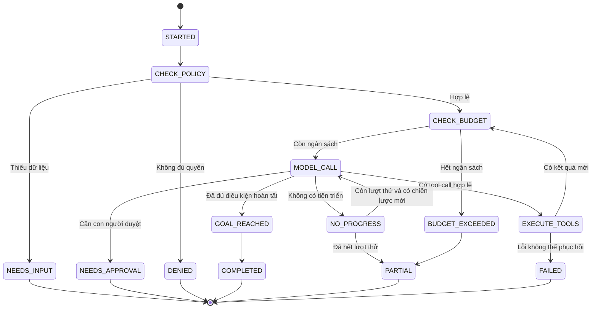

# Thiết kế điều kiện dừng nghiệp vụ và ngân sách chi phí

Giới hạn số lần gọi công cụ chỉ kiểm soát một phần của vòng tool calling. Một lượt có thể chưa vượt `maxTotalToolCalls` nhưng đã tiêu tốn quá nhiều token, chạy quá thời hạn, gọi một dịch vụ bên ngoài có tính phí hoặc lặp đi lặp lại mà không tiến gần mục tiêu. Ngược lại, một tác vụ có thể cần nhiều lần tra cứu hợp lệ nhưng phải dừng ngay khi trạng thái nghiệp vụ đã đạt yêu cầu.

Vì vậy, ứng dụng cần thiết kế hai nhóm chính sách riêng:

- **Điều kiện dừng nghiệp vụ:** xác định khi nào mục tiêu đã hoàn tất, cần thêm thông tin, cần người duyệt hoặc không thể tiếp tục.
- **Ngân sách tài nguyên và chi phí:** giới hạn số vòng mô hình, số tool call, token, tiền, thời gian, retry và chi phí dịch vụ bên ngoài.

Mô hình có thể đề xuất bước tiếp theo, nhưng ứng dụng phải đánh giá trạng thái thực tế và quyết định có cho phép bước đó chạy hay không. Không để mô hình tự tuyên bố đã hoàn thành hoặc tự quyết định được phép tiêu thêm ngân sách.

Bài này sử dụng Spring AI 2.1.0 làm mốc API. Các ví dụ về giá chỉ dùng công thức và bảng giá do ứng dụng quản lý; không gắn đơn giá cố định vào mã vì giá của model/provider có thể thay đổi theo model, khu vực, loại token và thời điểm.

## Phân biệt điều kiện dừng và giới hạn kỹ thuật

Một tác vụ AI có thể dừng vì nhiều lý do. Hãy đặt tên rõ cho từng lý do để hệ thống có thể phản hồi đúng và thống kê được nguyên nhân.

| Nhóm | Điều kiện | Ví dụ |
|---|---|---|
| Thành công nghiệp vụ | Trạng thái đích đã được service xác minh. | Đã tìm thấy đúng đơn hàng và trạng thái giao hàng mới nhất. |
| Cần thêm dữ liệu | Thiếu đầu vào bắt buộc hoặc có nhiều đối tượng phù hợp. | Có ba khách hàng cùng tên; cần hỏi mã khách hàng. |
| Cần phê duyệt | Hành động cần con người cho phép trước khi chạy. | Yêu cầu hoàn tiền vượt ngưỡng. |
| Bị từ chối | Policy hoặc trạng thái nghiệp vụ không cho phép. | Người dùng không có quyền trên đơn hàng thuộc tenant khác. |
| Không tiến triển | Nhiều vòng liên tiếp không tạo thông tin mới hoặc lặp lại cùng tool call. | Mô hình gọi lại cùng truy vấn với cùng arguments nhưng kết quả không đổi. |
| Hết ngân sách | Chạm trần token, tiền, số lần gọi hoặc số vòng. | Đã dùng hết ngân sách 0,05 USD cho một lượt. |
| Hết thời gian | Deadline của request hoặc workflow đã đến. | Tổng thời gian vượt 15 giây. |
| Lỗi không thể phục hồi | Dịch vụ hoặc provider thất bại sau chính sách retry. | Provider trả lỗi xác thực hoặc dịch vụ nghiệp vụ không khả dụng. |
| Người dùng hủy | Có tín hiệu cancellation hợp lệ. | Người dùng bấm dừng tác vụ đang chạy. |

Đừng gộp tất cả thành một trạng thái `FAILED`. Một yêu cầu chờ phê duyệt, một yêu cầu hết ngân sách và một yêu cầu hoàn thành là ba kết quả khác nhau, cần cách xử lý và thông báo khác nhau.

## Mô hình hóa một lượt xử lý như một state machine

Trước khi viết vòng lặp, hãy mô tả các trạng thái và chuyển tiếp hợp lệ. Ví dụ:



Mỗi lần chuyển trạng thái cần dựa trên dữ liệu có thể kiểm chứng. Ví dụ, `GOAL_REACHED` nên được xác nhận bằng kết quả từ service hoặc database, không chỉ bằng câu trả lời “Tôi đã hoàn tất” do mô hình tạo ra.

### Điều kiện hoàn thành phải đo được

Một mục tiêu nghiệp vụ nên có tiêu chí hoàn tất rõ ràng trước khi gọi mô hình:

- Tra cứu: đã tìm thấy đúng một bản ghi theo định danh và có dữ liệu cần thiết.
- Báo cáo: đã thu thập đủ các nhóm dữ liệu bắt buộc và kiểm tra khoảng thời gian.
- Đặt lịch: đã có booking ID và trạng thái xác nhận từ hệ thống đặt lịch.
- Cập nhật: service trả kết quả thành công và đọc lại trạng thái mới để xác minh.
- Hoàn tiền: giao dịch đã qua phê duyệt, được thực thi và có mã giao dịch từ hệ thống thanh toán.

Với tác vụ nhiều bước, biểu diễn mục tiêu thành các điều kiện con. Không tiếp tục gọi công cụ sau khi tất cả điều kiện con đã đạt; không đánh dấu thành công khi mới chỉ hoàn thành một phần.

## Thiết kế các điều kiện dừng nghiệp vụ

### Hoàn thành mục tiêu

Khi service xác nhận mục tiêu đã đạt, dừng vòng lặp ngay cả khi mô hình còn đề xuất một công cụ khác. Một lời gọi thừa có thể làm tăng chi phí hoặc vô tình thay đổi dữ liệu đã đúng.

### Thiếu thông tin hoặc mơ hồ

Nếu thiếu mã định danh, khoảng thời gian hoặc lựa chọn có ảnh hưởng đến kết quả, hãy dừng để hỏi người dùng. Không để mô hình thử đoán nhiều lần các giá trị mà người dùng cần xác nhận.

### Không tiến triển và lặp arguments

Ghi nhận dấu vết tối thiểu cho từng lần gọi: tên công cụ, hash của arguments đã chuẩn hóa, trạng thái kết quả và trạng thái nghiệp vụ sau khi thực thi. Nếu cùng một tool cùng arguments lặp lại mà không có dữ liệu mới, tăng bộ đếm `noProgressCount`.

Có thể dừng khi:

- Cùng một tool và arguments lặp quá số lần cho phép.
- Nhiều vòng liên tiếp không làm thay đổi trạng thái nghiệp vụ hoặc tập dữ liệu đã thu thập.
- Mô hình liên tục yêu cầu một hành động đã bị từ chối.
- Tool trả kết quả rỗng lặp lại mà không có chiến lược truy vấn mới.

Không xem hai lần gọi cùng tên là lặp vô ích nếu arguments khác nhau hoặc dữ liệu nguồn đã thay đổi. Quy tắc phát hiện không tiến triển phải xét cả mục tiêu và kết quả, không chỉ đếm tên tool.

### Cần phê duyệt hoặc bị từ chối

Với thao tác có tác động như thanh toán, xóa, hủy hoặc hoàn tiền, hãy dừng trước khi thực thi nếu cần người dùng hoặc nhân viên duyệt. Spring AI 2.1.0 có Tool Call Confirmation: `ToolCallingManager` có thể tạm dừng cả reply khi có call cần xác nhận; ứng dụng nhận các call chờ quyết định và chỉ chạy những call được cho phép. Xác thực người duyệt, chống replay và lưu quyết định vẫn là trách nhiệm của ứng dụng.

Nếu policy từ chối, trả trạng thái `DENIED` hoặc kết quả nghiệp vụ tương ứng. Không thử gọi một tool khác để vòng qua cùng một quyết định bảo mật.

## Phân biệt các loại ngân sách

Một hệ thống nên quản lý ngân sách theo nhiều chiều. Không dùng số tool call để đại diện cho toàn bộ chi phí.

| Ngân sách | Đơn vị | Phạm vi thường gặp |
|---|---|---|
| Model call budget | Số request tới model | Một lượt hoặc một workflow. |
| Iteration budget | Số vòng model/tool | Một lượt hội thoại. |
| Tool call budget | Số lần gọi từng tool và tổng số tool | Một lượt; Spring AI có giới hạn mặc định riêng. |
| Token budget | Prompt token, completion token hoặc tổng token | Một lượt, người dùng, tenant hoặc chu kỳ thanh toán. |
| Monetary budget | USD hoặc đơn vị tiền nội bộ | Một lượt, user, tenant, ngày hoặc tháng. |
| Tool/service budget | Số request, thời gian hoặc phí của API ngoài | Một lượt hoặc một tenant. |
| Time budget | Millisecond/second | Deadline toàn request và timeout từng bước. |
| Retry budget | Số lần thử lại | Một tool hoặc toàn workflow. |
| Concurrency budget | Số tác vụ đồng thời | User, tenant hoặc toàn ứng dụng. |

Ví dụ, một request có thể dùng hai model call nhưng mỗi prompt rất dài; tổng token có thể cao. Một tool call có thể chỉ mất một lần nhưng gọi API tìm kiếm tính phí. Một vòng có thể dùng ít token nhưng kéo dài do dịch vụ ngoài chậm. Hãy đo và giới hạn đúng đơn vị.

## Lập ngân sách chi phí cho model

### Tách prompt token và completion token

Spring AI cung cấp metadata usage từ response của provider. Với `ChatResponse`, có thể đọc:

```java
ChatResponse response = chatModel.call(prompt);

Usage usage = response.getMetadata().getUsage();
if (usage != null) {
    Integer promptTokens = usage.getPromptTokens();
    Integer completionTokens = usage.getCompletionTokens();
    Integer totalTokens = usage.getTotalTokens();
}
```

`promptTokens` đo phần đầu vào được xử lý; `completionTokens` đo phần sinh ra; `totalTokens` thường là tổng hai loại. Tùy provider và model, metadata có thể thiếu hoặc có thêm chi tiết về cache, reasoning, audio hay modality khác. Hãy kiểm tra khả năng hỗ trợ của provider đang dùng.

### Công thức ước tính chi phí

Không thể suy ra chi phí chỉ từ tổng token nếu giá đầu vào và đầu ra khác nhau. Một công thức cơ bản:

\[
\text{ModelCost} =
\frac{P_{in}}{10^6}R_{in} +
\frac{P_{out}}{10^6}R_{out}
\]

Trong đó:

- \(P_{in}\): số prompt token được tính phí.
- \(P_{out}\): số completion token được tính phí.
- \(R_{in}\): giá cho một triệu prompt token của model/plan đang dùng.
- \(R_{out}\): giá cho một triệu completion token.

Nếu provider có giá riêng cho cached input, cache write, reasoning token hoặc audio/image token, mở rộng công thức theo từng loại usage. Không cộng lại một nhóm token nếu provider đã tính nó trong tổng prompt/completion; dùng đúng cách tính phí của provider.

Chi phí của toàn lượt nên gồm:

\[
\text{TotalCost} = \sum \text{ModelCost}_i +
\sum \text{ExternalToolCost}_j +
\text{OtherBillableCost}
\]

`ExternalToolCost` có thể là phí truy vấn tìm kiếm, geocoding, OCR, dịch vụ dữ liệu hoặc API nghiệp vụ tính phí. Đừng chỉ ghi nhận tiền model nếu các công cụ phía sau cũng tạo chi phí.

### Ước tính trước và quyết toán sau

Trước mỗi model call, ứng dụng cần ước tính chi phí tối đa hoặc một khoản dự trữ đủ an toàn:

1. Ước tính token của system prompt, lịch sử hội thoại, tool definitions và user message.
2. Dành ngân sách cho `maxTokens` hoặc giới hạn output tương ứng của model.
3. Dùng model, vùng triển khai và bảng giá đúng với request.
4. Kiểm tra còn đủ ngân sách cho model call và phần tổng hợp cuối hay không.
5. Sau response, lấy usage thực tế và quyết toán phần dự trữ.

Ước tính token bằng tokenizer/provider nếu có. Nếu không có, dùng ước tính bảo thủ và chừa biên an toàn; số ký tự không tương đương chính xác với token. Tool definitions và lịch sử tool response cũng chiếm prompt token ở các vòng sau.

Luôn dành một phần ngân sách cho câu trả lời cuối hoặc bước bàn giao. Nếu tiêu hết tiền vào các lần tìm kiếm, ứng dụng có thể không còn ngân sách để tổng hợp kết quả cho người dùng.

### Không cố định bảng giá trong code

Lưu bảng giá theo provider, model, phiên bản, vùng và thời điểm hiệu lực trong cấu hình hoặc dịch vụ quản lý giá. Mỗi bản ghi nên có đơn vị, loại token, currency, effective date và nguồn giá. Khi tính chi phí lịch sử, dùng phiên bản bảng giá có hiệu lực lúc request chạy, không áp giá mới nhất ngược cho dữ liệu cũ.

Giá trị trong ví dụ học tập chỉ là giả định. Trước khi triển khai, hãy lấy giá từ trang giá chính thức của provider và quy đổi tiền tệ theo chính sách kế toán của ứng dụng.

## Ghi nhận usage qua nhiều vòng Spring AI

Trong Spring AI 2.1.0, `ChatResponseMetadata` cung cấp `getUsage()` và `getRateLimit()`. `Usage` có prompt, completion và total tokens; `RateLimit` có thể cung cấp giới hạn request/token và thời gian reset nếu model implementation ánh xạ thông tin đó từ provider.

Không phải provider/model nào cũng trả usage hoặc rate-limit metadata. Khi không có usage, không được xem chi phí là `0`; hãy đánh dấu số liệu chưa xác định, dùng ước tính bảo thủ và áp dụng chính sách fail-closed nếu hard cap bắt buộc phải được bảo đảm. Khi `getRateLimit()` trả `EmptyRateLimit`, các accessor có thể trả `0` vì không có dữ liệu; không hiểu nhầm đó là quota thực tế đã cạn.

Với `ChatClient` có tool-calling loop tự động, usage ở response cuối được cộng dồn qua các model call trong cùng exchange. Đây là số liệu phù hợp để quyết toán sau khi vòng lặp kết thúc. `getNativeUsage()` là dữ liệu provider-specific; không thể hợp nhất qua nhiều response và có thể là `null` sau khi usage đã được tổng hợp.

Ví dụ đọc usage cuối lượt:

```java
ChatResponse response = chatClient.prompt()
        .user(question)
        .tools(tools)
        .call()
        .chatResponse();

Usage usage = response.getMetadata().getUsage();
if (usage != null) {
    budgetLedger.recordUsage(
            usage.getPromptTokens(),
            usage.getCompletionTokens(),
            usage.getTotalTokens()
    );
}
```

Đoạn mã này phù hợp cho đo lường và quyết toán sau exchange. Nó không tự dừng vòng lặp trước khi chi phí vượt ngưỡng, vì lúc nhận response cuối thì các model call bên trong đã hoàn tất.

### Hard budget cần kiểm tra ở ranh giới từng vòng

Nếu chỉ ghi usage sau `.call()` của `ChatClient`, ứng dụng chỉ biết tổng chi phí sau khi advisor đã chạy xong vòng tool calling. Muốn dừng trước model call tiếp theo khi sắp hết ngân sách, cần kiểm tra ở ranh giới từng iteration:

- Dùng vòng lặp thủ công với `ChatModel`/`ToolCallingManager`, kiểm tra ngân sách trước mỗi model call và trước khi dispatch tool.
- Hoặc mở rộng `ToolCallingAdvisor` bằng hook/checker phù hợp với phiên bản để quan sát usage từng response và ngăn iteration tiếp theo theo một chính sách có kết quả dừng rõ ràng.

`ToolCallingAdvisor` có `doAfterCall` để quan sát response từng iteration và `doBeforeCall` để kiểm tra trước iteration tiếp theo. Nếu dùng custom advisor, hãy xử lý cả blocking và streaming hook tương ứng. Không chỉ trả `false` từ eligibility checker rồi mặc định rằng một response vẫn chứa tool call sẽ trở thành câu trả lời cuối hợp lệ; ứng dụng phải chuyển nó thành trạng thái dừng rõ ràng hoặc yêu cầu người dùng tiếp tục.

Với hard monetary cap, cách dễ kiểm soát nhất thường là điều phối thủ công: sau từng response, cập nhật usage; trước khi thực thi tool và trước lần gọi model tiếp theo, kiểm tra phần ngân sách còn lại.

## Thiết kế Budget Guard và sổ cái chi phí

Không nên rải phép so sánh chi phí ở nhiều callback. Hãy tạo một thành phần chịu trách nhiệm đọc snapshot, dự trữ ngân sách, ghi usage và quyết định có cho phép bước tiếp theo hay không.

Một mô hình dữ liệu tối thiểu:

```java
public record RunBudget(
        int maxModelCalls,
        int maxIterations,
        int maxToolCalls,
        int maxNoProgressIterations,
        Duration maxDuration,
        BigDecimal maxCost) {
}

public enum StopReason {
    GOAL_REACHED,
    NEEDS_INPUT,
    AWAITING_APPROVAL,
    POLICY_DENIED,
    MODEL_CALL_LIMIT,
    ITERATION_LIMIT,
    TOOL_CALL_LIMIT,
    TOKEN_BUDGET_EXCEEDED,
    COST_BUDGET_EXCEEDED,
    DEADLINE_EXCEEDED,
    NO_PROGRESS,
    CANCELLED,
    PROVIDER_ERROR
}
```

Đây là kiểu dữ liệu do ứng dụng định nghĩa, không phải API Spring AI. `BudgetGuard` có thể cung cấp các thao tác:

| Thao tác | Khi gọi | Mục đích |
|---|---|---|
| `reserveModelCall(...)` | Trước khi gọi model | Dự trữ ngân sách dựa trên prompt estimate và output cap. |
| `recordModelUsage(...)` | Sau mỗi model response | Quyết toán token thực tế và model cost. |
| `reserveToolExecution(...)` | Trước khi chạy tool | Kiểm tra số lượt, chi phí dự kiến, deadline và quyền. |
| `recordToolCost(...)` | Sau khi tool hoàn tất | Ghi phí API ngoài hoặc đơn vị tài nguyên. |
| `checkBusinessStop(...)` | Sau khi có kết quả mới | Xác định mục tiêu hoàn thành, cần hỏi hoặc bị từ chối. |
| `remainingBudget(...)` | Trước mỗi bước | Trả phần token, tiền và thời gian còn lại. |

### Pseudocode cho vòng điều phối có ngân sách

```java
while (true) {
    StopDecision decision = budgetGuard.checkBeforeModelCall(runState);
    if (decision.shouldStop()) {
        return finishWithStatus(decision.reason(), runState);
    }

    ChatResponse response = chatModel.call(runState.nextPrompt());
    budgetGuard.recordModelUsage(response.getMetadata().getUsage(), runState);

    if (budgetGuard.isCostBudgetExceeded(runState)) {
        return finishWithStatus(StopReason.COST_BUDGET_EXCEEDED, runState);
    }

    if (!response.hasToolCalls()) {
        return verifyBusinessGoalAndFinish(response, runState);
    }

    ToolBatchDecision batch = budgetGuard.checkToolBatch(
            response.getResult().getOutput().getToolCalls(), runState);
    if (batch.requiresApproval()) {
        return finishWithStatus(StopReason.AWAITING_APPROVAL, runState);
    }
    if (batch.shouldStop()) {
        return finishWithStatus(batch.reason(), runState);
    }

    ToolExecutionResult result = toolCallingManager.executeToolCalls(
            runState.nextPrompt(), response);
    budgetGuard.recordToolCosts(result, runState);

    if (result.returnDirect()) {
        return renderDirectResult(result);
    }

    runState = runState.withConversationHistory(result.conversationHistory());
    if (budgetGuard.businessGoalReached(runState)) {
        return finishWithStatus(StopReason.GOAL_REACHED, runState);
    }
}
```

Đây là pseudocode mô tả thứ tự kiểm tra, không phải một lớp có thể biên dịch nguyên trạng. `RunState`, `StopDecision`, `ToolBatchDecision` và `BudgetGuard` là abstraction của ứng dụng. Trong code thật, cần xử lý response không có generation, lỗi provider, cancellation, timeout và partial tool results.

Trước khi gọi `executeToolCalls(...)`, hãy kiểm tra toàn bộ batch nếu chi phí, quyền hoặc phê duyệt phụ thuộc từng tool call. Manager có thể thực thi nhiều call trong một batch; nếu một call hoàn tất rồi call tiếp theo chạm giới hạn, phần đã hoàn tất không tự rollback. Với thao tác ghi cần tính nguyên tử, hãy thiết kế workflow và idempotency ở service thay vì dựa vào batch tool execution.

## Dự trữ ngân sách nguyên tử khi có request đồng thời

Nếu nhiều request của cùng user hoặc tenant chạy đồng thời, kiểm tra `spent < limit` rồi mới gọi model có thể gây overspend: hai request cùng đọc một số dư và cùng cho rằng còn đủ ngân sách.

Hãy dùng một ledger có thao tác nguyên tử:

1. Tính khoản dự trữ ước tính cho bước tiếp theo.
2. Trong một transaction hoặc thao tác atomic, kiểm tra `spent + reserved + requested <= limit`.
3. Nếu đủ, tạo reservation có ID duy nhất và gắn với run/request.
4. Sau response, quyết toán theo usage thực tế; giải phóng phần dự trữ thừa.
5. Nếu request timeout hoặc bị hủy, xử lý reservation hết hạn bằng cơ chế recovery.

Ledger có thể đặt trong database hoặc Redis tùy yêu cầu nhất quán. Với ngân sách tài chính hoặc quota tenant, tránh chỉ dùng biến `AtomicLong` trong một instance vì nhiều replica ứng dụng sẽ có bộ đếm riêng.

Ghi nhận các trường như `runId`, `tenantRef`, `model`, `priceVersion`, `reservedAmount`, `actualAmount`, `currency`, `status` và timestamp. Không ghi prompt hoặc arguments nhạy cảm vào ledger.

## Deadline, cancellation và timeout

Ngân sách thời gian nên là deadline tuyệt đối của toàn request, không chỉ là timeout riêng cho từng lần gọi. Trước mỗi bước, tính `remaining = deadline - now` và truyền phần thời gian còn lại xuống model client, HTTP client và service khi API hỗ trợ.

Ví dụ một workflow có deadline 20 giây:

- Model call đầu dùng 4 giây.
- Tool tra cứu dùng 7 giây.
- Còn 9 giây cho model call tiếp theo, tool bổ sung và câu trả lời cuối.

Không bắt đầu một bước mới nếu thời gian còn lại không đủ cho timeout tối thiểu và bước tổng hợp cuối. Timeout ở HTTP client không tự dừng một vòng tool calling nếu advisor tiếp tục retry; deadline phải được kiểm tra giữa các iteration.

Khi người dùng hủy, truyền cancellation tới tác vụ đang chạy và không khởi tạo iteration mới. Nếu tool bên dưới không hỗ trợ cancellation, cần timeout, idempotency và cơ chế kiểm tra trạng thái để tránh tác vụ tiếp tục ghi dữ liệu sau khi caller đã rời đi.

## Khi hết ngân sách: dừng có kiểm soát

Hết ngân sách không đồng nghĩa luôn trả lỗi kỹ thuật. Chọn cách kết thúc dựa trên trạng thái dữ liệu đã có:

| Trạng thái tại thời điểm dừng | Cách phản hồi |
|---|---|
| Mục tiêu đã đạt và đã xác minh | Trả `COMPLETED` cùng kết quả đã kiểm tra. |
| Có một phần dữ liệu hữu ích nhưng chưa đủ | Trả `PARTIAL`, nêu phần đã hoàn thành và phần còn thiếu. |
| Cần người dùng bổ sung dữ liệu | Trả `NEEDS_INPUT` cùng câu hỏi cụ thể. |
| Chờ phê duyệt | Trả `AWAITING_APPROVAL` và lưu trạng thái chờ theo cơ chế an toàn. |
| Không đủ quyền | Trả `DENIED` với thông báo không tiết lộ tài nguyên của người khác. |
| Hết token hoặc chi phí | Trả `BUDGET_EXCEEDED`, không tự gọi model lần nữa để giải thích nếu ngân sách đã hết. |
| Hết deadline | Trả `TIMED_OUT` hoặc trạng thái một phần phù hợp; ghi nhận công cụ nào đã hoàn tất. |
| Không tiến triển | Trả `NEEDS_INPUT` hoặc `PARTIAL`, tránh lặp lại cùng một yêu cầu. |

Nếu cần tóm tắt kết quả sau khi chạm ngân sách model, hãy dùng một template deterministic ở ứng dụng hoặc dành trước ngân sách cho một lần tổng hợp ngắn. Không gọi thêm model sau khi đã tuyên bố hard cap bị chạm.

## Tách ngân sách theo từng cấp

Một sản phẩm thường cần nhiều mức ngân sách cùng lúc:

| Cấp | Ví dụ chính sách | Mục đích |
|---|---|---|
| Một lượt hội thoại | Tối đa 12.000 token, 0,05 USD, 8 iteration | Ngăn một yêu cầu đơn lẻ chạy quá lâu hoặc quá tốn kém. |
| Một người dùng | 0,50 USD mỗi ngày | Ngăn một tài khoản tiêu thụ quá nhiều tài nguyên. |
| Một tenant | 100 USD mỗi tháng | Phân bổ chi phí giữa các khách hàng tổ chức. |
| Toàn ứng dụng | Ngưỡng cảnh báo và hard cap theo ngày/tháng | Bảo vệ ngân sách vận hành và giới hạn provider. |
| Một công cụ | Tối đa 3 lần gọi API tìm kiếm có phí mỗi lượt | Kiểm soát dịch vụ ngoài đắt tiền. |

Các con số trên chỉ là ví dụ. Ngân sách phải dựa trên chi phí thực tế, SLA, gói dịch vụ và yêu cầu sản phẩm. Khi nhiều cấp cùng áp dụng, request phải còn đủ ngân sách ở tất cả các cấp trước khi được tiếp tục.

## Kiểm thử điều kiện dừng và ngân sách

Hãy kiểm thử bằng model giả lập và ledger giả để có thể tạo usage, chi phí và chuỗi tool call xác định. Không dựa vào model thật để tái hiện chính xác một vòng lặp có chi phí cao.

| Tình huống | Kết quả cần xác minh |
|---|---|
| Mục tiêu đã đạt | Dừng ngay và không gọi thêm tool/model. |
| Thiếu dữ liệu bắt buộc | Chuyển `NEEDS_INPUT`, không đoán vô hạn. |
| Tool lặp cùng arguments | Bộ phát hiện no-progress dừng theo ngưỡng. |
| Model call chạm token cap | Không khởi tạo model call tiếp theo. |
| Usage cuối `ChatClient` có nhiều iteration | Token được cộng dồn đúng, không chỉ lấy lần gọi cuối. |
| Usage metadata không có | Dùng chính sách ước tính bảo thủ và đánh dấu usage unavailable; không xem thiếu dữ liệu là chi phí bằng 0. |
| Prompt cache có usage riêng | Tính theo quy tắc giá cache của provider, không cộng trùng token. |
| External tool có phí | Ghi nhận phí tool ngoài cùng ngân sách model. |
| Hai request đồng thời cùng tenant | Reservation atomic ngăn tổng chi tiêu vượt cap do race condition. |
| Provider timeout và retry | Retry nằm trong deadline và retry budget. |
| Cần phê duyệt | Không có tool call nào trong batch được chạy trước khi quyết định hợp lệ. |
| Một phần batch đã chạy rồi chạm limit | Partial result được ghi nhận; không giả định rollback. |
| Người dùng hủy | Không bắt đầu iteration mới và xử lý tác vụ đang chạy theo cancellation policy. |
| Hết ngân sách giữa vòng | Trả trạng thái một phần hoặc budget exceeded theo policy; không gọi model thêm để giải thích. |

Đo thêm các chỉ số: chi phí trung bình và p95 mỗi lượt, token đầu vào/đầu ra, số model call, số tool call theo tên, iteration, thời gian từng bước, tỷ lệ no-progress, tỷ lệ chạm ngân sách và tỷ lệ tác vụ hoàn thành. Không dùng user ID hoặc tenant ID thô làm metric label có cardinality cao.

## Bài tập thực hành

Thiết kế một trợ lý xử lý yêu cầu hoàn tiền:

1. Định nghĩa mục tiêu nghiệp vụ: xác định đúng đơn, kiểm tra điều kiện hoàn tiền và nhận phê duyệt trước khi tạo giao dịch.
2. Đặt ngân sách ví dụ: tối đa 6 model call, 8 tool call, 5 iteration, 15 giây và 0,05 USD mỗi lượt.
3. Định nghĩa điều kiện dừng `COMPLETED`, `NEEDS_INPUT`, `AWAITING_APPROVAL`, `DENIED`, `NO_PROGRESS`, `BUDGET_EXCEEDED` và `TIMED_OUT`.
4. Đọc usage sau từng model response và tính chi phí bằng bảng giá có version.
5. Dự trữ ngân sách trước mỗi model call và tool có phí; quyết toán sau khi có usage thực tế.
6. Giữ một phần ngân sách cho câu trả lời cuối.
7. Mô phỏng model gọi lặp cùng tool/arguments và xác minh no-progress stop.
8. Chạy hai request đồng thời của cùng tenant để kiểm tra reservation atomic.
9. Mô phỏng timeout, cancellation, partial batch và phê duyệt bị từ chối.
10. Xác minh không có model call nào phát sinh sau hard stop.

Bạn hoàn thành khi có thể giải thích vì sao lượt xử lý dừng, ngân sách đã tiêu bao nhiêu, phần nào đã hoàn thành, phần nào còn thiếu và cách hệ thống quyết toán chi phí mà không vượt giới hạn do race condition.

## Danh sách kiểm tra trước khi triển khai

- [ ] Mục tiêu nghiệp vụ có tiêu chí hoàn thành đo được và được service xác minh.
- [ ] Có trạng thái riêng cho completed, partial, needs input, awaiting approval, denied, budget exceeded, timeout và failure.
- [ ] Có điều kiện dừng khi không tiến triển hoặc lặp cùng tool arguments.
- [ ] Có giới hạn model call, iteration, tool call riêng và tổng.
- [ ] Có token budget tách prompt và completion token.
- [ ] Có monetary budget theo lượt và theo user/tenant khi cần.
- [ ] Bảng giá có version theo provider/model/region/effective date; không hardcode giá hiện hành.
- [ ] Usage được ghi nhận sau từng response hoặc được cộng dồn đúng cho multi-step `ChatClient` exchange.
- [ ] Hard budget được kiểm tra ở ranh giới trước model call/tool dispatch, không chỉ quyết toán sau khi vòng tự động kết thúc.
- [ ] Có dự trữ cho output tối đa và câu trả lời cuối.
- [ ] Có tính phí dịch vụ ngoài, retry và cache theo đúng quy tắc provider.
- [ ] Budget reservation an toàn khi nhiều request đồng thời và nhiều replica.
- [ ] Có deadline tổng, timeout từng bước, cancellation và retry budget.
- [ ] Thao tác ghi có authorization, confirmation, idempotency và audit.
- [ ] Khi dừng, hệ thống trả trạng thái và phần kết quả đã xác minh; không tuyên bố hoàn tất khi mới có partial result.
- [ ] Có kiểm thử no-progress, budget exhaustion, usage thiếu, race condition, timeout và partial execution.

## Tài liệu tham khảo

- [Spring AI 2.1.0 – Chat Response Metadata và Usage](https://docs.spring.io/spring-ai/reference/api/usage-handling.html)
- [Spring AI 2.1.0 – Tool Calling và Tool Call Limits](https://docs.spring.io/spring-ai/reference/api/tools.html)
- [Spring AI 2.1.0 – ToolCallingAdvisor và các hook điều phối](https://docs.spring.io/spring-ai/reference/api/tools/tool-calling-advisor.html)
- [Spring AI 2.1.0 – Tool Call Confirmation](https://docs.spring.io/spring-ai/reference/api/tools/tool-call-confirmation.html)
