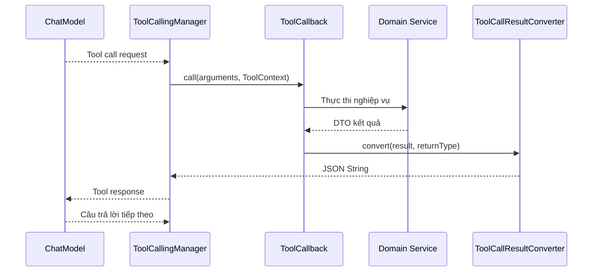

# Thiết kế DTO kết quả có cấu trúc và ngữ nghĩa rõ ràng

Kết quả của một tool là dữ liệu mà Spring AI chuyển lại cho mô hình hoặc trả thẳng cho ứng dụng. Vì vậy, kiểu trả về cần thể hiện rõ **điều gì đã xảy ra**, **dữ liệu nào có thể sử dụng**, **dữ liệu đó có ý nghĩa và đơn vị gì**, và **độ mới của dữ liệu**. Một DTO rõ nghĩa giúp mô hình diễn giải chính xác hơn, giúp ứng dụng kiểm thử ổn định hơn và tránh việc lộ các trường nội bộ của hệ thống.

Trong Spring AI, kết quả Java của method/function tool được chuyển thành `String` thông qua `ToolCallResultConverter`. Converter mặc định dùng Jackson để serialize đối tượng thành JSON. Do đó, nên thiết kế một DTO nhỏ, có kiểu rõ ràng và có hợp đồng ổn định thay vì trả trực tiếp entity database, object framework hoặc một chuỗi thông báo tùy ý.

## 1. Kết quả tool đi qua đâu?

Khi callback thực thi thành công, Spring AI lấy giá trị trả về và chuyển nó thành chuỗi để tạo tool response. Chuỗi này thường được gửi lại mô hình để mô hình tiếp tục suy luận và viết câu trả lời cuối cùng. Nếu tool được cấu hình `returnDirect = true`, kết quả có thể được trả thẳng cho caller và bỏ qua lượt mô hình tiếp theo.



Có ba hợp đồng cần tách bạch:

| Hợp đồng | Mục đích |
| --- | --- |
| Input schema | Mô tả dữ liệu mô hình được phép gửi vào tool |
| Java return type | Mô tả dữ liệu mà code nghiệp vụ trả về |
| Tool result JSON | Biểu diễn kết quả đã serialize để mô hình hoặc caller tiêu thụ |

Input schema không tự định nghĩa output schema cho mô hình. Kiểu trả về Java và JSON được serialize là hợp đồng đầu ra thực tế. Hãy thiết kế và kiểm thử hợp đồng đó một cách chủ động.

## 2. Vì sao nên trả DTO thay vì entity hoặc String?

Giả sử một tool tra cứu tồn kho trả trực tiếp `InventoryEntity`. Entity có thể chứa ID nội bộ, quan hệ lazy, thông tin nhà cung cấp, chi phí nhập, audit fields hoặc các thuộc tính mà mô hình không cần biết. Việc serialize entity còn có thể gây vòng tham chiếu, tải quan hệ ngoài ý muốn hoặc tạo payload quá lớn.

Trả một chuỗi như `"Còn 12 sản phẩm"` cũng có vấn đề: ứng dụng khó phân biệt số lượng, đơn vị, thời điểm kiểm tra và trạng thái không tìm thấy. Mô hình phải suy luận các giá trị từ câu chữ, dễ nhầm giữa “0 sản phẩm” và “không có dữ liệu”.

Một DTO chuyên biệt giúp:

- Chỉ công bố những trường cần thiết cho tác vụ.
- Giữ kiểu dữ liệu rõ ràng: số là số, ngày giờ là timestamp, trạng thái là enum/code.
- Biểu diễn riêng thành công, không tìm thấy, kết quả một phần và lỗi nghiệp vụ.
- Gắn đơn vị đo, tiền tệ, nguồn và thời điểm dữ liệu.
- Duy trì hợp đồng ổn định khi entity hoặc database thay đổi.
- Dễ viết test cho nội dung JSON mà mô hình sẽ nhận.

## 3. Một cấu trúc kết quả có ngữ nghĩa

Một mẫu envelope có thể gồm năm phần:

| Trường | Ý nghĩa | Quy tắc thiết kế |
| --- | --- | --- |
| `status` | Kết quả tổng quát | Dùng enum ổn định, ví dụ `SUCCESS`, `NOT_FOUND`, `PARTIAL` |
| `code` | Mã máy có thể kiểm tra | Ổn định, không phụ thuộc câu chữ hiển thị |
| `message` | Giải thích ngắn | Nói rõ kết quả, không chứa stack trace hoặc dữ liệu nhạy cảm |
| `data` | Payload nghiệp vụ | DTO có kiểu, chỉ chứa trường cần thiết |
| `meta` | Ngữ cảnh về dữ liệu | Thời điểm, nguồn, phiên bản schema, đơn vị hoặc phân trang khi cần |

Ví dụ kết quả tra cứu tồn kho:

```json
{
  "status": "SUCCESS",
  "code": "INVENTORY_FOUND",
  "message": "Đã tìm thấy thông tin tồn kho.",
  "data": {
    "sku": "SKU-42",
    "warehouseCode": "HCM-01",
    "availableQuantity": 12,
    "quantityUnit": "EA"
  },
  "meta": {
    "dataAsOf": "2026-11-27T09:30:00Z",
    "source": "inventory-service",
    "schemaVersion": "1"
  }
}
```

Mô hình có thể hiểu rằng `availableQuantity` là 12 đơn vị `EA` tại kho `HCM-01`, dữ liệu được cập nhật tại một thời điểm cụ thể. Ứng dụng cũng có thể đọc JSON và kiểm tra `status` hoặc `code` mà không phải parse câu văn.

## 4. Khai báo DTO bằng Java record

Java record phù hợp với kết quả tool vì các trường được khai báo rõ ràng và không có setter. Ví dụ:

```java
import java.time.Instant;

public enum ToolResultStatus {
    SUCCESS,
    NOT_FOUND,
    PARTIAL
}

public record ResultMetadata(
        Instant dataAsOf,
        Instant generatedAt,
        String source,
        String schemaVersion) {
}

public record InventoryData(
        String sku,
        String warehouseCode,
        long availableQuantity,
        String quantityUnit) {
}

public record ToolResult<T>(
        ToolResultStatus status,
        String code,
        String message,
        T data,
        ResultMetadata meta) {

    public static <T> ToolResult<T> success(
            String code, String message, T data, ResultMetadata meta) {
        return new ToolResult<>(
                ToolResultStatus.SUCCESS, code, message, data, meta);
    }

    public static <T> ToolResult<T> notFound(
            String code, String message, ResultMetadata meta) {
        return new ToolResult<>(
                ToolResultStatus.NOT_FOUND, code, message, null, meta);
    }
}
```

`ToolResult<T>` là envelope dùng lại được, còn `InventoryData` mô tả payload của riêng nghiệp vụ tồn kho. Không nên tạo một DTO khổng lồ có hàng chục trường nullable cho mọi loại tool; mỗi tool nên có payload phù hợp với mục đích của nó.

Nếu hệ thống cần kết quả một phần, có thể bổ sung factory `partial(...)` hoặc một status riêng cùng metadata giải thích phần nào chưa đầy đủ. Định nghĩa status ngay từ đầu và dùng nhất quán giữa các tool.

## 5. Viết tool trả về DTO thay vì entity

Method tool có thể trả trực tiếp `ToolResult<InventoryData>`. Spring AI nhận object này và dùng converter để serialize:

```java
import java.time.Instant;
import org.springframework.ai.tool.annotation.Tool;
import org.springframework.ai.tool.annotation.ToolParam;
import org.springframework.stereotype.Component;

@Component
public class InventoryTools {

    private final InventoryService inventoryService;

    public InventoryTools(InventoryService inventoryService) {
        this.inventoryService = inventoryService;
    }

    @Tool(description = "Tra cứu số lượng có thể bán của SKU tại một kho.")
    public ToolResult<InventoryData> lookupInventory(
            @ToolParam(description = "Mã SKU chính xác") String sku,
            @ToolParam(description = "Mã kho cần tra cứu") String warehouseCode) {

        Instant now = Instant.now();
        return inventoryService.findAvailable(sku, warehouseCode)
                .map(snapshot -> ToolResult.success(
                        "INVENTORY_FOUND",
                        "Đã tìm thấy thông tin tồn kho.",
                        new InventoryData(
                                snapshot.sku(),
                                snapshot.warehouseCode(),
                                snapshot.availableQuantity(),
                                snapshot.quantityUnit()),
                        new ResultMetadata(
                                snapshot.dataAsOf(), now, "inventory-service", "1")))
                .orElseGet(() -> ToolResult.notFound(
                        "INVENTORY_NOT_FOUND",
                        "Không tìm thấy dữ liệu tồn kho cho SKU và kho đã yêu cầu.",
                        new ResultMetadata(
                                null, now, "inventory-service", "1")));
    }
}
```

Ví dụ giả định `InventoryService.findAvailable(...)` trả về `Optional<InventorySnapshot>` và `InventorySnapshot` là kiểu nội bộ của ứng dụng. `Optional` ở đây chỉ nằm bên trong logic service; giá trị trả về của tool là DTO cụ thể. Với `MethodToolCallback`, không dùng `Optional` làm kiểu trả về trực tiếp của method tool.

Không trả trực tiếp `snapshot` nếu đó là entity hoặc object nội bộ. Việc ánh xạ sang `InventoryData` là ranh giới kiểm soát dữ liệu mà mô hình được phép nhìn thấy.

## 6. Phân biệt zero, not found và unknown

Đây là một trong những khác biệt ngữ nghĩa quan trọng nhất:

| Tình huống | Giá trị nên trả | Ý nghĩa |
| --- | --- | --- |
| Đã truy vấn và số lượng thực sự bằng 0 | `status=SUCCESS`, `availableQuantity=0` | Dữ liệu có thật và số lượng đã biết |
| Không có bản ghi phù hợp | `status=NOT_FOUND`, `data=null` | Không tìm thấy tài nguyên theo khóa tra cứu |
| Dịch vụ nguồn không trả được dữ liệu | Lỗi thực thi hoặc status kỹ thuật đã quy ước | Không biết số lượng hiện tại |
| Dữ liệu tồn tại nhưng chưa đồng bộ | `status=PARTIAL` hoặc trạng thái freshness riêng | Có kết quả nhưng chưa đầy đủ/có thể cũ |

Không dùng `0` để biểu diễn “không biết”. Không dùng danh sách rỗng để biểu diễn lỗi truy vấn. Không trả `NOT_FOUND` khi dịch vụ nguồn timeout vì hai tình huống đó có ý nghĩa khác nhau.

Với truy vấn danh sách, `items: []` thường có nghĩa truy vấn thành công nhưng không có phần tử phù hợp. Nếu truy vấn thất bại, trả lỗi theo hợp đồng lỗi riêng. Với trường đơn, `data: null` có thể biểu diễn không tìm thấy; hãy ghi rõ quy ước trong DTO và mô tả tool.

## 7. Dùng kiểu và đơn vị đúng nghĩa

Không nên biến mọi giá trị thành `String`. Kiểu dữ liệu cho mô hình biết cách so sánh, tính toán và diễn giải kết quả.

| Dữ liệu | Kiểu/biểu diễn phù hợp | Lưu ý |
| --- | --- | --- |
| Số lượng hàng | `long` hoặc `int` | Trả thêm đơn vị như `EA`, `BOX`, `KG` |
| Giá tiền | `BigDecimal` | Luôn có mã tiền tệ ISO 4217 như `VND`, `USD` |
| Tỷ lệ | `BigDecimal` hoặc `double` theo yêu cầu | Ghi rõ tỷ lệ là `0.15` hay `15` phần trăm |
| Thời điểm | `Instant` hoặc `OffsetDateTime` | Serialize ISO-8601, có timezone/offset |
| Ngày nghiệp vụ | `LocalDate` | Không gắn timezone nếu chỉ là ngày lịch |
| Trạng thái | Enum hoặc code ổn định | Không dùng câu văn tự do làm khóa logic |
| Mã định danh | `String`, UUID | Không ép ID có thể có số 0 đầu thành số |

Ví dụ với giá tiền:

```java
import java.math.BigDecimal;

public record PriceData(
        BigDecimal amount,
        String currency) {
}
```

```json
{
  "amount": 125000.00,
  "currency": "VND"
}
```

Không trả `"125.000"` nếu chưa nói rõ dấu chấm là dấu thập phân hay phân tách hàng nghìn. Dữ liệu số và mã đơn vị riêng biệt giúp mô hình tránh nhầm lẫn khi tổng hợp hoặc so sánh.

## 8. Thời điểm, độ mới và nguồn dữ liệu

Một kết quả “12 sản phẩm còn hàng” chưa đủ nếu người dùng hỏi tồn kho hiện tại mà dữ liệu đã cũ. DTO nên phân biệt:

- `generatedAt`: thời điểm ứng dụng tạo response.
- `dataAsOf`: thời điểm dữ liệu nguồn phản ánh.
- `source`: dịch vụ/hệ thống nguồn nếu có ích cho việc diễn giải.
- `schemaVersion`: phiên bản hợp đồng nếu có nhu cầu tương thích dài hạn.

`generatedAt` không thay thế `dataAsOf`. Một response vừa được tạo có thể chứa dữ liệu cache từ nhiều phút trước. Nếu độ mới ảnh hưởng quyết định, hãy đưa thời điểm dữ liệu và trạng thái freshness vào kết quả.

Dùng `Instant` hoặc `OffsetDateTime` để serialize thời điểm thành ISO-8601. Không dùng chuỗi như `"vừa xong"` hoặc `"hôm nay"` làm timestamp vì phụ thuộc locale và múi giờ. Với `LocalDate`, chỉ dùng khi dữ liệu mang ý nghĩa ngày lịch chứ không phải thời điểm.

## 9. Kết quả danh sách, phân trang và giới hạn payload

Không trả hàng nghìn bản ghi trong một tool result. Payload lớn làm tăng token, độ trễ và chi phí, đồng thời có thể khiến mô hình bỏ qua các phần quan trọng. Hãy giới hạn số phần tử và cung cấp metadata phân trang:

```java
public record PageMetadata(
        int page,
        int pageSize,
        long totalElements,
        boolean hasNext) {
}

public record CustomerSearchData(
        List<CustomerSummary> items,
        PageMetadata page) {
}
```

Ví dụ JSON:

```json
{
  "status": "SUCCESS",
  "code": "CUSTOMERS_FOUND",
  "message": "Tìm thấy khách hàng phù hợp.",
  "data": {
    "items": [
      {"customerId": "C-100", "displayName": "Nguyen A"},
      {"customerId": "C-101", "displayName": "Tran B"}
    ],
    "page": {
      "page": 0,
      "pageSize": 2,
      "totalElements": 18,
      "hasNext": true
    }
  }
}
```

Nếu có `hasNext=true`, mô hình có thể quyết định gọi trang tiếp theo khi cần. Cần đặt `pageSize` tối đa ở service, không để mô hình yêu cầu một số lượng tùy ý. Với tập dữ liệu lớn, cân nhắc trả top-N có sắp xếp rõ ràng hoặc cung cấp một tool phân trang riêng.

## 10. Thiết kế lỗi có cấu trúc

Không nên dùng một chuỗi lỗi tùy ý cho mọi tình huống. Tách lỗi nghiệp vụ dự kiến khỏi lỗi thực thi bất ngờ:

| Loại | Ví dụ | Cách xử lý gợi ý |
| --- | --- | --- |
| Kết quả nghiệp vụ hợp lệ | Không tìm thấy đơn hàng | Trả DTO `NOT_FOUND` với code ổn định |
| Đầu vào không hợp lệ | SKU rỗng, pageSize vượt giới hạn | Validate và trả lỗi input đã chuẩn hóa hoặc yêu cầu mô hình hỏi lại |
| Không đủ quyền | Caller không được xem tài nguyên | Từ chối tại policy/security boundary; tránh tiết lộ tài nguyên có tồn tại hay không |
| Lỗi phụ thuộc | Timeout database hoặc service | Ném `ToolExecutionException`; xử lý qua exception processor |
| Lỗi lập trình | Null bất ngờ, serialize thất bại | Ghi log nội bộ, trả lỗi chung cho caller/mô hình |

Ví dụ DTO cho lỗi nghiệp vụ đã biết:

```json
{
  "status": "NOT_FOUND",
  "code": "ORDER_NOT_FOUND",
  "message": "Không tìm thấy đơn hàng theo mã đã cung cấp.",
  "data": null,
  "meta": {
    "generatedAt": "2026-11-27T09:30:00Z",
    "schemaVersion": "1"
  }
}
```

Đừng đưa exception class, stack trace, SQL, tên bảng, token hoặc thông tin hạ tầng vào `message`. Với lỗi thực thi, Spring AI bọc lỗi trong `ToolExecutionException` và chuyển cho `ToolExecutionExceptionProcessor`. Processor có thể tạo thông điệp an toàn gửi lại mô hình hoặc ném lỗi lên caller. Custom `ToolCallback` nên ném `ToolExecutionException` khi thực thi thất bại để framework xử lý theo cơ chế đó.

Không biến mọi lỗi thành `status=SUCCESS` chỉ để mô hình tiếp tục. Cũng không biến lỗi hệ thống thành `NOT_FOUND`, vì điều đó khiến mô hình khẳng định sai về dữ liệu nghiệp vụ.

## 11. Kết quả có side effect cần mô tả trạng thái thực thi

Với tool tạo đơn hàng, cập nhật hồ sơ hoặc gửi thanh toán, kết quả cần nói rõ hành động đã được chấp nhận, hoàn tất hay đang chờ xử lý. Không dùng một boolean `success` duy nhất nếu nghiệp vụ có nhiều trạng thái.

Ví dụ:

```java
public enum OperationStatus {
    ACCEPTED,
    COMPLETED,
    REJECTED,
    PENDING
}

public record CreateOrderData(
        String orderId,
        OperationStatus operationStatus,
        String idempotencyKey) {
}
```

Phân biệt `ACCEPTED` với `COMPLETED`: hệ thống có thể đã nhận yêu cầu nhưng xử lý nền chưa xong. Trả `operationId` hoặc `orderId` để caller truy vấn trạng thái tiếp theo. Nếu có retry, dùng idempotency key ở tầng nghiệp vụ; tool call ID chỉ liên kết một lần gọi của mô hình và không đảm bảo chống tạo trùng.

Với thao tác cần xác nhận của người dùng, kết quả `PENDING` nên chỉ rõ cần bước xác nhận nào. Không trả kết quả như thể đã hoàn tất nếu transaction hoặc workflow chưa commit.

## 12. Giới hạn dữ liệu và bảo vệ thông tin nhạy cảm

Tool result thường được gửi lại mô hình. Vì vậy, mọi trường trong DTO đều có khả năng trở thành dữ liệu đầu vào cho mô hình và có thể xuất hiện trong câu trả lời. Áp dụng nguyên tắc tối thiểu dữ liệu:

- Không trả password, API key, access token, refresh token hoặc secret.
- Không trả toàn bộ entity hoặc quan hệ nội bộ.
- Không trả PII nếu câu hỏi không cần đến.
- Không trả chi phí nội bộ, margin, ghi chú quản trị hoặc trường audit riêng tư nếu không được phép.
- Không trả dữ liệu tenant khác; kiểm tra quyền trước khi truy vấn và trước khi serialize.
- Giới hạn độ dài chuỗi, số lượng phần tử và kích thước payload.
- Không đưa dữ liệu bí mật vào `message` hoặc `meta` chỉ vì đó là trường phụ.

`@JsonIgnore` hoặc custom serializer có thể giúp kiểm soát JSON, nhưng DTO chuyên biệt vẫn là cách rõ ràng hơn để giới hạn những gì tool công bố. Không dựa duy nhất vào việc ẩn field trên entity.

## 13. ToolCallResultConverter và JSON serialization

Spring AI chuyển kết quả tool thành `String` qua `ToolCallResultConverter`:

```java
@FunctionalInterface
public interface ToolCallResultConverter {
    String convert(Object result, Type returnType);
}
```

`DefaultToolCallResultConverter` dùng Jackson để serialize kết quả. Với DTO/record thông thường, converter mặc định thường đã đủ; không cần tự chuyển object thành JSON trong từng method tool.

Khi cần định dạng riêng, có thể cung cấp converter tùy chỉnh qua `@Tool(resultConverter = ...)`, `ToolMetadata` hoặc builder của `MethodToolCallback`/`FunctionToolCallback`, tùy cách đăng ký tool và phiên bản Spring AI. Converter nên tập trung vào serialization và định dạng. Việc lọc dữ liệu nhạy cảm, kiểm tra quyền và ánh xạ entity sang DTO nên được thực hiện trước converter trong lớp nghiệp vụ.

Ví dụ converter dùng Jackson:

```java
import com.fasterxml.jackson.core.JsonProcessingException;
import com.fasterxml.jackson.databind.ObjectMapper;
import java.lang.reflect.Type;
import org.springframework.ai.tool.execution.ToolCallResultConverter;

public class JsonToolResultConverter implements ToolCallResultConverter {

    private final ObjectMapper objectMapper;

    public JsonToolResultConverter(ObjectMapper objectMapper) {
        this.objectMapper = objectMapper;
    }

    @Override
    public String convert(Object result, Type returnType) {
        try {
            return objectMapper.writeValueAsString(result);
        }
        catch (JsonProcessingException ex) {
            throw new IllegalStateException("Không thể serialize tool result.", ex);
        }
    }
}
```

Ví dụ trên minh họa converter JSON tổng quát. Trong ứng dụng thật, hãy cấu hình `ObjectMapper` nhất quán với ứng dụng, bảo đảm Java time được serialize đúng và không thay đổi cấu hình mapper dùng chung sau khi khởi tạo.

Với `MethodToolCallback`, có thể gắn converter vào builder:

```java
ToolCallback callback = MethodToolCallback.builder()
        .toolDefinition(toolDefinition)
        .toolMethod(method)
        .toolObject(toolObject)
        .toolCallResultConverter(jsonToolResultConverter)
        .build();
```

Nếu DTO đã được Jackson serialize đúng theo hợp đồng, hãy giữ converter mặc định để giảm cấu hình và tránh tạo hai định dạng JSON khác nhau giữa các tool.

## 14. returnDirect: mô hình có nhận tool result hay không?

Mặc định, tool result được gửi lại mô hình để nó tiếp tục hội thoại. Khi tool metadata có `returnDirect=true`, kết quả được trả trực tiếp cho caller và bỏ qua lượt mô hình tiếp theo. Điều này phù hợp khi output của tool đã là câu trả lời cuối cùng và không cần mô hình diễn giải thêm.

```java
ToolMetadata metadata = ToolMetadata.builder()
        .returnDirect(true)
        .build();
```

Khi dùng `returnDirect`, DTO vẫn cần rõ nghĩa vì caller của ứng dụng sẽ nhận kết quả đó. Với một lượt có nhiều tool call, Spring AI chỉ honor `returnDirect` nếu tất cả tool trong lượt đó đều bật cờ này; nếu có tool không bật, kết quả được gửi lại mô hình.

Chọn `returnDirect` theo mục tiêu của workflow, không dùng nó như cách che giấu dữ liệu. Nếu tool result chứa dữ liệu nhạy cảm, phải lọc trước khi trả dù kết quả có đi qua mô hình hay trả trực tiếp cho caller.

## 15. Kiểm thử hợp đồng DTO và JSON

Kiểm thử không chỉ xác nhận method trả về object. Cần xác minh JSON cuối cùng có đúng tên field, kiểu, giá trị và quy ước null/empty mà mô hình sẽ nhận.

| Trường hợp | Điều cần xác minh |
| --- | --- |
| Thành công | `status`, `code`, `data` và `meta` đúng |
| Không tìm thấy | `NOT_FOUND`, `data=null`, code riêng |
| Số lượng bằng 0 | Vẫn là `SUCCESS` với quantity bằng 0 |
| Không có dữ liệu nguồn | Không giả thành số 0 hoặc `NOT_FOUND` |
| Giá tiền | Có amount dạng số và currency riêng |
| Timestamp | ISO-8601, timezone/offset đúng |
| Danh sách rỗng | `items=[]` và metadata phân trang hợp lệ |
| Payload lớn | Có giới hạn page size và kích thước |
| Dữ liệu nhạy cảm | Không có token, PII hoặc field nội bộ |
| Serialize thất bại | Lỗi được xử lý an toàn, không lộ dữ liệu |
| Side effect | `ACCEPTED`/`COMPLETED`/`PENDING` phản ánh đúng trạng thái |

Ví dụ test serialization:

```java
@Test
void shouldSerializeInventoryResultWithExplicitSemantics() throws Exception {
    ToolResult<InventoryData> result = ToolResult.success(
            "INVENTORY_FOUND",
            "Đã tìm thấy thông tin tồn kho.",
            new InventoryData("SKU-42", "HCM-01", 0, "EA"),
            new ResultMetadata(
                    Instant.parse("2026-11-27T09:30:00Z"),
                    Instant.parse("2026-11-27T09:31:00Z"),
                    "inventory-service",
                    "1"));

    String json = objectMapper.writeValueAsString(result);
    JsonNode node = objectMapper.readTree(json);

    assertThat(node.path("status").asText()).isEqualTo("SUCCESS");
    assertThat(node.path("data").path("availableQuantity").asLong()).isZero();
    assertThat(node.path("data").path("quantityUnit").asText()).isEqualTo("EA");
    assertThat(node.path("meta").path("dataAsOf").asText())
            .isEqualTo("2026-11-27T09:30:00Z");
}
```

Test trên cố ý dùng quantity bằng 0 để chứng minh số 0 là một kết quả hợp lệ đã biết, không phải trạng thái không tìm thấy. Nên bổ sung snapshot/contract test cho JSON nếu nhiều tool hoặc nhiều service cùng tiêu thụ DTO.

## 16. Checklist thiết kế tool result

- [ ] Method tool trả DTO/record chuyên biệt, không trả JPA entity hoặc object framework.
- [ ] `status` và `code` có tập giá trị ổn định, dễ kiểm tra.
- [ ] `message` ngắn, rõ nghĩa và không chứa thông tin nội bộ.
- [ ] `data` chỉ chứa trường cần thiết cho tác vụ.
- [ ] Số, tiền tệ, đơn vị và thời gian dùng kiểu/format rõ ràng.
- [ ] Phân biệt zero, empty, not found, unknown và lỗi nguồn.
- [ ] Có `dataAsOf` khi độ mới của dữ liệu ảnh hưởng câu trả lời.
- [ ] Danh sách có giới hạn và metadata phân trang.
- [ ] Side effect phân biệt accepted, pending, completed và rejected.
- [ ] Tool result không chứa credential, PII hoặc dữ liệu tenant khác.
- [ ] JSON serialization được kiểm thử bằng ObjectMapper/converter thực tế.
- [ ] Chọn `returnDirect` theo workflow và vẫn lọc dữ liệu trước khi trả.
- [ ] Lỗi thực thi được chuyển qua `ToolExecutionException`/processor theo chính sách.

## Tài liệu tham khảo

- [Spring AI 2.1 — Tool Calling: Result Conversion và Return Direct](https://docs.spring.io/spring-ai/reference/api/tools.html)
- [Spring AI 1.0 — Tool Calling và ToolCallResultConverter](https://docs.spring.io/spring-ai/reference/1.0/api/tools.html)
- [ToolCallResultConverter API — Spring AI 2.1](https://docs.spring.io/spring-ai/docs/2.1.x/api/org/springframework/ai/tool/execution/ToolCallResultConverter.html)
- [DefaultToolCallResultConverter API — Spring AI 2.1](https://docs.spring.io/spring-ai/docs/2.1.x/api/org/springframework/ai/tool/execution/DefaultToolCallResultConverter.html)

Kết quả tool là hợp đồng dữ liệu mà mô hình hoặc ứng dụng sẽ tiêu thụ. Hãy trả một DTO có cấu trúc ổn định, phân biệt rõ trạng thái và dữ liệu, ghi rõ đơn vị cùng thời điểm, giới hạn payload và loại bỏ trường nhạy cảm. Khi hợp đồng đầu ra rõ ràng, mô hình có cơ sở tốt hơn để trả lời và ứng dụng có thể kiểm tra kết quả bằng code thay vì suy luận từ câu chữ.
