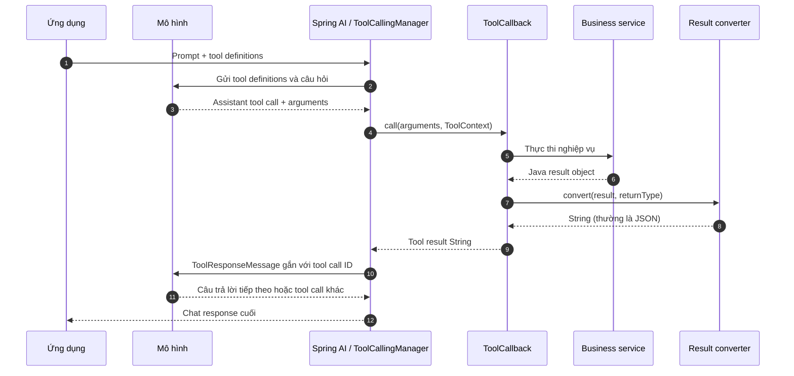

# Chuyển kết quả bằng DefaultToolCallResultConverter

Khi một phương thức công cụ trả về Java object, Spring AI cần chuyển object đó thành `String` để tạo tool response gửi lại mô hình. `DefaultToolCallResultConverter` đảm nhiệm việc chuyển đổi mặc định bằng Jackson. Nhờ vậy, tool có thể trả về record, DTO hoặc cấu trúc dữ liệu mà không phải tự ghép chuỗi JSON.

Trong module `SPRING_AI_TOOL_CALLING`, mô hình yêu cầu gọi công cụ bằng tên và arguments theo input schema. Ứng dụng thực thi callback, nhận kết quả nghiệp vụ rồi chuyển kết quả thành chuỗi cho vòng hội thoại. Converter chỉ định dạng kết quả thành nội dung có thể gửi đi; nó không xác thực quyền, không quyết định công cụ nào được gọi và không biến kết quả thành một kiểu Java mà mô hình phải tuân theo.

## 1. Vị trí của result converter trong tool calling

`ToolCallback` có hợp đồng thực thi trả về `String`. Các implementation như `MethodToolCallback` và `FunctionToolCallback` có thể nhận một Java object từ phương thức/hàm, sau đó dùng `ToolCallResultConverter` để tạo chuỗi trả về. `DefaultToolCallResultConverter` là implementation mặc định.



Trình tự này có ba ranh giới cần phân biệt:

1. **Input conversion:** chuyển JSON arguments do mô hình tạo thành tham số Java của callback.
2. **Business execution:** chạy service và tạo kết quả nghiệp vụ.
3. **Result conversion:** chuyển kết quả Java thành chuỗi để Spring AI đưa vào tool response.

`DefaultToolCallResultConverter` tham gia ở bước thứ ba. Nó không tạo input schema và cũng không thay đổi Java object đã được service trả về.

## 2. ToolCallResultConverter có hợp đồng gì?

`ToolCallResultConverter` là functional interface trong package `org.springframework.ai.tool.execution`:

```java
@FunctionalInterface
public interface ToolCallResultConverter {

    String convert(@Nullable Object result, @Nullable Type returnType);
}
```

Hai tham số đầu vào có ý nghĩa:

- `result`: object mà phương thức hoặc hàm công cụ vừa trả về. Nó có thể là DTO, record, collection, scalar hoặc `null`.
- `returnType`: kiểu trả về được khai báo của phương thức/hàm, biểu diễn bằng `java.lang.reflect.Type`. Kiểu này có thể hữu ích cho converter tùy chỉnh khi cần phân biệt các hợp đồng trả về.

Giá trị trả về luôn là `String`. Spring AI đặt chuỗi này vào nội dung của tool response tương ứng. Converter không trả `Message`, `ChatResponse` hay một object provider-specific.

`DefaultToolCallResultConverter` là implementation mặc định và sử dụng Jackson để serialize kết quả. Khi kết quả là một DTO thông thường, chuỗi tạo ra thường là JSON:

```java
public record OrderStatusView(
        String orderId,
        String status,
        String carrier,
        String estimatedDelivery) {
}

OrderStatusView result = new OrderStatusView(
        "ORD-2048", "SHIPPED", "VNPost", "2026-11-28");

ToolCallResultConverter converter = new DefaultToolCallResultConverter();
String toolResult = converter.convert(result, OrderStatusView.class);
```

Kết quả JSON có dạng:

```json
{
  "orderId": "ORD-2048",
  "status": "SHIPPED",
  "carrier": "VNPost",
  "estimatedDelivery": "2026-11-28"
}
```

JSON là nội dung tool result dưới dạng chuỗi. Mô hình đọc nội dung đó như dữ liệu trong hội thoại, sau đó có thể diễn giải cho người dùng hoặc dùng nó làm đầu vào cho một tool call tiếp theo.

## 3. Dùng converter mặc định với phương thức `@Tool`

Với một phương thức `@Tool` trả về DTO có thể serialize bằng Jackson, thường không cần cấu hình converter riêng. `MethodToolCallback` sử dụng `DefaultToolCallResultConverter` nếu không có converter tùy chỉnh.

```java
@Component
public class OrderTools {

    private final OrderQueryService orderQueryService;

    public OrderTools(OrderQueryService orderQueryService) {
        this.orderQueryService = orderQueryService;
    }

    @Tool(description = "Tra cứu trạng thái đơn hàng theo mã đơn hàng.")
    public OrderStatusView getOrderStatus(
            @ToolParam(description = "Mã đơn hàng cần tra cứu") String orderId) {
        return orderQueryService.findStatus(orderId);
    }
}
```

Đăng ký tool với `ChatClient`:

```java
String answer = chatClient.prompt()
        .user("Đơn hàng ORD-2048 đang ở trạng thái nào?")
        .tools(orderTools)
        .call()
        .content();
```

Khi model gọi `getOrderStatus`, phương thức trả `OrderStatusView`. `MethodToolCallback` dùng converter mặc định để serialize object thành JSON string, rồi `ToolCallingManager` tạo tool response và gửi lại mô hình.

Không cần tự viết:

```java
return "{\"orderId\":\"" + orderId + "\",\"status\":\"SHIPPED\"}";
```

Việc nối chuỗi JSON thủ công dễ tạo lỗi khi dữ liệu có dấu nháy, ký tự xuống dòng, Unicode hoặc giá trị `null`. Trả DTO giúp Jackson xử lý escaping và cấu trúc dữ liệu nhất quán.

## 4. Dùng converter mặc định với FunctionToolCallback

`FunctionToolCallback` cũng hỗ trợ result converter. Khi không chỉ định, builder dùng converter mặc định.

```java
public record OrderLookup(String orderId) {}

Function<OrderLookup, OrderStatusView> lookupOrder =
        request -> orderQueryService.findStatus(request.orderId());

ToolCallback orderStatusTool = FunctionToolCallback
        .builder("getOrderStatus", lookupOrder)
        .description("Tra cứu trạng thái đơn hàng theo mã đơn hàng.")
        .inputType(OrderLookup.class)
        .build();
```

Khi hàm trả về `OrderStatusView`, `FunctionToolCallback` chuyển object đó thành chuỗi bằng converter đã cấu hình. Cơ chế này tương tự method-based tool: model chỉ nhìn thấy tool name, description và input schema; result conversion xảy ra sau khi callback thực thi.

Có thể tạo converter mặc định tường minh để kiểm thử hoặc truyền vào builder:

```java
ToolCallResultConverter defaultConverter =
        new DefaultToolCallResultConverter();

ToolCallback orderStatusTool = FunctionToolCallback
        .builder("getOrderStatus", lookupOrder)
        .description("Tra cứu trạng thái đơn hàng theo mã đơn hàng.")
        .inputType(OrderLookup.class)
        .toolCallResultConverter(defaultConverter)
        .build();
```

Khai báo tường minh hữu ích khi ứng dụng muốn thể hiện rõ chính sách chuyển đổi tại nơi tạo callback. Nếu không có yêu cầu tùy chỉnh, có thể bỏ `.toolCallResultConverter(...)` và dùng mặc định.

## 5. Kết quả JSON không phải output schema của tool

Input schema và result conversion giải quyết hai hướng khác nhau:

| Thành phần | Mục đích | Ai sử dụng? |
|---|---|---|
| `ToolDefinition.inputSchema()` | Mô tả arguments mà model được phép gửi | Model/provider khi tạo tool call |
| Java parameter type | Nhận arguments sau khi deserialize | Callback và business service |
| Java return type | Mô tả kiểu object callback trả về | Method/function callback và converter |
| `ToolCallResultConverter` | Chuyển object trả về thành chuỗi | Spring AI trước khi tạo tool response |
| Tool response | Mang chuỗi kết quả gắn với tool call ID | Model/provider trong lượt tiếp theo |

Ví dụ, input schema của `getOrderStatus` có thể chỉ chứa `orderId`, trong khi result JSON chứa `status`, `carrier` và `estimatedDelivery`. Converter không tự tạo JSON Schema cho kết quả và cũng không xác thực rằng output tuân thủ một schema bắt buộc.

Nếu cần kết quả có cấu trúc ổn định, hãy thiết kế DTO trả về rõ ràng và kiểm thử chuỗi JSON. Đừng giả định rằng khai báo record đầu ra sẽ tự động gửi một output schema riêng cho model.

## 6. Các kiểu kết quả và cách lựa chọn

Nên ưu tiên kiểu trả về đơn giản, công khai và có thể serialize:

| Kiểu kết quả | Ví dụ | Khuyến nghị |
|---|---|---|
| String | `"SHIPPED"` | Phù hợp với kết quả ngắn, một giá trị |
| Number / Boolean | `3`, `true` | Dùng khi ý nghĩa và đơn vị đã rõ |
| Record / DTO | `OrderStatusView` | Lựa chọn tốt cho kết quả nhiều trường |
| Collection | `List<OrderSummary>` | Dùng khi số phần tử có giới hạn; cân nhắc phân trang |
| Map | `Map<String, Object>` | Chỉ dùng khi cấu trúc thực sự linh hoạt và được kiểm soát |
| `null` | Không có kết quả | Định nghĩa rõ ý nghĩa không tìm thấy/không có dữ liệu |
| `void` | Lệnh đã hoàn tất | Dùng khi không cần dữ liệu trả về; cân nhắc trả receipt nếu caller cần xác nhận |

Với kết quả nhiều trường, DTO giúp hợp đồng dễ hiểu hơn Map tổng quát:

```java
public record InvoiceSendResult(
        String operationId,
        String status,
        String message) {
}
```

Đối với collection lớn, không trả toàn bộ dữ liệu. Hãy trả tổng số, một trang giới hạn và cursor tiếp theo, hoặc tạo tool phân trang riêng. Kết quả dài làm tăng token, chi phí và nguy cơ bị cắt trong provider/model.

### `null`, `void` và dữ liệu ảnh

`ToolCallResultConverter.convert(...)` cho phép `result` và `returnType` là nullable. Điều đó cho biết converter có thể được gọi trong trường hợp không có object kết quả; ứng dụng nên xác định rõ cách biểu diễn trạng thái này.

Với phương thức `void`, tài liệu Spring AI 2.1.1-SNAPSHOT ghi nhận converter mặc định trả chuỗi `Done`. Cần kiểm tra đúng patch version đang dùng nếu dựa vào hành vi đặc biệt này. Nếu nghiệp vụ cần mã xác nhận hoặc trạng thái rõ ràng, trả một record như `InvoiceSendResult` sẽ tạo hợp đồng tường minh hơn.

Tài liệu 2.1.1-SNAPSHOT cũng mô tả `RenderedImage` được chuyển thành JSON object chứa PNG đã mã hóa Base64. Đây là hành vi đặc biệt theo phiên bản; cần kiểm tra tài liệu/API của dependency thực tế trước khi dựa vào nó. Với nội dung ảnh lớn, hãy cân nhắc lưu ảnh ở object storage và trả URL hoặc ID có quyền truy cập phù hợp thay vì nhúng Base64 dài vào hội thoại.

## 7. Khi nào cần converter tùy chỉnh?

Converter mặc định phù hợp khi JSON do Jackson tạo đã là định dạng hữu ích cho mô hình. Hãy cân nhắc converter riêng khi cần:

- Giảm kết quả lớn thành summary ngắn.
- Ẩn hoặc loại bỏ trường nhạy cảm.
- Chuẩn hóa ngày giờ, đơn vị đo hoặc mã trạng thái theo một hợp đồng thống nhất.
- Chuyển kết quả sang CSV, XML hoặc một định dạng văn bản nghiệp vụ cụ thể.
- Biểu diễn `null`, `void`, lỗi nghiệp vụ đã được chuyển thành kết quả hoặc dữ liệu đặc biệt theo quy ước riêng.
- Chuyển các kiểu dữ liệu đặc thù mà Jackson mặc định không serialize theo cách mong muốn.

Không nên tạo converter tùy chỉnh chỉ để đổi thứ tự field JSON hoặc làm kết quả “đẹp” hơn. Hãy ưu tiên DTO, Jackson annotation và cấu hình `ObjectMapper` phù hợp trước khi thêm một tầng chuyển đổi riêng.

## 8. Viết custom ToolCallResultConverter

Ví dụ sau giới hạn dữ liệu đơn hàng gửi cho mô hình. Converter chỉ trả mã đơn, trạng thái và ngày giao dự kiến; các trường nội bộ như địa chỉ, email hoặc ghi chú hỗ trợ không xuất hiện.

```java
public final class OrderSummaryResultConverter
        implements ToolCallResultConverter {

    private final ObjectMapper objectMapper;

    public OrderSummaryResultConverter(ObjectMapper objectMapper) {
        this.objectMapper = objectMapper;
    }

    @Override
    public String convert(Object result, Type returnType) {
        if (result == null) {
            return "{\"found\":false}";
        }

        if (result instanceof OrderStatusView order) {
            Map<String, Object> safeResult = new LinkedHashMap<>();
            safeResult.put("orderId", order.orderId());
            safeResult.put("status", order.status());
            safeResult.put("estimatedDelivery", order.estimatedDelivery());
            return writeJson(safeResult);
        }

        return writeJson(result);
    }

    private String writeJson(Object value) {
        try {
            return objectMapper.writeValueAsString(value);
        }
        catch (JsonProcessingException ex) {
            throw new IllegalStateException(
                    "Không thể serialize kết quả của tool.", ex);
        }
    }
}
```

Trong ví dụ, `returnType` chưa được dùng vì converter phân nhánh theo kiểu object thực tế. Nếu một converter xử lý nhiều kiểu có cùng cấu trúc hoặc cần phân biệt generic type, có thể dùng `returnType` để chọn chính sách. Không nên ép kiểu mù quáng khi `result` không đúng kiểu mong đợi.

`ObjectMapper` nên được cấu hình xong trước khi dùng và tái sử dụng an toàn. Converter nên có hành vi xác định, không lưu trạng thái của request trong field và không sửa object kết quả gốc.

## 9. Gắn converter tùy chỉnh với phương thức `@Tool`

Với khai báo `@Tool`, thuộc tính `resultConverter` nhận class triển khai `ToolCallResultConverter`:

Converter dùng qua annotation nên được thiết kế để framework có thể khởi tạo từ class được khai báo. Ví dụ dưới đây dùng converter không có dependency constructor:

```java
public final class OrderSummaryAnnotationConverter
        implements ToolCallResultConverter {

    private final ToolCallResultConverter delegate =
            new DefaultToolCallResultConverter();

    @Override
    public String convert(Object result, Type returnType) {
        if (result instanceof OrderStatusView order) {
            OrderSummary summary = new OrderSummary(
                    order.orderId(), order.status(), order.estimatedDelivery());
            return delegate.convert(summary, OrderSummary.class);
        }
        return delegate.convert(result, returnType);
    }

    public record OrderSummary(
            String orderId,
            String status,
            String estimatedDelivery) {
    }
}
```

```java
@Component
public class OrderTools {

    private final OrderQueryService orderQueryService;

    public OrderTools(OrderQueryService orderQueryService) {
        this.orderQueryService = orderQueryService;
    }

    @Tool(
            description = "Tra cứu trạng thái đơn hàng theo mã đơn hàng.",
            resultConverter = OrderSummaryAnnotationConverter.class)
    public OrderStatusView getOrderStatus(String orderId) {
        return orderQueryService.findStatus(orderId);
    }
}
```

Ở cách khai báo annotation, Spring AI nhận class converter từ annotation. Hãy giữ implementation phù hợp với cách framework khởi tạo converter của phiên bản đang dùng; một converter đơn giản, không có dependency injection phức tạp sẽ dễ tái sử dụng hơn. Nếu converter cần `ObjectMapper` được cấu hình bởi Spring hoặc các dependency khác, dùng programmatic builder để truyền instance đã được inject.

## 10. Gắn converter với MethodToolCallback hoặc FunctionToolCallback

Với cách programmatic, builder có phương thức `.toolCallResultConverter(...)` nhận một instance converter. Đây là cách phù hợp khi cần constructor injection hoặc dùng cùng converter cho nhiều callback.

Ví dụ với `FunctionToolCallback`:

```java
@Configuration(proxyBeanMethods = false)
public class OrderToolConfiguration {

    @Bean
    ToolCallback orderStatusTool(
            OrderQueryService orderQueryService,
            ObjectMapper objectMapper) {

        Function<OrderLookup, OrderStatusView> function =
                request -> orderQueryService.findStatus(request.orderId());

        ToolCallResultConverter converter =
                new OrderSummaryResultConverter(objectMapper);

        return FunctionToolCallback
                .builder("getOrderStatus", function)
                .description("Tra cứu trạng thái đơn hàng theo mã đơn hàng.")
                .inputType(OrderLookup.class)
                .toolCallResultConverter(converter)
                .build();
    }
}
```

Với `MethodToolCallback`, builder cũng hỗ trợ `.toolCallResultConverter(...)`:

```java
Method method = ReflectionUtils.findMethod(
        OrderTools.class, "getOrderStatus", String.class);

ToolCallback callback = MethodToolCallback.builder()
        .toolDefinition(ToolDefinitions.builder(method)
                .description("Tra cứu trạng thái đơn hàng theo mã đơn hàng.")
                .build())
        .toolMethod(method)
        .toolObject(orderTools)
        .toolCallResultConverter(new OrderSummaryResultConverter(objectMapper))
        .build();
```

Ví dụ giả định `orderTools` là object chứa phương thức instance và `method` đã được kiểm tra không null. Với method static, không cần `toolObject`. Cả hai builder đều dùng converter để chuyển object kết quả thành chuỗi trả về từ callback.

## 11. Converter tùy chỉnh và bảo vệ dữ liệu

Tool result được gửi lại mô hình trong conversation history. Mô hình có thể nhắc lại hoặc diễn giải nội dung đó trong câu trả lời cuối. Do vậy, converter là một điểm có thể giới hạn payload, nhưng không nên là lớp bảo mật duy nhất.

Nên thực hiện theo thứ tự:

1. Authorization service chỉ cho phép đọc tài nguyên thuộc phạm vi của actor/tenant.
2. Business service trả DTO đã loại bỏ dữ liệu không cần thiết.
3. Converter chỉ serialize các trường cần thiết cho mô hình.
4. Logging và tracing không ghi toàn bộ kết quả nếu có dữ liệu nhạy cảm.

Không serialize trực tiếp JPA entity hoặc object nội bộ có thể chứa:

- Password hash, access token, refresh token, API key hoặc secret.
- Địa chỉ, email, số điện thoại hoặc dữ liệu cá nhân không liên quan.
- Quan hệ lazy-loaded gây truy vấn không mong muốn hoặc vòng tham chiếu.
- Dữ liệu của tenant khác, ghi chú nội bộ hoặc trường quản trị.
- Dữ liệu nhị phân hoặc collection lớn không cần thiết cho bước suy luận tiếp theo.

Converter không thay thế authorization. Nếu service trả về dữ liệu mà user không được phép xem, việc converter bỏ một vài field có thể không đủ để sửa lỗi truy cập ở tầng nghiệp vụ.

## 12. Converter không xử lý exception của tool

Result converter xử lý giá trị trả về thành công của phương thức/hàm. Nếu tool ném exception, luồng xử lý đi qua `ToolExecutionException` và `ToolExecutionExceptionProcessor` theo cấu hình Spring AI.

Phân biệt:

| Tình huống | Thành phần xử lý |
|---|---|
| Service trả `OrderStatusView` | `DefaultToolCallResultConverter` hoặc converter tùy chỉnh |
| Service trả `null` | Converter quyết định chuỗi biểu diễn null |
| Method trả `void` | Converter mặc định theo hành vi của phiên bản; cân nhắc trả result DTO nếu cần hợp đồng rõ |
| Service ném `OrderNotFoundException` | Exception handling của tool, không phải result converter |
| JSON serialization thất bại | Lỗi trong bước chuyển đổi; cần kiểm thử và xử lý như lỗi thực thi phù hợp với callback/version |

Không dùng converter để bắt mọi exception rồi trả `"{}"`. Cách đó khiến mô hình không phân biệt được thao tác thành công với thao tác thất bại. Hãy dùng error contract riêng cho lỗi, gồm mã lỗi và thông điệp đã làm sạch; xem bài về `ToolExecutionException` để thiết kế chính sách lỗi.

## 13. Phân biệt result conversion với `returnDirect`

`returnDirect` quyết định kết quả tool có được gửi lại mô hình hay trả thẳng về caller. `ToolCallResultConverter` quyết định object kết quả được biểu diễn thành chuỗi nào.

| Cấu hình | Điều gì xảy ra? |
|---|---|
| Converter mặc định + `returnDirect=false` | Serialize kết quả; gửi chuỗi về model để model tiếp tục hội thoại |
| Converter tùy chỉnh + `returnDirect=false` | Serialize theo định dạng riêng; gửi chuỗi về model |
| Converter mặc định + `returnDirect=true` | Serialize kết quả; bypass model và trả trực tiếp theo flow của framework |
| Converter tùy chỉnh + `returnDirect=true` | Dùng chuỗi tùy chỉnh làm kết quả trả trực tiếp |

Ví dụ, một tool retrieval có thể trả JSON rút gọn và `returnDirect=true` nếu kết quả đã là nội dung cuối mà ứng dụng muốn hiển thị. Nếu cần mô hình tổng hợp kết quả, giữ `returnDirect=false` để tool response quay lại model.

Khi model gọi nhiều tool trong cùng một lượt, Spring AI chỉ tôn trọng `returnDirect` nếu tất cả tool trong batch đều được cấu hình `returnDirect=true`. Result converter vẫn chuyển đổi từng kết quả trước khi framework tạo tool response.

## 14. Kết quả ảnh, file và dữ liệu lớn

Không phải kết quả nào cũng phù hợp để serialize thành một JSON object lớn. Với ảnh hoặc file, cân nhắc trả metadata thay vì toàn bộ byte array:

```java
public record DocumentResult(
        String documentId,
        String fileName,
        String mimeType,
        String downloadUrl,
        long sizeBytes) {
}
```

URL cần được tạo bởi server, có thời hạn và quyền truy cập phù hợp. Không trả đường dẫn filesystem nội bộ hoặc URL có credential dài hạn. Nếu model cần nội dung văn bản, cung cấp một bản trích xuất giới hạn hoặc một tool đọc theo trang/chunk.

Với danh sách lớn, hãy trả summary và cursor:

```java
public record SearchPage<T>(
        List<T> items,
        String nextCursor,
        boolean hasMore) {
}
```

Mô hình có thể dùng cursor để gọi tool ở lượt sau. Giới hạn số phần tử, độ dài field và tổng kích thước output trước khi serialize.

## 15. Lưu ý về Jackson và các kiểu Java

Vì converter mặc định sử dụng Jackson, cách serialize phụ thuộc vào cấu trúc object và cấu hình mapper mà callback sử dụng. Một số điểm nên kiểm tra:

- **Java Time:** xác nhận `LocalDate`, `LocalDateTime`, `Instant` được serialize theo định dạng ISO mong muốn.
- **Enum:** xác định model nhận enum name hay một mã nghiệp vụ riêng.
- **BigDecimal:** giữ độ chính xác và đơn vị tiền tệ; không chuyển thành `double` nếu cần chính xác tài chính.
- **Collection generic:** kiểm tra kiểu phần tử và cấu trúc JSON thực tế.
- **Record/immutable DTO:** bảo đảm Jackson version và module hỗ trợ kiểu dữ liệu đang dùng.
- **JPA entity:** tránh proxy, lazy loading và vòng tham chiếu; map sang DTO trước khi trả.
- **Binary data:** tránh nhúng byte array lớn nếu model không cần nội dung nhị phân.

Không giả định mọi provider/model diễn giải JSON string giống nhau. Provider nhận tool result theo giao thức riêng nhưng Spring AI giữ hợp đồng callback là chuỗi. Kiểm thử trên model/provider thực tế khi định dạng kết quả ảnh hưởng đến chất lượng suy luận.

## 16. Kiểm thử result converter

Nên kiểm thử converter riêng trước, sau đó kiểm thử tích hợp callback để xác nhận kết quả thực sự được đưa vào tool response.

Ví dụ unit test cho converter mặc định:

```java
@Test
void serializesOrderStatusAsJson() {
    ToolCallResultConverter converter = new DefaultToolCallResultConverter();
    OrderStatusView result = new OrderStatusView(
            "ORD-2048", "SHIPPED", "VNPost", "2026-11-28");

    String json = converter.convert(result, OrderStatusView.class);

    assertThat(json).contains("\"orderId\":\"ORD-2048\"");
    assertThat(json).contains("\"status\":\"SHIPPED\"");
    assertThat(json).contains("\"carrier\":\"VNPost\"");
}
```

Ví dụ unit test cho converter rút gọn:

```java
@Test
void excludesInternalFieldsFromModelResult() throws Exception {
    ObjectMapper objectMapper = new ObjectMapper();
    ToolCallResultConverter converter =
            new OrderSummaryResultConverter(objectMapper);

    OrderStatusView result = new OrderStatusView(
            "ORD-2048", "SHIPPED", "VNPost", "2026-11-28");

    String json = converter.convert(result, OrderStatusView.class);
    JsonNode node = objectMapper.readTree(json);

    assertThat(node.has("orderId")).isTrue();
    assertThat(node.has("status")).isTrue();
    assertThat(node.has("carrier")).isFalse();
}
```

Trong integration test, xác minh:

1. Callback gọi business service và nhận đúng DTO.
2. Converter được chọn đúng cho tool.
3. Chuỗi converter trả về được gắn với đúng tool call ID trong `ToolResponseMessage`.
4. Với `returnDirect=false`, tool result được gửi lại model ở vòng tiếp theo.
5. Với `returnDirect=true`, flow dừng theo contract direct result.
6. Lỗi business đi qua exception processor thay vì converter.
7. Serialization failure được quan sát và xử lý đúng theo callback/version.
8. Output không chứa field nhạy cảm hoặc payload vượt giới hạn.

Không chỉ so sánh JSON bằng chuỗi nguyên văn nếu thứ tự field không phải một phần của hợp đồng. Parse JSON thành tree rồi kiểm tra field, kiểu dữ liệu và giá trị sẽ bền vững hơn.

## 17. Những lỗi thường gặp

| Lỗi | Hậu quả | Cách xử lý |
|---|---|---|
| Trả JPA entity trực tiếp | Lộ field nội bộ, lazy loading hoặc vòng tham chiếu | Map sang DTO chuyên cho tool result |
| Nối chuỗi JSON thủ công | Escape sai với dấu nháy, Unicode hoặc newline | Dùng `DefaultToolCallResultConverter`/Jackson |
| Cho rằng input schema cũng định nghĩa output schema | Kỳ vọng framework validate JSON kết quả | Thiết kế DTO và contract test riêng cho output |
| Cho rằng converter xử lý exception | Lỗi bị nhầm thành kết quả rỗng hoặc JSON mặc định | Dùng `ToolExecutionExceptionProcessor` cho lỗi |
| Dùng output quá lớn | Tốn token, chậm hoặc vượt giới hạn context | Summary, pagination và giới hạn kích thước |
| Dùng `returnDirect` để thay converter | Bỏ qua model nhưng không thay định dạng kết quả | Cấu hình converter và `returnDirect` theo hai mục tiêu riêng |
| Converter phụ thuộc mutable request state | Dữ liệu giữa request có thể bị trộn | Converter stateless, thread-safe |
| Converter tùy chỉnh chỉ kiểm tra một kiểu rồi cast trực tiếp | `ClassCastException` khi tool trả kiểu khác | Kiểm tra kiểu và có fallback rõ ràng |
| Bỏ qua null/void | Model nhận kết quả mơ hồ | Định nghĩa biểu diễn null/void theo version và nghiệp vụ |

## 18. Checklist trước khi đưa tool vào sử dụng

- Kiểu trả về là DTO/record công khai và serialize được.
- Đã xác định dùng `DefaultToolCallResultConverter` hay converter riêng.
- Converter riêng được gắn qua `@Tool(resultConverter=...)` hoặc builder phù hợp.
- Converter xử lý đúng `result` và `returnType`, bao gồm trường hợp null nếu có.
- JSON thực tế đã được kiểm tra bằng unit test.
- Result DTO chỉ chứa field mà mô hình được phép nhìn thấy.
- Kích thước output có giới hạn và có chiến lược phân trang khi cần.
- `returnDirect` được cấu hình độc lập với result converter.
- Exception business được xử lý qua error processor, không giả làm kết quả thành công.
- Có integration test cho tool response, tool call ID và luồng tiếp theo của model.
- Đã kiểm tra hành vi đặc biệt của `void`/`RenderedImage` theo đúng patch version nếu ứng dụng dựa vào chúng.

## 19. Tài liệu tham khảo

- [Spring AI 2.1 — Tool Calling, Result Conversion](https://docs.spring.io/spring-ai/reference/api/tools.html): hợp đồng `ToolCallResultConverter`, `DefaultToolCallResultConverter`, Jackson serialization và cấu hình converter.
- [ToolCallResultConverter API](https://docs.spring.io/spring-ai/docs/2.1.x/api/org/springframework/ai/tool/execution/ToolCallResultConverter.html): chữ ký `convert(Object, Type)` và vai trò chuyển kết quả thành chuỗi gửi mô hình.
- [DefaultToolCallResultConverter API](https://docs.spring.io/spring-ai/docs/2.1.x/api/org/springframework/ai/tool/execution/DefaultToolCallResultConverter.html): implementation mặc định của result converter.
- [Tool Annotation API](https://docs.spring.io/spring-ai/docs/2.1.x/api/org/springframework/ai/tool/annotation/Tool.html): thuộc tính `resultConverter` nhận class triển khai `ToolCallResultConverter`.
- [FunctionToolCallback.Builder API](https://docs.spring.io/spring-ai/docs/current/api/org/springframework/ai/tool/function/FunctionToolCallback.Builder.html): cấu hình `toolCallResultConverter(...)` cho function-based tool.
- [Tool Specification Reference — Spring AI 2.1.1-SNAPSHOT](https://docs.spring.io/spring-ai/reference/2.1-SNAPSHOT/tools/reference.html): ghi chú hành vi đặc biệt của `void` và `RenderedImage`; cần đối chiếu version trước khi sử dụng.

`DefaultToolCallResultConverter` là lựa chọn mặc định phù hợp cho phần lớn tool trả DTO hoặc cấu trúc JSON có thể serialize bằng Jackson. Khi cần kiểm soát dữ liệu gửi về mô hình, hãy dùng converter tùy chỉnh để tạo chuỗi ngắn, ổn định và an toàn. Luôn thiết kế output DTO, kiểm thử chuỗi kết quả và giới hạn dữ liệu ngay ở tầng nghiệp vụ trước khi chuyển kết quả vào hội thoại.
