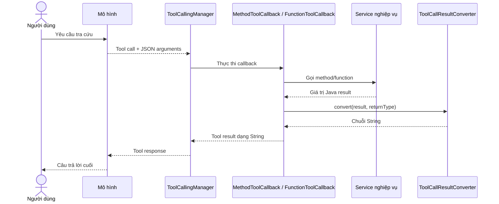

# Tùy chỉnh ToolCallResultConverter

Sau khi một tool thực thi, Spring AI cần chuyển giá trị Java mà method hoặc function trả về thành một chuỗi để gửi tiếp trong tool response. `ToolCallResultConverter` là điểm mở rộng dành cho bước chuyển đổi này. Bạn có thể dùng converter mặc định để serialize kết quả thành JSON bằng Jackson, hoặc viết converter riêng để tạo payload ngắn gọn, chuẩn hóa trạng thái và chỉ đưa những trường cần thiết cho mô hình.

Converter ảnh hưởng đến nội dung kết quả mà mô hình nhận được. Nó không thay đổi JSON Schema đầu vào, không thực thi tool và không quyết định người dùng có quyền gọi tool hay không. Callback và service vẫn chịu trách nhiệm xác thực arguments, phân quyền và thực hiện nghiệp vụ.

## Tool result đi qua converter ở đâu?

Trong luồng tool calling, mô hình gửi tên công cụ và arguments. Spring AI tìm `ToolCallback`, thực thi method hoặc function, nhận giá trị trả về rồi chuyển giá trị đó thành chuỗi. Chuỗi này được đóng gói thành tool response để mô hình sử dụng ở lượt tiếp theo, trừ khi công cụ được cấu hình `returnDirect`.



`ToolCallResultConverter` được Spring AI sử dụng cho cả method-based tool và function-based tool. Converter mặc định là `DefaultToolCallResultConverter`; kết quả thông thường được serialize thành JSON bằng Jackson. Nếu method/function trả về một object lớn hoặc chứa nhiều trường nội bộ, JSON mặc định có thể đưa quá nhiều dữ liệu vào ngữ cảnh của mô hình. Converter riêng giúp tạo một hợp đồng kết quả phù hợp hơn.

## Hợp đồng của ToolCallResultConverter

Interface nằm trong package `org.springframework.ai.tool.execution` và có một phương thức:

```java
package org.springframework.ai.tool.execution;

import java.lang.reflect.Type;

@FunctionalInterface
public interface ToolCallResultConverter {

    String convert(Object result, Type returnType);
}
```

Hai tham số có ý nghĩa khác nhau:

| Tham số | Ý nghĩa | Lưu ý |
| --- | --- | --- |
| `result` | Giá trị thực tế mà tool method/function trả về | Có thể là `null`; cần định nghĩa cách biểu diễn kết quả rỗng hoặc không tìm thấy. |
| `returnType` | Kiểu Java được khai báo cho giá trị trả về | Có thể hữu ích khi xử lý kiểu generic; không nên giả định luôn có giá trị. |

Phương thức luôn phải trả về `String`. Chuỗi này là nội dung mà Spring AI đưa vào tool response. Converter có thể trả JSON, văn bản có cấu trúc hoặc định dạng khác mà model/provider xử lý được, nhưng JSON thường dễ kiểm tra và ổn định hơn.

`returnType` là kiểu Java của kết quả tool, không phải JSON Schema của arguments. Schema đầu vào được tạo từ tham số method/function; converter chỉ làm việc sau khi tool đã thực thi.

## Khi nào nên viết converter riêng?

Converter mặc định thường phù hợp nếu tool trả DTO nhỏ, không có dữ liệu nhạy cảm và cấu trúc JSON đã đủ rõ. Converter riêng hữu ích trong các trường hợp:

- **Giảm kích thước kết quả:** chỉ giữ vài trường mà mô hình cần để trả lời hoặc quyết định bước tiếp theo.
- **Lọc dữ liệu nội bộ:** bỏ access token, thông tin xác thực, ghi chú nội bộ, dữ liệu cá nhân hoặc trường persistence không nên đưa vào prompt.
- **Chuẩn hóa trạng thái:** biểu diễn thống nhất `found`, `not_found`, `partial`, `error` hoặc `hasMore`.
- **Tương thích hợp đồng cũ:** chuyển DTO của service sang cấu trúc mà prompt và model đã được thiết kế để đọc.
- **Định dạng kết quả chuyên biệt:** tạo bản tóm tắt cho danh sách dài, cấu trúc cho kết quả phân trang hoặc định dạng đơn giản cho một loại dữ liệu.
- **Kiểm soát giá trị rỗng:** phân biệt không tìm thấy dữ liệu với một kết quả hợp lệ nhưng rỗng.

Không cần tạo converter chỉ để đổi tên một hoặc hai trường đơn giản nếu có thể trả về một DTO kết quả phù hợp ngay từ service. Hãy giữ logic nghiệp vụ trong service và dùng converter cho trách nhiệm trình bày dữ liệu với mô hình.

## Kết quả mặc định bằng Jackson

Với cấu hình mặc định, Spring AI dùng `DefaultToolCallResultConverter` để serialize giá trị trả về thành JSON. Ví dụ tool trả về:

```java
public record CustomerSummary(
        String customerId,
        String displayName,
        String membershipLevel) {
}
```

Kết quả được gửi cho mô hình có dạng JSON tương ứng với các thuộc tính của record. Cách này đơn giản, nhưng nếu object trả về là entity lớn, mô hình có thể nhận nhiều trường không cần thiết. Việc một object serialize được không đồng nghĩa toàn bộ thuộc tính của nó phù hợp để gửi đến mô hình.

Hãy ưu tiên DTO dành riêng cho kết quả tool hoặc converter có danh sách trường cho phép. Tránh trả thẳng entity JPA, object chứa quan hệ lazy, hoặc object mang theo thông tin nội bộ của hệ thống.

## Viết converter để tạo payload gọn và an toàn

Ví dụ sau minh họa tool tìm kiếm đơn hàng. Kết quả nội bộ của service có thêm ghi chú vận hành, trong khi mô hình chỉ cần mã đơn, trạng thái và tổng tiền. Converter tạo payload mới và chỉ đưa các trường được cho phép vào JSON.

```java
import java.lang.reflect.Type;
import java.util.List;

import org.springframework.ai.tool.execution.DefaultToolCallResultConverter;
import org.springframework.ai.tool.execution.ToolCallResultConverter;

public final class OrderSearchResultConverter implements ToolCallResultConverter {

    private final ToolCallResultConverter jackson = new DefaultToolCallResultConverter();

    @Override
    public String convert(Object result, Type returnType) {
        if (result == null) {
            return this.jackson.convert(
                    new ToolStatus("not_found", "Không tìm thấy đơn hàng phù hợp"),
                    ToolStatus.class);
        }

        if (result instanceof OrderSearchResult searchResult) {
            List<OrderForModel> visibleOrders = searchResult.items().stream()
                    .map(order -> new OrderForModel(
                            order.orderId(),
                            order.status(),
                            order.total(),
                            order.currency()))
                    .toList();

            OrderSearchPayload payload = new OrderSearchPayload(
                    "ok",
                    visibleOrders.size(),
                    searchResult.hasMore(),
                    visibleOrders);

            return this.jackson.convert(payload, OrderSearchPayload.class);
        }

        // Với kiểu kết quả khác, giữ hành vi serialize mặc định.
        return this.jackson.convert(result, returnType);
    }

    public record ToolStatus(String status, String message) {}

    public record OrderForModel(
            String orderId,
            String status,
            java.math.BigDecimal total,
            String currency) {}

    public record OrderSearchPayload(
            String status,
            int count,
            boolean hasMore,
            List<OrderForModel> orders) {}
}
```

`OrderSearchResult` và kiểu `OrderRecord` trong ví dụ là DTO do ứng dụng định nghĩa. `OrderRecord` có thể chứa các trường khác như `internalNote`, `customerEmail` hoặc `fraudReviewComment`; converter không sao chép những trường đó vào `OrderForModel`, nên chúng không xuất hiện trong chuỗi gửi cho mô hình.

Converter dùng `DefaultToolCallResultConverter` làm bộ serialize JSON để tái sử dụng Jackson behavior của Spring AI. Nhánh đã chuẩn hóa truyền kiểu payload mới; nhánh còn lại chuyển tiếp `returnType` nhận được. Nếu ứng dụng cần Jackson module, naming strategy hoặc cấu hình serialization riêng, hãy inject `ObjectMapper` vào converter và dùng nó trong implementation được đăng ký theo cách lập trình.

Các kiểu đầu vào minh họa của converter có thể được định nghĩa như sau:

```java
public record OrderSearchResult(List<OrderRecord> items, boolean hasMore) {}

public record OrderRecord(
        String orderId,
        String status,
        java.math.BigDecimal total,
        String currency,
        String internalNote) {}
```

### Định nghĩa rõ trạng thái kết quả

Không nên để mô hình tự suy luận ý nghĩa của một chuỗi rỗng hoặc JSON `null`. Một hợp đồng kết quả nên có trạng thái rõ ràng:

```json
{
  "status": "ok",
  "count": 2,
  "hasMore": true,
  "orders": [
    {
      "orderId": "ORD-1001",
      "status": "PROCESSING",
      "total": 1250000,
      "currency": "VND"
    },
    {
      "orderId": "ORD-1002",
      "status": "SHIPPED",
      "total": 890000,
      "currency": "VND"
    }
  ]
}
```

Khi không tìm thấy dữ liệu, có thể trả:

```json
{
  "status": "not_found",
  "message": "Không tìm thấy đơn hàng phù hợp"
}
```

Các trạng thái nên có ý nghĩa ổn định và được mô tả trong `@Tool(description = ...)` hoặc tài liệu công cụ. Ví dụ `hasMore: true` cho biết kết quả còn trang tiếp theo; mô hình có thể quyết định có cần gọi công cụ phân trang nữa hay không.

## Gắn converter vào method bằng @Tool

Với cách khai báo bằng annotation, dùng thuộc tính `resultConverter` của `@Tool`:

```java
import org.springframework.ai.tool.annotation.Tool;
import org.springframework.ai.tool.annotation.ToolParam;
import org.springframework.stereotype.Component;

@Component
public class OrderTools {

    private final OrderService orderService;

    public OrderTools(OrderService orderService) {
        this.orderService = orderService;
    }

    @Tool(
            name = "orders_search",
            description = "Tìm đơn hàng theo trạng thái và trả về mã, trạng thái, tổng tiền",
            resultConverter = OrderSearchResultConverter.class)
    public OrderSearchResult searchOrders(
            @ToolParam(description = "Trạng thái cần lọc; bỏ qua để tìm mọi trạng thái", required = false)
            String status) {
        return this.orderService.search(status);
    }
}
```

Spring AI dùng class được khai báo trong `resultConverter` để tạo converter cho method tool. Vì annotation lưu một `Class`, converter cần là class cụ thể, có thể được khởi tạo bằng constructor không tham số. Nếu converter cần dependency như `ObjectMapper` đã cấu hình trong Spring, nên dùng cách đăng ký programmatic để truyền instance đã được inject thay vì cố lấy bean từ annotation.

## Gắn converter vào FunctionToolCallback

Với function, method reference hoặc lambda, truyền converter instance bằng `.toolCallResultConverter(...)` trên builder:

```java
import org.springframework.ai.tool.ToolCallback;
import org.springframework.ai.tool.execution.ToolCallResultConverter;
import org.springframework.ai.tool.function.FunctionToolCallback;

ToolCallResultConverter converter = new OrderSearchResultConverter();

ToolCallback ordersSearch = FunctionToolCallback
        .builder("orders_search", orderService::search)
        .description("Tìm đơn hàng theo trạng thái")
        .inputType(OrderSearchRequest.class)
        .toolCallResultConverter(converter)
        .build();
```

Trong ví dụ, `orderService.search(OrderSearchRequest)` trả về `OrderSearchResult`. `FunctionToolCallback` gọi function, nhận object kết quả rồi dùng converter đã đăng ký để tạo chuỗi. `inputType(...)` chỉ mô tả kiểu đầu vào và schema; nó không liên quan đến việc serialize kết quả.

Nếu function nhận `ToolContext` bằng `BiFunction<I, ToolContext, O>`, converter vẫn xử lý giá trị `O` trả về. Context không tự động được đưa vào kết quả; chỉ các trường mà function trả về mới được converter xử lý.

## Gắn converter vào MethodToolCallback

Khi tạo method callback bằng builder, truyền converter instance qua `.toolCallResultConverter(...)`:

```java
import java.lang.reflect.Method;

import org.springframework.ai.tool.ToolCallback;
import org.springframework.ai.tool.method.MethodToolCallback;
import org.springframework.ai.tool.support.ToolDefinitions;
import org.springframework.util.ReflectionUtils;

Method method = ReflectionUtils.findMethod(
        OrderTools.class, "searchOrders", String.class);

ToolCallback callback = MethodToolCallback.builder()
        .toolDefinition(ToolDefinitions.builder(method)
                .name("orders_search")
                .description("Tìm đơn hàng theo trạng thái")
                .build())
        .toolMethod(method)
        .toolObject(orderTools)
        .toolCallResultConverter(converter)
        .build();
```

`toolMethod` là method được gọi; `toolObject` là instance chứa method nếu đó là method không static. Builder nhận converter instance, nên có thể dùng một converter đã được cấu hình với dependency của ứng dụng. Hãy kiểm tra method tìm được không phải `null` trước khi build callback trong code khởi tạo thực tế.

Trong ví dụ này, `converter` là instance đã tạo ở phần FunctionToolCallback; `orderTools` là bean chứa method `searchOrders`. Nếu tạo converter bằng Spring, hãy inject instance vào cấu hình callback thay vì gọi `new` trực tiếp.

## Nếu tự triển khai ToolCallback

`ToolCallback.call(...)` vốn trả về `String`, vì vậy một custom callback tự triển khai phải tự quyết định cách chuyển object kết quả thành chuỗi. Spring AI không thể tự áp dụng converter cho một object mà callback đã chuyển thành `String`:

```java
import org.springframework.ai.tool.ToolCallback;
import org.springframework.ai.tool.execution.ToolCallResultConverter;

public final class RemoteCatalogCallback implements ToolCallback {

    private final ToolCallResultConverter resultConverter;
    private final RemoteCatalogService remoteCatalogService;

    // getToolDefinition() và getToolMetadata() được triển khai theo hợp đồng của tool.

    @Override
    public String call(String toolInput) {
        CatalogResult result = this.remoteCatalogService.search(toolInput);
        return this.resultConverter.convert(result, CatalogResult.class);
    }
}
```

Đây là đoạn minh họa phần thực thi; callback hoàn chỉnh còn phải triển khai `getToolDefinition()`, `getToolMetadata()` và overload nhận `ToolContext` nếu cần. Khi callback đã tự serialize JSON hoặc tạo văn bản, không cần chạy thêm một converter bên ngoài lần nữa.

## ToolCallResultConverter và returnDirect là hai cấu hình khác nhau

Hai thuộc tính này thường bị nhầm vì đều liên quan đến kết quả tool:

| Cấu hình | Trả lời câu hỏi | Tác động |
| --- | --- | --- |
| `ToolCallResultConverter` | Object kết quả được biểu diễn thành chuỗi nào? | Chọn nội dung và định dạng của tool result. |
| `returnDirect` | Chuỗi kết quả đi đâu sau khi tool chạy? | Quyết định trả thẳng về caller hay gửi lại mô hình để tiếp tục hội thoại. |

Mặc định, tool result được gửi lại mô hình để mô hình sử dụng khi tạo câu trả lời cuối. Khi `returnDirect = true`, kết quả được trả trực tiếp cho caller, không cần mô hình diễn giải thêm. Converter vẫn chịu trách nhiệm tạo chuỗi kết quả của callback; `returnDirect` không thay thế converter.

Nếu một response yêu cầu nhiều tool call cùng lúc, Spring AI chỉ trả kết quả trực tiếp khi tất cả các tool được gọi trong batch đều có `returnDirect = true`. Nếu không, kết quả sẽ được gửi lại mô hình. Hãy chọn `returnDirect` dựa trên luồng hội thoại, không dựa trên nhu cầu lọc hoặc serialize dữ liệu.

## ToolCallResultConverter không thay thế xử lý exception

Converter xử lý giá trị trả về khi tool thực thi thành công. Nếu method/function ném exception, luồng xử lý lỗi của Spring AI đi qua `ToolExecutionException` và `ToolExecutionExceptionProcessor`, không phải converter.

Vì vậy:

- Không dùng converter để bắt mọi lỗi nghiệp vụ rồi serialize stack trace.
- Không biến lỗi quyền truy cập thành kết quả `ok` hoặc dữ liệu rỗng.
- Chuẩn hóa lỗi ở service hoặc exception processor theo chính sách ứng dụng.
- Chỉ đưa thông báo lỗi an toàn cho mô hình; không lộ SQL, endpoint nội bộ, credential hoặc stack trace.
- Phân biệt `not_found` hợp lệ với lỗi hệ thống như timeout hoặc database unavailable.

Nếu nghiệp vụ xem “không tìm thấy” là kết quả bình thường, service có thể trả DTO có `status = not_found`; converter sẽ serialize DTO đó. Nếu đây là lỗi thực thi, hãy dùng exception handling tương ứng.

## Lưu ý khi triển khai converter

Một converter tốt cần giữ hợp đồng kết quả nhỏ, ổn định và dễ hiểu:

1. **Chỉ trả trường cần thiết:** dùng DTO output hoặc allowlist field; không serialize trực tiếp entity lớn.
2. **Giữ kiểu dữ liệu:** tiền tệ nên có số và đơn vị riêng; ngày giờ nên theo ISO-8601; trạng thái nên dùng tập giá trị ổn định.
3. **Xử lý null có chủ đích:** quy định `not_found`, `empty` hay một trạng thái khác; không trả chuỗi mơ hồ.
4. **Giới hạn kích thước:** kết quả tìm kiếm nên có phân trang, giới hạn số phần tử và trường `hasMore` khi cần.
5. **Không phụ thuộc model để lọc dữ liệu:** converter phải loại trường nhạy cảm trước khi chuỗi được gửi đến provider.
6. **Giữ tính xác định:** cùng một loại kết quả nên có cùng cấu trúc, tránh format phụ thuộc locale hoặc thứ tự map không ổn định.
7. **Không đưa prompt vào converter:** converter chỉ chuyển kết quả; không nên biến nó thành nơi xây dựng prompt hoặc thực thi nghiệp vụ.
8. **Xử lý kiểu generic:** nếu cần, dùng `returnType` để giữ thông tin kiểu khai báo; nhớ tham số này có thể nullable.

Kết quả tool trở thành một phần ngữ cảnh mà mô hình xử lý. Kết quả càng lớn thì càng tiêu tốn token và càng dễ đưa dữ liệu không cần thiết vào hội thoại. Chuyển đổi có kiểm soát giúp giảm payload và giới hạn thông tin mà mô hình có thể nhìn thấy.

## Kiểm thử converter

Hãy kiểm thử converter độc lập trước khi tích hợp với model. Không cần gọi mô hình thật để xác nhận một object được chuyển thành JSON đúng.

### Kiểm thử kết quả bình thường và lọc trường

```java
@Test
void convertsOrderSearchResultToModelSafeJson() throws Exception {
    var converter = new OrderSearchResultConverter();
    var result = new OrderSearchResult(
            List.of(new OrderRecord(
                    "ORD-1001",
                    "PROCESSING",
                    new BigDecimal("1250000"),
                    "VND",
                    "Ghi chú nội bộ không được gửi cho model")),
            true);

    String json = converter.convert(result, OrderSearchResult.class);
    JsonNode payload = new ObjectMapper().readTree(json);

    assertThat(payload.path("status").asText()).isEqualTo("ok");
    assertThat(payload.path("count").asInt()).isEqualTo(1);
    assertThat(payload.path("orders").get(0).path("orderId").asText())
            .isEqualTo("ORD-1001");
    assertThat(json).doesNotContain("Ghi chú nội bộ");
}
```

### Kiểm thử kết quả null

```java
@Test
void convertsNullToExplicitNotFoundPayload() throws Exception {
    var converter = new OrderSearchResultConverter();

    String json = converter.convert(null, OrderSearchResult.class);
    JsonNode payload = new ObjectMapper().readTree(json);

    assertThat(payload.path("status").asText()).isEqualTo("not_found");
    assertThat(payload.path("message").asText()).isNotBlank();
}
```

Các ca nên kiểm tra thêm:

- Danh sách rỗng và `hasMore = false`.
- Kết quả có nhiều trang và số lượng phần tử lớn.
- Trường optional có giá trị `null`.
- Kiểu kết quả khác với loại converter chuyên biệt để xác nhận fallback hoạt động.
- `returnType` null hoặc là kiểu generic khi converter có dùng thông tin kiểu.
- Kết quả có trường nhạy cảm và xác nhận trường đó không xuất hiện trong chuỗi.
- Lỗi serialize được báo rõ ràng và không âm thầm trả dữ liệu sai định dạng.

### Kiểm thử tích hợp qua tool callback

Sau unit test, tạo `FunctionToolCallback` hoặc `MethodToolCallback` với converter và gọi callback bằng input JSON có kiểm soát. Xác nhận kết quả `String` đúng định dạng. Sau đó mới chạy integration test qua `ChatClient` với model giả hoặc provider thử nghiệm để xác nhận mô hình nhận đúng tool response và có thể sử dụng các trường trong payload.

Không chỉ kiểm tra câu trả lời cuối. Hãy kiểm tra trực tiếp chuỗi tool result để biết converter đã lọc trường và chuẩn hóa dữ liệu đúng trước khi nó đi vào hội thoại.

## Lỗi thường gặp

| Hiện tượng | Nguyên nhân có thể | Cách xử lý |
| --- | --- | --- |
| Converter không được gọi | Tool được tạo theo đường khác hoặc callback đang dùng converter mặc định | Kiểm tra callback thực tế và nơi đăng ký converter. |
| `@Tool` không khởi tạo được converter | Class không cụ thể, không truy cập được hoặc thiếu constructor không tham số | Dùng class converter cụ thể với public no-arg constructor. |
| Converter cần `ObjectMapper` nhưng không có bean | Annotation chỉ nhận class converter, không truyền instance Spring-managed | Dùng `FunctionToolCallback.Builder` hoặc `MethodToolCallback.Builder` và truyền converter instance đã inject. |
| Mô hình không hiểu kết quả | Payload quá phức tạp, field không rõ nghĩa hoặc JSON không hợp lệ | Chuẩn hóa DTO, dùng tên field rõ và kiểm tra JSON output. |
| Kết quả quá dài | Serialize nguyên entity hoặc collection lớn | Tạo output DTO, giới hạn số phần tử và hỗ trợ phân trang. |
| Dữ liệu nhạy cảm bị gửi cho mô hình | Converter serialize tất cả field của entity | Dùng allowlist field và kiểm thử nội dung JSON. |
| Không thấy thông báo lỗi trong converter | Tool ném exception nên đi qua exception processor | Cấu hình `ToolExecutionExceptionProcessor` cho lỗi; converter chỉ xử lý giá trị trả về. |
| Đã đặt `returnDirect` nhưng kết quả vẫn qua model | Converter bị nhầm với chính sách định tuyến kết quả hoặc batch có tool không returnDirect | Kiểm tra metadata của mọi tool trong batch và cấu hình `returnDirect` riêng. |

## Quy trình áp dụng

1. Xác định object mà tool method/function đang trả về và những trường mô hình thực sự cần.
2. Chọn DTO kết quả gọn hoặc viết `ToolCallResultConverter` nếu cần biến đổi riêng.
3. Quy định cấu trúc trạng thái cho kết quả thành công, rỗng và không tìm thấy.
4. Cấu hình converter bằng `@Tool(resultConverter = ...)` hoặc builder của method/function callback.
5. Nếu converter cần dependency Spring, tạo instance trong cấu hình bean và truyền vào builder.
6. Kiểm thử JSON output, null, generic type, dữ liệu nhạy cảm và payload lớn.
7. Kiểm thử callback rồi mới kiểm thử tích hợp với `ChatClient` và model/provider.
8. Cấu hình exception processor riêng cho lỗi thực thi và `returnDirect` riêng cho cách trả kết quả.

`ToolCallResultConverter` là ranh giới cuối để quyết định nội dung tool result được gửi vào hội thoại. Khi chuyển đổi đúng cách, mô hình nhận dữ liệu có cấu trúc, vừa đủ và an toàn để tiếp tục suy luận; ứng dụng vẫn giữ quyền kiểm soát logic nghiệp vụ, dữ liệu và quyền truy cập.

## Tài liệu tham khảo

- [Spring AI 1.0.9 Reference — Tool Calling / Result Conversion](https://docs.spring.io/spring-ai/reference/1.0/api/tools.html)
- [Spring AI 1.0.9 API — ToolCallResultConverter](https://docs.spring.io/spring-ai/docs/1.0.x/api/org/springframework/ai/tool/execution/ToolCallResultConverter.html)
- [Spring AI 1.0.9 API — DefaultToolCallResultConverter](https://docs.spring.io/spring-ai/docs/1.0.x/api/org/springframework/ai/tool/execution/DefaultToolCallResultConverter.html)
- [Spring AI 1.0.9 API — @Tool](https://docs.spring.io/spring-ai/docs/1.0.x/api/org/springframework/ai/tool/annotation/Tool.html)
- [Spring AI 1.0.9 API — FunctionToolCallback.Builder](https://docs.spring.io/spring-ai/docs/1.0.x/api/org/springframework/ai/tool/function/FunctionToolCallback.Builder.html)
