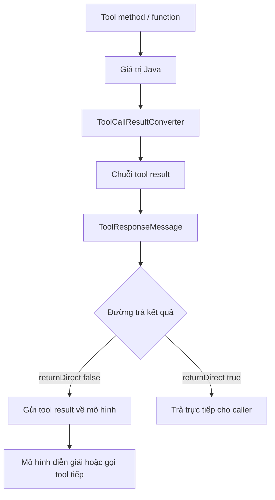

# Xử lý kết quả rỗng, null và công cụ không trả dữ liệu

Một tool call có thể chạy thành công nhưng không tìm thấy dữ liệu phù hợp. Ví dụ, truy vấn sản phẩm không có kết quả, mã đơn hàng không tồn tại hoặc dịch vụ tra cứu trả về một danh sách rỗng. Đây là kết quả nghiệp vụ hợp lệ và cần được biểu diễn rõ ràng để mô hình biết rằng ứng dụng đã tra cứu nhưng không có dữ liệu.

Trong Spring AI 2.x, giá trị Java do phương thức công cụ trả về được chuyển thành chuỗi qua `ToolCallResultConverter`. Mặc định, `DefaultToolCallResultConverter` dùng Jackson để serialize kết quả. Vì vậy, `null`, chuỗi rỗng, danh sách rỗng và một kết quả “không tìm thấy” có thể tạo ra các payload khác nhau. Ứng dụng cần thiết kế hợp đồng kết quả có ý nghĩa, tránh để mô hình tự đoán liệu một payload trống là không có dữ liệu, lỗi hệ thống hay thao tác đã hoàn tất.

Trong module `SPRING_AI_TOOL_CALLING`, ứng dụng chịu trách nhiệm thực thi công cụ và diễn giải kết quả. Mô hình chỉ nhận chuỗi tool response rồi quyết định cách tiếp tục hội thoại. Bài học này tập trung vào việc phân biệt kết quả rỗng với lỗi, chọn kiểu trả về phù hợp, tùy chỉnh chuyển đổi khi cần và kiểm thử các trường hợp không có dữ liệu.

Sau bài học, bạn có thể:

- Phân biệt `null`, `void`, chuỗi rỗng, collection rỗng và kết quả không tìm thấy.
- Hiểu cách `ToolCallResultConverter` chuyển kết quả Java thành chuỗi gửi cho mô hình.
- Thiết kế DTO kết quả biểu diễn rõ trạng thái có dữ liệu và không có dữ liệu.
- Chuyển dữ liệu `null` từ service cũ thành kết quả nghiệp vụ rõ nghĩa.
- Phân biệt no-data với lỗi thực thi và chọn cách xử lý exception phù hợp.
- Kiểm thử callback, tool response, `returnDirect` và cách mô hình xử lý kết quả không có dữ liệu.

## 1. Không có dữ liệu vẫn có thể là một lần thực thi thành công

Hãy xét công cụ tìm sản phẩm theo từ khóa. Người dùng hỏi “Có sản phẩm nào tên là `camera-x99` không?”. Service truy vấn database và không tìm thấy bản ghi phù hợp. Công cụ đã thực thi đúng; kết quả nghiệp vụ là không có kết quả.

Phân biệt hai nhóm tình huống:

| Nhóm | Ví dụ | Ý nghĩa |
|---|---|---|
| Kết quả nghiệp vụ không có dữ liệu | Không có sản phẩm khớp, không có lịch hẹn, mã khách hàng không tồn tại | Công cụ đã chạy và trả lời được câu hỏi nghiệp vụ |
| Lỗi thực thi | Database timeout, thiếu quyền, service ngoài không khả dụng, lỗi serialize | Ứng dụng không hoàn thành thao tác theo hợp đồng |

Không nên biến mọi trường hợp “không tìm thấy” thành exception. Nếu không có sản phẩm phù hợp là kết quả bình thường, hãy trả một payload biểu diễn `NO_RESULTS`. Mô hình có thể nói rõ “không tìm thấy sản phẩm phù hợp” thay vì phải suy luận từ một lỗi hoặc một chuỗi trống.

Ngược lại, không nên trả `NO_RESULTS` khi database không truy cập được. Một lỗi hạ tầng không chứng minh rằng không có dữ liệu. Nếu trộn hai trường hợp, mô hình có thể trả lời sai rằng một đơn hàng hoặc sản phẩm không tồn tại trong khi hệ thống chỉ đang gặp sự cố.

## 2. Các dạng kết quả khác nhau

Các giá trị dưới đây không tương đương nhau:

| Giá trị Java | Ý nghĩa thường gặp | Dạng dữ liệu sau chuyển đổi JSON mặc định |
|---|---|---|
| `null` | Không có object kết quả | `null` |
| `""` | Có một chuỗi nhưng nội dung rỗng | `""` |
| `List.of()` | Truy vấn thành công, không có phần tử | `[]` |
| `Map.of()` | Object kết quả không có property | `{}` |
| `void` | Phương thức không khai báo giá trị trả về | Phụ thuộc converter và phiên bản; không nên dùng làm hợp đồng kết quả cho mô hình |
| DTO trạng thái `NO_RESULTS` | Không có dữ liệu theo một quy tắc nghiệp vụ cụ thể | JSON object có status, count và message |

Các dạng trên chỉ mô tả payload sau chuyển đổi. Chúng không tự nói lên nguyên nhân nghiệp vụ. Ví dụ, `null` có thể là “không tìm thấy” trong một service cũ, nhưng cũng có thể là lỗi lập trình do một nhánh code quên trả kết quả.

Với Spring AI 2.1.0, `ToolCallResultConverter` nhận object và kiểu trả về rồi tạo một `String`. Converter mặc định dùng Jackson để serialize object. Vì vậy, một giá trị `null` được serialize thành JSON literal `null`, còn một collection rỗng được serialize thành `[]`. Nếu cần ý nghĩa ổn định cho caller và mô hình, nên trả DTO thay vì phụ thuộc vào cách diễn giải một payload trống.

## 3. Vai trò của `ToolCallResultConverter`

Mọi `ToolCallback` trả về chuỗi kết quả. Với method tool hoặc function tool, Spring AI chuyển giá trị Java thành chuỗi bằng `ToolCallResultConverter`:

```java
@FunctionalInterface
public interface ToolCallResultConverter {
    String convert(Object result, Type returnType);
}
```

`DefaultToolCallResultConverter` là implementation mặc định và dùng Jackson. Có thể cấu hình converter riêng qua thuộc tính `resultConverter` của `@Tool` hoặc metadata của callback.

Luồng dữ liệu:



Converter chỉ định dạng kết quả. Nó không thể tự xác định một bản ghi `null` có nghĩa là “không tìm thấy”, “chưa tính được” hay “lỗi nghiệp vụ”. Ý nghĩa đó phải được xác định ở service hoặc adapter trước khi serialize.

## 4. Vì sao không nên trả `null` cho trường hợp không tìm thấy?

Giả sử service cũ có chữ ký:

```java
public Product findBySku(String sku) {
    return productRepository.findBySku(sku).orElse(null);
}
```

Nếu không tìm thấy SKU, tool method trả `null`. Converter mặc định có thể serialize thành `null`, nhưng mô hình không biết liệu:

- SKU không tồn tại;
- truy vấn trả về null do dữ liệu chưa đồng bộ;
- service có lỗi và một nhánh code đã trả null để che lỗi;
- công cụ có chủ ý trả về “không có nội dung”.

Để kết quả rõ ràng, chuyển giá trị nullable thành một DTO trạng thái ở lớp tool adapter:

```java
public record ProductLookupResult(
    String status,
    boolean found,
    ProductSummary product,
    String message
) {
    public static ProductLookupResult found(ProductSummary product) {
        return new ProductLookupResult(
            "FOUND", true, product, "Đã tìm thấy sản phẩm."
        );
    }

    public static ProductLookupResult notFound() {
        return new ProductLookupResult(
            "NOT_FOUND", false, null, "Không tìm thấy sản phẩm theo mã đã cung cấp."
        );
    }
}
```

Tool method:

```java
@Component
public class ProductTools {

    private final ProductService productService;

    public ProductTools(ProductService productService) {
        this.productService = productService;
    }

    @Tool(description = "Tra cứu một sản phẩm theo SKU. "
        + "Kết quả có status FOUND hoặc NOT_FOUND.")
    public ProductLookupResult lookupProduct(
            @ToolParam(description = "Mã SKU cần tra cứu") String sku) {

        ProductSummary product = productService.findBySku(sku);
        if (product == null) {
            return ProductLookupResult.notFound();
        }

        return ProductLookupResult.found(product);
    }
}
```

Mô hình nhận một object có `status` rõ ràng. Nếu status là `NOT_FOUND`, nó có thể trả lời rằng không tìm thấy sản phẩm mà không phải đoán ý nghĩa của `null`.

DTO là hợp đồng ổn định hơn cho tool. Nếu cần thay đổi cấu trúc kết quả trong tương lai, có thể bổ sung trường như `source`, `searchedAt` hoặc `suggestions` mà không thay đổi ý nghĩa của `FOUND` và `NOT_FOUND`.

## 5. Biểu diễn danh sách tìm kiếm rỗng

Với truy vấn có thể trả về nhiều bản ghi, một danh sách rỗng thường hợp lý hơn `null`. Tuy vậy, chỉ trả `[]` có thể chưa đủ thông tin cho mô hình: nó không cho biết truy vấn đã chạy thành công, đã tìm đúng phạm vi hay bị giới hạn kết quả.

Có thể trả envelope:

```java
public record ProductSearchResult(
    String status,
    String query,
    int count,
    List<ProductSummary> items,
    String message
) {
    public ProductSearchResult {
        items = List.copyOf(items);
    }

    public static ProductSearchResult noResults(String query) {
        return new ProductSearchResult(
            "NO_RESULTS", query, 0, List.of(),
            "Không có sản phẩm phù hợp với từ khóa."
        );
    }

    public static ProductSearchResult found(
            String query, List<ProductSummary> items) {
        return new ProductSearchResult(
            "FOUND", query, items.size(), items,
            "Đã tìm thấy sản phẩm phù hợp."
        );
    }
}
```

```java
@Tool(description = "Tìm sản phẩm theo từ khóa. "
    + "Trả về status FOUND hoặc NO_RESULTS và danh sách items.")
public ProductSearchResult searchProducts(String query) {
    List<ProductSummary> items = productService.search(query);

    if (items == null) {
        throw new IllegalStateException(
            "ProductService phải trả danh sách rỗng thay vì null khi không có kết quả."
        );
    }

    if (items.isEmpty()) {
        return ProductSearchResult.noResults(query);
    }

    return ProductSearchResult.found(query, items);
}
```

Kết quả `NO_RESULTS` có ba tín hiệu nhất quán: `count` bằng 0, `items` là danh sách rỗng và `message` giải thích trạng thái. Tránh trả `count = 0` nhưng `items` có dữ liệu hoặc status `FOUND` với danh sách rỗng.

Với API phân trang, có thể bổ sung `page`, `pageSize`, `hasNext` và `totalCount`. Không dùng `items = null` để biểu diễn trang rỗng; hãy dùng danh sách rỗng và giữ các metadata phân trang rõ ràng.

## 6. Phân biệt input optional với output không có dữ liệu

Một tham số đầu vào không được cung cấp khác với kết quả tra cứu không tìm thấy.

Ví dụ, `category` là bộ lọc tùy chọn:

```java
@Tool(description = "Tìm sản phẩm theo từ khóa và bộ lọc tùy chọn")
public ProductSearchResult searchProducts(
        @ToolParam(description = "Từ khóa tìm kiếm") String query,
        @ToolParam(description = "Danh mục lọc, có thể bỏ qua", required = false)
        String category) {

    return productService.search(query, category);
}
```

`@ToolParam(required = false)` cho phép mô hình bỏ qua trường `category`. Ở runtime, giá trị có thể là `null`; tool method phải xác định cách hiểu, ví dụ không áp dụng bộ lọc danh mục.

Spring AI cũng hỗ trợ `@Nullable` để đánh dấu tham số có thể không có. Với method tool, `Optional` không phải kiểu thay thế được hỗ trợ cho tham số hoặc kết quả; hãy dùng `@Nullable` hoặc `@ToolParam(required = false)` cho input tùy chọn. Đừng trả `Optional.empty()` với kỳ vọng framework tự biến nó thành `NOT_FOUND`.

Quy tắc nên giữ:

- Input optional: cho phép thiếu giá trị và xử lý mặc định trong tool method.
- Output no-data: trả trạng thái nghiệp vụ như `NOT_FOUND` hoặc `NO_RESULTS`.
- Output `null`: chỉ dùng khi `null` là một phần rõ ràng của hợp đồng và converter/caller đã được kiểm thử.

## 7. Phương thức `void` và thao tác không có payload

Một phương thức `void` phù hợp với thao tác mà caller chỉ cần biết đã thực hiện, chẳng hạn gửi một tín hiệu hoặc ghi một audit event. Tuy nhiên, `void` không thể diễn đạt nhiều trạng thái nghiệp vụ như:

- Thao tác đã hoàn tất;
- Đối tượng mục tiêu không tồn tại;
- Thao tác bị bỏ qua vì trạng thái hiện tại;
- Không có thay đổi nào cần áp dụng.

Nếu mô hình cần biết điều gì đã xảy ra, hãy trả một DTO xác nhận:

```java
public record UpdateResult(
    String status,
    boolean updated,
    String message
) {}
```

```java
@Tool(description = "Cập nhật địa chỉ giao hàng và trả trạng thái cập nhật")
public UpdateResult updateShippingAddress(
        String orderId, String newAddress) {

    boolean updated = orderService.updateAddress(orderId, newAddress);
    if (!updated) {
        return new UpdateResult(
            "NOT_UPDATED", false,
            "Không cập nhật được; đơn hàng không tồn tại hoặc không còn cho phép sửa."
        );
    }

    return new UpdateResult("UPDATED", true, "Địa chỉ giao hàng đã được cập nhật.");
}
```

Đừng giả định `void` luôn tương đương chuỗi rỗng. Giá trị tool response cuối cùng phụ thuộc result converter và phiên bản Spring AI. Nếu caller hoặc mô hình cần dựa vào kết quả, trả kiểu có cấu trúc rõ ràng và kiểm thử payload sau chuyển đổi.

## 8. Dùng chuỗi rỗng khi nào?

Một chuỗi rỗng thường là hợp đồng yếu vì nó không nói lý do nội dung trống. Ví dụ:

```java
@Tool(description = "Lấy ghi chú công khai của khách hàng")
public String getPublicNote(String customerId) {
    return customerService.findPublicNote(customerId).orElse("");
}
```

Khi tool trả `""`, mô hình không biết khách hàng không có ghi chú, khách hàng không tồn tại hay service không lấy được ghi chú. Hãy dùng DTO hoặc ít nhất một chuỗi có trạng thái:

```java
public record NoteLookupResult(
    String status,
    String note,
    String message
) {}
```

Nếu dữ liệu thật sự là văn bản có thể rỗng — ví dụ trường mô tả do người dùng nhập — hãy giữ giá trị rỗng như một giá trị dữ liệu hợp lệ, nhưng đừng dùng nó thay cho trạng thái `NOT_FOUND` hoặc `ERROR`.

## 9. Không có dữ liệu khác với không có tool call

Hai trường hợp này nằm ở hai tầng khác nhau:

| Tình huống | Điều gì đã xảy ra? | Có tool response không? |
|---|---|---|
| Mô hình không yêu cầu công cụ | Không có tool call trong phản hồi assistant | Không |
| Mô hình yêu cầu công cụ, kết quả `NO_RESULTS` | Callback đã chạy và trả kết quả nghiệp vụ rỗng | Có |
| Mô hình yêu cầu công cụ, callback trả `null` | Callback đã chạy và converter chuyển giá trị null | Có |
| Mô hình yêu cầu công cụ, callback ném lỗi | Thực thi thất bại và exception processor xử lý | Tùy chính sách lỗi; có thể là error tool response hoặc exception cho caller |

Đừng kiểm tra `ChatResponse.hasToolCalls()` để suy ra có dữ liệu hay không. `hasToolCalls()` chỉ cho biết phản hồi của mô hình có yêu cầu thực thi công cụ. Dữ liệu được trả về sau đó nằm trong tool response message và conversation history.

Với `ChatClient`, `ToolCallingAdvisor` thực thi callback, thêm kết quả vào lịch sử rồi gửi lịch sử cho mô hình tiếp tục. Mô hình có thể tạo câu trả lời cuối như “Không tìm thấy sản phẩm nào”. Nếu công cụ dùng `returnDirect = true`, kết quả được trả trực tiếp cho caller và mô hình không diễn giải thêm.

## 10. Xử lý lỗi thực thi riêng biệt

Khi tool method ném exception, Spring AI bọc lỗi trong `ToolExecutionException` và chuyển cho `ToolExecutionExceptionProcessor`.

Với cấu hình mặc định:

- Thông điệp của `RuntimeException` được gửi lại cho mô hình dưới dạng tool result để mô hình có thể xử lý hoặc giải thích.
- Checked exception và `Error` được ném ra caller.
- Có thể đặt `spring.ai.tools.throw-exception-on-error=true` để yêu cầu lỗi công cụ được ném cho caller xử lý.

Ví dụ cấu hình:

```properties
spring.ai.tools.throw-exception-on-error=true
```

Hãy chọn theo hợp đồng ứng dụng. Với câu hỏi “không có sản phẩm phù hợp”, trả `NO_RESULTS` như kết quả thành công. Với database timeout, nên báo lỗi thực thi và để caller xử lý retry hoặc trả thông báo dịch vụ tạm thời không khả dụng.

Không ném `RuntimeException("No product found")` nếu `NOT_FOUND` là tình huống bình thường. Theo cấu hình mặc định, thông điệp RuntimeException có thể được đưa lại mô hình như một kết quả lỗi; mô hình có thể hiểu sai nếu thông điệp không rõ ràng. Nếu cần dùng exception cho lỗi nghiệp vụ, hãy phân loại và làm sạch thông điệp, tránh gửi stack trace, SQL hoặc dữ liệu nhạy cảm.

Nếu tự triển khai `ToolCallback`, hãy ném `ToolExecutionException` khi callback thất bại để `ToolExecutionExceptionProcessor` xử lý theo cơ chế của Spring AI.

## 11. Tùy chỉnh `ToolCallResultConverter`

DTO có trạng thái thường là lựa chọn đầu tiên. Chỉ tạo converter riêng khi nhiều tool cần cùng một quy tắc serialize, cần chuẩn hóa output hoặc phải loại bỏ trường không được gửi cho mô hình.

Ví dụ converter biến `null` thành một JSON envelope cụ thể:

```java
import java.lang.reflect.Type;
import org.jspecify.annotations.Nullable;
import org.springframework.ai.tool.execution.DefaultToolCallResultConverter;
import org.springframework.ai.tool.execution.ToolCallResultConverter;

public class NullAsNoDataConverter implements ToolCallResultConverter {

    private final ToolCallResultConverter delegate =
        new DefaultToolCallResultConverter();

    @Override
    public String convert(@Nullable Object result, @Nullable Type returnType) {
        if (result == null) {
            return """
                {"status":"NO_DATA","found":false,"message":"Không có dữ liệu phù hợp."}
                """;
        }

        return delegate.convert(result, returnType);
    }
}
```

Có thể gắn converter vào phương thức:

```java
@Tool(
    description = "Tra cứu hồ sơ theo mã",
    resultConverter = NullAsNoDataConverter.class
)
public CustomerProfile findProfile(String customerId) {
    return customerService.findProfile(customerId);
}
```

Converter ở ví dụ cần có constructor không tham số để framework khởi tạo theo annotation. Nếu converter cần dependency phức tạp, cân nhắc cấu hình callback tường minh hoặc chuyển đổi kết quả ngay trong tool method thay vì cố inject service vào converter.

Không nên áp dụng quy tắc “mọi null là NO_DATA” cho toàn hệ thống nếu một số tool dùng null để biểu thị lỗi hoặc trạng thái khác. Chỉ dùng converter như vậy khi hợp đồng của tất cả tool gắn converter thống nhất và đã được kiểm thử. Nếu không, chuyển đổi null thành DTO ở từng tool sẽ rõ ràng hơn.

## 12. `returnDirect` với kết quả rỗng

Mặc định, tool result được gửi lại mô hình để mô hình diễn giải và tiếp tục hội thoại. Khi `returnDirect = true`, kết quả đi thẳng tới caller mà không được mô hình xử lý thêm.

Với công cụ trả `NO_RESULTS`, hãy quyết định caller muốn nhận gì:

- Nếu caller là một API backend, JSON envelope `NO_RESULTS` có thể là hợp đồng phù hợp.
- Nếu caller là giao diện người dùng, có thể cần lớp application service chuyển DTO thành thông báo dễ đọc.
- Nếu muốn mô hình giải thích kết quả và gợi ý từ khóa khác, để `returnDirect = false`.

Nếu mô hình yêu cầu nhiều tool call trong một lượt, `returnDirect` chỉ được áp dụng khi tất cả công cụ trong batch đều đặt `returnDirect = true`. Nếu có ít nhất một công cụ không bật cờ, kết quả được đưa lại mô hình.

Không bật `returnDirect` chỉ vì kết quả rỗng. Một kết quả không có dữ liệu vẫn có thể cần mô hình giải thích phạm vi tìm kiếm hoặc hỏi người dùng bổ sung thông tin.

## 13. Hướng dẫn mô hình diễn giải no-data

Kết quả cấu trúc giúp mô hình biết trạng thái, nhưng system prompt vẫn nên quy định cách phản hồi:

```text
Khi tool result có status = NOT_FOUND hoặc NO_RESULTS:
- Nói rõ hệ thống không tìm thấy dữ liệu phù hợp.
- Không suy đoán hoặc tự tạo bản ghi thay thế.
- Không nói rằng hệ thống gặp lỗi nếu tool không báo lỗi.
- Chỉ đề xuất bước tiếp theo nếu có dữ liệu hỗ trợ, ví dụ hỏi lại mã SKU.

Khi tool result có status = ERROR hoặc callback báo lỗi:
- Không trình bày lỗi kỹ thuật như một kết quả nghiệp vụ.
- Nói rằng chưa thể xác minh dữ liệu nếu thao tác tra cứu thất bại.
```

System prompt hỗ trợ cách diễn đạt. Quyền truy cập, tính đúng đắn và trạng thái thực tế phải được bảo đảm bởi service và DTO, không dựa vào lời nhắc mô hình.

## 14. Kiểm thử các dạng kết quả

Nên kiểm thử cả giá trị Java trước chuyển đổi và chuỗi kết quả sau chuyển đổi.

| Trường hợp | Assertion cần có |
|---|---|
| Service tìm thấy một bản ghi | `status = FOUND`, `found = true`, payload có bản ghi |
| Service không tìm thấy bản ghi | `status = NOT_FOUND`, `found = false`, không có object sản phẩm |
| Search không có kết quả | `status = NO_RESULTS`, `count = 0`, `items = []` |
| Service trả null ngoài dự kiến | Adapter chuyển thành trạng thái rõ nghĩa hoặc test phát hiện null không hợp lệ |
| Chuỗi rỗng là dữ liệu hợp lệ | Output vẫn phân biệt được với `NOT_FOUND` |
| Collection rỗng | JSON output là `[]` hoặc envelope có `items: []` |
| Tool method trả void | Kiểm tra payload thực tế theo converter/phiên bản; không dựa vào giả định chuỗi rỗng |
| Database timeout | Lỗi được chuyển qua exception processor hoặc ném ra caller theo cấu hình |
| Converter tùy chỉnh nhận null | Kết quả đúng schema JSON đã quy định |
| `returnDirect = true` | Caller nhận payload trực tiếp; không có lượt mô hình diễn giải tiếp |

Ví dụ unit test cho kết quả không tìm thấy:

```java
@Test
void returnsNotFoundWhenSkuDoesNotExist() {
    when(productService.findBySku("SKU-404")).thenReturn(null);

    ProductLookupResult result = productTools.lookupProduct("SKU-404");

    assertThat(result.status()).isEqualTo("NOT_FOUND");
    assertThat(result.found()).isFalse();
    assertThat(result.product()).isNull();
    assertThat(result.message()).contains("Không tìm thấy");
}
```

Và kiểm thử payload tool callback sau khi chuyển đổi:

```java
@Test
void callbackSerializesNoResultsEnvelope() {
    String toolResult = productSearchCallback.call("""
        {"query":"camera-x99"}
        """);

    assertThatJson(toolResult)
        .when(Option.IGNORING_EXTRA_FIELDS)
        .isEqualTo("""
            {
              "status": "NO_RESULTS",
              "query": "camera-x99",
              "count": 0,
              "items": [],
              "message": "Không có sản phẩm phù hợp với từ khóa."
            }
            """);
}
```

Ở mức tích hợp với `ChatClient`, dùng model giả để xác nhận tool response có đúng tool call ID và nội dung được gửi lại cho mô hình. Kiểm tra mô hình nhận `NO_RESULTS` và tạo câu trả lời không bịa ra sản phẩm.

## 15. Lỗi thường gặp

| Triệu chứng | Nguyên nhân | Cách xử lý |
|---|---|---|
| Mô hình nói “đã tìm thấy” dù danh sách rỗng | Tool trả `[]` mà không có trạng thái rõ nghĩa | Trả envelope `NO_RESULTS` và `count = 0` |
| Mô hình không hiểu kết quả `null` | Null không diễn tả lý do không có object | Chuyển null thành `NOT_FOUND` hoặc `NO_DATA` ở adapter |
| Không phân biệt được chuỗi rỗng và không tìm thấy | Dùng `""` cho cả hai trường hợp | Dùng DTO có status riêng |
| Database timeout bị diễn giải thành không có bản ghi | Catch exception rồi trả danh sách rỗng | Tách lỗi hạ tầng khỏi kết quả nghiệp vụ |
| Tool trả `Optional` và lỗi serialize | `Optional` không được hỗ trợ cho method tool | Trả DTO hoặc giá trị nullable theo hợp đồng |
| Caller không nhận được payload trực tiếp | `returnDirect` chưa bật hoặc không phải tất cả tool trong batch đều bật | Kiểm tra metadata của từng callback |
| Converter trả JSON sai định dạng | Converter tùy chỉnh tạo chuỗi không hợp lệ | Parse và kiểm thử JSON trước khi gửi cho mô hình |
| Log chứa dữ liệu nội bộ | Ghi nguyên arguments hoặc result vào span/log | Che dữ liệu và chỉ ghi trường cần thiết |

## 16. Ghi nhớ

- `null`, `""`, `[]`, `{}` và `void` là các dạng khác nhau; không dùng chúng thay thế tùy tiện.
- `ToolCallResultConverter` biến giá trị Java thành chuỗi tool response. Mặc định Spring AI dùng Jackson để serialize kết quả.
- Không tìm thấy dữ liệu là kết quả nghiệp vụ bình thường nếu truy vấn đã chạy thành công; database timeout hoặc lỗi quyền là lỗi thực thi.
- DTO có `status`, `found`, `count`, `items` và `message` giúp mô hình diễn giải kết quả không mơ hồ.
- Với method tool, tránh `Optional`; dùng `@Nullable` hoặc `@ToolParam(required = false)` cho input tùy chọn.
- `ToolExecutionExceptionProcessor` xử lý lỗi callback; lỗi không được ngụy trang thành kết quả rỗng.
- `returnDirect` quyết định kết quả đi thẳng tới caller hay quay lại mô hình; hãy chọn theo hợp đồng đầu ra.

Khi một công cụ không tìm thấy dữ liệu, hãy trả kết quả có trạng thái rõ ràng và giữ lỗi thực thi ở một nhánh riêng. Chuyển đổi giá trị Java thành payload ổn định, kiểm thử chuỗi thực tế mà mô hình nhận được và hướng dẫn mô hình nói rõ khi không có dữ liệu. Nhờ đó, “không tìm thấy” không bị nhầm với “hệ thống không hoạt động” hoặc một câu trả lời được suy đoán.

## Tài liệu tham khảo

- [Spring AI 2.1.0 — Tool Calling](https://docs.spring.io/spring-ai/reference/2.1/api/tools.html)
- [Spring AI 2.1.0 — Tool Specification Reference](https://docs.spring.io/spring-ai/reference/2.1/tools/reference.html)
- [Spring AI API — DefaultToolCallResultConverter](https://docs.spring.io/spring-ai/docs/current/api/org/springframework/ai/tool/execution/DefaultToolCallResultConverter.html)
- [Spring AI API — ToolCallResultConverter](https://docs.spring.io/spring-ai/docs/current/api/org/springframework/ai/tool/execution/ToolCallResultConverter.html)
