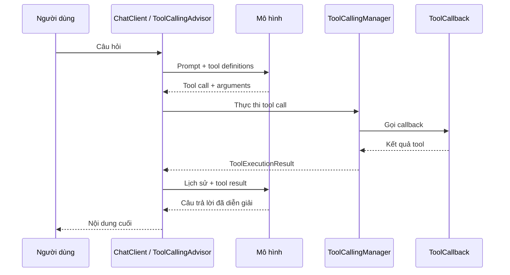
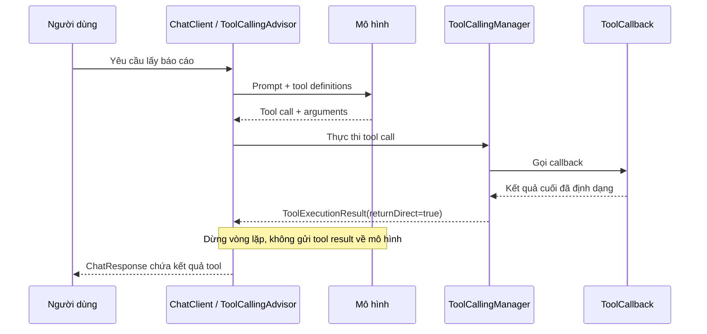

# Return direct và trường hợp bỏ lượt diễn giải tiếp theo của mô hình

Trong luồng tool calling thông thường, sau khi công cụ chạy xong, Spring AI gửi kết quả công cụ trở lại mô hình. Mô hình đọc kết quả, có thể gọi thêm công cụ hoặc tạo câu trả lời cuối cho người dùng. Đây là cách phù hợp khi cần mô hình tóm tắt, giải thích, so sánh hoặc kết hợp dữ liệu.

Có những công cụ đã tạo ra kết quả cuối cùng mà ứng dụng có thể trả trực tiếp. Ví dụ, một tool tạo báo cáo đã định dạng, một truy vấn trả về nội dung hoàn chỉnh hoặc một thao tác trả về mã xác nhận mà caller chỉ cần nhận. Spring AI cung cấp `returnDirect` để bỏ lượt gọi mô hình sau khi tool thực thi. `ToolCallingAdvisor` trả kết quả tool trực tiếp cho caller và kết thúc vòng lặp.

`returnDirect` chỉ bỏ lượt diễn giải tiếp theo. Mô hình vẫn được gọi ban đầu để quyết định có dùng tool nào và tạo arguments; ứng dụng vẫn thực thi callback. Vì vậy, đây là lựa chọn về luồng trả kết quả, không phải cách bỏ qua xác thực, phân quyền hoặc logic nghiệp vụ.

Sau bài học, bạn có thể:

- Phân biệt luồng tool calling thông thường với luồng `returnDirect`.
- Bật `returnDirect` bằng `@Tool` hoặc `ToolMetadata`.
- Hiểu kết quả nào được trả về caller và vì sao mô hình không còn diễn giải lại.
- Xử lý đúng batch có nhiều tool call.
- Phân biệt `returnDirect` với lỗi thực thi và xác nhận của người dùng.
- Biết cách xử lý cờ này khi dùng `ChatClient` tự động hoặc tự điều phối bằng `ChatModel`.

## 1. Luồng mặc định: công cụ trả kết quả cho mô hình

Mặc định, `returnDirect` là `false`. Khi mô hình yêu cầu gọi công cụ, Spring AI thực thi callback rồi đưa kết quả vào lịch sử hội thoại. Sau đó `ToolCallingAdvisor` gọi mô hình thêm một lần để mô hình sử dụng kết quả.



Lượt gọi mô hình sau tool hữu ích khi kết quả thô chưa phải câu trả lời. Chẳng hạn, tool trả về năm bản ghi đơn hàng, mô hình có thể xác định bản ghi mới nhất, giải thích trạng thái và trả lời bằng ngôn ngữ tự nhiên.

## 2. Return direct: trả kết quả tool thẳng cho caller

Khi tool có `returnDirect = true`, `ToolCallingAdvisor` vẫn thực thi tool như bình thường. Sau khi nhận `ToolExecutionResult`, advisor kiểm tra cờ này, thoát khỏi vòng lặp và trả kết quả thực thi trực tiếp cho caller dưới dạng `ChatResponse` có generation content là output của tool.



Kết quả tool không được gửi lại cho mô hình. Do đó, không có lượt gọi mô hình để tóm tắt, đổi cách diễn đạt hoặc kết hợp kết quả với dữ liệu khác. Lợi ích là giảm một lần round-trip tới model, giảm độ trễ và token phát sinh từ lượt diễn giải sau tool.

Điểm cần phân biệt:

- **Vẫn có model call đầu tiên:** mô hình vẫn quyết định gọi tool và tạo arguments.
- **Tool vẫn được thực thi:** callback và service nghiệp vụ vẫn chạy.
- **Chỉ bỏ model call sau tool:** không có lượt mô hình nhận kết quả để tạo câu trả lời mới.
- **Caller nhận output của tool:** nội dung trả về có thể là JSON hoặc văn bản do converter tạo, không nhất thiết là câu văn tự nhiên.

## 3. Bật returnDirect bằng @Tool

Với method tool khai báo bằng annotation, đặt `returnDirect = true` ngay trên `@Tool`:

```java
@Component
public class ReportTools {

    private final ReportService reportService;

    public ReportTools(ReportService reportService) {
        this.reportService = reportService;
    }

    @Tool(
        name = "generate_sales_report",
        description = "Tạo báo cáo doanh số theo khoảng thời gian. "
                + "Kết quả trả về đã được định dạng để hiển thị trực tiếp.",
        returnDirect = true
    )
    public SalesReport generateSalesReport(
            @ToolParam(description = "Ngày bắt đầu theo ISO-8601") LocalDate from,
            @ToolParam(description = "Ngày kết thúc theo ISO-8601") LocalDate to) {

        return reportService.generate(from, to);
    }
}
```

Khi ứng dụng truyền `ReportTools` vào `ChatClient`, Spring AI đưa tool definition cho mô hình. Nếu mô hình chọn tool này và tool call đủ điều kiện direct, kết quả `SalesReport` sẽ được chuyển đổi rồi trả thẳng về caller.

```java
ChatClient chatClient = ChatClient.builder(chatModel)
        .build();

ChatResponse response = chatClient.prompt()
        .user("Tạo báo cáo doanh số từ ngày 1 đến ngày 30 tháng 11 năm 2026")
        .tools(reportTools)
        .call()
        .chatResponse();

String output = response.getResult().getOutput().getText();
```

Với `returnDirect`, `output` là nội dung được chuyển đổi từ kết quả tool. Không nên viết code caller giả định đó luôn là câu trả lời do mô hình tạo. Nếu giao diện cần bảng, biểu đồ hoặc file, hãy thiết kế result DTO và lớp hiển thị tương ứng.

## 4. Bật returnDirect bằng ToolMetadata

Với `FunctionToolCallback`, `MethodToolCallback` hoặc custom `ToolCallback`, đặt cờ trong `ToolMetadata`:

```java
ToolMetadata metadata = ToolMetadata.builder()
        .returnDirect(true)
        .build();

ToolCallback reportTool = FunctionToolCallback
        .builder("generate_sales_report", reportService::generate)
        .description("Tạo báo cáo doanh số đã định dạng để trả trực tiếp")
        .inputType(ReportRequest.class)
        .toolMetadata(metadata)
        .build();
```

Với custom `ToolCallback`, trả metadata này từ `getToolMetadata()`:

```java
private final ToolMetadata metadata = ToolMetadata.builder()
        .returnDirect(true)
        .build();

@Override
public ToolMetadata getToolMetadata() {
    return this.metadata;
}
```

`ToolMetadata` mô tả cách framework xử lý kết quả của tool. Nó không thay đổi JSON Schema đầu vào và không thay đổi chữ ký Java của callback. Dữ liệu đầu vào vẫn được chuyển đổi như bình thường; method vẫn trả về object hoặc giá trị mà converter có thể biểu diễn.

## 5. Nội dung caller nhận được phụ thuộc vào result converter

Tool callback trả kết quả theo hợp đồng `ToolCallback`. Spring AI chuyển kết quả Java thành chuỗi thông qua `ToolCallResultConverter`. Converter mặc định dùng Jackson để tuần tự hóa object thành JSON. Nếu cấu hình converter riêng, nội dung được trả trực tiếp sẽ theo định dạng do converter đó tạo.

Ví dụ DTO:

```java
public record SalesReport(
        LocalDate from,
        LocalDate to,
        BigDecimal totalRevenue,
        long orderCount,
        String currency) {
}
```

Với converter mặc định, caller có thể nhận chuỗi JSON tương tự:

```json
{
  "from": "2026-11-01",
  "to": "2026-11-30",
  "totalRevenue": 128500000.00,
  "orderCount": 248,
  "currency": "VND"
}
```

Nếu caller muốn hiển thị câu văn, có thể tạo converter trả văn bản đã định dạng. Tuy nhiên, hãy quyết định rõ tầng nào chịu trách nhiệm trình bày: converter tạo nội dung sẵn sàng hiển thị, hoặc ứng dụng nhận JSON rồi render thành giao diện. `returnDirect` không yêu cầu kết quả phải là JSON hay văn bản; nó chỉ quyết định kết quả có quay lại mô hình hay không.

## 6. Điều kiện khi một response có nhiều tool call

Một model response có thể chứa nhiều tool call trong cùng một lượt. Spring AI chỉ honor `returnDirect` nếu **tất cả tool call trong lượt đó đều được phép và tất cả tool được gọi đều có `returnDirect = true`**.

| Tool call trong cùng response | Kết quả của lượt |
| --- | --- |
| Một tool, `returnDirect = true`, được phép | Trả trực tiếp kết quả tool; dừng loop. |
| Nhiều tool, tất cả đều `returnDirect = true`, tất cả được phép | Trả kết quả tool trực tiếp; dừng loop. |
| Có ít nhất một tool `returnDirect = false` | Các kết quả được gửi lại mô hình để tiếp tục. |
| Có tool call bị từ chối | Không honor direct; kết quả được gửi lại mô hình. |
| Có tool call cần xác nhận trước khi chạy | Toàn batch tạm dừng trước khi thực thi; ứng dụng xử lý quyết định rồi tiếp tục. |

Ví dụ mô hình yêu cầu `get_order` và `get_payment_status` cùng lúc. Nếu `get_order` bật direct nhưng `get_payment_status` không bật, Spring AI cần gửi kết quả của cả lượt về mô hình để mô hình tổng hợp. Một tool được bật direct không thể tự kết thúc lượt khi một tool khác trong batch vẫn cần mô hình xử lý.

Quy tắc này giúp giữ một kết quả nhất quán cho toàn bộ lượt. Nếu muốn trả trực tiếp một tool cụ thể, hãy cân nhắc để mô hình chỉ yêu cầu tool đó trong response riêng, hoặc thiết kế một tool tổng hợp thực hiện các bước cần thiết rồi trả một kết quả cuối.

## 7. Khi nào nên dùng returnDirect?

Chỉ bật direct khi output của tool đã đủ hoàn chỉnh cho bên gọi. Các trường hợp thường phù hợp:

- **Kết quả truy xuất đã hoàn chỉnh:** tool trả một tài liệu hoặc nội dung đã được chuẩn hóa mà ứng dụng hiển thị nguyên trạng.
- **Báo cáo hoặc artifact:** tool tạo báo cáo, file hoặc cấu trúc dữ liệu đã sẵn sàng để caller sử dụng.
- **Mã xác nhận:** tool thực hiện thao tác và trả một receipt ngắn, có trạng thái và mã tham chiếu rõ ràng.
- **Kết quả máy đọc:** caller là một thành phần khác sẽ parse JSON và render, không cần mô hình viết lại.
- **Độ trễ quan trọng:** lượt diễn giải sau tool không bổ sung giá trị cho use case.

Không nên dùng direct khi:

- Kết quả thô cần được tóm tắt hoặc giải thích cho người dùng.
- Mô hình cần so sánh nhiều kết quả hoặc kết hợp chúng với nhau.
- Kết quả cần được chuyển đổi thành câu trả lời theo ngữ cảnh hội thoại.
- Tool chỉ trả một phần dữ liệu và mô hình cần quyết định bước tiếp theo.
- Output là `null`, rỗng hoặc không đủ thông tin để caller hiểu điều gì đã xảy ra.

Ví dụ: `search_orders` trả về 20 đơn hàng phù hợp thường nên để mô hình tổng hợp, trừ khi caller cần nhận trực tiếp danh sách. `generate_invoice_pdf` trả về mã file cùng URL tải xuống đã kiểm tra quyền có thể phù hợp với direct nếu giao diện xử lý URL đó.

## 8. Return direct không có nghĩa là tool không chạy hoặc bỏ qua bảo mật

`returnDirect` không làm giảm trách nhiệm của ứng dụng. Mô hình vẫn có thể tạo arguments sai hoặc bị prompt injection. Callback vẫn phải kiểm tra dữ liệu, xác thực actor, phân quyền trên tài nguyên và áp dụng các giới hạn nghiệp vụ trước khi tạo kết quả.

Ví dụ tool trả trực tiếp báo cáo tài chính cần kiểm tra:

- Người dùng có quyền xem báo cáo của đơn vị/tenant đó không?
- Khoảng ngày có nằm trong phạm vi được phép không?
- Dữ liệu trả về có trường nội bộ hoặc thông tin cá nhân không cần thiết không?
- Kết quả có bị quá lớn hoặc chứa URL tải xuống không được bảo vệ không?
- Có cần audit hoặc xác nhận trước khi tạo artifact không?

Không đưa dữ liệu nhạy cảm vào output chỉ vì mô hình sẽ không nhìn thấy nó. Caller là người nhận trực tiếp kết quả, nên việc lọc dữ liệu ở service và DTO vẫn bắt buộc.

## 9. Phân biệt returnDirect với confirmation và lỗi

Ba trạng thái này có ý nghĩa khác nhau:

| Cơ chế | Tool có chạy không? | Mô hình có nhận kết quả tool không? | Luồng xử lý |
| --- | --- | --- | --- |
| `returnDirect = true` và được phép | Có | Không | Advisor trả kết quả tool cho caller và kết thúc loop. |
| Confirmation đang chờ | Chưa | Chưa có tool result | Advisor tạm dừng, trả thông tin chờ quyết định cho ứng dụng. |
| Confirmation bị từ chối | Không chạy tool bị từ chối | Có thông báo từ chối như tool result | Kết quả quay lại mô hình để phản hồi phù hợp. |
| Tool execution error | Tool đã bắt đầu và thất bại hoặc không hoàn tất | Tùy exception processor | Lỗi được ném về caller hoặc chuyển thành error tool response. |

Trong Spring AI 2.1.0, `requiresConfirmation = true` khiến `ToolCallingManager` tạm dừng toàn bộ batch trước khi chạy bất kỳ tool call nào trong response. Ứng dụng phải lấy quyết định cho từng tool call, rồi tiếp tục bằng `ToolCallingManager.executeToolCalls(...)`. Khi có call bị từ chối, kết quả không được trả direct; mô hình nhận tool response để biết quyết định đó.

Nếu callback ném lỗi, `ToolExecutionExceptionProcessor` quyết định ném exception về ứng dụng hay gửi thông báo lỗi lại cho mô hình. `returnDirect` không biến lỗi thành kết quả thành công và không thay thế exception handling.

## 10. Return direct khi dùng ChatClient tự động

Đây là trường hợp đơn giản nhất. `DefaultChatClient` tự đăng ký `ToolCallingAdvisor`; advisor đọc metadata, xử lý batch và quyết định trả trực tiếp hay gọi mô hình tiếp.

```java
ChatResponse response = chatClient.prompt()
        .user("Tạo báo cáo doanh số tháng 11")
        .tools(reportTool)
        .call()
        .chatResponse();

String result = response.getResult().getOutput().getText();
```

Khi direct được honor, `ChatResponse` chứa generation content từ tool output. Nếu direct không được honor, response cuối thường là câu trả lời do mô hình tạo sau khi nhận tool results. Vì vậy, nếu caller cần biết kết quả là JSON báo cáo hay câu văn tổng hợp, hãy dựa vào hợp đồng response của ứng dụng hoặc metadata mà ứng dụng quản lý, không suy đoán chỉ từ việc nội dung bắt đầu bằng `{`.

Với streaming (`.stream()`), `ToolCallingAdvisor` vẫn điều phối vòng lặp và áp dụng cùng quy tắc direct. Nếu UI cần hiển thị tiến trình gọi tool hoặc nhận biết kết quả cuối, hãy quan sát `ChatResponse`/chunk và không giả định mọi chunk text đều là câu trả lời cuối đã được mô hình diễn giải.

## 11. Return direct khi tự điều phối bằng ChatModel

Khi gọi `ChatModel` trực tiếp và tự chạy `ToolCallingManager`, ứng dụng là bên điều phối vòng lặp. `ToolExecutionResult` có `returnDirect()` để báo rằng kết quả tool phải được trả cho caller thay vì gửi lại mô hình.

Luồng khái quát:

```java
ToolExecutionResult result =
        toolCallingManager.executeToolCalls(prompt, chatResponse);

if (result.returnDirect()) {
    // Chuyển ToolExecutionResult thành generations để trả cho caller.
    List<Generation> generations = ToolExecutionResult.buildGenerations(result);
    return buildApplicationResponse(generations);
}

// Chỉ khi không direct, đưa conversationHistory vào prompt tiếp theo.
Prompt nextPrompt = new Prompt(result.conversationHistory(), chatOptions);
ChatResponse nextResponse = chatModel.call(nextPrompt);
```

`buildApplicationResponse(...)` là hàm do ứng dụng định nghĩa để tạo kiểu response mà tầng gọi cần. Điểm quan trọng là phải kiểm tra `result.returnDirect()` trước khi gọi mô hình tiếp. Nếu bỏ qua cờ này và luôn gửi `conversationHistory()` lại cho `ChatModel`, ứng dụng sẽ vô tình thực hiện lượt diễn giải mà tool yêu cầu bỏ qua.

Khi tự điều phối, ứng dụng cũng phải tự xử lý batch, confirmation, error, timeout, giới hạn số vòng và lịch sử hội thoại. `returnDirect` không tự dừng vòng lặp do ứng dụng viết.

## 12. Những lỗi thiết kế thường gặp

| Lỗi | Hệ quả | Cách khắc phục |
| --- | --- | --- |
| Bật direct cho kết quả thô | Người dùng nhận JSON hoặc dữ liệu khó hiểu thay vì lời giải thích | Chỉ bật khi output đã sẵn sàng cho caller; nếu cần, để mô hình diễn giải. |
| Nghĩ direct bỏ qua lần gọi mô hình đầu tiên | Hiểu sai chi phí và vòng đời thực thi | Direct chỉ bỏ lượt gọi mô hình sau tool. |
| Nghĩ direct không thực thi callback | Bỏ qua việc kiểm tra side effect và quyền | Callback vẫn chạy như bình thường; bảo vệ service như mọi tool khác. |
| Chỉ một tool trong batch bật direct | Kỳ vọng kết quả được trả thẳng nhưng advisor vẫn gọi mô hình | Bảo đảm mọi tool call trong batch đều được phép và bật direct. |
| Tool trả `void`/`null` nhưng bật direct | Caller không nhận được nội dung xác nhận hữu ích | Trả receipt có trạng thái, hoặc dùng result converter phù hợp. |
| Dùng direct cho thao tác cần người dùng duyệt | Bỏ qua thiết kế xác nhận | Dùng `requiresConfirmation`/confirmation policy và tiếp tục theo quyết định. |
| Caller giả định luôn có câu trả lời tự nhiên | UI hoặc API parse sai output | Định nghĩa rõ response contract cho direct result và normal model answer. |
| Tự điều phối nhưng không kiểm tra `returnDirect()` | Vẫn gọi model sau tool, gây thêm latency và token | Kiểm tra cờ trước khi tạo prompt tiếp theo. |

## 13. Kiểm thử returnDirect

Kiểm thử nên xác minh cả số lần gọi mô hình, số lần gọi tool và nội dung caller nhận được.

| Kịch bản | Số lần tool thực thi | Model call sau tool | Kết quả mong đợi |
| --- | ---: | ---: | --- |
| Một tool direct, thực thi thành công | 1 | 0 | Caller nhận output từ tool. |
| Một tool không direct | 1 | 1 hoặc nhiều hơn | Tool result quay lại mô hình để diễn giải/tiếp tục. |
| Hai tool trong batch, cả hai direct và được phép | 2 | 0 | Các tool result được trả trực tiếp. |
| Hai tool trong batch, chỉ một tool direct | 2 | Có | Kết quả batch quay lại mô hình. |
| Có tool call bị từ chối | Tùy quyết định | Có | Denial response được gửi lại mô hình; không direct. |
| Có tool cần xác nhận | 0 trước khi có quyết định | Chưa tiếp tục | Advisor trả trạng thái chờ xác nhận. |
| Tool ném exception | Tùy điểm lỗi | Tùy processor | Exception hoặc error tool response theo cấu hình. |
| Tool direct trả DTO | 1 | 0 | Caller nhận chuỗi do result converter tạo. |

Các assertion nên có:

1. Dùng spy trên `ChatModel` để xác nhận chỉ có model call ban đầu khi direct được honor.
2. Dùng spy trên callback để xác nhận tool vẫn thực thi đúng số lần.
3. Xác minh `ChatResponse` cuối chứa output tool, không phải nội dung do model tạo sau đó.
4. Với batch, xác minh một tool không direct làm mất điều kiện direct của toàn lượt.
5. Với confirmation, xác minh chưa có callback nào chạy trước khi nhận quyết định.
6. Với custom converter, xác minh caller nhận đúng định dạng.
7. Với thao tác có side effect, xác minh authorization, audit và idempotency vẫn hoạt động.

## 14. Quy trình quyết định có nên bật direct

Trước khi đặt `returnDirect = true`, hãy trả lời các câu hỏi sau:

1. Kết quả tool đã hoàn chỉnh để caller sử dụng chưa?
2. Caller có cần mô hình giải thích, tóm tắt hoặc kết hợp kết quả không?
3. Nếu một response chứa nhiều tool call, tất cả tool có thể direct không?
4. Output converter có tạo nội dung dễ đọc hoặc dễ parse không?
5. Tool có cần confirmation, authorization hoặc kiểm tra side effect không?
6. API/UI có phân biệt được tool result trực tiếp với câu trả lời do mô hình tạo không?

Nếu output cần mô hình diễn giải, giữ mặc định `returnDirect = false`. Nếu output đã là kết quả cuối và không cần lượt model tiếp theo, bật direct cho tool đó và kiểm thử cả đường đơn lẻ lẫn batch.

## Những điểm cần nhớ

- Mặc định, tool result quay lại mô hình để mô hình tiếp tục hội thoại.
- `returnDirect = true` khiến `ToolCallingAdvisor` dừng loop và trả kết quả tool thẳng cho caller.
- Tool vẫn được thực thi; direct chỉ bỏ lượt gọi mô hình sau tool.
- Có thể bật bằng `@Tool(returnDirect = true)` hoặc `ToolMetadata.builder().returnDirect(true)`.
- Nếu một response chứa nhiều tool call, direct chỉ được honor khi tất cả call đều được phép và tất cả tool đều bật direct.
- Tool result được chuyển thành nội dung theo `ToolCallResultConverter`; caller có thể nhận JSON hoặc văn bản, không nhất thiết là câu trả lời tự nhiên.
- Confirmation và lỗi là các nhánh riêng; direct không bỏ qua bước duyệt hoặc xử lý lỗi.
- Khi tự điều phối bằng `ChatModel`, ứng dụng phải kiểm tra `ToolExecutionResult.returnDirect()` và không gọi mô hình tiếp khi cờ này bật.

## Tài liệu tham khảo

- [Spring AI 2.1.0 Reference — Tool Calling](https://docs.spring.io/spring-ai/reference/2.1/api/tools.html)
- [Spring AI 2.1.0 Reference — ToolCallingAdvisor](https://docs.spring.io/spring-ai/reference/2.1/api/tools/tool-calling-advisor.html)
- [Spring AI 2.1.0 Reference — Tool Call Confirmation](https://docs.spring.io/spring-ai/reference/2.1/api/tools/tool-call-confirmation.html)
- [Spring AI API — ToolMetadata](https://docs.spring.io/spring-ai/docs/2.1.x/api/org/springframework/ai/tool/metadata/ToolMetadata.html)
- [Spring AI API — ToolExecutionResult](https://docs.spring.io/spring-ai/docs/2.1.x/api/org/springframework/ai/model/tool/ToolExecutionResult.html)

Các ví dụ và quy tắc trong bài dựa trên Spring AI 2.1.0. Khi dùng phiên bản khác, hãy kiểm tra API của `ToolMetadata`, `ToolCallingAdvisor` và `ToolExecutionResult`, đặc biệt nếu ứng dụng tự điều phối vòng tool calling.
