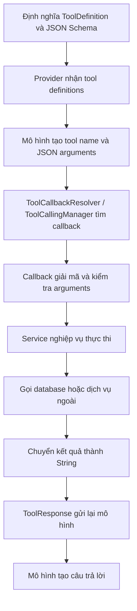

# Xử lý lỗi

## Phân loại lỗi schema, đối số, phân giải, thực thi và dịch vụ ngoài

Một yêu cầu tool calling đi qua nhiều bước: ứng dụng định nghĩa schema, mô hình tạo tên tool và đối số, Spring AI tìm callback, callback thực thi nghiệp vụ, rồi kết quả được chuyển đổi và có thể gửi tới dịch vụ bên ngoài. Lỗi ở mỗi bước có nguyên nhân và cách khắc phục khác nhau.

Trong module `SPRING_AI_TOOL_CALLING`, ứng dụng công khai công cụ bằng `@Tool`, `ToolCallback`, JSON Schema và `ToolContext`. Mô hình chỉ yêu cầu thực thi; ứng dụng vẫn chịu trách nhiệm kiểm tra dữ liệu, xác thực quyền, chạy nghiệp vụ, xử lý lỗi và quyết định thông tin nào được trả lại mô hình. Phân loại lỗi theo đúng tầng giúp tránh retry sai, tránh lộ thông tin nội bộ và giữ được trạng thái nghiệp vụ chính xác.

### 1. Theo dấu các điểm có thể phát sinh lỗi

Một tool call thường đi qua các bước sau:



Mỗi ranh giới có một nhóm lỗi riêng:

| Tầng | Ví dụ lỗi | Nơi xử lý chính |
| --- | --- | --- |
| Schema/định nghĩa | JSON Schema sai, thiếu mô tả, tên tool trùng, kiểu không được hỗ trợ | Cấu hình tool và kiểm thử khởi động |
| Đối số | JSON lỗi, thiếu field, sai kiểu, giá trị ngoài miền cho phép | Binding, validation và service nghiệp vụ |
| Phân giải | Không tìm thấy tên tool, callback không được gắn vào request | `ToolCallbackResolver`, `ToolCallingManager`, cấu hình request |
| Thực thi | Không tìm thấy đơn hàng, không đủ quyền, trạng thái không hợp lệ, lỗi code | Callback và service nghiệp vụ |
| Dịch vụ ngoài | Timeout, mất kết nối, rate limit, lỗi xác thực, server 5xx | HTTP/MCP client, resilience policy và adapter tích hợp |
| Chuyển đổi kết quả | DTO không serialize được, converter lỗi | `ToolCallResultConverter` và hợp đồng DTO |

Không nên gộp tất cả thành một thông báo “tool failed”. Cần ghi nhận tên tool, call ID, request ID, tầng lỗi và khả năng retry để hệ thống biết bước nào cần sửa hoặc chạy lại.

### 2. Lỗi schema và định nghĩa tool

`ToolDefinition` mô tả tên tool, mục đích và input schema mà mô hình nhìn thấy. Với method-based tool, Spring AI tạo JSON Schema từ danh sách tham số. Schema hướng dẫn mô hình tạo arguments; nó không thay thế validation ở callback hoặc service.

Các lỗi thường gặp ở tầng này:

- Schema JSON không hợp lệ hoặc không được provider hỗ trợ.
- Mô tả tool không rõ khiến mô hình chọn sai tool hoặc dùng sai tham số.
- Khai báo field bắt buộc nhưng mô hình không có cách biết giá trị cần cung cấp.
- Đánh dấu tham số optional trong khi code không chấp nhận `null`.
- Dùng kiểu tham số hoặc kiểu trả về mà `MethodToolCallback` không hỗ trợ.
- Có hai callback cùng tên trong một tool set.

Ví dụ khai báo rõ tên, mô tả và yêu cầu của từng tham số:

```java
@Component
public class OrderTools {

    @Tool(description = "Tra cứu trạng thái một đơn hàng mà người dùng hiện tại có quyền xem.")
    public OrderSummary lookupOrder(
            @ToolParam(description = "Mã đơn hàng, ví dụ ORD-2048") String orderId,
            @ToolParam(description = "Có cần kèm lịch sử vận chuyển hay không", required = false)
            Boolean includeTracking,
            ToolContext toolContext) {
        // Phần thực thi được trình bày ở các mục sau.
        return null;
    }
}
```

Trong Spring AI, các tham số method mặc định được xem là required. Dùng `@ToolParam(required = false)` hoặc `@Nullable` để khai báo optional. Với tham số optional có thể nhận `null`, nên dùng kiểu wrapper như `Boolean` hoặc `Integer` thay vì primitive `boolean` hoặc `int`. `Optional`, `CompletableFuture`, `Future`, `Flow`, `Mono` và `Flux` không phải kiểu method parameter/return được `MethodToolCallback` hỗ trợ trực tiếp.

Một số nguyên tắc thiết kế schema:

- Dùng tên field và kiểu dữ liệu thể hiện đúng hợp đồng nghiệp vụ.
- Mô tả định dạng, đơn vị, timezone, enum và giới hạn giá trị trong description hoặc schema khi có thể.
- Chỉ đánh dấu optional nếu callback thực sự có cách xử lý khi giá trị vắng mặt.
- Không đưa `tenantId`, `userId`, role hoặc token vào schema để mô hình tự điền; dữ liệu tin cậy thuộc `ToolContext`.
- Kiểm tra tool definitions lúc khởi động và trong integration test, thay vì chờ mô hình gọi lần đầu mới phát hiện cấu hình sai.

### 3. Lỗi đối số: JSON, kiểu dữ liệu và giá trị nghiệp vụ

Ngay cả khi schema hợp lệ, mô hình vẫn có thể gửi arguments sai. Cần tách ba loại:

1. **Lỗi cú pháp hoặc binding:** JSON không parse được, field sai kiểu hoặc không chuyển đổi được sang Java type.
2. **Lỗi hợp đồng:** thiếu field bắt buộc, chuỗi rỗng, enum không hợp lệ hoặc định dạng ID sai.
3. **Lỗi nghiệp vụ:** ID đúng định dạng nhưng không tồn tại, số lượng vượt tồn kho hoặc trạng thái đơn hàng không cho phép thao tác.

Schema giúp giảm lỗi nhưng không bảo đảm mô hình luôn tuân thủ. Callback/service vẫn phải xác minh dữ liệu trước khi truy vấn hoặc thay đổi trạng thái.

Ví dụ kiểm tra arguments và context trước khi gọi service:

```java
@Component
public class OrderTools {

    private final OrderService orderService;

    public OrderTools(OrderService orderService) {
        this.orderService = orderService;
    }

    @Tool(description = "Tra cứu trạng thái đơn hàng theo mã đơn.")
    public OrderSummary lookupOrder(
            @ToolParam(description = "Mã đơn hàng dạng ORD-xxxx") String orderId,
            ToolContext toolContext) {

        if (orderId == null || !orderId.matches("ORD-[0-9]{4,12}")) {
            throw new InvalidToolArgumentsException("Mã đơn hàng không đúng định dạng.");
        }

        String tenantId = requireContextValue(toolContext, "tenantId");
        String userId = requireContextValue(toolContext, "userId");

        return orderService.findVisibleOrder(orderId, tenantId, userId);
    }

    private String requireContextValue(ToolContext context, String key) {
        Object value = context == null ? null : context.getContext().get(key);
        if (!(value instanceof String text) || text.isBlank()) {
            throw new IllegalStateException("Thiếu ngữ cảnh xác thực cần thiết.");
        }
        return text;
    }
}
```

`InvalidToolArgumentsException` là exception do ứng dụng định nghĩa. Đoạn code minh họa việc kiểm tra đầu vào trước khi gọi service. Nếu dùng Jakarta Bean Validation, hãy gọi `Validator` một cách tường minh hoặc tích hợp validation ở service boundary; không giả định JSON Schema tự kích hoạt Bean Validation cho mọi `@Tool` method.

Ví dụ với DTO:

```java
public record TransferRequest(
        @NotBlank String sourceAccount,
        @NotBlank String destinationAccount,
        @Positive BigDecimal amount,
        @NotBlank String currency) {
}

@Tool(description = "Tạo yêu cầu chuyển tiền giữa hai tài khoản.")
public TransferReceipt requestTransfer(TransferRequest request) {
    Set<ConstraintViolation<TransferRequest>> violations =
        validator.validate(request);

    if (!violations.isEmpty()) {
        throw new InvalidToolArgumentsException("Thông tin chuyển tiền không hợp lệ.");
    }

    return transferService.requestTransfer(request);
}
```

Validation cần diễn ra trước side effect. Với giao dịch tài chính, ngoài kiểu dữ liệu còn phải kiểm tra quyền sở hữu tài khoản, hạn mức, số dư, tiền tệ được hỗ trợ và quy tắc xác nhận.

### 4. Lỗi phân giải tool

Sau khi nhận tool name, `ToolCallingManager` cần tìm `ToolCallback` tương ứng. Callback có thể được gắn trực tiếp vào request hoặc được tìm qua `ToolCallbackResolver` khi resolution fallback được bật.

Các lỗi thường gặp:

- Model gọi tên tool khác với `ToolDefinition.name()`.
- Callback chưa được đăng ký hoặc không được gắn vào request.
- Resolver không tìm thấy callback và trả về `null`.
- Hai callback trong cùng tool set có tên trùng.
- Một callback bị gỡ hoặc bị vô hiệu hóa nhưng model vẫn gọi tên cũ.

Trong Spring AI 2.0.2, nếu không tìm thấy callback, `ToolCallingManager` ném `IllegalStateException` với thông báo dạng `No ToolCallback found for tool name`. Resolution fallback mặc định tắt; có thể bật bằng `spring.ai.tools.resolution.fallback.enabled=true`, nhưng chỉ nên bật khi ứng dụng kiểm soát toàn bộ callback mà resolver có thể trả về.

Tên tool trùng cũng cần được xử lý rõ ràng. `ChatClient` kiểm tra danh sách tool đã gộp và báo `IllegalStateException` khi có tên trùng. Nếu tự gọi `ChatModel` và tự ghép `ToolCallingChatOptions`, hãy gọi `ToolCallingChatOptions.validateToolCallbacks(...)` hoặc bảo đảm namespace tên duy nhất; đường thủ công có thể phân giải callback đầu tiên theo tên mà không báo xung đột.

| Tình huống | Hành vi | Cách khắc phục |
| --- | --- | --- |
| Không có callback đúng tên | `IllegalStateException` | So khớp tên trong model response với tool definitions và request |
| Callback tồn tại nhưng chưa gắn request | Không thực thi khi fallback tắt | Thêm callback vào `.tools(...)`/`.defaultTools(...)` hoặc bật fallback có kiểm soát |
| Tên callback bị trùng | `ChatClient` báo lỗi cấu hình | Đổi tên hoặc thêm namespace theo nguồn |
| Tool bị tắt trong registry | Resolver không trả callback | Cập nhật danh sách tool mà mô hình được phép thấy |

Lỗi phân giải thường là lỗi cấu hình hoặc capability. Không retry cùng một tool call liên tục nếu callback không thể được tìm thấy; cần sửa danh sách tool hoặc tạo request mới với tool hợp lệ.

### 5. Lỗi thực thi trong callback và service nghiệp vụ

Khi callback đã được tìm thấy và chạy, lỗi có thể đến từ logic nghiệp vụ hoặc hạ tầng nội bộ:

- Đơn hàng hoặc khách hàng không tồn tại.
- Người dùng không có quyền truy cập tài nguyên.
- Trạng thái hiện tại không cho phép thao tác.
- Dữ liệu xung đột hoặc vi phạm ràng buộc database.
- Lỗi lập trình, lỗi cấu hình hoặc lỗi serialize dữ liệu.

Nên phân biệt kết quả nghiệp vụ bình thường với lỗi thực thi. Ví dụ, “không tìm thấy đơn hàng” có thể là một kết quả có cấu trúc `NOT_FOUND`; lỗi database timeout là lỗi hạ tầng. Không biến mọi trường hợp thành một chuỗi rỗng hoặc một số `0`, vì mô hình và ứng dụng sẽ không phân biệt được trạng thái.

Với lỗi thực thi, Spring AI bọc exception trong `ToolExecutionException` và chuyển tới `ToolExecutionExceptionProcessor`. Processor có hai lựa chọn: tạo chuỗi thông báo lỗi để gửi lại mô hình, hoặc ném exception để caller xử lý.

### 6. Hành vi mặc định của `ToolExecutionExceptionProcessor`

Khi dùng Spring Boot starter, Spring AI tự cấu hình `DefaultToolExecutionExceptionProcessor`. Theo tài liệu Spring AI 2.0.2:

- Message của `RuntimeException` được gửi lại mô hình dưới dạng tool error response.
- Checked exception và `Error` luôn được ném lại cho caller.
- Có thể đặt `spring.ai.tools.throw-exception-on-error=true` để đẩy tool errors về caller xử lý.

```properties
spring.ai.tools.throw-exception-on-error=true
```

Nếu để mặc định, mô hình có thể đọc lỗi và giải thích hoặc thử cách khác. Điều đó hữu ích với lỗi đầu vào có thể sửa, nhưng cần cẩn trọng: message của exception có thể chứa SQL, hostname, token, path nội bộ hoặc dữ liệu khách hàng. Không nên đưa nguyên văn exception kỹ thuật ra mô hình.

Nếu muốn tự quyết định lỗi nào được gửi cho mô hình và lỗi nào phải dừng request, hãy cung cấp `ToolExecutionExceptionProcessor` riêng:

```java
@Configuration(proxyBeanMethods = false)
public class ToolErrorConfiguration {

    @Bean
    ToolExecutionExceptionProcessor toolExecutionExceptionProcessor() {
        return exception -> {
            Throwable cause = exception.getCause();

            if (cause instanceof InvalidToolArgumentsException) {
                return "{\"code\":\"INVALID_ARGUMENT\","
                    + "\"retryable\":false,"
                    + "\"message\":\"Thông tin đầu vào không hợp lệ. Hãy kiểm tra mã và định dạng.\"}";
            }

            if (cause instanceof OrderNotFoundException) {
                return "{\"code\":\"ORDER_NOT_FOUND\","
                    + "\"retryable\":false,"
                    + "\"message\":\"Không tìm thấy đơn hàng trong phạm vi được phép.\"}";
            }

            if (cause instanceof UpstreamUnavailableException) {
                return "{\"code\":\"UPSTREAM_UNAVAILABLE\","
                    + "\"retryable\":true,"
                    + "\"message\":\"Dịch vụ liên quan tạm thời không khả dụng.\"}";
            }

            // Lỗi chưa phân loại phải được xử lý ở caller và ghi log nội bộ.
            throw exception;
        };
    }
}
```

Các exception nghiệp vụ trong ví dụ là kiểu do ứng dụng định nghĩa. Chuỗi trả về là thông báo an toàn để mô hình đọc; log nội bộ vẫn giữ cause, stack trace và correlation ID để điều tra. Với custom `ToolCallback`, hãy ném `ToolExecutionException` từ `call()` khi thực thi thất bại để processor nhận được lỗi theo hợp đồng của Spring AI.

### 7. Thiết kế thông báo lỗi dành cho mô hình

Thông báo lỗi gửi mô hình nên ngắn, ổn định và có thể hành động. Không cần đưa stack trace hoặc thông tin hạ tầng vào đó.

Một error envelope có thể gồm:

| Field | Ý nghĩa |
| --- | --- |
| `code` | Mã lỗi ổn định để mô hình và ứng dụng phân loại |
| `retryable` | Có thể thử lại hay không theo chính sách đã biết |
| `message` | Mô tả an toàn và hướng xử lý tiếp theo |
| `correlationId` | Mã tham chiếu để caller tra log nội bộ nếu cần |

Ví dụ:

```json
{
  "code": "UPSTREAM_TIMEOUT",
  "retryable": true,
  "message": "Dịch vụ vận chuyển chưa phản hồi. Có thể thử lại sau.",
  "correlationId": "req-8f21"
}
```

Mô hình có thể giải thích lỗi cho người dùng, nhưng ứng dụng vẫn phải quyết định retry. Trường `retryable` trong message không tự kích hoạt retry và không cấp quyền cho mô hình lặp vô hạn. Hãy áp dụng số lần retry, timeout và tool-call limit ở tầng ứng dụng.

Không đưa các dữ liệu sau vào tool error response:

- API key, bearer token, cookie hoặc secret.
- SQL statement, connection string, hostname nội bộ hoặc stack trace.
- Dữ liệu cá nhân hoặc bản ghi của tenant khác.
- Nội dung exception thô từ dịch vụ ngoài nếu chứa request/response payload nhạy cảm.

### 8. Lỗi từ dịch vụ ngoài

Tool thường là adapter gọi REST API, database, MCP server hoặc dịch vụ thanh toán. Cần phân loại lỗi theo khả năng phục hồi và ý nghĩa nghiệp vụ.

| Nhóm lỗi | Ví dụ | Hành động khuyến nghị |
| --- | --- | --- |
| Lỗi request | HTTP 400, payload sai hoặc thiếu field | Sửa arguments hoặc mapping; không retry cùng request |
| Không xác thực | HTTP 401 | Làm mới thông tin xác thực theo flow của ứng dụng |
| Không đủ quyền | HTTP 403 | Từ chối thao tác; không retry để vượt quyền |
| Không tìm thấy tài nguyên | HTTP 404 | Trả trạng thái `NOT_FOUND` nếu phù hợp với hợp đồng nghiệp vụ |
| Rate limit | HTTP 429 | Tôn trọng `Retry-After` nếu có; retry có giới hạn |
| Timeout/mất kết nối | DNS, connect timeout, read timeout, connection reset | Có thể retry nếu thao tác an toàn và còn deadline |
| Lỗi server | HTTP 5xx | Có thể retry có backoff; dùng circuit breaker khi cần |
| Xung đột trạng thái | HTTP 409 hoặc optimistic-lock conflict | Đọc lại trạng thái và quyết định nghiệp vụ; không lặp mù quáng |

Đây là cách phân loại phổ biến cho HTTP service; từng API có thể định nghĩa status code và khả năng retry khác nhau. Với thao tác ghi dữ liệu, cần idempotency key hoặc business command ID trước khi retry vì timeout không cho biết chắc server đã nhận hay chưa.

Ví dụ adapter gọi service vận chuyển:

```java
public DeliveryStatus getDeliveryStatus(String orderId) {
    try {
        return restClient.get()
            .uri("/deliveries/{orderId}", orderId)
            .retrieve()
            .body(DeliveryStatus.class);
    }
    catch (HttpClientErrorException.NotFound ex) {
        throw new DeliveryNotFoundException(orderId, ex);
    }
    catch (HttpClientErrorException.TooManyRequests ex) {
        throw new UpstreamRateLimitedException("delivery-service", ex);
    }
    catch (ResourceAccessException ex) {
        throw new UpstreamUnavailableException("delivery-service", ex);
    }
    catch (HttpServerErrorException ex) {
        throw new UpstreamUnavailableException("delivery-service", ex);
    }
}
```

Các exception trong ví dụ là kiểu ứng dụng tự định nghĩa. Adapter chuyển lỗi transport thành lỗi có ý nghĩa để `ToolExecutionExceptionProcessor` hoặc tầng orchestration quyết định cách phản hồi.

### 9. Dịch vụ MCP và timeout

Khi tool được cung cấp bởi MCP server, callback local là một lớp proxy gọi qua MCP client. Vì vậy, lỗi có thể đến từ việc kết nối, timeout, phiên giao thức hoặc lỗi do MCP server trả về.

Trong Spring AI MCP Client Boot Starter:

- `spring.ai.mcp.client.request-timeout` có giá trị mặc định 20 giây cho một exchange.
- Với modern Streamable HTTP, có thể cấu hình timeout toàn bộ call bằng `spring.ai.mcp.client.modern.call-timeout`.
- `unreachable-cool-down` cho phép tạm ngừng hỏi lại server được xem là không thể truy cập.
- Trong modern connection, mất kết nối, timeout, mất response hoặc status 5xx/408/429 được xem là server không khả dụng; status 401/403/404 được ném về caller để ứng dụng xử lý xác thực, quyền hoặc cấu hình.

Ví dụ cấu hình:

```yaml
spring:
  ai:
    mcp:
      client:
        request-timeout: 20s
        modern:
          call-timeout: 45s
          unreachable-cool-down: 30s
```

Khi một MCP server tạm thời không khả dụng, ứng dụng có thể tiếp tục dùng tool từ server khác nếu danh sách tool còn lại đáp ứng yêu cầu. Không giả định mọi tool trong cùng một provider có chung trạng thái sức khỏe.

Lưu ý thêm về identity: MCP client session có thể được chia sẻ giữa nhiều request. Nếu server phản hồi khác nhau theo người dùng, phải cấu hình client scope và truyền credential theo request đúng cách; không dùng một session dùng chung như ranh giới phân quyền cho từng user.

### 10. Retry, timeout và idempotency

Không phải lỗi nào cũng nên retry. Hãy xác định retry ở tầng adapter hoặc service, thay vì yêu cầu mô hình tự gọi lại vô hạn.

| Tình huống | Retry? | Điều kiện |
| --- | --- | --- |
| JSON sai hoặc thiếu đối số | Không | Mô hình hoặc caller phải tạo request hợp lệ mới |
| Tool name không tồn tại | Không | Sửa đăng ký hoặc tên tool |
| Không đủ quyền | Không | Chỉ tiếp tục sau khi quyền được cấp hợp lệ |
| HTTP 429 | Có điều kiện | Tôn trọng `Retry-After`, backoff và giới hạn số lần |
| Timeout khi đọc dữ liệu | Có thể | Có deadline và retry budget |
| Timeout khi ghi dữ liệu | Chỉ khi có idempotency | Xác định request trước đã được commit hay chưa |
| HTTP 5xx | Có điều kiện | Backoff, circuit breaker và thao tác an toàn |
| Lỗi chuyển đổi kết quả | Không retry nghiệp vụ ngay | Sửa DTO/converter hoặc tương thích schema |

Đối với thao tác có side effect, nên dùng idempotency key do ứng dụng tạo. Tool call ID do mô hình cung cấp hữu ích để tương quan một lần gọi, nhưng có thể thay đổi khi mô hình retry hoặc tạo tool call mới. Một operation ID ổn định giúp service phát hiện yêu cầu đã hoàn tất và tránh gửi email, tạo thanh toán hoặc cập nhật bản ghi lần thứ hai.

Hãy đặt timeout nhỏ hơn deadline của request tổng thể. Nếu mỗi tool được retry nhiều lần mà không có ngân sách chung, một câu hỏi có thể chiếm worker lâu hơn thời gian người dùng chờ hoặc vượt giới hạn vòng lặp.

### 11. Lỗi chuyển đổi kết quả

Sau khi method chạy thành công, Spring AI cần chuyển giá trị trả về thành `String` để đưa vào tool response. `DefaultToolCallResultConverter` mặc định dùng Jackson để serialize object thành JSON. Có thể thay converter trên `@Tool`, `ToolMetadata` hoặc builder của `MethodToolCallback`/`FunctionToolCallback`.

Lỗi chuyển đổi có thể xảy ra khi:

- DTO có field không serialize được.
- Object graph chứa vòng tham chiếu.
- Kiểu trả về không tương thích với converter.
- DTO chứa dữ liệu quá lớn hoặc không nên gửi cho mô hình.
- Schema kết quả thay đổi nhưng prompt/tool contract chưa được cập nhật.

`MethodToolCallback` không hỗ trợ `Optional`, các kiểu async như `CompletableFuture`/`Future`, reactive types như `Mono`/`Flux`, hoặc functional types làm tham số/giá trị trả về. Hãy trả một DTO đồng bộ, nhỏ, có cấu trúc rõ ràng. Không trả entity database có lazy relation hoặc toàn bộ object graph của hệ thống.

Ví dụ DTO trả về tối giản:

```java
public record OrderSummary(
        String orderId,
        String status,
        Instant updatedAt,
        String trackingReference) {
}
```

Nếu method đã cập nhật database nhưng serialize kết quả thất bại, side effect có thể đã hoàn tất dù caller chỉ nhận lỗi. Vì vậy, hãy lưu operation ID và trạng thái nghiệp vụ; không retry thao tác ghi chỉ vì response serialization bị lỗi.

### 12. Không để lỗi nghiệp vụ trở thành quyền truy cập

Lỗi phân quyền cần được xử lý rõ ràng và nhất quán. Không trả thông tin tài nguyên bị từ chối cho mô hình nếu người dùng không được phép xem nó.

Ví dụ:

- `ORDER_NOT_FOUND`: không có đơn hàng phù hợp.
- `ACCESS_DENIED`: người dùng không có quyền xem đơn hàng.
- `TENANT_SCOPE_MISMATCH`: tài nguyên không thuộc tenant hiện tại.
- `UPSTREAM_UNAVAILABLE`: hệ thống vận chuyển tạm thời không phản hồi.

Với một số API, trả cùng thông báo cho “không tồn tại” và “không có quyền” giúp tránh dò tìm ID tài nguyên. Chọn chính sách theo mô hình đe dọa và hợp đồng API. Trong mọi trường hợp, kiểm tra tenant/user phải dùng `ToolContext` do ứng dụng tạo; không dùng giá trị do mô hình cung cấp làm danh tính.

### 13. Quan sát và ghi log lỗi

Để điều tra lỗi, cần liên kết được request của người dùng, tool call và request tới dịch vụ ngoài. Nên ghi nhận:

- `conversationId`, `requestId` và `toolCallId`.
- Tên tool và phiên bản tool definition.
- Nhóm lỗi: `SCHEMA`, `ARGUMENT`, `RESOLUTION`, `EXECUTION`, `UPSTREAM`, `RESULT_CONVERSION`.
- Mã lỗi nghiệp vụ hoặc HTTP status.
- Thời gian thực thi, số lần retry và timeout.
- Kết quả cuối: thành công, lỗi được gửi về mô hình hay exception được trả cho caller.

Spring AI cung cấp Micrometer observation `spring.ai.tool` để đo thời gian thực thi và truyền tracing context. Việc xuất arguments và results thành span attributes bị tắt mặc định vì dữ liệu có thể nhạy cảm. Chỉ bật khi chính sách bảo vệ dữ liệu cho phép.

Trong môi trường phát triển, có thể bật log DEBUG:

```properties
logging.level.org.springframework.ai=DEBUG
```

Không ghi toàn bộ payload hoặc exception message vào log production nếu chúng có thể chứa thông tin cá nhân, token hay bí mật dịch vụ. Dùng mã lỗi và correlation ID để tra cứu dữ liệu chi tiết trong hệ thống được kiểm soát.

### 14. Kiểm thử từng tầng lỗi

Không nên chỉ kiểm thử câu trả lời cuối của mô hình. Hãy kiểm tra từng boundary để biết lỗi được phát hiện ở đâu và callback có bị chạy ngoài ý muốn hay không.

**Kiểm thử schema:**

- Schema được tạo có tên, description, kiểu và required fields đúng.
- Optional parameters được đánh dấu đúng.
- Tool names là duy nhất.
- Các kiểu method parameter/return được hỗ trợ.
- Provider chấp nhận tool definitions đã cấu hình.

**Kiểm thử đối số:**

- JSON hợp lệ được map sang Java arguments.
- JSON malformed hoặc sai kiểu bị từ chối.
- Thiếu field required và giá trị optional được xử lý đúng.
- Giá trị ngoài miền nghiệp vụ bị từ chối trước side effect.
- Primitive/wrapper và giá trị `null` được kiểm tra theo đúng signature.

**Kiểm thử phân giải:**

- Callback đúng tên được tìm thấy.
- Tên không tồn tại tạo lỗi rõ ràng.
- Fallback tắt ngăn callback không gắn request được thực thi.
- Tên trùng bị phát hiện ở bước cấu hình hoặc validation.

**Kiểm thử thực thi:**

- Domain exception được chuyển thành error response hoặc được ném theo chính sách.
- Authorization/tenant check chạy trước truy vấn và side effect.
- `ToolExecutionExceptionProcessor` chỉ gửi thông báo đã được sanitize cho mô hình.
- Checked exception và lỗi không thể phục hồi được chuyển tới caller theo chính sách.

**Kiểm thử dịch vụ ngoài:**

- Timeout, connection reset, 401, 403, 404, 429 và 5xx được phân loại đúng.
- Retry có giới hạn và tôn trọng `Retry-After` nếu có.
- Idempotency ngăn thao tác ghi chạy hai lần.
- Circuit breaker hoặc cooldown không làm các tool độc lập khác bị vô hiệu hóa ngoài ý muốn.

**Kiểm thử kết quả:**

- DTO serialize thành công và không chứa field nhạy cảm.
- Converter lỗi được phát hiện.
- Lỗi serialize sau side effect không khiến thao tác bị chạy lại mù quáng.

Ví dụ test processor chuyển lỗi nghiệp vụ thành thông báo an toàn:

```java
@Test
void mapsOrderNotFoundToSafeToolError() {
    ToolExecutionExceptionProcessor processor = exception -> {
        if (exception.getCause() instanceof OrderNotFoundException) {
            return "{\"code\":\"ORDER_NOT_FOUND\",\"retryable\":false}";
        }
        throw exception;
    };

    ToolExecutionException exception = new ToolExecutionException(
        toolDefinition,
        new OrderNotFoundException("ORD-2048"));

    assertThat(processor.process(exception))
        .isEqualTo("{\"code\":\"ORDER_NOT_FOUND\",\"retryable\":false}");
}
```

Test này kiểm tra mapping của ứng dụng. Một integration test riêng cần xác minh `DefaultToolCallingManager` thực sự đưa chuỗi lỗi vào tool response và mô hình nhận được đúng nội dung.

### 15. Bảng quyết định: xử lý lỗi ở đâu?

| Lỗi phát hiện tại | Sửa ở đâu? | Gửi lỗi về mô hình? | Retry? |
| --- | --- | --- | --- |
| Schema sai hoặc provider từ chối tool definition | Tool configuration/schema | Thường không; sửa cấu hình trước khi chạy | Không |
| JSON arguments sai cú pháp/kiểu | Input binding và error processor | Có thể gửi lỗi ngắn để mô hình sửa | Chỉ sau khi arguments mới hợp lệ |
| Giá trị không hợp lệ theo nghiệp vụ | Callback/service validation | Có thể gửi mã lỗi và yêu cầu thông tin đúng | Không tự retry cùng arguments |
| Không tìm thấy callback | Registration/resolver/request tools | Thường caller cần sửa cấu hình | Không |
| Không đủ quyền | Authorization/service | Chỉ trả thông báo từ chối an toàn | Không |
| Tài nguyên không tồn tại | Service nghiệp vụ | Có thể trả `NOT_FOUND` | Không, trừ khi dữ liệu eventual-consistent |
| Dịch vụ ngoài timeout/5xx | Adapter/resilience layer | Có thể báo tạm thời không khả dụng | Có điều kiện, có deadline và idempotency |
| Dịch vụ ngoài 401/403 | Authentication/authorization | Thông báo cần xác thực hoặc không có quyền | Không retry cùng credential |
| Serialize kết quả thất bại | DTO/result converter | Không nên yêu cầu mô hình đoán kết quả | Sửa converter; không chạy lại side effect |

### 16. Quy trình xử lý lỗi cho một tool call

1. Xác định tool name và request/call ID để tương quan log.
2. Kiểm tra tool definition và schema có hợp lệ, tên có duy nhất không.
3. Parse arguments và kiểm tra kiểu, field required, định dạng và giới hạn.
4. Đọc danh tính tin cậy từ `ToolContext`, xác minh quyền và tenant.
5. Thực thi service nghiệp vụ; phân biệt domain outcome với lỗi kỹ thuật.
6. Với dịch vụ ngoài, phân loại status/timeout, áp dụng retry có giới hạn và idempotency.
7. Chuyển kết quả thành DTO nhỏ và serialize bằng converter.
8. Nếu có lỗi, map sang error code an toàn hoặc ném exception cho caller theo chính sách.
9. Ghi trạng thái và correlation ID; không log bí mật hoặc payload nhạy cảm.
10. Chỉ tiếp tục vòng lặp khi tool response và trạng thái nghiệp vụ đã được xác định rõ.

Trong Spring AI, schema, resolver, callback và exception processor đảm nhiệm các phần khác nhau của tool calling lifecycle. Phân loại lỗi theo từng tầng giúp mô hình nhận được thông tin có ích để sửa yêu cầu, đồng thời giữ quyền kiểm soát thực thi ở ứng dụng. Với thao tác quan trọng, service phải xác minh quyền và trạng thái; với dịch vụ ngoài, adapter phải quản lý timeout và retry; với mọi lỗi, ứng dụng phải bảo vệ dữ liệu nội bộ và tránh lặp side effect.

### Tài liệu tham khảo

- [Spring AI 2.0.2 Reference — Tool Calling](https://docs.spring.io/spring-ai/reference/api/tools.html)
- [Spring AI 2.0.2 Reference — Tool Specification and Exception Handling](https://docs.spring.io/spring-ai/reference/api/tools.html#_exception_handling)
- [Spring AI 2.0.2 API — ToolExecutionException](https://docs.spring.io/spring-ai/docs/current/api/org/springframework/ai/tool/execution/ToolExecutionException.html)
- [Spring AI 2.0.2 API — ToolExecutionExceptionProcessor](https://docs.spring.io/spring-ai/docs/current/api/org/springframework/ai/tool/execution/ToolExecutionExceptionProcessor.html)
- [Spring AI 2.0.2 Reference — MCP Client Boot Starter](https://docs.spring.io/spring-ai/reference/api/mcp/mcp-client-boot-starter-docs.html)
- [Spring AI 2.0.2 Upgrade Notes](https://docs.spring.io/spring-ai/reference/upgrade-notes.html)

Các ví dụ exception processor, resolver và MCP client trong bài dựa trên Spring AI 2.0.2. Hãy đối chiếu dependency thực tế của dự án và hợp đồng của dịch vụ ngoài trước khi áp dụng status mapping, timeout hoặc retry policy.
