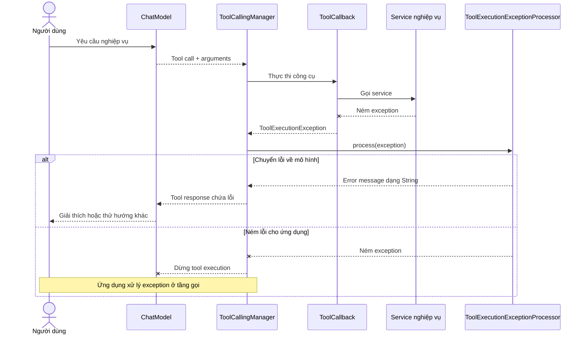

# ToolExecutionException và ToolExecutionExceptionProcessor

Khi một công cụ Spring AI gặp lỗi trong lúc thực thi, framework biểu diễn lỗi đó bằng `ToolExecutionException`. `ToolExecutionExceptionProcessor` quyết định bước tiếp theo: chuyển lỗi thành một chuỗi an toàn để gửi lại mô hình, hoặc ném exception để ứng dụng xử lý.

Hai thành phần này có trách nhiệm khác nhau. `ToolExecutionException` là exception bao quanh lỗi thực thi và giữ định nghĩa của công cụ đã thất bại. `ToolExecutionExceptionProcessor` là chính sách xử lý exception đó. Nhờ tách riêng hai phần, ứng dụng có thể chọn cách xử lý theo loại lỗi mà không phải nhúng logic điều phối hội thoại vào từng tool.

Các ví dụ trong bài dùng API Spring AI 1.0.x, được đối chiếu với tài liệu và Javadocs Spring AI 1.0.9. Những API cốt lõi này được giới thiệu từ Spring AI 1.0.0; hãy kiểm tra Javadocs của phiên bản dự án nếu đang dùng dòng phiên bản khác.

## Exception xuất hiện ở đâu trong luồng tool calling?

Mô hình chỉ yêu cầu gọi công cụ và tạo arguments. Ứng dụng mới là thành phần thực thi callback. Khi method, function hoặc custom callback thất bại, lỗi đi qua `ToolCallingManager`, nơi `ToolExecutionExceptionProcessor` được gọi để quyết định cách phản hồi.



Với framework-controlled tool execution, `ChatModel` dùng `ToolCallingManager` để chạy công cụ và xử lý kết quả. Nếu chọn user-controlled execution, ứng dụng gọi `ToolCallingManager.executeToolCalls(...)` trong vòng lặp của mình; processor vẫn được dùng bên trong `DefaultToolCallingManager`. Nếu ứng dụng gọi trực tiếp một callback bên ngoài manager, processor không tự động chạy — caller phải tự xử lý lỗi.

## ToolExecutionException là gì?

`ToolExecutionException` nằm trong package `org.springframework.ai.tool.execution` và kế thừa `RuntimeException`. Nó được dùng để biểu diễn một lỗi xảy ra khi thực thi tool.

Constructor của Spring AI 1.0.x nhận hai giá trị:

```java
public ToolExecutionException(ToolDefinition toolDefinition, Throwable cause)
```

Các thông tin quan trọng:

| Thành phần | Ý nghĩa |
| --- | --- |
| `getToolDefinition()` | Trả về định nghĩa của tool đã thất bại, gồm tên, mô tả và input schema. |
| `getCause()` | Lỗi gốc do method, function hoặc callback gây ra. |
| `getMessage()` | Thông điệp của exception bao; không nên mặc định xem đây là thông điệp an toàn để gửi cho mô hình. |

Ví dụ tạo exception cho callback tùy chỉnh:

```java
throw new ToolExecutionException(toolDefinition, cause);
```

Với method được đánh dấu `@Tool` hoặc `FunctionToolCallback`, Spring AI quản lý callback và bọc lỗi thực thi theo cơ chế của framework. Nếu tự triển khai `ToolCallback`, tài liệu Spring AI yêu cầu ném `ToolExecutionException` khi logic trong `call()` thất bại để `ToolExecutionExceptionProcessor` nhận được đúng loại exception.

`ToolExecutionException` giữ `ToolDefinition`, vì vậy log có thể ghi nhận tên tool mà không cần phân tích message. Không nên đưa toàn bộ tool arguments vào exception message: dữ liệu đó có thể chứa thông tin cá nhân, token hoặc nội dung nhạy cảm.

## ToolExecutionExceptionProcessor quyết định điều gì?

`ToolExecutionExceptionProcessor` là functional interface có một phương thức:

```java
package org.springframework.ai.tool.execution;

@FunctionalInterface
public interface ToolExecutionExceptionProcessor {

    String process(ToolExecutionException exception);
}
```

Khi nhận exception, processor có hai cách kết thúc:

1. Trả về `String`: manager dùng chuỗi đó làm nội dung tool response và gửi lại mô hình. Mô hình có thể giải thích lỗi, yêu cầu thêm thông tin hoặc chọn một công cụ khác.
2. Ném exception: lỗi đi ngược về caller để controller, service hoặc exception handler của ứng dụng xử lý.

Chuỗi trả về không phải HTTP response và cũng không tự động trở thành thông báo cho người dùng. Khi processor trả chuỗi, mô hình nhận nó như kết quả của tool; mô hình có thể diễn giải lại trong câu trả lời cuối.

Vì chuỗi lỗi trở thành dữ liệu đầu vào của mô hình, chỉ nên trả nội dung đã được chuẩn hóa. Không trả stack trace, SQL, tên bảng, endpoint nội bộ, thông tin xác thực hoặc nguyên văn exception message nếu chưa đánh giá nội dung đó.

## Hành vi mặc định của DefaultToolExecutionExceptionProcessor

Khi dùng Spring AI Spring Boot Starter, `DefaultToolExecutionExceptionProcessor` được auto-configure. Theo mặc định trong Spring AI 1.0.x:

- Message của lỗi có cause là `RuntimeException` được chuyển thành chuỗi gửi lại mô hình.
- Checked exception và `Error` luôn được ném ra để caller xử lý.
- Có thể đặt `alwaysThrow = true` để ném `ToolExecutionException` thay vì gửi thông điệp lỗi về mô hình.

Ví dụ một tool tìm đơn hàng:

```java
import org.springframework.ai.tool.annotation.Tool;

public class OrderTools {

    private final OrderService orderService;

    public OrderTools(OrderService orderService) {
        this.orderService = orderService;
    }

    @Tool(description = "Tra cứu đơn hàng theo mã")
    public OrderSummary findOrder(String orderId) {
        return this.orderService.findById(orderId)
                .orElseThrow(() -> new OrderNotFoundException(orderId));
    }
}
```

Nếu `OrderNotFoundException` là một `RuntimeException`, processor mặc định có thể gửi message của nó về mô hình. Nếu exception message chứa mã đơn hàng hoặc dữ liệu không nên tiết lộ, hãy đổi cách xử lý bằng processor tùy chỉnh hoặc cấu hình ném lỗi về caller.

### Cấu hình bằng application.yml

Property `spring.ai.tools.throw-exception-on-error` điều khiển chế độ của default processor:

```yaml
spring:
  ai:
    tools:
      throw-exception-on-error: true
```

| Giá trị | Hành vi | Mặc định |
| --- | --- | --- |
| `false` | Lỗi runtime được chuyển thành thông điệp gửi lại mô hình; checked exception và `Error` vẫn được ném ra. | Có |
| `true` | Tool execution error được ném về caller để ứng dụng xử lý. | Không |

Đặt `true` phù hợp khi API cần trả HTTP status rõ ràng, ví dụ 403 khi không đủ quyền hoặc 404 khi tài nguyên không tồn tại. Đặt `false` phù hợp với lỗi nghiệp vụ có thể phục hồi trong hội thoại, chẳng hạn dữ liệu tra cứu không tồn tại và mô hình có thể hỏi người dùng kiểm tra lại mã.

Property này điều khiển default processor do auto-configuration tạo. Nếu ứng dụng cung cấp một `ToolExecutionExceptionProcessor` bean riêng, hãy cấu hình chính sách trong bean đó thay vì giả định property sẽ thay đổi logic tùy chỉnh.

### Cấu hình bằng constructor

Có thể thay đổi chế độ bằng constructor:

```java
@Bean
ToolExecutionExceptionProcessor toolExecutionExceptionProcessor() {
    return new DefaultToolExecutionExceptionProcessor(true);
}
```

Khi `true`, processor ném exception để caller xử lý. Khi `false`, processor dùng hành vi mặc định: lỗi runtime có thể được gửi lại mô hình, còn checked exception và `Error` vẫn được ném ra.

## Allowlist exception cần được ném lại

`DefaultToolExecutionExceptionProcessor.Builder` cho phép cấu hình danh sách các lớp exception runtime cần được unwrap và ném lại mà không chuyển thành thông điệp cho mô hình. Đây là cách giữ hành vi hội thoại cho lỗi thông thường nhưng vẫn chuyển một số lỗi quan trọng về ứng dụng.

```java
import java.util.List;

import org.springframework.ai.tool.execution.DefaultToolExecutionExceptionProcessor;
import org.springframework.ai.tool.execution.ToolExecutionExceptionProcessor;
import org.springframework.security.access.AccessDeniedException;

@Bean
ToolExecutionExceptionProcessor toolExecutionExceptionProcessor() {
    return DefaultToolExecutionExceptionProcessor.builder()
            .alwaysThrow(false)
            .rethrowExceptions(List.of(
                    AccessDeniedException.class,
                    PaymentApprovalRequiredException.class))
            .build();
}
```

Trong ví dụ:

- Lỗi runtime thông thường vẫn được chuyển thành thông điệp cho mô hình.
- `AccessDeniedException` và `PaymentApprovalRequiredException` được unwrap và ném lại để tầng ứng dụng xử lý.
- Checked exception và `Error` vẫn được ném theo hành vi mặc định.

Các kiểu trong `rethrowExceptions(...)` phải là lớp con của `RuntimeException`. Chỉ đưa vào allowlist những exception mà caller thực sự cần xử lý riêng. Nếu đặt `alwaysThrow(true)`, tất cả lỗi đều được ném nên allowlist thường không còn cần thiết.

## Tạo ToolExecutionExceptionProcessor tùy chỉnh

Khi cần phân loại lỗi theo nghiệp vụ, hãy triển khai processor riêng. Ví dụ, lỗi không tìm thấy đơn hàng có thể trả một mã lỗi ổn định cho mô hình; lỗi truy cập bị từ chối được chuyển về caller; lỗi chưa biết không nên lộ message gốc.

```java
import org.springframework.ai.tool.execution.ToolExecutionException;
import org.springframework.ai.tool.execution.ToolExecutionExceptionProcessor;
import org.springframework.security.access.AccessDeniedException;
import org.springframework.stereotype.Component;

@Component
public class ApplicationToolExceptionProcessor
        implements ToolExecutionExceptionProcessor {

    @Override
    public String process(ToolExecutionException exception) {
        Throwable cause = exception.getCause();

        if (cause instanceof OrderNotFoundException) {
            return "{\"code\":\"ORDER_NOT_FOUND\","
                    + "\"message\":\"Không tìm thấy đơn hàng. Hãy kiểm tra lại mã đơn.\"}";
        }

        if (cause instanceof InvalidOrderStateException) {
            return "{\"code\":\"INVALID_ORDER_STATE\","
                    + "\"message\":\"Đơn hàng hiện không ở trạng thái cho phép thao tác này.\"}";
        }

        if (cause instanceof AccessDeniedException) {
            // Để tầng ứng dụng xử lý quyền truy cập; không yêu cầu mô hình quyết định quyền.
            throw exception;
        }

        // Lỗi chưa biết: chuyển cho caller, không gửi exception message thô đến model.
        throw exception;
    }
}
```

Processor trả chuỗi JSON cho hai lỗi nghiệp vụ đã biết. Mô hình có thể dùng `code` để giải thích hoặc hỏi người dùng cung cấp thông tin khác. Với lỗi quyền và lỗi chưa biết, processor ném `ToolExecutionException` để tầng ứng dụng xử lý. Cách này tránh để mô hình diễn giải một lỗi bảo mật hoặc lỗi nội bộ thành một lời hứa sẽ thực hiện thao tác.

Nếu muốn ghi log, hãy lấy tên tool từ `exception.getToolDefinition().name()` và loại cause. Không ghi toàn bộ input, context hoặc secret vào log. Log exception đầy đủ chỉ nên được lưu trong hệ thống log nội bộ có kiểm soát quyền truy cập.

### Đăng ký processor bằng Spring bean

Với Spring Boot, cung cấp bean tùy chỉnh để thay thế default processor:

```java
@Configuration
class ToolErrorConfiguration {

    @Bean
    ToolExecutionExceptionProcessor toolExecutionExceptionProcessor() {
        return new ApplicationToolExceptionProcessor();
    }
}
```

Nếu processor là `@Component`, không cần khai báo thêm bean thứ hai. Chỉ nên có một bean processor được dùng cho default tool calling manager; nhiều bean cùng loại có thể làm việc inject trở nên mơ hồ hoặc khiến cấu hình không rõ ràng.

### Đăng ký qua ToolCallingManager.Builder

Khi tự tạo `DefaultToolCallingManager`, truyền processor qua builder:

```java
import org.springframework.ai.model.tool.DefaultToolCallingManager;
import org.springframework.ai.model.tool.ToolCallingManager;
import org.springframework.ai.tool.execution.ToolExecutionExceptionProcessor;

@Bean
ToolCallingManager toolCallingManager(
        ToolExecutionExceptionProcessor exceptionProcessor) {
    return DefaultToolCallingManager.builder()
            .toolExecutionExceptionProcessor(exceptionProcessor)
            .build();
}
```

`DefaultToolCallingManager.Builder.toolExecutionExceptionProcessor(...)` nhận processor cần dùng trong lúc thực thi. Cách này hữu ích khi ứng dụng muốn tự cấu hình manager hoặc dùng manager với `ToolCallbackResolver` riêng. Nếu đã cung cấp manager bean, hãy xác nhận `ChatModel` hoặc `ToolCallingAdvisor` thực sự sử dụng manager đó; tạo một bean không được wiring vào luồng thực thi sẽ không thay đổi hành vi.

## Custom ToolCallback phải ném đúng loại exception

Với method `@Tool` và `FunctionToolCallback`, Spring AI cung cấp implementation callback và bọc lỗi thực thi. Khi tự triển khai `ToolCallback`, callback cần ném `ToolExecutionException` để manager chuyển lỗi qua processor.

```java
import org.springframework.ai.tool.ToolCallback;
import org.springframework.ai.tool.definition.ToolDefinition;
import org.springframework.ai.tool.execution.ToolExecutionException;
import org.springframework.ai.tool.metadata.ToolMetadata;

public final class InventoryLookupCallback implements ToolCallback {

    private final InventoryService inventoryService;
    private final ToolDefinition toolDefinition;
    private final ToolMetadata toolMetadata;

    public InventoryLookupCallback(
            InventoryService inventoryService,
            ToolDefinition toolDefinition,
            ToolMetadata toolMetadata) {
        this.inventoryService = inventoryService;
        this.toolDefinition = toolDefinition;
        this.toolMetadata = toolMetadata;
    }

    @Override
    public ToolDefinition getToolDefinition() {
        return this.toolDefinition;
    }

    @Override
    public ToolMetadata getToolMetadata() {
        return this.toolMetadata;
    }

    @Override
    public String call(String toolInput) {
        try {
            InventoryRequest request = parseAndValidate(toolInput);
            InventorySummary result = this.inventoryService.lookup(request);
            return serializeResult(result);
        }
        catch (ToolExecutionException ex) {
            throw ex;
        }
        catch (Exception ex) {
            throw new ToolExecutionException(this.toolDefinition, ex);
        }
    }
}
```

`parseAndValidate(...)` và `serializeResult(...)` đại diện cho các hàm parse/serialize do ứng dụng triển khai. Trong code thực tế, có thể bắt các exception cụ thể thay vì bắt toàn bộ `Exception`, nhưng lỗi phát sinh trong `call()` cần được chuyển thành `ToolExecutionException` nếu muốn dùng processor chung. Không bắt `Error` rồi chuyển thành lỗi nghiệp vụ thông thường.

Không nên tự gọi `ToolExecutionExceptionProcessor.process(...)` bên trong callback. Callback chỉ nên ném lỗi có định nghĩa tool và cause; `ToolCallingManager` là nơi áp dụng chính sách chung. Nếu callback tự xử lý trước, nó sẽ bỏ qua chính sách tập trung và có thể tạo hành vi khác nhau giữa các tool.

## Phân loại lỗi: lỗi nào gửi mô hình, lỗi nào trả caller?

Không phải mọi lỗi đều phù hợp để mô hình tự phục hồi. Hãy phân loại theo khả năng phục hồi và mức độ nhạy cảm:

| Loại lỗi | Ví dụ | Hướng xử lý thường phù hợp |
| --- | --- | --- |
| Đầu vào nghiệp vụ không hợp lệ | Trạng thái không được hỗ trợ, ngày kết thúc trước ngày bắt đầu | Trả mã lỗi đã chuẩn hóa để mô hình yêu cầu người dùng sửa dữ liệu, nếu lỗi không chứa thông tin nhạy cảm. |
| Không tìm thấy tài nguyên | Không có đơn hàng với mã đã nhập | Trả thông điệp `not_found` rõ ràng để mô hình giải thích. |
| Xung đột trạng thái | Đơn hàng đã giao nên không thể hủy | Trả mã lỗi nghiệp vụ để mô hình giải thích điều kiện không thỏa mãn. |
| Không đủ quyền | Người dùng không có quyền hoàn tiền | Ném về caller hoặc trả thông điệp từ chối tối thiểu; tuyệt đối không để mô hình tự cấp quyền. |
| Lỗi hạ tầng tạm thời | Timeout database, service phụ thuộc không khả dụng | Thường xử lý ở tầng ứng dụng/resilience; nếu gửi mô hình, chỉ cung cấp thông báo tạm thời đã lọc. |
| Lỗi lập trình hoặc lỗi hệ thống nghiêm trọng | `NullPointerException`, `OutOfMemoryError` | Ném về caller và xử lý như lỗi hệ thống; không yêu cầu mô hình sửa lỗi. |

Một quy tắc thực tế: chỉ gửi mô hình những lỗi có thể giúp nó đưa ra bước tiếp theo an toàn. Những lỗi cần HTTP status, audit, rollback, cảnh báo vận hành hoặc điều tra bảo mật nên được chuyển về ứng dụng.

## Không nhầm lỗi tool với lỗi gọi mô hình

`ToolExecutionExceptionProcessor` xử lý exception phát sinh trong quá trình thực thi tool thông qua `DefaultToolCallingManager`. Nó không phải bộ xử lý tổng quát cho mọi lỗi của ứng dụng AI.

| Lỗi | Có đi qua ToolExecutionExceptionProcessor? | Nơi xử lý phù hợp |
| --- | --- | --- |
| `@Tool` method ném runtime exception | Có, thông qua callback và manager | Processor hoặc caller. |
| Function callback ném exception | Có, thông qua callback và manager | Processor hoặc caller. |
| Custom `ToolCallback.call()` ném `ToolExecutionException` | Có | Processor hoặc caller. |
| Custom callback ném exception tùy ý mà không bọc đúng loại | Không bảo đảm theo hợp đồng custom callback | Sửa callback để ném `ToolExecutionException`. |
| Provider/model API trả lỗi xác thực hoặc timeout | Không | Model/provider exception handler, retry hoặc API error mapping. |
| Controller/service lỗi trước khi tool được gọi | Không | Exception handler của ứng dụng. |
| Ứng dụng gọi callback trực tiếp, bỏ qua manager | Không tự động | Caller tự xử lý exception. |

Nếu dùng framework-controlled execution, manager được gọi bên trong `ChatModel`. Nếu dùng user-controlled execution, vẫn nên dùng `ToolCallingManager` thay vì tự gọi callback từng cái để tận dụng resolver, quan sát và exception processor có sẵn.

## Bảo mật thông điệp lỗi gửi lại mô hình

Khi processor trả về một chuỗi, nội dung đó trở thành tool response mà mô hình đọc được. Hãy xem nó như dữ liệu được gửi đến một nhà cung cấp mô hình bên ngoài.

- Không gửi stack trace, SQL, câu lệnh shell, tên bảng, internal URL hoặc thông tin kết nối.
- Không gửi access token, API key, session ID, cookie hoặc nội dung `ToolContext`.
- Không gửi nguyên văn message của exception nếu message có thể chứa dữ liệu đầu vào hoặc dữ liệu cá nhân.
- Dùng mã lỗi ổn định như `ORDER_NOT_FOUND`, `INVALID_ORDER_STATE` hoặc `SERVICE_TEMPORARILY_UNAVAILABLE`.
- Chỉ mô tả điều kiện cần sửa, không đưa chi tiết nội bộ của hệ thống.
- Với lỗi phân quyền, không để mô hình quyết định có được phép thử lại bằng danh tính khác hay không.
- Giới hạn số lần thử lại và dùng idempotency cho công cụ có side effect.

Ví dụ thông điệp phù hợp cho mô hình:

```json
{
  "code": "INVALID_ORDER_STATE",
  "message": "Đơn hàng hiện không ở trạng thái cho phép hủy. Không thử lại thao tác hủy."
}
```

Thông điệp này đủ để mô hình giải thích cho người dùng nhưng không tiết lộ câu truy vấn, tên bảng hoặc chi tiết triển khai. Với lỗi không thể phục hồi trong hội thoại, hãy ném exception để tầng ứng dụng trả response phù hợp.

## Kiểm thử ToolExecutionExceptionProcessor

Nên kiểm thử processor độc lập bằng cách tạo `ToolExecutionException` có `ToolDefinition` và cause cụ thể. Không cần gọi model thật để kiểm tra chính sách phân loại lỗi.

Các snippet dưới đây giả định `processor` là instance của `ApplicationToolExceptionProcessor` được inject vào test. Helper tạo exception dùng chung:

```java
import org.springframework.ai.tool.definition.ToolDefinition;
import org.springframework.ai.tool.execution.ToolExecutionException;

private static ToolExecutionException toolExecutionException(Throwable cause) {
    ToolDefinition definition = ToolDefinition.builder()
            .name("orders_lookup")
            .description("Tra cứu đơn hàng")
            .inputSchema("{\"type\":\"object\"}")
            .build();
    return new ToolExecutionException(definition, cause);
}
```

### Kiểm thử lỗi nghiệp vụ được chuyển thành thông điệp an toàn

```java
@Test
void mapsOrderNotFoundToSafeModelMessage() {
    ToolDefinition definition = ToolDefinition.builder()
            .name("orders_lookup")
            .description("Tra cứu đơn hàng")
            .inputSchema("{\"type\":\"object\"}")
            .build();

    var exception = new ToolExecutionException(
            definition,
            new OrderNotFoundException("ORD-1001"));

    String message = processor.process(exception);

    assertThat(message).contains("ORDER_NOT_FOUND");
    assertThat(message).doesNotContain("SELECT");
}
```

### Kiểm thử lỗi phân quyền được ném về caller

```java
@Test
void rethrowsAccessDeniedInsteadOfSendingItToModel() {
    ToolDefinition definition = ToolDefinition.builder()
            .name("payments_refund")
            .description("Hoàn tiền")
            .inputSchema("{\"type\":\"object\"}")
            .build();

    var exception = new ToolExecutionException(
            definition,
            new AccessDeniedException("Access denied"));

    assertThatThrownBy(() -> processor.process(exception))
            .isSameAs(exception);
}
```

### Kiểm thử default processor

```java
@Test
void defaultProcessorCanBeConfiguredToAlwaysThrow() {
    var processor = new DefaultToolExecutionExceptionProcessor(true);
    var exception = toolExecutionException(new IllegalStateException("failure"));

    assertThatThrownBy(() -> processor.process(exception))
            .isSameAs(exception);
}
```

Các ca kiểm thử nên có:

1. Runtime exception thông thường được chuyển thành thông điệp khi `alwaysThrow = false`.
2. Checked exception và `Error` được ném ra theo hành vi mặc định.
3. Exception thuộc allowlist được unwrap và ném lại.
4. `alwaysThrow = true` ném `ToolExecutionException`.
5. Custom processor chỉ trả mã lỗi an toàn, không trả raw exception message.
6. Custom `ToolCallback` bọc lỗi bằng `ToolExecutionException` có đúng `ToolDefinition`.
7. Lỗi provider/model không bị nhầm thành lỗi tool.
8. Khi processor ném exception, controller/global exception handler ánh xạ đúng HTTP status.

## Kiểm thử tích hợp với tool calling

Sau unit test, dùng callback giả hoặc service mock để kiểm tra luồng qua `ToolCallingManager`/`ChatClient`:

- Tool chạy thành công: processor không được gọi.
- Tool ném lỗi runtime và processor trả chuỗi: tool response chứa chuỗi đã chuẩn hóa và mô hình có thể tiếp tục.
- Tool ném lỗi phân quyền và processor ném exception: request dừng và caller nhận lỗi.
- Một tool trong batch thất bại: kiểm tra hành vi của batch và kết quả các tool khác theo implementation/version đang dùng; không giả định side effect đã chạy được rollback.
- Callback tùy chỉnh ném exception đúng wrapper: processor nhận được tool name và cause.
- Log chỉ chứa metadata an toàn, không chứa arguments hoặc secrets.

Khi dùng user-controlled execution, gọi `ToolCallingManager.executeToolCalls(prompt, chatResponse)` trong test để xác nhận processor được áp dụng. Khi gọi `ChatModel` hoặc callback trực tiếp mà không đi qua manager, test cần xử lý exception ở caller vì processor không tự được gọi.

## Lỗi thường gặp

| Hiện tượng | Nguyên nhân có thể | Cách xử lý |
| --- | --- | --- |
| Runtime exception bị mô hình nhìn thấy | Default processor mặc định gửi message runtime exception về mô hình | Đặt `spring.ai.tools.throw-exception-on-error=true` hoặc viết processor lọc lỗi. |
| Checked exception không được gửi về mô hình | Default processor luôn ném checked exception và `Error` | Xử lý ở caller hoặc chuyển lỗi nghiệp vụ thành exception runtime phù hợp có chủ đích. |
| Custom callback không đi qua processor | Callback ném exception tùy ý thay vì `ToolExecutionException` | Bọc lỗi bằng `new ToolExecutionException(toolDefinition, cause)`. |
| Mô hình nhìn thấy SQL hoặc thông tin nội bộ | Processor trả `exception.getMessage()` không lọc | Trả mã lỗi và thông điệp công khai đã chuẩn hóa. |
| Lỗi quyền bị mô hình diễn giải thành có thể thử lại | Processor trả lỗi phân quyền như lỗi nghiệp vụ thông thường | Ném về caller hoặc dùng thông điệp từ chối rõ ràng; service vẫn kiểm tra quyền. |
| Property không thay đổi hành vi | Ứng dụng đã cung cấp processor bean tùy chỉnh hoặc manager dùng processor khác | Kiểm tra bean và `ToolCallingManager` thực tế đang được sử dụng. |
| Processor tùy chỉnh không chạy | Ứng dụng gọi callback trực tiếp hoặc tự dùng manager khác | Đưa execution qua `DefaultToolCallingManager` đã cấu hình hoặc tự xử lý ở caller. |
| Exception bị bọc nhiều lớp | Callback và service cùng bọc exception mà không giữ cause rõ ràng | Giữ một chuỗi cause có ý nghĩa và tránh bọc lại `ToolExecutionException`. |

## Quy trình thiết kế chính sách lỗi

1. Xác định loại lỗi mà mỗi tool có thể phát sinh: validation, not found, conflict, access denied và infrastructure failure.
2. Quyết định lỗi nào mô hình có thể dùng để phục hồi và lỗi nào phải trả về caller.
3. Giữ default processor nếu chính sách runtime exception mặc định phù hợp; nếu không, tạo processor tùy chỉnh.
4. Dùng allowlist để unwrap/rethrow các runtime exception quan trọng khi cần giữ chính sách mặc định cho lỗi khác.
5. Với custom `ToolCallback`, luôn ném `ToolExecutionException` có `ToolDefinition` và cause.
6. Chỉ trả thông điệp lỗi đã chuẩn hóa cho mô hình; không trả raw exception message hoặc stack trace.
7. Kiểm tra bean processor và manager được wiring đúng vào luồng tool execution.
8. Kiểm thử cả đường framework-controlled và user-controlled execution nếu ứng dụng hỗ trợ cả hai.
9. Kết hợp exception processing với timeout, retry có giới hạn, idempotency, authorization và audit.

`ToolExecutionException` cung cấp ngữ cảnh về công cụ thất bại; `ToolExecutionExceptionProcessor` quyết định lỗi đó được trả lại mô hình hay chuyển cho ứng dụng. Khi phân loại đúng và chuẩn hóa thông điệp, mô hình có thể phục hồi với lỗi nghiệp vụ phù hợp, còn ứng dụng vẫn kiểm soát lỗi bảo mật, lỗi hệ thống và các thao tác có tác động phụ.

## Tài liệu tham khảo

- [Spring AI 1.0.9 Reference — Tool Calling / Exception Handling](https://docs.spring.io/spring-ai/reference/1.0/api/tools.html)
- [Spring AI 1.0.x API — ToolExecutionException](https://docs.spring.io/spring-ai/docs/1.0.x/api/org/springframework/ai/tool/execution/ToolExecutionException.html)
- [Spring AI 1.0.x API — ToolExecutionExceptionProcessor](https://docs.spring.io/spring-ai/docs/1.0.x/api/org/springframework/ai/tool/execution/ToolExecutionExceptionProcessor.html)
- [Spring AI 1.0.x API — DefaultToolExecutionExceptionProcessor](https://docs.spring.io/spring-ai/docs/1.0.x/api/org/springframework/ai/tool/execution/DefaultToolExecutionExceptionProcessor.html)
- [Spring AI 1.0.x API — DefaultToolExecutionExceptionProcessor.Builder](https://docs.spring.io/spring-ai/docs/1.0.x/api/org/springframework/ai/tool/execution/DefaultToolExecutionExceptionProcessor.Builder.html)
- [Spring AI 1.0.x API — DefaultToolCallingManager.Builder](https://docs.spring.io/spring-ai/docs/1.0.x/api/org/springframework/ai/model/tool/DefaultToolCallingManager.Builder.html)
