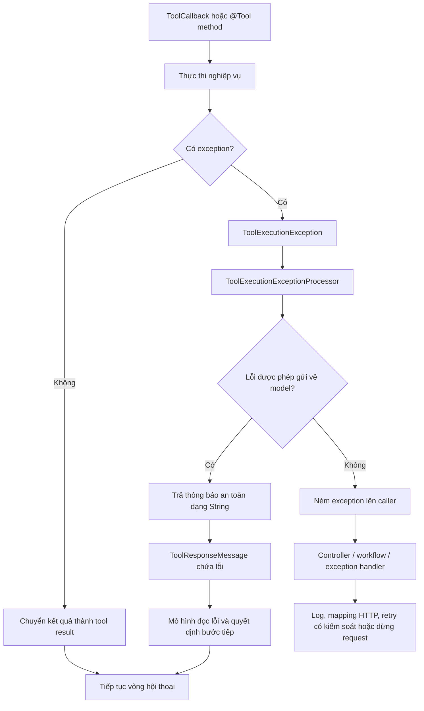

# Chọn trả lỗi có kiểm soát cho mô hình hoặc ném lỗi cho ứng dụng

Khi một công cụ thất bại, ứng dụng phải quyết định ai sẽ xử lý lỗi tiếp theo: mô hình ngôn ngữ hay chính ứng dụng. Nếu lỗi có thể được khắc phục bằng cách sửa đối số hoặc chọn một bước nghiệp vụ khác, ứng dụng có thể gửi một thông báo lỗi an toàn về mô hình để mô hình tiếp tục. Nếu lỗi liên quan đến xác thực, phân quyền, hạ tầng hoặc trạng thái không an toàn, ứng dụng nên nhận exception và dừng vòng tool calling để xử lý theo chính sách của mình.

Spring AI cung cấp `ToolExecutionExceptionProcessor` để thực hiện quyết định này. Processor nhận `ToolExecutionException` và chọn một trong hai kết quả: trả về chuỗi lỗi để Spring AI thêm vào tool result gửi lại mô hình, hoặc ném exception lên caller. Chọn đúng hướng xử lý giúp mô hình có cơ hội phục hồi khi phù hợp, đồng thời giữ các lỗi bảo mật và lỗi hệ thống trong phạm vi kiểm soát của ứng dụng.

## Luồng xử lý exception trong tool calling

Khi phương thức `@Tool` hoặc `ToolCallback` thất bại, Spring AI đóng gói lỗi thành `ToolExecutionException`. `DefaultToolCallingManager` chuyển exception tới `ToolExecutionExceptionProcessor`. Nếu processor trả về chuỗi, chuỗi đó được dùng làm nội dung lỗi của tool response và được đưa vào lịch sử hội thoại. Mô hình nhận tool result này và có thể giải thích, sửa lời gọi hoặc yêu cầu công cụ khác. Nếu processor ném exception, quá trình tool calling dừng và lỗi được chuyển lên tầng gọi `ChatClient`/bộ điều phối để ứng dụng xử lý.



Điểm quan trọng là lỗi gửi về mô hình vẫn là kết quả của một tool call trong giao thức hội thoại. Mô hình không tự nhận exception Java hay stack trace; nó nhận chuỗi do processor trả về. Ngược lại, khi processor ném lỗi, mô hình không có cơ hội tự xử lý lỗi đó trong vòng hiện tại vì ứng dụng đã dừng luồng thực thi.

## `ToolExecutionExceptionProcessor` có hợp đồng gì?

Trong Spring AI 2.1.0, `ToolExecutionExceptionProcessor` là functional interface:

```java
@FunctionalInterface
public interface ToolExecutionExceptionProcessor {
    String process(ToolExecutionException exception);
}
```

Phương thức `process(...)` có hai cách hoàn tất:

- Trả về `String`: Spring AI dùng chuỗi này làm thông báo lỗi gửi lại mô hình dưới dạng tool result.
- Ném exception: lỗi được chuyển lên caller để controller, workflow hoặc tầng tích hợp xử lý.

Processor không nên gọi lại tool, retry service hoặc quyết định quyền truy cập. Nó chỉ phân loại lỗi đã xảy ra và chọn ranh giới xử lý tiếp theo. Retry thuộc tầng service/client có chính sách rõ ràng; authorization thuộc tầng bảo mật/nghiệp vụ.

## Hành vi mặc định trong Spring AI 2.1.0

Spring Boot Starter tự cấu hình `DefaultToolExecutionExceptionProcessor`. Khi không bật chế độ ném tất cả lỗi, hành vi mặc định là:

| Loại lỗi được bọc | Hành vi mặc định | Hệ quả |
|---|---|---|
| `RuntimeException` | Gửi message của exception về mô hình | Mô hình có thể đọc lỗi và tiếp tục vòng tool calling |
| Checked exception | Ném lại caller | Ứng dụng nhận lỗi và xử lý ở tầng của mình |
| `Error` | Ném lại caller | Lỗi nghiêm trọng của JVM/ứng dụng không được gửi cho mô hình |
| `ClientAuthorizationException` của Spring Security OAuth2 | Processor auto-configured ném lại để luồng OAuth2 xử lý | Custom processor cần giữ hành vi này nếu ứng dụng dùng OAuth2 |

Điều cần chú ý là `RuntimeException` bao gồm rất nhiều loại lỗi: lỗi validation, lỗi nghiệp vụ, lỗi database, lỗi mạng, lỗi lập trình và lỗi cấu hình. Vì vậy, mặc định gửi message của mọi `RuntimeException` về mô hình có thể làm lộ thông tin nội bộ nếu exception message chứa SQL, URL nội bộ, tên bảng, dữ liệu người dùng hoặc chi tiết xác thực. Trong ứng dụng có dữ liệu nhạy cảm, nên chọn processor tùy chỉnh theo allowlist lỗi được phép gửi về mô hình.

Thuộc tính cấu hình mặc định:

```yaml
spring:
  ai:
    tools:
      throw-exception-on-error: false
```

Đặt thành `true` để `DefaultToolExecutionExceptionProcessor` ném tất cả lỗi tool lên caller:

```yaml
spring:
  ai:
    tools:
      throw-exception-on-error: true
```

Hoặc khai báo bean:

```java
@Bean
ToolExecutionExceptionProcessor toolExecutionExceptionProcessor() {
    return new DefaultToolExecutionExceptionProcessor(true);
}
```

`alwaysThrow = true` phù hợp khi ứng dụng muốn tự chịu trách nhiệm cho mọi lỗi tool. Khi đó, mô hình không nhận error message từ tool để tự phục hồi. Đây là lựa chọn rõ ràng cho hệ thống mà lỗi cần đi qua centralized exception handling, audit hoặc quy trình retry riêng.

## Chọn lỗi nào gửi về mô hình?

Chỉ gửi lỗi về mô hình khi thông báo đó an toàn và mô hình có thể thực hiện một bước tiếp theo hợp lệ. Một quy tắc thực tế là chỉ cho phép các lỗi nghiệp vụ đã được thiết kế rõ ràng cho model đọc:

| Tình huống | Cách xử lý gợi ý | Vì sao |
|---|---|---|
| Thiếu tham số hoặc định dạng đầu vào không hợp lệ | Gửi mã lỗi và hướng sửa an toàn về mô hình | Mô hình có thể hỏi người dùng hoặc tạo lại arguments đúng schema |
| Không tìm thấy tài nguyên theo ID | Thường trả kết quả `NOT_FOUND`; nếu dùng exception thì chỉ gửi thông báo đã chuẩn hóa | Mô hình có thể báo không tìm thấy hoặc hỏi lại mã |
| Trạng thái nghiệp vụ không cho phép thao tác | Trả kết quả nghiệp vụ `REJECTED` hoặc lỗi miền đã chuẩn hóa | Mô hình có thể giải thích quy tắc và đề xuất bước hợp lệ khác |
| Xung đột phiên bản có thể giải quyết bằng cách đọc lại | Gửi lỗi có mã rõ ràng nếu retry/đọc lại được giới hạn | Mô hình có thể yêu cầu tool đọc trạng thái mới trước khi thử lại |
| Người dùng không có quyền | Ném lên caller | Không để mô hình tự thử một tài nguyên khác hoặc vượt quyền |
| Token OAuth2 hết hạn/ủy quyền thất bại | Ném lên caller | Luồng xác thực/refresh cần được ứng dụng xử lý |
| Database, network hoặc dịch vụ phụ thuộc đang lỗi | Thường ném lên caller | Mô hình không thể sửa sự cố hạ tầng và có thể retry gây tải thêm |
| Timeout khi thao tác ghi chưa rõ đã commit hay chưa | Ném lên caller và kiểm tra trạng thái/idempotency | Không được để mô hình lặp thao tác khi kết quả chưa xác định |
| Lỗi lập trình, lỗi cấu hình hoặc lỗi serialize ngoài dự kiến | Ném lên caller | Cần điều tra và sửa ứng dụng; message nội bộ không phải hướng dẫn cho mô hình |

Một kết quả nghiệp vụ âm tính không nhất thiết là exception. Ví dụ, khách hàng không tồn tại hoặc đơn hàng đã giao có thể là kết quả hợp lệ của truy vấn/quy tắc nghiệp vụ. Nếu caller và mô hình cần phân biệt rõ, DTO có `status`, `code` và `message` thường tốt hơn việc dùng exception cho mọi trường hợp.

## Thông báo gửi về mô hình phải được kiểm soát

Khi quyết định trả lỗi về mô hình, hãy gửi dữ liệu tối thiểu:

- Mã lỗi ổn định, ví dụ `INVALID_ORDER_ID`, `CUSTOMER_NOT_FOUND` hoặc `ORDER_STATE_CONFLICT`.
- Một câu giải thích ngắn mà mô hình có thể dùng để chọn bước tiếp theo.
- Tên trường cần sửa nếu lỗi liên quan đến đầu vào.
- Hành động hợp lệ tiếp theo nếu có, ví dụ hỏi người dùng cung cấp mã đơn hoặc tra cứu trạng thái mới.

Không gửi:

- Stack trace, tên class nội bộ hoặc thông tin về cấu trúc package.
- SQL, tên bảng, câu lệnh database, URL nội bộ, hostname, IP hoặc đường dẫn file.
- Access token, refresh token, API key, cookie, mật khẩu hoặc thông tin OAuth2.
- Toàn bộ request body, dữ liệu cá nhân hoặc bản ghi của người dùng khác.
- Message nguyên văn từ thư viện, driver hoặc dịch vụ bên thứ ba nếu chưa được làm sạch.

Không đưa dữ liệu đầu vào do người dùng kiểm soát vào message mà không giới hạn độ dài và làm sạch. Một exception message có thể chứa chuỗi prompt injection hoặc nội dung khiến mô hình hiểu sai nhiệm vụ. Hãy dùng mã lỗi và message do ứng dụng định nghĩa thay vì nối trực tiếp input vào chuỗi trả về.

## Tạo exception có thể phục hồi dành riêng cho mô hình

Một cách rõ ràng là định nghĩa kiểu exception riêng cho lỗi mà mô hình được phép đọc. Exception chỉ chứa mã và thông báo đã chuẩn hóa:

```java
public final class ModelRecoverableToolException extends RuntimeException {

    private final String code;
    private final String safeMessage;

    public ModelRecoverableToolException(String code, String safeMessage) {
        super(code);
        this.code = code;
        this.safeMessage = safeMessage;
    }

    public String code() {
        return code;
    }

    public String safeMessage() {
        return safeMessage;
    }
}
```

Ví dụ tool kiểm tra ID đơn hàng:

```java
@Tool(description = "Tra cứu đơn hàng theo mã đơn")
public OrderSummary lookupOrder(String orderId) {
    if (orderId == null || !ORDER_ID_PATTERN.matcher(orderId).matches()) {
        throw new ModelRecoverableToolException(
                "INVALID_ORDER_ID",
                "Mã đơn hàng không đúng định dạng. Hãy hỏi người dùng mã đơn hợp lệ.");
    }

    return orderService.findVisibleOrder(orderId)
            .orElseThrow(() -> new ModelRecoverableToolException(
                    "ORDER_NOT_FOUND",
                    "Không tìm thấy đơn hàng với mã đã cung cấp."));
}
```

Trong ví dụ này, `ORDER_ID_PATTERN` và `orderService` thuộc ứng dụng. Với lỗi không tìm thấy, ứng dụng cũng có thể trả DTO `OrderLookupResult(status = NOT_FOUND, ...)` thay vì ném exception. Chọn một hợp đồng nhất quán cho từng tool; đừng trộn kết quả bình thường và exception cho cùng một trạng thái mà không có lý do.

## Viết processor theo allowlist

Processor tùy chỉnh chỉ gửi `ModelRecoverableToolException` về mô hình. Các lỗi phân quyền và lỗi chưa được phân loại được ném lên caller:

```java
@Configuration(proxyBeanMethods = false)
public class ToolExceptionConfiguration {

    @Bean
    ToolExecutionExceptionProcessor toolExecutionExceptionProcessor(
            ObjectMapper objectMapper) {

        return exception -> {
            Throwable cause = exception.getCause();

            if (cause instanceof ClientAuthorizationException authorizationException) {
                throw authorizationException;
            }

            if (cause instanceof AccessDeniedException accessDeniedException) {
                throw accessDeniedException;
            }

            if (cause instanceof ModelRecoverableToolException modelException) {
                try {
                    return objectMapper.writeValueAsString(Map.of(
                            "error", Map.of(
                                    "code", modelException.code(),
                                    "message", modelException.safeMessage())));
                }
                catch (JsonProcessingException serializationFailure) {
                    throw new IllegalStateException(
                            "Không thể tạo thông báo lỗi an toàn cho tool.",
                            serializationFailure);
                }
            }

            // Lỗi chưa được allowlist phải được xử lý ở tầng ứng dụng.
            throw exception;
        };
    }
}
```

Các import chính:

```java
import com.fasterxml.jackson.core.JsonProcessingException;
import com.fasterxml.jackson.databind.ObjectMapper;
import org.springframework.ai.tool.execution.ToolExecutionException;
import org.springframework.ai.tool.execution.ToolExecutionExceptionProcessor;
import org.springframework.context.annotation.Bean;
import org.springframework.context.annotation.Configuration;
import org.springframework.security.access.AccessDeniedException;
import org.springframework.security.oauth2.client.ClientAuthorizationException;

import java.util.Map;
```

Ví dụ giả định `ToolExecutionException.getCause()` trực tiếp là exception miền do callback ném. Nếu ứng dụng có nhiều lớp wrapper, hãy viết hàm tìm cause theo danh sách lớp cho phép và kiểm tra cả cause chain; không tự động gửi message của cause cuối cùng nếu chưa xác minh kiểu exception đó an toàn. Với OAuth2, giữ hành vi ném lại `ClientAuthorizationException` để cơ chế ủy quyền của Spring Security có thể phản ứng.

Đây là chính sách allowlist: chỉ một kiểu lỗi được phép đi tới mô hình. Mọi lỗi khác — kể cả một `IllegalArgumentException` hoặc `IllegalStateException` bất ngờ — đều dừng ở tầng ứng dụng. Chính sách này tránh phụ thuộc vào việc một exception runtime bất kỳ có message an toàn hay không.

## Khi nào dùng processor mặc định với allowlist rethrow?

Nếu ứng dụng chấp nhận gửi message của hầu hết `RuntimeException` về mô hình nhưng muốn một số kiểu runtime luôn được ném lên caller, có thể cấu hình `DefaultToolExecutionExceptionProcessor` bằng builder:

```java
@Bean
ToolExecutionExceptionProcessor toolExecutionExceptionProcessor() {
    return DefaultToolExecutionExceptionProcessor.builder()
            .alwaysThrow(false)
            .rethrowExceptions(List.of(
                    AccessDeniedException.class,
                    ClientAuthorizationException.class))
            .build();
}
```

`rethrowExceptions(...)` nhận allowlist các lớp `RuntimeException` sẽ được unwrap khỏi `ToolExecutionException` và ném lại. Cách này hữu ích khi muốn giữ hành vi mặc định và bổ sung vài ngoại lệ. Nó không tương đương với allowlist lỗi được gửi về mô hình: các `RuntimeException` khác vẫn có thể gửi message về mô hình. Nếu yêu cầu là chỉ cho một số loại lỗi được gửi về mô hình, hãy dùng processor tùy chỉnh như ví dụ trước.

## Tự triển khai ToolCallback phải ném đúng exception

Nếu tự triển khai `ToolCallback`, khi logic thực thi thất bại hãy ném `ToolExecutionException` từ `call(...)`. Đây là kiểu lỗi mà `ToolExecutionExceptionProcessor` nhận:

```java
public final class RemoteInventoryTool implements ToolCallback {

    private final ToolDefinition definition;
    private final RemoteInventoryClient client;

    @Override
    public ToolDefinition getToolDefinition() {
        return definition;
    }

    @Override
    public String call(String toolInput) {
        try {
            InventoryResult result = client.lookup(toolInput);
            return objectMapper.writeValueAsString(result);
        }
        catch (RemoteInventoryValidationException ex) {
            throw new ToolExecutionException(definition,
                    new ModelRecoverableToolException(
                            "INVALID_INVENTORY_QUERY",
                            "Điều kiện tra cứu kho không hợp lệ. Hãy kiểm tra lại mã kho."));
        }
        catch (Exception ex) {
            // Không đưa message của dịch vụ từ xa trực tiếp về mô hình.
            throw new ToolExecutionException(definition,
                    new IllegalStateException("Dịch vụ tra cứu kho không thể hoàn tất yêu cầu.", ex));
        }
    }
}
```

Đây là khung minh họa; implementation đầy đủ cần khai báo các field, constructor và dependency như `objectMapper` theo ứng dụng. Trong Spring AI 2.1.0, `getToolMetadata()` và `call(String, ToolContext)` có triển khai mặc định; callback tối thiểu cần cung cấp `getToolDefinition()` và `call(String)`. Với method-based tool (`@Tool`), Spring AI tự bọc exception của phương thức trong `ToolExecutionException`; với callback tự viết, ứng dụng phải chủ động bọc lỗi thực thi.

Không bắt `Throwable` để tiếp tục như thể mọi lỗi đều có thể phục hồi. `Error` có thể đại diện cho tình trạng JVM nghiêm trọng. Hãy để lỗi nghiêm trọng đi lên caller và được runtime xử lý.

## Ảnh hưởng của lựa chọn tới ChatClient và API ứng dụng

Khi processor trả lỗi về mô hình, vòng `ToolCallingAdvisor` tiếp tục với tool response chứa lỗi. Mô hình có thể gọi tool khác hoặc trả lời người dùng. Kết quả cuối cùng có thể là một câu giải thích, một câu hỏi làm rõ hoặc một hành động tiếp theo. Ứng dụng vẫn cần giới hạn số vòng và số tool call; không để mô hình thử lại vô hạn.

Khi processor ném exception, vòng tool calling dừng tại lần thực thi lỗi. Exception thoát khỏi `ChatClient.call()`/luồng điều phối và được xử lý bởi caller. Controller có thể ánh xạ sang HTTP status phù hợp, workflow có thể đánh dấu task thất bại hoặc retry theo chính sách. Mô hình không được gọi thêm để xử lý exception đó.

| Quyết định | Kết quả của tool loop | Việc ứng dụng cần làm |
|---|---|---|
| Trả lỗi về mô hình | Tool response chứa error string; model có thể tiếp tục | Giới hạn retry/loop, chỉ cung cấp message an toàn, theo dõi lần phục hồi |
| Ném exception lên caller | Tool loop dừng và lời gọi ChatClient thất bại | Mapping lỗi, log có correlation ID, retry hoặc báo lỗi theo nghiệp vụ |

Ví dụ controller xử lý exception được ném lên caller:

```java
@RestControllerAdvice
public class ToolApiExceptionHandler {

    @ExceptionHandler(AccessDeniedException.class)
    ResponseEntity<ApiError> handleAccessDenied(AccessDeniedException ex) {
        return ResponseEntity.status(HttpStatus.FORBIDDEN)
                .body(new ApiError("FORBIDDEN", "Bạn không có quyền thực hiện thao tác này."));
    }

    @ExceptionHandler(ToolExecutionException.class)
    ResponseEntity<ApiError> handleToolFailure(ToolExecutionException ex) {
        return ResponseEntity.status(HttpStatus.BAD_GATEWAY)
                .body(new ApiError("TOOL_EXECUTION_FAILED", "Dịch vụ xử lý yêu cầu hiện không khả dụng."));
    }
}
```

`ApiError` là DTO của ứng dụng. Trong ứng dụng thật, hãy phân loại lỗi hạ tầng và lỗi nghiệp vụ để chọn HTTP status phù hợp; không ánh xạ mọi `ToolExecutionException` thành `502` nếu nguyên nhân có ý nghĩa khác. Không trả `ex.getMessage()` hoặc stack trace ra HTTP response.

## Không để mô hình tự retry thao tác ghi vô hạn

Khi lỗi được gửi về mô hình, model có thể quyết định gọi lại cùng tool. Điều này có thể hợp lý nếu lỗi là tham số sai, nhưng nguy hiểm nếu thao tác có side effect và kết quả trước đó chưa rõ.

Ví dụ, một tool tạo thanh toán timeout sau khi ngân hàng đã nhận lệnh. Nếu ứng dụng gửi thông báo “timeout” về mô hình và mô hình gọi lại `createPayment`, hệ thống có thể tạo giao dịch trùng. Với thao tác ghi:

1. Tạo idempotency key ở tầng ứng dụng hoặc service nghiệp vụ.
2. Lưu trạng thái và kết quả của lần thực thi đầu cùng key.
3. Khi nhận retry cùng key, trả kết quả đã lưu thay vì thực hiện side effect lần nữa.
4. Nếu không xác định được giao dịch đã commit hay chưa, trả trạng thái `UNKNOWN`/`PENDING` theo hợp đồng và tra cứu trước khi gửi lệnh mới.
5. Chỉ gửi lỗi về mô hình nếu có một bước tiếp theo an toàn và đã được giới hạn.

Không dùng request ID hoặc tool call ID thay cho idempotency key nếu chúng không có semantics duy nhất cho thao tác nghiệp vụ. Tool call ID có thể thay đổi khi mô hình tạo lại lời gọi; idempotency key cần ổn định qua các lần retry của cùng một lệnh.

## Xử lý lỗi phân quyền và OAuth2

Lỗi phân quyền không nên được gửi cho mô hình như một lỗi tham số có thể sửa. Nếu mô hình nhận message “không có quyền”, nó có thể thử tool khác, đổi ID tài nguyên hoặc yêu cầu một phạm vi dữ liệu khác. Quyết định quyền phải được giữ ở tầng ứng dụng:

- `AccessDeniedException`: ném lên caller và ánh xạ thành phản hồi từ chối phù hợp.
- `ClientAuthorizationException`: giữ hành vi rethrow để OAuth2 client/authorization flow xử lý.
- Lỗi xác thực người dùng: xử lý ở security filter/controller trước khi mở tool loop.
- Lỗi tenant hoặc quyền trên tài nguyên: kiểm tra trong service nghiệp vụ; không tin tenant/user ID do mô hình cung cấp.

Nếu custom processor thay thế processor auto-configured, phải chủ động giữ hành vi rethrow `ClientAuthorizationException` khi ứng dụng sử dụng OAuth2. Nếu không, lỗi ủy quyền có thể bị biến thành tool result và làm mất tín hiệu cần thiết cho luồng OAuth2.

## Quan sát và log lỗi an toàn

Spring AI phát Micrometer observation cho tool call với tên `spring.ai.tool`. Observation có tên tool, metadata định nghĩa, thời gian thực thi và tracing context khi có tracer. Nội dung arguments/results có thể được bật làm span attributes nhưng mặc định tắt vì lý do nhạy cảm.

Nên ghi log có cấu trúc gồm:

- `requestId` hoặc trace ID để liên kết request và tool call.
- Tên tool, mã lỗi ổn định và loại exception.
- Quyết định của processor: `SENT_TO_MODEL` hoặc `THROWN_TO_CALLER`.
- Thời gian thực thi, số lần retry và trạng thái side effect nếu có.
- Kết quả cuối của workflow hoặc HTTP status.

Không ghi raw arguments, token, cookie, SQL, stack trace đầy đủ hoặc dữ liệu cá nhân nếu không có nhu cầu và chính sách lưu trữ phù hợp. Để điều tra lỗi, correlation ID cùng error code thường đủ để tìm log nội bộ an toàn.

## Kiểm thử chính sách xử lý lỗi

Hãy kiểm thử processor độc lập và kiểm thử tích hợp qua tool calling loop. Mục tiêu là chứng minh chỉ các lỗi được allowlist mới trở thành tool result, còn lỗi bảo mật và lỗi hệ thống được ném lên caller.

| Ca kiểm thử | Kết quả mong đợi |
|---|---|
| `ModelRecoverableToolException` | Processor trả JSON có error code/message an toàn |
| `AccessDeniedException` | Processor ném lỗi lên caller |
| `ClientAuthorizationException` | Processor ném lỗi lên caller để OAuth2 flow xử lý |
| `DataAccessException` hoặc lỗi database | Không gửi message nội bộ về mô hình; ném lên caller |
| Runtime exception chưa được phân loại | Ném lên caller theo allowlist policy |
| Checked exception | Ném lên caller |
| `Error` | Không chuyển thành tool result |
| Message chứa input nhạy cảm | Không xuất hiện trong tool error gửi về mô hình |
| Serialization của error payload thất bại | Dừng và ném lỗi lên caller |
| Model nhận lỗi có thể phục hồi | Chỉ retry trong ngân sách; không lặp vô hạn |
| Tool ghi bị timeout | Kiểm tra idempotency/trạng thái trước khi retry |
| Custom ToolCallback thất bại | Ném `ToolExecutionException` đúng hợp đồng |

Ví dụ unit test cho processor:

```java
@Test
void sendsOnlyAllowlistedRecoverableErrorsToModel() {
    ToolExecutionException exception = new ToolExecutionException(
            toolDefinition,
            new ModelRecoverableToolException(
                    "INVALID_ORDER_ID", "Mã đơn hàng không đúng định dạng."));

    String message = processor.process(exception);

    assertThat(message).contains("INVALID_ORDER_ID");
    assertThat(message).contains("Mã đơn hàng không đúng định dạng.");
}

@Test
void rethrowsAccessDeniedInsteadOfSendingItToModel() {
    AccessDeniedException denied = new AccessDeniedException("internal policy detail");
    ToolExecutionException exception = new ToolExecutionException(toolDefinition, denied);

    assertThatThrownBy(() -> processor.process(exception))
            .isSameAs(denied);
}

@Test
void rethrowsUnexpectedRuntimeException() {
    ToolExecutionException exception = new ToolExecutionException(
            toolDefinition,
            new IllegalStateException("database host db-internal-01 failed"));

    assertThatThrownBy(() -> processor.process(exception))
            .isSameAs(exception);
}
```

Các ví dụ giả định `processor`, `toolDefinition` và `ObjectMapper` đã được khởi tạo trong test fixture. Ngoài unit test, integration test cần xác minh `ToolCallingManager` biến lỗi được allowlist thành `ToolResponseMessage` và `ToolCallingAdvisor` tiếp tục vòng lặp; với lỗi bị ném, xác minh `ChatClient.call()` thất bại và controller/workflow nhận exception.

## Quy trình ra quyết định

Khi thiết kế một tool, hãy quyết định trước cách xử lý từng nhóm lỗi:

1. Xác định lỗi có phải kết quả nghiệp vụ bình thường không. Nếu có, trả DTO/status thay vì exception.
2. Nếu là lỗi đầu vào có thể sửa, tạo exception miền dành riêng cho mô hình với mã và thông báo an toàn.
3. Nếu mô hình có thể thực hiện bước tiếp theo hợp lệ, allowlist exception đó trong processor.
4. Nếu lỗi liên quan đến quyền, OAuth2, hạ tầng, timeout không rõ trạng thái hoặc lỗi lập trình, ném lên caller.
5. Nếu thay processor mặc định, giữ hành vi rethrow `ClientAuthorizationException` khi dùng OAuth2.
6. Đặt giới hạn số lần tool call, retry và deadline; không để model tự lặp vô hạn.
7. Với thao tác ghi, dùng idempotency và kiểm tra trạng thái trước retry.
8. Kiểm thử cả nội dung lỗi gửi model lẫn exception được ném lên caller.

## Kết luận

`ToolExecutionExceptionProcessor` là ranh giới quyết định lỗi tool đi tiếp theo hướng nào. Trả về chuỗi lỗi đã chuẩn hóa khi mô hình có thể sửa đầu vào hoặc chọn bước nghiệp vụ hợp lệ; ném exception lên caller khi lỗi cần xử lý bởi bảo mật, hạ tầng hoặc workflow của ứng dụng. Spring AI 2.1.0 mặc định gửi message của `RuntimeException` về mô hình và ném checked exception/`Error` lên caller; thuộc tính `spring.ai.tools.throw-exception-on-error=true` chuyển sang chế độ ném mọi lỗi. Với hệ thống nhạy cảm, processor allowlist giúp chỉ các lỗi được thiết kế rõ ràng mới được mô hình đọc, trong khi lỗi phân quyền, OAuth2 và lỗi chưa phân loại tiếp tục được ứng dụng kiểm soát.

## Tài liệu tham khảo

- [Spring AI 2.1.0 — Tool Calling](https://docs.spring.io/spring-ai/reference/api/tools.html) — exception handling, `ToolExecutionExceptionProcessor`, default behavior, cấu hình `spring.ai.tools.throw-exception-on-error` và lưu ý OAuth2.
- [Spring AI 2.1.x — ToolExecutionExceptionProcessor API](https://docs.spring.io/spring-ai/docs/2.1.x/api/org/springframework/ai/tool/execution/ToolExecutionExceptionProcessor.html) — hợp đồng `process(ToolExecutionException)`.
- [Spring AI 2.1.x — DefaultToolExecutionExceptionProcessor API](https://docs.spring.io/spring-ai/docs/2.1.x/api/org/springframework/ai/tool/execution/DefaultToolExecutionExceptionProcessor.html) — chế độ `alwaysThrow` và constructor rethrow allowlist.
- [Spring AI 2.1.x — DefaultToolExecutionExceptionProcessor.Builder API](https://docs.spring.io/spring-ai/docs/2.1.x/api/org/springframework/ai/tool/execution/DefaultToolExecutionExceptionProcessor.Builder.html) — `alwaysThrow(...)` và `rethrowExceptions(...)`.
