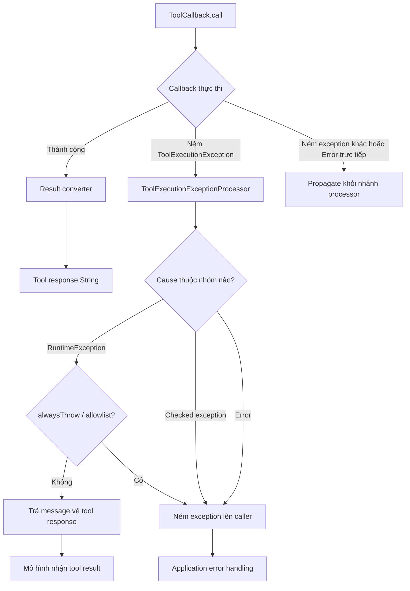

# Kiểm tra hành vi với checked exception, runtime exception và Error

Khi một tool thất bại, Spring AI không xử lý mọi loại throwable theo cùng một cách. `DefaultToolExecutionExceptionProcessor` mặc định chuyển thông điệp của nguyên nhân thuộc `RuntimeException` thành tool result để mô hình có thể phản hồi hoặc thử bước khác. Checked exception và `Error` được propagate về phía caller. Quy tắc này giúp phân biệt lỗi nghiệp vụ có thể diễn giải trong hội thoại với lỗi kỹ thuật hoặc lỗi nghiêm trọng cần ứng dụng xử lý.

Trong module `SPRING_AI_TOOL_CALLING`, callback vẫn là nơi ứng dụng thực thi dịch vụ nghiệp vụ. Việc một lỗi được gửi lại mô hình không có nghĩa mô hình được phép tự sửa quyền, bỏ qua validation hoặc lặp một thao tác ghi. Ứng dụng phải chọn loại exception có chủ đích, giữ cause gốc để điều tra và chỉ đưa thông điệp đã được làm sạch vào hội thoại.

## 1. Ba nhóm throwable trong Java

Java chia lỗi và ngoại lệ thành ba nhóm thường gặp:

| Nhóm | Đặc điểm | Ví dụ | Hướng xử lý điển hình |
|---|---|---|---|
| Checked exception | Compiler yêu cầu catch hoặc khai báo `throws` | `IOException`, `SQLException` | Propagate tới caller hoặc ánh xạ có chủ đích sang lỗi runtime an toàn |
| `RuntimeException` | Không bắt buộc khai báo/catch; thường biểu diễn lỗi nghiệp vụ, input hoặc trạng thái | `IllegalArgumentException`, `IllegalStateException`, `AccessDeniedException` | Có thể gửi thông điệp an toàn về mô hình theo processor mặc định |
| `Error` | Lỗi nghiêm trọng ở JVM hoặc môi trường chạy; ứng dụng thường không thể phục hồi tại chỗ | `OutOfMemoryError`, `StackOverflowError`, `LinkageError` | Để propagate; không biến thành lỗi nghiệp vụ cho mô hình |

`ToolExecutionException` là một `RuntimeException` của Spring AI dùng làm wrapper ở ranh giới thực thi tool. Vì vậy cần phân biệt kiểu của wrapper với kiểu của `cause` bên trong. Processor mặc định dựa trên nguyên nhân mà wrapper giữ lại để quyết định trả chuỗi hay ném exception.

## 2. Vị trí xử lý exception trong tool calling

Khi callback thực thi thất bại, Spring AI có thể đóng gói lỗi thành `ToolExecutionException`, giữ `ToolDefinition` của công cụ và throwable gốc làm cause. `DefaultToolCallingManager` chuyển wrapper đó tới `ToolExecutionExceptionProcessor`.



`ToolExecutionExceptionProcessor` chỉ xử lý `ToolExecutionException` mà tool callback ném ra. Trong implementation mặc định, `DefaultToolCallingManager` bắt đúng loại wrapper này quanh `ToolCallback.call(...)`. Một custom callback ném trực tiếp `IllegalStateException` hoặc `Error` mà không đóng gói có thể đi ra ngoài nhánh processor. Phương thức `ToolCallback.call(...)` không khai báo checked exception, vì vậy checked cause cần được giữ trong `ToolExecutionException` nếu muốn processor phân loại nó. Nếu tự triển khai `ToolCallback`, hãy tuân thủ hợp đồng: bọc lỗi thực thi bằng `ToolExecutionException` khi muốn Spring AI áp dụng chính sách tool error.

## 3. Hành vi mặc định của DefaultToolExecutionExceptionProcessor

Khi dùng Spring Boot Starter, Spring AI tự cấu hình `DefaultToolExecutionExceptionProcessor`. Với cấu hình mặc định `alwaysThrow=false`, hành vi được mô tả như sau:

| Cause trong `ToolExecutionException` | Hành vi mặc định | Mô hình nhận lỗi? |
|---|---|---|
| `RuntimeException` | Lấy thông điệp của exception và trả về dưới dạng tool result | Có |
| Checked exception | Ném `ToolExecutionException` lên caller, giữ cause | Không |
| `Error` | Ném `ToolExecutionException` lên caller, giữ cause | Không |
| Runtime exception nằm trong `rethrowExceptions` allowlist | Unwrap và ném runtime exception đó | Không |
| Bất kỳ nhóm lỗi nào khi `alwaysThrow=true` | Ném exception thay vì trả thông điệp | Không |

Hai điểm quan trọng:

- `alwaysThrow=false` không có nghĩa mọi lỗi đều được gửi cho mô hình. Checked exception và `Error` vẫn được propagate theo quy tắc mặc định.
- `alwaysThrow=true` mở rộng hành vi propagate cho cả runtime exception, bao gồm lỗi nghiệp vụ vốn có thể gửi về mô hình.

Property điều khiển hành vi `alwaysThrow`:

```yaml
spring:
  ai:
    tools:
      throw-exception-on-error: false
```

Giá trị mặc định là `false`. Đổi thành `true` nếu ứng dụng muốn nhận tool execution exception ở tầng caller và tự quyết định HTTP response, retry hoặc workflow tiếp theo.

Có thể cấu hình processor bằng Java:

```java
@Bean
ToolExecutionExceptionProcessor toolExecutionExceptionProcessor() {
    return new DefaultToolExecutionExceptionProcessor(true);
}
```

Khi khai báo bean riêng, bean đó thay thế processor mặc định do auto-configuration cung cấp. Hãy bảo đảm cấu hình này được dùng nhất quán ở tất cả nơi tạo `ToolCallingManager`.

## 4. Runtime exception: khi nào gửi lỗi về mô hình?

Runtime exception phù hợp với lỗi mà mô hình có thể giải thích hoặc giúp người dùng sửa yêu cầu, ví dụ:

- Mã đơn hàng không đúng định dạng.
- Tài nguyên không tồn tại trong phạm vi truy cập.
- Trạng thái nghiệp vụ không cho phép hành động.
- Một tham số bắt buộc thiếu hoặc không hợp lệ.

Ví dụ phương thức `@Tool` chuyển lỗi nghiệp vụ sang runtime exception có thông điệp an toàn:

```java
public final class OrderNotFoundException extends RuntimeException {

    public OrderNotFoundException(String message, Throwable cause) {
        super(message, cause);
    }
}

@Component
public class OrderTools {

    private final OrderQueryService orderQueryService;

    public OrderTools(OrderQueryService orderQueryService) {
        this.orderQueryService = orderQueryService;
    }

    @Tool(description = "Tra cứu trạng thái đơn hàng theo mã đơn hàng.")
    public OrderStatusView getOrderStatus(String orderId) {
        try {
            return orderQueryService.findStatus(orderId);
        }
        catch (OrderNotFoundDomainException ex) {
            throw new OrderNotFoundException(
                    "Không tìm thấy đơn hàng trong phạm vi truy cập.", ex);
        }
    }
}
```

Với runtime exception này, processor mặc định có thể trả thông điệp đã làm sạch về mô hình. Mô hình có thể thông báo rằng không tìm thấy đơn hàng hoặc yêu cầu người dùng kiểm tra mã.

Không ném `new RuntimeException(ex.getMessage())` cho mọi lỗi một cách máy móc. Thông điệp của driver, database hoặc thư viện có thể chứa SQL, hostname, đường dẫn, ID nội bộ hoặc dữ liệu nhạy cảm. Hãy ánh xạ lỗi đã biết sang thông điệp công khai; lỗi không dự kiến nên có thông điệp chung và được ghi log ở server.

## 5. Checked exception: mặc định propagate về caller

Checked exception thường đại diện cho lỗi kỹ thuật mà ứng dụng cần quyết định cách phục hồi, chẳng hạn lỗi đọc file, lỗi I/O hoặc một API khai báo checked exception. Processor mặc định không chuyển những lỗi này thành tool result cho mô hình.

Ví dụ một service khai báo `IOException`:

```java
@Tool(description = "Đọc nội dung tài liệu theo mã tài liệu.")
public DocumentSummary readDocument(String documentId) throws IOException {
    return documentService.readSummary(documentId);
}
```

Nếu lỗi checked được giữ làm cause của `ToolExecutionException`, processor mặc định ném wrapper lên caller. Tùy loại callback và cơ chế reflection/proxy, caller có thể thấy wrapper hoặc một exception wrapper khác ở tầng trên; khi điều tra cần kiểm tra cause chain thay vì giả định top-level exception luôn là `IOException`.

Caller có thể xử lý ở application boundary:

```java
try {
    return chatClient.prompt()
            .user("Tóm tắt tài liệu DOC-2048")
            .tools(documentTools)
            .call()
            .content();
}
catch (ToolExecutionException ex) {
    Throwable cause = ex.getCause();
    log.error("Tool '{}' failed", ex.getToolDefinition().name(), ex);
    throw new DocumentToolUnavailableException(
            "Không thể đọc tài liệu lúc này.", cause);
}
```

Ví dụ giả định exception đi ra ở dạng `ToolExecutionException`; nếu callback/proxy đang dùng có wrapper khác, hãy bắt loại exception tại ranh giới ứng dụng phù hợp và kiểm tra cause chain. Không đưa nguyên văn thông điệp checked exception hoặc stack trace vào response HTTP hay tool response.

Nếu muốn mô hình nhận một lỗi checked có thể giải thích, hãy chuyển đổi nó thành một runtime exception nghiệp vụ có thông điệp an toàn ngay trong tool method hoặc service adapter. Chỉ làm vậy khi đó là quyết định nghiệp vụ có chủ đích. Với lỗi hạ tầng cần caller retry, circuit breaker hoặc trả HTTP 5xx, giữ checked exception để nó propagate là lựa chọn phù hợp.

## 6. Error: không biến lỗi JVM thành tool message

`Error` khác exception thông thường. Các ví dụ gồm:

- `OutOfMemoryError`: JVM không còn đủ bộ nhớ.
- `StackOverflowError`: ngăn xếp lời gọi bị tràn.
- `LinkageError`: lỗi liên kết class hoặc dependency.
- `ExceptionInInitializerError`: lỗi trong quá trình khởi tạo class.

Không nên bắt `Error` rồi chuyển thành `RuntimeException` để mô hình tiếp tục hội thoại. Một số lỗi có thể khiến trạng thái process hoặc classloader không còn đáng tin. Hãy để Error propagate và dùng cơ chế giám sát/restart phù hợp.

Ví dụ không nên làm:

```java
try {
    return criticalService.execute();
}
catch (Throwable ex) {
    // Không làm: che cả Error và biến lỗi nghiêm trọng thành tool message.
    throw new RuntimeException("Tool failed", ex);
}
```

Nếu custom callback cần đóng gói exception nghiệp vụ, chỉ bắt những loại exception đã dự kiến. Không bắt `Throwable` hoặc `Error` để xử lý như lỗi thông thường.

## 7. ToolExecutionException là wrapper, không phải loại lỗi nghiệp vụ

`ToolExecutionException` kế thừa `RuntimeException` và có constructor nhận `ToolDefinition` cùng `Throwable cause`:

```java
throw new ToolExecutionException(toolDefinition, cause);
```

Wrapper cung cấp:

- `getToolDefinition()`: tên và định nghĩa tool đã thất bại.
- `getCause()`: exception hoặc Error nguyên nhân.
- `getMessage()`: thường lấy thông điệp từ cause trong constructor.

Không phân loại mọi lỗi chỉ bằng `exception instanceof RuntimeException`, vì `ToolExecutionException` luôn là runtime wrapper. Processor cần xem `exception.getCause()` để phân biệt runtime, checked và Error. Khi tự viết processor, hãy giữ nguyên cause và tránh làm mất loại exception ban đầu.

Ví dụ helper tạo wrapper cho custom callback:

```java
private ToolExecutionException toolFailure(Throwable cause) {
    return new ToolExecutionException(toolDefinition, cause);
}
```

## 8. Custom ToolCallback phải bọc lỗi đúng hợp đồng

`DefaultToolCallingManager` gọi `ToolCallback.call(...)` và bắt `ToolExecutionException` để chuyển sang processor. Nếu tự triển khai `ToolCallback`, hãy bọc lỗi dự kiến bằng `ToolExecutionException`.

```java
public final class InventoryTool implements ToolCallback {

    private final ToolDefinition toolDefinition;
    private final InventoryService inventoryService;

    public InventoryTool(
            ToolDefinition toolDefinition,
            InventoryService inventoryService) {
        this.toolDefinition = toolDefinition;
        this.inventoryService = inventoryService;
    }

    @Override
    public ToolDefinition getToolDefinition() {
        return toolDefinition;
    }

    @Override
    public String call(String toolInput) {
        try {
            InventoryRequest request = parse(toolInput);
            InventoryView result = inventoryService.find(request.sku());
            return toJson(result);
        }
        catch (InvalidInventoryRequestException ex) {
            throw new ToolExecutionException(
                    toolDefinition,
                    new IllegalArgumentException(
                            "Mã sản phẩm không hợp lệ.", ex));
        }
        catch (IOException ex) {
            throw new ToolExecutionException(toolDefinition, ex);
        }
        // Không catch Error. Không catch Throwable.
    }
}
```

Trong ví dụ:

- `IllegalArgumentException` là runtime cause, vì vậy processor mặc định có thể gửi thông điệp an toàn về mô hình.
- `IOException` là checked cause, vì vậy processor mặc định propagate `ToolExecutionException` về caller.
- `Error` không bị callback bắt và được để lan truyền.

Nếu custom callback không bọc lỗi thành `ToolExecutionException`, processor không được gọi cho lỗi đó. Hãy kiểm tra cả đường thực thi của callback tùy chỉnh và các lỗi xảy ra trước khi `call()` bắt đầu, chẳng hạn lỗi phân giải tên tool hoặc lỗi parse ở một adapter khác.

## 9. Luật allowlist: runtime exception nào phải được ném lên caller?

Không phải runtime exception nào cũng nên gửi cho mô hình. Ví dụ `AccessDeniedException`, lỗi optimistic locking hoặc một lỗi cần dừng workflow có thể cần propagate để tầng ứng dụng xử lý.

`DefaultToolExecutionExceptionProcessor.Builder.rethrowExceptions(...)` nhận allowlist các loại `RuntimeException` cần được unwrap và ném lại:

```java
@Bean
ToolExecutionExceptionProcessor toolExecutionExceptionProcessor() {
    return DefaultToolExecutionExceptionProcessor.builder()
            .alwaysThrow(false)
            .rethrowExceptions(List.of(
                    AccessDeniedException.class,
                    OptimisticLockingFailureException.class))
            .build();
}
```

Allowlist khớp với loại exception đang được giữ làm cause trong `ToolExecutionException`. Nếu callback bọc `AccessDeniedException` bên trong một `ToolFailure` riêng, processor nhìn thấy `ToolFailure` là cause trực tiếp; allowlist `AccessDeniedException.class` sẽ không tự tìm sâu mọi cấp của cause chain. Trong trường hợp đó, hãy thiết kế wrapper hoặc custom processor rõ ràng để giữ đúng chính sách.

`rethrowExceptions` chỉ dành cho runtime exception. Checked exception và `Error` đã propagate theo mặc định. Không dùng allowlist để cố xử lý `Error` như lỗi có thể khôi phục.

## 10. Chọn giữa alwaysThrow và gửi lỗi về mô hình

Có thể cấu hình theo từng môi trường:

```yaml
# Ví dụ: cho phép lỗi runtime đã được làm sạch quay lại mô hình.
spring:
  ai:
    tools:
      throw-exception-on-error: false
```

```yaml
# Ví dụ: mọi ToolExecutionException, kể cả runtime, đi lên caller.
spring:
  ai:
    tools:
      throw-exception-on-error: true
```

| Chính sách | Dùng khi |
|---|---|
| `alwaysThrow=false` và không allowlist | Lỗi runtime có thể giải thích trong hội thoại; checked/Error vẫn propagate |
| `alwaysThrow=false` và có allowlist | Một số runtime exception cần dừng workflow; runtime còn lại được gửi về mô hình |
| `alwaysThrow=true` | Ứng dụng muốn xử lý tất cả tool execution failures ở caller, không để mô hình tiếp tục từ lỗi |
| Custom `ToolExecutionExceptionProcessor` | Cần ánh xạ từng mã lỗi sang thông điệp an toàn hoặc chính sách propagate riêng |

Ví dụ custom processor cho một hợp đồng lỗi riêng:

```java
@Bean
ToolExecutionExceptionProcessor toolExecutionExceptionProcessor(ObjectMapper objectMapper) {
    return exception -> {
        Throwable cause = exception.getCause();

        if (cause instanceof ToolBusinessException businessException) {
            try {
                return objectMapper.writeValueAsString(new ToolError(
                        false,
                        businessException.getCode(),
                        businessException.getSafeMessage(),
                        businessException.isRetryable()));
            }
            catch (JsonProcessingException serializationFailure) {
                throw new IllegalStateException(
                        "Không thể tạo error response cho tool.", serializationFailure);
            }
        }

        // Checked exception, Error và lỗi không nhận diện: chuyển lên caller.
        throw exception;
    };
}

public final class ToolBusinessException extends RuntimeException {

    private final String code;
    private final boolean retryable;

    public ToolBusinessException(
            String code, String safeMessage, boolean retryable, Throwable cause) {
        super(safeMessage, cause);
        this.code = code;
        this.retryable = retryable;
    }

    public String getCode() {
        return code;
    }

    public String getSafeMessage() {
        return getMessage();
    }

    public boolean isRetryable() {
        return retryable;
    }
}

public record ToolError(boolean ok, String code, String message, boolean retryable) {}
```

Custom processor chỉ chuyển `ToolBusinessException` đã được kiểm soát thành JSON. Các cause khác được propagate. Không trả `cause.getMessage()` trực tiếp nếu nó có thể chứa thông tin nội bộ.

## 11. Phân biệt lỗi thực thi với lỗi trước/sau callback

`ToolExecutionExceptionProcessor` không phải bộ xử lý tổng quát cho mọi lỗi của request ChatClient. Nó được gọi ở nhánh `ToolCallback.call(...)` khi callback ném `ToolExecutionException`.

| Điểm xảy ra lỗi | Ví dụ | Processor tool có xử lý không? |
|---|---|---|
| Model/provider request | Timeout gọi model, authentication provider lỗi | Không; xử lý ở model/client/application layer |
| Tool resolution | Không tìm thấy callback, tên tool không hợp lệ | Không; xử lý ở resolver/manager/application layer |
| Parse arguments | JSON sai hoặc không deserialize được | Tùy callback; chỉ qua processor nếu callback đóng gói thành `ToolExecutionException` |
| Business method | Service ném exception | Có nếu callback đưa lỗi ra dưới dạng `ToolExecutionException` |
| Custom callback | `call()` ném trực tiếp `IllegalStateException` | Không theo nhánh catch mặc định; cần wrap đúng hợp đồng |
| Result serialization | Converter/Jackson thất bại | Phụ thuộc callback và nơi exception phát sinh; không giả định mọi lỗi serialize đều được processor xử lý |
| Application response | Controller không ánh xạ exception | Không; xử lý ở web/API boundary |

Điều này giúp tránh chẩn đoán sai khi cấu hình `spring.ai.tools.throw-exception-on-error` mà lỗi vẫn không đi qua processor. Trước hết hãy xác định exception phát sinh ở đâu và có được bọc đúng loại hay không.

## 12. Bảo vệ thông điệp lỗi gửi về mô hình

Với runtime cause, processor mặc định gửi thông điệp exception về mô hình. Điều này tiện cho lỗi nghiệp vụ có thể giải thích, nhưng cũng có thể làm lộ dữ liệu nếu thông điệp được tạo từ exception kỹ thuật.

Không đưa các thông tin sau vào exception message:

- SQL, câu truy vấn, tên bảng hoặc cấu trúc database.
- URL nội bộ, hostname, địa chỉ IP hoặc chi tiết hạ tầng.
- Token, API key, mật khẩu hoặc thông tin xác thực.
- Stack trace, đường dẫn filesystem hoặc tên class nội bộ.
- Dữ liệu cá nhân hoặc dữ liệu của tenant khác.

Hãy tạo runtime exception với thông điệp an toàn:

```java
throw new ToolBusinessException(
        "DEPENDENCY_UNAVAILABLE",
        "Dịch vụ tồn kho tạm thời không khả dụng.",
        true,
        originalException);
```

Giữ `originalException` làm cause để log và tracing phía server. Tool response chỉ chứa thông điệp đã chọn lọc. Nếu lỗi không dự kiến, dùng mã chung như `INTERNAL_ERROR` và để caller/observability lưu cause gốc.

## 13. Retry và xử lý lỗi phải dựa trên loại thao tác

Việc gửi runtime error về mô hình không tự động retry tool. Mô hình có thể quyết định gọi lại, nhưng đó là một quyết định hội thoại khác và có thể gây tác động phụ lặp lại.

| Loại lỗi | Có nên retry? | Lưu ý |
|---|---|---|
| Input không hợp lệ | Không | Yêu cầu mô hình hỏi lại hoặc sửa tham số |
| Không có quyền | Không | Không để mô hình thử một danh tính hoặc tenant khác |
| Trạng thái nghiệp vụ không hợp lệ | Thường không | Cần chờ trạng thái thay đổi hoặc người dùng xác nhận lại |
| Timeout khi đọc dữ liệu | Có thể | Retry có giới hạn, backoff và deadline tổng |
| Timeout khi ghi dữ liệu | Chỉ khi có idempotency | Trước khi retry phải xác định thao tác đã hoàn tất hay chưa |
| Checked exception từ hạ tầng | Caller quyết định | Dùng retry/circuit breaker ở service layer nếu phù hợp |
| `Error` | Không retry trong cùng request | Để lỗi propagate và giám sát process |

Đối với thao tác ghi, dùng idempotency key do server tạo, transaction phù hợp và audit event. Không dùng việc đổi checked exception thành runtime để kích hoạt model retry tự do.

## 14. Kiểm thử ba nhóm exception

Kiểm thử processor riêng giúp xác minh quy tắc phân loại mà không cần gọi model thật.

Ví dụ kiểm thử runtime exception được chuyển thành thông điệp:

```java
@Test
void returnsRuntimeCauseMessageByDefault() {
    ToolExecutionExceptionProcessor processor =
            new DefaultToolExecutionExceptionProcessor(false);
    ToolExecutionException exception = new ToolExecutionException(
            toolDefinition,
            new IllegalArgumentException("Mã đơn hàng không hợp lệ."));

    String message = processor.process(exception);

    assertThat(message).isEqualTo("Mã đơn hàng không hợp lệ.");
}
```

Ví dụ kiểm thử checked exception được propagate:

```java
@Test
void propagatesCheckedCause() {
    ToolExecutionExceptionProcessor processor =
            new DefaultToolExecutionExceptionProcessor(false);
    ToolExecutionException exception = new ToolExecutionException(
            toolDefinition,
            new IOException("storage unavailable"));

    assertThatThrownBy(() -> processor.process(exception))
            .isInstanceOf(ToolExecutionException.class)
            .hasCauseInstanceOf(IOException.class);
}
```

Ví dụ kiểm thử Error không được biến thành tool message:

```java
@Test
void propagatesErrorCause() {
    ToolExecutionExceptionProcessor processor =
            new DefaultToolExecutionExceptionProcessor(false);
    ToolExecutionException exception = new ToolExecutionException(
            toolDefinition,
            new AssertionError("fatal JVM condition"));

    assertThatThrownBy(() -> processor.process(exception))
            .isInstanceOf(ToolExecutionException.class)
            .hasCauseInstanceOf(AssertionError.class);
}
```

Ví dụ kiểm thử `alwaysThrow=true` với runtime exception:

```java
@Test
void alwaysThrowPropagatesRuntimeCause() {
    ToolExecutionExceptionProcessor processor =
            new DefaultToolExecutionExceptionProcessor(true);
    ToolExecutionException exception = new ToolExecutionException(
            toolDefinition,
            new IllegalStateException("business state conflict"));

    assertThatThrownBy(() -> processor.process(exception))
            .isInstanceOf(ToolExecutionException.class)
            .hasCauseInstanceOf(IllegalStateException.class);
}
```

Ngoài unit test, cần integration test với `ToolCallingManager` để xác minh:

1. Callback ném `ToolExecutionException` với runtime cause: tool response chứa thông điệp lỗi.
2. Callback ném wrapper với checked cause: manager propagate lỗi về caller.
3. Callback ném wrapper với Error cause: manager không tạo tool response giả như thành công.
4. Custom callback ném exception thô: xác nhận lỗi không tự động đi qua processor và điều chỉnh callback cho đúng hợp đồng.
5. Allowlist runtime exception: cause được unwrap và propagate.
6. Property `throw-exception-on-error=true`: runtime exception cũng propagate.
7. Thông điệp gửi mô hình không chứa stack trace, SQL, token hoặc thông tin nhạy cảm.

Không nên chủ động tạo `OutOfMemoryError` hoặc làm JVM cạn bộ nhớ trong test suite thông thường. Có thể kiểm tra chính sách với một `AssertionError` hoặc một Error giả lập nhẹ, rồi để bài kiểm thử stress/chaos riêng đánh giá hành vi process.

## 15. Những lỗi thường gặp

| Sai lầm | Hậu quả | Cách xử lý |
|---|---|---|
| Nghĩ `alwaysThrow=false` sẽ gửi mọi exception về mô hình | Checked exception và Error vẫn propagate | Hiểu quy tắc cause type của processor |
| Phân loại bằng kiểu `ToolExecutionException` | Wrapper luôn là RuntimeException nên dễ nhầm | Kiểm tra `getCause()` |
| Custom callback ném exception thô | Manager không gọi tool exception processor | Bọc lỗi thực thi bằng `ToolExecutionException` |
| Bắt `Throwable` rồi chuyển thành RuntimeException | Che giấu lỗi JVM nghiêm trọng | Chỉ bắt exception dự kiến; để Error propagate |
| Chuyển mọi IOException thành runtime để mô hình thấy | Lộ chi tiết hạ tầng hoặc để model xử lý lỗi không thể phục hồi | Chỉ ánh xạ lỗi checked khi có thông điệp nghiệp vụ an toàn và chủ đích rõ |
| Cho rằng allowlist xử lý checked exception | Allowlist chỉ nhận các loại RuntimeException | Giữ checked exception ở đường propagate |
| Allowlist không khớp cause trực tiếp | Runtime exception không được unwrap như dự kiến | Kiểm tra wrapper và cause chain |
| Gửi `cause.getMessage()` nguyên văn | Có thể lộ SQL, host hoặc bí mật | Dùng safe message và log cause ở server |
| Retry mọi lỗi do mô hình đề xuất | Có thể lặp giao dịch ghi | Idempotency và retry policy ở service |

## 16. Checklist thiết kế exception cho tool

- Đã xác định lỗi nào là lỗi nghiệp vụ có thể giải thích cho người dùng.
- Runtime exception gửi về mô hình có thông điệp an toàn và không chứa chi tiết nội bộ.
- Checked exception được giữ ở đường caller nếu cần retry, circuit breaker hoặc phản hồi HTTP phù hợp.
- `Error` không bị bắt và chuyển thành lỗi nghiệp vụ.
- Custom `ToolCallback` bọc lỗi thực thi bằng `ToolExecutionException`.
- Processor được cấu hình rõ bằng `alwaysThrow`, allowlist hoặc custom policy.
- Allowlist khớp với cause trực tiếp mà processor thực sự nhận.
- Caller kiểm tra cause chain và ghi log đầy đủ ở server.
- Có unit test cho runtime, checked, Error, allowlist và `alwaysThrow`.
- Có integration test xác minh ToolCallingManager chỉ xử lý `ToolExecutionException` theo đúng hợp đồng.
- Tool ghi có idempotency và retry giới hạn.
- Tool response không tiết lộ stack trace, SQL, credential hoặc dữ liệu ngoài quyền.

## 17. Tài liệu tham khảo

- [Spring AI 2.1 — Tool Calling, Exception Handling](https://docs.spring.io/spring-ai/reference/api/tools.html): hành vi mặc định với RuntimeException, checked exception và Error; property `spring.ai.tools.throw-exception-on-error`.
- [DefaultToolExecutionExceptionProcessor API](https://docs.spring.io/spring-ai/docs/2.1.x/api/org/springframework/ai/tool/execution/DefaultToolExecutionExceptionProcessor.html): constructor `alwaysThrow` và phương thức `process(...)`.
- [DefaultToolExecutionExceptionProcessor.Builder API](https://docs.spring.io/spring-ai/docs/2.1.x/api/org/springframework/ai/tool/execution/DefaultToolExecutionExceptionProcessor.Builder.html): `alwaysThrow(...)` và allowlist `rethrowExceptions(...)`.
- [ToolExecutionException API](https://docs.spring.io/spring-ai/docs/2.1.x/api/org/springframework/ai/tool/execution/ToolExecutionException.html): wrapper runtime chứa `ToolDefinition` và `Throwable cause`.
- [ToolExecutionExceptionProcessor API](https://docs.spring.io/spring-ai/docs/2.1.x/api/org/springframework/ai/tool/execution/ToolExecutionExceptionProcessor.html): hợp đồng trả error message hoặc ném exception lên caller.

Hãy phân loại lỗi theo cause thực tế, không theo wrapper `ToolExecutionException`. Runtime exception phù hợp có thể trở thành thông điệp cho mô hình; checked exception và `Error` mặc định propagate để ứng dụng xử lý. Khi custom callback tuân thủ hợp đồng wrapper, processor được cấu hình rõ và thông điệp được làm sạch, tool calling có thể phục hồi trước lỗi nghiệp vụ mà vẫn giữ lỗi hạ tầng và lỗi JVM ở đúng tầng chịu trách nhiệm.
