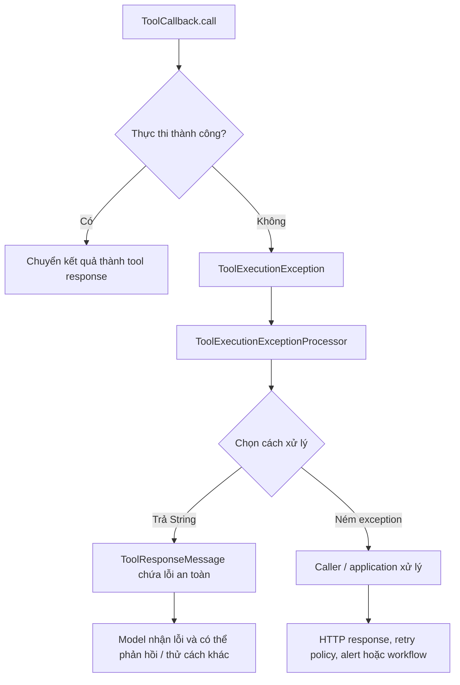

# Thiết kế mã lỗi, thông tin có thể khôi phục và thông báo an toàn

Khi một tool thất bại, ứng dụng cần quyết định thông tin nào được gửi lại cho mô hình, thông tin nào chỉ dành cho log nội bộ và liệu thao tác có thể thử lại hay không. Một chuỗi exception tự do không đủ để đưa ra các quyết định đó: message có thể chứa SQL, tên host, dữ liệu cá nhân hoặc chi tiết triển khai; còn việc chỉ biết “đã xảy ra lỗi” không giúp mô hình hay người dùng chọn bước tiếp theo.

Trong Spring AI, `ToolExecutionException` chuẩn hóa lỗi phát sinh trong quá trình thực thi tool và `ToolExecutionExceptionProcessor` quyết định chuyển lỗi thành nội dung tool response hay ném lỗi về caller. Ứng dụng nên đặt một taxonomy lỗi ổn định ở tầng nghiệp vụ, phân loại khả năng khôi phục, rồi dùng processor để tạo thông báo ngắn gọn, an toàn và có thể hành động.

Bài học này thuộc module `SPRING_AI_TOOL_CALLING`: mô hình có thể đề nghị gọi tool, nhưng ứng dụng vẫn sở hữu việc thực thi, quyền truy cập, xử lý lỗi và quyết định retry. Thông tin gửi cho mô hình chỉ hỗ trợ nó tiếp tục hội thoại; thông tin chẩn đoán chi tiết phải ở hệ thống quan sát và audit của ứng dụng.

## 1. Hai đường đi sau khi tool thất bại

`ToolExecutionExceptionProcessor` có một hợp đồng rất nhỏ:

```java
@FunctionalInterface
public interface ToolExecutionExceptionProcessor {
    String process(ToolExecutionException exception);
}
```

Processor có hai lựa chọn:

- Trả về `String`: Spring AI dùng chuỗi đó làm kết quả của tool call và đưa nó vào hội thoại để mô hình đọc ở vòng tiếp theo.
- Ném exception: lỗi thoát khỏi quá trình tool calling để ứng dụng, controller hoặc lớp điều phối xử lý.



Khi dùng `ChatClient` với `ToolCallingAdvisor`, chuỗi lỗi được trả về sẽ trở thành tool result; vòng lặp có thể gọi mô hình thêm để giải thích hoặc điều chỉnh arguments. Nếu processor ném exception, lời gọi `ChatClient` thất bại và exception đi về ứng dụng. Khi dùng `ToolCallingManager` trực tiếp, manager cũng dùng processor đã cấu hình để xử lý `ToolExecutionException` trong lúc gọi callback.

Đây là ranh giới giữa hai chính sách:

| Lựa chọn | Hệ quả | Thường phù hợp khi |
| --- | --- | --- |
| Trả thông báo cho model | Hội thoại tiếp tục với một tool response báo lỗi | Lỗi nghiệp vụ có thể giải thích và model có thể sửa yêu cầu hoặc thông báo cho người dùng |
| Ném về ứng dụng | Dừng luồng tool calling hiện tại | Lỗi xác thực, quyền, hạ tầng, lỗi không an toàn để model xử lý hoặc cần workflow riêng |

Không phải lỗi nào cũng nên gửi cho mô hình. Một lỗi nội bộ hoặc lỗi bảo mật thường cần dừng ở ứng dụng, ghi log có kiểm soát và trả một phản hồi bên ngoài phù hợp.

## 2. ToolExecutionException mang thông tin gì?

`ToolExecutionException` là một `RuntimeException` chứa `ToolDefinition` của tool thất bại và `cause` gốc:

```java
public ToolExecutionException(ToolDefinition toolDefinition, Throwable cause)

public ToolDefinition getToolDefinition()
```

`ToolDefinition` giúp xác định tool name, description và input schema; `getCause()` giữ exception nghiệp vụ hoặc kỹ thuật ban đầu. Vì vậy, processor có thể phân loại theo loại lỗi gốc mà không cần suy luận từ chuỗi message.

Ví dụ một custom `ToolCallback`:

```java
import org.springframework.ai.tool.ToolCallback;
import org.springframework.ai.tool.definition.ToolDefinition;
import org.springframework.ai.tool.execution.ToolExecutionException;
import org.springframework.ai.tool.metadata.ToolMetadata;

public final class CustomerLookupCallback implements ToolCallback {

    private final ToolDefinition definition;
    private final CustomerService customerService;

    public CustomerLookupCallback(
            ToolDefinition definition,
            CustomerService customerService) {
        this.definition = definition;
        this.customerService = customerService;
    }

    @Override
    public ToolDefinition getToolDefinition() {
        return definition;
    }

    @Override
    public ToolMetadata getToolMetadata() {
        return ToolMetadata.builder().build();
    }

    @Override
    public String call(String toolInput) {
        try {
            return customerService.lookupAsJson(toolInput);
        }
        catch (CustomerNotFoundException exception) {
            throw new ToolExecutionException(definition,
                    new ToolBusinessException(
                            ToolErrorCode.RESOURCE_NOT_FOUND,
                            "Không tìm thấy khách hàng theo thông tin đã cung cấp.",
                            true, false,
                            "Kiểm tra lại mã khách hàng hoặc hỏi người dùng.",
                            exception));
        }
        catch (CustomerAccessDeniedException exception) {
            throw new ToolExecutionException(definition,
                    new ToolBusinessException(
                            ToolErrorCode.ACCESS_DENIED,
                            "Bạn không có quyền xem thông tin khách hàng này.",
                            false, false,
                            "Không thể tiếp tục thao tác với tài khoản hiện tại.",
                            exception));
        }
        catch (RuntimeException exception) {
            throw new ToolExecutionException(definition, exception);
        }
    }
}
```

Ví dụ rút gọn này minh họa việc gắn `ToolDefinition` vào exception. Trong ứng dụng thật, chỉ bắt các lỗi mà callback có thể xử lý hoặc chuẩn hóa; không cần bắt `Throwable` và không nên biến `Error` của JVM thành lỗi nghiệp vụ. Nếu custom callback không ném `ToolExecutionException`, processor của Spring AI không có bảo đảm nhận được lỗi đó; `DefaultToolCallingManager` xử lý `ToolExecutionException` ở ranh giới gọi callback.

Với `MethodToolCallback` và `FunctionToolCallback`, Spring AI đã cung cấp cơ chế thực thi tương ứng. Khi tự viết `ToolCallback`, hãy tuân thủ hợp đồng trên để processor có thể hoạt động thống nhất.

## 3. Thiết kế taxonomy mã lỗi ổn định

Mã lỗi nên mô tả loại tình huống nghiệp vụ, không mô tả class Java hoặc câu message của exception. Mã cần ổn định qua các lần refactor để frontend, log, dashboard và mô hình có thể nhận biết nhất quán.

Một taxonomy tham khảo:

| Code | Ý nghĩa | Có thể khôi phục? | Hướng xử lý |
| --- | --- | --- | --- |
| `INVALID_ARGUMENT` | Thiếu hoặc sai dữ liệu đầu vào | Có điều kiện | Yêu cầu bổ sung hoặc sửa trường được nêu |
| `RESOURCE_NOT_FOUND` | Không tìm thấy tài nguyên | Thường không | Kiểm tra lại mã tài nguyên hoặc hỏi người dùng |
| `ACCESS_DENIED` | Chủ thể không có quyền | Không bằng cách thử lại | Dừng, không tiết lộ tài nguyên hoặc quyền nội bộ |
| `STATE_CONFLICT` | Trạng thái hiện tại không cho phép thao tác | Có điều kiện | Đọc lại trạng thái, yêu cầu người dùng quyết định |
| `RATE_LIMITED` | Vượt giới hạn tốc độ hoặc quota | Có | Chờ theo thời gian được phép rồi thử lại nếu thao tác an toàn |
| `DEPENDENCY_UNAVAILABLE` | Dịch vụ phụ thuộc tạm thời không khả dụng | Có | Retry có giới hạn hoặc chuyển sang quy trình khác |
| `DEPENDENCY_TIMEOUT` | Hết thời gian chờ dịch vụ phụ thuộc | Không chắc chắn | Kiểm tra trạng thái giao dịch trước khi retry |
| `BUSINESS_RULE_VIOLATION` | Vi phạm quy tắc nghiệp vụ | Thường không | Giải thích điều kiện cần đáp ứng |
| `INTERNAL_ERROR` | Lỗi ngoài dự kiến | Không gửi chi tiết | Dừng, ghi nhận correlation ID và xử lý ở ứng dụng |

Không cần tạo hàng trăm code cho mọi exception. Bắt đầu với nhóm lỗi mà ứng dụng thực sự cần hành động khác nhau. Nếu hai lỗi có cùng cách xử lý, có thể dùng chung code và phân biệt thêm trong log nội bộ.

### Phân biệt recoverable và retryable

Hai khái niệm này có liên quan nhưng không giống nhau:

- **Recoverable:** quy trình có thể tiếp tục sau khi có thêm thông tin hoặc thay đổi trạng thái, ví dụ người dùng sửa ngày đặt hàng.
- **Retryable:** có thể thử lại cùng một thao tác sau một khoảng thời gian, ví dụ dịch vụ tạm thời trả 503.

`INVALID_ARGUMENT` có thể recoverable nhưng không retryable với cùng arguments. `DEPENDENCY_TIMEOUT` có thể retryable về mặt hạ tầng nhưng không an toàn để retry giao dịch ghi nếu chưa biết lần trước đã commit hay chưa. `ACCESS_DENIED` không trở thành retryable chỉ vì mô hình gọi tool lần nữa.

Vì vậy, đừng chỉ có một cờ `retryable` rồi để mô hình tự quyết định retry mọi trường hợp. Hãy xác định rõ ai được phép retry, cần điều kiện gì và có cần idempotency key hay không.

## 4. Định nghĩa lỗi nghiệp vụ có mã và dữ liệu có cấu trúc

Có thể dùng exception riêng để giữ code, khả năng khôi phục và dữ liệu an toàn cho model:

```java
public enum ToolErrorCode {
    INVALID_ARGUMENT,
    RESOURCE_NOT_FOUND,
    ACCESS_DENIED,
    STATE_CONFLICT,
    RATE_LIMITED,
    DEPENDENCY_UNAVAILABLE,
    DEPENDENCY_TIMEOUT,
    BUSINESS_RULE_VIOLATION,
    INTERNAL_ERROR
}
```

```java
public class ToolBusinessException extends RuntimeException {

    private final ToolErrorCode code;
    private final boolean recoverable;
    private final boolean retryable;
    private final String safeMessage;
    private final String nextAction;

    public ToolBusinessException(
            ToolErrorCode code,
            String safeMessage,
            boolean recoverable,
            boolean retryable,
            String nextAction,
            Throwable cause) {
        super(code.name(), cause);
        this.code = code;
        this.safeMessage = safeMessage;
        this.recoverable = recoverable;
        this.retryable = retryable;
        this.nextAction = nextAction;
    }

    public ToolErrorCode getCode() {
        return code;
    }

    public boolean isRecoverable() {
        return recoverable;
    }

    public boolean isRetryable() {
        return retryable;
    }

    public String getSafeMessage() {
        return safeMessage;
    }

    public String getNextAction() {
        return nextAction;
    }
}
```

Thông tin này thuộc ứng dụng, không phải API bắt buộc của Spring AI. `safeMessage` cần được tạo từ template do ứng dụng kiểm soát; không sao chép trực tiếp `cause.getMessage()` vào trường này.

DTO gửi về mô hình có thể gồm:

```java
public record ToolErrorResponse(
        String code,
        String message,
        boolean recoverable,
        boolean retryable,
        String nextAction) {
}
```

Ví dụ response:

```json
{
  "code": "RESOURCE_NOT_FOUND",
  "message": "Không tìm thấy đơn hàng với mã ORD-204.",
  "recoverable": true,
  "retryable": false,
  "nextAction": "Kiểm tra lại mã đơn hàng hoặc hỏi người dùng."
}
```

Không đưa `principalId`, tenant nội bộ, SQL, stack trace, URL dịch vụ, tên bảng, access token hoặc dữ liệu cá nhân không cần thiết vào DTO này.

## 5. Tùy chỉnh ToolExecutionExceptionProcessor để tạo thông báo an toàn

Processor mặc định `DefaultToolExecutionExceptionProcessor` phù hợp với cách dùng cơ bản, nhưng hành vi mặc định có thể gửi nguyên message của `RuntimeException` về mô hình. Nếu exception message chứa thông tin nội bộ, mô hình cũng sẽ nhìn thấy. Trong ứng dụng nghiệp vụ, nên dùng processor có taxonomy và thông báo được kiểm soát.

Ví dụ:

```java
import com.fasterxml.jackson.core.JsonProcessingException;
import com.fasterxml.jackson.databind.ObjectMapper;
import org.springframework.ai.tool.execution.ToolExecutionException;
import org.springframework.ai.tool.execution.ToolExecutionExceptionProcessor;
import org.springframework.context.annotation.Bean;
import org.springframework.context.annotation.Configuration;
import org.springframework.security.oauth2.client.ClientAuthorizationException;

@Configuration(proxyBeanMethods = false)
class ToolErrorConfiguration {

    @Bean
    ToolExecutionExceptionProcessor toolExecutionExceptionProcessor(
            ObjectMapper objectMapper) {
        return exception -> {
            Throwable cause = exception.getCause();

            // Giữ lỗi OAuth2 ở application layer để luồng xác thực có thể xử lý.
            if (cause instanceof ClientAuthorizationException authorizationException) {
                throw authorizationException;
            }

            ToolErrorResponse response = toSafeResponse(cause);
            try {
                return objectMapper.writeValueAsString(response);
            }
            catch (JsonProcessingException serializationFailure) {
                return "{\"code\":\"INTERNAL_ERROR\","
                        + "\"message\":\"Không thể hoàn tất yêu cầu công cụ.\","
                        + "\"recoverable\":false,\"retryable\":false}";
            }
        };
    }

    private ToolErrorResponse toSafeResponse(Throwable cause) {
        if (cause instanceof ToolBusinessException businessException) {
            return new ToolErrorResponse(
                    businessException.getCode().name(),
                    businessException.getSafeMessage(),
                    businessException.isRecoverable(),
                    businessException.isRetryable(),
                    businessException.getNextAction());
        }

        return new ToolErrorResponse(
                "INTERNAL_ERROR",
                "Không thể hoàn tất yêu cầu công cụ. Vui lòng thử lại sau hoặc liên hệ hỗ trợ.",
                false,
                false,
                "Ứng dụng sẽ ghi nhận lỗi để kiểm tra.");
    }
}
```

`ClientAuthorizationException` được ném lại để luồng OAuth2 của ứng dụng có thể phản ứng, thay vì biến lỗi xác thực thành tool response cho mô hình. Nếu custom processor thay thế processor tự cấu hình, hãy bảo toàn các exception đặc biệt mà ứng dụng cần xử lý ở lớp ngoài. Với các hệ thống dùng Spring Security, cân nhắc cả `AccessDeniedException` và các exception bảo mật khác theo chính sách riêng.

Đoạn code trên là ví dụ chính sách cho module. Nếu không cần JSON response, processor có thể trả một chuỗi thông báo ngắn. Nếu serialization thất bại, fallback phải là thông báo hằng số, không dùng message của lỗi serialization.

## 6. Cấu hình processor mặc định: trả lỗi hay ném lỗi?

Spring Boot auto-configuration cung cấp `DefaultToolExecutionExceptionProcessor`. Theo hành vi mặc định:

- `RuntimeException` được gửi về mô hình bằng message của exception.
- Checked exception và `Error` luôn được ném lại.
- `spring.ai.tools.throw-exception-on-error=true` yêu cầu ném lỗi về caller thay vì chuyển thành tool response.

Cấu hình application properties:

```yaml
spring:
  ai:
    tools:
      throw-exception-on-error: true
```

Hoặc khai báo bean:

```java
import org.springframework.ai.tool.execution.DefaultToolExecutionExceptionProcessor;
import org.springframework.ai.tool.execution.ToolExecutionExceptionProcessor;

@Bean
ToolExecutionExceptionProcessor toolExecutionExceptionProcessor() {
    return new DefaultToolExecutionExceptionProcessor(true);
}
```

Constructor nhận `alwaysThrow`. Ở chế độ `false`, processor trả message cho các runtime exception mà nó không đưa vào allowlist rethrow. Có thể dùng builder để thêm exception cần ném lại:

```java
import java.util.List;

import org.springframework.ai.tool.execution.DefaultToolExecutionExceptionProcessor;
import org.springframework.ai.tool.execution.ToolExecutionExceptionProcessor;
import org.springframework.security.oauth2.client.ClientAuthorizationException;

@Bean
ToolExecutionExceptionProcessor toolExecutionExceptionProcessor() {
    return DefaultToolExecutionExceptionProcessor.builder()
            .alwaysThrow(false)
            .rethrowExceptions(List.of(ClientAuthorizationException.class))
            .build();
}
```

`rethrowExceptions(...)` nhận danh sách loại `RuntimeException` được unwrap khỏi `ToolExecutionException` và ném lại nguyên loại. Chỉ đưa vào allowlist những exception mà lớp điều phối bên ngoài thực sự biết xử lý.

Nếu định nghĩa bean processor riêng, bean đó thay thế hành vi auto-configured tương ứng. Đừng khai báo nhiều bean cùng kiểu mà không quy định rõ bean nào được dùng.

## 7. Không dùng exception message làm hợp đồng API

Exception message được viết cho lập trình viên và có thể thay đổi theo thư viện, phiên bản hoặc driver. Không nên để model phụ thuộc vào các chuỗi như:

```text
org.postgresql.util.PSQLException: ERROR: duplicate key value violates unique constraint ...
Connection refused to db-internal-03:5432
Access denied for user 'svc_tool'@'10.0.0.12'
```

Thay vào đó, dùng code và message ổn định:

```json
{
  "code": "STATE_CONFLICT",
  "message": "Đơn hàng đã được xử lý nên không thể hủy.",
  "recoverable": false,
  "retryable": false,
  "nextAction": "Kiểm tra trạng thái đơn hàng hiện tại."
}
```

Một thông báo tốt trả lời được ba câu hỏi:

1. Điều gì đã xảy ra ở mức nghiệp vụ?
2. Mô hình hoặc người dùng có thể làm gì tiếp theo?
3. Có thể thử lại không, và nếu có thì cần chờ hay thay đổi điều gì?

Thông báo không cần giải thích chi tiết nội bộ về nguyên nhân kỹ thuật. Log nội bộ có thể ghi exception class, stack trace, cause chain và correlation ID với quyền truy cập phù hợp.

## 8. Phân biệt model-facing error với application-facing error

Một lỗi có thể cần hai thông điệp khác nhau:

| Kênh | Người đọc | Nội dung phù hợp |
| --- | --- | --- |
| Tool response | Mô hình | Code ổn định, thông điệp nghiệp vụ, khả năng khôi phục và hành động tiếp theo |
| UI/API response | Người dùng hoặc client | Ngôn ngữ dễ hiểu, mã tham chiếu hỗ trợ, hướng xử lý phù hợp với quyền của họ |
| Application log | Developer/on-call | Exception gốc, stack trace, dependency, duration và correlation ID |
| Security audit | Nhóm được phân quyền | Actor, tenant, hành động, outcome, thời điểm và policy decision cần thiết |
| Metrics/trace | Vận hành | Tool name, error category, outcome, latency; tránh payload nhạy cảm và label có cardinality cao |

Không chuyển nguyên tool response cho HTTP client nếu nó chứa thông tin dành riêng cho mô hình. Cũng không gửi stack trace vào model chỉ vì muốn nó “giúp debug”. Model không phải hệ thống giám sát nội bộ.

Ví dụ log có correlation ID:

```java
try {
    return orderService.cancel(orderId, actor);
}
catch (OrderAlreadyShippedException exception) {
    log.info("Tool cancelOrder rejected by business state. correlationId={}",
            correlationId);
    throw new ToolExecutionException(toolDefinition, exception);
}
catch (RuntimeException exception) {
    log.error("Tool cancelOrder failed. correlationId={}", correlationId, exception);
    throw new ToolExecutionException(toolDefinition, exception);
}
```

Không log raw arguments nếu chúng có thông tin cá nhân, tài khoản hoặc bí mật. Nếu cần truy vết tài nguyên, ưu tiên mã đã được mask hoặc định danh nội bộ không nhạy cảm.

## 9. Xác định khả năng khôi phục và chính sách retry

Mã lỗi có thể kèm hướng dẫn, nhưng retry phải do ứng dụng hoặc workflow kiểm soát. Mô hình có thể đề nghị thử lại; ứng dụng quyết định có thực hiện hay không.

| Loại lỗi | Model có thể làm gì? | Ứng dụng nên làm gì? |
| --- | --- | --- |
| `INVALID_ARGUMENT` | Hỏi người dùng hoặc tạo arguments hợp lệ hơn | Validate lại; không retry cùng dữ liệu sai |
| `RESOURCE_NOT_FOUND` | Kiểm tra mã hoặc yêu cầu người dùng xác nhận | Tránh dò tìm tài nguyên ngoài quyền |
| `ACCESS_DENIED` | Thông báo không thể thực hiện | Không retry; ghi audit và giữ nguyên ranh giới quyền |
| `STATE_CONFLICT` | Đọc trạng thái mới hoặc đề xuất thao tác khác | Kiểm tra trạng thái và yêu cầu xác nhận nếu cần |
| `RATE_LIMITED` | Thông báo cần chờ | Tuân thủ `Retry-After`/quota; dùng backoff và jitter |
| `DEPENDENCY_UNAVAILABLE` | Có thể yêu cầu thử lại sau | Retry có giới hạn, timeout và circuit breaker |
| `DEPENDENCY_TIMEOUT` | Không được giả định thao tác chưa chạy | Tra cứu trạng thái theo idempotency key trước khi retry |
| `INTERNAL_ERROR` | Thông báo không thể hoàn tất | Không lặp vô hạn; log và cảnh báo |

Với thao tác đọc, retry có thể an toàn hơn. Với thao tác ghi, cần idempotency key hoặc cơ chế xác định kết quả trước khi gửi lại. Timeout không đồng nghĩa giao dịch chưa được commit: server đích có thể đã hoàn tất nhưng response bị mất.

Nếu trả `retryable: true`, nên bổ sung `retryAfterSeconds` hoặc một thời điểm retry cụ thể nếu hệ thống có dữ liệu đáng tin cậy. Không để model tự tạo thời gian chờ hoặc tự gọi lại liên tục.

## 10. Phân biệt lỗi tool với lỗi ngoài vòng xử lý này

`ToolExecutionExceptionProcessor` không phải một bộ xử lý cho mọi lỗi của hệ thống AI. Nó xử lý `ToolExecutionException` phát sinh khi callback thực thi thất bại.

| Lỗi | Có đi qua ToolExecutionExceptionProcessor? | Nơi xử lý phù hợp |
| --- | --- | --- |
| Method/function tool ném lỗi khi thực thi và được bọc | Có | Processor |
| Custom `ToolCallback` ném `ToolExecutionException` | Có | Processor |
| Custom callback ném một runtime exception thô | Không được bảo đảm; manager mặc định bắt `ToolExecutionException` | Sửa callback để tuân thủ hợp đồng hoặc xử lý ở caller |
| Không tìm thấy tool callback | Không | Tool resolution / application configuration |
| JSON arguments không deserialize được trước khi gọi method | Không nhất thiết | Validation và xử lý request/model response |
| Provider/model API lỗi | Không | ChatModel/provider exception handling |
| Vượt tool call limit | Không | `ToolCallLimitExceededException` và tool limit policy |
| Authorization ở controller trước khi bắt đầu tool call | Không | Spring Security/application layer |

Không nên bắt tất cả exception ở một processor duy nhất. Mỗi tầng có ngữ cảnh và trách nhiệm riêng. Nếu gộp lỗi provider, lỗi phân quyền, lỗi schema và lỗi nghiệp vụ thành một chuỗi “tool failed”, ứng dụng sẽ khó vận hành và mô hình cũng khó chọn hành động đúng.

## 11. Kiểm thử taxonomy và processor

Kiểm thử phải xác nhận code ổn định, message an toàn, khả năng khôi phục và quyết định throw/return. Đặc biệt, cần bảo đảm exception nội bộ không rò vào tool response.

| Trường hợp | Điều cần xác minh |
| --- | --- |
| Lỗi nghiệp vụ đã biết | Được ánh xạ đúng error code và safe message |
| Lỗi không xác định | Trả `INTERNAL_ERROR`, không trả cause message |
| Cause chứa SQL/host/token | Không xuất hiện trong chuỗi processor trả về |
| `ClientAuthorizationException` | Được ném lại nếu ứng dụng cần OAuth2 flow xử lý |
| `alwaysThrow=true` | Tool error thoát về caller |
| `alwaysThrow=false` | Runtime exception không nằm trong allowlist được chuyển thành message |
| Checked exception / `Error` | Theo đúng hành vi của default processor và chính sách JVM |
| Custom callback | Luôn bọc lỗi thực thi trong `ToolExecutionException` với đúng `ToolDefinition` |
| Model recovery | Tool response được nối vào lịch sử và model có thể trả lời hoặc hỏi lại |
| Retry | Chỉ thực hiện theo policy, idempotency và giới hạn số lần |
| Logging | Log có correlation ID nhưng không chứa payload nhạy cảm ngoài chính sách |

Ví dụ unit test cho custom processor:

```java
@Test
void hidesUnexpectedCauseDetailsFromModel() {
    ToolDefinition definition = ToolDefinition.builder()
            .name("lookupOrder")
            .description("Tra cứu đơn hàng")
            .inputSchema("{\"type\":\"object\"}")
            .build();

    RuntimeException internalCause =
            new RuntimeException("Connection refused to db-private:5432; password=secret");
    ToolExecutionException exception =
            new ToolExecutionException(definition, internalCause);

    String message = processor.process(exception);

    assertThat(message).contains("INTERNAL_ERROR");
    assertThat(message).doesNotContain("db-private");
    assertThat(message).doesNotContain("password=secret");
}
```

Ví dụ này giả định `processor` là bean hoặc fixture được tạo bằng `ObjectMapper` test. Nên bổ sung test cho từng code nghiệp vụ, allowlist rethrow và chế độ `alwaysThrow`.

Ở integration test, cho model gọi một tool có lỗi recoverable như `INVALID_ARGUMENT`; xác nhận `ToolResponseMessage` chứa JSON lỗi an toàn, mô hình được gọi lại và có thể hỏi người dùng giá trị còn thiếu. Với `ACCESS_DENIED` hoặc `INTERNAL_ERROR`, xác nhận ứng dụng không để model tiếp tục thực hiện thao tác bị cấm.

## 12. Quy trình xử lý lỗi trong production

1. Tool/service phát hiện lỗi và ném exception nghiệp vụ có loại rõ ràng.
2. Callback bọc lỗi thực thi bằng `ToolExecutionException` cùng `ToolDefinition`.
3. `ToolExecutionExceptionProcessor` phân loại cause và chọn trả thông báo an toàn hay ném về caller.
4. Nếu trả message, Spring AI tạo tool response để mô hình tiếp tục; nếu ném, application handler xử lý.
5. Ứng dụng ghi log/audit/metrics với correlation ID và dữ liệu đã được lọc.
6. Retry chỉ được thực hiện bởi tầng có đủ thông tin về idempotency, timeout và trạng thái nghiệp vụ.

`ToolExecutionException` giúp chuẩn hóa lỗi ở ranh giới thực thi; `ToolExecutionExceptionProcessor` quyết định lỗi có thể quay lại cuộc hội thoại hay phải dừng ở ứng dụng. Khi mã lỗi ổn định, thông tin recoverability rõ ràng và message được lọc trước khi gửi cho mô hình, hệ thống vừa giúp mô hình xử lý tình huống hợp lệ vừa giữ được dữ liệu chẩn đoán và quyền kiểm soát ở phía ứng dụng.

## Tài liệu tham khảo

- [Spring AI 2.1 — Tool Calling: Exception Handling](https://docs.spring.io/spring-ai/reference/api/tools.html)
- [Spring AI 2.0 — Tool Calling: Exception Handling](https://docs.spring.io/spring-ai/reference/2.0/api/tools.html)
- [ToolExecutionException API](https://docs.spring.io/spring-ai/docs/2.0.1/api/org/springframework/ai/tool/execution/ToolExecutionException.html)
- [ToolExecutionExceptionProcessor API](https://docs.spring.io/spring-ai/docs/2.1.x/api/org/springframework/ai/tool/execution/ToolExecutionExceptionProcessor.html)
- [DefaultToolExecutionExceptionProcessor API](https://docs.spring.io/spring-ai/docs/2.1.x/api/org/springframework/ai/tool/execution/DefaultToolExecutionExceptionProcessor.html)
- [DefaultToolExecutionExceptionProcessor.Builder API](https://docs.spring.io/spring-ai/docs/2.1.x/api/org/springframework/ai/tool/execution/DefaultToolExecutionExceptionProcessor.Builder.html)
