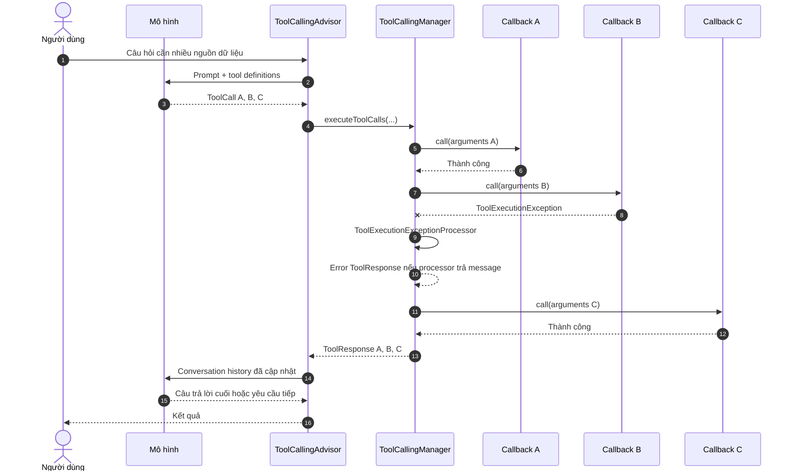

# Xử lý nhiều công cụ khi một công cụ thất bại

Một phản hồi của mô hình có thể chứa nhiều tool call trong cùng một lượt. Ví dụ, khi người dùng hỏi tổng quan đơn hàng, mô hình có thể yêu cầu tra cứu trạng thái giao hàng, tồn kho và thông tin thanh toán. Nếu một công cụ thất bại, ứng dụng cần quyết định các công cụ còn lại có tiếp tục hay cả lượt phải dừng.

Spring AI 2.x cung cấp `ToolExecutionExceptionProcessor` để quyết định cách xử lý lỗi do callback ném ra: chuyển lỗi thành tool response gửi lại mô hình, hoặc ném lỗi ra caller. Với processor mặc định, thông điệp của `RuntimeException` được trả lại mô hình; checked exception và `Error` được ném ra. Vì vậy, một lỗi callback được xử lý thành thông điệp lỗi có thể để manager tiếp tục các tool call còn lại trong cùng batch.

Một điểm quan trọng khác: mô hình có thể phát nhiều tool call trong một response, nhưng điều đó không đồng nghĩa ứng dụng chạy chúng đồng thời. `DefaultToolCallingManager` duyệt danh sách tool call theo thứ tự và gọi từng callback. `parallelToolCalls` của model/provider điều khiển khả năng mô hình trả nhiều call trong một response; nó không tự biến việc thực thi callback phía ứng dụng thành concurrent execution.

Trong module `SPRING_AI_TOOL_CALLING`, ứng dụng chịu trách nhiệm điều phối nhiều tool call, phân loại lỗi, bảo toàn kết quả thành công, giới hạn retry và bảo vệ side effect. Bài học này tập trung vào cách chọn chính sách tiếp tục hay dừng, cách trả lỗi có cấu trúc cho mô hình và cách kiểm thử partial success.

Sau bài học, bạn có thể:

- Phân biệt lỗi của một callback với lỗi cấu hình hoặc phân giải công cụ.
- Hiểu khi nào `ToolExecutionExceptionProcessor` cho phép batch tiếp tục và khi nào lỗi làm batch dừng.
- Chọn giữa continue-on-error và fail-fast theo nghiệp vụ.
- Trả lỗi an toàn, có mã và có thể hành động cho mô hình.
- Retry lỗi tạm thời mà không lặp side effect ngoài ý muốn.
- Phân biệt nhiều tool call trong một response với thực thi song song ở phía ứng dụng.
- Kiểm thử kết quả thành công một phần, lỗi toàn batch và giới hạn số lần gọi.

## 1. Tình huống nhiều công cụ, một công cụ thất bại

Giả sử assistant hỗ trợ nhân viên chăm sóc khách hàng. Để trả lời câu hỏi “Đơn ORD-104 đang ở đâu và có đủ hàng để giao không?”, mô hình có thể yêu cầu ba công cụ:

1. `get_order_status`: tra cứu trạng thái đơn hàng.
2. `get_inventory`: kiểm tra số lượng hàng.
3. `get_payment_status`: kiểm tra thanh toán.

Kết quả có thể như sau:

| Công cụ | Kết quả | Ý nghĩa |
|---|---|---|
| `get_order_status` | Thành công | Đơn hàng đang chờ giao |
| `get_inventory` | Timeout | Chưa xác minh được tồn kho |
| `get_payment_status` | Thành công | Thanh toán đã hoàn tất |

Ứng dụng cần giữ hai kết quả đã có, biểu diễn lỗi tồn kho trung thực và quyết định có tiếp tục hội thoại hay dừng để caller xử lý. Không nên bỏ tất cả kết quả thành công chỉ vì một công cụ không truy cập được.

Tuy nhiên, không phải mọi thao tác đều được phép tiếp tục. Nếu một tool call thất bại làm mất điều kiện tiên quyết cho các thao tác sau — ví dụ chưa xác minh quyền nhưng một công cụ khác có thể ghi dữ liệu — ứng dụng phải dừng trước khi tạo tác động phụ.

## 2. Vòng xử lý nhiều tool call

Với `ChatClient`, `ToolCallingAdvisor` nhận phản hồi của mô hình và giao các tool call cho `ToolCallingManager`. Manager phân giải callback, thực thi chúng và tạo `ToolResponseMessage` chứa kết quả theo từng tool call ID. Advisor thêm tool response vào conversation history rồi gọi mô hình tiếp.



Khi processor chuyển exception thành chuỗi, manager có thể thêm error response cho tool call bị lỗi rồi tiếp tục vòng duyệt. Nếu processor ném exception ra ngoài, luồng thực thi hiện tại kết thúc và các callback nằm sau lỗi đó không được gọi.

## 3. Nhiều tool call không có nghĩa là chạy song song

Mô hình có thể trả về nhiều tool call trong một assistant message. Trong `DefaultToolCallingManager`, danh sách này được duyệt theo thứ tự và callback được gọi lần lượt. Vì vậy, nếu ba callback mất lần lượt 1, 2 và 3 giây, tổng thời gian có thể gần bằng tổng thời gian của cả ba.

| Khái niệm | Điều khiển điều gì? |
|---|---|
| Model `parallelToolCalls` | Cho phép mô hình đề xuất nhiều tool call trong cùng một response |
| `DefaultToolCallingManager` | Thực thi các callback theo thứ tự trong danh sách |
| Concurrent execution do ứng dụng xây dựng | Chạy các tác vụ độc lập trên executor hoặc một cơ chế điều phối riêng |

Không bật `parallelToolCalls(true)` với kỳ vọng callback sẽ tự chạy đồng thời. Nếu các thao tác phụ thuộc nhau, cách thực thi tuần tự còn giúp giữ thứ tự nghiệp vụ rõ ràng. Nếu cần concurrency, ứng dụng phải tự thiết kế giới hạn luồng, timeout, thứ tự kết quả và cách cô lập lỗi.

## 4. Ba lớp lỗi cần phân biệt

Không phải lỗi nào xuất hiện trong quá trình tool calling cũng đi qua `ToolExecutionExceptionProcessor`.

| Lớp lỗi | Ví dụ | Cách xử lý |
|---|---|---|
| Lỗi trong callback | Service timeout, API ngoài trả lỗi, quy tắc nghiệp vụ từ chối | Callback báo `ToolExecutionException`; processor chuyển thành error response hoặc ném ra |
| Lỗi phân giải/cấu hình | Không tìm thấy callback, tên tool sai, schema hoặc arguments không hợp lệ trước khi gọi callback | Có thể phát sinh exception trực tiếp từ manager; không mặc định đi qua processor |
| Lỗi điều phối/model | Model timeout, lỗi provider, lỗi advisor hoặc lỗi xây dựng response | Xử lý ở tầng gọi model/orchestrator; không xem là lỗi riêng của một callback |

`ToolExecutionExceptionProcessor` xử lý lỗi thực thi được bọc trong `ToolExecutionException`. Nếu tự triển khai `ToolCallback`, hãy ném `ToolExecutionException` khi callback thất bại để framework có thể áp dụng processor. Đừng kỳ vọng mọi `IllegalStateException` từ resolver hoặc mọi lỗi trước lúc callback chạy sẽ tự biến thành một tool response.

## 5. Hành vi của processor mặc định

Spring AI cung cấp `DefaultToolExecutionExceptionProcessor`. Hành vi mặc định:

- Nếu lỗi callback là `RuntimeException`, thông điệp lỗi được chuyển thành chuỗi tool result gửi lại mô hình.
- Checked exception và `Error` được ném ra caller.
- Có thể đặt `spring.ai.tools.throw-exception-on-error=true` để yêu cầu tool errors được ném ra caller xử lý.

```properties
spring.ai.tools.throw-exception-on-error=false
```

Với cấu hình mặc định, một callback ném `RuntimeException` được bọc thành `ToolExecutionException`; processor tạo thông điệp lỗi và manager thêm nó vào danh sách tool response. Manager tiếp tục thực thi các callback sau trong batch. Mô hình nhận cả kết quả thành công lẫn thông điệp lỗi ở vòng tiếp theo.

Nếu bật:

```properties
spring.ai.tools.throw-exception-on-error=true
```

processor ném lỗi ra caller thay vì chuyển thành thông điệp cho mô hình. Batch hiện tại dừng tại lỗi đó; các tool call sau chưa chạy. Các kết quả trước lỗi có thể chưa được đóng thành `ToolExecutionResult` để gửi lại mô hình. Vì vậy, khi chọn fail-fast, ứng dụng cần có cách ghi nhận side effect và kết quả đã hoàn tất ở tầng nghiệp vụ/audit.

Một custom processor cũng có thể ném exception. Khi đó, vòng duyệt callback dừng tại vị trí processor ném lỗi. Chỉ những lỗi được processor chuyển thành chuỗi mới cho phép manager tiếp tục.

## 6. Continue-on-error: tiếp tục và báo lỗi theo từng công cụ

Chọn continue-on-error khi các công cụ độc lập và một kết quả lỗi không làm mất tính hợp lệ của các kết quả khác. Ví dụ, dashboard có thể hiển thị trạng thái đơn hàng và thanh toán dù truy vấn tồn kho đang lỗi.

Một error response nên chứa:

- Mã lỗi ổn định, ví dụ `UPSTREAM_TIMEOUT`.
- Trạng thái có thể retry hay không.
- Thông điệp an toàn, không chứa stack trace hoặc thông tin nội bộ.
- Tool call vẫn gắn với đúng ID để mô hình biết kết quả thuộc yêu cầu nào.

Có thể chuẩn hóa thông điệp lỗi trong `ToolExecutionExceptionProcessor`:

```java
import org.springframework.ai.tool.execution.ToolExecutionExceptionProcessor;
import org.springframework.context.annotation.Bean;
import org.springframework.context.annotation.Configuration;

@Configuration
class ToolErrorConfiguration {

    @Bean
    ToolExecutionExceptionProcessor toolExecutionExceptionProcessor() {
        return exception -> """
            {
              "status": "ERROR",
              "code": "TOOL_EXECUTION_FAILED",
              "retryable": false,
              "message": "Công cụ chưa thể hoàn tất yêu cầu. Hãy dùng các kết quả khác nếu có."
            }
            """;
    }
}
```

Đây là chính sách mẫu trả lỗi an toàn cho mô hình. Trong ứng dụng thực tế, phân loại exception theo loại lỗi nội bộ trước khi tạo payload: timeout có thể retry, lỗi validation hoặc authorization không nên retry tự động. Không đưa `exception.getMessage()` nguyên văn ra mô hình nếu thông điệp có thể chứa SQL, URL nội bộ, token hoặc dữ liệu khách hàng.

Khi processor trả chuỗi lỗi, nó không tự retry callback. Nó chỉ chuyển lỗi thành một tool result. Mô hình có thể quyết định bước tiếp theo dựa trên kết quả đó, nhưng ứng dụng vẫn phải giới hạn số vòng và không dựa vào mô hình để bảo đảm tính an toàn của retry.

## 7. Fail-fast: dừng cả batch khi một công cụ thất bại

Chọn fail-fast khi các thao tác có quan hệ phụ thuộc hoặc khi tiếp tục có thể tạo trạng thái nghiệp vụ không nhất quán.

Ví dụ:

- Chưa xác minh danh tính thì không cho phép công cụ cập nhật hồ sơ chạy.
- Không đọc được trạng thái đơn hàng thì không thực hiện hủy đơn.
- Một bước kiểm tra hạn mức thất bại thì không tiếp tục tạo giao dịch.
- Không xác định được tenant thì không gọi bất kỳ service nào có dữ liệu tenant.

Có thể dùng cấu hình `spring.ai.tools.throw-exception-on-error=true`, hoặc custom processor ném exception với nhóm lỗi cần dừng. Caller bắt lỗi ở tầng orchestration và trả trạng thái phù hợp cho giao diện/API.

Fail-fast không tự rollback những thao tác đã chạy trước đó. Nếu tool A đã cập nhật dữ liệu và tool B thất bại, việc dừng tool C không đảo ngược thay đổi của A. Muốn có tính nguyên tử, hãy đưa các bước vào một service nghiệp vụ có transaction hoặc thiết kế saga/compensation. Không dùng ranh giới một tool batch như ranh giới transaction phân tán.

## 8. Trả kết quả từng công cụ bằng DTO khi lỗi là kết quả nghiệp vụ

Không phải mọi trường hợp từ chối nghiệp vụ đều cần ném exception. Ví dụ, “không đủ tồn kho” hoặc “đơn hàng đã giao nên không thể hủy” là kết quả nghiệp vụ mà mô hình có thể diễn giải bình thường.

Hãy trả DTO có trạng thái:

```java
public record OperationResult(
    String status,
    String code,
    String message,
    Object data
) {
    public static OperationResult success(Object data) {
        return new OperationResult("SUCCESS", "OK", "Thao tác thành công.", data);
    }

    public static OperationResult rejected(String code, String message) {
        return new OperationResult("REJECTED", code, message, null);
    }
}
```

Ví dụ:

```java
@Tool(description = "Kiểm tra khả năng hủy đơn hàng")
public OperationResult checkCancellation(String orderId) {
    Order order = orderService.findById(orderId);

    if (order == null) {
        return OperationResult.rejected("ORDER_NOT_FOUND", "Không tìm thấy đơn hàng.");
    }

    if (order.isShipped()) {
        return OperationResult.rejected(
            "ORDER_ALREADY_SHIPPED",
            "Đơn hàng đã được giao cho đơn vị vận chuyển."
        );
    }

    return OperationResult.success(Map.of("canCancel", true));
}
```

`REJECTED` ở đây là kết quả nghiệp vụ thành công của lần gọi công cụ: service đã kiểm tra và xác định thao tác không được phép. Hãy dùng exception cho lỗi kỹ thuật hoặc trạng thái mà tool không thể hoàn thành theo hợp đồng. Sự phân biệt này giúp mô hình không nhầm “không được phép” với “hệ thống bị lỗi”.

## 9. Phân loại lỗi và chính sách retry

Retry phải dựa trên loại lỗi, không dựa vào việc mô hình muốn thử lại. Có thể phân loại như sau:

| Nhóm lỗi | Ví dụ | Retry? | Hành động |
|---|---|---|---|
| Validation | Thiếu SKU, định dạng ngày sai | Không | Trả lỗi đầu vào và yêu cầu sửa dữ liệu |
| Authorization | Người dùng không có quyền | Không | Dừng thao tác và ghi nhận từ chối |
| Not found | Đơn hàng không tồn tại | Không | Trả kết quả nghiệp vụ `NOT_FOUND` |
| Conflict | Đơn đã giao, phiên bản dữ liệu thay đổi | Thường không | Đọc lại trạng thái hoặc yêu cầu quyết định mới |
| Transient network | Timeout, connection reset | Có giới hạn | Retry có backoff nếu thao tác an toàn |
| Rate limit / overload | HTTP 429, 503 | Có giới hạn | Tôn trọng `Retry-After`, backoff và jitter |
| Unknown/internal | Lỗi không phân loại | Mặc định không tự retry | Ghi log, trả mã lỗi tổng quát |

Một retry policy nên có số lần tối đa, deadline tổng, exponential backoff và jitter. Đặt timeout cho từng lần gọi để một callback không giữ cả batch vô hạn. Không retry lỗi authorization, validation hoặc lỗi nghiệp vụ chỉ vì model yêu cầu.

Nếu dùng Spring Retry hoặc Resilience4j bên trong service, hãy chọn một tầng chịu trách nhiệm retry. Tránh đồng thời retry trong service, callback adapter và vòng hội thoại vì số lần thực thi thực tế có thể nhân lên ngoài dự kiến.

## 10. Idempotency cho tool có side effect

Khi tool call ghi dữ liệu, gửi email, tạo thanh toán hoặc hủy đơn, retry có thể thực hiện hành động hai lần. Một timeout không chứng minh server chưa xử lý yêu cầu; response có thể bị mất sau khi side effect đã commit.

Với thao tác có thể retry, dùng idempotency key ổn định:

```java
public record PaymentCommand(
    String orderId,
    BigDecimal amount,
    String idempotencyKey
) {}
```

Service kiểm tra key trước khi tạo giao dịch mới. Nếu key đã được xử lý, trả lại kết quả trước đó. Key nên được tạo ở tầng ứng dụng từ workflow/request ID và định danh thao tác; không để mô hình tự tạo key tùy ý.

Đối với batch nhiều tool call, mỗi hành động cần key riêng. Nếu một tool thành công và tool khác lỗi, khi chạy lại batch phải nhận ra tool thành công đã hoàn tất để không lặp side effect.

## 11. Giữ kết quả thành công khi một công cụ thất bại

Với continue-on-error, mỗi tool call có tool response riêng. Response thành công giữ payload nghiệp vụ; response thất bại chứa thông điệp lỗi đã chuẩn hóa. Khi manager hoàn tất batch, `ToolCallingAdvisor` thêm các response vào conversation history theo tool call ID.

Ví dụ payload mà mô hình có thể nhận:

```json
{
  "toolResponses": [
    {
      "toolCallId": "call_order",
      "tool": "get_order_status",
      "status": "SUCCESS",
      "data": { "orderStatus": "PROCESSING" }
    },
    {
      "toolCallId": "call_inventory",
      "tool": "get_inventory",
      "status": "ERROR",
      "code": "UPSTREAM_TIMEOUT",
      "retryable": true
    },
    {
      "toolCallId": "call_payment",
      "tool": "get_payment_status",
      "status": "SUCCESS",
      "data": { "paymentStatus": "PAID" }
    }
  ]
}
```

Đây là cấu trúc minh họa để giải thích partial success; Spring AI tạo `ToolResponseMessage` cho từng tool call chứ không bắt buộc dùng JSON envelope chung như ví dụ. Mỗi callback chịu trách nhiệm định dạng kết quả của chính nó.

Khi một processor ném lỗi ra ngoài, manager có thể dừng trước khi đóng `ToolResponseMessage` cho batch. Không giả định các response thành công đã tích lũy trước đó sẽ tự động được gửi lại mô hình. Nếu nghiệp vụ yêu cầu bảo toàn kết quả từng bước, hãy ghi chúng vào action ledger hoặc lưu kết quả ở service/orchestrator trước khi tiếp tục.

## 12. `ToolCallLimitExceededException` là trường hợp riêng

`DefaultToolCallingManager` có giới hạn số lần gọi mỗi tool và tổng số tool call trong một turn. Mặc định hiện hành là 40 lần cho mỗi tool và 150 lần tổng. Khi vượt giới hạn với `ToolCallLimitBehavior.THROW`, manager ném `ToolCallLimitExceededException` có chứa `ToolExecutionResult` một phần đã được thực thi trong batch.

`ToolCallingAdvisor` xử lý ngoại lệ giới hạn này và trả một response cuối có finish reason riêng; các tool response đã thành công trước đó được giữ trong metadata `METADATA_PARTIAL_TOOL_RESPONSES`. Đây là hành vi đặc biệt của `ToolCallLimitExceededException`, không phải cam kết rằng mọi exception từ callback đều giữ partial result.

Nếu muốn bỏ qua tool call vượt giới hạn, thêm error ToolResponse và tiếp tục batch, cấu hình `ToolCallLimitBehavior.RETURN_ERROR_RESPONSE`:

```java
ToolCallingManager manager = ToolCallingManager.builder()
    .maxCallsPerTool(20)
    .maxCallsPerTool("get_inventory", 5)
    .maxTotalToolCalls(60)
    .onLimitExceeded(ToolCallLimitBehavior.RETURN_ERROR_RESPONSE)
    .build();
```

Giới hạn này bảo vệ vòng lặp khỏi việc mô hình gọi công cụ quá nhiều. Nó không thay thế rate limit của service, giới hạn concurrency hoặc ngân sách theo người dùng.

## 13. Khi nào cần thực thi đồng thời?

Nếu nhiều truy vấn độc lập và latency là vấn đề, có hai hướng:

1. **Tạo một composite tool.** Một callback duy nhất gọi nhiều service độc lập bằng bounded executor, thu thập kết quả thành công và lỗi theo từng phần rồi trả một DTO tổng hợp. Cách này giữ việc điều phối song song trong một service nghiệp vụ có kiểm soát.
2. **Tạo custom `ToolCallingManager`.** Dùng khi cần thay đổi cách thực thi mọi tool call trong batch. Implementation phải giữ đúng tool call ID, thứ tự response, `ToolContext`, observation, confirmation, limit và exception policy.

Với composite tool, phương thức tool vẫn trả một DTO đồng bộ. Không khai báo `CompletableFuture`, `Mono` hoặc `Flux` làm kiểu trả về của `MethodToolCallback`; các kiểu bất đồng bộ/reactive không phải output schema mà mô hình có thể hiểu. Có thể dùng executor bên trong rồi chờ kết quả trong giới hạn timeout:

```java
public record SubtaskResult(
    String name,
    String status,
    String value,
    String errorCode
) {}

public record DashboardResult(List<SubtaskResult> results) {}

@Component
public class DashboardTools {

    private final Executor dashboardExecutor;
    private final AccountService accountService;
    private final InventoryService inventoryService;

    public DashboardTools(
            @Qualifier("dashboardExecutor") Executor dashboardExecutor,
            AccountService accountService,
            InventoryService inventoryService) {
        this.dashboardExecutor = dashboardExecutor;
        this.accountService = accountService;
        this.inventoryService = inventoryService;
    }

    @Tool(description = "Lấy tổng quan tài khoản và tồn kho; mỗi phần có status riêng")
    public DashboardResult getDashboard(String accountId, String sku) {
        CompletableFuture<SubtaskResult> account = CompletableFuture
            .supplyAsync(() -> accountService.summary(accountId), dashboardExecutor)
            .handle((value, error) -> error == null
                ? new SubtaskResult("account", "SUCCESS", value, null)
                : new SubtaskResult("account", "ERROR", null, "ACCOUNT_UNAVAILABLE"));

        CompletableFuture<SubtaskResult> inventory = CompletableFuture
            .supplyAsync(() -> inventoryService.availableQuantity(sku), dashboardExecutor)
            .handle((value, error) -> error == null
                ? new SubtaskResult("inventory", "SUCCESS", value, null)
                : new SubtaskResult("inventory", "ERROR", null, "INVENTORY_UNAVAILABLE"));

        return new DashboardResult(List.of(account.join(), inventory.join()));
    }
}
```

Ví dụ chỉ minh họa cách cô lập lỗi giữa hai truy vấn độc lập. Trong production, hãy dùng executor có kích thước và queue giới hạn, timeout cho từng tác vụ, phân loại exception, truyền context bảo mật cần thiết và tránh đưa nội dung exception thô vào kết quả. Với thao tác ghi hoặc có phụ thuộc thứ tự, không chạy song song chỉ để giảm latency.

## 14. Custom manager và yêu cầu khi xử lý song song

Nếu viết custom `ToolCallingManager` để thực thi nhiều callback đồng thời, cần định nghĩa rõ các quy tắc sau:

- **Bounded concurrency:** dùng executor có giới hạn; không tạo một thread cho mỗi tool call không giới hạn.
- **Per-call isolation:** một callback lỗi không làm mất kết quả của callback khác nếu chính sách là collect-all.
- **Stable mapping:** giữ `toolCallId` và ánh xạ chính xác mỗi response với request tương ứng.
- **Ordering:** tạo response theo thứ tự tool call ban đầu nếu provider/model yêu cầu thứ tự ổn định.
- **Timeout/cancellation:** giới hạn thời gian và xác định việc hủy các tác vụ còn lại khi fail-fast.
- **Context propagation:** truyền `ToolContext`, security context và tracing context đúng cách; không chia sẻ mutable request state giữa các thread.
- **Side effects:** chỉ chạy song song khi các thao tác độc lập, idempotent hoặc có cơ chế phối hợp phù hợp.
- **Framework behavior:** giữ confirmation policy, call limits, resolver, exception processor, returnDirect và Micrometer observations.

Không nên copy toàn bộ `DefaultToolCallingManager` chỉ để chạy nhanh hơn nếu chưa có yêu cầu đo được. Composite tool thường đơn giản hơn khi chỉ một nhóm service cần fan-out; custom manager phù hợp khi concurrency là chính sách chung của toàn bộ tool execution.

## 15. `returnDirect` khi một batch có nhiều công cụ

Thông thường, tool result được gửi lại mô hình để mô hình tổng hợp. `returnDirect = true` cho phép trả kết quả tool trực tiếp cho caller. Với nhiều tool call trong cùng một response, Spring AI chỉ áp dụng `returnDirect` khi tất cả tool trong batch đều bật metadata này. Nếu một tool không bật, kết quả batch được gửi lại mô hình.

Khi dùng continue-on-error, hãy kiểm tra output cuối theo chính sách thực tế. Không dựa vào `returnDirect` để che lỗi của một tool hoặc giả định chỉ cần một callback bật cờ là cả batch sẽ kết thúc.

## 16. Logging và quan sát lỗi theo từng tool

Spring AI phát Micrometer observation cho tool call với tên `spring.ai.tool`. Nên theo dõi tối thiểu:

- Tên tool và tool call ID.
- Thời gian thực thi và trạng thái success/error.
- Mã lỗi đã phân loại và khả năng retry.
- Request/workflow correlation ID.
- Số callback thành công, thất bại và bị bỏ qua trong một batch.
- Số lần retry và thời gian chờ.

Không ghi toàn bộ arguments/result mặc định nếu có dữ liệu cá nhân, token hoặc thông tin nội bộ. Cấu hình include tool content chỉ sau khi đã đánh giá dữ liệu nhạy cảm, quyền truy cập trace và thời gian lưu trữ.

## 17. Kiểm thử nhiều công cụ khi một công cụ thất bại

Kiểm thử cần xác nhận cả chính sách exception lẫn thứ tự thực thi.

| Trường hợp | Kết quả mong đợi |
|---|---|
| Tool A thành công, B ném RuntimeException, C thành công; processor mặc định | A và C vẫn chạy; B có error tool response |
| Tool A thành công, B ném checked exception | Processor mặc định ném lỗi; batch dừng trước C |
| Tool A thành công, B lỗi; `throw-exception-on-error=true` | Caller nhận exception; C không chạy |
| Custom processor trả error string | Error response được tạo và manager tiếp tục theo thứ tự |
| Custom processor ném exception | Batch dừng tại tool lỗi |
| Tool name không tồn tại | Manager báo lỗi phân giải; không coi là lỗi callback có thể retry |
| Tool A ghi dữ liệu, B lỗi | Kiểm tra action ledger và idempotency; không giả định rollback A |
| Retry timeout | Số lần retry bị giới hạn và không lặp side effect |
| Nhiều call độc lập qua composite tool | Một subtask lỗi không xóa kết quả subtask thành công |
| Vượt giới hạn tool call | Hành vi đúng theo `THROW` hoặc `RETURN_ERROR_RESPONSE` |
| Nhiều callback có returnDirect khác nhau | Kết quả chỉ direct khi tất cả callback trong batch yêu cầu |

Ví dụ test kiểm tra continue-on-error:

```java
@Test
void continuesWithNextToolWhenRuntimeFailureBecomesToolResponse() {
    ToolExecutionExceptionProcessor processor = exception ->
        "{\"status\":\"ERROR\",\"code\":\"UPSTREAM_FAILED\"}";

    ToolCallingManager manager = managerWith(processor, callbacks);
    ChatResponse response = responseWithToolCalls(
        call("call_a", "get_order_status"),
        call("call_b", "get_inventory"),
        call("call_c", "get_payment_status")
    );

    ToolExecutionResult result = manager.executeToolCalls(prompt, response);

    verify(orderCallback).call(anyString(), any());
    verify(inventoryCallback).call(anyString(), any());
    verify(paymentCallback).call(anyString(), any());
    assertThat(result.conversationHistory()).hasAtLeastOneElementOfType(ToolResponseMessage.class);
}
```

Các hàm `managerWith`, `responseWithToolCalls` và `call` là fixture của test, không phải API Spring AI. Trong test tích hợp, kiểm tra từng `ToolResponse` bằng tool call ID và nội dung, thay vì chỉ xác nhận `ToolResponseMessage` tồn tại.

## 18. Lỗi thường gặp

| Triệu chứng | Nguyên nhân | Cách xử lý |
|---|---|---|
| Một RuntimeException làm các tool sau không chạy | Custom processor ném lỗi thay vì trả error message | Chọn continue-on-error hoặc fail-fast có chủ đích |
| Bật `parallelToolCalls` nhưng callback vẫn chạy tuần tự | Cờ điều khiển model trả nhiều tool call, không điều khiển executor phía ứng dụng | Dùng composite tool hoặc custom manager nếu cần concurrency |
| Kết quả thành công bị mất khi batch fail-fast | Manager thoát trước khi tạo tool response message hoàn chỉnh | Ghi action result vào ledger; không dựa vào partial result trừ exception có hỗ trợ rõ ràng |
| Mô hình tự retry thao tác ghi | Error response không nêu retryability hoặc idempotency chưa có | Trả mã lỗi rõ, giới hạn retry và dùng idempotency key |
| Timeout bị coi là thao tác chưa chạy | Server có thể đã commit nhưng response bị mất | Tra cứu theo idempotency key trước khi chạy lại |
| Log làm lộ dữ liệu | Ghi nguyên arguments hoặc exception message | Redact và chỉ log mã lỗi/correlation ID cần thiết |
| Tool name sai bị coi là lỗi service | Nhầm lỗi resolver với lỗi callback | Phân loại lỗi theo tầng trước khi retry |

## 19. Ghi nhớ

- Một response có nhiều tool call không có nghĩa `DefaultToolCallingManager` chạy chúng đồng thời; manager duyệt tuần tự.
- `ToolExecutionExceptionProcessor` là điểm quyết định lỗi callback trở thành tool response hay exception cho caller.
- Processor mặc định gửi message của `RuntimeException` lại mô hình; checked exception và `Error` được ném ra.
- Khi processor trả error string, manager có thể tiếp tục các tool call còn lại; khi processor ném lỗi, batch dừng tại lỗi đó.
- `spring.ai.tools.throw-exception-on-error=true` chọn hướng ném lỗi cho caller.
- Lỗi nghiệp vụ như `NOT_FOUND` hoặc `REJECTED` thường nên là DTO kết quả; lỗi hạ tầng nên có mã và retryability riêng.
- Retry cần bounded backoff, timeout và idempotency cho side effect.
- `ToolCallLimitExceededException` có partial result riêng; không suy rộng hành vi đó cho mọi exception.
- Muốn concurrency, dùng composite tool hoặc custom manager có giới hạn và cô lập lỗi.

Khi một công cụ thất bại trong batch, hãy xác định rõ phần nào có thể tiếp tục và phần nào phải dừng. Dùng processor để quyết định cách trả lỗi, giữ kết quả theo từng tool call, phân loại retry và bảo vệ side effect bằng idempotency. Nếu cần thực thi đồng thời, thiết kế concurrency ở phía ứng dụng thay vì nhầm lẫn nó với việc mô hình phát nhiều tool call trong cùng một response.

## Tài liệu tham khảo

- [Spring AI 2.1.0 — Tool Calling](https://docs.spring.io/spring-ai/reference/2.1/api/tools.html)
- [Spring AI API — ToolExecutionExceptionProcessor](https://docs.spring.io/spring-ai/docs/2.1.x/api/org/springframework/ai/tool/execution/ToolExecutionExceptionProcessor.html)
- [Spring AI — DefaultToolCallingManager source](https://github.com/spring-projects/spring-ai/blob/main/spring-ai-model/src/main/java/org/springframework/ai/model/tool/DefaultToolCallingManager.java)
- [Spring AI issue — Sequential execution of multiple tool calls](https://github.com/spring-projects/spring-ai/issues/5195)
