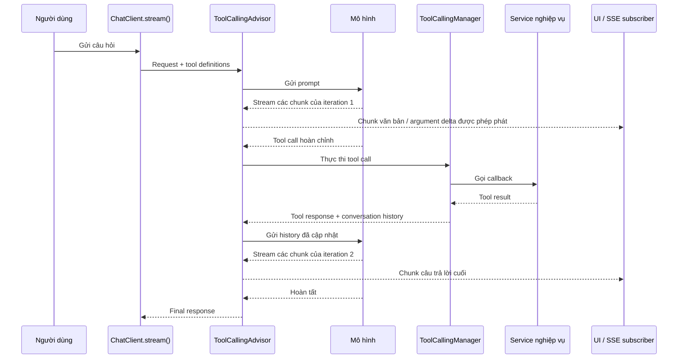
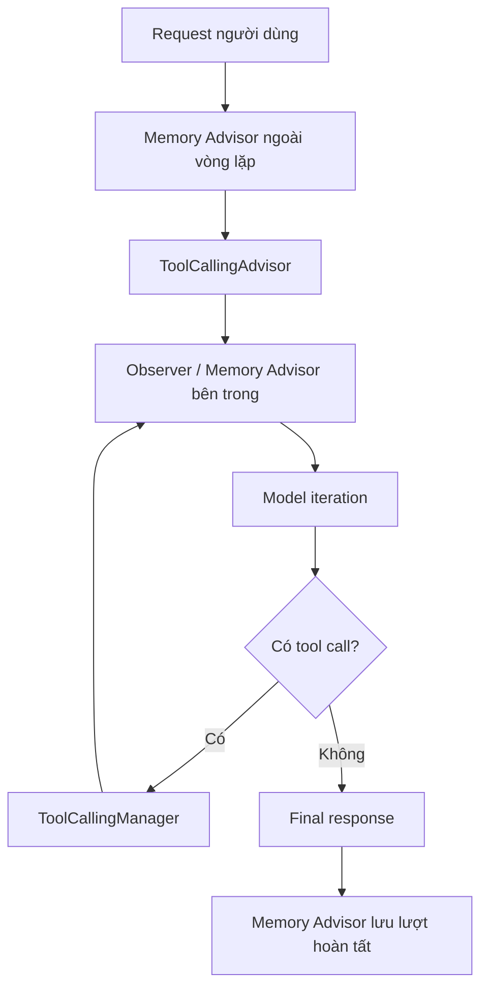

# Streaming và đồng thời

## Vòng lặp streaming qua `ChatClient` và advisor theo phiên bản

Streaming cho phép ứng dụng gửi từng phần nội dung tới giao diện khi mô hình đang tạo phản hồi. Khi bật tool calling, một yêu cầu có thể đi qua nhiều vòng: mô hình phát yêu cầu gọi tool, ứng dụng thực thi callback, kết quả được gửi lại mô hình và mô hình tiếp tục tạo câu trả lời. Vì vậy, stream không chỉ là luồng token của một lần gọi model; nó còn liên quan đến vòng lặp tool, conversation history và advisor chain.

Trong module `SPRING_AI_TOOL_CALLING`, `ChatClient` là điểm vào cấp ứng dụng, `ToolCallingAdvisor` điều phối vòng gọi công cụ và `ToolCallingManager` thực thi `ToolCallback`. Cách các phần này kết hợp đã thay đổi giữa Spring AI 1.x và 2.x. Bài này tập trung vào `ChatClient.stream()`, cách quan sát từng iteration và cách migration theo phiên bản.

### 1. Streaming có tool calling khác gì streaming văn bản thông thường?

Với một request không có tool, mô hình tạo văn bản và ứng dụng nhận các chunk theo thời gian. Với tool calling, stream có thể chứa nhiều loại dữ liệu:

- Các phần văn bản mô hình tạo ra.
- Các mảnh arguments của tool call trong lúc mô hình đang viết JSON.
- Tool-call request hoàn chỉnh sau khi mô hình kết thúc phần yêu cầu.
- Tool response do ứng dụng tạo sau khi callback thực thi.
- Các chunk văn bản từ lượt model tiếp theo.

Ứng dụng chỉ được thực thi tool khi đã nhận được tool call hoàn chỉnh. Một mảnh JSON đang stream chưa phải một yêu cầu có thể chạy. Sau khi tool chạy, vòng lặp tiếp tục với lịch sử hội thoại đã cập nhật.



Trong vòng này, `ToolCallingAdvisor` quản lý nhiều lần gọi model. Subscriber của ứng dụng thường nhận được stream đầu ra đã qua advisor chain, không nhất thiết nhận nguyên trạng mọi message nội bộ được trao đổi giữa mô hình và tool.

### 2. Dùng `ChatClient.stream()` với tool calling tự động

Trong Spring AI 2.0 và 2.1, `DefaultChatClient` tự đăng ký `ToolCallingAdvisor` trong advisor chain, trừ khi ứng dụng tắt cơ chế này hoặc cung cấp một `ToolAdvisor` tùy chỉnh. Advisor thực thi vòng tool calling cho cả `.call()` và `.stream()`.

Ví dụ:

```java
ChatClient chatClient = ChatClient.builder(chatModel)
    .defaultTools(new WeatherTools())
    .build();

Flux<String> answerChunks = chatClient.prompt()
    .user("Thời tiết ở Hà Nội hôm nay thế nào?")
    .stream()
    .content();

answerChunks.subscribe(
    chunk -> ui.appendText(chunk),
    error -> ui.showError(error),
    () -> ui.finish()
);
```

`ToolCallingAdvisor` tự thực hiện các bước:

1. Gửi prompt cùng tool definitions tới model.
2. Kiểm tra response có tool call hay không.
3. Nếu có, chuyển tool call cho `ToolCallingManager`.
4. Thêm tool responses vào conversation history.
5. Gọi model tiếp với history mới.
6. Lặp lại đến khi model trả response không còn tool call hoặc một nhánh kết thúc đặc biệt xảy ra.

Với cách dùng này, ứng dụng không cần tự viết vòng lặp hoặc tự aggregate response của từng iteration. Đây là lựa chọn phù hợp cho phần lớn ứng dụng chat và agent thông thường.

### 3. Phân biệt `.content()`, `.chatResponse()` và `.chatClientResponse()`

`ChatClient.stream()` cung cấp nhiều dạng đầu ra. Chọn dạng phù hợp với thông tin UI hoặc tầng orchestration cần nhận.

| API | Giá trị nhận được | Khi phù hợp |
| --- | --- | --- |
| `.stream().content()` | `Flux<String>` gồm các phần text | UI chỉ cần hiển thị văn bản |
| `.stream().chatResponse()` | `Flux<ChatResponse>` | Cần metadata model, generation và các message part |
| `.stream().chatClientResponse()` | `Flux<ChatClientResponse>` | Cần cả `ChatResponse` và context/metadata của advisor chain |

Ví dụ quan sát usage và finish metadata từ stream:

```java
chatClient.prompt()
    .user("Tìm thông tin đơn hàng ORD-2048.")
    .tools(orderTools)
    .stream()
    .chatResponse()
    .doOnNext(response -> {
        response.getResults().forEach(generation -> {
            log.debug("Finish reason: {}", generation.getMetadata().getFinishReason());
        });
    })
    .subscribe(ui::acceptResponse);
```

Nếu cần context từ advisor hoặc dữ liệu trung gian, hãy dùng `.chatClientResponse()`. Không nên dùng `.content()` cho một workflow cần kiểm tra tool call, finish reason, confirmation metadata hoặc tracing context.

### 4. Vòng lặp tự động không phát nguyên trạng mọi tool-call chunk

Trong Spring AI 2.1.0, `ToolCallingAdvisor` lọc các chunk đại diện cho tool-call request khỏi stream được trả về caller chính. Điều này tránh đưa một assistant tool-call request ra ngoài như thể đó là câu trả lời cuối hoặc một message độc lập có thể được lưu mà thiếu tool response tương ứng.

Tuy nhiên, với các provider hỗ trợ stream tool-call arguments, caller vẫn có thể nhận được các argument delta. Các delta này được biểu diễn bằng `ToolCallPart` partial. Chúng có thể giúp UI hiển thị tiến trình như “đang chuẩn bị tra cứu đơn hàng”, nhưng không phải tool call hoàn chỉnh.

| Dữ liệu | Có thể xuất hiện ở stream ngoài? | Có được thực thi ngay? |
| --- | --- | --- |
| Text chunk | Có | Không phải tool call |
| Partial `ToolCallPart` argument delta | Có, tùy provider | Không |
| Tool-call request hoàn chỉnh | Được advisor dùng nội bộ và lọc khỏi stream chính | Chỉ sau khi `ToolCallingManager` xử lý |
| Tool response trung gian | Được advisor dùng để tiếp tục vòng lặp | Đã là kết quả callback |
| Final answer text | Có | Không |

Không ghép thủ công các argument delta rồi gọi callback từ UI. Hãy để `ToolCallingAdvisor` và `ToolCallingManager` xử lý tool call hoàn chỉnh.

### 5. Streaming tool arguments và `ToolCallPart` partial

Một số provider gửi arguments thành nhiều chunk. Spring AI 2.1.0 hỗ trợ stream các delta này từ Anthropic, OpenAI Chat Completions và Responses, Amazon Bedrock Converse và DeepSeek.

Ví dụ một tool call có thể đến thành ba phần:

```text
Chunk 1: {"order
Chunk 2: Id":"ORD-
Chunk 3: 2048"}
```

Mỗi delta chứa một phần mới của arguments. Riêng từng mảnh thường không phải JSON hợp lệ. Spring AI biểu diễn chúng bằng `ToolCallPart` được đánh dấu partial.

Các quy tắc quan trọng:

- `AssistantMessage.getToolCalls()` bỏ qua các `ToolCallPart` partial.
- `ChatResponse.hasToolCalls()` chỉ nhận tool call hoàn chỉnh.
- `ToolCallingManager` và `ToolCallingAdvisor` bỏ qua các partial parts.
- `MessageAggregator` cũng bỏ qua partial parts khi aggregate message history.
- Tool call hoàn chỉnh xuất hiện sau đó trong cùng response; nó mới được dùng để thực thi.

Ví dụ UI quan sát argument delta:

```java
chatClient.prompt()
    .user("Tra cứu đơn hàng ORD-2048")
    .tools(orderTools)
    .stream()
    .chatResponse()
    .subscribe(response -> response.getResults().forEach(generation -> {
        for (MessagePart part : generation.getOutput().getParts()) {
            if (part instanceof ToolCallPart toolCallPart
                    && StreamingParts.isPartial(part)) {
                ToolCall delta = toolCallPart.toolCall();
                ui.showToolProgress(
                    delta.id(), delta.name(), delta.arguments());
            }
        }
    }));
```

Đây là tiến trình hiển thị. Không dùng `delta.arguments()` để gọi service. Chờ tool call hoàn chỉnh và để advisor thực thi.

### 6. Quan sát từng iteration bằng advisor nằm bên trong vòng lặp

Nhiều ứng dụng muốn gửi trạng thái từng iteration tới UI, ghi audit log hoặc đo thời gian tool call. Không nhất thiết phải tắt vòng lặp tự động. Trong Spring AI 2.1.0, có thể đặt một advisor quan sát bên trong `ToolCallingAdvisor` bằng cách dùng order lớn hơn `ToolCallingAdvisor.DEFAULT_ORDER`.

Order mặc định của `ToolCallingAdvisor` là:

```java
Ordered.HIGHEST_PRECEDENCE + 300
```

Ví dụ advisor quan sát ở order `HIGHEST_PRECEDENCE + 400`:

```java
public class ToolCallObservingAdvisor implements CallAdvisor, StreamAdvisor {

    private final Consumer<ChatClientResponse> observer;

    public ToolCallObservingAdvisor(Consumer<ChatClientResponse> observer) {
        this.observer = observer;
    }

    @Override
    public String getName() {
        return "ToolCallObservingAdvisor";
    }

    @Override
    public int getOrder() {
        return Ordered.HIGHEST_PRECEDENCE + 400;
    }

    @Override
    public ChatClientResponse adviseCall(
            ChatClientRequest request,
            CallAdvisorChain chain) {
        ChatClientResponse response = chain.nextCall(request);
        observer.accept(response);
        return response;
    }

    @Override
    public Flux<ChatClientResponse> adviseStream(
            ChatClientRequest request,
            StreamAdvisorChain chain) {
        return chain.nextStream(request)
            .doOnNext(observer);
    }
}
```

Đăng ký advisor cùng `ChatClient`:

```java
ChatClient chatClient = ChatClient.builder(chatModel)
    .defaultAdvisors(new ToolCallObservingAdvisor(this::observeIteration))
    .build();

Flux<String> answer = chatClient.prompt()
    .user("Tra cứu đơn hàng ORD-2048 và trạng thái giao hàng.")
    .tools(orderTools, deliveryTools)
    .stream()
    .content();
```

Advisor quan sát được gọi trong từng iteration của vòng tool calling. Khi dùng `.stream()`, nó có thể quan sát các chunk từ model ở từng iteration, bao gồm tool-call request chunks. Stream trả về caller chính vẫn tuân theo chính sách lọc của `ToolCallingAdvisor`.

Đây thường là lựa chọn tốt hơn việc tự viết lại vòng lặp chỉ để ghi log hoặc gửi tiến trình.

### 7. Hook streaming khi kế thừa `ToolCallingAdvisor`

Khi cần thay đổi chính vòng lặp, có thể kế thừa `ToolCallingAdvisor`. Lớp này có hai nhóm hook song song: call path và stream path.

| Hook streaming | Thời điểm | Mục đích |
| --- | --- | --- |
| `doInitializeLoopStream` | Một lần trước iteration đầu tiên | Khởi tạo trạng thái session, cache hoặc index |
| `doBeforeStream` | Trước mỗi lần gọi model | Thêm context, cập nhật tools hoặc options |
| `doAfterStream` | Sau mỗi iteration | Ghi nhận hoặc biến đổi response của iteration |
| `doFinalizeLoopStream` | Khi toàn bộ vòng lặp kết thúc | Tổng hợp metrics, cleanup hoặc biến đổi Flux cuối |
| `doGetNextInstructionsForToolCallStream` | Sau khi tool chạy, trước iteration tiếp theo | Quyết định message nào được gửi ở iteration kế |

`doAfterStream` nhận response đã được aggregate từ các chunk của iteration đó. `doFinalizeLoopStream` có thể biến đổi toàn bộ output `Flux` sau khi vòng lặp kết thúc.

Nếu tạo subclass, cần override cả hook call và stream tương ứng nếu ứng dụng hỗ trợ cả `.call()` và `.stream()`. Chỉ override call hooks sẽ khiến hành vi tùy chỉnh không xuất hiện trên đường streaming.

Ví dụ phác thảo hook:

```java
public class AuditingToolCallingAdvisor extends ToolCallingAdvisor {

    private final AuditService auditService;

    public AuditingToolCallingAdvisor(
            ToolCallingManager manager,
            AuditService auditService) {
        super(
            manager,
            response -> response != null && response.hasToolCalls(),
            ToolCallingAdvisor.DEFAULT_ORDER,
            true);
        this.auditService = auditService;
    }

    @Override
    protected ChatClientResponse doAfterStream(
            ChatClientResponse response,
            StreamAdvisorChain chain) {

        auditService.recordIteration(response);
        return response;
    }

    @Override
    protected Flux<ChatClientResponse> doFinalizeLoopStream(
            Flux<ChatClientResponse> responses,
            StreamAdvisorChain chain) {

        return responses.doFinally(signal -> auditService.finishLoop(signal));
    }
}
```

Đăng ký subclass làm `ToolAdvisor` trong advisor chain để `DefaultChatClient` dùng nó thay cho advisor mặc định. Constructor gọi `super(...)` với checker mặc định tương đương `response != null && response.hasToolCalls()`, order mặc định và internal history bật. Nếu ứng dụng còn hỗ trợ `.call()`, hãy override hook call tương ứng để audit cả hai đường.

### 8. Thứ tự advisor quyết định advisor chạy một lần hay mỗi iteration

`ToolCallingAdvisor` là recursive advisor: nó gọi lại advisor chain ở mỗi iteration. Vì vậy, vị trí của một advisor khác quyết định nó nhìn thấy toàn bộ vòng lặp hay chỉ request ban đầu và kết quả cuối.

| Advisor order | Vị trí tương đối | Hành vi thường gặp |
| --- | --- | --- |
| Nhỏ hơn `ToolCallingAdvisor.DEFAULT_ORDER` (300) | Bên ngoài vòng lặp | Chạy một lần trước/sau toàn bộ vòng tool calling |
| Lớn hơn `ToolCallingAdvisor.DEFAULT_ORDER` (300) | Bên trong vòng lặp | Chạy lại ở mỗi iteration và quan sát tool-call cycle |

Ví dụ:

```java
int toolLoopOrder = ToolCallingAdvisor.DEFAULT_ORDER;
// Giá trị mặc định: Ordered.HIGHEST_PRECEDENCE + 300.

// Bên ngoài: ví dụ memory advisor mặc định ở +200.
// Bên trong: ví dụ observer advisor ở +400.
```

Advisor nằm bên trong nhận request đã có tool response từ iteration trước. Đây là vị trí phù hợp cho logging, tracing, metrics, kiểm tra điều kiện trước/sau mỗi model call và cập nhật context theo iteration.

### 9. Conversation history và memory advisor

Mặc định `ToolCallingAdvisor` giữ toàn bộ conversation history nội bộ trong vòng lặp. Mỗi lần gọi model tiếp theo nhận user message, assistant tool-call requests và tool responses của các iteration trước.

Nếu memory advisor nằm bên ngoài tool loop, memory chỉ cần đọc lịch sử trước request và lưu cặp user/assistant cuối cùng sau khi vòng lặp kết thúc. Đây là cấu hình mặc định phổ biến.

Nếu đặt memory advisor bên trong tool loop, advisor memory phải quản lý message history cho từng iteration. Khi đó cần tắt internal history của `ToolCallingAdvisor` bằng `disableInternalConversationHistory()` khi tự cấu hình advisor. Trong auto-registration, `DefaultChatClient` phát hiện `MemoryAdvisor` đặt bên trong và tự tắt internal history.



Ví dụ advisor memory ở trong vòng lặp:

```java
ToolCallingAdvisor toolAdvisor = ToolCallingAdvisor.builder()
    .disableInternalConversationHistory()
    .advisorOrder(Ordered.HIGHEST_PRECEDENCE + 300)
    .build();

Advisor memoryAdvisor = buildMemoryAdvisor(
    Ordered.HIGHEST_PRECEDENCE + 400);

ChatClient chatClient = ChatClient.builder(chatModel)
    .defaultAdvisors(toolAdvisor, memoryAdvisor)
    .build();
```

Ví dụ này thể hiện quan hệ thứ tự. Với Spring AI 2.1.0, `ChatMemory` và `MessageChatMemoryAdvisor` đã deprecated để chuyển sang Session API; khi xây dựng mới, nên dùng session memory theo tài liệu của phiên bản đang triển khai.

### 10. Tắt auto-registration để tự điều khiển streaming

Nếu ứng dụng cần nhận từng `ChatClientResponse` của mỗi iteration và tự quyết định khi nào thực thi tool, có thể tắt `ToolCallingAdvisor` cho một request:

```java
.advisors(AdvisorParams.toolCallingAdvisorAutoRegister(false))
```

Hoặc tắt toàn cục với auto-configured `ChatClient`:

```properties
spring.ai.chat.client.tool-calling.enabled=false
```

Khi tắt auto-registration, `.tools(...)` vẫn gửi tool definitions cho model, nhưng tool call trong response không được thực thi tự động. Ứng dụng phải tự kiểm tra `hasToolCalls()`, gọi `ToolCallingManager` và gửi history đã cập nhật ở iteration tiếp theo.

Đây là chế độ user-controlled tool execution. Chỉ nên chọn khi cần interrupt, phê duyệt, điều phối workflow hoặc quan sát toàn bộ request/response từng vòng. Với nhu cầu chỉ hiển thị progress, đặt observer advisor bên trong thường ít code và giữ được composition của advisor chain.

### 11. User-controlled streaming qua `ChatClientMessageAggregator`

Tool call arguments có thể trải qua nhiều stream chunks. Vì vậy, không được kiểm tra `hasToolCalls()` trên từng chunk rời. Cần aggregate toàn bộ response của một iteration, sau đó mới kiểm tra tool calls.

Spring AI cung cấp `ChatClientMessageAggregator.aggregateChatClientResponse(...)` cho đường `ChatClient`:

```java
private ChatClientResponse streamOneIteration(
        ChatClient chatClient,
        Prompt prompt,
        ChatOptions chatOptions) {

    AtomicReference<ChatClientResponse> aggregated = new AtomicReference<>();

    new ChatClientMessageAggregator().aggregateChatClientResponse(
        chatClient.prompt()
            .messages(prompt.getInstructions())
            .options(chatOptions)
            .advisors(AdvisorParams.toolCallingAdvisorAutoRegister(false))
            .stream()
            .chatClientResponse()
            .doOnNext(this::forwardChunkToSse),
        aggregated::set
    ).blockLast();

    return aggregated.get();
}
```

Sau khi aggregate, ứng dụng điều khiển vòng lặp:

```java
Prompt prompt = new Prompt(
    List.of(new UserMessage("Thời tiết ở Hà Nội và Đà Nẵng thế nào?")),
    chatOptions);

ChatClientResponse response =
    streamOneIteration(chatClient, prompt, chatOptions);

while (response.chatResponse() != null
        && response.chatResponse().hasToolCalls()) {

    ToolExecutionResult result = toolCallingManager.executeToolCalls(
        prompt, response.chatResponse());

    if (result.returnDirect()) {
        forwardDirectResult(result);
        break;
    }

    prompt = new Prompt(result.conversationHistory(), chatOptions);
    response = streamOneIteration(chatClient, prompt, chatOptions);
}
```

`streamOneIteration` tắt auto-registration ở từng request nên không có vòng tool thứ hai chạy ngầm. `ChatClientMessageAggregator` tổng hợp các chunk thành response hoàn chỉnh; `ToolCallingManager` thực thi tool; sau đó prompt tiếp theo dùng `result.conversationHistory()` cùng `chatOptions` ban đầu.

### 12. Không block event loop trong ứng dụng reactive

Ví dụ trên dùng `.blockLast()` để làm rõ thứ tự các bước. Nó phù hợp cho command-line app, test hoặc code chạy trên thread không phải event loop. Không gọi `.blockLast()` bên trong WebFlux event loop hoặc một pipeline reactive đang xử lý request.

Trong ứng dụng reactive production:

- Compose việc aggregate, thực thi tool và gọi model tiếp theo thành `Mono`/`Flux` thay vì block.
- Nếu callback là blocking I/O, đưa nó sang scheduler phù hợp hoặc dùng API non-blocking.
- Không thực hiện ghi database hoặc gọi dịch vụ chậm trực tiếp trong `doOnNext` trên stream thread.
- Giữ thứ tự conversation history giữa các iteration.
- Tôn trọng cancellation khi subscriber đóng kết nối; không tự phát thêm chunk sau khi request đã bị hủy.
- Đặt timeout và giới hạn số vòng tool call để stream không giữ tài nguyên vô hạn.

`doOnNext` nên làm việc nhẹ như phát một event hoặc ghi metric. Nếu cần audit bền vững, chuyển event tới cơ chế xử lý riêng có giới hạn queue và chính sách backpressure.

### 13. Vì sao `streamToolCallResponses` đã bị loại bỏ?

Tên option này xuất hiện trong một số phiên bản milestone/RC và API 1.x. Nó từng điều khiển việc có phát các chunk của tool-call iteration tới downstream subscriber hay chỉ phát câu trả lời cuối.

Trong tài liệu 1.1.5, `ToolCallAdvisor.Builder.streamToolCallResponses(...)` tồn tại và mặc định `true`. Tài liệu Spring AI 2.0.0-RC2 cũng từng có option này. Tuy nhiên, option đã bị loại khỏi Spring AI 2.0 GA cùng các property auto-configuration liên quan.

Lý do: khi phát tool-call request chunks xuống downstream nhưng không phát tool response tương ứng (vì tool response được gửi nội bộ lại model), một memory advisor ở downstream có thể lưu assistant tool call mà thiếu kết quả. Lịch sử hội thoại sau đó bị sai cấu trúc.

Migration:

```java
// Spring AI 1.1.x
ToolCallAdvisor.builder()
    .streamToolCallResponses(true)
    .build();

// Spring AI 2.0 milestone/RC
ToolCallingAdvisor.builder()
    .streamToolCallResponses(true)
    .build();

// Spring AI 2.0 GA và 2.1.0
ToolCallingAdvisor.builder()
    .build();
```

Trong 2.0 GA/2.1.0, bỏ các lời gọi `.streamToolCallResponses(...)` và xóa property cũ:

```properties
# Đã bị loại bỏ, không còn hiệu lực
spring.ai.chat.client.tool-calling.stream-tool-call-responses=true
spring.ai.chat.client.tool-search-advisor.stream-tool-call-responses=true
```

Nếu cần quan sát từng iteration, dùng `StreamAdvisor` đặt bên trong vòng lặp hoặc tắt auto-registration và tự điều khiển bằng `ChatClientMessageAggregator`. Không dùng lại option cũ vì nó không còn trong API GA.

### 14. Bảng migration theo phiên bản

| Phiên bản | Nơi sở hữu tool loop | Streaming tool calling | Hướng triển khai |
| --- | --- | --- | --- |
| Spring AI 1.0.x/1.1.x | Mỗi `ChatModel` có vòng thực thi tool nội bộ | `ChatModel.stream()` chạy qua vòng nội bộ; `ToolCallAdvisor`/`streamToolCallResponses` có mặt ở một số API 1.x | Kiểm tra đúng minor version; chuẩn bị migration khỏi model-level loop |
| Spring AI 2.0 milestone/RC | `ToolCallingAdvisor` trong advisor chain | Một số RC còn có `streamToolCallResponses` | Không dựa vào API RC khi nâng lên GA |
| Spring AI 2.0 GA/2.0.x | `ChatClient` auto-register `ToolCallingAdvisor`; `ChatModel` trả raw response | `.stream()` hỗ trợ vòng tự động; `streamToolCallResponses` bị loại bỏ | Dùng observer advisor hoặc user-controlled streaming |
| Spring AI 2.1.0 | `ToolCallingAdvisor` là recursive advisor triển khai `StreamAdvisor` | Có stream hooks, `ChatClientMessageAggregator`, partial `ToolCallPart` và confirmation pause | Ưu tiên custom advisor bên trong loop; manual loop khi cần quyền điều khiển đầy đủ |

Thay đổi lớn nhất từ 1.x sang 2.x là `ChatModel` không còn tự thực thi tool. `ChatModel.call(prompt)` và `ChatModel.stream(prompt)` chỉ trả response của model, gồm cả tool-call request nếu có. `ChatClient` là đường được khuyến nghị vì advisor chain tự quản lý vòng lặp.

Một số tên API cũng đổi khi migration:

- `ToolCallAdvisor` được thay bằng `ToolCallingAdvisor`; lớp cũ còn được giữ deprecated để tương thích và sẽ bị loại bỏ.
- `MessageAggregator.aggregateChatClientResponse(...)` được chuyển sang `ChatClientMessageAggregator.aggregateChatClientResponse(...)` trong package `org.springframework.ai.chat.client`.
- `streamToolCallResponses(...)` và các property tương ứng không còn trong Spring AI 2.0 GA/2.1.0.

### 15. `ToolCallingAdvisor` chỉ được có một instance trong advisor chain

`ToolCallingAdvisor` triển khai marker interface `ToolAdvisor`. `DefaultChatClient` bảo đảm chỉ có một `ToolAdvisor` trong một advisor chain để tránh chạy tool hai lần.

Các trường hợp:

- Nếu không có custom `ToolAdvisor`, `DefaultChatClient` tự thêm advisor mặc định.
- Nếu ứng dụng truyền một custom advisor triển khai `ToolAdvisor`, auto-registration mặc định bị bỏ qua và custom advisor được dùng.
- Nếu đăng ký hai custom `ToolAdvisor`, việc dựng chain thất bại sớm.

Nếu chỉ cần logging hoặc quan sát, hãy tạo advisor triển khai `CallAdvisor` và `StreamAdvisor`, không triển khai `ToolAdvisor`. Như vậy observer có thể chạy bên trong vòng lặp mà không thay thế tool loop.

### 16. `returnDirect` và chờ xác nhận trong streaming

Hai nhánh kết thúc đặc biệt cần được tính đến khi xây UI.

**`returnDirect`:** nếu tất cả tool calls trong một iteration đều có `returnDirect=true`, advisor dừng vòng lặp và trả tool result trực tiếp cho caller. Mô hình không nhận tool result và không tạo thêm câu trả lời. Nếu chỉ một tool trong batch không direct, vòng lặp tiếp tục bình thường.

**Chờ xác nhận:** nếu `ToolCallingManager` ném `ToolCallConfirmationRequiredException`, advisor dừng vòng lặp mà không thực thi bất kỳ tool call nào trong reply đó. Với streaming, chunk cuối mang tool calls cùng keys đang chờ quyết định trong metadata `ToolCallDecisions.AWAITING_DECISION_METADATA_KEY`, đồng thời giữ finish reason của reply. Ứng dụng hiển thị yêu cầu xác nhận, nhận allow/deny rồi gửi quyết định qua manager trong request tiếp theo.

Không coi confirmation-pending response là final answer. UI nên thể hiện rõ trạng thái “đang chờ xác nhận” và giữ conversation/session context để tiếp tục đúng lượt.

### 17. Đồng thời giữa nhiều stream và cùng một conversation

Các conversation độc lập có thể được xử lý đồng thời nếu model, tool callbacks và service nghiệp vụ an toàn khi chạy song song. Nhưng hai stream cùng ghi vào một conversation ID có thể làm lịch sử bị xen kẽ:

- Stream A đang chờ tool response trong khi stream B đã thêm user message mới.
- Memory advisor có thể đọc một history khác với history mà vòng tool A đang dùng.
- Tool response của một lượt có thể bị ghi vào sai vị trí nếu ứng dụng tự quản lý session không có versioning.

Với mỗi conversation/session, nên tuần tự hóa các lượt đang chạy hoặc dùng optimistic locking/version check trong kho history. Không lưu conversation history mutable trong field của singleton advisor hoặc tool object. Trạng thái tạm của mỗi subscription nên thuộc request/session tương ứng.

Đối với tool callbacks, chỉ chia sẻ instance singleton khi chúng stateless hoặc được thiết kế thread-safe. Dữ liệu `tenantId`, `userId`, request ID và cancellation signal phải được truyền theo request/context, không lưu vào field dùng chung.

### 18. Cancellation, timeout và backpressure

Streaming subscriber có thể hủy subscription khi người dùng rời trang hoặc đóng kết nối. Ứng dụng nên thiết kế để cancellation ngăn các iteration model tiếp theo được khởi chạy. Tuy nhiên, một callback blocking hoặc side effect đã bắt đầu có thể không dừng ngay chỉ vì client hủy stream.

Với tool có side effect:

- Dùng operation ID/idempotency key để tránh lặp khi client reconnect hoặc retry.
- Xác định rõ hành động có tiếp tục sau khi client hủy hay phải được hủy theo workflow.
- Không giả định cancellation của stream sẽ rollback database transaction hoặc remote request đã gửi.
- Đặt timeout riêng cho model call, tool execution và toàn bộ conversation turn.
- Giới hạn số lần gọi tool và tổng thời gian để vòng lặp không giữ connection vô hạn.

Đối với backpressure, tránh đẩy quá nhiều progress event vào UI. Có thể gộp token hoặc cập nhật trạng thái theo từng tool call, nhưng không được bỏ mất message cần thiết trong conversation history. Tách stream hiển thị với lịch sử giao thức: UI có thể nhận progress rút gọn, còn advisor phải giữ đúng các message cần cho model.

### 19. Kiểm thử vòng lặp streaming

Kiểm thử cần xác minh cả stream bên ngoài và các iteration nội bộ.

**Kiểm thử auto loop:**

- `.stream()` thực thi tool khi model phát tool-call request hoàn chỉnh.
- Tool response được gửi lại model trước khi final answer được phát.
- Vòng lặp tiếp tục khi model gọi thêm tool.
- Stream kết thúc khi model trả response không còn tool call.
- `returnDirect` dừng vòng lặp đúng quy tắc.

**Kiểm thử observer advisor:**

- Advisor order lớn hơn `ToolCallingAdvisor.DEFAULT_ORDER` làm observer chạy mỗi iteration.
- Observer nhận các chunk tool-call request ở bên trong chain.
- Subscriber bên ngoài không nhận tool-call request chunks đã bị lọc.
- Partial argument deltas không bị hiểu là tool call hoàn chỉnh.

**Kiểm thử manual streaming:**

- Auto-registration bị tắt cho mọi iteration.
- Aggregator chỉ trả response hoàn chỉnh sau khi stream của iteration kết thúc.
- `ToolCallingManager` chỉ chạy khi response aggregate có tool calls.
- Prompt kế tiếp chứa `conversationHistory()` đã cập nhật.
- `ToolContext` và `ToolCallingChatOptions` được giữ qua từng iteration.

**Kiểm thử advisor/memory:**

- Memory advisor ngoài loop chỉ lưu lượt user/assistant cuối cùng.
- Memory advisor trong loop nhận các message trung gian và internal history được tắt đúng cách.
- Không có hai `ToolAdvisor` trong cùng chain.
- Các request cùng conversation ID được tuần tự hóa hoặc bảo vệ bằng version check.

**Kiểm thử vận hành:**

- Subscriber cancel trước khi model hoàn tất.
- Tool blocking không làm nghẽn event loop.
- Timeout và tool-call limit dừng vòng lặp.
- Hai conversation độc lập stream đồng thời mà không trộn context.
- Hai request cùng conversation không ghi đè history lẫn nhau.

Ví dụ test với Reactor `StepVerifier`:

```java
StepVerifier.create(
        chatClient.prompt()
            .user("Tra cứu đơn hàng ORD-2048")
            .tools(orderTools)
            .stream()
            .content())
    .expectNextMatches(chunk -> !chunk.isBlank())
    .thenConsumeWhile(chunk -> true)
    .verifyComplete();

verify(orderService).findVisibleOrder("ORD-2048", tenantId, userId);
```

Đây là khung test. Trong integration test, dùng mock model trả lần lượt tool-call response và final response; xác minh tool service chạy đúng số lần và final content chỉ được phát sau khi tool result đã được gửi lại model.

### 20. Checklist chọn cách streaming

| Nhu cầu | Cách triển khai |
| --- | --- |
| Chỉ hiển thị câu trả lời cuối theo token | `ChatClient.stream().content()` với `ToolCallingAdvisor` mặc định |
| Hiển thị progress của tool arguments | Quan sát partial `ToolCallPart` từ `.chatResponse()` và chỉ dùng để hiển thị |
| Ghi log từng model iteration | `StreamAdvisor` bên trong loop, order lớn hơn `ToolCallingAdvisor.DEFAULT_ORDER` |
| Thay đổi logic trước/sau mỗi iteration | Custom `ToolCallingAdvisor` subclass và stream hooks |
| Tự quyết định khi nào chạy tool | Tắt auto-registration và dùng `ChatClientMessageAggregator` |
| Tự quản lý workflow phức tạp hoặc interrupt | User-controlled streaming hoặc workflow engine riêng |
| Dùng memory theo từng tool iteration | Đặt memory advisor bên trong loop và để nó quản lý history |
| Nâng cấp từ 1.x | Chuyển tool loop từ `ChatModel` lên `ChatClient`/`ToolCallingAdvisor` |
| Nâng cấp từ RC có `streamToolCallResponses` | Xóa option/property cũ; dùng observer advisor hoặc manual streaming |

### 21. Quy trình triển khai đề xuất

1. Bắt đầu với `ChatClient.stream()` và auto-registered `ToolCallingAdvisor`.
2. Dùng `.content()` nếu UI chỉ cần text; dùng `.chatResponse()` hoặc `.chatClientResponse()` nếu cần metadata và progress.
3. Nếu cần quan sát mỗi iteration, đặt `StreamAdvisor` bên trong vòng lặp với order lớn hơn `ToolCallingAdvisor.DEFAULT_ORDER`.
4. Nếu cần điều khiển hoàn toàn, tắt auto-registration ở request và aggregate mỗi iteration bằng `ChatClientMessageAggregator`.
5. Chỉ thực thi tool sau khi response đã hoàn chỉnh và có tool calls.
6. Giữ conversation history, tool call IDs, `ToolContext` và options đúng qua các iteration.
7. Thiết kế cancellation, timeout, idempotency và tuần tự hóa theo conversation.
8. Khi nâng cấp phiên bản, kiểm tra API `ToolCallingAdvisor`, `streamToolCallResponses`, advisor order và memory integration của đúng release.

Trong Spring AI 2.1.0, streaming và tool calling được kết hợp trong `ToolCallingAdvisor`, advisor có cả call path và stream path. Phần lớn ứng dụng chỉ cần `ChatClient.stream()` với advisor mặc định. Khi cần quan sát từng vòng, thêm một observer advisor bên trong; khi cần kiểm soát từng bước, dùng user-controlled streaming và aggregate response trước khi thực thi. Việc phân biệt đúng các phiên bản giúp tránh dùng API đã bị loại bỏ và tránh làm hỏng conversation history khi stream tool calls.

### Tài liệu tham khảo

- [Spring AI 2.1.0 Reference — Tool Calling](https://docs.spring.io/spring-ai/reference/api/tools.html)
- [Spring AI 2.1.0 Reference — ToolCallingAdvisor](https://docs.spring.io/spring-ai/reference/api/tools/tool-calling-advisor.html)
- [Spring AI 2.1.0 Reference — ChatModel Tool Calling](https://docs.spring.io/spring-ai/reference/api/tools/chatmodel-tool-calling.html)
- [Spring AI 2.1.0 Reference — ChatClient API](https://docs.spring.io/spring-ai/reference/api/chatclient.html)
- [Spring AI 2.0.2 Upgrade Notes — Removed `streamToolCallResponses`](https://docs.spring.io/spring-ai/reference/upgrade-notes.html)
- [Spring AI 1.1.5 API — ToolCallAdvisor.Builder](https://docs.spring.io/spring-ai/docs/1.1.5/api/org/springframework/ai/chat/client/advisor/ToolCallAdvisor.Builder.html)
- [Spring AI 2.1.0 GA Release Notes](https://spring.io/blog/2026/11/20/spring-ai-2-1-0-GA-available-now/)

Các ví dụ advisor hook, streaming aggregator và partial `ToolCallPart` dựa trên Spring AI 2.1.0. Phần `streamToolCallResponses` mô tả API từng có trong dòng 1.x/2.0 milestone hoặc RC và đã bị loại khỏi Spring AI 2.0 GA. Khi migration, hãy kiểm tra dependency thực tế và Javadoc đúng phiên bản thay vì chỉ dựa vào ví dụ cũ trên mạng.
