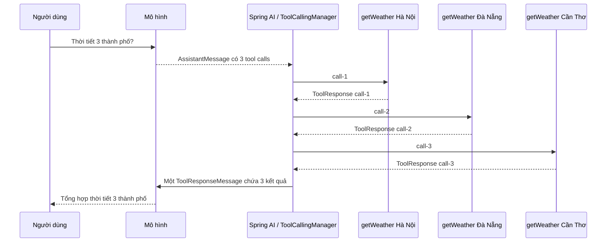
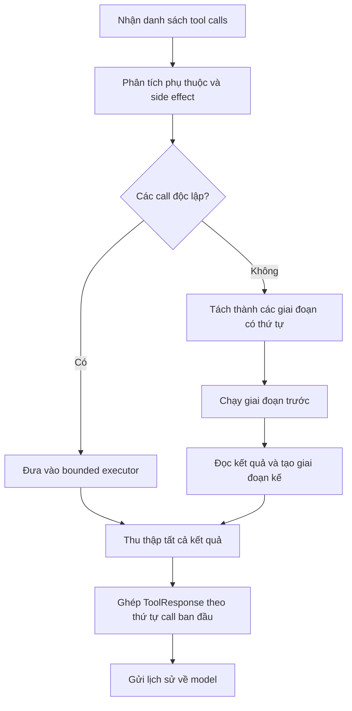

# Phân biệt nhiều tool call trong một lượt với thực thi song song

Một response của mô hình có thể chứa nhiều tool call. Điều đó có nghĩa mô hình đã đề nghị nhiều thao tác trong cùng một vòng phản hồi; nó chưa nói rằng ứng dụng sẽ chạy các thao tác ấy đồng thời. Trong Spring AI, `parallelToolCalls` ở một số provider điều khiển khả năng mô hình phát ra nhiều call trong một response, còn `DefaultToolCallingManager` hiện thực thi từng call theo thứ tự trong danh sách bằng vòng lặp đồng bộ.

Để hiểu đúng hành vi, cần tách ba khái niệm:

- **Multiple tool calls in one response:** một `AssistantMessage` có nhiều phần tử trong `getToolCalls()`.
- **Concurrent/parallel execution:** ứng dụng bắt đầu nhiều callback trước khi các callback trước hoàn tất, thường bằng executor hoặc cơ chế reactive.
- **Multiple tool rounds:** mô hình nhận kết quả của một batch, suy luận tiếp và gửi một response mới có tool calls khác. Đây là các vòng nối tiếp vì vòng sau cần kết quả của vòng trước.

Trong module `SPRING_AI_TOOL_CALLING`, ứng dụng chịu trách nhiệm điều phối và thực thi tool. Vì vậy, muốn giảm độ trễ cho nhiều thao tác độc lập, phải chọn rõ nơi tạo concurrency, giới hạn tài nguyên và bảo toàn kết quả cho đúng tool-call ID.

## 1. Một lượt có thể chứa nhiều tool call

Ví dụ người dùng hỏi: “Cho tôi biết thời tiết ở Hà Nội, Đà Nẵng và Cần Thơ”. Mô hình có thể trả về một `AssistantMessage` chứa ba tool calls:

```text
AssistantMessage
  toolCall(id="call-1", name="getWeather", arguments={"city":"Hà Nội"})
  toolCall(id="call-2", name="getWeather", arguments={"city":"Đà Nẵng"})
  toolCall(id="call-3", name="getWeather", arguments={"city":"Cần Thơ"})
```

Đây là một batch gồm ba yêu cầu. Ứng dụng cần trả một kết quả cho từng call, giữ đúng ID và ghép chúng thành `ToolResponseMessage`. Sau đó, kết quả của cả batch được gửi về mô hình trong vòng tiếp theo.



Sơ đồ trên mô tả thứ tự của `DefaultToolCallingManager` hiện tại: từng callback hoàn tất rồi mới bắt đầu callback kế tiếp. Một custom executor có thể khởi chạy các call độc lập chồng thời gian nhưng vẫn ghép kết quả thành một batch.

## 2. Phân biệt batch, concurrency và các vòng gọi mô hình

| Khái niệm | Điều gì xảy ra? | Ví dụ |
| --- | --- | --- |
| Nhiều tool call trong một response | Mô hình phát ra nhiều yêu cầu trong một `AssistantMessage` | Gọi thời tiết cho ba thành phố |
| Thực thi tuần tự | Callback thứ hai chỉ bắt đầu sau khi callback thứ nhất kết thúc | Hà Nội xong rồi mới gọi Đà Nẵng |
| Thực thi đồng thời | Nhiều callback được đưa vào executor trước khi chờ kết quả | Ba yêu cầu thời tiết chạy chồng thời gian |
| Nhiều vòng model | Mô hình nhận kết quả hiện tại rồi mới quyết định tool call tiếp theo | Tra cứu đơn hàng, sau đó dùng mã vận đơn để tra cứu vận chuyển |

Một batch có thể được thực thi tuần tự hoặc đồng thời. Ngược lại, nhiều vòng model vẫn nối tiếp ngay cả khi mỗi batch riêng lẻ có thể chạy đồng thời: mô hình cần kết quả batch trước để tạo arguments cho batch sau.

## 3. `parallelToolCalls` điều khiển phía mô hình

Một số API model, chẳng hạn OpenAI Chat Completions, có tùy chọn `parallel_tool_calls` (được Spring AI OpenAI adapter biểu diễn bằng `parallelToolCalls`). Tùy chọn này cho phép model trả về nhiều tool calls trong một response khi nó thấy phù hợp.

Nó không cấu hình executor, không tạo thread và không làm cho `ToolCallback.call(...)` tự chạy đồng thời. Nó chỉ ảnh hưởng cách model được phép phát ra tool calls.

| Giá trị ở provider | Ý nghĩa ở phía model |
| --- | --- |
| `parallelToolCalls = true` | Model có thể trả nhiều tool calls trong cùng response nếu API/model hỗ trợ và thấy phù hợp |
| `parallelToolCalls = false` | Yêu cầu model không phát nhiều tool calls song song trong response theo khả năng của provider |
| Không thiết lập | Provider dùng mặc định của API/model |

Đây là tùy chọn riêng của provider, không phải thuộc tính chung bảo đảm có mặt trên mọi `ChatOptions`. Kiểm tra adapter và model đang dùng trước khi cấu hình. Một số provider không hỗ trợ hoặc diễn giải khác nhau.

**Ví dụ về mặt request:**

```yaml
spring:
  ai:
    openai:
      chat:
        parallel-tool-calls: true
```

Tên property trên thuộc OpenAI adapter. Đặt nó thành `true` chỉ cho phép model tạo nhiều call trong response. Nếu ứng dụng dùng `DefaultToolCallingManager`, việc thực thi vẫn theo implementation của manager.

## 4. DefaultToolCallingManager thực thi batch như thế nào?

`ToolCallingAdvisor` điều phối vòng lặp cho `ChatClient`. Khi response có tool calls, advisor chuyển response đến `ToolCallingManager`. Manager tìm callback theo tên, thực thi và tạo tool responses. Sau đó advisor gửi lịch sử đã cập nhật về mô hình.

Trong implementation `DefaultToolCallingManager` hiện tại, phần xử lý batch duyệt `assistantMessage.getToolCalls()` bằng vòng `for`, gọi `toolCallback.call(...)` cho từng phần tử và chỉ thêm response sau khi call đó trả về. Vì vậy, các call trong cùng batch được xử lý tuần tự.

```java
List<AssistantMessage.ToolCall> toolCalls = assistantMessage.getToolCalls();

for (int i = 0; i < toolCalls.size(); i++) {
    AssistantMessage.ToolCall toolCall = toolCalls.get(i);
    ToolCallback callback = resolveToolCallback(toolCallbacks, toolCall.name());

    String result = callback.call(toolCall.arguments(), toolContext);

    toolResponses.add(new ToolResponseMessage.ToolResponse(
            toolCall.id(), toolCall.name(), result));
}
```

Đoạn mã rút gọn trên mô tả cấu trúc của vòng lặp; nó không thay thế implementation thực tế của Spring AI. Điểm quan trọng là mỗi `call(...)` hoàn tất trước khi vòng lặp chuyển sang callback kế tiếp.

Ví dụ ba tool mất lần lượt 2, 3 và 2 giây:

```text
Tuần tự (2s + 3s + 2s):
0s      2s          5s      7s
| Tool 1 |  Tool 2   | Tool 3 |

Đồng thời (các call độc lập):
0s      2s          3s
| Tool 1 |
| Tool 2 |-----------|
| Tool 3 |
```

Thời gian đồng thời lý tưởng xấp xỉ thời gian của call chậm nhất (3 giây trong ví dụ). Thời gian thực tế còn phụ thuộc pool, độ trễ mạng, giới hạn dịch vụ và tranh chấp tài nguyên.

Do đó, không nên suy ra “model trả nhiều tool calls” đồng nghĩa “Spring AI chạy chúng song song”. Muốn thay đổi cách thực thi, ứng dụng cần một chiến lược concurrency riêng hoặc gom các thao tác độc lập vào một tool tổng hợp.

### Khác biệt giữa Spring AI 1.x và 2.x

Trong Spring AI 1.x, vòng tool execution được tích hợp trong từng `ChatModel` implementation. Từ Spring AI 2.x, vòng lặp được chuyển thành `ToolCallingAdvisor` trong `ChatClient`; gọi `ChatModel` trực tiếp chỉ trả về response có tool calls để ứng dụng tự điều phối. Sự thay đổi này ảnh hưởng vị trí đặt custom orchestration, nhưng không làm `parallelToolCalls` trở thành cấu hình executor. Hãy kiểm tra source của đúng phiên bản dependency đã khóa trước khi dựa vào chi tiết triển khai của `DefaultToolCallingManager`.

## 5. Xác định call nào thực sự độc lập

Không phải mọi tool calls trong cùng response đều an toàn để chạy đồng thời. Chỉ fan-out khi các thao tác không phụ thuộc kết quả của nhau và không tranh chấp trạng thái cần được tuần tự hóa.

Ví dụ có thể chạy đồng thời:

- Đọc thời tiết ở nhiều thành phố.
- Lấy hồ sơ khách hàng, hóa đơn và lịch sử hỗ trợ nếu ba nguồn không phụ thuộc nhau.
- Tra cứu giá từ nhiều nhà cung cấp độc lập.

Ví dụ cần tuần tự hoặc có điều phối riêng:

- Tạo đơn hàng rồi dùng `orderId` mới để tạo vận đơn.
- Đọc số dư rồi thực hiện giao dịch dựa trên số dư đó.
- Cập nhật trạng thái bản ghi rồi gọi tool khác cần trạng thái mới.
- Hai thao tác ghi cùng một tài khoản, đơn hàng hoặc inventory item.



Mô hình có thể đề nghị nhiều call trong cùng response nhưng ứng dụng vẫn phải kiểm tra điều kiện nghiệp vụ. Không xem việc model phát ra một batch là bằng chứng các thao tác không phụ thuộc nhau.

## 6. Cách đơn giản: một composite tool tự chạy fan-out nội bộ

Nếu các thao tác luôn thuộc cùng một nghiệp vụ tổng hợp, có thể tạo một tool duy nhất. Callback của tool dùng executor để gọi nhiều service độc lập, đợi kết quả và trả một DTO tổng hợp. Cách này giữ nguyên `DefaultToolCallingManager`; manager chỉ cần thực thi một callback.

Ví dụ một tool tạo phần tổng quan khách hàng từ ba nguồn đọc:

```java
import java.util.List;
import java.util.concurrent.CompletableFuture;
import java.util.concurrent.CompletionException;
import java.util.concurrent.Executor;

import org.springframework.ai.chat.model.ToolContext;
import org.springframework.ai.tool.annotation.Tool;
import org.springframework.security.access.AccessDeniedException;
import org.springframework.stereotype.Component;

@Component
class CustomerOverviewTools {

    private final CustomerService customerService;
    private final InvoiceService invoiceService;
    private final SupportService supportService;
    private final Executor toolExecutor;

    CustomerOverviewTools(
            CustomerService customerService,
            InvoiceService invoiceService,
            SupportService supportService,
            Executor toolExecutor) {
        this.customerService = customerService;
        this.invoiceService = invoiceService;
        this.supportService = supportService;
        this.toolExecutor = toolExecutor;
    }

    @Tool(description = "Tổng hợp hồ sơ, hóa đơn gần đây và ticket hỗ trợ của một khách hàng")
    CustomerOverview getCustomerOverview(
            String customerId,
            ToolContext toolContext) {

        String tenantId = (String) toolContext.getContext().get("tenantId");
        if (tenantId == null || tenantId.isBlank()) {
            throw new AccessDeniedException("Thiếu tenant đã xác thực");
        }

        CompletableFuture<Customer> customer = CompletableFuture.supplyAsync(
                () -> customerService.find(customerId, tenantId), toolExecutor);

        CompletableFuture<List<Invoice>> invoices = CompletableFuture.supplyAsync(
                () -> invoiceService.findRecent(customerId, tenantId), toolExecutor);

        CompletableFuture<List<SupportTicket>> tickets = CompletableFuture.supplyAsync(
                () -> supportService.findOpenTickets(customerId, tenantId), toolExecutor);

        try {
            CompletableFuture.allOf(customer, invoices, tickets).join();
            return new CustomerOverview(customer.join(), invoices.join(), tickets.join());
        }
        catch (CompletionException exception) {
            throw new CustomerOverviewUnavailableException(
                    "Không thể tổng hợp thông tin khách hàng lúc này", exception.getCause());
        }
    }
}
```

`Customer`, `Invoice`, `SupportTicket`, `CustomerOverview` và các service là kiểu nghiệp vụ do ứng dụng định nghĩa. Ví dụ giả định ba thao tác chỉ đọc và có thể chạy độc lập. `ToolContext` cung cấp tenant đã được ứng dụng xác thực; service vẫn phải kiểm tra quyền truy cập trên từng tài nguyên.

Tạo executor có giới hạn:

```java
import org.springframework.context.annotation.Bean;
import org.springframework.context.annotation.Configuration;
import org.springframework.scheduling.concurrent.ThreadPoolTaskExecutor;

import java.util.concurrent.Executor;

@Configuration(proxyBeanMethods = false)
class ToolExecutorConfiguration {

    @Bean
    Executor toolExecutor() {
        ThreadPoolTaskExecutor executor = new ThreadPoolTaskExecutor();
        executor.setCorePoolSize(4);
        executor.setMaxPoolSize(8);
        executor.setQueueCapacity(100);
        executor.setThreadNamePrefix("tool-io-");
        return executor;
    }
}
```

Không dùng `ForkJoinPool.commonPool()` mặc định cho mọi tool I/O trong ứng dụng có tải. Một executor riêng giúp giới hạn số tác vụ, cô lập công việc tool và cấu hình queue/thread rõ ràng. Kích thước pool cần cân đối với connection pool, quota API và số request đồng thời.

Composite tool phù hợp khi các dữ liệu luôn được dùng cùng nhau. Nếu model cần lựa chọn riêng từng tool, cần audit từng call hoặc cần phê duyệt riêng, hãy giữ các tool riêng và dùng chiến lược điều phối batch phù hợp.

## 7. Chạy nhiều tool call riêng biệt đồng thời

Muốn chạy các callback riêng mà model đã gửi trong một `AssistantMessage`, cần thay hoặc mở rộng bước thực thi batch. Với manual orchestration, ứng dụng có thể:

1. Lấy danh sách `AssistantMessage.ToolCall` theo thứ tự ban đầu.
2. Resolve toàn bộ callback, kiểm tra tên trùng/tên không tồn tại và kiểm tra quyền cho từng call.
3. Kiểm tra confirmation, tool-call limit và điều kiện nghiệp vụ trước khi khởi chạy bất kỳ tác vụ nào.
4. Gửi từng call độc lập vào một executor có giới hạn.
5. Thu thập kết quả theo chiến lược all-settled hoặc chính sách lỗi đã định nghĩa.
6. Ghép các `ToolResponse` theo thứ tự gốc, không theo thứ tự hoàn tất.
7. Nối `AssistantMessage` và `ToolResponseMessage` vào conversation history rồi gọi mô hình tiếp.

Mẫu fan-out/fan-in:

```java
import java.util.ArrayList;
import java.util.Comparator;
import java.util.List;
import java.util.concurrent.CompletableFuture;
import java.util.concurrent.CompletionException;

import org.springframework.ai.chat.messages.AssistantMessage;
import org.springframework.ai.chat.messages.Message;
import org.springframework.ai.chat.messages.ToolResponseMessage;
import org.springframework.ai.model.tool.ToolExecutionResult;
import org.springframework.ai.tool.ToolCallback;
import org.springframework.util.StringUtils;

record IndexedToolResponse(
        int index,
        ToolResponseMessage.ToolResponse response) {
}

List<AssistantMessage.ToolCall> calls = assistantMessage.getToolCalls();
List<CompletableFuture<IndexedToolResponse>> futures = new ArrayList<>();

for (int i = 0; i < calls.size(); i++) {
    final int index = i;
    final AssistantMessage.ToolCall call = calls.get(i);

    futures.add(CompletableFuture.supplyAsync(() -> {
        ToolCallback callback = callbackRegistry.get(call.name());
        String arguments = StringUtils.hasText(call.arguments())
                ? call.arguments() : "{}";

        String result = executeWithApplicationErrorPolicy(callback, arguments, toolContext);

        return new IndexedToolResponse(index,
                new ToolResponseMessage.ToolResponse(call.id(), call.name(), result));
    }, toolExecutor).handle((outcome, failure) -> {
        if (failure == null) {
            return outcome;
        }

        Throwable cause = failure instanceof CompletionException && failure.getCause() != null
                ? failure.getCause() : failure;
        if (cause instanceof Error error) {
            throw error;
        }

        String safeResult = toolFailureMapper.toSafeToolResult(call.name(), cause);
        return new IndexedToolResponse(index,
                new ToolResponseMessage.ToolResponse(call.id(), call.name(), safeResult));
    }));
}

CompletableFuture.allOf(futures.toArray(CompletableFuture[]::new)).join();

List<ToolResponseMessage.ToolResponse> orderedResponses = futures.stream()
        .map(CompletableFuture::join)
        .sorted(Comparator.comparingInt(IndexedToolResponse::index))
        .map(IndexedToolResponse::response)
        .toList();

ToolResponseMessage responseMessage = ToolResponseMessage.builder()
        .responses(orderedResponses)
        .build();

List<Message> history = new ArrayList<>(prompt.getInstructions());
history.add(assistantMessage);
history.add(responseMessage);

boolean returnDirect = calls.stream().allMatch(call ->
        callbackRegistry.get(call.name()).getToolMetadata().returnDirect());

ToolExecutionResult executionResult = ToolExecutionResult.builder()
        .conversationHistory(history)
        .returnDirect(returnDirect)
        .build();
```

Đây là phần lõi fan-out/fan-in, không phải một `ToolCallingManager` hoàn chỉnh. `callbackRegistry`, `executeWithApplicationErrorPolicy`, `toolContext` và `toolExecutor` thuộc ứng dụng. Nếu triển khai custom manager, cần bảo toàn các trách nhiệm mà `DefaultToolCallingManager` đang cung cấp: tool resolution, giới hạn số call, confirmation, exception processing, `returnDirect`, metrics/observation, ToolContext và kiểm tra tool name trùng.

Trong triển khai thật, hãy resolve và validate toàn bộ callback trước khi gửi task đầu tiên vào executor. Dùng registry bất biến theo request để mỗi task gọi đúng callback đã được kiểm tra. Nếu thiếu callback hoặc có tên trùng, dừng trước khi bất kỳ side effect nào bắt đầu.

Trong ví dụ, `handle(...)` chuyển lỗi của từng future thành một kết quả an toàn bằng `toolFailureMapper` để batch có thể thu thập theo kiểu all-settled. `toolFailureMapper` là thành phần do ứng dụng định nghĩa: nó có thể trả lỗi nghiệp vụ đã được lọc hoặc ném lại lỗi mà policy yêu cầu dừng. `Error` của JVM được ném lại ngay. Nếu mapper ném lỗi, `allOf().join()` có thể ném `CompletionException`; ứng dụng phải lưu partial outcomes và xử lý các side effect đã hoàn tất. `returnDirect` trong ví dụ chỉ đúng khi tất cả callback đều cho phép trả trực tiếp và không có call bị deny; custom executor phải tính cả quyết định của policy.

## 8. Giữ đúng thứ tự tool response

Các callback đồng thời có thể hoàn tất theo thứ tự bất kỳ. Model vẫn cần nhận kết quả gắn đúng tool-call ID. Không dùng thứ tự hoàn tất làm thứ tự response.

Ví dụ model yêu cầu theo thứ tự A, B, C nhưng C xong trước, A xong sau cùng:

| Call | Thứ tự model yêu cầu | Thứ tự hoàn tất | Vị trí trong ToolResponseMessage |
| --- | ---: | ---: | ---: |
| A | 1 | 3 | 1 |
| B | 2 | 2 | 2 |
| C | 3 | 1 | 3 |

Giữ một index cho mỗi call rồi sắp kết quả theo index trước khi tạo `ToolResponseMessage`. Đồng thời, giữ nguyên `id()` và `name()` của từng call khi tạo `ToolResponse`. Không tạo ID mới hoặc ghép kết quả của hai call cùng tên vào một response duy nhất.

## 9. Quản lý lỗi theo từng call

Khi chạy tuần tự, một exception không được xử lý có thể làm vòng lặp dừng trước khi các call phía sau chạy. Với concurrency, có thể có call khác đã hoàn tất trước khi một call lỗi. Ứng dụng cần chọn chiến lược phù hợp:

| Chiến lược | Hành vi | Phù hợp khi |
| --- | --- | --- |
| All-settled | Đợi mọi task kết thúc; mỗi call trả success hoặc error result | Các thao tác độc lập, model có thể xử lý kết quả từng phần |
| Fail-fast | Khi lỗi nghiêm trọng, dừng batch và báo lỗi về caller | Các thao tác phải thành công cùng nhau hoặc lỗi làm mất an toàn |
| Partial result | Trả kết quả đã hoàn tất và đánh dấu call còn lại thất bại/hủy | Dashboard hoặc tổng hợp dữ liệu chấp nhận dữ liệu thiếu |

Không coi việc cancel một `CompletableFuture` là bảo đảm side effect đã dừng. Một HTTP request có thể đã đến server; một giao dịch có thể đã commit trước khi thread bị interrupt. Với thao tác ghi, dùng idempotency key, trạng thái thực thi và cơ chế bù trừ nếu nghiệp vụ cần.

Ví dụ xử lý lỗi cho một task:

```java
String executeWithApplicationErrorPolicy(
        ToolCallback callback,
        String arguments,
        ToolContext toolContext) {
    try {
        return callback.call(arguments, toolContext);
    }
    catch (ToolExecutionException exception) {
        // Dùng ToolExecutionExceptionProcessor đã cấu hình của ứng dụng.
        return toolExecutionExceptionProcessor.process(exception);
    }
}
```

Nếu processor được cấu hình ném exception thay vì trả chuỗi, future sẽ hoàn tất exceptionally. Lớp batch phải quyết định dừng hoặc ánh xạ lỗi đó thành kết quả an toàn theo policy. Không bắt mọi `Throwable` rồi trả “thành công” giả; lỗi JVM như `OutOfMemoryError` cần được để hệ thống xử lý ở cấp phù hợp.

## 10. Các giới hạn cần giữ khi chạy đồng thời

### Bounded concurrency và backpressure

Không tạo thread mới không giới hạn cho mỗi tool call. Nếu 100 request cùng yêu cầu 5 tool, ứng dụng có thể tạo 500 tác vụ cùng lúc. Dùng pool có giới hạn, queue có giới hạn, timeout và rate limit theo dependency. Khi queue đầy, trả lỗi quá tải có thể khôi phục hoặc từ chối request sớm.

### Thread safety của callback và service

Tool callback thường là Spring bean singleton. Nếu nhiều task gọi cùng một callback đồng thời, các field mutable trong callback phải được đồng bộ hoặc loại bỏ. Tránh lưu arguments, user ID hoặc kết quả invocation vào field của bean.

### ToolContext và security context

Mỗi task phải nhận đúng context của request. Không truyền dữ liệu tenant/user qua `ThreadLocal` tự tạo rồi hy vọng executor tự kế thừa. Tạo context từ dữ liệu đã xác thực, chỉ chia sẻ các giá trị immutable/thread-safe và bảo đảm tenant của task không bị lẫn giữa request.

### Transaction và persistence context

Transaction Spring thông thường gắn với thread. Ba tác vụ chạy trên ba thread không tự động nằm trong cùng một transaction. Không chia sẻ cùng một JPA `EntityManager` hoặc transaction-scoped object giữa các task. Nếu các thao tác cần atomicity, thiết kế một transaction nghiệp vụ phù hợp hoặc dùng saga/outbox thay vì chạy song song tùy tiện.

### Dependency quota và connection pool

Concurrency có thể giảm thời gian chờ của một request nhưng tăng số request đến database, MCP server hoặc API bên ngoài. Giới hạn concurrency theo từng dependency, không chỉ theo tổng pool. Nếu API giới hạn 10 request/giây, mở 50 thread sẽ làm tăng lỗi 429 thay vì tăng throughput.

### Timeout và deadline

Đặt deadline cho toàn batch và timeout cho từng call. Trừ thời gian đã dùng khỏi ngân sách còn lại trước khi gọi dependency. Timeout một call cần được biểu diễn trong đúng `ToolResponse` hoặc làm batch thất bại theo policy; không để mô hình chờ vô hạn.

## 11. ToolContext, observation và tracing

Trong Spring AI, `ToolContext` được chuyển đến callback khi manager thực thi. Khi tự tạo executor, phải truyền context vào từng invocation. Không đưa tenant ID, principal hoặc credential vào JSON arguments do model tạo.

Mỗi task nên có trace/span con gắn với tool name và tool-call ID. Spring AI mặc định tạo observation cho tool execution trong `DefaultToolCallingManager`; nếu thay manager hoặc gọi callback trực tiếp, ứng dụng cần tạo observation tương đương nếu muốn giữ dashboard và distributed tracing. Khi chạy qua executor, phải cấu hình context propagation phù hợp cho Micrometer Observation, tracing và MDC.

Không ghi raw arguments hoặc kết quả nhạy cảm vào span attributes theo mặc định. Dùng tool name, outcome, duration, correlation ID và error category đã được lọc.

## 12. Confirmation và returnDirect trong batch

Với Spring AI 2.1.0, `ToolCallConfirmationPolicy` được đánh giá trước khi batch chạy. Nếu ít nhất một call yêu cầu người dùng xác nhận, `DefaultToolCallingManager` tạm dừng toàn bộ batch trước khi thực thi bất kỳ call nào. Ứng dụng phải nhận quyết định cho từng tool call rồi mới tiếp tục. Một custom concurrent executor phải giữ cùng nguyên tắc: không khởi chạy các call khác trong batch trong khi một call còn đang chờ confirmation.

`returnDirect` cũng là thuộc tính của batch. Nếu model yêu cầu nhiều call trong cùng response, kết quả chỉ được trả thẳng về caller khi tất cả callback đều đặt `returnDirect = true`. Nếu có call không bật cờ này, kết quả batch sẽ quay lại mô hình để nó tổng hợp. Nếu có call bị deny, không được coi batch là kết quả direct hoàn chỉnh.

## 13. Tool-call limits không phải concurrency limits

Spring AI 2.1 cung cấp giới hạn số lần gọi tool trong một lượt để tránh vòng lặp tốn kém. Giá trị mặc định hiện tại của `DefaultToolCallingManager` là tối đa 40 lần cho mỗi tool và 150 lần tổng cộng trong một lượt. Có thể cấu hình bằng builder hoặc properties.

```java
ToolCallingManager manager = ToolCallingManager.builder()
        .maxCallsPerTool(20)
        .maxTotalToolCalls(60)
        .onLimitExceeded(ToolCallLimitBehavior.RETURN_ERROR_RESPONSE)
        .build();
```

Các giới hạn này kiểm soát tổng số lần gọi trong một lượt, không giới hạn số task đang chạy đồng thời. Nếu triển khai concurrency, vẫn cần semaphore, bounded executor hoặc bulkhead riêng để kiểm soát số invocation đang hoạt động.

## 14. Streaming: chỉ thực thi tool call hoàn chỉnh

Trong streaming, một số provider gửi tên tool và arguments thành nhiều delta. Một `ToolCallPart` partial chỉ là mảnh của arguments, thường chưa phải JSON hợp lệ và không được xem là một tool call hoàn chỉnh.

Spring AI đánh dấu các phần này là partial. `AssistantMessage.getToolCalls()` và `hasToolCalls()` bỏ qua partial parts; `ToolCallingManager` chỉ nhận tool calls hoàn chỉnh trong response đã được aggregate. Vì vậy:

- UI có thể hiển thị tiến trình model đang tạo tool call.
- Không gọi callback cho từng delta.
- Đợi response hoàn chỉnh, sau đó mới tạo batch và quyết định tuần tự hay đồng thời.
- Khi dùng manual streaming, aggregate chunk bằng cơ chế của Spring AI trước khi dispatch.

Đừng chạy một phần arguments rồi tiếp tục chạy lại khi phần còn lại đến. Điều đó có thể tạo side effect trùng hoặc thực thi một request bị cắt cụt.

## 15. Khi nào nên chọn cách nào?

| Tình huống | Cách tiếp cận phù hợp |
| --- | --- |
| Ít tool, mỗi tool nhanh, cần hành vi đơn giản | Dùng `ChatClient` và `ToolCallingAdvisor` mặc định; chấp nhận thực thi tuần tự của manager hiện tại |
| Một nghiệp vụ cần tổng hợp nhiều nguồn đọc độc lập | Tạo một composite `@Tool` và dùng bounded executor bên trong |
| Model cần chọn từng tool riêng, có audit/approval riêng và cần chạy batch đồng thời | Tự điều khiển loop hoặc triển khai custom `ToolCallingManager` với fan-out/fan-in |
| Các tool phụ thuộc kết quả của nhau | Tách thành nhiều model round hoặc thực thi theo DAG/giai đoạn |
| Tool có side effect trên cùng tài nguyên | Tuần tự hóa theo resource key hoặc dùng cơ chế khóa/idempotency |
| Provider không hỗ trợ nhiều tool calls trong một response | Để model gọi từng tool ở các round riêng hoặc dùng composite tool |

Đừng tự viết custom manager chỉ để giảm vài mili giây nếu một composite tool giải quyết được bài toán. Custom manager phải tái hiện nhiều hành vi quan trọng của Spring AI và cần kiểm thử kỹ.

## 16. Kiểm thử concurrency và tính toàn vẹn của batch

Kiểm thử cần xác nhận cả tốc độ tương đối lẫn hợp đồng dữ liệu. Tránh test chỉ dựa trên `Thread.sleep()` vì dễ flaky. Dùng latch/barrier hoặc fake service có thể điều khiển thời điểm hoàn tất.

| Trường hợp | Điều cần xác minh |
| --- | --- |
| Một response có nhiều call | Có đúng một kết quả cho mỗi tool-call ID |
| Manager mặc định | Callback được thực thi theo thứ tự trong implementation hiện tại |
| Parallel executor | Hai tác vụ độc lập có khoảng thời gian thực thi chồng nhau |
| Kết quả hoàn tất khác thứ tự | ToolResponse vẫn giữ thứ tự call ban đầu và đúng ID |
| Một task lỗi nghiệp vụ | Kết quả lỗi gắn đúng call; các task khác được xử lý theo policy |
| Một task lỗi hệ thống | Batch lưu được partial outcome hoặc dừng theo fail-fast policy |
| Return direct hỗn hợp | Không trả direct nếu có tool không bật `returnDirect` |
| Confirmation | Không task nào chạy trước khi batch có đủ quyết định |
| ToolContext | Mỗi task nhận đúng principal/tenant của request |
| Executor quá tải | Queue/pool giới hạn hoạt động; lỗi quá tải được xử lý rõ |
| Timeout/cancel | Không giả định side effect đã rollback khi future bị cancel |
| Gọi đồng thời nhiều request | Không rò state mutable giữa invocation hoặc tenant |
| Streaming partial | Không callback nào chạy từ một delta chưa hoàn chỉnh |

Ví dụ test ý tưởng cho việc giữ thứ tự:

```java
assertThat(orderedResponses)
        .extracting(ToolResponseMessage.ToolResponse::id)
        .containsExactly("call-1", "call-2", "call-3");
```

Ví dụ test này giả định `orderedResponses` được tạo từ batch có ba call theo thứ tự trên. Một test khác nên dùng `CountDownLatch` để chứng minh hai callback có thể cùng vào vùng thực thi trước khi một callback được thả hoàn tất.

## 17. Quy trình triển khai an toàn

1. Xác định provider/model có hỗ trợ trả nhiều tool calls trong một response hay không.
2. Xem xét các tool trong batch có độc lập về dữ liệu và side effect không.
3. Giữ manager tuần tự nếu concurrency chưa đem lại lợi ích rõ ràng.
4. Nếu chỉ tổng hợp nhiều nguồn đọc, tạo composite tool và bounded executor.
5. Nếu cần thực thi nhiều callback riêng đồng thời, xây dựng fan-out/fan-in trong custom orchestration và giữ đầy đủ các trách nhiệm của manager.
6. Giới hạn pool, queue, concurrency theo dependency, timeout và rate limit.
7. Giữ tool-call ID và thứ tự response; định nghĩa rõ all-settled, fail-fast hoặc partial result.
8. Kiểm tra confirmation, quyền và giới hạn trước khi khởi chạy task.
9. Dùng idempotency và trạng thái thực thi cho thao tác ghi; không dựa vào future cancellation để rollback.
10. Kiểm thử batch, lỗi, thứ tự, ToolContext, streaming và tải đồng thời.

Nhiều tool calls trong một response chỉ mô tả cách mô hình nhóm các yêu cầu. Thực thi song song là lựa chọn điều phối của ứng dụng. Khi phân biệt hai lớp này, đội phát triển có thể giữ cách thực thi mặc định dễ dự đoán, đồng thời thêm concurrency có giới hạn cho những batch độc lập mà không làm mất thứ tự tool responses, quyền truy cập hoặc tính nhất quán nghiệp vụ.

## Tài liệu tham khảo

- [Spring AI 2.1 — Tool Calling](https://docs.spring.io/spring-ai/reference/api/tools.html)
- [Spring AI — ChatModel Tool Calling](https://docs.spring.io/spring-ai/reference/api/tools/chatmodel-tool-calling.html)
- [Spring AI — ToolCallingAdvisor](https://docs.spring.io/spring-ai/reference/api/tools/tool-calling-advisor.html)
- [Spring AI — ToolCallingChatOptions API](https://docs.spring.io/spring-ai/docs/current/api/org/springframework/ai/model/tool/ToolCallingChatOptions.html)
- [Spring AI — DefaultToolCallingManager source](https://github.com/spring-projects/spring-ai/blob/main/spring-ai-model/src/main/java/org/springframework/ai/model/tool/DefaultToolCallingManager.java)
- [Spring AI — OpenAiChatOptions source](https://github.com/spring-projects/spring-ai/blob/main/models/spring-ai-openai/src/main/java/org/springframework/ai/openai/OpenAiChatOptions.java)
