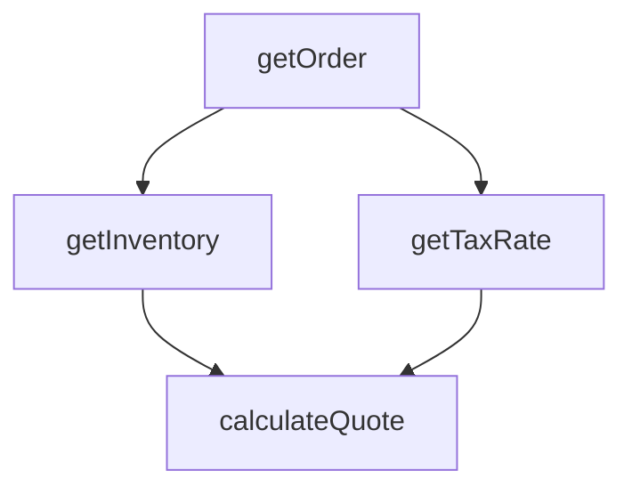
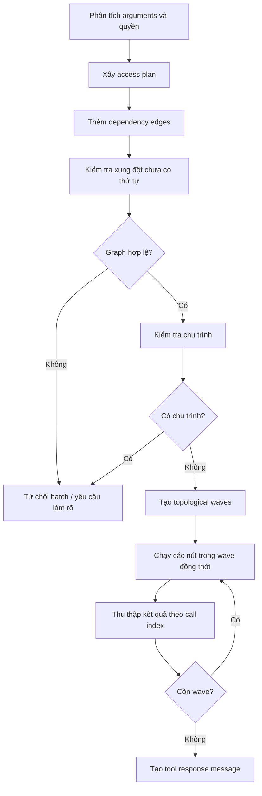

# Xác định phụ thuộc dữ liệu trước khi chạy các công cụ đồng thời

Một phản hồi của mô hình có thể yêu cầu nhiều công cụ trong cùng một lượt. Chạy các công cụ độc lập đồng thời có thể giảm thời gian chờ, đặc biệt khi chúng gọi những dịch vụ từ xa khác nhau. Tuy nhiên, chạy song song chỉ an toàn khi ứng dụng hiểu dữ liệu mà mỗi công cụ đọc, ghi và cần từ kết quả của công cụ khác.

Trước khi đưa các lời gọi vào executor, hãy xác định quan hệ phụ thuộc, xung đột truy cập tài nguyên và yêu cầu nhất quán nghiệp vụ. Các lời gọi không phụ thuộc nhau có thể nằm trong cùng một nhóm thực thi. Lời gọi cần kết quả của bước trước phải chờ bước đó hoàn tất. Nếu hai thao tác cùng thay đổi một tài nguyên mà ứng dụng chưa xác định được thứ tự đúng, hãy dừng việc lập lịch song song và yêu cầu quy tắc nghiệp vụ rõ ràng.

## Nhiều tool call trong một phản hồi không có nghĩa là có thể chạy song song

Mô hình có thể trả về nhiều `AssistantMessage.ToolCall` trong cùng một `ChatResponse`. Mỗi lời gọi có ID, tên công cụ và JSON arguments. Danh sách này cho biết mô hình muốn ứng dụng thực thi những công cụ nào; nó không mô tả đầy đủ quan hệ phụ thuộc dữ liệu, quyền ghi hoặc ràng buộc transaction giữa chúng.

Ví dụ, hai lời gọi sau có thể độc lập nếu đều là thao tác đọc:

```json
[
  {
    "id": "call-1",
    "name": "getInventory",
    "arguments": { "sku": "SKU-2048" }
  },
  {
    "id": "call-2",
    "name": "getTaxRate",
    "arguments": { "postalCode": "700000" }
  }
]
```

Hai lời gọi dùng hai loại dữ liệu khác nhau và không cần kết quả của nhau. Nếu hợp đồng nghiệp vụ xác nhận chúng là read-only, không chia sẻ trạng thái mutable và không cần một snapshot nhất quán chung, ứng dụng có thể chạy đồng thời.

Ngược lại, hai lời gọi cùng tác động lên một đơn hàng không mặc nhiên độc lập:

```text
updateOrderAddress(orderId = ORD-2048)
createShipment(orderId = ORD-2048)
```

Nếu `createShipment` phải dùng địa chỉ mới, nó cần chạy sau `updateOrderAddress`. Nếu hai thao tác có thể ghi đè dữ liệu của nhau hoặc phụ thuộc vào trạng thái đơn hàng, chạy cùng lúc có thể tạo shipment với địa chỉ cũ hoặc trạng thái không hợp lệ.

## Spring AI thực thi tool call như thế nào?

Trong Spring AI 2.1.0, `ChatModel.call(prompt)` trả về phản hồi thô của mô hình, có thể chứa một hoặc nhiều tool call. `ChatModel` không tự thực thi các lời gọi đó. Ứng dụng chuyển phản hồi cho `ToolCallingManager.executeToolCalls(prompt, response)` để phân giải callback, gọi công cụ và tạo `ToolExecutionResult`.

Với `ChatClient`, `ToolCallingAdvisor` quản lý vòng gọi mô hình và công cụ. `ToolCallingManager` thực hiện các callback rồi đưa kết quả trở lại lịch sử hội thoại. Hợp đồng API công khai không hứa rằng một batch tool call sẽ được chạy song song. Trong implementation `DefaultToolCallingManager` hiện tại, các phần tử trong danh sách tool call được duyệt bằng vòng `for` và callback được gọi trực tiếp trong vòng đó. Vì vậy, không nên giả định rằng chỉ cần mô hình phát nhiều tool call là Spring AI tự động tạo các tác vụ đồng thời.

Nếu muốn kiểm soát song song ở mức nhiều tool call, ứng dụng cần một lớp điều phối riêng, chẳng hạn custom `ToolCallingManager` hoặc custom `ToolAdvisor`, để lập kế hoạch phụ thuộc trước khi thực thi. Với nhiều hệ thống, cách đơn giản hơn là giữ tool loop mặc định và cho một tool nghiệp vụ điều phối song song các lời gọi service độc lập bên trong chính phương thức của nó.

## Phân biệt phụ thuộc dữ liệu và xung đột truy cập

Một dependency graph cần thể hiện ít nhất hai điều: một công cụ cần kết quả nào từ công cụ khác, và những công cụ nào truy cập cùng tài nguyên với quyền đọc/ghi xung đột.

### Phụ thuộc đầu ra: bước sau cần kết quả bước trước

Ví dụ, `getOrder(orderId)` trả về SKU và địa chỉ giao hàng. `getInventory(sku)` cần SKU, còn `getTaxRate(destination)` cần địa chỉ. Sau khi có hai kết quả này, ứng dụng mới có đủ dữ liệu để tính báo giá.



Các nhóm thực thi theo thứ tự topo là:

| Nhóm | Công việc | Lý do |
|---|---|---|
| 1 | `getOrder` | Cần lấy SKU và địa chỉ từ đơn hàng |
| 2 | `getInventory` và `getTaxRate` | Hai lời gọi cùng cần kết quả nhóm 1 nhưng không cần kết quả của nhau |
| 3 | `calculateQuote` | Cần cả kết quả tồn kho và thuế |

Đây là một ví dụ điển hình của song song có phụ thuộc: chạy song song theo từng lớp, không chạy tất cả các nút cùng lúc.

### Xung đột đọc/ghi trên cùng tài nguyên

Đặt tên tài nguyên theo phạm vi đã xác thực, ví dụ `tenant/acme/order/ORD-2048`. Mỗi tool có thể khai báo tập tài nguyên nó đọc và tập tài nguyên nó ghi.

| Quan hệ | Ví dụ | Cách xử lý |
|---|---|---|
| Read–Read | `getOrder` và `getOrderHistory` cùng đọc một đơn | Thường có thể chạy song song nếu không cần snapshot chung |
| Read–Write | `getOrder` đọc đơn trong khi `updateOrder` ghi cùng đơn | Cần xác định thứ tự hoặc dùng snapshot/locking phù hợp |
| Write–Read | `updateOrder` ghi đơn trước khi `createShipment` đọc địa chỉ | Tạo dependency `updateOrder → createShipment` |
| Write–Write | `updateOrderAddress` và `cancelOrder` cùng sửa trạng thái/đơn hàng | Phải có thứ tự nghiệp vụ rõ ràng hoặc từ chối batch mơ hồ |

Quy tắc xung đột cơ bản cho hai lời gọi A và B là:

```text
conflict(A, B) =
    intersects(A.writes, B.reads)
    OR intersects(A.writes, B.writes)
    OR intersects(B.writes, A.reads)
```

Hai lời gọi chỉ có thể nằm cùng một nhóm song song khi không có phụ thuộc đầu ra, không có xung đột đọc/ghi chưa được sắp thứ tự và không có ràng buộc nghiệp vụ khác ngăn chúng chạy đồng thời.

### Ràng buộc ngoài dữ liệu

Hai lời gọi có thể đọc/ghi các tài nguyên khác nhau nhưng vẫn không nên chạy cùng lúc nếu:

- Cùng dùng một API có quota hoặc giới hạn concurrency thấp.
- Cùng sử dụng một connection pool hoặc thiết bị/tài nguyên độc quyền.
- Một thao tác cần khóa phân tán hoặc giữ transaction lâu.
- Một hệ thống phía sau yêu cầu thứ tự gọi, ví dụ tạo phiên trước rồi mới gửi lệnh vào phiên.
- Một thao tác cần người dùng phê duyệt trước khi bất kỳ side effect nào trong batch được chạy.

Vì vậy, dependency planner cần xem cả dữ liệu, side effect và chính sách vận hành của dịch vụ.

## Xác định dependency từ hợp đồng công cụ

JSON Schema mô tả tên, kiểu và ràng buộc của arguments. `ToolDefinition` không tự mô tả đầy đủ các tài nguyên mà tool đọc/ghi hoặc thứ tự nghiệp vụ giữa các tool. Ứng dụng nên duy trì một registry/policy riêng cho mục đích lập lịch.

Một policy cho mỗi tool có thể khai báo:

- Các resource key được đọc.
- Các resource key được ghi.
- Các tool call hoặc workflow step phải hoàn thành trước.
- Tool có read-only hay có side effect.
- Có yêu cầu snapshot nhất quán, transaction, lock hoặc confirmation không.
- Mức concurrency tối đa của tool hoặc dịch vụ downstream.

Ví dụ kiểu dữ liệu cho access plan:

```java
public record ResourceKey(
        String tenantId,
        String resourceType,
        String resourceId) {
}

public record ToolAccessPlan(
        Set<ResourceKey> reads,
        Set<ResourceKey> writes,
        Set<Integer> dependsOnCallIndexes,
        boolean requiresConsistentSnapshot) {
}

public record PlannedToolCall(
        int originalIndex,
        AssistantMessage.ToolCall toolCall,
        ToolCallback callback,
        ToolAccessPlan accessPlan) {
}
```

`originalIndex` giữ vị trí của lời gọi trong assistant message. Nó hữu ích để trả tool response đúng thứ tự ban đầu, ngay cả khi các tác vụ hoàn tất theo thứ tự khác nhau. `dependsOnCallIndexes` do policy của ứng dụng tạo ra, không lấy trực tiếp từ một trường tùy ý do mô hình gửi.

Một registry có thể ánh xạ tên tool sang policy:

```java
public interface ToolAccessPolicy {

    String toolName();

    ToolAccessPlan describe(
            AssistantMessage.ToolCall toolCall,
            ToolContext trustedContext,
            int originalIndex);
}
```

Ví dụ, policy của `getInventory` parse SKU từ arguments, lấy tenant từ `ToolContext` rồi khai báo resource đọc là `tenant/{tenantId}/inventory/{sku}`. Policy của `reserveInventory` khai báo cùng resource ở tập `writes`. Nhờ đó, planner phát hiện hai thao tác có xung đột dù tên tool khác nhau.

Không tin `tenantId`, `userId` hoặc quyền truy cập do mô hình tự gửi trong JSON arguments. Resource key phải được xây dựng từ dữ liệu đã xác thực trong `ToolContext` hoặc principal do ứng dụng quản lý. Mỗi callback vẫn phải validate arguments và authorization trong service trước khi thực hiện.

## Không suy ra thứ tự nghiệp vụ từ thứ tự tool call của mô hình

Thứ tự trong danh sách `AssistantMessage.getToolCalls()` là thứ tự các lời gọi xuất hiện trong phản hồi. Nó không phải một hợp đồng giao dịch nói rằng tool call thứ hai phải quan sát kết quả của tool call thứ nhất. Nếu hai thao tác xung đột, ứng dụng cần một policy nghiệp vụ để xác định hướng dependency.

Ví dụ, với `readBalance(accountId)` và `deposit(accountId, amount)`, chỉ biết hai lời gọi cùng tài khoản là chưa đủ để quyết định đọc trước hay nạp trước. Nếu yêu cầu của người dùng là “nạp tiền rồi cho biết số dư mới”, policy phải đặt `deposit → readBalance`. Nếu yêu cầu là “ghi nhận số dư hiện tại rồi nạp tiền”, thứ tự là `readBalance → deposit`. Khi không có hợp đồng xác định, hãy từ chối lập lịch batch và yêu cầu workflow/model tạo các lượt có thứ tự rõ ràng.

Một tool call trong cùng phản hồi cũng không thể mặc nhiên dùng kết quả runtime của tool call bên cạnh vì các arguments đã được mô hình tạo trước khi callback nào chạy. Nếu B cần một ID chỉ có thể lấy từ kết quả A, hãy thực thi A trước, gửi kết quả về mô hình hoặc để workflow của ứng dụng chuyển ID sang B ở bước kế tiếp.

## Tạo dependency graph và các nhóm thực thi

Mỗi tool call là một nút. Tạo cạnh `A → B` khi B phải chờ A, ví dụ B cần output của A hoặc phải quan sát trạng thái sau khi A ghi dữ liệu. Sau khi thêm tất cả cạnh, kiểm tra graph không có chu trình rồi chia thành các lớp topo.



Thuật toán lập lịch theo lớp:

1. Tạo danh sách các tool call và access plan tương ứng.
2. Xác minh mọi dependency trỏ tới một call tồn tại trong workflow.
3. Với từng cặp có xung đột tài nguyên, yêu cầu graph đã có đường đi theo một hướng. Nếu chưa có thứ tự nghiệp vụ, dừng và báo batch mơ hồ.
4. Lấy các nút chưa chạy mà mọi dependency đã hoàn tất. Đây là wave tiếp theo.
5. Xác minh không có hai nút xung đột cùng nằm trong wave.
6. Chạy wave, chờ kết quả và đánh dấu hoàn tất.
7. Lặp đến khi hết nút. Nếu không còn nút sẵn sàng nhưng vẫn còn nút chưa chạy, graph có chu trình hoặc dependency không thể thỏa mãn.

Ví dụ graph:

```text
loadOrder
   |
   +----> getInventory ----+
   |                      +----> calculateQuote
   +----> getTaxRate ------+
```

Các wave là `[loadOrder]`, `[getInventory, getTaxRate]`, `[calculateQuote]`. Không có bước nào chạy trước khi dữ liệu đầu vào cần thiết đã sẵn sàng.

## Kiểm tra xung đột trước khi lập lịch

Một helper có thể kiểm tra giao nhau giữa tập resource:

```java
private boolean intersects(Set<ResourceKey> left, Set<ResourceKey> right) {
    return left.stream().anyMatch(right::contains);
}

private boolean conflicts(ToolAccessPlan a, ToolAccessPlan b) {
    return intersects(a.writes(), b.reads())
            || intersects(a.writes(), b.writes())
            || intersects(b.writes(), a.reads());
}
```

`conflicts(...)` chỉ báo rằng hai lời gọi không được chạy đồng thời theo access plan hiện tại. Nó không tự quyết định lời gọi nào phải chạy trước. Hướng cạnh phải đến từ business policy hoặc workflow đã xác định. Nếu policy không thể xác định thứ tự, từ chối batch hoặc chuyển sang một bước hội thoại mới để lấy quyết định rõ ràng.

Không nên tự động thêm cạnh theo vị trí model output chỉ để graph trở thành DAG. Điều đó có thể tạo ra một thứ tự hợp lệ về mặt kỹ thuật nhưng sai về nghiệp vụ. Cũng cần phát hiện chu trình, ví dụ A chờ B trong khi B lại chờ A; trường hợp này không có wave nào có thể bắt đầu.

## Ví dụ điều phối song song bên trong một tool nghiệp vụ

Nếu các bước độc lập đã biết trước trong nghiệp vụ, cách đơn giản nhất là giữ một tool method và chạy song song các lời gọi service bên trong. Ví dụ, sau khi đọc đơn hàng để biết SKU và địa chỉ, ứng dụng có thể lấy tồn kho và thuế cùng lúc.

```java
@Component
public class QuoteTools {

    private final OrderService orderService;
    private final InventoryService inventoryService;
    private final TaxService taxService;
    private final QuoteService quoteService;
    private final Executor quoteExecutor;

    public QuoteTools(
            OrderService orderService,
            InventoryService inventoryService,
            TaxService taxService,
            QuoteService quoteService,
            @Qualifier("quoteExecutor") Executor quoteExecutor) {
        this.orderService = orderService;
        this.inventoryService = inventoryService;
        this.taxService = taxService;
        this.quoteService = quoteService;
        this.quoteExecutor = quoteExecutor;
    }

    @Tool(description = "Tính báo giá cho đơn hàng sau khi kiểm tra tồn kho và thuế")
    public QuoteSummary calculateQuote(
            String orderId,
            ToolContext toolContext) {

        String tenantId = requireTenantId(toolContext);

        // Bước phụ thuộc: cần đọc đơn trước để biết SKU và địa chỉ giao hàng.
        Order order = orderService.getVisibleOrder(tenantId, orderId);

        // Hai bước sau chỉ đọc các resource riêng và không cần kết quả của nhau.
        CompletableFuture<InventoryAvailability> inventoryFuture =
                CompletableFuture.supplyAsync(
                        () -> inventoryService.getAvailability(
                                tenantId, order.sku()),
                        quoteExecutor);

        CompletableFuture<TaxRate> taxFuture =
                CompletableFuture.supplyAsync(
                        () -> taxService.getRate(
                                tenantId, order.destination()),
                        quoteExecutor);

        CompletableFuture.allOf(inventoryFuture, taxFuture).join();

        return quoteService.calculate(
                order,
                inventoryFuture.join(),
                taxFuture.join());
    }

    private String requireTenantId(ToolContext context) {
        Object value = context.getContext().get("tenantId");
        if (!(value instanceof String tenantId) || tenantId.isBlank()) {
            throw new IllegalArgumentException("Thiếu tenant context.");
        }
        return tenantId;
    }
}
```

`Order`, `InventoryAvailability`, `TaxRate`, `QuoteSummary` và các service là kiểu nghiệp vụ minh họa. `ToolContext` được dùng để lấy tenant đã xác thực; tenant được truyền tường minh vào các service chạy trên executor. Không phụ thuộc vào `SecurityContextHolder` hoặc transaction ThreadLocal tự truyền sang worker thread.

Executor nên có giới hạn concurrency và queue:

```java
@Configuration(proxyBeanMethods = false)
public class ToolExecutorConfiguration {

    @Bean("quoteExecutor")
    ThreadPoolTaskExecutor quoteExecutor() {
        ThreadPoolTaskExecutor executor = new ThreadPoolTaskExecutor();
        executor.setCorePoolSize(4);
        executor.setMaxPoolSize(8);
        executor.setQueueCapacity(32);
        executor.setThreadNamePrefix("quote-tool-");
        return executor;
    }
}
```

Không dùng một executor không giới hạn hoặc `parallelStream()` trên common pool cho mọi tool call. Giới hạn số thread, queue, timeout và concurrency theo downstream service để một request AI không làm cạn tài nguyên của toàn ứng dụng.

Ví dụ này giữ tool loop mặc định của Spring AI. Một tool callback duy nhất điều phối hai truy vấn độc lập bên trong service. Cách tiếp cận này thường ít phức tạp hơn việc thay `ToolCallingManager` chỉ để chạy nhiều callback song song.

## Khi cần chạy nhiều ToolCallback trong cùng batch

Nếu ứng dụng muốn lập lịch nhiều `AssistantMessage.ToolCall` song song, cần một lớp điều phối nhận danh sách call, resolve callback từ danh sách được phép của request, xây access plan và chạy từng wave. `ToolCallback` cung cấp `call(String)` và overload `call(String, ToolContext)`; kết quả là chuỗi gửi lại mô hình. Mỗi tool response cần giữ đúng `id` và `name` của lời gọi gốc.

Khung thực thi cho một wave có thể dùng `CompletableFuture`:

```java
List<CompletableFuture<IndexedToolResult>> futures = readyWave.stream()
        .map(plan -> CompletableFuture.supplyAsync(
                () -> invokeTool(plan, toolContext),
                toolExecutor))
        .toList();

CompletableFuture.allOf(
        futures.toArray(CompletableFuture[]::new)).join();

for (CompletableFuture<IndexedToolResult> future : futures) {
    IndexedToolResult result = future.join();
    resultsByOriginalIndex.set(result.originalIndex(), result.response());
}
```

`invokeTool(...)` gọi callback đã được resolve và validate trước đó:

```java
private IndexedToolResult invokeTool(
        PlannedToolCall plan,
        ToolContext toolContext) {

    String result;
    try {
        result = plan.callback().call(
                plan.toolCall().arguments(),
                toolContext);
    }
    catch (ToolExecutionException ex) {
        result = exceptionProcessor.process(ex);
    }

    ToolResponseMessage.ToolResponse response =
            new ToolResponseMessage.ToolResponse(
                    plan.toolCall().id(),
                    plan.toolCall().name(),
                    result == null ? "" : result);

    return new IndexedToolResult(plan.originalIndex(), response);
}
```

`PlannedToolCall`, `IndexedToolResult`, `resultsByOriginalIndex`, `toolContext`, `toolExecutor` và `exceptionProcessor` là thành phần của custom orchestrator. Đây là khung minh họa cho việc chạy một wave, không phải một cấu hình bật concurrency có sẵn trên `DefaultToolCallingManager`.

Sau khi tất cả wave hoàn tất, tạo `ToolResponseMessage` theo thứ tự gốc của assistant tool calls, không theo thứ tự future hoàn thành:

```java
ToolResponseMessage responseMessage = ToolResponseMessage.builder()
        .responses(resultsByOriginalIndex)
        .build();
```

Sau đó, custom manager tạo `ToolExecutionResult` chứa lịch sử trước đó, assistant message có tool calls và tool response message. Nếu tiếp tục gọi model, giữ nguyên mối liên kết giữa từng tool call ID và tool response. Với nhiều tool trong một batch, `returnDirect` chỉ đúng khi tất cả tool được thực thi đều có metadata `returnDirect = true` và không có call bị từ chối.

Một custom `ToolCallingManager` hoàn chỉnh còn phải giữ các hành vi khác của Spring AI: kiểm tra confirmation trước khi chạy bất kỳ call nào trong batch, tool callback allowlist, `ToolContext`, giới hạn per-tool/tổng số call, exception processing, observation/tracing và xây dựng conversation history. Không thay implementation mặc định bằng một vòng `CompletableFuture` đơn giản rồi bỏ qua các chính sách này.

## Xử lý lỗi và side effect khi một wave chạy đồng thời

Khi một wave có nhiều future, một tác vụ có thể thành công trong khi tác vụ khác thất bại. Không có transaction tự động bao trùm các thread chỉ vì chúng cùng thuộc một tool batch. Nếu một callback đã ghi dữ liệu thành công rồi callback khác timeout, việc hủy future không tự động rollback side effect đã xảy ra.

Hãy quyết định chính sách trước khi triển khai:

- **Read-only wave:** thu thập kết quả thành công/lỗi; có thể retry từng lời gọi đọc nếu freshness và quota cho phép.
- **Wave có write:** chỉ chạy song song nếu các resource độc lập và service hỗ trợ idempotency; ghi lại trạng thái từng thao tác.
- **Batch cần all-or-nothing:** dùng transaction hoặc workflow/compensation phù hợp ở tầng nghiệp vụ. Không giả định `CompletableFuture.allOf()` tạo transaction phân tán.
- **Một future lỗi:** dừng các wave phụ thuộc phía sau; không khởi chạy bước tiếp theo dựa trên kết quả chưa đầy đủ.
- **Timeout:** xác định thao tác đã commit hay chưa trước khi retry; timeout không chứng minh downstream chưa thực hiện.
- **Cancellation:** truyền cancellation token/deadline tới client nếu downstream hỗ trợ. `CompletableFuture.cancel(true)` không bảo đảm side effect bên ngoài đã dừng.

Nếu các tác vụ trong wave độc lập nhưng một tác vụ thất bại, các kết quả còn lại vẫn có thể đã hoàn tất. Hãy giữ kết quả theo call ID để tạo response chính xác hoặc để ứng dụng xử lý trạng thái partial failure. Không chạy lại cả batch một cách mù quáng.

## Giữ context, authorization và transaction đúng khi đổi thread

Khi callback chạy trên executor, thread thực thi có thể khác thread của request HTTP. Điều này ảnh hưởng tới các context gắn với thread:

- `ToolContext` cần được truyền tường minh tới callback hoặc các service con. Map context của Spring AI không tự biến thành context của executor.
- `SecurityContextHolder` thường gắn với thread; nếu service phụ thuộc vào Spring Security context, cần cấu hình context propagation hoặc truyền principal/authority đã xác thực theo cách được kiểm soát.
- Transaction của JDBC/JPA thường gắn với thread; không giả định hai future chia sẻ một transaction của caller.
- Micrometer observation/tracing cần context propagation phù hợp để trace không bị đứt khi chuyển executor.
- Các object mutable dùng chung giữa các callback cần thread-safe; ưu tiên DTO/record bất biến và không chia sẻ `EntityManager` hoặc mutable persistence entity giữa các task.

Authorization phải được kiểm tra trước khi lập lịch và vẫn được service kiểm tra lại trên từng tài nguyên. Không cho mô hình quyết định tenant hoặc user ID. Mọi resource key trong access plan phải có tenant/user scope đã xác thực.

## Giới hạn concurrency và áp lực lên hệ thống phía sau

Chạy đồng thời giảm latency của một request nhưng tăng số request downstream đồng thời. Nếu mỗi request AI chạy 8 tool call, 100 request đồng thời có thể tạo ra hàng trăm kết nối tới một service.

Nên áp dụng:

1. Giới hạn số tool call trong một batch và số wave trong một lượt.
2. Dùng executor có core/max pool và queue capacity hữu hạn.
3. Dùng semaphore hoặc bulkhead riêng cho từng downstream service.
4. Đặt timeout theo service và deadline tổng của request.
5. Giới hạn kích thước kết quả để tránh giữ nhiều dữ liệu trong bộ nhớ.
6. Dùng rate limiter theo tenant/user nếu quota có phạm vi người dùng.
7. Thu thập metrics về queue depth, active thread, latency, timeout và số tác vụ bị từ chối.

Giới hạn số lần tool call của `DefaultToolCallingManager` giúp chống vòng lặp runaway, nhưng không phải concurrency limit. Hai chính sách này cần được cấu hình riêng.

## Kiểm thử dependency planner và thực thi song song

Test không chỉ xác minh các future được chạy cùng lúc; cần chứng minh scheduler không chạy song song những thao tác có dependency hoặc xung đột tài nguyên.

| Ca kiểm thử | Điều cần xác minh |
|---|---|
| Hai tool read-only trên resource độc lập | Cùng nằm trong một wave và có thể chạy đồng thời |
| Một tool cần output của tool khác | Tool phụ thuộc chỉ bắt đầu sau khi producer hoàn tất |
| Read–Write trên cùng resource | Không nằm cùng wave; thứ tự lấy từ business policy |
| Write–Write trên cùng resource | Không chạy đồng thời; thiếu thứ tự thì planner từ chối batch |
| Hai read trên cùng resource cần snapshot | Scheduler dùng snapshot/transaction phù hợp hoặc serialize theo policy |
| Tenant khác nhau | Resource key có tenant scope; không tạo dependency giả hoặc truy cập chéo tenant |
| Dependency ID không tồn tại | Planner từ chối trước khi thực thi |
| Dependency graph có chu trình | Planner phát hiện và không khởi chạy tool nào |
| Hai call xung đột nhưng không có hướng cạnh | Batch bị từ chối vì thứ tự nghiệp vụ chưa rõ |
| Một future thất bại | Các wave phụ thuộc không chạy; trạng thái partial failure được giữ |
| Kết quả hoàn thành sai thứ tự | Tool responses vẫn được sắp theo thứ tự gốc và đúng call ID |
| Executor đạt giới hạn | Queue/concurrency có giới hạn; request bị từ chối hoặc backpressure theo policy |
| Timeout sau side effect | Không retry mù; kiểm tra idempotency/trạng thái trước |
| Context trên worker thread | Tenant/user đã xác thực được truyền đúng; không dựa vào ThreadLocal ngầm định |

Một test có thể dùng `CountDownLatch` hoặc `CyclicBarrier` để xác nhận hai task độc lập thực sự overlap. Với các task có dependency, dùng event log hoặc mock service để xác minh task sau chỉ bắt đầu sau khi task trước hoàn tất. Cần test riêng trường hợp planner từ chối batch mơ hồ trước khi bất kỳ callback nào được gọi.

## Checklist trước khi bật concurrency

1. Đã biết từng tool đọc và ghi resource nào chưa?
2. Resource key đã bao gồm tenant/user scope đáng tin cậy chưa?
3. Có tool nào cần output của tool khác không?
4. Có cặp read/write hoặc write/write trên cùng resource không?
5. Hướng dependency có được business policy xác định rõ không?
6. Dependency graph có chu trình hoặc cạnh trỏ tới call không tồn tại không?
7. Mọi cặp có xung đột đã được sắp thứ tự hoặc bị từ chối chưa?
8. Executor, queue, timeout và downstream concurrency đã có giới hạn chưa?
9. Context bảo mật, transaction và observation có được truyền đúng qua thread không?
10. Partial failure, cancellation, retry và idempotency đã có chính sách chưa?
11. Tool responses có được trả theo đúng ID và thứ tự gốc không?
12. Các test chứng minh tool độc lập chạy đồng thời và tool phụ thuộc chạy theo thứ tự chưa?

## Kết luận

Muốn chạy nhiều công cụ đồng thời, ứng dụng phải xác định phụ thuộc dữ liệu và quyền truy cập tài nguyên trước khi thực thi. Hãy mô tả tập resource đọc/ghi của mỗi tool, xây dependency graph từ các quy tắc nghiệp vụ đáng tin cậy, phát hiện xung đột và chu trình, rồi chạy từng lớp topo bằng executor có giới hạn. Giữ nguyên thứ tự và ID của tool response, truyền context đã xác thực qua thread và xử lý partial failure/idempotency ở tầng service. Spring AI 2.1.0 cung cấp vòng tool calling và `ToolCallback`; việc lập lịch song song theo dependency là trách nhiệm của lớp điều phối ứng dụng.

## Tài liệu tham khảo

- [Spring AI 2.1.0 — Tool Calling](https://docs.spring.io/spring-ai/reference/api/tools.html) — kiến trúc tool calling, `ToolCallingAdvisor`, `ToolDefinition` và trách nhiệm thực thi của ứng dụng.
- [Spring AI 2.1.0 — ChatModel Tool Calling](https://docs.spring.io/spring-ai/reference/api/tools/chatmodel-tool-calling.html) — phản hồi tool call thô, `ToolCallingManager` và vòng điều phối thủ công.
- [Spring AI 2.1.x — ToolCallback API](https://docs.spring.io/spring-ai/docs/2.1.x/api/org/springframework/ai/tool/ToolCallback.html) — hợp đồng gọi callback đồng bộ với JSON input và `ToolContext`.
- [Spring AI 2.1.x — AssistantMessage.ToolCall API](https://docs.spring.io/spring-ai/docs/2.1.x/api/org/springframework/ai/chat/messages/AssistantMessage.ToolCall.html) — ID, tên và arguments của từng tool call.
- [Spring AI — DefaultToolCallingManager source](https://github.com/spring-projects/spring-ai/blob/main/spring-ai-model/src/main/java/org/springframework/ai/model/tool/DefaultToolCallingManager.java) — implementation hiện tại duyệt tool call theo danh sách và gọi callback trong vòng lặp tuần tự; đây là chi tiết implementation, không phải cam kết concurrency của API công khai.
- [Spring Framework — Task Execution and Scheduling](https://docs.spring.io/spring-framework/reference/integration/scheduling.html) — cấu hình executor, thread pool và giới hạn tác vụ.
