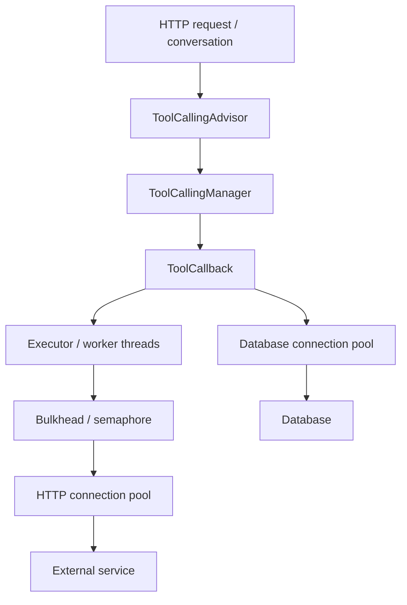

# Streaming và đồng thời

## Giới hạn số công việc, thread và kết nối tới dịch vụ ngoài

Một ứng dụng dùng Spring AI có thể nhận nhiều yêu cầu chat cùng lúc. Mỗi yêu cầu có thể kích hoạt một hoặc nhiều tool, và mỗi tool có thể gọi database, REST API hoặc MCP server. Nếu không giới hạn tài nguyên ở từng tầng, lượng công việc chờ xử lý có thể tăng nhanh hơn khả năng phục vụ của dịch vụ phía sau.

Trong module `SPRING_AI_TOOL_CALLING`, mô hình yêu cầu gọi công cụ, còn ứng dụng thực thi `ToolCallback` và kiểm soát các tài nguyên được dùng. `ToolCallingManager` điều phối việc gọi callback; `ToolCallingAdvisor` quản lý vòng lặp; executor, bulkhead và connection pool của ứng dụng giới hạn số công việc thực sự được chạy đồng thời.

Điều quan trọng là phân biệt số lần gọi tool trong một lượt hội thoại với số tool đang chạy cùng lúc. Hai giới hạn này giải quyết hai vấn đề khác nhau.

### 1. Bốn lớp tài nguyên cần giới hạn

Một request tool calling đi qua nhiều lớp tài nguyên:



| Tài nguyên | Giới hạn cần kiểm soát | Khi cạn tài nguyên |
| --- | --- | --- |
| Request và conversation | Số workflow đang chạy, số lượt trên mỗi người dùng/tenant | Từ chối hoặc xếp hàng request mới |
| Công việc và thread | Số tác vụ đang chạy, số thread, độ dài queue | Chờ trong queue hữu hạn hoặc bị reject |
| Dịch vụ ngoài | Số request đồng thời và tốc độ request | Bulkhead/rate limiter từ chối hoặc trì hoãn |
| Kết nối | Số socket/connection, số lần acquire đang chờ | Chờ lấy connection đến timeout hoặc bị từ chối |
| Database | Số transaction và connection đang dùng | Chờ connection, timeout hoặc pool exhausted |

Không nên chỉ tăng số thread để xử lý nhiều request hơn. Nếu dịch vụ ngoài chỉ chịu được 20 request đồng thời, mở 100 thread chỉ khiến 80 công việc chờ hoặc làm dịch vụ phía sau quá tải.

### 2. `parallelToolCalls` không phải giới hạn concurrency của ứng dụng

Một model provider có thể cho phép mô hình yêu cầu nhiều tool calls trong cùng một response. Một tùy chọn như `parallelToolCalls` (nếu provider hỗ trợ) điều khiển hành vi sinh tool calls của mô hình. Nó không tự tạo thread pool, không giới hạn số HTTP connection và cũng không bảo đảm callback được chạy song song.

Trong Spring AI 2.x, `DefaultToolCallingManager` thực thi các tool calls trong một vòng lặp và gọi `ToolCallback.call(...)` đồng bộ. Vì vậy, nhiều tool calls trong cùng một response được xử lý lần lượt bởi implementation mặc định. Các request ChatClient độc lập vẫn có thể chạy đồng thời trên những thread xử lý request khác nhau.

| Tình huống | Có chạy đồng thời không? | Nơi cần giới hạn |
| --- | --- | --- |
| Một response chứa ba tool calls với `DefaultToolCallingManager` | Mặc định lần lượt | Tool-call limit theo lượt và timeout từng callback |
| Ba request ChatClient độc lập cùng gọi một tool | Có thể đồng thời | Bulkhead/executor của tool hoặc dịch vụ |
| Một tool gọi đồng thời ba API con | Chỉ khi code của tool chủ động fan-out | Executor/bulkhead riêng cho các API con |
| Nhiều pod cùng gọi một API | Có thể đồng thời trên toàn cluster | Quota phía dịch vụ, gateway hoặc distributed limiter |

Spring AI còn có giới hạn số lần gọi theo từng tool và tổng số tool calls trong một lượt (mặc định 40 lần/tool và 150 lần/lượt ở các phiên bản hiện hành). Đây là giới hạn số lần gọi trong lịch sử của một lượt hội thoại, không phải giới hạn số callback đang chạy cùng lúc. Không dùng hai giá trị này thay cho giới hạn thread hoặc connection pool.

Builder của `DefaultToolCallingManager` cấu hình call-count limits và chính sách khi vượt hạn mức; nó không cung cấp một thuộc tính `maxConcurrentToolCalls` hoặc executor để giới hạn thread. Nếu cần concurrency thực sự giữa nhiều tool calls trong cùng response, ứng dụng phải chủ động triển khai fan-out có giới hạn hoặc một `ToolCallingManager` tùy chỉnh.

### 3. Chọn ngân sách concurrency theo dịch vụ chậm nhất

Mỗi dịch vụ phía sau có năng lực riêng. Ví dụ, service vận chuyển cho phép tối đa 12 request đồng thời, database pool còn 8 connection dành cho workflow AI và executor có 16 worker. Số request thực sự được gửi tới service vận chuyển không nên vượt 12.

Một quy tắc sizing đơn giản:

\[
C_{service} \leq \min(C_{executor}, C_{bulkhead}, C_{connection}, C_{downstream})
\]

Trong đó:

- \(C_{executor}\): số công việc tối đa executor có thể chạy đồng thời.
- \(C_{bulkhead}\): số permit cho phép đi vào đoạn gọi dịch vụ.
- \(C_{connection}\): khả năng phục vụ của connection pool hoặc HTTP/2 stream limit.
- \(C_{downstream}\): quota đồng thời do dịch vụ đích công bố hoặc được đo qua thử tải.

Nếu có nhiều pod, concurrency tổng gần đúng bằng concurrency mỗi pod nhân số pod. Ví dụ 4 pod, mỗi pod cho phép 12 request, có thể tạo ra 48 request đồng thời tới cùng một API. Nếu quota 12 là quota toàn hệ thống, cần chia ngân sách giữa các pod hoặc dùng distributed rate limiter/gateway.

Với JDBC, connection pool database cũng là một ngân sách riêng. Ví dụ cấu hình Hikari:

```yaml
spring:
  datasource:
    hikari:
      maximum-pool-size: 20
```

Không dành toàn bộ 20 connection cho tool callbacks nếu request web, job nền và các luồng nghiệp vụ khác cũng dùng chung datasource. Hãy xác định phần capacity dành cho tool workflow và theo dõi connection pending/timeout.

Hãy đo thời gian phản hồi, tỷ lệ lỗi, queue wait, connection acquire và giới hạn thực tế của dịch vụ trước khi chọn con số. Không có một giá trị thread hoặc connection phù hợp cho mọi ứng dụng.

### 4. Giới hạn công việc bằng `ThreadPoolTaskExecutor`

Với callback thực hiện blocking I/O, có thể dùng một executor hữu hạn để cô lập công việc. Cấu hình cả core size, max size và queue capacity. Queue không giới hạn có thể giữ quá nhiều request chờ, làm tăng độ trễ và tiêu thụ bộ nhớ.

Ví dụ một executor riêng cho dịch vụ vận chuyển:

```java
@Configuration
public class ToolExecutionConfiguration {

    @Bean("shippingExecutor")
    ThreadPoolTaskExecutor shippingExecutor() {
        ThreadPoolTaskExecutor executor = new ThreadPoolTaskExecutor();
        executor.setCorePoolSize(8);
        executor.setMaxPoolSize(8);
        executor.setQueueCapacity(32);
        executor.setThreadNamePrefix("shipping-tool-");
        executor.setRejectedExecutionHandler(new ThreadPoolExecutor.AbortPolicy());
        return executor;
    }
}
```

Với cấu hình này, tối đa 8 tác vụ chạy cùng lúc và tối đa 32 tác vụ chờ trong queue. Khi cả worker lẫn queue đều đầy, executor reject tác vụ mới. Ứng dụng có thể ánh xạ rejection thành trạng thái quá tải có thể thử lại sau.

Quy tắc của `ThreadPoolExecutor` là: dùng thread đến core size trước; khi đủ core thread thì ưu tiên đưa tác vụ vào queue; khi queue đầy mới tăng thread vượt core size cho tới max size; nếu cả max size và queue đều đầy thì reject. Nếu queue không giới hạn, max size thường không giúp pool tăng thread vượt core size và queue có thể làm cạn bộ nhớ.

Không chọn `DiscardPolicy` hoặc `DiscardOldestPolicy` cho tool call cần có kết quả giao thức. Việc âm thầm bỏ tác vụ có thể khiến caller chờ kết quả không bao giờ đến. `AbortPolicy` giúp phát hiện quá tải rõ ràng; `CallerRunsPolicy` có thể tạo backpressure nhưng không nên dùng nếu thread gửi tác vụ là Reactor event loop hoặc thread cần giữ latency thấp.

### 5. Chờ có giới hạn và xử lý executor bị quá tải

Callback `@Tool` dựa trên method là lời gọi đồng bộ. Nếu callback chuyển công việc sang executor rồi chờ kết quả, cần đặt timeout cho thời gian chờ và chuyển lỗi rejection/timeout thành lỗi nghiệp vụ rõ ràng.

```java
@Component
public class ShippingTools {

    private final ThreadPoolTaskExecutor shippingExecutor;
    private final ShippingClient shippingClient;

    public ShippingTools(
            @Qualifier("shippingExecutor") ThreadPoolTaskExecutor shippingExecutor,
            ShippingClient shippingClient) {
        this.shippingExecutor = shippingExecutor;
        this.shippingClient = shippingClient;
    }

    @Tool(description = "Tra cứu trạng thái giao hàng của đơn hàng.")
    public DeliveryStatus getDeliveryStatus(String orderId) {
        Future<DeliveryStatus> future;
        try {
            future = shippingExecutor.submit(() -> shippingClient.getStatus(orderId));
        }
        catch (TaskRejectedException ex) {
            throw new ToolOverloadedException("Dịch vụ giao hàng đang quá tải.", ex);
        }

        try {
            return future.get(4, TimeUnit.SECONDS);
        }
        catch (TimeoutException ex) {
            future.cancel(true);
            throw new ToolTimeoutException("Tra cứu giao hàng đã hết thời gian chờ.", ex);
        }
        catch (InterruptedException ex) {
            Thread.currentThread().interrupt();
            throw new IllegalStateException("Đã ngắt khi chờ dịch vụ giao hàng.", ex);
        }
        catch (ExecutionException ex) {
            throw new UpstreamServiceException("Không thể tra cứu dịch vụ giao hàng.", ex.getCause());
        }
    }
}
```

`ToolOverloadedException`, `ToolTimeoutException` và `UpstreamServiceException` là các kiểu exception do ứng dụng định nghĩa. Với method-based tool, Spring AI chuyển lỗi thực thi qua `ToolExecutionExceptionProcessor`; hãy ánh xạ chúng thành thông báo an toàn cho mô hình hoặc ném lại cho caller theo chính sách của ứng dụng.

`future.cancel(true)` chỉ yêu cầu ngắt tác vụ. Nó không bảo đảm HTTP request đã gửi tới server bị hủy hoặc server không thực hiện side effect. Luôn cấu hình connect/read/response timeout ở HTTP client. Với thao tác ghi, dùng idempotency key để tránh thực hiện lặp khi caller retry sau timeout.

### 6. Dùng semaphore bulkhead để bảo vệ một dịch vụ

Executor giới hạn số tác vụ trong pool. Semaphore bulkhead giới hạn số lời gọi được phép đi vào một dịch vụ, kể cả khi chúng đến từ nhiều executor hoặc nhiều đường code khác nhau.

```java
@Component
public class InventoryGateway {

    private final Semaphore permits = new Semaphore(12);
    private final RestClient restClient;

    public InventoryGateway(RestClient restClient) {
        this.restClient = restClient;
    }

    public InventoryResult check(String sku) {
        boolean acquired = false;
        try {
            acquired = permits.tryAcquire(100, TimeUnit.MILLISECONDS);
            if (!acquired) {
                throw new ToolOverloadedException("Kho đang xử lý đủ số request đồng thời.");
            }

            return restClient.get()
                .uri("/inventory/{sku}", sku)
                .retrieve()
                .body(InventoryResult.class);
        }
        catch (InterruptedException ex) {
            Thread.currentThread().interrupt();
            throw new IllegalStateException("Đã ngắt khi chờ dịch vụ tồn kho.", ex);
        }
        finally {
            if (acquired) {
                permits.release();
            }
        }
    }
}
```

Semaphore giới hạn số lời gọi đồng thời ở mức 12. `tryAcquire` có thời gian chờ hữu hạn nên request không giữ thread mãi chỉ để chờ một permit. `finally` bảo đảm permit được trả lại khi thành công hoặc lỗi.

Bulkhead không giới hạn số lần gọi mỗi giây. Nếu API có quota 100 request/giây, cần thêm rate limiter. Bulkhead kiểm soát concurrency; rate limiter kiểm soát throughput. Hai cơ chế thường được dùng cùng nhau.

Không nhất thiết phải đặt semaphore và executor có cùng kích thước. Nếu executor có 20 worker nhưng bulkhead có 12 permit, tối đa 12 worker đi vào service; 8 worker còn lại có thể chờ permit. Hãy cân nhắc vị trí đặt bulkhead để không giữ worker trong thời gian chờ quá lâu.

### 7. Giới hạn kết nối HTTP bằng Reactor Netty

Khi dùng `WebClient` với Reactor Netty, `ConnectionProvider` cho phép giới hạn số connection trong mỗi pool, số lần acquire đang chờ và thời gian chờ lấy connection.

```java
@Configuration
public class ShippingHttpConfiguration {

    @Bean(destroyMethod = "dispose")
    ConnectionProvider shippingConnectionProvider() {
        return ConnectionProvider.builder("shipping-api")
            .maxConnections(12)
            .pendingAcquireMaxCount(24)
            .pendingAcquireTimeout(Duration.ofSeconds(2))
            .maxIdleTime(Duration.ofSeconds(20))
            .maxLifeTime(Duration.ofMinutes(2))
            .build();
    }

    @Bean
    WebClient shippingWebClient(ConnectionProvider shippingConnectionProvider) {
        HttpClient httpClient = HttpClient.create(shippingConnectionProvider)
            .option(ChannelOption.CONNECT_TIMEOUT_MILLIS, 1_000)
            .responseTimeout(Duration.ofSeconds(3));

        return WebClient.builder()
            .clientConnector(new ReactorClientHttpConnector(httpClient))
            .baseUrl("https://shipping.example.internal")
            .build();
    }
}
```

Các con số trong ví dụ chỉ là giá trị minh họa để thể hiện cách đặt ngân sách; cần thay bằng quota và latency thực tế của dịch vụ.

| Thuộc tính | Ý nghĩa |
| --- | --- |
| `maxConnections` | Số connection tối đa trong mỗi pool trước khi request phải chờ |
| `pendingAcquireMaxCount` | Số yêu cầu tối đa được giữ trong hàng đợi chờ connection |
| `pendingAcquireTimeout` | Thời gian tối đa chờ lấy connection |
| `maxIdleTime` | Thời gian connection có thể nằm idle trước khi bị loại bỏ |
| `maxLifeTime` | Tuổi thọ tối đa của connection |
| `CONNECT_TIMEOUT_MILLIS` | Thời gian tối đa để thiết lập kết nối TCP |
| `responseTimeout` | Thời gian chờ phản hồi từ dịch vụ |

Khi pool đầy, request mới chờ trong pending queue. Nếu queue đầy hoặc chờ quá lâu, client phát lỗi acquire timeout. Hãy ánh xạ lỗi này thành trạng thái quá tải hoặc retry có giới hạn, không để queue vô hạn.

Với HTTP/1.1, connection thường là giới hạn gần với số request đang chạy trên một host. Với HTTP/2, một connection có thể multiplex nhiều stream; cần xét cả số connection và giới hạn concurrent streams của server. `maxConnections` không đồng nghĩa với số request đồng thời tối đa trong mọi giao thức.

### 8. MCP client cũng cần ngân sách thời gian và thread

Tool callback do MCP client tạo ra có thể gọi MCP server qua STDIO, SSE hoặc Streamable HTTP. MCP Client Boot Starter hiện hỗ trợ client đồng bộ và bất đồng bộ; các client trong cùng cấu hình phải dùng cùng loại.

Một số cấu hình thời gian cần phân biệt:

```yaml
spring:
  ai:
    mcp:
      client:
        request-timeout: 20s
        modern:
          call-timeout: 45s
          unreachable-cool-down: 30s
```

- `request-timeout` giới hạn một exchange với MCP server.
- `modern.call-timeout` giới hạn toàn bộ một call hiện đại, gồm nhiều exchange và thời gian chờ input.
- `unreachable-cool-down` tạm ngừng hỏi lại server được xác định là không thể truy cập.
- Connect timeout thuộc transport; với JDK MCP transport, mặc định của SDK là 10 giây và có thể tùy chỉnh bằng `McpClientCustomizer`.

MCP docs lưu ý tool calls chạy trên các thread Spring AI dùng để thực thi tool và các thread đó có thể block. Khi ứng dụng tự thực thi tool, phải dùng thread có thể block. Với WebFlux, không gọi code blocking trực tiếp trên event loop. MCP WebFlux starter là lựa chọn phù hợp khi cần transport dựa trên WebFlux; nhưng việc chọn starter không tự tạo giới hạn concurrency nghiệp vụ cho mọi tool.

`request-timeout` không phải giới hạn số kết nối. Nó chỉ giới hạn thời gian một exchange. Muốn giới hạn số request đồng thời, cần cấu hình transport pool hoặc bulkhead ở tầng ứng dụng.

### 9. Tránh chặn Reactor event loop

`ChatClient.stream()` trả `Flux`, nhưng điều đó không có nghĩa mọi callback bên trong đều non-blocking. Một method `@Tool` thông thường chạy đồng bộ và có thể gọi JDBC, `RestClient` hoặc MCP sync client.

Các nguyên tắc:

- Không gọi `.block()` hoặc chờ `Future.get()` trên Reactor event loop.
- Không chạy JDBC, filesystem hoặc HTTP blocking trực tiếp trong event loop.
- Dùng bounded worker pool cho các thao tác blocking.
- Dùng WebClient/R2DBC và compose `Mono`/`Flux` khi cần I/O non-blocking.
- Nếu `@Tool` method phải trả kết quả đồng bộ, hãy đảm bảo callback chạy trên thread có thể block và có timeout.
- Không dùng `Schedulers.boundedElastic()` như giới hạn nghiệp vụ duy nhất; scheduler toàn cục có queue lớn và không biết quota riêng của từng dịch vụ.

Virtual threads có thể giảm chi phí tạo thread cho blocking I/O trên các phiên bản Java/Spring phù hợp, nhưng không làm tăng quota của database hoặc dịch vụ ngoài. Dù dùng platform thread hay virtual thread, vẫn cần giới hạn số call đang in-flight bằng bulkhead và connection pool.

Ví dụ đưa việc khởi tạo một MCP-backed ChatClient stream sang scheduler có thể block:

```java
Flux<String> answer = Flux.defer(() ->
        chatClient.prompt(question)
            .stream()
            .content())
    .subscribeOn(Schedulers.boundedElastic());
```

Ví dụ này bảo vệ thread gọi khi phần resolve tool cần blocking. Nó không thay thế bulkhead, executor hoặc connection pool riêng cho dịch vụ phía sau.

### 10. Khi nào nên fan-out song song?

Vì `DefaultToolCallingManager` thực thi các tool calls tuần tự, ứng dụng chỉ nên tự tạo concurrency khi các thao tác độc lập và có lợi ích latency rõ ràng.

Một lựa chọn là tạo composite tool. Mô hình chỉ gọi một tool, còn method đó gọi song song hai service độc lập bằng executor hữu hạn:

Trong ví dụ, `toolIoExecutor` là bean executor có queue hữu hạn, được cấu hình riêng cho các tác vụ I/O của workflow. Hai client phía sau vẫn nên có bulkhead và connection pool riêng nếu quota của chúng khác nhau.

```java
@Component
public class OrderOverviewTools {

    private final Executor toolIoExecutor;
    private final InventoryClient inventoryClient;
    private final ShippingClient shippingClient;

    public OrderOverviewTools(
            @Qualifier("toolIoExecutor") Executor toolIoExecutor,
            InventoryClient inventoryClient,
            ShippingClient shippingClient) {
        this.toolIoExecutor = toolIoExecutor;
        this.inventoryClient = inventoryClient;
        this.shippingClient = shippingClient;
    }

    @Tool(description = "Lấy tổng quan tồn kho và vận chuyển cho một đơn hàng.")
    public OrderOverview getOverview(String orderId) {
        CompletableFuture<InventorySummary> inventory =
            CompletableFuture.supplyAsync(
                () -> inventoryClient.getForOrder(orderId), toolIoExecutor);

        CompletableFuture<DeliveryStatus> delivery =
            CompletableFuture.supplyAsync(
                () -> shippingClient.getForOrder(orderId), toolIoExecutor);

        CompletableFuture.allOf(inventory, delivery)
            .orTimeout(4, TimeUnit.SECONDS)
            .join();

        return new OrderOverview(inventory.join(), delivery.join());
    }
}
```

Executor giới hạn số task con đang chạy và queue. Trong code production, cần áp dụng timeout cho từng call và toàn bộ composite operation, xử lý lỗi riêng từng service, và giữ idempotency cho side effect. Ví dụ này phù hợp với hai thao tác đọc độc lập; không áp dụng cùng cách cho hai lệnh ghi có quan hệ phụ thuộc.

`orTimeout` hoàn tất future tổng hợp bằng lỗi timeout nhưng không tự bảo đảm các future con hoặc HTTP request đã gửi đều bị hủy. Cần timeout riêng ở từng HTTP client và một chính sách cancellation rõ ràng cho các task con.

Nếu muốn chạy song song nhiều tool calls trực tiếp từ cùng một assistant message, cần một `ToolCallingManager` tùy chỉnh hoặc một lớp orchestration riêng. Thiết kế đó phải:

- Dùng executor có giới hạn và queue hữu hạn.
- Giữ nguyên tool call ID, tool name và thứ tự response tương ứng với yêu cầu gốc.
- Xử lý lỗi từng tool theo chính sách collect-all hoặc fail-fast đã chọn.
- Giữ `ToolContext` đúng request và tenant.
- Tính `returnDirect` theo quy tắc: chỉ direct khi mọi tool trong batch đều yêu cầu direct.
- Không vượt bulkhead hoặc quota của dịch vụ đích.

Đừng tự `parallelStream()` trên danh sách tool calls mà không có executor được kiểm soát. Common ForkJoinPool không phải ngân sách tài nguyên riêng cho tool workflow.

### 11. Bulkhead, rate limiter và circuit breaker giải quyết việc khác nhau

| Cơ chế | Giới hạn | Câu hỏi nó trả lời |
| --- | --- | --- |
| Thread pool | Số task chạy và queue | Có bao nhiêu công việc blocking đang chiếm worker? |
| Semaphore bulkhead | Số call đang ở trong vùng tài nguyên | Có bao nhiêu request cùng vào service này? |
| Connection pool | Số kết nối và số acquire chờ | Có bao nhiêu kết nối có thể được dùng? |
| Rate limiter | Số lần bắt đầu trong một khoảng thời gian | Có bao nhiêu request mỗi giây/phút? |
| Circuit breaker | Trạng thái cho phép/từ chối call theo lỗi và tỷ lệ chậm | Có nên tạm ngừng gọi một service đang lỗi? |
| Timeout/deadline | Thời gian chờ tối đa | Một call được phép chiếm tài nguyên bao lâu? |

Ví dụ, một service có thể cho phép 10 request đồng thời nhưng chỉ 50 request/giây. Bulkhead 10 không bảo đảm tuân thủ quota 50/giây nếu request rất nhanh; rate limiter mới kiểm soát tốc độ bắt đầu. Ngược lại, rate limiter 50/giây không ngăn 50 request chậm cùng tồn tại; bulkhead mới giới hạn số in-flight.

### 12. Đặt timeout theo từng lớp

Một workflow có thể chờ ở nhiều nơi. Nên phân biệt:

1. Thời gian chờ executor queue.
2. Thời gian chờ bulkhead permit.
3. Thời gian acquire connection.
4. Connect timeout.
5. Response/read timeout.
6. Timeout toàn bộ tool call.
7. Deadline toàn bộ lượt hội thoại.

Các timeout phải nằm trong ngân sách deadline chung. Ví dụ nếu request còn 5 giây, không nên để queue chờ 4 giây, acquire connection chờ 3 giây rồi mới bắt đầu response timeout 4 giây. Một timeout tổng phải bao trùm toàn bộ quá trình, còn timeout thành phần giúp xác định chính xác điểm nghẽn.

Khi retry, không giữ semaphore permit trong thời gian backoff nếu không có request đang chạy. Thả permit sau mỗi lần thử và acquire lại khi bắt đầu attempt mới. Với thao tác ghi, dùng idempotency key để tránh trường hợp timeout xảy ra sau khi server đã commit.

### 13. Backpressure và từ chối quá tải

Một hệ thống ổn định phải có hành vi rõ ràng khi hết năng lực:

- Queue hữu hạn: giữ số công việc chờ trong mức đã chọn.
- Acquire timeout: từ chối sau một thời gian chờ ngắn.
- Executor rejection: trả lỗi quá tải thay vì giữ task vô hạn.
- Bulkhead rejection: báo service đang đạt giới hạn concurrency.
- Rate-limit rejection: trì hoãn hoặc yêu cầu retry sau theo quota.
- Circuit breaker open: dừng gọi dependency tạm thời.

Không nên xếp hàng request quá lâu chỉ để giảm tỷ lệ lỗi tức thời. Queue lớn làm tăng latency và giữ request context, memory, thread hoặc connection lâu hơn. Với tương tác chat, từ chối nhanh kèm thông báo thử lại thường tốt hơn một request chờ nhiều chục giây rồi hết deadline.

Khi dùng Reactor, hãy giữ backpressure trong pipeline và tránh gọi `subscribe()` lồng bên trong tool callback để tạo công việc tách rời không được quản lý. Mỗi tác vụ con phải có lifecycle, timeout, error path và cancellation policy rõ ràng.

### 14. Cách giới hạn theo tenant và toàn cluster

Một semaphore trong JVM chỉ giới hạn một instance. Nếu chạy 5 pod và mỗi pod có semaphore 10 permit, hệ thống có thể tạo 50 request đồng thời tới dependency.

Có thể chia ngân sách theo hai lớp:

- Per-pod bulkhead: bảo vệ CPU, worker, connection pool và memory của từng instance.
- Global quota: bảo vệ giới hạn của dependency trên toàn cluster bằng API gateway, distributed rate limiter, Redis-based limiter hoặc quota do dịch vụ đích áp dụng.

Nếu tenant có quota riêng, dùng key dựa trên tenant đã xác thực ở server. Không lấy tenant ID từ tool arguments do mô hình sinh ra. Một tenant không nên chiếm hết semaphore của các tenant khác; cân nhắc semaphore theo tenant kết hợp giới hạn toàn cục và giới hạn số conversation đồng thời.

### 15. Đo lường để biết giới hạn nào đang bị chạm

Spring AI phát Micrometer observation cho tool calls dưới tên `spring.ai.tool`, gồm tool name, metadata và thời gian thực thi. Bổ sung metrics cho các tầng tài nguyên của ứng dụng:

| Metric | Điều cần quan sát |
| --- | --- |
| Executor active threads | Có bao nhiêu worker đang bận |
| Executor queue size | Công việc đang chờ và xu hướng tăng |
| Executor rejected count | Số task bị từ chối do quá tải |
| Bulkhead available permits | Số slot còn lại cho dependency |
| Bulkhead rejection/wait time | Số request không vào được service và thời gian chờ |
| HTTP active/idle connections | Pool có đang cạn connection không |
| Pending connection acquire | Số request chờ connection |
| Connection acquire timeout | Số lần pool không cấp connection đúng hạn |
| Downstream latency/error rate | Dịch vụ đích có chậm hoặc lỗi tăng không |
| Tool duration by name | Tool nào chiếm thời gian nhiều nhất |

Không ghi toàn bộ arguments, `ToolContext`, token hoặc response nhạy cảm vào metric labels. Dùng tên tool, loại lỗi và dependency name làm dimensions có cardinality thấp; dùng trace ID để truy vết từng request.

### 16. Kiểm thử giới hạn concurrency

Test cần xác minh giới hạn thực sự được giữ dưới tải đồng thời, không chỉ kiểm tra cấu hình bean.

**Executor:**

- Số task đang chạy không vượt max pool size.
- Queue không vượt capacity.
- Task mới bị reject khi pool và queue đều đầy.
- Timeout chờ task được ánh xạ thành lỗi phù hợp.

**Bulkhead:**

- Số request đồng thời tới dependency không vượt permit count.
- Permit được trả lại sau success, exception và timeout.
- Request quá tải bị từ chối sau thời gian chờ đã cấu hình.
- Một tenant không thể chiếm hết quota của tenant khác nếu có quota phân tầng.

**Connection pool:**

- Số connection không vượt `maxConnections`.
- Pending acquire queue có giới hạn.
- Acquire timeout và response timeout được kiểm tra riêng.
- HTTP/2 test phân biệt số connection với số concurrent streams.

**Tool workflow:**

- Nhiều request ChatClient độc lập không làm vượt bulkhead.
- Nhiều tool calls trong một response với `DefaultToolCallingManager` được xác nhận là chạy lần lượt.
- Nếu có custom parallel manager, tool response vẫn khớp call ID và giữ đúng thứ tự.
- `ToolContext` của các request đồng thời không bị trộn.
- Cancellation và timeout không làm side effect bị chạy lại ngoài ý muốn.

Ví dụ kiểm tra bulkhead bằng bộ đếm đồng thời:

```java
@Test
void neverExceedsConfiguredConcurrency() throws Exception {
    int limit = 3;
    Semaphore permits = new Semaphore(limit);
    AtomicInteger active = new AtomicInteger();
    AtomicInteger maximum = new AtomicInteger();

    ExecutorService workers = Executors.newFixedThreadPool(12);
    List<Future<?>> tasks = new ArrayList<>();

    for (int i = 0; i < 24; i++) {
        tasks.add(workers.submit(() -> {
            try {
                if (!permits.tryAcquire(1, TimeUnit.SECONDS)) {
                    return;
                }
                int current = active.incrementAndGet();
                maximum.accumulateAndGet(current, Math::max);
                try {
                    Thread.sleep(50);
                }
                finally {
                    active.decrementAndGet();
                    permits.release();
                }
            }
            catch (InterruptedException ex) {
                Thread.currentThread().interrupt();
            }
        }));
    }

    for (Future<?> task : tasks) {
        task.get();
    }
    workers.shutdown();

    assertThat(maximum.get()).isLessThanOrEqualTo(limit);
}
```

Test này xác minh invariant của semaphore. Integration test cần gọi mock HTTP server để đo số request đồng thời thực tế và kiểm tra pending acquire/timeout.

### 17. Checklist trước khi đưa tool vào production

1. Xác định dependency nào bị giới hạn về concurrency, rate, connection hoặc database capacity.
2. Đặt ngân sách cho mỗi pod và tính lại tổng theo số replica.
3. Giới hạn số workflow và công việc đang chờ.
4. Dùng executor có thread count và queue capacity hữu hạn cho blocking work.
5. Dùng bulkhead riêng cho dependency quan trọng.
6. Cấu hình HTTP connection pool, pending acquire và timeout.
7. Không block Reactor event loop.
8. Tách rate limiter khỏi bulkhead; mỗi cái bảo vệ một loại quota.
9. Chọn rõ cách xử lý rejection, timeout, retry và cancellation.
10. Đo active, queue, rejection, connection wait và downstream latency.
11. Kiểm thử concurrency dưới tải, gồm nhiều request và nhiều tenant.
12. Giữ tool callback stateless hoặc thread-safe; truyền `ToolContext` theo request.

`ToolCallingManager` kiểm soát việc thực thi tool trong vòng hội thoại, nhưng không phải bộ quản lý toàn bộ thread và kết nối của ứng dụng. Muốn hệ thống ổn định, cần đặt giới hạn ở nơi tài nguyên thực sự được dùng: executor cho công việc, bulkhead cho dependency, connection pool cho HTTP và quota/rate limiter cho toàn hệ thống. Kết hợp các giới hạn hữu hạn với timeout, backpressure và metrics giúp tool calling hoạt động ổn định ngay cả khi nhiều conversation cùng chạy hoặc một dịch vụ ngoài bị chậm.

### Tài liệu tham khảo

- [Spring AI 2.1.0 Reference — Tool Calling](https://docs.spring.io/spring-ai/reference/api/tools.html)
- [Spring AI 2.1.0 Reference — ToolCallingAdvisor](https://docs.spring.io/spring-ai/reference/api/tools/tool-calling-advisor.html)
- [Spring AI 2.1.0 Reference — MCP Client Boot Starter](https://docs.spring.io/spring-ai/reference/api/mcp/mcp-client-boot-starter-docs.html)
- [Spring AI 2.1.x API — DefaultToolCallingManager](https://docs.spring.io/spring-ai/docs/2.1.x/api/org/springframework/ai/model/tool/DefaultToolCallingManager.html)
- [Spring Framework 7.1 Reference — Task Execution and Scheduling](https://docs.spring.io/spring-framework/reference/integration/scheduling.html)
- [Reactor Netty 1.4 Reference — HTTP Connection Pool](https://projectreactor.io/docs/netty/release/reference/http-client.html)
- [Reactor Core API — Schedulers](https://projectreactor.io/docs/core/release/api/reactor/core/scheduler/Schedulers.html)

Các giá trị thread, queue, permit, connection và timeout trong ví dụ chỉ là cấu hình minh họa. Hãy đo năng lực của service thực tế, xét số replica và kiểm thử dưới tải trước khi chọn ngân sách production.
