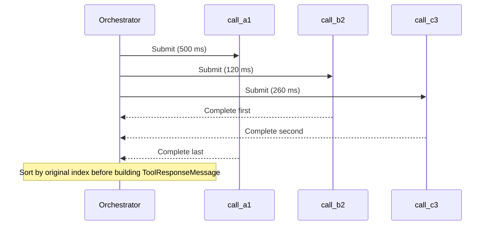

# Giữ đúng liên kết kết quả khi các công cụ hoàn tất khác thứ tự

Một assistant message có thể yêu cầu nhiều công cụ trong cùng một lượt. Nếu ứng dụng thực thi các công cụ đồng thời, thời gian hoàn tất có thể khác với thứ tự mô hình yêu cầu. Công cụ thứ hai có thể trả kết quả trước công cụ thứ nhất. Khi đó, ứng dụng phải giữ liên kết giữa từng kết quả và đúng tool call ban đầu.

Ví dụ, mô hình gọi `getWeather` hai lần: một lần cho Hà Nội và một lần cho Đà Nẵng. Hai lời gọi có cùng tên nhưng có `id` và arguments khác nhau. Nếu kết quả được ghép theo thứ tự hoàn tất hoặc chỉ theo tên tool, nhiệt độ của hai thành phố có thể bị đổi chỗ. Câu trả lời cuối của mô hình khi đó sẽ sai dù cả hai callback đều chạy thành công.

Trong `SPRING_AI_TOOL_CALLING`, mỗi tool call cần được theo dõi như một công việc độc lập có định danh. Khi thu thập kết quả, giữ nguyên `id`, `name` và vị trí ban đầu của call. Chỉ tạo `ToolResponseMessage` sau khi đã ghép đúng từng kết quả với call tương ứng.

## 1. Vì sao thứ tự hoàn tất không phải thứ tự yêu cầu?

Giả sử model trả về ba tool call theo thứ tự:

| Vị trí ban đầu | Tool call ID | Tool | Arguments |
|---:|---|---|---|
| 0 | `call_a1` | `getWeather` | `{"city":"Hà Nội"}` |
| 1 | `call_b2` | `getWeather` | `{"city":"Đà Nẵng"}` |
| 2 | `call_c3` | `getAirQuality` | `{"city":"Hà Nội"}` |

Khi chạy đồng thời, thời gian có thể diễn ra như sau:



Thứ tự hoàn tất là `call_b2`, `call_c3`, `call_a1`, khác với thứ tự ban đầu `call_a1`, `call_b2`, `call_c3`. Thứ tự hoàn tất phản ánh độ trễ của service, mạng và executor. Nó không thay đổi ý nghĩa của tool call do model tạo.

Nếu ứng dụng lấy phần tử thứ nhất trong danh sách kết quả hoàn tất rồi gán cho phần tử thứ nhất trong danh sách tool call, kết quả bị ghép sai. Việc ghép cần dựa trên định danh của call gốc, không dựa trên thời điểm callback trả về.

## 2. Tool call và tool response có định danh tương ứng

Trong Spring AI, `AssistantMessage.ToolCall` chứa các thành phần:

| Trường | Ý nghĩa |
|---|---|
| `id` | Định danh của tool call trong assistant message |
| `type` | Loại tool call do provider trả về |
| `name` | Tên công cụ cần thực thi |
| `arguments` | Chuỗi JSON arguments của lần gọi đó |

`ToolResponseMessage.ToolResponse` chứa ba thành phần:

| Trường | Ý nghĩa |
|---|---|
| `id` | ID của tool call mà response này trả lời |
| `name` | Tên công cụ đã được gọi |
| `responseData` | Nội dung kết quả trả về dưới dạng chuỗi |

Ví dụ:

```java
AssistantMessage.ToolCall call = new AssistantMessage.ToolCall(
        "call_a1",
        "function",
        "getWeather",
        "{\"city\":\"Hà Nội\"}");

ToolResponseMessage.ToolResponse response =
        new ToolResponseMessage.ToolResponse(
                call.id(),
                call.name(),
                "{\"city\":\"Hà Nội\",\"temperatureC\":28}");
```

Điểm liên kết quan trọng là `response.id()` phải trỏ tới `call.id()` mà kết quả đó trả lời. `name` giúp xác định công cụ, nhưng không đủ để ghép kết quả vì một assistant message có thể gọi cùng một tool nhiều lần với arguments khác nhau.

## 3. Không dùng tên tool làm khóa ghép kết quả

Đoạn mã sau không an toàn:

```java
// Không dùng: một tool có thể xuất hiện nhiều lần trong cùng một lượt.
Map<String, String> resultsByToolName = new HashMap<>();
resultsByToolName.put(call.name(), responseData);
```

Hai lần gọi `getWeather` sẽ ghi đè nhau trong map. Khi mô hình yêu cầu cùng một tool cho nhiều thành phố, tài khoản hoặc tài liệu, tên tool không phân biệt được các lần gọi.

Hãy giữ định danh từng lần gọi:

```java
Map<String, ToolResponseMessage.ToolResponse> responsesByCallId =
        new HashMap<>();

responsesByCallId.put(
        call.id(),
        new ToolResponseMessage.ToolResponse(
                call.id(), call.name(), responseData));
```

Nếu cần lưu kết quả theo thứ tự ban đầu, giữ thêm `index` của call trong assistant message. ID là khóa liên kết với protocol; index là khóa sắp xếp cục bộ và là phương án dự phòng khi xử lý dữ liệu đầu vào có ID không hợp lệ.

## 4. ToolResponseMessage giữ danh sách kết quả có thứ tự

Spring AI biểu diễn các kết quả của một lượt bằng `ToolResponseMessage`. Nội dung của message là danh sách các result part theo thứ tự. Mỗi `ToolResponse` mang ID, tên tool và dữ liệu kết quả.

```java
List<ToolResponseMessage.ToolResponse> responses = List.of(
        new ToolResponseMessage.ToolResponse(
                "call_a1", "getWeather", "{\"city\":\"Hà Nội\",\"temperatureC\":28}"),
        new ToolResponseMessage.ToolResponse(
                "call_b2", "getWeather", "{\"city\":\"Đà Nẵng\",\"temperatureC\":30}"));

ToolResponseMessage toolResponseMessage = ToolResponseMessage.builder()
        .responses(responses)
        .build();
```

`ToolResponseMessage.Builder.responses(...)` tạo các text result part theo thứ tự danh sách truyền vào. `getResponses()` và `getResults()` cũng giữ thứ tự các phần tử tương ứng. Vì vậy, sau khi thu thập kết quả đồng thời, ứng dụng nên sắp xếp về thứ tự tool call ban đầu trước khi tạo message.

Lịch sử hội thoại phải giữ assistant message có tool calls, sau đó là tool response message chứa kết quả cho các call đó. Không chèn từng kết quả vào conversation history ngay khi callback hoàn tất, vì như vậy có thể tạo ra message sequence không đúng với lượt tool call mà model đã phát ra.

## 5. Hành vi của DefaultToolCallingManager

Không nên giả định model yêu cầu nhiều tool thì Spring AI sẽ tự thực thi chúng song song. `parallelToolCalls` ở phía model/provider cho phép model phát ra nhiều tool call trong một response; nó không đồng nghĩa ứng dụng đã tạo executor chạy các callback đồng thời.

Trong implementation `DefaultToolCallingManager` hiện hành, danh sách `AssistantMessage.ToolCall` được duyệt bằng vòng `for`, từng callback được thực thi và mỗi kết quả được thêm vào danh sách bằng chính `toolCall.id()` và `toolCall.name()`. Cách làm này thực thi lần lượt theo thứ tự ban đầu, nên không phát sinh đảo thứ tự do callback hoàn tất khác nhau.

Nếu cần tăng thông lượng bằng thực thi song song, ứng dụng phải tự xây orchestration/concurrent executor hoặc tùy biến thành phần thực thi phù hợp với phiên bản Spring AI đang dùng. Khi đó, việc giữ liên kết ID và thứ tự trở thành trách nhiệm của executor đó.

## 6. Chụp metadata của call trước khi đưa vào executor

Ngay khi nhận `AssistantMessage`, hãy tạo một work item chứa đủ thông tin để nhận diện call sau khi tác vụ hoàn tất:

```java
public record ToolCallWorkItem(
        int index,
        String callId,
        String toolName,
        String arguments) {
}

List<AssistantMessage.ToolCall> toolCalls = assistantMessage.getToolCalls();

List<ToolCallWorkItem> workItems = IntStream.range(0, toolCalls.size())
        .mapToObj(index -> {
            AssistantMessage.ToolCall call = toolCalls.get(index);
            return new ToolCallWorkItem(
                    index,
                    call.id(),
                    call.name(),
                    call.arguments());
        })
        .toList();
```

Mỗi work item giữ snapshot của call gốc. Callback không cần tìm ngược trong một biến `currentToolCall` dùng chung. Khi future hoàn tất, metadata đã gắn sẵn với kết quả.

## 7. Thực thi đồng thời nhưng ghép theo ID và index

Ví dụ sau dùng `ExecutorCompletionService` để thu kết quả theo thứ tự hoàn tất, sau đó sắp xếp lại theo index ban đầu. Hàm `executeAndConvert(...)` đại diện cho bước resolve callback, kiểm tra quyền, thực thi và chuyển kết quả thành chuỗi theo chính sách của ứng dụng.

```java
public record IndexedToolOutcome(
        int index,
        String callId,
        String toolName,
        String responseData,
        Exception failure) {
}

public ToolResponseMessage executeConcurrently(
        AssistantMessage assistantMessage,
        ToolContext toolContext,
        ExecutorService executor) throws InterruptedException, ExecutionException {

    List<AssistantMessage.ToolCall> calls = assistantMessage.getToolCalls();
    CompletionService<IndexedToolOutcome> completion =
            new ExecutorCompletionService<>(executor);

    for (int index = 0; index < calls.size(); index++) {
        final int originalIndex = index;
        AssistantMessage.ToolCall call = calls.get(index);

        completion.submit(() -> {
            try {
                String responseData = executeAndConvert(call, toolContext);
                return new IndexedToolOutcome(
                        originalIndex, call.id(), call.name(), responseData, null);
            }
            catch (Exception ex) {
                return new IndexedToolOutcome(
                        originalIndex, call.id(), call.name(), null, ex);
            }
        });
    }

    List<IndexedToolOutcome> completed = new ArrayList<>();
    for (int i = 0; i < calls.size(); i++) {
        completed.add(completion.take().get());
    }

    List<ToolResponseMessage.ToolResponse> orderedResponses = completed.stream()
            .sorted(Comparator.comparingInt(IndexedToolOutcome::index))
            .map(outcome -> new ToolResponseMessage.ToolResponse(
                    outcome.callId(),
                    outcome.toolName(),
                    outcome.failure() == null
                            ? outcome.responseData()
                            : toSafePerCallError(outcome.failure())))
            .toList();

    return ToolResponseMessage.builder()
            .responses(orderedResponses)
            .build();
}
```

Các import và phần resolve callback được lược bỏ để tập trung vào liên kết kết quả. `executeAndConvert(...)` cần dùng đúng `ToolCallback`, `ToolContext`, result converter và error policy của ứng dụng. `toSafePerCallError(...)` chỉ chuyển các lỗi dự kiến, an toàn thành nội dung lỗi theo hợp đồng; lỗi không được phép phục hồi phải được ném lên caller. Ví dụ bắt `Exception`, không bắt `Error`. Trong production, hãy dùng executor có giới hạn thread/queue, deadline và xử lý hủy tác vụ.

Ở đây `completion.take()` trả về future đã hoàn tất sớm nhất. `completed` vì vậy có thể chứa `call_b2` trước `call_a1`. Bước `sorted(...)` khôi phục thứ tự ban đầu trước khi tạo `ToolResponseMessage`. Mỗi result vẫn giữ `callId` và `toolName` gốc, nên cả thứ tự lẫn quan hệ ID đều chính xác.

Nếu không cần thu kết quả theo thời điểm hoàn tất, có thể giữ `CompletableFuture` trong danh sách theo thứ tự submit rồi join theo danh sách đó. Tuy nhiên, vẫn nên gắn ID và index vào từng kết quả thay vì dựa vào vị trí của future một cách ngầm định.

## 8. Dùng ID làm khóa liên kết, index làm khóa sắp xếp

Hai giá trị này giải quyết hai vấn đề khác nhau:

| Giá trị | Dùng để làm gì? | Có gửi lại model không? |
|---|---|---|
| `call.id()` | Liên kết tool response với tool call gốc | Có, trong `ToolResponse.id` |
| `index` | Khôi phục thứ tự model đã yêu cầu | Không, chỉ dùng nội bộ |
| `call.name()` | Xác định callback và ghi metadata | Có, trong `ToolResponse.name` |
| `arguments` | Đầu vào của lần thực thi | Không cần gửi lại như response metadata |

Không tạo một ID mới khi callback hoàn tất. Nếu đổi `call_a1` thành `result_1`, provider không còn cách ghép kết quả với assistant tool call đã phát ra.

Không dùng `index` thay cho `call.id()` trong `ToolResponse` nếu provider đã cấp ID hợp lệ. Index chỉ nên tham gia vào khóa nội bộ như `(assistantMessageId, index)` hoặc `(turnId, index)` để quản lý future và log.

## 9. ID thiếu hoặc trùng: xử lý thận trọng

Một số provider có thể không trả ID hoặc trả ID không duy nhất trong các trường hợp đặc biệt. Spring AI có cơ chế `ToolCallDecisions.toolCallKeys(...)` dùng ID làm key; khi ID thiếu hoặc bị trùng, nó dùng vị trí `#0`, `#1`, ... để định danh quyết định trong reply. Đây là key cho luồng confirmation, không làm thay đổi tool call gốc hoặc tự động biến vị trí thành `ToolResponse.id`.

Với custom executor:

- Luôn giữ `index` nội bộ để phân biệt các call ngay cả khi ID có vấn đề.
- Giữ nguyên assistant message và ID provider đã trả về.
- Không dùng tool name làm fallback vì cùng tên có thể được gọi nhiều lần.
- Nếu adapter/provider yêu cầu ID duy nhất, hãy tuân theo quy tắc chuẩn hóa của adapter ở ranh giới provider; không tự thay ID ở giữa conversation history.
- Kiểm thử trường hợp ID rỗng/trùng theo đúng provider đang tích hợp.

Nếu dùng confirmation, lấy key bằng `ToolCallDecisions.toolCallKeys(assistantMessage)` thay vì tự tạo quy tắc riêng. Khi resume, dùng lại assistant reply gốc với thứ tự tool calls không thay đổi.

## 10. Streaming: không thực thi từ một phần tool call

Khi stream, một số provider gửi `ToolCallPart` theo nhiều delta. Mỗi delta có thể chỉ chứa một phần arguments; tên hoặc ID cũng có thể đến ở các chunk khác nhau. Một fragment riêng lẻ thường chưa phải JSON hợp lệ và không đủ để chạy callback.

Trong Spring AI, các `ToolCallPart` được đánh dấu partial dùng để hiển thị tiến trình. `AssistantMessage.getToolCalls()` và `hasToolCalls()` chỉ xem các tool call hoàn chỉnh; `ToolCallingManager` không thực thi partial part. Khi model phát ra tool call hoàn chỉnh, framework mới có đủ ID, tên và arguments để điều phối.

Ví dụ chỉ hiển thị tiến trình:

```java
chatClient.prompt()
        .user("So sánh thời tiết Hà Nội và Đà Nẵng")
        .tools(weatherTools)
        .stream()
        .chatResponse()
        .subscribe(response -> response.getResults().forEach(generation -> {
            for (MessagePart part : generation.getOutput().getParts()) {
                if (part instanceof ToolCallPart toolCallPart
                        && StreamingParts.isPartial(part)) {
                    AssistantMessage.ToolCall call = toolCallPart.toolCall();
                    ui.showToolProgress(
                            call.id(), call.name(), call.arguments());
                }
            }
        }));
```

UI có thể hiển thị phần arguments đã nhận để người dùng thấy tiến trình, nhưng không được gửi callback chạy trên mỗi delta. Hãy đợi response hoàn chỉnh và dùng `AssistantMessage.ToolCall` đã được tổng hợp.

Nếu ứng dụng tự điều phối streaming, phải tổng hợp các delta thành từng tool call hoàn chỉnh trước, sau đó mới tạo work item và đưa vào executor. Khi tổng hợp, không nối fragments của hai tool call khác nhau chỉ vì chúng đến xen kẽ.

## 11. Chỉ chạy song song các tool call độc lập

Việc model phát nhiều tool call trong một assistant message thường có nghĩa các arguments đã được xác định cùng lúc. Điều đó không chứng minh các thao tác độc lập về nghiệp vụ.

Ví dụ có thể chạy song song:

- Lấy thời tiết Hà Nội và Đà Nẵng.
- Đọc tồn kho của hai SKU độc lập.
- Tìm kiếm tài liệu ở hai nguồn không phụ thuộc nhau.

Ví dụ không nên chạy song song:

- Tạo đơn hàng rồi dùng ID đơn vừa tạo để thanh toán.
- Cập nhật địa chỉ rồi tính phí vận chuyển dựa trên địa chỉ mới.
- Đọc trạng thái giao dịch trước khi một callback khác hoàn tất cập nhật trạng thái đó.

Nếu kết quả tool A là đầu vào cần thiết của tool B, hãy thực hiện A trước. Gửi kết quả A về mô hình để mô hình tạo tool call tiếp theo cho B, hoặc điều phối dependency trong workflow nghiệp vụ riêng. Không giả định thứ tự trong mảng tool calls tạo ra dependency graph cho executor.

## 12. Giữ conversation history thành một batch nhất quán

Sau khi mọi tool call trong lượt đã hoàn tất và được ghép đúng, tạo một `ToolResponseMessage` duy nhất cho batch. Conversation history có dạng:

```text
UserMessage
  └── câu hỏi của người dùng

AssistantMessage
  └── tool calls: call_a1, call_b2, call_c3

ToolResponseMessage
  ├── response id=call_a1
  ├── response id=call_b2
  └── response id=call_c3

AssistantMessage
  └── câu trả lời tiếp theo của mô hình
```

Không thêm một `ToolResponseMessage` cho mỗi callback hoàn tất nếu provider mong đợi một message phản hồi cho cả batch. Không đưa final assistant message vào history trước khi tất cả response của batch đã được ghép. Dùng `ToolExecutionResult.conversationHistory()` của manager khi dùng đường chuẩn của Spring AI; với custom orchestration, giữ cấu trúc message tương đương và đúng protocol provider.

Ví dụ dựng history sau khi đã có `ToolResponseMessage`:

```java
List<Message> nextHistory = new ArrayList<>(prompt.getInstructions());
nextHistory.add(assistantMessage);
nextHistory.add(toolResponseMessage);

Prompt nextPrompt = new Prompt(nextHistory, chatOptions);
ChatResponse nextResponse = chatModel.call(nextPrompt);
```

Đừng append kết quả theo thứ tự hoàn tất vào history rồi mới gọi model. Việc sắp xếp phải xong trước khi history được gửi đi.

## 13. Xử lý lỗi và kết quả từng phần

Thực thi song song có thể có tình huống một tool thành công, một tool thất bại và một tool timeout. Chính sách lỗi cần được xác định trước khi đưa batch vào model.

| Chính sách | Cách xử lý | Khi phù hợp |
|---|---|---|
| Fail batch | Nếu một lỗi không thể phục hồi, không gửi batch thiếu response; propagate lỗi lên caller | Workflow cần tất cả kết quả để tiếp tục |
| Per-call error result | Chuyển lỗi nghiệp vụ đã biết thành response an toàn gắn đúng call ID; các kết quả khác vẫn được giữ | Model có thể tiếp tục với kết quả từng phần |
| Partial result + status | Mỗi call trả success/error/timeout trong một envelope thống nhất | Dashboard, tổng hợp hoặc tìm kiếm nhiều nguồn |

Không được bỏ mất một tool call mà không có quyết định rõ. Nếu chọn per-call error result, response lỗi vẫn phải dùng `id` và `name` của call ban đầu. Nếu chọn fail batch, hãy ghi nhận những tác vụ đã hoàn tất và đảm bảo thao tác ghi có idempotency trước khi retry.

Ví dụ envelope nội bộ:

```java
public record ToolExecutionOutcome(
        int index,
        String callId,
        String toolName,
        String responseData,
        boolean successful,
        String errorCode) {
}
```

`responseData` là nội dung an toàn gửi lại mô hình. `errorCode` phục vụ ứng dụng/observability; không đưa stack trace hoặc exception message nội bộ vào result. Với `Error`, lỗi hạ tầng nghiêm trọng hoặc chính sách `alwaysThrow`, không ép chúng thành business response chỉ để batch tiếp tục.

## 14. Timeout, hủy tác vụ và tác động phụ

Timeout không có nghĩa callback chắc chắn chưa chạy. Một service có thể hoàn tất ghi dữ liệu nhưng phản hồi bị mất trước khi executor nhận được kết quả. Nếu ứng dụng retry ngay, thao tác có thể xảy ra hai lần.

Khi dùng executor đồng thời:

- Đặt deadline tổng cho batch và timeout phù hợp cho từng callback.
- Dùng thread pool có kích thước và queue giới hạn; tránh tạo thread vô hạn.
- Hủy các tác vụ chưa bắt đầu khi request bị hủy, nhưng không giả định interrupt đảo ngược tác động đã thực hiện.
- Dùng idempotency key do server tạo cho các tool ghi dữ liệu.
- Ghi lại trạng thái từng call: submitted, running, succeeded, failed, timed out hoặc cancelled.
- Khi retry, giữ operation ID ổn định và kiểm tra trạng thái giao dịch trước khi thực hiện lại.

Không dùng chung mutable accumulator giữa callback mà không có đồng bộ. Mỗi task nên trả một kết quả bất biến chứa metadata gốc; một thread điều phối duy nhất tổng hợp danh sách cuối.

## 15. ToolContext và callback cần an toàn khi chạy đồng thời

Trong cùng một lượt, các callback có thể nhận cùng một `ToolContext`. Hãy xem context là dữ liệu chỉ đọc. Không thêm `currentToolCallId`, `currentTenant` hoặc kết quả tạm vào map dùng chung giữa các task.

Các điểm cần kiểm tra:

- Callback không lưu arguments hoặc actor của request vào field singleton.
- Service/repository được gọi đồng thời có hỗ trợ concurrency phù hợp.
- Transaction của mỗi tool call độc lập và có phạm vi rõ ràng.
- Authorization được kiểm tra cho từng call, không dùng một cờ `authorized` chung.
- Executor không chia sẻ mutable request object có thể bị thay đổi trong lúc task chạy.
- Nếu một tool dùng tài nguyên không thread-safe, giới hạn concurrency hoặc dùng executor riêng cho tool đó.

Một `ToolContext` không làm callback tự thread-safe. Hãy đánh giá cả các dependency mà callback gọi tới, bao gồm SDK, client HTTP, parser và cache.

## 16. Quan sát và truy vết từng kết quả

Để điều tra kết quả bị ghép sai, log/tracing cần chứa định danh của cả batch và call:

- `conversationId` hoặc request correlation ID.
- `toolCallId` do model cung cấp.
- `toolName` và `originalIndex`.
- Thời điểm submit, start, finish và thời lượng.
- Trạng thái success, error, timeout hoặc cancelled.
- `responseIndex` sau khi sắp xếp để kiểm tra việc khôi phục thứ tự.

Không ghi raw arguments hoặc tool result nếu chúng chứa dữ liệu cá nhân, bí mật hoặc thông tin nghiệp vụ nhạy cảm. Có thể ghi hash hoặc mã định danh tài nguyên đã được làm sạch.

Spring AI cung cấp tool calling observations có thuộc tính tool name, metadata, thời gian thực thi và tool call ID. Khi viết executor riêng, hãy giữ `toolCallId` trong observation context để nối trace của từng callback với lượt model đã tạo ra nó.

## 17. Kiểm thử trường hợp hoàn tất ngược thứ tự

Một test hữu ích cần chủ động tạo thời gian hoàn tất khác nhau. Đừng dựa vào scheduler tự nhiên vì thứ tự có thể thay đổi theo môi trường.

Ví dụ kiểm thử ý tưởng:

```java
@Test
void keepsToolResponsesLinkedWhenCallsFinishOutOfOrder() throws Exception {
    AssistantMessage assistant = AssistantMessage.builder()
            .content("")
            .toolCalls(List.of(
                    new AssistantMessage.ToolCall(
                            "call_a1", "function", "getWeather", "{\"city\":\"Hà Nội\"}"),
                    new AssistantMessage.ToolCall(
                            "call_b2", "function", "getWeather", "{\"city\":\"Đà Nẵng\"}")))
            .build();

    // Fake executor/tool: call_a1 chậm hơn call_b2.
    ToolResponseMessage message = executor.execute(assistant);

    assertThat(message.getResponses())
            .extracting(ToolResponseMessage.ToolResponse::id)
            .containsExactly("call_a1", "call_b2");

    assertThat(message.getResponses())
            .extracting(ToolResponseMessage.ToolResponse::responseData)
            .containsExactly("weather:Hà Nội", "weather:Đà Nẵng");
}
```

Đây là test phác họa; `executor.execute(...)` là adapter của ứng dụng. Bộ test hoàn chỉnh nên dùng `CountDownLatch`, `CompletableFuture` hoặc fake service có delay xác định để chứng minh `call_b2` hoàn tất trước `call_a1`.

Các ca kiểm thử nên có:

| Ca kiểm thử | Kỳ vọng |
|---|---|
| Hai call khác tên hoàn tất ngược thứ tự | Mỗi response giữ đúng ID và result |
| Hai call cùng tên, arguments khác nhau | Không ghi đè kết quả theo tool name |
| Ba call, một call chậm | Kết quả cuối giữ đúng thứ tự ban đầu |
| Một callback trả lỗi nghiệp vụ | Error response vẫn mang ID/name của call đó |
| Một callback timeout | Chính sách partial/fail batch được áp dụng rõ |
| Một task bị cancel | Không ghép nhầm kết quả của task khác |
| ID thiếu hoặc trùng | Index nội bộ phân biệt call; adapter tuân thủ quy tắc provider |
| Streaming partial arguments | Callback chưa chạy trước khi tool call hoàn chỉnh |
| Hai request đồng thời | Không trộn kết quả hoặc context giữa các conversation |
| Retry sau timeout của tool ghi | Idempotency ngăn tác động phụ lặp lại |

## 18. Những lỗi thường gặp

| Sai lầm | Hậu quả | Cách xử lý |
|---|---|---|
| Ghép theo thứ tự future hoàn tất | Kết quả của call sau bị gán cho call trước | Giữ call ID/index và sắp xếp lại |
| Ghép theo tên tool | Hai call cùng tên ghi đè hoặc đổi kết quả | Dùng ID của từng tool call |
| Tạo ToolResponse với ID mới | Provider không ghép được với assistant tool call | Giữ nguyên ID gốc |
| Append ToolResponse ngay khi callback xong | Conversation history bị đảo thứ tự hoặc thiếu batch | Thu thập, sắp xếp rồi tạo message |
| Chạy callback trên partial ToolCallPart | JSON arguments chưa hoàn chỉnh | Chờ AssistantMessage.ToolCall hoàn chỉnh |
| Nghĩ `parallelToolCalls=true` tự tạo thread | Callback có thể vẫn chạy tuần tự | Tự cấu hình executor nếu cần concurrent execution |
| Chạy song song các tool phụ thuộc nhau | Dữ liệu đầu vào hoặc trạng thái không tồn tại đúng lúc | Tách thành các vòng tool call tuần tự |
| Dùng chung mutable result list | Race condition và ghi đè | Task trả immutable result; coordinator tổng hợp |
| Bỏ qua lỗi một future | Model không nhận đủ response hoặc batch bị treo | Áp dụng fail-batch hoặc per-call error policy |
| Retry sau timeout mà không idempotency | Tác động nghiệp vụ bị lặp | Dùng operation ID ổn định và kiểm tra trạng thái |

## 19. Checklist trước khi bật thực thi đồng thời

- Mỗi tool call được chụp `id`, `name`, `arguments` và `index` trước khi submit.
- Mỗi task trả kết quả kèm metadata của call gốc.
- Không ghép kết quả bằng tool name hoặc completion order.
- Kết quả được sắp xếp theo thứ tự call ban đầu trước khi tạo `ToolResponseMessage`.
- Mỗi response giữ nguyên call ID và tool name.
- Có đúng một response cho mỗi tool call theo chính sách thành công/lỗi đã chọn.
- Conversation history chứa assistant tool-call message trước tool response message.
- Chỉ chạy song song các tool độc lập.
- Streaming partial deltas chỉ dùng hiển thị tiến trình; không dispatch callback.
- Executor có giới hạn concurrency, queue, timeout và cancellation policy.
- Callback và dependency của chúng an toàn khi chạy đồng thời.
- ToolContext chỉ được đọc; không dùng mutable state chung giữa request.
- Tool ghi có idempotency và retry policy.
- Test ép hoàn tất ngược thứ tự, call cùng tên, lỗi, timeout và request đồng thời.
- Trace/log giữ tool call ID và index nhưng không lộ arguments nhạy cảm.

## 20. Tài liệu tham khảo

- [Spring AI 2.1 — Tool Calling](https://docs.spring.io/spring-ai/reference/api/tools.html): tool calling loop, streaming tool call arguments, xử lý tool response và quan sát tool call.
- [ToolResponseMessage API](https://docs.spring.io/spring-ai/docs/2.1.x/api/org/springframework/ai/chat/messages/ToolResponseMessage.html): ordered message parts, `getResponses()` và `getResults()`.
- [ToolResponseMessage.ToolResponse API](https://docs.spring.io/spring-ai/docs/2.1.x/api/org/springframework/ai/chat/messages/ToolResponseMessage.ToolResponse.html): trường `id`, `name` và `responseData`; ID là tool call mà response trả lời.
- [AssistantMessage.ToolCall API](https://docs.spring.io/spring-ai/docs/2.1.x/api/org/springframework/ai/chat/messages/AssistantMessage.ToolCall.html): định danh, loại, tên và arguments của một tool call.
- [ToolResponseMessage.Builder API](https://docs.spring.io/spring-ai/docs/2.1.x/api/org/springframework/ai/chat/messages/ToolResponseMessage.Builder.html): cách thêm result parts theo thứ tự.
- [Tool Call Confirmation](https://docs.spring.io/spring-ai/reference/api/tools/tool-call-confirmation.html): cách Spring AI tạo key cho tool calls và yêu cầu giữ nguyên thứ tự reply khi resume.
- [DefaultToolCallingManager source](https://github.com/spring-projects/spring-ai/blob/main/spring-ai-model/src/main/java/org/springframework/ai/model/tool/DefaultToolCallingManager.java): implementation hiện tại duyệt danh sách tool calls và tạo response với ID/name tương ứng.

Khi callback có thể hoàn tất khác thứ tự, hãy gắn mọi kết quả với tool call ID gốc và giữ index để sắp xếp lại. `ToolResponseMessage` phải chứa các kết quả đúng ID, tên và thứ tự trước khi được đưa trở lại mô hình. Đây là điều kiện để tăng concurrency mà không làm sai ý nghĩa của hội thoại.
