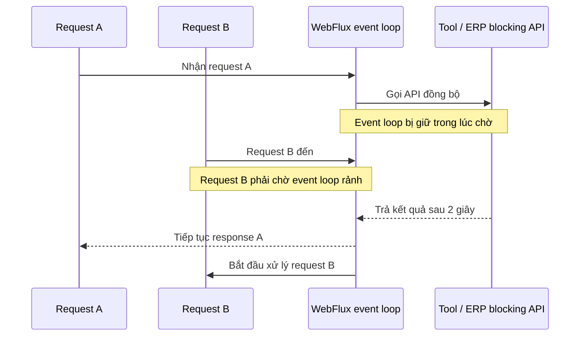
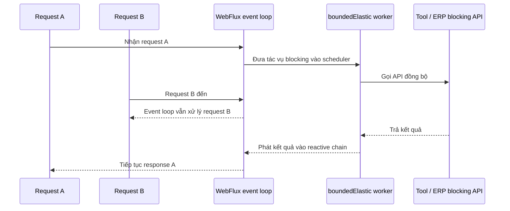

# Không chặn luồng xử lý reactive bằng tác vụ chậm

Trong ứng dụng WebFlux, một request có thể đi qua nhiều bước bất đồng bộ mà không giữ một thread riêng trong suốt thời gian chờ I/O. Các event-loop thread xử lý nhiều kết nối, vì vậy một tác vụ đồng bộ chậm như truy vấn JDBC, gọi HTTP bằng client blocking, đọc file lớn hoặc `Thread.sleep()` có thể làm chậm hàng loạt request khác nếu chạy ngay trên event loop.

Spring AI hỗ trợ cả gọi đồng bộ và streaming bằng Reactor. Tuy nhiên, việc `.stream()` trả về `Flux` không tự biến mọi đoạn code bên trong tool thành non-blocking. Tool callback kiểu `@Tool`/`MethodToolCallback` có hợp đồng thực thi đồng bộ; trong Spring AI 2.1.0, tài liệu lưu ý tool calling là imperative và có thể tạo workflow blocking. Tài liệu 2.1.1-SNAPSHOT mô tả rõ hơn rằng tool đồng bộ được chạy trên Reactor `boundedElastic` trong streaming call. Đây là khác biệt theo phiên bản, cần đối chiếu dependency thực tế trước khi dựa vào chi tiết scheduler.

Bài học này tập trung vào cách nhận diện tác vụ blocking, cách chuyển chúng ra khỏi event loop bằng Reactor, cách dùng `ChatClient` trong WebFlux, và cách thiết kế đường thực thi riêng khi dịch vụ nghiệp vụ đã có API reactive. Mục tiêu là giữ luồng xử lý reactive sẵn sàng nhận request mới trong khi tool đang chờ database, HTTP hoặc một hệ thống bên ngoài.

## 1. Vì sao một tác vụ blocking làm nghẽn WebFlux?

WebFlux thường chạy trên một số lượng nhỏ event-loop thread. Một event loop có thể xử lý I/O của nhiều kết nối vì phần lớn thời gian nó không phải chờ một thread riêng cho từng request. Khi code blocking chạy trên event loop, thread đó không thể xử lý những event khác cho đến khi tác vụ kết thúc.

Ví dụ, một tool gọi dịch vụ ERP mất 2 giây bằng HTTP client đồng bộ. Nếu nó chạy trên event loop, thread có thể không xử lý được request khác trong khoảng 2 giây đó. Khi nhiều tool cùng blocking, số event-loop thread bị giữ tăng lên, làm tăng latency và có thể gây timeout dây chuyền.



Khi chuyển tác vụ blocking sang scheduler chuyên dụng, event loop có thể tiếp tục xử lý request B trong lúc worker thread chờ ERP:



`boundedElastic` không làm lời gọi đồng bộ trở thành non-blocking. Nó dành một worker để chờ lời gọi đó, qua đó giữ event loop không bị chiếm dụng. Cần giới hạn số worker và queue để tải tăng không biến thành hàng đợi vô hạn.

## 2. Nhận diện tác vụ blocking trong tool

Một tool có thể trông rất ngắn nhưng vẫn blocking vì service bên dưới sử dụng API đồng bộ. Hãy kiểm tra toàn bộ call chain từ method `@Tool` đến repository, HTTP client hoặc SDK.

| Tác vụ | Ví dụ blocking thường gặp | Hướng xử lý |
| --- | --- | --- |
| Database | JDBC, `JdbcTemplate`, JPA/Hibernate, `EntityManager` | Chạy trên bounded worker hoặc chuyển sang R2DBC/reactive repository |
| HTTP | `RestTemplate`, `RestClient`, Feign đồng bộ, SDK đồng bộ | Dùng `WebClient`/SDK async hoặc offload lời gọi đồng bộ |
| File | `Files.readAllBytes`, đọc file lớn, thao tác filesystem | Offload I/O; dùng streaming file API khi phù hợp |
| Queue | Consumer/client đồng bộ chờ response | Dùng reactive/async client hoặc worker riêng |
| Java concurrency | `Future.get()`, `CompletableFuture.join()`, `CountDownLatch.await()` | Compose bằng `Mono`/`Flux`, hoặc offload phần blocking |
| Delay | `Thread.sleep()` | Dùng `Mono.delay()` nếu đó là thời gian chờ có chủ đích |
| Reactive sai cách | `.block()`, `.blockFirst()`, `.blockLast()` trên event loop | Trả publisher và compose bằng operator |

Một method không chứa từ khóa `synchronized` vẫn có thể block. Ví dụ `orderRepository.findById(id)` có thể dùng JDBC; `paymentSdk.getStatus(id)` có thể chờ HTTP; `future.join()` có thể chờ một tác vụ khác chưa hoàn thành.

## 3. Phân biệt API đồng bộ, API reactive và streaming của Spring AI

`ChatClient` có hai kiểu gọi chính:

| API | Kiểu kết quả | Đặc điểm |
| --- | --- | --- |
| `.call()` | Kết quả đồng bộ như `String`, `ChatResponse` hoặc entity | Caller chờ cho đến khi model và tool loop hoàn tất |
| `.stream()` | `Flux<String>`, `Flux<ChatResponse>` hoặc `Flux<ChatClientResponse>` | Kết quả được phát dần qua Reactor |

`ChatClient.stream()` giúp phát nội dung model theo dạng stream, nhưng không đảm bảo mọi service do tool gọi đều non-blocking. Tool method vẫn phải tuân thủ hợp đồng của Spring AI.

Với `MethodToolCallback`, các kiểu bất đồng bộ/reactive như `CompletableFuture`, `Future`, `Mono` và `Flux` không được hỗ trợ làm kiểu tham số hoặc giá trị trả về của method tool. Những kiểu này không thể được biểu diễn trực tiếp trong JSON schema mà model hiểu. Do đó, ví dụ sau không phải cách khai báo method tool hợp lệ:

```java
@Tool(description = "Tra cứu đơn hàng")
Mono<OrderStatus> getOrderStatus(String orderId) {
    return orderService.findStatus(orderId);
}
```

Để đưa dịch vụ reactive vào luồng tool calling chuẩn, cần một lớp adapter phù hợp hoặc một bộ điều phối do ứng dụng quản lý. Không trả `Mono`/`Flux` như thể đó là dữ liệu kết quả mà model có thể đọc.

### Khác biệt tài liệu giữa các phiên bản Spring AI

- **Spring AI 1.1.x:** tool execution được tích hợp trong `ChatModel`; ứng dụng reactive cần đặc biệt cẩn trọng vì vòng tool calling là imperative.
- **Spring AI 2.0.x và 2.1.0 stable:** vòng tool calling nằm trong `ToolCallingAdvisor` của `ChatClient`. Tài liệu 2.1.0 ghi nhận tool calling là imperative/blocking workflow; built-in advisors có đường blocking cho `.call()` và đường xử lý non-blocking cho `.stream()`.
- **Spring AI 2.1.1-SNAPSHOT:** tài liệu đang phát triển mô tả rõ rằng tool đồng bộ được chạy trên Reactor `boundedElastic` trong streaming call. Đây là snapshot, chưa phải bản stable; kiểm tra source/Javadoc của phiên bản đang dùng trước khi phụ thuộc vào hành vi này.

Không nên suy ra một cấu hình scheduler có trên mọi builder. Ví dụ, Javadoc `ToolCallingAdvisor.Builder` của Spring AI 2.1.0 liệt kê các cấu hình manager, advisor order, eligibility checker và conversation history; nó không có method `scheduler(...)`. Một advisor khác có thể có scheduler riêng, nhưng không được chép cấu hình của advisor đó sang `ToolCallingAdvisor` nếu API không hỗ trợ.

## 4. Tránh các cách gọi làm blocking xảy ra quá sớm

### Gọi `.call()` trước khi tạo publisher

Đoạn sau gọi model ngay khi method controller chạy, trước khi `Mono` được subscribe:

```java
// Sai trong WebFlux: call() chạy đồng bộ ngay tại thời điểm tạo Mono.
@GetMapping("/answer")
Mono<String> answer(String question) {
    String result = chatClient.prompt()
            .user(question)
            .call()
            .content();

    return Mono.just(result);
}
```

`Mono.just(...)` chỉ bọc một giá trị đã có. Nó không chuyển lời gọi blocking trước đó sang scheduler khác.

### Chặn reactive publisher bằng `.block()`

```java
// Sai nếu được gọi trên event loop.
@Tool(description = "Tra cứu trạng thái đơn hàng")
String getOrderStatus(String orderId) {
    return orderService.findStatusReactive(orderId).block();
}
```

`.block()` chờ publisher hoàn tất trên thread hiện tại. Nếu thread đó là Reactor non-blocking thread, Reactor có thể ném `IllegalStateException`; nếu không, thread vẫn bị giữ trong thời gian chờ.

### Dùng `publishOn` sau lời gọi blocking

```java
// Sai: blocking call đã chạy trước khi publishOn chuyển downstream.
Mono<Order> order = Mono.just(orderRepository.findById(orderId))
        .publishOn(Schedulers.boundedElastic());
```

`publishOn` chuyển việc xử lý các tín hiệu downstream sau vị trí operator. Nó không quay ngược thời gian để chuyển lời gọi `findById` đã chạy ở phía trước.

### Tự subscribe bên trong service

```java
// Không nên: tách subscription khỏi lifecycle của request.
public void notifyAsync(String orderId) {
    notificationService.send(orderId).subscribe();
}
```

Tự gọi `subscribe()` khiến caller khó quản lý lỗi, cancellation, timeout và backpressure. Hãy trả `Mono`/`Flux` để tầng gọi quyết định khi nào subscribe.

## 5. Bọc một lời gọi blocking bằng `Mono.fromCallable`

Khi chưa thể thay JDBC/JPA hoặc SDK đồng bộ, hãy tạo publisher lười bằng `Mono.fromCallable` và đặt `subscribeOn(Schedulers.boundedElastic())` ngay sau nguồn.

```java
import reactor.core.publisher.Mono;
import reactor.core.scheduler.Schedulers;

public Mono<Order> findOrder(String orderId) {
    return Mono.fromCallable(() -> orderRepository.findById(orderId)
                    .orElseThrow(() -> new OrderNotFoundException(orderId)))
            .subscribeOn(Schedulers.boundedElastic());
}
```

`fromCallable` chỉ chạy khi có subscription. `subscribeOn` điều khiển scheduler nơi subscription và nguồn callable bắt đầu chạy. Lời gọi repository được thực hiện trên worker của bounded elastic thay vì event loop.

Không bọc một giá trị đã được tính trước:

```java
// Sai: repository đã chạy trước khi Mono được tạo.
Mono<Order> order = Mono.just(orderRepository.findById(orderId).orElseThrow());

// Đúng: repository chỉ chạy khi có subscription.
Mono<Order> order = Mono.fromCallable(() ->
        orderRepository.findById(orderId).orElseThrow())
    .subscribeOn(Schedulers.boundedElastic());
```

Nếu thao tác trả về nhiều phần tử, dùng `Flux.defer` hoặc `Flux.fromIterable` phù hợp với nguồn dữ liệu. Không dùng `Mono.fromCallable` để trả `null`; Reactor coi kết quả `null` như publisher rỗng. Hãy chuyển trường hợp không tìm thấy thành exception nghiệp vụ hoặc một kiểu kết quả rõ ràng.

## 6. Dùng `subscribeOn` và `publishOn` đúng chỗ

Hai operator đổi execution context ở hai vị trí khác nhau:

| Operator | Ảnh hưởng | Vị trí dùng phổ biến |
| --- | --- | --- |
| `subscribeOn(scheduler)` | Chuyển quá trình subscribe và nguồn phát dữ liệu lên scheduler chỉ định | Ngay sau nguồn blocking được bọc bằng `fromCallable` |
| `publishOn(scheduler)` | Chuyển việc xử lý các tín hiệu downstream kể từ vị trí operator | Sau khi đã nhận dữ liệu, trước một bước xử lý cần scheduler khác |

Ví dụ kết hợp đọc JDBC blocking rồi xử lý CPU:

```java
return Mono.fromCallable(() -> orderRepository.findById(orderId).orElseThrow())
        .subscribeOn(Schedulers.boundedElastic())
        .publishOn(Schedulers.parallel())
        .map(orderMapper::toSummary);
```

Trong ví dụ, repository chạy trên bounded elastic; bước map được chuyển sang scheduler dành cho công việc CPU. Không chuyển tác vụ I/O blocking sang `Schedulers.parallel()` hoặc `Schedulers.single()`.

`publishOn` không phải cách thay thế `subscribeOn` cho nguồn blocking. Đặt operator sai phía nguồn sẽ không giúp event loop tránh được lời gọi blocking.

## 7. Đưa lời gọi ChatClient đồng bộ ra khỏi event loop

Nếu ứng dụng cần dùng `.call()` trong endpoint WebFlux, bọc toàn bộ workflow imperative bằng `Mono.fromCallable` và offload nó. Cách này phù hợp khi chấp nhận response một lần và không cần phát token dần.

```java
import org.springframework.ai.chat.client.ChatClient;
import org.springframework.web.bind.annotation.GetMapping;
import org.springframework.web.bind.annotation.RequestParam;
import org.springframework.web.bind.annotation.RestController;
import reactor.core.publisher.Mono;
import reactor.core.scheduler.Schedulers;

@RestController
class BlockingChatController {

    private final ChatClient chatClient;

    BlockingChatController(ChatClient.Builder builder) {
        this.chatClient = builder.build();
    }

    @GetMapping("/ai/answer")
    Mono<String> answer(@RequestParam String question) {
        return Mono.fromCallable(() -> chatClient.prompt()
                        .user(question)
                        .call()
                        .content())
                .subscribeOn(Schedulers.boundedElastic());
    }
}
```

Lời gọi `.call()` cùng tool loop chạy trên worker bounded elastic. Event loop chỉ nhận kết quả khi publisher phát tín hiệu. Cách này có thể dùng như bước chuyển tiếp khi service AI còn imperative, nhưng nó vẫn giữ một worker thread trong toàn bộ thời gian model và tool hoàn tất. Hãy giới hạn concurrency và chuyển dần các I/O service sang API non-blocking khi phù hợp.

Không dùng mẫu này cho một luồng streaming dài nếu mục tiêu là phát dữ liệu theo thời gian thực. Khi cần streaming, dùng `.stream()` và xác minh scheduler của model/advisor/tool theo đúng phiên bản Spring AI.

## 8. Dùng ChatClient.stream trong WebFlux

Với endpoint SSE, trả `Flux` trực tiếp từ `ChatClient.stream()`:

```java
import org.springframework.http.MediaType;
import org.springframework.web.bind.annotation.GetMapping;
import org.springframework.web.bind.annotation.RequestParam;
import reactor.core.publisher.Flux;

@GetMapping(value = "/ai/stream", produces = MediaType.TEXT_EVENT_STREAM_VALUE)
Flux<String> stream(@RequestParam String question) {
    return chatClient.prompt()
            .user(question)
            .stream()
            .content();
}
```

Không gọi `.blockLast()` trong controller. WebFlux sẽ subscribe và ghi các phần tử vào response stream. Nếu có tool call, `ToolCallingAdvisor` điều phối các vòng gọi và chỉ hoàn tất stream khi model trả lời cuối theo cơ chế của phiên bản đang dùng.

### Scheduler của đường streaming

Trong Spring AI 2.1.0 stable, tài liệu ChatClient nói rõ đường advisor streaming dùng các thao tác non-blocking, nhưng tool calling vẫn là một workflow imperative. Trong tài liệu 2.1.1-SNAPSHOT, Spring AI mô tả các tool đồng bộ được chạy trên `Schedulers.boundedElastic()` khi streaming. Hãy xác minh behavior trên đúng artifact đang chạy bằng test thread hoặc BlockHound, thay vì giả định mọi phiên bản đều có cùng cơ chế.

Khi dùng scheduler riêng cho một advisor, chỉ cấu hình nếu builder của chính advisor đó cung cấp API scheduler. Javadoc `ToolCallingAdvisor.Builder` của Spring AI 2.1.0 không liệt kê `scheduler(...)`; không thêm method này vào code dựa trên ví dụ của `MessageChatMemoryAdvisor` hoặc advisor khác.

Nếu đang dùng một bản Spring AI mà tool callback blocking có thể chạy trực tiếp trên thread reactive, hãy chọn một trong các cách sau:

- Dùng bản Spring AI có cơ chế offload tool execution đã được xác nhận.
- Chuyển service tool sang client non-blocking và điều phối reactive ở tầng ứng dụng.
- Tự quản lý vòng tool call bằng một orchestrator reactive thay vì gọi manager đồng bộ trên event loop.
- Tạm thời chạy toàn bộ request imperative `.call()` trên bounded elastic nếu không cần streaming.

Không đặt `.publishOn(Schedulers.boundedElastic())` ở cuối `Flux` rồi cho rằng các callback trước đó tự động được chuyển thread. Operator chỉ ảnh hưởng phần downstream theo vị trí đặt.

## 9. Dùng WebClient hoặc R2DBC để giữ I/O non-blocking

Nếu service đã có API reactive, hãy giữ publisher xuyên suốt tầng service và controller. Ví dụ với `WebClient`:

```java
import org.springframework.stereotype.Service;
import org.springframework.web.reactive.function.client.WebClient;
import reactor.core.publisher.Mono;

@Service
class InventoryClient {

    private final WebClient webClient;

    InventoryClient(WebClient.Builder builder) {
        this.webClient = builder.baseUrl("https://inventory.internal").build();
    }

    Mono<InventoryStatus> findStatus(String sku) {
        return webClient.get()
                .uri("/items/{sku}", sku)
                .retrieve()
                .bodyToMono(InventoryStatus.class);
    }
}
```

Không gọi `.block()` trong service này. Hãy compose publisher bằng `flatMap`, `map`, `zip` hoặc các operator phù hợp.

Ví dụ ghép hai nguồn reactive độc lập:

```java
Mono<OrderOverview> loadOverview(String orderId) {
    Mono<Order> order = orderClient.findOrder(orderId);
    Mono<InventoryStatus> inventory = inventoryClient.findStatusForOrder(orderId);

    return Mono.zip(order, inventory)
            .map(tuple -> new OrderOverview(tuple.getT1(), tuple.getT2()));
}
```

Nếu nguồn trả `Mono<Void>` hoặc có thể hoàn tất rỗng, không dùng `zip` như thể nó luôn phát một giá trị. Với các thao tác chỉ cần hoàn tất, cân nhắc `Mono.when(...)`; với dữ liệu có thể rỗng, xử lý `defaultIfEmpty` hoặc `switchIfEmpty` theo hợp đồng nghiệp vụ.

## 10. Khi tool method đồng bộ nhưng service bên dưới reactive

Một method `@Tool` chuẩn thường trả về dữ liệu đã hoàn tất để Spring AI chuyển thành chuỗi gửi lại model. Không trả publisher như kết quả. Nếu tool method gọi một service reactive, tránh `.block()` trên thread chưa biết scheduler.

Ví dụ thiết kế không phù hợp:

```java
@Tool(description = "Tra cứu tồn kho")
InventoryStatus getInventory(String sku) {
    return inventoryClient.findStatus(sku).block();
}
```

Có hai hướng kiến trúc:

1. **Tool callback đồng bộ:** dùng service đồng bộ và bảo đảm callback được gọi trên worker dành cho blocking. Đây là cách tương thích với `MethodToolCallback`; cần giới hạn thread và thời gian chờ.
2. **Điều phối reactive do ứng dụng sở hữu:** để model trả tool call request, sau đó ứng dụng dispatch tên tool và arguments sang các service `Mono`/`Flux`, đợi publisher hoàn tất bằng operator và tạo tool response cho vòng model kế tiếp. Đây là custom orchestration, không phải method `@Tool` trả `Mono`.

Phác thảo bước dispatch reactive:

```java
import org.springframework.ai.chat.model.ToolContext;
import reactor.core.publisher.Mono;

Mono<String> dispatchReactive(String toolName, String arguments, ToolContext context) {
    return switch (toolName) {
        case "findInventory" -> {
            InventoryRequest request = parseArguments(arguments, InventoryRequest.class);
            authorizationService.assertCanReadInventory(context, request.sku());
            yield inventoryClient.findStatus(request.sku())
                    .map(this::toModelJson);
        }
        case "findOrder" -> {
            OrderRequest request = parseArguments(arguments, OrderRequest.class);
            authorizationService.assertCanReadOrder(context, request.orderId());
            yield orderClient.findOrder(request.orderId())
                    .map(this::toModelJson);
        }
        default -> Mono.error(new UnknownToolException(toolName));
    };
}
```

`parseArguments`, `authorizationService`, `ToolContext`, các DTO và client là thành phần do ứng dụng định nghĩa; `parseArguments` cần chuyển lỗi JSON thành lỗi đầu vào có kiểm soát. Trong một custom loop, ứng dụng cần aggregate response model, xác thực tool name và arguments, gọi `dispatchReactive`, tạo `ToolResponseMessage` gắn đúng tool-call ID, cập nhật conversation history rồi gọi model vòng kế tiếp. Không gọi `ToolCallingManager.executeToolCalls(...)` đồng bộ trên event loop nếu implementation đó thực thi callback blocking.

Khi triển khai custom orchestration, phải giữ các trách nhiệm vốn có của Spring AI: quyền và tenant, tool-call limit, confirmation, error processor, `returnDirect`, quan sát/tracing, thứ tự message và giới hạn số vòng. Custom loop không được bỏ qua kiểm tra quyền chỉ vì dispatch dùng `Mono`.

## 11. Dùng `flatMap` có giới hạn khi gọi nhiều dịch vụ

`flatMap` có thể subscribe nhiều publisher đồng thời. Khi fan-out nhiều lời gọi I/O, đặt giới hạn concurrency thay vì tạo hàng nghìn request cùng lúc.

```java
Flux<InventoryStatus> statuses = Flux.fromIterable(skus)
        .flatMap(inventoryClient::findStatus, 8);
```

Tham số `8` giới hạn số inner publisher đang được subscribe đồng thời. Nếu cần giữ thứ tự đầu vào trong khi vẫn cho phép chạy chồng thời gian, dùng `flatMapSequential`:

```java
Flux<InventoryStatus> statuses = Flux.fromIterable(skus)
        .flatMapSequential(inventoryClient::findStatus, 8);
```

Chọn operator theo yêu cầu:

| Operator | Concurrency | Thứ tự phát kết quả |
| --- | --- | --- |
| `concatMap` | Tuần tự | Giữ thứ tự nguồn |
| `flatMap` | Có thể đồng thời | Theo thứ tự hoàn tất |
| `flatMapSequential` | Có thể đồng thời | Giữ thứ tự nguồn |

Đối với tool call, luôn gắn kết quả với tool-call ID tương ứng. Nếu response của model cần giữ thứ tự danh sách call, dùng `flatMapSequential` hoặc gắn index rồi sắp xếp trước khi tạo tool response.

## 12. Backpressure, queue và giới hạn tài nguyên

Offload blocking work không đồng nghĩa có thể nhận vô hạn công việc. `boundedElastic` có giới hạn worker và queue; scheduler riêng cũng cần giới hạn tương tự.

Các điểm cần thiết kế:

- Giới hạn số tác vụ blocking đang chạy đồng thời.
- Giới hạn queue chờ và xử lý tình huống queue đầy.
- Đặt timeout cho từng dependency và deadline cho toàn request.
- Dùng bulkhead riêng cho database, HTTP API, file I/O hoặc SDK có quota khác nhau.
- Tránh tạo scheduler mới cho từng request; tạo scheduler dùng chung theo vòng đời ứng dụng và dispose khi shutdown.
- Theo dõi queue depth, active workers, task wait time, execution time và rejection count.

Có thể tạo scheduler bounded riêng cho một loại công việc:

```java
import jakarta.annotation.PreDestroy;
import org.springframework.stereotype.Component;
import reactor.core.scheduler.Scheduler;
import reactor.core.scheduler.Schedulers;

@Component
class LegacyErpScheduler {

    private final Scheduler scheduler = Schedulers.newBoundedElastic(
            16, 200, "legacy-erp");

    Scheduler scheduler() {
        return scheduler;
    }

    @PreDestroy
    void shutdown() {
        scheduler.dispose();
    }
}
```

Dùng scheduler này tại nguồn blocking:

```java
Mono<ErpOrder> findLegacyOrder(String id) {
    return Mono.fromCallable(() -> legacyErpClient.findOrder(id))
            .subscribeOn(legacyErpScheduler.scheduler());
}
```

Kích thước `16` worker và queue `200` chỉ là giá trị minh họa. Hãy chọn dựa trên connection pool, quota ERP, latency và tải đo được. Khi queue đầy, publisher có thể báo lỗi từ chối; ứng dụng cần map lỗi quá tải sang phản hồi có thể xử lý, không retry liên tục làm tăng tải.

## 13. Không dùng `parallel()` để thay boundedElastic cho I/O blocking

`Schedulers.parallel()` phù hợp với các phép tính CPU-bound ngắn, không phải nơi chờ JDBC hoặc HTTP đồng bộ. Nếu chạy tác vụ blocking trên scheduler được thiết kế cho công việc non-blocking, Reactor có thể phát hiện và ném lỗi khi code cố block; nếu không phát hiện, các worker hữu hạn vẫn bị chiếm dụng.

```java
// Không phù hợp cho JDBC blocking.
Mono.fromCallable(() -> orderRepository.findById(orderId).orElseThrow())
        .subscribeOn(Schedulers.parallel());

// Phù hợp hơn cho nguồn blocking.
Mono.fromCallable(() -> orderRepository.findById(orderId).orElseThrow())
        .subscribeOn(Schedulers.boundedElastic());
```

Nếu cần tính toán CPU sau khi đọc dữ liệu, chuyển scheduler sau khi I/O đã hoàn tất:

```java
return Mono.fromCallable(() -> orderRepository.findById(orderId).orElseThrow())
        .subscribeOn(Schedulers.boundedElastic())
        .publishOn(Schedulers.parallel())
        .map(this::calculateRiskScore);
```

Không dùng `Schedulers.elastic()` trong code mới; đây là scheduler không giới hạn trước đây và có thể che giấu vấn đề backpressure. `boundedElastic` đặt giới hạn rõ ràng hơn cho tác vụ blocking.

## 14. Timeout, cancellation và side effect

Reactive cancellation dừng subscription hoặc ngừng phát tín hiệu downstream. Nó không đảm bảo một lời gọi JDBC, HTTP hoặc SDK đồng bộ đã bắt đầu sẽ dừng ngay lập tức.

Ví dụ:

```java
import java.time.Duration;

import reactor.core.publisher.Mono;
import reactor.core.scheduler.Schedulers;

return Mono.fromCallable(() -> paymentClient.capture(paymentRequest))
        .subscribeOn(Schedulers.boundedElastic())
        .timeout(Duration.ofSeconds(3));
```

Nếu timeout xảy ra, client có thể ngừng chờ nhưng hệ thống thanh toán vẫn có thể đã xử lý yêu cầu. Với tool có side effect:

- Dùng idempotency key gắn với action/request ID.
- Tra cứu trạng thái trước khi retry một thao tác có kết quả chưa xác định.
- Không giả định cancellation đã rollback giao dịch.
- Dùng timeout của chính HTTP/database client để giới hạn I/O ở tầng thấp.
- Chọn rõ kết quả khi client SSE ngắt kết nối: có tiếp tục tác vụ nghiệp vụ hay hủy nếu an toàn.

Không dùng `timeout()` thay cho timeout của socket hoặc database. Nó giới hạn thời gian chờ của publisher; client blocking bên dưới cũng cần timeout riêng để worker không bị giữ quá lâu.

## 15. Truyền security context và dữ liệu request qua scheduler

Khi chuyển từ event loop sang worker thread, không nên giả định `ThreadLocal` tùy chỉnh sẽ tự được sao chép. Các giá trị như tenant ID, principal, correlation ID hoặc locale cần được truyền qua context có chủ đích.

Với Reactor, dùng `Context` cho dữ liệu gắn với subscription. Với Spring Security reactive, lấy `SecurityContext` từ reactive security context thay vì gọi một API imperative phụ thuộc `ThreadLocal` trên worker thread.

Transaction JDBC/JPA trong Spring thường gắn với thread. Nếu một service blocking cần `@Transactional`, hãy để method service mở transaction bên trong callable đang chạy trên worker; không mở transaction trên event loop rồi chuyển phần truy cập `EntityManager` sang thread khác. Không chia sẻ persistence context hoặc JPA entity manager giữa các worker.

Đối với tool calling, `ToolContext` nên được tạo từ danh tính đã xác thực ở tầng ứng dụng và truyền đúng vào callback. Không lấy principal hoặc tenant từ arguments do model tạo. Khi offload một tác vụ, chỉ truyền các giá trị cần thiết, immutable và có phạm vi request rõ ràng.

Ví dụ truyền correlation ID qua Reactor Context:

```java
Mono<Order> loadOrder(String orderId) {
    return Mono.deferContextual(context -> {
        String correlationId = context.get("correlationId");
        return Mono.fromCallable(() -> orderService.find(orderId, correlationId))
                .subscribeOn(Schedulers.boundedElastic());
    });
}

Mono<Order> request = loadOrder(orderId)
        .contextWrite(context -> context.put("correlationId", correlationId));
```

Nếu cần MDC hoặc tracing context trên worker thread, cấu hình Micrometer Context Propagation/Reactor integration phù hợp với phiên bản Spring Boot và Reactor đang dùng. Không tự lưu dữ liệu người dùng vào field của singleton tool bean.

## 16. Xử lý lỗi trong reactive chain

Một exception phát ra từ publisher trở thành `onError` và kết thúc sequence hiện tại. Dùng operator theo loại lỗi và chính sách phục hồi:

```java
import java.time.Duration;
import java.util.concurrent.TimeoutException;

import reactor.core.publisher.Mono;
import reactor.core.scheduler.Schedulers;

return Mono.fromCallable(() -> legacyClient.findOrder(orderId))
        .subscribeOn(Schedulers.boundedElastic())
        .timeout(Duration.ofSeconds(2))
        .onErrorMap(TimeoutException.class,
                exception -> new DependencyTimeoutException("Order service timeout", exception))
        .onErrorResume(OrderNotFoundException.class,
                exception -> Mono.empty());
```

`onErrorResume` thay thế sequence đã lỗi bằng publisher fallback. Không dùng `onErrorComplete()` hoặc giá trị mặc định để che giấu lỗi nghiệp vụ nếu điều đó khiến model tin rằng tool đã thành công.

Trong tool calling, hãy chuyển lỗi thành một kết quả có cấu trúc hoặc để exception đi đến `ToolExecutionExceptionProcessor` theo chính sách đã thiết kế. Không gửi stack trace, connection string hoặc secret về model.

## 17. Kiểm thử phát hiện blocking

Kiểm thử cần xác nhận publisher không chạy nguồn blocking trên event loop và phản hồi lỗi/cancellation đúng hợp đồng.

### StepVerifier cho wrapper blocking

```java
import org.junit.jupiter.api.Test;
import reactor.core.publisher.Mono;
import reactor.test.StepVerifier;

@Test
void loadsOrderOnBoundedElastic() {
    Mono<Order> result = orderService.findOrder("ORD-10");

    StepVerifier.create(result)
            .expectNextMatches(order -> order.id().equals("ORD-10"))
            .verifyComplete();
}
```

Để kiểm tra thread cụ thể, fake repository có thể ghi lại tên thread:

```java
import static org.assertj.core.api.Assertions.assertThat;

import java.util.concurrent.atomic.AtomicReference;

import reactor.core.publisher.Mono;
import reactor.core.scheduler.Schedulers;
import reactor.test.StepVerifier;

AtomicReference<String> executionThread = new AtomicReference<>();

Mono<String> publisher = Mono.fromCallable(() -> {
    executionThread.set(Thread.currentThread().getName());
    return "ok";
}).subscribeOn(Schedulers.boundedElastic());

StepVerifier.create(publisher)
        .expectNext("ok")
        .verifyComplete();

assertThat(executionThread.get()).contains("boundedElastic");
```

Test cần tránh giả định tên thread là hợp đồng API trong production; mục tiêu là xác nhận nguồn được offload trong test.

### BlockHound

BlockHound có thể phát hiện các lời gọi blocking phổ biến trên thread được đánh dấu non-blocking. Dùng trong test hoặc môi trường phát triển để tìm `.block()`, `Thread.sleep()` và các API blocking vô tình xuất hiện trong reactive pipeline. Khi dùng cùng thư viện bên thứ ba, có thể cần cấu hình allowlist cho các trường hợp đã biết; không allowlist rộng để che lỗi ứng dụng.

### Ma trận test nên có

| Kịch bản | Điều cần xác minh |
| --- | --- |
| Blocking JDBC/SDK được bọc | Nguồn chạy trên bounded worker |
| `.call()` imperative từ WebFlux | Workflow chạy ngoài event loop |
| `.stream()` có tool | Tool execution theo scheduler của phiên bản Spring AI đã khóa |
| WebClient/R2DBC | Không có `.block()` trong service/controller |
| Nhiều request cùng lúc | Event loop tiếp tục nhận request khác khi tool chậm |
| Queue scheduler đầy | Lỗi quá tải được xử lý rõ ràng |
| Timeout | Client không chờ vô hạn; I/O client có timeout riêng |
| Cancellation | Không giả định side effect đã bị rollback |
| Security context | Principal/tenant đúng ở worker và tool callback |
| Lỗi service | `onError` được map theo policy, không bị nuốt |

## 18. Checklist trước khi đưa reactive tool flow lên production

- [ ] Xác định rõ endpoint dùng `.call()` đồng bộ hay `.stream()` reactive.
- [ ] Kiểm tra tool method và mọi service mà nó gọi để tìm JDBC, JPA, HTTP client đồng bộ, filesystem, `.block()`, `.join()` và `Thread.sleep()`.
- [ ] Không trả `Mono`/`Flux`/`Future` từ `MethodToolCallback` như thể model có thể đọc publisher.
- [ ] Bọc nguồn blocking bằng `Mono.fromCallable` và `subscribeOn(boundedElastic)` khi điều phối ở tầng reactive.
- [ ] Không dùng `publishOn` sau nguồn để chữa một lời gọi blocking đã chạy trước đó.
- [ ] Không gọi `.block()` trên event loop và không tự `subscribe()` trong controller/service.
- [ ] Với `.call()` imperative trong WebFlux, offload toàn workflow có chủ đích; ưu tiên API reactive nếu cần streaming.
- [ ] Xác minh hành vi scheduler của tool calling trên đúng phiên bản Spring AI; không lấy hành vi từ snapshot làm cam kết cho bản stable.
- [ ] Giới hạn worker, queue, concurrency, timeout và rate limit theo dependency.
- [ ] Truyền đúng `ToolContext`, principal, tenant và tracing context.
- [ ] Dùng idempotency key cho side effect và xử lý kết quả không xác định sau timeout.
- [ ] Kiểm thử bằng StepVerifier, thread assertions và BlockHound khi phù hợp.

Một ứng dụng reactive không cần loại bỏ mọi thư viện đồng bộ ngay lập tức. Điều quan trọng là biết chính xác nơi blocking xảy ra và đưa nó sang worker có giới hạn, hoặc thay thế bằng API non-blocking. Với Spring AI, cần nhớ tool callback chuẩn vẫn là hợp đồng thực thi đồng bộ; `.stream()` chỉ mô tả cách nhận response của model. Khi kết hợp đúng Reactor scheduler, tool execution, context và timeout, luồng WebFlux có thể tiếp tục phục vụ request khác trong lúc một tool đang chờ hệ thống nghiệp vụ.

## Tài liệu tham khảo

- [Spring AI 2.1 — ChatClient API](https://docs.spring.io/spring-ai/reference/api/chatclient.html)
- [Spring AI 2.1 — Tool Calling](https://docs.spring.io/spring-ai/reference/api/tools.html)
- [Spring AI 2.1 — ToolCallingAdvisor](https://docs.spring.io/spring-ai/reference/api/tools/tool-calling-advisor.html)
- [Spring AI 2.1 — ChatModel Tool Calling](https://docs.spring.io/spring-ai/reference/api/tools/chatmodel-tool-calling.html)
- [Spring AI 2.1 — MethodToolCallback API](https://docs.spring.io/spring-ai/docs/2.1.x/api/org/springframework/ai/tool/method/MethodToolCallback.html)
- [Spring AI 2.1 — ToolCallingAdvisor.Builder API](https://docs.spring.io/spring-ai/docs/2.1.x/api/org/springframework/ai/chat/client/advisor/ToolCallingAdvisor.Builder.html)
- [Spring AI 2.1.1-SNAPSHOT — ChatClient Implementation Notes](https://docs.spring.io/spring-ai/reference/2.1-SNAPSHOT/chatclient/index.html)
- [Project Reactor — FAQ: Wrap a Synchronous, Blocking Call](https://projectreactor.io/docs/core/release/reference/faq.html#faq.wrap-blocking)
- [Project Reactor — Threading and Schedulers](https://projectreactor.io/docs/core/release/reference/coreFeatures/schedulers.html)
- [Project Reactor — Context Propagation](https://projectreactor.io/docs/core/release/reference/advanced-contextPropagation.html)
- [BlockHound](https://github.com/reactor/BlockHound)
