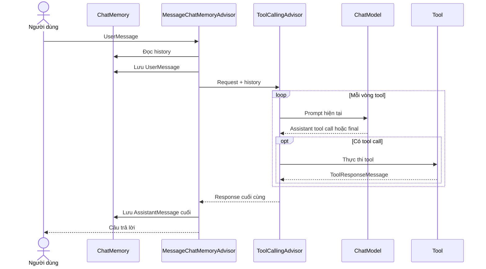
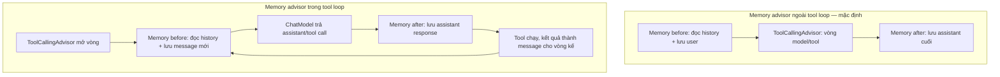

# Ảnh hưởng của vị trí ChatMemory advisor đối với thông điệp được lưu

Trong Spring AI, `MessageChatMemoryAdvisor` vừa đọc lịch sử trước khi gọi mô hình, vừa ghi thông điệp sau khi mô hình phản hồi. Khi ứng dụng bật tool calling, một lượt chat có thể gồm nhiều vòng: assistant yêu cầu gọi tool, tool trả kết quả, mô hình nhận kết quả rồi yêu cầu tool khác hoặc trả lời cuối cùng. Vị trí của memory advisor so với `ToolCallingAdvisor` quyết định advisor có nhìn thấy toàn bộ các vòng trung gian đó hay chỉ nhìn thấy yêu cầu ban đầu và câu trả lời cuối.

Với cấu hình mặc định của Spring AI 2.x, `MessageChatMemoryAdvisor` nằm **bên ngoài** tool loop. Nó lưu user message cuối cùng và assistant message cuối cùng; các assistant tool-call request và `ToolResponseMessage` ở giữa không được ghi vào `ChatMemory`. Nếu đặt advisor **bên trong** loop, nó chạy ở từng vòng và có thể lưu cả tool transcript, nhưng repository phải hỗ trợ các loại message này và internal history của `ToolCallingAdvisor` phải được xử lý đúng để tránh ghi lặp.

## 1. Một lượt tool calling gồm nhiều thông điệp

Giả sử người dùng hỏi trạng thái đơn hàng. Mô hình gọi `findOrder`, nhận kết quả, sau đó gọi `findShipment`, cuối cùng tổng hợp câu trả lời. Lịch sử đầy đủ trong một lượt có thể gồm:

1. `UserMessage`: câu hỏi ban đầu.
2. `AssistantMessage`: yêu cầu gọi `findOrder`.
3. `ToolResponseMessage`: kết quả của `findOrder`.
4. `AssistantMessage`: yêu cầu gọi `findShipment`.
5. `ToolResponseMessage`: kết quả của `findShipment`.
6. `AssistantMessage`: câu trả lời cuối cùng.

Các message ở giữa rất hữu ích khi mô hình cần tiếp tục một lượt nhiều bước. Nhưng không phải mọi memory advisor đều lưu chúng. Cần phân biệt **lịch sử nội bộ của tool loop** với **các message được ghi vào ChatMemoryRepository**: tool loop có thể giữ đủ transcript để hoàn tất request hiện tại trong khi memory chỉ lưu cặp user/assistant cuối cùng cho các request tương lai.



Sơ đồ trên mô tả memory advisor ở ngoài loop, là vị trí mặc định trong Spring AI 2.x. Khi đặt advisor bên trong loop, thao tác đọc/ghi memory diễn ra ở từng vòng thay vì chỉ một lần quanh cả lượt.

## 2. Advisor order quyết định vị trí trong chain

`ChatClient` thực thi advisors theo giá trị `getOrder()`, không theo thứ tự bạn truyền chúng vào `defaultAdvisors(...)` hoặc `.advisors(...)`. Giá trị order nhỏ hơn được chạy trước trên đường request đi tới model và chạy sau cùng trên đường response quay về caller. Chain hoạt động như một stack.

Trong Spring AI 2.x, các giá trị mặc định liên quan là:

| Advisor | Order mặc định | Vai trò |
| --- | --- | --- |
| `MessageChatMemoryAdvisor` | `Ordered.HIGHEST_PRECEDENCE + 200` | Đọc/ghi ChatMemory |
| `ToolCallingAdvisor` | `Ordered.HIGHEST_PRECEDENCE + 300` | Điều phối vòng gọi tool |

Vì `+200` nhỏ hơn `+300`, memory advisor bao quanh tool loop. Nó được gọi một lần trước vòng đầu và một lần sau khi vòng cuối kết thúc. Muốn memory advisor chạy trong loop, đặt order lớn hơn order của `ToolCallingAdvisor`, ví dụ `HIGHEST_PRECEDENCE + 400`.



Đừng suy luận vị trí từ cách viết:

```java
ChatClient.builder(chatModel)
        .defaultAdvisors(memoryAdvisor, anotherAdvisor)
        .build();
```

Framework sắp xếp theo `getOrder()`. Nếu hai advisor có cùng order, thứ tự có thể không xác định. Hãy dùng các giá trị order rõ ràng và kiểm tra chain thực tế khi advisor có quan hệ phụ thuộc.

## 3. Vị trí mặc định: Memory advisor ở ngoài loop

Với Spring AI 2.x, `MessageChatMemoryAdvisor` có order mặc định `HIGHEST_PRECEDENCE + 200`, thấp hơn `ToolCallingAdvisor` (`+300`). Memory advisor:

- Đọc lịch sử một lần trước khi tool loop bắt đầu.
- Thêm lịch sử vào prompt của lượt hiện tại.
- Lưu user message của request.
- Chờ tool loop hoàn thành.
- Lưu assistant message cuối cùng sau khi mô hình trả lời xong.

Nó không nhìn thấy assistant tool-call request hoặc tool response ở các vòng trung gian. Những message này vẫn được `ToolCallingAdvisor` giữ trong conversation history nội bộ để mô hình dùng tiếp trong chính lượt đó.

Ví dụ cấu hình mặc định:

```java
import org.springframework.ai.chat.client.ChatClient;
import org.springframework.ai.chat.client.advisor.MessageChatMemoryAdvisor;
import org.springframework.ai.chat.memory.ChatMemory;

ChatMemory chatMemory = /* repository và memory policy của ứng dụng */;

ChatClient chatClient = ChatClient.builder(chatModel)
        .defaultAdvisors(
                MessageChatMemoryAdvisor.builder(chatMemory).build())
        .build();

String answer = chatClient.prompt()
        .user("Kiểm tra đơn ORD-42 và trạng thái giao hàng.")
        .tools(orderTools)
        .advisors(a -> a.param(ChatMemory.CONVERSATION_ID, conversationId))
        .call()
        .content();
```

Kết quả được lưu có dạng khái quát:

| Thứ tự | Message | Có lưu vào ChatMemory ngoài loop? |
| --- | --- | --- |
| 1 | User hỏi trạng thái đơn | Có |
| 2 | Assistant yêu cầu `findOrder` | Không |
| 3 | Tool trả kết quả `findOrder` | Không |
| 4 | Assistant yêu cầu `findShipment` | Không |
| 5 | Tool trả kết quả `findShipment` | Không |
| 6 | Assistant trả câu trả lời cuối | Có |

Đây là lựa chọn an toàn cho repository chỉ hỗ trợ `UserMessage` và `AssistantMessage` thông thường. Nó cũng giữ memory gọn hơn vì không ghi toàn bộ trao đổi kỹ thuật của tool loop.

## 4. Điều gì xảy ra với tool transcript khi advisor ở ngoài?

`ToolCallingAdvisor` có conversation history riêng trong lúc chạy loop. Khi model trả tool call, manager thực thi tool, thêm tool response vào history rồi gửi history đã cập nhật cho lần gọi model tiếp theo. Vì thế, mô hình vẫn có thể sử dụng kết quả tool trước đó trong cùng request.

Nhưng khi lượt chat kết thúc, `MessageChatMemoryAdvisor` ngoài loop chỉ nhận response cuối cùng. Ở request tiếp theo, nó tải lịch sử từ repository và mô hình chỉ thấy câu hỏi ban đầu cùng câu trả lời cuối, không thấy chi tiết từng tool đã được gọi hoặc kết quả từng tool.

Điều này phù hợp nếu câu trả lời cuối đã tóm tắt đủ thông tin để duy trì hội thoại. Ví dụ, nếu mô hình trả “Đơn ORD-42 đang được giao và dự kiến đến ngày 28/11”, lượt sau có thể tiếp tục từ kết luận đó.

Vị trí ngoài loop có thể không phù hợp khi:

- Lượt sau cần biết chính xác tool nào đã được gọi và với arguments nào.
- Mô hình cần kiểm tra lại kết quả tool trước thay vì tin phần tóm tắt cuối.
- Quy trình cần tiếp tục từ một tool round đã tạm dừng hoặc chờ xác nhận.
- Ứng dụng muốn dùng tool transcript làm dữ liệu kiểm tra hoặc phân tích.

`ChatMemory` được thiết kế để lưu thông tin cần cho ngữ cảnh mô hình, không phải kho audit đầy đủ. Nếu cần lưu mọi event để kiểm toán, hãy dùng event log hoặc conversation history store riêng.

## 5. Đặt Memory advisor bên trong tool loop

Để lưu toàn bộ tool transcript, đặt memory advisor sau `ToolCallingAdvisor` trong advisor chain bằng order lớn hơn `+300`. Khi đó, mỗi lần tool loop gọi lại phần chain bên trong, memory advisor sẽ được chạy lại:

1. Trước mỗi model round, memory advisor tải lịch sử hiện có và bổ sung message mới của vòng đó.
2. Sau mỗi model response, memory advisor lưu assistant message; nếu đó là tool-call request, message assistant chứa tool calls cũng được lưu.
3. Ở vòng kế tiếp, tool response mới nhất được thêm vào memory.
4. Sau vòng cuối, assistant final message được lưu.

Ví dụ:

```java
import org.springframework.ai.chat.client.ChatClient;
import org.springframework.ai.chat.client.advisor.MessageChatMemoryAdvisor;
import org.springframework.ai.chat.memory.ChatMemory;
import org.springframework.core.Ordered;

MessageChatMemoryAdvisor memoryInsideLoop =
        MessageChatMemoryAdvisor.builder(chatMemory)
                .order(Ordered.HIGHEST_PRECEDENCE + 400)
                .build();

ChatClient chatClient = ChatClient.builder(chatModel)
        .defaultAdvisors(memoryInsideLoop)
        .build();

String answer = chatClient.prompt()
        .user("Kiểm tra đơn ORD-42 và trạng thái giao hàng.")
        .tools(orderTools)
        .advisors(a -> a.param(ChatMemory.CONVERSATION_ID, conversationId))
        .call()
        .content();
```

Vì memory advisor ở `+400`, nó nằm sau `ToolCallingAdvisor` ở `+300` và chạy trong loop. `DefaultChatClient` nhận diện `MemoryAdvisor` nằm trong loop và tự tắt internal conversation history của tool advisor được auto-register. Nhờ vậy memory quản lý transcript qua từng vòng mà không bị ghi lặp bởi hai cơ chế history.

Khi tự tạo `ToolCallingAdvisor`, hãy tắt internal history một cách tường minh:

```java
ToolCallingAdvisor toolCallingAdvisor = ToolCallingAdvisor.builder()
        .disableInternalConversationHistory()
        .build();

MessageChatMemoryAdvisor memoryInsideLoop =
        MessageChatMemoryAdvisor.builder(chatMemory)
                .order(Ordered.HIGHEST_PRECEDENCE + 400)
                .build();

ChatClient chatClient = ChatClient.builder(chatModel)
        .defaultAdvisors(toolCallingAdvisor, memoryInsideLoop)
        .build();
```

`disableInternalConversationHistory()` tương đương `conversationHistoryEnabled(false)`. Cấu hình này nói với tool advisor rằng memory advisor trong loop chịu trách nhiệm nạp và lưu history. Nếu bạn tự tạo tool advisor và quên bước này, history có thể bị lặp hoặc được đưa vào chain theo cách không mong muốn.

## 6. So sánh dữ liệu được lưu ở hai vị trí

Giả sử một lượt gọi hai tool tuần tự:

```text
User: Kiểm tra đơn ORD-42 và trạng thái giao hàng.
Assistant: tool call findOrder({orderId: "ORD-42"})
Tool: {status: "PACKED", shipmentId: "SHP-9"}
Assistant: tool call findShipment({shipmentId: "SHP-9"})
Tool: {status: "IN_TRANSIT", eta: "2026-11-28"}
Assistant: Đơn ORD-42 đang được giao, dự kiến đến ngày 28/11.
```

Kết quả trong repository:

| Message | Memory ngoài loop | Memory trong loop |
| --- | --- | --- |
| User question | Lưu | Lưu |
| Assistant tool call `findOrder` | Không lưu | Lưu |
| Tool response từ `findOrder` | Không lưu | Lưu |
| Assistant tool call `findShipment` | Không lưu | Lưu |
| Tool response từ `findShipment` | Không lưu | Lưu |
| Assistant final answer | Lưu | Lưu |

Với memory trong loop, các message trung gian trở thành một phần của ngữ cảnh được nạp cho những request tương lai, tùy theo giới hạn window và repository. Mô hình có thể biết mình đã thử tool nào, đã nhận kết quả gì và vì sao đưa ra kết luận.

## 7. Repository phải hỗ trợ loại message nào?

Đây là điều kiện quan trọng nhất khi đặt `MessageChatMemoryAdvisor` trong loop. Tool transcript không chỉ gồm user và assistant text. Nó có thể gồm:

- `AssistantMessage` chứa tool-call request.
- `ToolResponseMessage` chứa kết quả tool.
- `AssistantMessage` chứa câu trả lời cuối.

Repository phải serialize và khôi phục đúng các kiểu message này. Nếu repository chỉ hỗ trợ user/assistant message thông thường, lưu tool call hoặc tool response có thể thất bại, mất thông tin hoặc tạo lịch sử không hợp lệ với provider.

Theo tài liệu Spring AI, các built-in repository được nêu là hỗ trợ đầy đủ message set để dùng memory advisor bên trong loop gồm:

| Repository | Dùng trong loop với tool messages? |
| --- | --- |
| `InMemoryChatMemoryRepository` | Có |
| `RedisChatMemoryRepository` | Có |
| `Neo4jChatMemoryRepository` | Có |
| Các repository khác | Kiểm tra hỗ trợ cụ thể trước khi dùng |

Đặc biệt, nếu đang dùng JDBC-backed `ChatMemoryRepository`, không nên mặc định rằng nó lưu được tool message. Với JDBC và nhu cầu lưu toàn bộ tool transcript, Session Memory là hướng được Spring AI khuyến nghị.

## 8. Memory ngoài loop phù hợp khi nào?

Chọn vị trí mặc định ngoài loop khi câu trả lời cuối đã đủ để mô hình duy trì hội thoại và bạn muốn repository chỉ lưu user/assistant message thông thường.

Các lợi ích:

- Tương thích với mọi `ChatMemoryRepository` được hỗ trợ cho message thông thường.
- Giảm dung lượng memory và token lịch sử ở các lượt tiếp theo.
- Tránh lưu arguments và kết quả tool chi tiết nếu không cần.
- Giữ tách biệt memory phục vụ hội thoại với log thực thi công cụ.

Ví dụ phù hợp: trợ lý FAQ gọi tool tra cứu giờ mở cửa hoặc thời tiết, sau đó trả một kết luận ngắn. Lượt sau thường chỉ cần kết luận trước đó, không cần toàn bộ JSON của từng tool.

## 9. Memory trong loop phù hợp khi nào?

Chọn memory bên trong loop khi các lượt sau cần biết tool transcript hoặc phải tiếp tục suy luận từ kết quả tool cụ thể.

Các tình huống thường gặp:

- Agent có nhiều bước tra cứu và cần tránh gọi lại các tool đã thử.
- Workflow cần xem lại dữ liệu gốc từ tool trước khi thực hiện hành động tiếp theo.
- Quy trình có pause/confirmation giữa các bước tool.
- Mô hình cần đối chiếu kết quả nhiều tool để phát hiện mâu thuẫn.

Đổi lại, repository cần hỗ trợ tool message, memory tăng nhanh hơn và cần quản lý internal history đúng cách. Không đặt advisor trong loop chỉ vì muốn “lưu được nhiều hơn”; hãy xác định rõ những message nào cần tồn tại cho các lượt sau.

## 10. Vị trí advisor cũng ảnh hưởng các advisor khác

`ToolCallingAdvisor` là recursive advisor: nó gọi lại phần advisor chain bên trong cho mỗi vòng tool. Vì vậy, một advisor đặt trước nó sẽ chạy một lần cho toàn bộ request; advisor đặt sau nó sẽ chạy lại theo từng vòng model/tool.

Ví dụ, `SimpleLoggerAdvisor` với order `0` nằm trong loop mặc định và ghi log từng model request/response. Nếu đặt một advisor logging ở order thấp hơn `ToolCallingAdvisor`, nó có thể chỉ thấy request ban đầu và response cuối. Điều này tương tự với các advisor khác như retrieval, prompt augmentation hoặc policy checks.

| Vị trí | Hành vi | Ví dụ tác động |
| --- | --- | --- |
| Order thấp hơn ToolCallingAdvisor | Ngoài loop, chạy một lần | Nạp memory một lần, ghi kết quả cuối |
| Order cao hơn ToolCallingAdvisor | Trong loop, chạy mỗi round | Nạp memory và ghi từng tool round |
| Cùng order | Thứ tự không xác định | Không nên dựa vào thứ tự thực thi |

Khi phối hợp nhiều advisor, hãy lập sơ đồ order và xác định rõ advisor nào phải nhìn thấy intermediate tool messages. Không chỉ dựa vào thứ tự đăng ký trong builder.

## 11. Khác biệt theo phiên bản Spring AI

Vị trí của ChatMemory advisor thay đổi ý nghĩa theo kiến trúc tool calling của phiên bản:

| Phiên bản | Tool loop nằm ở đâu? | Tác động tới ChatMemory |
| --- | --- | --- |
| Spring AI 1.0.x | Nội bộ `ChatModel` | `MessageChatMemoryAdvisor` ở ChatClient không thể chen vào từng vòng nội bộ; chỉ lưu user và assistant cuối |
| Spring AI 2.0.x | `ToolCallingAdvisor` trong ChatClient advisor chain | Order quyết định memory ở ngoài hay trong loop |
| Spring AI 2.1.0 | Vẫn có cơ chế order của MessageChatMemoryAdvisor, nhưng API này đã deprecated | Nên xem xét chuyển sang Session Memory |

Trong Spring AI 2.0, tool loop trở thành một phần của advisor chain. Default order của ChatMemory advisor được đổi từ `HIGHEST_PRECEDENCE + 1000` thành `+200`, đặt nó ngoài `ToolCallingAdvisor` ở `+300`. Nếu nâng cấp từ phiên bản cũ, hãy kiểm tra lại cấu hình order thay vì giả định memory đang ở vị trí trước đây.

Từ Spring AI 2.1.0, `MessageChatMemoryAdvisor` và `ChatMemory` API bị deprecated để chuyển sang Session Memory, dự kiến loại bỏ ở 3.0.0. Các ví dụ `MessageChatMemoryAdvisor` trong bài này hữu ích để hiểu và duy trì ứng dụng hiện có; với ứng dụng mới, nên cân nhắc Session Memory.

## 12. Session Memory: hướng mới cho tool transcript

Session Memory lưu cuộc hội thoại dưới dạng append-only event log và xây dựng prompt từ một view của log. Nó có khái niệm turn, giữ các tool call và tool result cùng một lượt, đồng thời hỗ trợ compaction theo ranh giới turn để không tách một tool call khỏi kết quả tương ứng.

`SessionAdvisors` tạo hai advisor với vị trí mặc định:

| Advisor | Order mặc định | Vai trò |
| --- | --- | --- |
| `SessionTurnAdvisor` | `HIGHEST_PRECEDENCE + 200` | Bao quanh toàn bộ ChatClient call, xử lý turn và compaction |
| `ToolCallingAdvisor` | `HIGHEST_PRECEDENCE + 300` | Điều phối tool loop |
| `SessionMemoryAdvisor` | `HIGHEST_PRECEDENCE + 1000` | Nạp/lưu message ở từng model round bên trong loop |

Ví dụ cấu hình:

```java
ChatClient chatClient = ChatClient.builder(chatModel)
        .defaultAdvisors(
                SessionAdvisors.builder(sessionService)
                        .build())
        .build();

String answer = chatClient.prompt()
        .user("Kiểm tra đơn ORD-42 và trạng thái giao hàng.")
        .tools(orderTools)
        .advisors(SessionAdvisors.session(sessionId))
        .call()
        .content();
```

`SessionMemoryAdvisor` chạy từng round, lưu user message hoặc tool result và model reply; assistant reply có tool calls cũng được lưu. `SessionTurnAdvisor` chạy một lần cho toàn lượt, xử lý tool result nếu loop kết thúc mà không có model round tiếp theo, ví dụ `returnDirect` hoặc chạm giới hạn tool call, rồi chạy compaction nếu trigger yêu cầu.

Session Memory cũng xử lý tính toàn vẹn của tool transcript: nếu history được lọc khiến assistant tool call không còn tool response tương ứng, advisor có thể loại bỏ phần không hoàn chỉnh khỏi prompt. Cửa sổ history được mở rộng về đầu turn để không tách tool call khỏi kết quả.

## 13. Kiểm thử advisor placement

Đừng chỉ kiểm tra câu trả lời cuối. Hãy xác minh chính xác những message đã được ghi trong repository.

| Kịch bản | Memory ngoài loop | Memory trong loop |
| --- | --- | --- |
| Request không gọi tool | User + assistant final | User + assistant final |
| Một tool call | User + assistant final | User + assistant tool call + tool result + assistant final |
| Nhiều tool round | User + assistant final | Tất cả assistant tool call/tool result của từng round + final |
| Tool execution lỗi | Theo response cuối của loop | Có thể lưu tool-call request và tool error/result theo processor |
| Repository không hỗ trợ ToolResponseMessage | Vẫn có thể hoạt động | Không phù hợp |
| `returnDirect` | Kiểm tra response thực tế mà advisor ngoài loop nhận được; không giả định nó giống final assistant message do model sinh | Tool loop có thể kết thúc trước model round kế tiếp; cần kiểm thử riêng, còn SessionTurnAdvisor trong Session Memory có cơ chế lưu tool result trực tiếp |

Ví dụ kiểm tra danh sách message sau một lượt có một tool call:

```java
List<Message> messages = chatMemory.get(conversationId);

assertThat(messages)
        .anyMatch(UserMessage.class::isInstance);
assertThat(messages)
        .anyMatch(message -> message instanceof AssistantMessage assistant
                && !assistant.getToolCalls().isEmpty());
assertThat(messages)
        .anyMatch(ToolResponseMessage.class::isInstance);
assertThat(messages)
        .anyMatch(message -> message instanceof AssistantMessage assistant
                && assistant.getToolCalls().isEmpty());
```

Đây là kiểm tra khái niệm; trong test thực tế nên phân biệt assistant tool-call message và assistant final message bằng nội dung/metadata cụ thể, không chỉ dựa vào `getToolCalls().isEmpty()` nếu provider có các dạng message parts khác.

### Ma trận kiểm thử nên có

- [ ] Advisor order được sắp xếp theo `getOrder()`, không theo registration order.
- [ ] Với order mặc định, repository chỉ nhận user message và assistant response cuối.
- [ ] Với order `+400`, repository nhận assistant tool-call message và tool response của từng round.
- [ ] ToolCallingAdvisor auto-registration nhận diện memory advisor trong loop.
- [ ] Khi tự tạo ToolCallingAdvisor, internal history được disable.
- [ ] Repository trong loop serialize/deserialize được `ToolResponseMessage` và tool-call request.
- [ ] `conversationId` được truyền ở mọi request và không trộn các hội thoại.
- [ ] Tool loop nhiều vòng vẫn gửi đủ history cho model ở round kế tiếp.
- [ ] Streaming được aggregate trước khi memory ghi response hoàn chỉnh.
- [ ] `returnDirect`, tool-call limit và lỗi giữa loop được kiểm tra riêng.

## 14. Những lỗi cấu hình thường gặp

| Lỗi | Hậu quả | Cách khắc phục |
| --- | --- | --- |
| Nghĩ `defaultAdvisors(memory, tool)` quyết định thứ tự | Thứ tự thực tế khác mong đợi | Đặt và kiểm tra `getOrder()` |
| Nghĩ memory mặc định lưu tool transcript | Lượt sau không có intermediate tool messages | Đặt advisor trong loop hoặc dùng Session Memory |
| Đặt memory vào loop nhưng repository không hỗ trợ tool messages | Lỗi lưu/đọc hoặc history không hợp lệ | Dùng repository tương thích hoặc Session Memory |
| Tự tạo ToolCallingAdvisor mà không disable internal history | History có thể bị lặp/đưa vào chain hai lần | Gọi `.disableInternalConversationHistory()` |
| Dùng ChatMemory như audit log đầy đủ | Mất message trung gian hoặc bị giới hạn window | Dùng event log/history store riêng |
| Bỏ `conversationId` | Advisor ném `IllegalArgumentException` | Truyền conversation ID ở mọi request |
| Nâng cấp 1.x lên 2.x mà không xem lại order | Vị trí memory thay đổi theo tool advisor | Kiểm tra default order của đúng phiên bản |
| Dùng MessageChatMemoryAdvisor cho dự án mới 2.1+ mà không xem deprecation | Tạo phụ thuộc vào API sắp bị loại bỏ | Cân nhắc Session Memory |

## 15. Checklist lựa chọn vị trí

- [ ] Xác định phiên bản Spring AI đang chạy.
- [ ] Xác định tool loop nằm trong ChatModel hay ToolCallingAdvisor.
- [ ] Xác định lượt sau có cần assistant tool-call và tool-response message hay chỉ cần câu trả lời cuối.
- [ ] Nếu chỉ cần user/final assistant, giữ MessageChatMemoryAdvisor ngoài loop ở order mặc định.
- [ ] Nếu cần tool transcript, đặt memory advisor sau ToolCallingAdvisor bằng order lớn hơn `+300`.
- [ ] Khi memory ở trong loop, xác minh repository hỗ trợ đủ loại tool message.
- [ ] Khi tự tạo ToolCallingAdvisor, tắt internal conversation history.
- [ ] Kiểm tra message window không làm mất phần hội thoại cần thiết.
- [ ] Truyền conversation ID cho mọi request.
- [ ] Nếu dùng Spring AI 2.1+, đánh giá Session Memory thay cho ChatMemory API đã deprecated.
- [ ] Dùng kho lịch sử/audit riêng nếu cần lưu đầy đủ và lâu dài.

## Tài liệu tham khảo

- [Spring AI 2.1 — Tool Calling: Memory and the Tool Loop](https://docs.spring.io/spring-ai/reference/api/tools.html)
- [Spring AI 2.1 — ToolCallingAdvisor](https://docs.spring.io/spring-ai/reference/api/tools/tool-calling-advisor.html)
- [Spring AI 2.1 — ChatClient API và Advisor Configuration](https://docs.spring.io/spring-ai/reference/api/chatclient.html)
- [Spring AI 1.0 — Chat Memory](https://docs.spring.io/spring-ai/reference/1.0/api/chat-memory.html)
- [Spring AI 2.1 — Session Memory](https://docs.spring.io/spring-ai/reference/api/session.html)
- [Spring AI 2.1 — Session Memory trong ChatClient](https://docs.spring.io/spring-ai/reference/api/session/chat-client.html)
- [Spring AI 2.1 — Upgrade Notes](https://docs.spring.io/spring-ai/reference/upgrade-notes.html)

Vị trí của `MessageChatMemoryAdvisor` quyết định memory lưu một cặp user/assistant cuối cùng hay cả chuỗi tool call và tool result. Hãy chọn vị trí dựa trên ngữ cảnh mà lượt sau cần, kiểm tra khả năng lưu message của repository và tránh để hai cơ chế history cùng ghi một transcript. Với Spring AI 2.1.0, Session Memory là hướng thay thế phù hợp hơn khi cần lưu tool transcript theo từng round và quản lý hội thoại theo turn.
