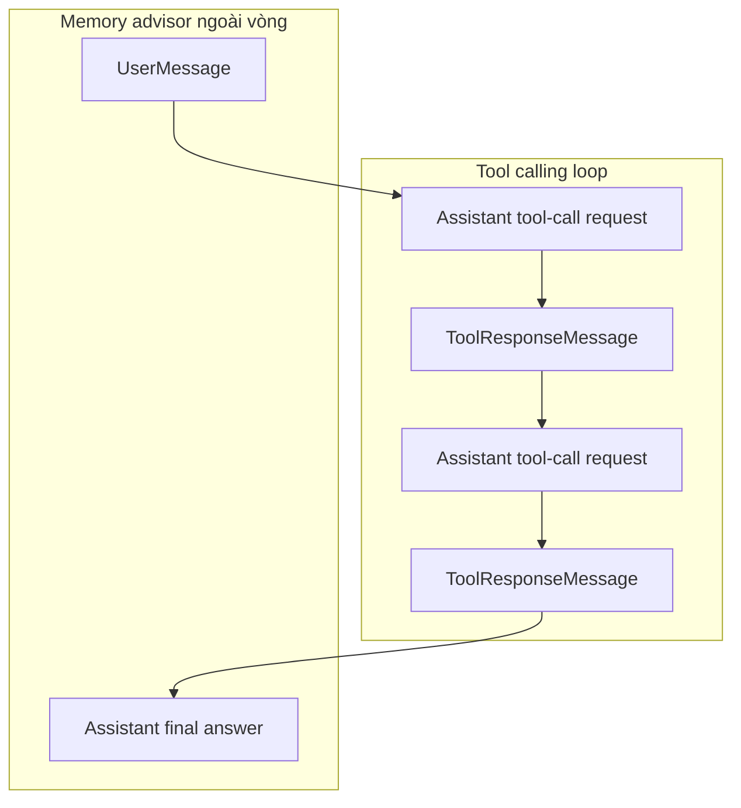

# Tránh nhân đôi lịch sử khi nhiều thành phần cùng quản lý

Trong một ứng dụng Spring AI, lịch sử hội thoại có thể được quản lý bởi `ChatMemory`, memory advisor, vòng tool calling, session memory hoặc chính code điều phối của ứng dụng. Nếu nhiều thành phần cùng đọc, chèn và lưu một bản lịch sử mà không có ranh giới rõ ràng, mô hình có thể nhận một message nhiều lần, tool call bị lặp trong prompt hoặc repository lưu hai bản user/assistant message giống nhau.

Nguyên tắc quan trọng là xác định **một nguồn sở hữu lịch sử cho mỗi phạm vi**. Thành phần nào quản lý transcript của vòng tool calling thì thành phần còn lại chỉ nên xử lý phần lịch sử thuộc phạm vi của nó. Khi dùng memory advisor, đừng đồng thời tự nạp cùng lịch sử vào prompt hoặc tự append lại những message mà advisor đã lưu.

## Phân biệt conversation history, memory và repository

Các tên gọi thường được dùng gần nhau nhưng đảm nhiệm những việc khác nhau:

| Thành phần | Trách nhiệm | Có tự quyết định prompt chứa gì không? |
| --- | --- | --- |
| Conversation history | Chuỗi message theo thứ tự: user, assistant, tool call và tool response | Là dữ liệu đầu vào có thể được dùng để dựng prompt. |
| `ChatMemory` | Chọn và quản lý phần lịch sử cần giữ cho hội thoại | Có, thông qua việc lấy/lọc message. |
| `ChatMemoryRepository` | Lưu và truy xuất message theo conversation ID | Không; repository chủ yếu đảm nhiệm persistence. |
| Memory advisor | Đọc memory, đưa message vào request và lưu kết quả sau khi gọi model | Có; advisor quyết định lúc nào history được nạp và lưu. |
| `ToolCallingAdvisor` | Điều phối các vòng model/tool call và giữ transcript trung gian trong vòng lặp | Có; mặc định nó giữ lịch sử của các iteration. |
| Session memory | Lưu event theo session và dựng một view lịch sử theo turn | Có; session advisor đưa view phù hợp vào từng model call. |
| Code điều phối của ứng dụng | Có thể tự tải, ghép và lưu message | Có nếu ứng dụng chủ động quản lý prompt và persistence. |

Repository không phải một memory advisor thứ hai. Có thể dùng một repository làm backend cho một `ChatMemory`; điều cần tránh là vừa để advisor lưu message vừa tự gọi API memory/repository để append lại đúng message đó.

## Xác định message nào đang được quản lý ở đâu

Một vòng tool calling có thể tạo ra các message trung gian:

1. `UserMessage` chứa yêu cầu ban đầu.
2. `AssistantMessage` chứa tool call request từ mô hình.
3. `ToolResponseMessage` chứa kết quả từ callback.
4. Một `AssistantMessage` khác có thể tiếp tục yêu cầu tool.
5. Cuối cùng là `AssistantMessage` chứa câu trả lời hoàn chỉnh.

Khi mô hình gọi nhiều công cụ, chuỗi này có thể lặp lại nhiều lần trước câu trả lời cuối. Thành phần nằm ngoài vòng lặp thường chỉ nhìn thấy yêu cầu đầu vào và kết quả cuối; thành phần nằm trong vòng lặp có thể nhìn thấy từng tool call và tool response.



Nếu memory advisor ở ngoài vòng, nó không lưu transcript tool trung gian. Nếu memory advisor ở trong vòng, nó có thể lưu cả tool call request và tool response. Cả hai cách đều hợp lệ; vấn đề xuất hiện khi hai thành phần cùng cố làm chủ cùng một chuỗi message.

## Spring AI 1.x: tool loop nằm trong ChatModel

Trong Spring AI 1.x, vòng thực thi tool nằm bên trong `ChatModel` thông qua `ToolCallingManager`. `ChatClient` advisor chain bao quanh một lần gọi model đã bao gồm toàn bộ vòng tool execution. Vì vậy, `MessageChatMemoryAdvisor` chỉ nhìn thấy request trước khi vòng bắt đầu và response cuối sau khi vòng hoàn tất.

Đây là lý do memory advisor mặc định của 1.x không lưu các tool call request và tool response trung gian. Nếu ứng dụng dùng `MessageChatMemoryAdvisor`, hãy để advisor quản lý việc đọc và ghi lịch sử user/assistant; không tự append lại cùng hai message sau `.call()`.

Nếu cần lưu toàn bộ tool transcript trong 1.x, ứng dụng phải chuyển sang user-controlled tool execution hoặc xây dựng cơ chế điều phối riêng để nhận từng kết quả. Khi đó hãy chọn một nơi duy nhất để ghi message: memory advisor hoặc code điều phối thủ công. Không bật cả hai cho cùng một conversation.

## Spring AI 2.0: hai cách đặt memory quanh ToolCallingAdvisor

Từ Spring AI 2.0, `ToolCallingAdvisor` quản lý vòng tool calling trong advisor chain. Mặc định advisor này giữ lịch sử đầy đủ bên trong vòng lặp: user message, assistant tool-call request, tool response và các phản hồi mô hình tiếp theo.

`ToolCallingAdvisor.DEFAULT_ORDER` mặc định là `Ordered.HIGHEST_PRECEDENCE + 300`. `MessageChatMemoryAdvisor` mặc định có order `Ordered.HIGHEST_PRECEDENCE + 200`, vì vậy memory nằm **ngoài** vòng tool calling.

| Vị trí | Memory advisor | ToolCallingAdvisor | Lịch sử được quản lý như thế nào? |
| --- | --- | --- | --- |
| Ngoài vòng (mặc định) | Order nhỏ hơn `+300`, thường `+200` | Giữ internal history | Memory nạp một lần và lưu user/final assistant; tool advisor giữ các message trung gian. |
| Trong vòng | Order lớn hơn `+300`, ví dụ `+400` | Tắt internal history | Memory advisor quản lý lịch sử ở từng iteration, bao gồm tool call và tool response. |

Không nên bật đồng thời internal history của `ToolCallingAdvisor` và một memory advisor nằm trong vòng. Khi đó hai thành phần cùng đưa transcript vào các lượt model tiếp theo, có thể tạo message lặp hoặc prompt phình to.

## Cách 1: để memory ở ngoài vòng lặp

Đây là lựa chọn đơn giản và an toàn cho hầu hết ứng dụng. Memory advisor nạp lịch sử một lần trước khi tool loop bắt đầu và lưu user message cùng assistant response cuối khi vòng kết thúc. `ToolCallingAdvisor` tự giữ transcript trung gian trong request hiện tại.

```java
import org.springframework.ai.chat.client.ChatClient;
import org.springframework.ai.chat.client.advisor.MessageChatMemoryAdvisor;
import org.springframework.ai.chat.memory.ChatMemory;
import org.springframework.ai.chat.model.ChatModel;
import org.springframework.context.annotation.Bean;
import org.springframework.context.annotation.Configuration;

@Configuration
class ChatClientConfiguration {

    @Bean
    ChatClient chatClient(ChatModel chatModel, ChatMemory chatMemory) {
        var memoryAdvisor = MessageChatMemoryAdvisor.builder(chatMemory)
                // Mặc định +200: nằm ngoài ToolCallingAdvisor (+300).
                .build();

        return ChatClient.builder(chatModel)
                .defaultAdvisors(memoryAdvisor)
                .build();
    }
}
```

Mỗi request phải truyền conversation ID để memory biết lịch sử nào cần đọc và ghi:

```java
import org.springframework.ai.chat.memory.ChatMemory;

String answer = chatClient.prompt()
        .user("Kiểm tra trạng thái đơn hàng ORD-1001.")
        .tools(orderTools)
        .advisors(a -> a.param(ChatMemory.CONVERSATION_ID, conversationId))
        .call()
        .content();
```

Trong cấu hình này:

- Memory advisor tải lịch sử đã lưu trước khi bắt đầu vòng tool calling.
- ToolCallingAdvisor giữ các tool call request và tool response trong nội bộ vòng lặp.
- Khi vòng hoàn tất, memory advisor lưu user message và assistant response cuối.
- Repository không cần lưu các message tool trung gian.

Không gọi thêm `chatMemory.add(conversationId, ...)` trong controller/service cho cùng user message và final assistant message. Nếu làm vậy, lần gọi tiếp theo có thể nạp hai bản giống nhau.

## Cách 2: đưa memory vào trong vòng lặp

Chỉ chọn cách này khi ứng dụng thực sự cần lưu transcript tool đầy đủ để các request sau xem lại công cụ đã được gọi và kết quả từng bước. Đặt memory advisor sau `ToolCallingAdvisor`, nghĩa là order lớn hơn `+300`, ví dụ `+400`.

Khi memory nằm trong vòng, cần tắt internal conversation history của `ToolCallingAdvisor` để chỉ còn memory advisor quản lý lịch sử giữa các iteration.

```java
import org.springframework.ai.chat.client.ChatClient;
import org.springframework.ai.chat.client.advisor.MessageChatMemoryAdvisor;
import org.springframework.ai.chat.client.advisor.ToolCallingAdvisor;
import org.springframework.ai.chat.memory.ChatMemory;
import org.springframework.ai.chat.model.ChatModel;
import org.springframework.core.Ordered;

var toolCallingAdvisor = ToolCallingAdvisor.builder()
        .advisorOrder(Ordered.HIGHEST_PRECEDENCE + 300)
        .disableInternalConversationHistory()
        .build();

var memoryAdvisor = MessageChatMemoryAdvisor.builder(chatMemory)
        .order(Ordered.HIGHEST_PRECEDENCE + 400)
        .build();

ChatClient chatClient = ChatClient.builder(chatModel)
        .defaultAdvisors(toolCallingAdvisor, memoryAdvisor)
        .build();
```

Request vẫn phải truyền đúng conversation ID:

```java
String answer = chatClient.prompt()
        .user("Tìm các đơn hàng trễ và kiểm tra tồn kho.")
        .tools(orderTools, inventoryTools)
        .advisors(a -> a.param(ChatMemory.CONVERSATION_ID, conversationId))
        .call()
        .content();
```

Khi memory advisor chạy trong vòng:

- Nó được gọi ở mỗi lần model iteration.
- Tool call request và tool response có thể được lưu trong memory.
- Lượt tiếp theo đọc transcript đã được cập nhật từ memory.
- `ToolCallingAdvisor` chỉ chuyển system message và tool response mới nhất xuống advisor chain; memory advisor nạp phần lịch sử trước đó từ repository. Vì vậy không có một bản internal history thứ hai được gửi kèm.

### Khi nào phải gọi disableInternalConversationHistory()?

Nếu tự tạo `ToolCallingAdvisor` như ví dụ trên, hãy gọi `.disableInternalConversationHistory()` một cách tường minh. Nếu để `ChatClient` tự đăng ký `ToolCallingAdvisor`, `DefaultChatClient` nhận diện một `MemoryAdvisor` nằm bên trong vòng và tự tắt internal history.

Custom memory advisor không kế thừa `BaseChatMemoryAdvisor` cần triển khai marker interface `MemoryAdvisor` để `DefaultChatClient` nhận diện đúng. Nếu advisor tùy chỉnh chỉ implements `CallAdvisor` mà không khai báo marker, auto-registration có thể không biết advisor đó đang quản lý history; khi đó hãy tự cấu hình `ToolCallingAdvisor` và tắt internal history.

Không đăng ký thêm một `ToolCallingAdvisor` thứ hai nếu `ChatClient` đã tự động đăng ký. `ToolCallingAdvisor` là thành phần sở hữu vòng tool calling; chain chỉ nên có một `ToolAdvisor`.

## Repository phải hỗ trợ tool messages nếu memory nằm trong vòng

Không phải `ChatMemoryRepository` nào cũng lưu được toàn bộ message của tool calling. Repository cần serialize và khôi phục được:

- `AssistantMessage` có tool-call content.
- `ToolResponseMessage` chứa kết quả của callback.
- Thứ tự message giữa assistant tool call và tool response.

Nếu repository chỉ hỗ trợ user/assistant text đơn giản, đưa memory vào trong vòng có thể làm mất tool transcript hoặc không thể dựng lại prompt hợp lệ. Tài liệu Spring AI 2.0.2 nêu `InMemoryChatMemoryRepository` làm ví dụ repository có thể lưu tool-call messages. Một số implementation khác cũng có thể hỗ trợ, nhưng hãy xác nhận khả năng serialize và khôi phục `AssistantMessage` có tool calls cùng `ToolResponseMessage` trước khi chuyển memory vào trong vòng.

Với memory ngoài vòng, hạn chế này không ảnh hưởng vì repository chỉ nhận user message và assistant response cuối. Đây là một lý do quan trọng để giữ cấu hình mặc định nếu không có yêu cầu lưu tool transcript.

## Tránh ghi cùng message từ memory advisor và code ứng dụng

Một nguồn trùng phổ biến là controller/service vừa gọi `ChatClient` có memory advisor, vừa tự thêm message vào `ChatMemory`:

```java
import org.springframework.ai.chat.memory.ChatMemory;

// Không làm cả hai việc cho cùng một conversation:
String answer = chatClient.prompt()
        .user(userText)
        .advisors(a -> a.param(ChatMemory.CONVERSATION_ID, conversationId))
        .call()
        .content();

// MessageChatMemoryAdvisor đã quản lý user/final assistant message.
chatMemory.add(conversationId, List.of(
        new UserMessage(userText),
        new AssistantMessage(answer)));
```

Đoạn code trên append lại hai message mà advisor đã quản lý. Hãy chọn một trong hai mô hình:

**Advisor quản lý memory:** ứng dụng chỉ truyền conversation ID và nội dung lượt mới; advisor tự nạp và lưu.

**Ứng dụng quản lý thủ công:** không đăng ký memory advisor cho request đó; ứng dụng tự tải history, ghép vào prompt và append kết quả đúng một lần sau khi hoàn tất.

Không trộn hai mô hình trên trong cùng một request.

## Tránh vừa truyền history thủ công vừa dùng memory advisor

Một trường hợp khác là code ứng dụng đã lấy lịch sử từ repository rồi truyền qua `.messages(...)`, trong khi memory advisor cũng tải cùng conversation ID:

```java
import org.springframework.ai.chat.memory.ChatMemory;

// Tránh truyền lại history đã được memory advisor tự nạp.
chatClient.prompt()
        .messages(chatMemory.get(conversationId))
        .user(userText)
        .advisors(a -> a.param(ChatMemory.CONVERSATION_ID, conversationId))
        .call();
```

Khi cả hai nguồn cùng thêm history, prompt có thể chứa message cũ hai lần. Nếu dùng memory advisor, chỉ truyền message mới của lượt hiện tại. Nếu tự dựng toàn bộ prompt từ history, bỏ memory advisor khỏi request đó.

Tương tự, không thêm một memory advisor vào `defaultAdvisors(...)` rồi lại thêm cùng advisor vào `.advisors(...)` ở từng request. Kiểm tra cả advisor mặc định của `ChatClient` lẫn advisor gắn ở cấp request.

## Chỉ dùng một memory advisor cho cùng một lịch sử

`MessageChatMemoryAdvisor` và `PromptChatMemoryAdvisor` có cách đưa dữ liệu vào prompt khác nhau, nhưng nếu cả hai cùng đọc/ghi cùng conversation ID và cùng tập message thì chúng có thể lặp nội dung hoặc lưu trùng. `VectorStoreChatMemoryAdvisor` cũng có thể bổ sung lại nội dung đã được memory advisor khác cung cấp.

Trước khi kết hợp nhiều advisor, xác định rõ vai trò:

- Một advisor quản lý lịch sử hội thoại dạng message.
- Advisor khác chỉ truy xuất tri thức liên quan (RAG) hoặc memory ngữ nghĩa, không append lại toàn bộ transcript.
- Nếu thật sự cần nhiều nguồn memory, hãy định nghĩa phạm vi và nguồn dữ liệu riêng, ví dụ một nguồn cho hội thoại và một nguồn cho tri thức dài hạn.

Không dùng hai advisor như hai bản sao của cùng một conversation log. Nếu một advisor chỉ đọc mà không ghi, hãy xác nhận rõ điều đó trong implementation và kiểm thử số lần message xuất hiện trong prompt.

## Spring AI 2.1: ưu tiên Session Memory

Từ Spring AI 2.1.0, `ChatMemory`, các repository tương ứng và `MessageChatMemoryAdvisor` đã bị deprecated để chuyển sang Session Memory. Session Memory lưu hội thoại dưới dạng append-only event log và dựng một view theo turn để đưa vào prompt. Cách này phù hợp hơn với tool calling vì có thể lưu tool request, tool result và câu trả lời cuối như một phần của cùng turn.

`SessionAdvisors` phối hợp hai advisor với trách nhiệm khác nhau:

| Advisor | Vị trí | Trách nhiệm |
| --- | --- | --- |
| `SessionTurnAdvisor` | Ngoài tool loop, mặc định order `HIGHEST_PRECEDENCE + 200` | Quản lý một lần gọi `ChatClient` như một turn, xử lý kết thúc turn và compaction. |
| `ToolCallingAdvisor` | Ranh giới vòng lặp, mặc định order `HIGHEST_PRECEDENCE + 300` | Thực thi tool calls và điều phối các model iteration. |
| `SessionMemoryAdvisor` | Trong tool loop, mặc định order `HIGHEST_PRECEDENCE + 1000` | Đọc session view và lưu message của từng model round, gồm tool request và tool result. |

Hai session advisor không phải hai bản sao cùng ghi một tập message. `SessionMemoryAdvisor` quản lý message ở từng round; `SessionTurnAdvisor` quản lý ranh giới của một lần gọi và compaction, bao gồm kết quả của vòng kết thúc mà không có model round tiếp theo như `returnDirect`.

### Đăng ký SessionAdvisors một lần

```java
import org.springframework.ai.chat.client.ChatClient;
import org.springframework.ai.chat.model.ChatModel;
import org.springframework.ai.session.SessionService;
import org.springframework.ai.session.advisor.SessionAdvisors;
import org.springframework.context.annotation.Bean;
import org.springframework.context.annotation.Configuration;

@Configuration
class SessionChatClientConfiguration {

    @Bean
    ChatClient chatClient(ChatModel chatModel, SessionService sessionService) {
        return ChatClient.builder(chatModel)
                .defaultAdvisors(SessionAdvisors.builder(sessionService).build())
                .build();
    }
}
```

Mỗi request truyền session ID:

```java
String answer = chatClient.prompt()
        .user("Tra cứu đơn hàng ORD-1001 và kiểm tra trạng thái giao hàng.")
        .tools(orderTools, deliveryTools)
        .advisors(SessionAdvisors.session(sessionId))
        .call()
        .content();
```

Với cấu hình này, không thêm `MessageChatMemoryAdvisor` cho cùng session, không tự gọi `sessionService.appendMessage(...)` để ghi lại message mà `SessionMemoryAdvisor` đã lưu và không tự truyền lại toàn bộ session history qua `.messages(...)`. `SessionAdvisors` đã là điểm tích hợp duy nhất giữa session và `ChatClient`.

`SessionMemoryAdvisor` là memory advisor nằm trong vòng; `ChatClient` nhận diện nó và tắt internal history của `ToolCallingAdvisor` để session trở thành nguồn sở hữu lịch sử. Nếu tự tạo các session advisor riêng lẻ, cần giữ đúng marker interface và order của chúng.

### Session ID phải nhất quán

Một session ID là khóa xác định hội thoại. Nếu memory advisor dùng `conversation-A` nhưng code thủ công append vào `conversation-B`, lịch sử bị chia đôi. Nếu nhiều người dùng không liên quan dùng chung một ID, dữ liệu có thể bị trộn.

- Tạo hoặc xác minh session ID ở tầng ứng dụng.
- Truyền cùng ID trong mọi request thuộc cùng hội thoại.
- Không dùng một ID mặc định toàn cục cho mọi người dùng.
- Không thay ID giữa các advisor trong cùng một request.
- Kiểm tra quyền truy cập session trước khi nạp hoặc ghi history.

Session Memory yêu cầu session ID trên mỗi request; thiếu ID sẽ gây lỗi thay vì tự tạo một session chung. Đây là hành vi bảo vệ ranh giới dữ liệu giữa các hội thoại.

## Không dùng ToolContext làm nơi lưu conversation history

`ToolContext` dành cho dữ liệu nội bộ do ứng dụng cung cấp khi thực thi tool, ví dụ `tenantId`, `userId` hoặc `requestId`. Nó không phải một memory store và không nên chứa toàn bộ conversation history.

Trong các phiên bản mới, cơ chế tự động đưa tool-call history vào `ToolContext` đã bị loại bỏ. Lịch sử thuộc trách nhiệm của advisor/session layer. Tool nên nhận input nghiệp vụ cùng context cần thiết cho lần thực thi, không tự quản lý transcript của hội thoại.

Nếu callback cần biết kết quả của một bước trước, hãy truyền dữ liệu cần thiết một cách tường minh qua arguments hợp lệ hoặc context do ứng dụng tạo, hoặc để model đọc lịch sử thông qua advisor. Đừng sao chép toàn bộ transcript vào `ToolContext` rồi lại đưa transcript đó qua memory advisor.

## Cách tự quản lý history nếu không dùng memory advisor

Một ứng dụng có thể tự quản lý transcript, nhưng khi đó cần sở hữu trọn quy trình:

1. Tải history đúng conversation ID.
2. Thêm message mới của người dùng đúng một lần.
3. Gửi history vào prompt.
4. Thu thập tool call request và tool response nếu ứng dụng tự điều khiển vòng tool calling.
5. Thêm assistant response cuối đúng một lần.
6. Lưu transcript theo đúng thứ tự và ranh giới turn.

Không đăng ký memory advisor cho cùng request nếu code đã làm các bước này. Nếu dùng `ChatClient` tự động thực thi tool loop và không có memory advisor, hãy xác định rõ nơi lấy và lưu các message cuối; muốn lưu từng tool message thì cần một vòng điều phối có thể quan sát từng iteration.

## Kiểm thử để phát hiện lịch sử bị nhân đôi

Đừng chỉ kiểm tra câu trả lời cuối. Hãy kiểm tra các message thực sự được gửi đến model và số lần repository nhận lệnh ghi.

| Kịch bản | Điều cần xác minh |
| --- | --- |
| Memory ngoài vòng | History được đọc một lần; repository chỉ lưu user message và assistant final một lần. |
| Memory trong vòng | Advisor chạy mỗi iteration; ToolCallingAdvisor internal history đã tắt; mỗi tool call/result xuất hiện đúng một lần. |
| Memory advisor + manual `chatMemory.add()` | Test phải phát hiện user/final assistant message bị ghi hai lần. |
| Memory advisor + `.messages(history)` | Test phải phát hiện prompt chứa message cũ hai lần. |
| Hai memory advisor cùng conversation ID | Xác minh chúng không cùng append một message hoặc lặp nội dung trong prompt. |
| Default advisor và request advisor cùng là một instance | Xác minh advisor không bị chạy hai lần. |
| SessionAdvisors | SessionMemoryAdvisor lưu từng round; SessionTurnAdvisor xử lý turn; không có append thủ công trùng. |
| Tool call nhiều vòng | Tool request và tool response giữ đúng thứ tự, không bị mất hoặc lặp. |
| `returnDirect` | Kiểm tra kết quả tool được lưu đúng theo loại memory và phiên bản. |
| Hai session ID khác nhau | Không có message của session này xuất hiện trong prompt session kia. |

Có thể dùng spy hoặc mock cho `ChatMemory`, `ChatMemoryRepository`, `SessionService` và model để đếm số lần `get`, `add`, `appendMessage` cũng như kiểm tra message list trong từng model call.

Ví dụ kiểm tra một user message chỉ được ghi một lần:

```java
verify(chatMemory, times(1)).add(
        eq(conversationId),
        argThat(messages -> messages.stream()
                .filter(UserMessage.class::isInstance)
                .count() == 1));
```

Với memory trong vòng, nên kiểm tra prompt iteration thứ hai có đúng một bản tool-call request và tool response của iteration đầu. Với memory ngoài vòng, kiểm tra repository không nhận tool transcript trung gian và `ToolCallingAdvisor` vẫn gửi chúng đến model trong cùng request.

## Lỗi thường gặp

| Hiện tượng | Nguyên nhân có thể | Cách xử lý |
| --- | --- | --- |
| Mô hình thấy câu hỏi cũ hai lần | Vừa dùng memory advisor vừa truyền toàn bộ history bằng `.messages(...)` | Chỉ dùng một nguồn nạp history. |
| User/final assistant message xuất hiện hai bản trong repository | Memory advisor và controller cùng gọi API ghi | Chọn advisor hoặc code thủ công làm chủ persistence. |
| Tool response bị lặp ở các iteration | Memory nằm trong vòng nhưng ToolCallingAdvisor vẫn giữ internal history | Tắt internal conversation history hoặc dùng auto-registration nhận diện MemoryAdvisor. |
| Tool transcript không được lưu | Memory advisor nằm ngoài vòng | Chuyển memory vào trong vòng nếu repository hỗ trợ tool messages. |
| Repository lỗi khi lưu tool response | Repository không hỗ trợ `AssistantMessage` tool call hoặc `ToolResponseMessage` | Dùng repository hỗ trợ đầy đủ hoặc giữ memory ngoài vòng. |
| Một request có hai vòng tool calling | Tự thêm ToolCallingAdvisor trong khi auto-registration cũng bật | Chỉ để một `ToolAdvisor` sở hữu vòng lặp. |
| Session có message lặp | Vừa dùng `SessionAdvisors` vừa tự append cùng event/message | Để session advisors quản lý message, trừ khi có event riêng không thuộc trách nhiệm của chúng. |
| Lịch sử của hai người dùng bị trộn | Dùng chung conversation/session ID | Tạo ID riêng và kiểm tra quyền truy cập. |
| Tool cố đọc lịch sử từ ToolContext | Nhầm context thực thi với memory | Đọc history ở advisor/session layer; chỉ truyền context ứng dụng cần thiết cho tool. |

## Quy trình chọn một nguồn sở hữu history

1. Xác định phiên bản Spring AI và vị trí vòng tool calling của phiên bản đó.
2. Chọn memory ngoài vòng nếu chỉ cần lưu user message và câu trả lời cuối.
3. Chỉ đưa memory vào trong vòng khi cần lưu tool transcript và repository hỗ trợ các message đó.
4. Nếu memory nằm trong vòng, tắt internal history của ToolCallingAdvisor khi tự tạo advisor; với auto-registration, bảo đảm memory advisor được nhận diện qua marker `MemoryAdvisor`.
5. Không vừa dùng memory advisor vừa tự tải/append cùng conversation history.
6. Dùng một conversation/session ID nhất quán cho toàn bộ thành phần.
7. Với Spring AI 2.1+, ưu tiên `SessionAdvisors` thay cho ChatMemory API đã deprecated.
8. Kiểm thử số lần đọc/ghi, số lần message xuất hiện trong prompt và tính tách biệt giữa các session.

Tránh nhân đôi lịch sử không phải là xóa bớt message một cách tùy ý. Đó là việc xác định rõ ai chịu trách nhiệm nạp, giữ transcript trong vòng tool calling và ghi lại kết quả cuối. Khi mỗi phạm vi chỉ có một nguồn sở hữu, model nhận đúng thứ tự message, repository không lưu trùng và các tool call có thể tiếp tục qua nhiều iteration mà không làm phình hội thoại.

## Tài liệu tham khảo

- [Spring AI 2.0 Reference — Tool Calling và Conversation History](https://docs.spring.io/spring-ai/reference/2.0/api/tools.html)
- [Spring AI 2.0 Reference — Chat Memory](https://docs.spring.io/spring-ai/reference/2.0/api/chat-memory.html)
- [Spring AI 2.0 Upgrade Notes — Memory Advisor Order](https://docs.spring.io/spring-ai/reference/2.0/upgrade-notes.html)
- [Spring AI 2.1 Reference — Session Memory](https://docs.spring.io/spring-ai/reference/api/session.html)
- [Spring AI 2.1 Reference — Session ChatClient Integration](https://docs.spring.io/spring-ai/reference/api/session/chat-client.html)
- [Spring AI 2.1 Reference — Advisors API](https://docs.spring.io/spring-ai/reference/api/advisors.html)
