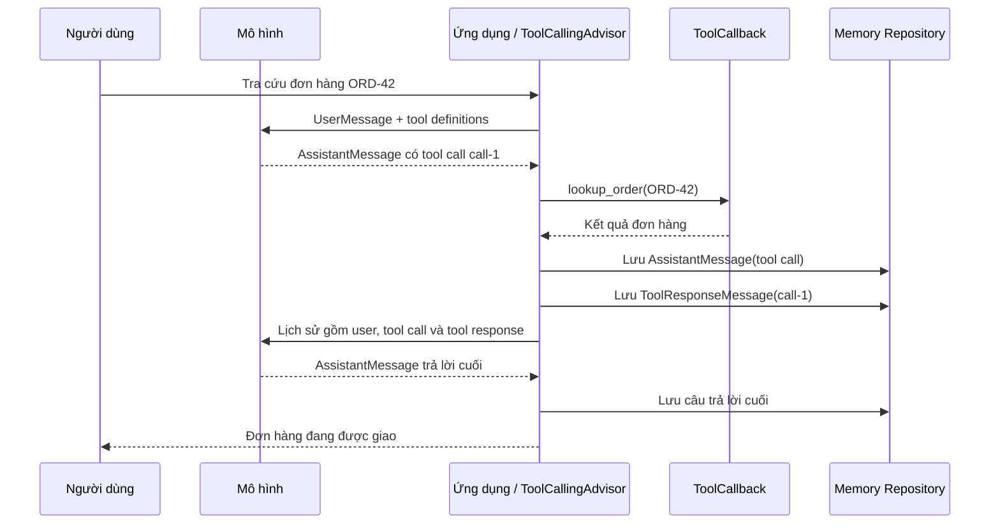
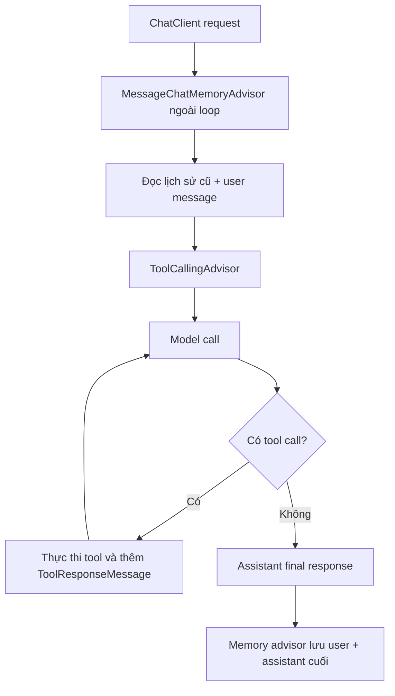

# Khả năng lưu thông điệp công cụ của từng repository

Một lượt hội thoại có tool calling không chỉ gồm câu hỏi của người dùng và câu trả lời của mô hình. Lịch sử còn có thông điệp `AssistantMessage` chứa yêu cầu gọi công cụ và `ToolResponseMessage` chứa kết quả thực thi. Nếu memory advisor lưu toàn bộ lượt gọi công cụ, repository phải tuần tự hóa và khôi phục được cả hai loại thông điệp này, đồng thời giữ đúng thứ tự và ID liên kết.

Không phải `ChatMemoryRepository` nào của Spring AI cũng hỗ trợ đầy đủ. Trong Spring AI 2.1.0, `InMemoryChatMemoryRepository`, `RedisChatMemoryRepository` và `Neo4jChatMemoryRepository` hỗ trợ tập message có tool call; `JdbcChatMemoryRepository`, `CassandraChatMemoryRepository` và `MongoChatMemoryRepository` âm thầm loại bỏ assistant message chứa tool call cùng `ToolResponseMessage` khi lưu. Nếu memory advisor nằm bên trong tool loop, chọn nhầm repository có thể làm lịch sử bị thiếu một nửa mà không có lỗi rõ ràng.

Spring AI 2.1.0 đã đánh dấu `ChatMemory`, `ChatMemoryRepository` và `MessageChatMemoryAdvisor` deprecated để chuyển sang Session Memory. Session Memory lưu sự kiện hội thoại theo dạng event log và JDBC session repository hỗ trợ đầy đủ các loại message, bao gồm tool calls và tool results. Đây là hướng nên chọn cho ứng dụng mới cần lưu bền vững lịch sử tool calling.

Sau bài học, bạn có thể:

- Nhận diện các message tạo nên một lượt tool calling.
- Phân biệt repository lưu đầy đủ tool messages với repository lọc bỏ chúng.
- Hiểu vì sao vị trí của `MessageChatMemoryAdvisor` trong tool loop quyết định repository có cần hỗ trợ tool messages hay không.
- Kiểm tra khả năng round-trip của repository bằng `saveAll` và `findByConversationId`.
- Chọn Session Memory và JDBC session repository trong Spring AI 2.1.0.
- Tránh cắt rời tool call khỏi tool response khi giới hạn cửa sổ hội thoại.

## 1. Một lượt tool calling gồm những message nào?

Khi mô hình quyết định gọi công cụ, nó tạo một `AssistantMessage` có danh sách tool calls. Ứng dụng thực thi từng callback rồi ghi kết quả thành `ToolResponseMessage`. Mô hình nhận lại lịch sử này và có thể trả lời hoặc yêu cầu công cụ khác.

Ví dụ mô hình gọi `lookup_order`:



Một lượt hoàn chỉnh có thể chứa:

| Thứ tự | Message | Nội dung quan trọng |
| ---: | --- | --- |
| 1 | `UserMessage` | Câu hỏi hoặc yêu cầu của người dùng. |
| 2 | `AssistantMessage` | Tool call ID, tên tool, arguments; có thể có nhiều tool call trong một message. |
| 3 | `ToolResponseMessage` | Kết quả tương ứng với từng tool call, thường mang cùng ID và tên tool. |
| 4 | `AssistantMessage` | Câu trả lời sau khi mô hình đọc tool result. |

Nếu mô hình tiếp tục gọi công cụ, các cặp assistant tool call và tool response sẽ xuất hiện thêm trước câu trả lời cuối. Vì vậy, một repository chỉ lưu được text của user và assistant là chưa đủ để tái dựng toàn bộ lượt tool calling.

## 2. Vì sao phải giữ cả tool call và tool response?

`AssistantMessage` chứa tool call ghi lại điều mô hình đã yêu cầu. Mỗi tool call có ID, tên và arguments. `ToolResponseMessage` ghi lại kết quả thực thi và phải khớp với tool call tương ứng.

Ví dụ một assistant message có thể chứa:

```json
{
  "role": "assistant",
  "tool_calls": [
    {
      "id": "call-1",
      "name": "lookup_order",
      "arguments": "{\"orderId\":\"ORD-42\"}"
    }
  ]
}
```

Thông điệp kết quả tương ứng:

```json
{
  "role": "tool",
  "tool_call_id": "call-1",
  "name": "lookup_order",
  "content": "{\"status\":\"SHIPPED\",\"trackingCode\":\"VN123\"}"
}
```

Nếu repository lưu tool response nhưng bỏ assistant tool call, hoặc lưu tool call nhưng bỏ tool response, lịch sử có thể không hợp lệ khi gửi lại cho model provider. Mô hình cũng mất thông tin đã gọi công cụ nào, với arguments nào và kết quả nào đã được nhận.

Trong Spring AI, `AssistantMessage.ToolCall` mang `id`, `type`, `name` và `arguments`. `ToolResponseMessage.ToolResponse` mang `id`, `name` và `responseData`. Ở API message parts của Spring AI 2.1, tool calls và tool results còn được biểu diễn bằng `ToolCallPart` và `ToolResultPart` trong danh sách parts có thứ tự. Repository cần bảo toàn các cấu trúc này, không chỉ ghi lại `getText()`.

## 3. Ma trận hỗ trợ của từng ChatMemoryRepository

Theo tài liệu Spring AI 2.1.0, khả năng lưu tool messages của các repository tích hợp sẵn như sau:

| Repository | Lưu assistant tool call | Lưu `ToolResponseMessage` | Ghi chú |
| --- | --- | --- | --- |
| `InMemoryChatMemoryRepository` | Có | Có | Hỗ trợ đầy đủ; dữ liệu nằm trong bộ nhớ tiến trình và mất khi ứng dụng khởi động lại. |
| `RedisChatMemoryRepository` | Có | Có | Lưu message dạng JSON trên Redis Stack; hỗ trợ TTL và truy vấn nâng cao; repository này deprecated từ 2.1.0. |
| `Neo4jChatMemoryRepository` | Có | Có | Lưu tool call và tool response thành node/relationship riêng trong graph; deprecated cùng ChatMemory API từ 2.1.0. |
| `JdbcChatMemoryRepository` | Không | Không | Các message chứa tool call và `ToolResponseMessage` bị lọc âm thầm khi save. |
| `CassandraChatMemoryRepository` | Không | Không | Các message chứa tool call và `ToolResponseMessage` bị lọc âm thầm khi save. |
| `MongoChatMemoryRepository` | Không | Không | Các message chứa tool call và `ToolResponseMessage` bị lọc âm thầm khi save. |
| `CosmosDBChatMemoryRepository` | Chưa xác nhận | Chưa xác nhận | Module ngoài do Azure Cosmos DB team duy trì; phải kiểm tra đúng phiên bản module. |

“Không hỗ trợ” ở đây không có nghĩa repository không lưu được bất kỳ hội thoại nào. Các repository đó vẫn lưu được message thông thường. Giới hạn nằm ở những message biểu diễn yêu cầu gọi công cụ và kết quả công cụ.

Lưu ý thêm: toàn bộ ChatMemory API và các repository nói trên đã deprecated từ Spring AI 2.1.0 và dự kiến bị loại bỏ ở 3.0.0. Redis và Neo4j vẫn hỗ trợ tool messages ở phiên bản hiện tại, nhưng cần tính đến kế hoạch chuyển sang Session Memory khi chọn kiến trúc dài hạn.

## 4. InMemoryChatMemoryRepository

`InMemoryChatMemoryRepository` dùng `ConcurrentHashMap` để lưu message theo conversation ID. Đây là repository đơn giản cho thử nghiệm, demo hoặc ứng dụng không cần giữ hội thoại sau khi tiến trình dừng.

Repository này hỗ trợ đầy đủ tập message có tool call, nên phù hợp khi đặt `MessageChatMemoryAdvisor` bên trong tool loop.

```java
ChatMemoryRepository repository = new InMemoryChatMemoryRepository();

ChatMemory chatMemory = MessageWindowChatMemory.builder()
        .chatMemoryRepository(repository)
        .maxMessages(30)
        .build();
```

Hạn chế chính là dữ liệu chỉ tồn tại trong instance ứng dụng. Nếu chạy nhiều instance, mỗi instance có vùng nhớ riêng; request tiếp theo có thể không tìm thấy lịch sử đã lưu ở instance khác. Dùng repository này để kiểm tra luồng và test round-trip, không xem nó là kho hội thoại bền vững cho production.

## 5. RedisChatMemoryRepository

`RedisChatMemoryRepository` lưu message thành JSON document bằng Redis Stack, RedisJSON và Redis Query Engine. Repository hỗ trợ đầy đủ tool call messages, sắp xếp message theo thời gian và có thể cấu hình TTL. `AdvancedRedisChatMemoryRepository` còn hỗ trợ tìm kiếm theo nội dung, loại message, khoảng thời gian và metadata.

```java
RedisChatMemoryRepository repository = RedisChatMemoryRepository.builder()
        .jedisClient(redisClient)
        .indexName("chat-memory-index")
        .keyPrefix("chat-memory:")
        .timeToLive(Duration.ofDays(7))
        .build();

ChatMemory chatMemory = MessageWindowChatMemory.builder()
        .chatMemoryRepository(repository)
        .maxMessages(40)
        .build();
```

Redis phù hợp với nhu cầu đọc nhanh, TTL và truy vấn nâng cao, nhưng yêu cầu Redis Stack có Redis Query Engine và RedisJSON. Trong Spring AI 2.1.0, `RedisChatMemoryRepository` cùng auto-configuration đã deprecated và sẽ bị loại bỏ ở 3.0.0; Session Memory chưa có Redis session store trong phiên bản này. Nếu chọn Redis vì tool messages, cần tính trước kế hoạch di chuyển hoặc tự xây `SessionRepository` theo SPI mới.

## 6. Neo4jChatMemoryRepository

`Neo4jChatMemoryRepository` lưu message thành node và relationship trong Neo4j. Khác biệt hữu ích với tool calling là repository có label riêng cho tool call và tool response, bên cạnh node message và metadata:

| Label mặc định | Mục đích |
| --- | --- |
| `Session` | Node đại diện cuộc hội thoại. |
| `Message` | Node chứa message. |
| `ToolCall` | Node lưu yêu cầu tool call trong assistant message. |
| `ToolResponse` | Node lưu kết quả tool. |
| `Metadata` | Node chứa metadata của message. |
| `Media` | Node lưu media liên kết với message. |

Repository trả message theo thứ tự message index tăng dần. Nó hỗ trợ tool call messages, vì vậy có thể dùng với memory advisor bên trong tool loop. Tuy nhiên, ChatMemory API và Neo4j repository đã deprecated từ 2.1.0 để chuyển sang Session Memory. Nếu ứng dụng mới cần graph storage, cần cân nhắc tự triển khai SessionRepository phù hợp thay vì xây mới dựa trên API sắp bị loại bỏ.

## 7. JDBC, Cassandra và MongoDB: message công cụ bị lọc âm thầm

Ba repository này vẫn có thể lưu hội thoại text thông thường, nhưng không lưu được tool call request và tool response trong ChatMemory API tích hợp sẵn.

| Repository | Cách lưu message thông thường | Hành vi với tool message |
| --- | --- | --- |
| `JdbcChatMemoryRepository` | Bảng quan hệ, có `sequence_id` để giữ thứ tự và `timestamp` cho thời điểm tạo. | Bỏ `AssistantMessage` có tool calls và `ToolResponseMessage` khi save. |
| `CassandraChatMemoryRepository` | Bảng time-series, hỗ trợ TTL và sắp xếp theo timestamp. | Bỏ `AssistantMessage` có tool calls và `ToolResponseMessage` khi save. |
| `MongoChatMemoryRepository` | Collection document, sắp xếp theo timestamp, có thể cấu hình TTL index. | Bỏ `AssistantMessage` có tool calls và `ToolResponseMessage` khi save. |

Điểm nguy hiểm là việc lọc diễn ra âm thầm. Lệnh save không nhất thiết ném exception để báo rằng transcript bị thiếu. Khi đọc lại, ứng dụng chỉ thấy user message và assistant text còn lại; các bước gọi công cụ đã biến mất.

Ví dụ, một lượt ban đầu có:

```text
UserMessage: Tra cứu đơn ORD-42
AssistantMessage: gọi lookup_order(call-1, ORD-42)
ToolResponseMessage: call-1 -> SHIPPED
AssistantMessage: Đơn hàng đang được giao
```

Sau khi lưu bằng repository không hỗ trợ tool messages, lịch sử có thể chỉ còn:

```text
UserMessage: Tra cứu đơn ORD-42
AssistantMessage: Đơn hàng đang được giao
```

Người dùng vẫn đọc được câu trả lời cuối, nhưng hệ thống không thể tái dựng đầy đủ cách câu trả lời được tạo ra. Khi mô hình cần tiếp tục dựa trên tool call trước đó, history này cũng không đủ dữ kiện.

## 8. Repository có hỗ trợ tool messages hay không còn phụ thuộc vị trí memory advisor

Không phải request nào dùng tool calling cũng yêu cầu `ChatMemoryRepository` lưu tool messages. Trong Spring AI 2.1.0, `MessageChatMemoryAdvisor` mặc định nằm bên ngoài `ToolCallingAdvisor`:

- `MessageChatMemoryAdvisor` có order `HIGHEST_PRECEDENCE + 200`.
- `ToolCallingAdvisor` có order mặc định `HIGHEST_PRECEDENCE + 300`.
- Advisor memory tải lịch sử một lần trước tool loop và chỉ lưu user message cuối cùng cùng assistant response cuối cùng sau khi loop hoàn tất.
- Nó không nhìn thấy assistant tool call hoặc `ToolResponseMessage` ở các iteration bên trong.

Vì vậy, mặc định an toàn này hoạt động với mọi `ChatMemoryRepository`, kể cả JDBC, Cassandra và MongoDB. Trong tool loop, `ToolCallingAdvisor` tự giữ lịch sử đầy đủ cho các lần gọi mô hình kế tiếp.



Đây là lý do một ứng dụng có thể dùng `JdbcChatMemoryRepository` với tool calling mà vẫn hoạt động bình thường trong cấu hình mặc định. Repository chỉ cần lưu phần hội thoại cuối mà advisor gửi cho nó.

## 9. Khi nào repository bắt buộc phải lưu tool messages?

Nếu đặt `MessageChatMemoryAdvisor` bên trong tool loop, advisor chạy ở mỗi iteration. Nó lưu assistant tool call và tool response để lượt model tiếp theo có thể đọc đầy đủ transcript.

Ví dụ đặt memory advisor ở order `+400`, phía trong `ToolCallingAdvisor`:

```java
ChatMemoryAdvisor memoryAdvisor = MessageChatMemoryAdvisor.builder(chatMemory)
        .advisorOrder(Ordered.HIGHEST_PRECEDENCE + 400)
        .build();

ChatClient chatClient = ChatClient.builder(chatModel)
        .defaultAdvisors(memoryAdvisor)
        .build();
```

Khi đó repository phải hỗ trợ đầy đủ message có tool call. Dùng JDBC, Cassandra hoặc MongoDB ChatMemoryRepository tích hợp sẵn sẽ làm mất tool transcript do các message này bị lọc âm thầm.

Khi có memory advisor bên trong loop, `ToolCallingAdvisor` không nên đồng thời giữ và ghi một bản history riêng. `DefaultChatClient` nhận diện `MemoryAdvisor` bên trong loop và tự tắt internal conversation history. Nếu tự tạo `ToolCallingAdvisor` bằng builder, hãy gọi `.disableInternalConversationHistory()` để tránh hai thành phần cùng quản lý history.

Không thay đổi advisor order chỉ để “lưu được nhiều message hơn”. Chỉ đặt memory bên trong loop khi ứng dụng thực sự cần lưu từng iteration, và phải chọn repository có hỗ trợ tool messages.

## 10. ChatMemoryRepository chỉ lưu trữ; MessageWindowChatMemory quyết định giữ bao nhiêu

`ChatMemoryRepository` chịu trách nhiệm lưu và đọc danh sách `Message`. Lớp `ChatMemory`, ví dụ `MessageWindowChatMemory`, quyết định message nào được giữ lại hoặc loại bỏ.

`MessageWindowChatMemory` mặc định giữ cửa sổ 20 message. Khi vượt giới hạn, nó loại bỏ theo ranh giới turn: một turn bắt đầu ở `UserMessage` và gồm tất cả assistant reply, tool call và tool response cho đến `UserMessage` tiếp theo. Cách này tránh giữ lại một tool call mà không có kết quả tương ứng hoặc kết quả không có tool call đi trước.

`maxMessages` là giới hạn trên, không phải lúc nào cũng là số message chính xác. Nếu một lượt tool calling dài hơn cửa sổ, việc giữ nguyên ranh giới turn có thể khiến nhiều message cũ bị loại bỏ cùng lúc. Hãy đặt cửa sổ đủ lớn để chứa ít nhất một lượt đại diện của ứng dụng.

## 11. Kiểm thử repository bằng round-trip

Không nên chỉ kiểm tra `saveAll(...)` không ném exception. Cần lưu một chuỗi message có tool call, đọc lại bằng `findByConversationId(...)` rồi xác minh:

- Số lượng message và thứ tự không đổi.
- Assistant message vẫn có tool call.
- ID, tên tool và arguments được giữ nguyên.
- Tool response vẫn có ID tương ứng, tên tool và response data.
- Metadata và các message parts khác không bị mất.

Ví dụ test dùng `ChatMemoryRepository`:

```java
@Test
void preservesToolCallAndToolResponseMessages() {
    String conversationId = "conversation-42";

    AssistantMessage.ToolCall toolCall = new AssistantMessage.ToolCall(
            "call-1",
            "function",
            "lookup_order",
            """{"orderId":"ORD-42"}""");

    ToolResponseMessage.ToolResponse toolResponse =
            new ToolResponseMessage.ToolResponse(
                    "call-1",
                    "lookup_order",
                    """{"status":"SHIPPED"}""");

    List<Message> messages = List.of(
            new UserMessage("Tra cứu đơn ORD-42"),
            AssistantMessage.builder()
                    .toolCalls(List.of(toolCall))
                    .build(),
            ToolResponseMessage.builder()
                    .responses(List.of(toolResponse))
                    .build(),
            new AssistantMessage("Đơn hàng đang được giao."));

    repository.saveAll(conversationId, messages);

    List<Message> restored = repository.findByConversationId(conversationId);

    assertThat(restored).hasSize(4);
    assertThat(restored.get(0)).isInstanceOf(UserMessage.class);
    assertThat(restored.get(1)).isInstanceOf(AssistantMessage.class);
    assertThat(((AssistantMessage) restored.get(1)).getToolCalls())
            .containsExactly(toolCall);
    assertThat(restored.get(2)).isInstanceOf(ToolResponseMessage.class);
    assertThat(((ToolResponseMessage) restored.get(2)).getResponses())
            .containsExactly(toolResponse);
    assertThat(restored.get(3).getText()).isEqualTo("Đơn hàng đang được giao.");
}
```

Các import và phần khởi tạo `repository` được lược bỏ. Test này nên chạy cho từng implementation repository mà ứng dụng dự định sử dụng. Với JDBC, Cassandra hoặc MongoDB ChatMemoryRepository tích hợp sẵn, assertion về số lượng và hai loại tool message sẽ thất bại vì các message đó bị lọc. Đừng bỏ assertion để làm test pass; hãy chọn repository phù hợp với cách advisor đang được đặt.

## 12. Lưu ý khi tự triển khai ChatMemoryRepository

Interface `ChatMemoryRepository` cung cấp `saveAll(conversationId, messages)`, `findByConversationId(conversationId)`, `findConversationIds()` và `deleteByConversationId(conversationId)`. `saveAll` thay thế toàn bộ danh sách message của conversation ID được truyền vào; không nên hiểu nó là append một message mới.

Nếu tự viết repository, hãy bảo đảm:

1. Tuần tự hóa mọi loại `Message` mà ứng dụng dùng, không chỉ `UserMessage` và assistant text.
2. Bảo toàn `AssistantMessage` chứa tool calls, bao gồm ID, tên, type, arguments và thứ tự.
3. Bảo toàn `ToolResponseMessage`, gồm ID liên kết, tên tool, response data và error/result parts nếu có.
4. Bảo toàn thứ tự message và thứ tự các parts trong từng message.
5. Giữ metadata và provider-specific payload cần thiết để replay message với model provider.
6. Trả message theo thứ tự cũ đến mới để tạo prompt.
7. Phân vùng dữ liệu bằng conversation ID đáng tin cậy, duy nhất cho đúng người dùng và hội thoại.
8. Kiểm thử round-trip cho cả tool call đơn, nhiều tool call trong một assistant message và nhiều vòng tool calling.

Trong Spring AI 2.1, `AssistantMessage` và `UserMessage` có ordered `MessagePart`. Với message có tool call hoặc tool result, chỉ lưu text sẽ làm mất phần quan trọng. Khi tự serialize, hãy dùng cơ chế đa hình phù hợp với message parts hoặc định dạng tương đương có thể khôi phục chính xác.

## 13. Session Memory: lựa chọn mới trong Spring AI 2.1.0

Từ Spring AI 2.1.0, Session Memory thay thế hướng ChatMemory cũ. Thay vì chỉ lưu một danh sách message phẳng theo conversation ID, Session Memory lưu một event log nối tiếp, có ID và timestamp. Nó tạo prompt từ một view của log và hỗ trợ compaction theo ranh giới turn.

`JdbcSessionRepository` lưu các message dưới dạng ordered Spring AI `MessagePart` cùng metadata. Tài liệu xác nhận tool calls, tool results, media và provider-signed reasoning được bảo toàn khi round-trip. Đây là điểm khác biệt quan trọng với `JdbcChatMemoryRepository`, vốn không hỗ trợ tool call messages.

Để dùng Session Memory với JDBC, thêm starter:

```xml
<dependency>
    <groupId>org.springframework.ai</groupId>
    <artifactId>spring-ai-starter-model-session-jdbc</artifactId>
</dependency>
```

Starter này cấu hình `JdbcSessionRepository` và `SessionService` khi ứng dụng có `DataSource`. Các hệ quản trị được hỗ trợ sẵn gồm PostgreSQL, MySQL, MariaDB, Microsoft SQL Server và H2.

## 14. Dùng SessionAdvisors để lưu cả tool loop và kết quả trả trực tiếp

Trong Session Memory, `SessionAdvisors` kết hợp hai advisor có trách nhiệm khác nhau:

| Advisor | Vị trí | Trách nhiệm |
| --- | --- | --- |
| `SessionMemoryAdvisor` | Bên trong tool loop, chạy mỗi model call | Đọc history, lưu user/tool messages, assistant tool calls và model replies. |
| `SessionTurnAdvisor` | Bên ngoài tool loop, chạy mỗi ChatClient call | Quản lý ranh giới turn, lưu kết quả của loop kết thúc mà không có model round tiếp theo (ví dụ `returnDirect`), chạy compaction. |

Nếu chỉ đăng ký `SessionMemoryAdvisor`, lịch sử tool loop thông thường được lưu nhưng kết quả của tool `returnDirect` không được ghi ở cuối turn. Nếu chỉ đăng ký `SessionTurnAdvisor`, nó không lưu các message hội thoại. Vì vậy, dùng `SessionAdvisors` để cấu hình cả hai trong ứng dụng thông thường.

```java
@Bean
ChatClient chatClient(ChatModel chatModel, SessionService sessionService) {
    return ChatClient.builder(chatModel)
            .defaultAdvisors(SessionAdvisors.builder(sessionService)
                    .compaction(
                            new TurnCountTrigger(20),
                            WindowCompactionStrategy.builder().lastTurns(10).build())
                    .build())
            .build();
}
```

Mỗi request phải cung cấp session ID:

```java
String answer = chatClient.prompt()
        .user("Tra cứu đơn ORD-42 và cho biết trạng thái giao hàng")
        .advisors(SessionAdvisors.session(sessionId))
        .call()
        .content();
```

Session ID phải được tạo và kiểm tra ở phía server, gắn với đúng người dùng và hội thoại. Không dùng một session ID chung cho mọi người dùng vì toàn bộ history của họ sẽ bị trộn vào cùng một session.

Session Memory giữ tool call và tool result trong event log. `EventFilter` điều khiển những event nào được đưa vào prompt; `MessageFilter` điều khiển message nào được lưu. Tool calls và tool results được lưu bất kể `MessageFilter`, vì chỉ lưu một nửa cặp sẽ tạo prompt mà provider không thể xử lý. Nếu muốn ẩn tool traffic khỏi prompt, hãy lọc ở read side và bảo đảm tool call bị thiếu kết quả không xuất hiện đơn lẻ.

## 15. Không nhầm memory với bản ghi kiểm toán đầy đủ

`ChatMemory` được thiết kế để giữ phần hội thoại cần thiết cho mô hình tiếp tục có ngữ cảnh. Nó không phải giải pháp tốt nhất để lưu toàn bộ lịch sử kiểm toán hoặc mọi sự kiện nghiệp vụ.

Nếu cần biết ai yêu cầu công cụ, công cụ nào được gọi, arguments nào được gửi, ai phê duyệt và service trả kết quả gì, hãy thiết kế audit log hoặc event store riêng theo yêu cầu nghiệp vụ. Không mặc định mọi message được giữ vĩnh viễn chỉ vì dùng repository có khả năng lưu tool messages.

Với Session Memory, event log là append-only và compaction tạo ranh giới view mới mà không sửa/xóa log gốc. Tuy vậy, retention, phân quyền đọc, mã hóa, xóa dữ liệu theo yêu cầu và redaction vẫn là trách nhiệm của ứng dụng và chính sách lưu trữ.

## 16. Checklist chọn repository

Trước khi chọn repository cho tool calling, hãy trả lời:

1. Memory advisor nằm ngoài hay bên trong `ToolCallingAdvisor`?
2. Nếu nằm bên trong, repository có lưu được cả `AssistantMessage` chứa tool calls và `ToolResponseMessage` không?
3. Repository có giữ ID liên kết, arguments, response data và thứ tự message không?
4. Ứng dụng có cần persistence qua restart và chia sẻ history giữa nhiều instance không?
5. Có cần TTL, truy vấn nâng cao hoặc graph traversal không?
6. Repository/API được chọn còn được hỗ trợ hay đã deprecated trong phiên bản Spring AI đang dùng?
7. Đã có round-trip test xác minh tool call và tool response còn nguyên vẹn chưa?
8. Conversation/session ID có được cô lập theo người dùng không?
9. Cửa sổ history có đủ lớn để giữ trọn một tool-calling turn không?
10. Nếu cần JDBC persistence trên Spring AI 2.1.0, đã cân nhắc JDBC Session Memory chưa?

## Những điểm cần nhớ

- Một lượt tool calling có assistant tool-call message và tool-response message; cần giữ cả hai, đúng thứ tự và đúng ID.
- `InMemoryChatMemoryRepository`, `RedisChatMemoryRepository` và `Neo4jChatMemoryRepository` hỗ trợ đầy đủ tool messages trong ChatMemory API.
- `JdbcChatMemoryRepository`, `CassandraChatMemoryRepository` và `MongoChatMemoryRepository` âm thầm lọc tool-call assistant messages cùng `ToolResponseMessage` khi lưu.
- `MessageChatMemoryAdvisor` mặc định nằm ngoài tool loop, nên chỉ lưu user message cuối và assistant response cuối; cấu hình mặc định này hoạt động với mọi repository.
- Nếu đặt memory advisor bên trong tool loop, repository phải hỗ trợ toàn bộ tool messages. Không dùng JDBC/Cassandra/Mongo ChatMemoryRepository tích hợp sẵn cho cấu hình này.
- ChatMemory API và các repository đã deprecated từ Spring AI 2.1.0, dự kiến loại bỏ ở 3.0.0.
- Session Memory là hướng thay thế; `JdbcSessionRepository` lưu ordered message parts gồm tool calls và tool results.
- Dùng `SessionAdvisors` để kết hợp `SessionMemoryAdvisor` và `SessionTurnAdvisor`, bao gồm cả trường hợp `returnDirect`.
- Kiểm tra bằng round-trip test; đừng chỉ kiểm tra thao tác save không ném exception.

## Tài liệu tham khảo

- [Spring AI 2.1.0 Reference — Chat Memory và các repository](https://docs.spring.io/spring-ai/reference/2.1/api/chat-memory.html)
- [Spring AI 2.1.0 Reference — Tool Calling: Memory and the Tool Loop](https://docs.spring.io/spring-ai/reference/2.1/api/tools.html)
- [Spring AI 2.1.0 Reference — Session Memory](https://docs.spring.io/spring-ai/reference/2.1/api/session.html)
- [Spring AI 2.1.0 Reference — ChatClient Integration cho Session Memory](https://docs.spring.io/spring-ai/reference/2.1/api/session/chat-client.html)
- [Spring AI 2.1.0 Reference — JDBC Session Repository](https://docs.spring.io/spring-ai/reference/2.1/api/session/jdbc.html)
- [Spring AI API — ChatMemoryRepository](https://docs.spring.io/spring-ai/docs/2.1.x/api/org/springframework/ai/chat/memory/ChatMemoryRepository.html)
- [Spring AI API — ToolResponseMessage](https://docs.spring.io/spring-ai/docs/2.1.x/api/org/springframework/ai/chat/messages/ToolResponseMessage.html)

Các khả năng repository và ví dụ trong bài dựa trên Spring AI 2.1.0. Với repository ngoài như Cosmos DB hoặc repository tự triển khai, hãy xác minh hỗ trợ message parts bằng test round-trip trên đúng phiên bản đang dùng thay vì suy luận từ việc nó lưu được hội thoại text.
