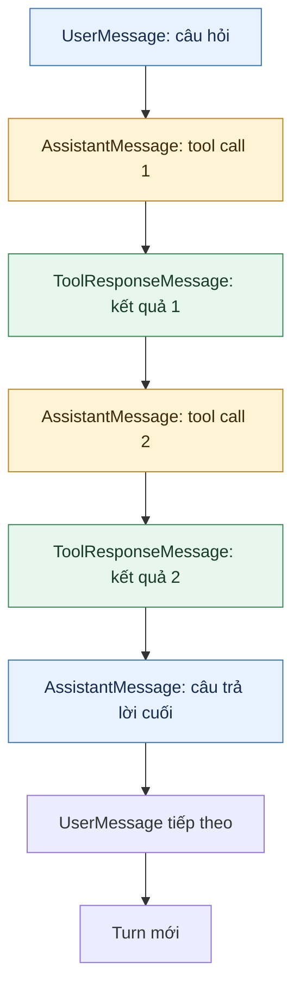

# Cắt giảm lịch sử mà không tách rời cặp lời gọi và kết quả

Khi một mô hình dùng công cụ, lịch sử hội thoại không chỉ gồm câu hỏi và câu trả lời dạng văn bản. Một lượt có thể chứa `UserMessage`, `AssistantMessage` mang các tool call, `ToolResponseMessage` chứa kết quả tương ứng và nhiều vòng gọi mô hình/công cụ trước khi có câu trả lời cuối. Nếu cắt lịch sử theo số message một cách tùy ý, ứng dụng có thể giữ lại yêu cầu gọi công cụ nhưng bỏ mất kết quả, hoặc giữ kết quả mà không còn lời gọi tạo ra nó. Một số provider sẽ từ chối chuỗi message như vậy; ngay cả khi request được chấp nhận, mô hình cũng không còn đủ ngữ cảnh để hiểu kết quả.

Trong Spring AI 2.1.0, đơn vị an toàn để cắt lịch sử là **turn**: một `UserMessage` cùng toàn bộ phản hồi assistant, tool call và tool result cho tới `UserMessage` kế tiếp. `MessageWindowChatMemory` đã hỗ trợ eviction theo ranh giới turn; Session Memory mở rộng nguyên tắc này thành event log và compaction có ranh giới rõ ràng. Với ứng dụng dùng tool calling, nên ưu tiên Session Memory vì `ChatMemory` API và các repository cũ đã deprecated, đồng thời một số repository cũ không lưu tool call/result.

## Một tool call và kết quả của nó tạo thành một cặp giao thức

Khi mô hình yêu cầu một công cụ, assistant message chứa một hoặc nhiều tool call. Mỗi call có ID, tên và arguments. Ứng dụng thực thi callback rồi trả kết quả trong `ToolResponseMessage`, liên kết với ID của call tương ứng. Mô hình cần thấy cả yêu cầu lẫn kết quả để tiếp tục đúng giao thức.

Một lượt đơn giản có thể trông như sau:

```text
UserMessage
  "Kiểm tra đơn ORD-2048"

AssistantMessage
  tool call: lookupOrder
  id: call-91
  arguments: {"orderId":"ORD-2048"}

ToolResponseMessage
  tool call id: call-91
  result: {"status":"PROCESSING"}

AssistantMessage
  "Đơn hàng ORD-2048 đang được xử lý."
```

Nếu mô hình yêu cầu nhiều công cụ trong cùng một vòng, assistant message có thể chứa nhiều tool call và tool response message chứa các kết quả tương ứng:

```text
AssistantMessage
  call-1: getInventory({"sku":"SKU-2048"})
  call-2: getTaxRate({"postalCode":"700000"})

ToolResponseMessage
  call-1 -> {"available":true}
  call-2 -> {"rate":0.08}

AssistantMessage
  "Có hàng và mức thuế áp dụng là 8%."
```

Một lượt có thể có nhiều vòng như vậy. Ví dụ, mô hình gọi `lookupOrder`, đọc kết quả, rồi gọi `checkAddressEligibility` trước khi trả lời. Toàn bộ các vòng đó vẫn thuộc cùng một turn vì chưa có `UserMessage` mới.

Các nguyên tắc cần giữ:

- Không giữ `ToolResponseMessage` mà bỏ `AssistantMessage` chứa tool call tương ứng.
- Không giữ assistant tool call mà bỏ kết quả của call đó.
- Với batch nhiều tool call, phải giữ đủ kết quả cho mọi call ID trong batch.
- Giữ thứ tự message và liên kết ID/name của từng tool result.
- Khi cắt lịch sử, ưu tiên giữ hoặc loại cả turn; không cắt giữa một vòng tool calling.

## Vì sao cắt theo số message có thể làm hỏng lịch sử?

Giả sử lịch sử có các message sau:

```text
U1  User: "Tra cứu đơn hàng"
A1  Assistant: tool call lookupOrder
T1  Tool: kết quả lookupOrder
A2  Assistant: tool call checkShipment
T2  Tool: kết quả checkShipment
A3  Assistant: câu trả lời cuối
U2  User: "Còn đơn khác thì sao?"
A4  Assistant: câu trả lời mới
```

Nếu lấy đúng 4 message cuối bằng `subList(...)`, lịch sử có thể bắt đầu ở `T2` hoặc `A3`. Khi đó, mô hình thấy kết quả công cụ nhưng không còn yêu cầu gọi công cụ hoặc câu hỏi ban đầu. Ngược lại, nếu cửa sổ kết thúc ngay sau `A2`, assistant đã yêu cầu `checkShipment` nhưng không có `T2` trả lời. Đây là một lịch sử không hoàn chỉnh.



Ranh giới turn nằm ở `UserMessage` kế tiếp. Những message từ `U1` tới `A3` phải được xem là một đơn vị khi cắt lịch sử.

## Turn là đơn vị eviction trong Spring AI

Spring AI định nghĩa turn là một `UserMessage` cộng tất cả message tiếp theo cho tới `UserMessage` kế tiếp: assistant replies, tool calls và tool results. Một lời gọi `ChatClient` với nhiều vòng tool calling vẫn là một turn; mỗi lần mô hình được gọi bên trong vòng lặp là một round.

Với `MessageWindowChatMemory`, cửa sổ mặc định là 20 message. Khi số message vượt `maxMessages`, Spring AI loại bỏ các turn cũ. Nếu điểm cắt thô rơi vào một assistant message hoặc tool response ở giữa turn, điểm cắt được đẩy tới `UserMessage` kế tiếp để cửa sổ còn lại bắt đầu tại một turn hoàn chỉnh. `SystemMessage` được giữ riêng.

Ví dụ, lịch sử:

```text
U1 A1 U2 A2[tool call] T2[result] A2' U3 A3
```

Nếu cửa sổ thô rơi vào `T2`, việc cắt sẽ tiến tới `U3`. Toàn bộ turn `U2 ... A2'` bị loại; `T2` không bị giữ lại một mình. `maxMessages` vì thế là giới hạn trên, không phải lúc nào cũng là số message chính xác sau eviction.

Một lưu ý khác: nếu một turn duy nhất có nhiều tool call và vượt `maxMessages`, `MessageWindowChatMemory` có thể phải loại toàn bộ message hội thoại không phải system cho tới khi một `UserMessage` mới được thêm. Hãy chọn cửa sổ đủ lớn cho một turn tool-heavy điển hình.

Ví dụ cấu hình legacy:

```java
ChatMemory chatMemory = MessageWindowChatMemory.builder()
        .maxMessages(30)
        .build();
```

`MessageWindowChatMemory` giữ ranh giới turn, nhưng cần xem xét cả advisor và repository trước khi dùng cho tool calling. Chỉ eviction theo turn không thể khôi phục message tool call/result nếu tầng lưu trữ đã loại chúng trước đó.

## Cảnh báo về ChatMemory và các repository cũ

Trong Spring AI 2.1.0, `ChatMemory`, `ChatMemoryRepository`, `MessageChatMemoryAdvisor` và các auto-configuration tương ứng đã deprecated, dự kiến bị loại bỏ ở 3.0.0. Spring AI khuyến nghị Session Memory.

Ngoài việc deprecated, một số repository cũ không hỗ trợ tool-call messages. Tài liệu 2.1.0 ghi rõ:

| Repository cũ | Hành vi với tool call/result |
|---|---|
| `JdbcChatMemoryRepository` | Lọc bỏ `AssistantMessage` có tool calls và `ToolResponseMessage` khi lưu |
| `CassandraChatMemoryRepository` | Lọc bỏ các message tool call và tool response |
| `MongoChatMemoryRepository` | Lọc bỏ các message tool call và tool response |

Với JDBC, Cassandra và Mongo, việc lọc bỏ được mô tả rõ trong tài liệu Spring AI 2.1.0. Không thể dùng một `MessageWindowChatMemory` để giữ cặp tool call/result nếu repository không lưu những message đó ngay từ đầu. Nếu ứng dụng cần lịch sử tool calling đầy đủ, hãy chuyển sang Session Memory với JDBC session repository hoặc một `SessionRepository` đáp ứng đầy đủ hợp đồng lưu message.

Khi migrate, các bảng ChatMemory cũ và session store là hai kho riêng. `JdbcSessionRepository` không tự đọc dữ liệu từ `SPRING_AI_CHAT_MEMORY`; nếu cần giữ hội thoại cũ, hãy viết migration riêng và xác minh nguồn cũ có đủ assistant tool-call messages cùng tool responses trước khi chuyển.

`MessageChatMemoryAdvisor` mặc định chạy bên ngoài `ToolCallingAdvisor`. Nó tải lịch sử trước khi vòng tool bắt đầu và chỉ lưu user message cuối cùng cùng assistant answer cuối cùng sau khi vòng lặp hoàn tất. Nó không nhìn thấy các assistant tool-call requests hoặc tool responses trung gian. Nếu cần lưu đầy đủ các message trung gian bằng một vòng tool tự điều khiển, ứng dụng phải tự quản lý toàn bộ lịch sử; trong Spring AI 2.1.0, Session Memory là hướng tích hợp được khuyến nghị.

## Session Memory lưu lịch sử dưới dạng event log

Session Memory giữ hội thoại dưới dạng append-only event log. Mỗi message được lưu trong một `SessionEvent` kiểu `MESSAGE`, có ID, session ID, timestamp, metadata và nội dung message. Các event đã ghi không bị sửa hoặc di chuyển. Khi cần cắt bớt ngữ cảnh, Spring AI thêm một `COMPACTION` event định nghĩa view mới thay vì xóa lịch sử cũ.

Các loại message quan trọng:

| Message | Vai trò | Cách compaction xử lý |
|---|---|---|
| `UserMessage` | Mở đầu một turn | Được giữ hoặc loại cùng turn |
| `AssistantMessage` | Câu trả lời hoặc message chứa tool calls | Được giữ hoặc loại cùng tool results trong turn |
| `ToolResponseMessage` | Kết quả của tool call | Được giữ hoặc loại cùng assistant tool call trong turn |
| `SystemMessage` | Cấu hình/instruction của ứng dụng | Lưu opt-in; system message mới nhất được pin ở đầu view, không đưa vào summary |
| Synthetic `UserMessage` | Shadow prompt mở đầu một summary turn | Được dùng cùng synthetic assistant summary |
| Synthetic `AssistantMessage` | Nội dung tóm tắt các turn cũ | Được giữ trong view hoặc thay bằng summary mới |

Một turn trong session có dạng:

```text
Turn 1: [USER] [ASSISTANT final]
Turn 2: [USER] [ASSISTANT tool call] [TOOL result] [ASSISTANT tool call] [TOOL result] [ASSISTANT final]
Turn 3: [USER] [ASSISTANT final]
```

Session Memory coi Turn 2 là đơn vị nguyên tử. Compaction không thể chỉ giữ tool result hoặc chỉ giữ tool call của Turn 2.

## Cấu hình Session Memory với ChatClient

Với ứng dụng Spring Boot dùng JDBC, thêm starter session:

```xml
<dependency>
    <groupId>org.springframework.ai</groupId>
    <artifactId>spring-ai-starter-model-session-jdbc</artifactId>
</dependency>
```

Starter cấu hình `JdbcSessionRepository` và `SessionService` khi có một `DataSource` phù hợp. JDBC session repository lưu các `MessagePart` theo thứ tự, bao gồm tool calls, tool results, media và reasoning metadata được hỗ trợ. Các cơ sở dữ liệu được hỗ trợ sẵn gồm PostgreSQL, MySQL, MariaDB, Microsoft SQL Server và H2.

Nếu dùng PostgreSQL/MySQL trong môi trường phát triển, có thể bật khởi tạo schema:

```yaml
spring:
  ai:
    session:
      repository:
        jdbc:
          initialize-schema: always
```

Với production, nên quản lý schema bằng Flyway/Liquibase hoặc migration tool của dự án và đặt `initialize-schema: never` sau khi schema đã được tạo.

Đăng ký hai session advisors thông qua `SessionAdvisors`. `SessionMemoryAdvisor` chạy bên trong tool-calling loop để lưu từng round; `SessionTurnAdvisor` chạy bên ngoài loop để hoàn tất turn và chạy compaction sau khi `ChatClient` trả kết quả:

```java
@Configuration
class AssistantConfiguration {

    @Bean
    ChatClient assistantChatClient(
            ChatModel chatModel,
            SessionService sessionService) {

        return ChatClient.builder(chatModel)
                .defaultAdvisors(
                        SessionAdvisors.builder(sessionService)
                                .compaction(
                                        new TurnCountTrigger(20),
                                        WindowCompactionStrategy.builder()
                                                .lastTurns(10)
                                                .build())
                                .build())
                .build();
    }
}
```

Mỗi request phải cung cấp session ID:

```java
String answer = chatClient.prompt()
        .user("Kiểm tra đơn ORD-2048 và trạng thái giao hàng")
        .tools(orderTools, shipmentTools)
        .advisors(SessionAdvisors.session(sessionId))
        .call()
        .content();
```

Session ID phải được tạo hoặc phân giải ở server theo user và conversation. Không dùng một session ID chung cho mọi người dùng; nếu không, lịch sử có thể bị trộn giữa các user. `SessionAdvisors.session(sessionId)` thiết lập session context cho request. Nếu bỏ session ID, advisor báo lỗi thay vì âm thầm dùng một session mặc định chung.

Ứng dụng cũng nên tuần tự hóa các lượt ghi trên cùng một session. Hai request đồng thời cùng session có thể xen kẽ message và làm hỏng ranh giới turn; session repository hỗ trợ optimistic concurrency cho các batch compaction, nhưng điều đó không tự biến nhiều `ChatClient` call đồng thời thành một cuộc hội thoại được tuần tự hóa.

`SessionAdvisors` tạo cả hai advisor với thứ tự mặc định phù hợp. Không chỉ đăng ký `SessionTurnAdvisor` nếu cần lưu message; advisor này không tự lưu hội thoại. Cũng không chỉ đăng ký `SessionMemoryAdvisor` nếu cần compaction và xử lý kết quả của tool loop kết thúc bằng `returnDirect`; trường hợp đó cần cả hai advisor.

## SessionMemoryAdvisor giữ tool call và tool result như thế nào?

Trong mỗi lần model được gọi bên trong vòng tool calling, `SessionMemoryAdvisor`:

1. Đọc active view của session và dựng prompt cùng request hiện tại.
2. Lưu trailing `UserMessage` của request theo `MessageFilter`, hoặc lưu tool results của vòng trước.
3. Sau khi model phản hồi, lưu assistant reply theo `MessageFilter`; assistant message có tool calls luôn được lưu.
4. Ở round tiếp theo, dựng prompt từ active view và phần lịch sử mà request chưa mang theo.

Nhờ đặt memory advisor bên trong tool loop, session có thể lưu chuỗi assistant tool-call message và tool response message thay vì chỉ lưu câu trả lời cuối. `ToolCallingAdvisor` không phải nơi lưu lịch sử lâu dài; Session Memory quản lý lịch sử ở tầng advisor.

`SessionTurnAdvisor` xử lý phần bên ngoài vòng lặp:

- Tạo session nếu đây là lần đầu.
- Hoàn tất các tool results khi một vòng kết thúc mà không có model round tiếp theo, ví dụ tool có `returnDirect = true` hoặc vượt giới hạn tool call.
- Chạy compaction sau khi lời gọi `ChatClient` hoàn tất.
- Nếu một turn trước để lại tool call chưa có result, xử lý trạng thái đó ở lần gọi tiếp theo để prompt không chứa một tool call bị bỏ ngỏ.

Trong trường hợp turn trước bị lỗi sau khi assistant tool call đã được lưu, ứng dụng không thể kết luận chắc chắn tool chưa chạy. Session advisor dùng thông điệp `No result was recorded for this tool call.` để mô tả đúng trạng thái log; nó không khẳng định side effect chưa xảy ra. Với thao tác ghi, service vẫn cần idempotency và kiểm tra trạng thái trước khi retry.

## EventFilter cắt lịch sử theo turn boundary

`EventFilter` là bộ lọc ở chiều đọc. Nó quyết định event nào xuất hiện trong prompt; event bị lọc vẫn nằm trong log. Có thể lấy active view hoặc cửa sổ gần nhất:

```java
List<Message> activeHistory = sessionService.getActiveMessages(sessionId);

List<SessionEvent> recentEvents = sessionService.getEvents(
        sessionId,
        EventFilter.lastN(20));
```

`EventFilter.lastN(n)` là cửa sổ theo số event, nhưng `n` là ngưỡng tối thiểu. Nếu event cũ nhất trong cửa sổ rơi vào giữa turn, filter mở rộng ngược tới `UserMessage` mở đầu turn đó. Vì vậy, kết quả không bắt đầu bằng tool result thiếu tool call hoặc assistant reply thiếu câu hỏi gốc.

Có thể cấu hình filter chi tiết:

```java
EventFilter filter = EventFilter.builder()
        .activeView(true)
        .eventTypes(Set.of(EventType.MESSAGE))
        .lastN(50)
        .build();
```

Lưu ý: việc mở rộng về turn start cần nhìn thấy `UserMessage`. Nếu `messageTypes(...)` loại `USER` khỏi tập kết quả, filter không thể tìm ranh giới turn và sẽ trả cửa sổ thô. Vì vậy, đừng lọc bỏ user messages khi mục tiêu là giữ lịch sử hội thoại hoàn chỉnh.

`SessionMemoryAdvisor` luôn giới hạn đọc trong active view để những turn đã được compaction cover không quay lại prompt. Có thể giới hạn riêng một request mà không thay đổi cấu hình toàn advisor:

```java
String answer = chatClient.prompt()
        .user("Tóm tắt nhanh nội dung gần đây")
        .advisors(a -> a
                .param(SessionMemoryAdvisor.SESSION_ID_CONTEXT_KEY, sessionId)
                .param(SessionMemoryAdvisor.EVENT_FILTER_CONTEXT_KEY,
                        EventFilter.lastN(5)))
        .call()
        .content();
```

Đây là read-side window cho request hiện tại. Nó không xóa event khỏi session và không thay đổi chính sách compaction lâu dài.

## Compaction giảm lịch sử mà không chia turn

Compaction có hai quyết định độc lập:

- `CompactionTrigger`: khi nào cần rút gọn lịch sử.
- `CompactionStrategy`: phần nào được giữ trong active view và phần nào được thay bằng summary.

Spring AI cung cấp các trigger phổ biến:

```java
CompactionTrigger byTurns = new TurnCountTrigger(20);

CompactionTrigger byTokens = TokenCountTrigger.builder()
        .threshold(4000)
        .build();

CompactionTrigger either = CompositeCompactionTrigger.anyOf(
        byTurns,
        byTokens);
```

`TokenCountTrigger` ước lượng token của nội dung sẽ gửi cho model, gồm system message mới nhất, summary và hội thoại. Mặc định dùng `TokenCountEstimator` dựa trên JTokkit; có thể truyền estimator khác nếu ứng dụng cần khớp tokenizer của model đang dùng.

Các window strategy:

```java
WindowCompactionStrategy lastEvents = WindowCompactionStrategy.builder()
        .lastEvents(30)
        .build();

WindowCompactionStrategy lastTurns = WindowCompactionStrategy.builder()
        .lastTurns(10)
        .build();

WindowCompactionStrategy tokenBudget = WindowCompactionStrategy.builder()
        .tokenBudget(4000)
        .build();
```

| Window | Đơn vị | Khi phù hợp |
|---|---|---|
| `lastEvents(n)` | Event gần nhất | Muốn một giới hạn dễ dự đoán; điểm cắt vẫn được điều chỉnh để không tách turn |
| `lastTurns(n)` | Số turn gần nhất | Hội thoại có turn dài/ngắn khác nhau, đặc biệt khi có nhiều tool call |
| `tokenBudget(n)` | Token ước lượng | Muốn kiểm soát kích thước ngữ cảnh theo ngân sách token |

Với bất kỳ window nào, compaction di chuyển điểm cắt tới đầu turn kế tiếp nếu điểm cắt thô nằm giữa turn. Turn mới nhất luôn được giữ nguyên, kể cả khi chính turn đó vượt window. Điều này ngăn compaction xóa một tool call đang chờ kết quả hoặc bỏ kết quả khỏi turn đang diễn ra.

Hệ quả quan trọng: `tokenBudget(4000)` không bảo đảm tuyệt đối rằng prompt luôn dưới 4000 token nếu riêng turn mới nhất đã lớn hơn ngân sách. Đừng giải quyết tình huống này bằng cách cắt giữa tool call và tool result. Hãy giảm kích thước tool output ngay từ callback, giới hạn số trang/bản ghi, chỉ trả field cần thiết hoặc tạo summary nghiệp vụ trước khi đưa kết quả vào hội thoại.

## Tóm tắt các turn cũ bằng ChatModelSummarizer

Nếu chỉ dùng window, các turn cũ được cover khỏi active view nhưng vẫn còn nguyên trong log. Nếu cần giữ lại ý chính để model tiếp tục hiểu ngữ cảnh, thêm `ChatModelSummarizer`. Summarizer nhận các turn được cover, summary trước đó và một phần turn được giữ để duy trì tính liên tục. Nó trả về một summary turn gồm synthetic `UserMessage` (shadow prompt) và synthetic `AssistantMessage` (nội dung tóm tắt).

```java
WindowCompactionStrategy strategy = WindowCompactionStrategy.builder()
        .lastTurns(10)
        .summarizer(ChatModelSummarizer.builder(chatModel)
                .overlapSize(2)
                .build())
        .build();
```

`overlapSize(2)` là số event được giữ đầu tiên đưa vào summary để duy trì continuity; mặc định là 2. Summary trước đó cũng được đưa vào lần summarization kế tiếp, nên các summary tạo thành một chuỗi rolling summary.

Compaction chỉ tóm tắt các turn cũ đã cover. Nó không tóm tắt hoặc cắt một nửa tool-call pair đang nằm trong turn mới nhất. Các tool call và tool result cũ được tổng hợp cùng toàn bộ turn của chúng; summary ghi lại kết quả nghiệp vụ, quyết định, ID tài nguyên và trạng thái cần nhớ. Summary không nên giả lập một assistant tool call mới hoặc tạo một tool response không tồn tại.

Nếu summarizer trả về danh sách rỗng, lỗi model, hoặc phản hồi rỗng, compaction không ghi boundary mới và active view giữ nguyên. Nhờ đó, một lần tóm tắt thất bại không làm mất lịch sử đang dùng.

Ví dụ bật compaction sau mỗi 20 turn, giữ 10 turn mới nhất và tóm tắt phần cũ:

```java
ChatClient chatClient = ChatClient.builder(chatModel)
        .defaultAdvisors(SessionAdvisors.builder(sessionService)
                .compaction(
                        new TurnCountTrigger(20),
                        WindowCompactionStrategy.builder()
                                .lastTurns(10)
                                .summarizer(ChatModelSummarizer.builder(chatModel)
                                        .overlapSize(2)
                                        .build())
                                .build())
                .build())
        .build();
```

Có thể dùng `asyncCompaction(true)` để advisor chạy compaction trên scheduler sau khi trả câu trả lời. Khi bật chế độ này, thời gian gọi model để tóm tắt không cộng vào latency của response hiện tại; compaction vẫn là best-effort và lỗi được log.

## Event log và active view có mục đích khác nhau

Session Memory không xóa các turn cũ khi compaction. Nó thêm một `COMPACTION` boundary event tham chiếu ID của:

- System message mới nhất và các event preamble được pin.
- Summary turn thay cho các turn đã cover.
- Các turn gần nhất được giữ nguyên.

Khi đọc `EventFilter.active()`, Spring AI dựng active view từ boundary mới nhất rồi nối các event được thêm sau boundary. Khi đọc `EventFilter.all()`, ứng dụng vẫn thấy toàn bộ event log, kể cả các turn đã được cover. Vì vậy:

```java
// Những message thực sự được dùng làm context cho model.
List<SessionEvent> active = sessionService.getEvents(
        sessionId, EventFilter.active());

// Toàn bộ log để audit hoặc điều tra.
List<SessionEvent> auditLog = sessionService.getEvents(
        sessionId, EventFilter.all());
```

Compaction không phải cơ chế xóa dữ liệu hoặc chính sách retention. Session có TTL và có thể được dọn bằng `deleteExpiredSessions(...)`; nếu cần lưu lịch sử phục vụ audit, hãy xác định retention, quyền truy cập và quy trình xóa riêng.

## Tự cắt lịch sử khi tự điều phối ChatModel

Nếu ứng dụng tự viết tool loop bằng `ChatModel`, `ToolExecutionResult.conversationHistory()` trả về prompt history, assistant tool-call request và tool results. Khi tự quản lý danh sách message, hãy chia thành turn trước khi cắt. Ví dụ helper sau giả định `conversation` chỉ chứa message hội thoại; system prompt được cung cấp riêng trong cấu hình request:

```java
static List<Message> keepLastCompleteTurns(
        List<Message> conversation,
        int maxMessages) {

    if (maxMessages < 1) {
        throw new IllegalArgumentException("maxMessages phải lớn hơn 0.");
    }

    if (conversation.size() <= maxMessages) {
        return List.copyOf(conversation);
    }

    int rawCut = conversation.size() - maxMessages;
    int start = -1;

    // Nếu có turn mới bắt đầu sau điểm cắt, bắt đầu ở turn đó.
    for (int i = rawCut; i < conversation.size(); i++) {
        if (conversation.get(i) instanceof UserMessage) {
            start = i;
            break;
        }
    }

    // Nếu điểm cắt nằm trong turn mới nhất, giữ trọn turn mới nhất.
    if (start < 0) {
        for (int i = rawCut - 1; i >= 0; i--) {
            if (conversation.get(i) instanceof UserMessage) {
                start = i;
                break;
            }
        }
    }

    if (start < 0) {
        start = 0;
    }

    return List.copyOf(conversation.subList(start, conversation.size()));
}
```

Helper minh họa cách tìm ranh giới `UserMessage`, không thay thế Session Memory. Trong ứng dụng thật, cần giữ system/developer instructions theo đúng thứ tự prompt, xử lý summary và các message đặc biệt, đồng thời kiểm tra tool call/result ID trước khi gửi prompt. Không áp dụng `subList()` trực tiếp trên danh sách message nếu chưa xác định ranh giới turn.

Nếu một turn quá dài, helper sẽ giữ nguyên turn đó thay vì cắt dở. Hãy giảm tool result ở nguồn, đặt giới hạn số vòng/tool call hoặc tóm tắt dữ liệu nghiệp vụ trước khi lưu. Nếu cần một lịch sử đầy đủ có thể phục hồi, lưu event log riêng và chỉ tạo active view rút gọn cho model.

## Kiểm thử để chứng minh không có tool call/result mồ côi

Nên kiểm thử cả việc lưu message và việc dựng prompt sau khi cắt. Các ca quan trọng:

| Ca kiểm thử | Điều cần xác minh |
|---|---|
| Một tool call thành công | Assistant tool-call message và tool response cùng nằm trong history |
| Một assistant message có nhiều tool call | Tất cả call ID có kết quả tương ứng và không bị mất một phần |
| Nhiều round trong một turn | Các tool call/result của mọi round được giữ đến `UserMessage` tiếp theo |
| Điểm cắt rơi vào assistant tool call | Cả turn cũ bị loại hoặc cả turn mới nhất được giữ; không giữ call đơn lẻ |
| Điểm cắt rơi vào tool response | Không giữ result mà bỏ assistant call; không để provider nhận orphan result |
| Một turn vượt `maxMessages` | `MessageWindowChatMemory` giữ hoặc loại trọn turn theo ranh giới |
| Một turn mới nhất vượt token budget | Compaction giữ trọn turn; tool output cần được giới hạn ở nguồn |
| `EventFilter.lastN(n)` rơi giữa turn | Window mở rộng về `UserMessage` mở đầu turn |
| Filter loại `UserMessage` | Test xác nhận boundary extension không còn áp dụng; tránh cấu hình này nếu cần turn safety |
| Compaction có summarizer | Summary thay các turn cũ bằng summary turn; các turn được giữ nguyên vẹn |
| Summarizer thất bại hoặc trả rỗng | Active view không đổi và lịch sử không mất |
| `returnDirect = true` | `SessionTurnAdvisor` lưu tool result dù không có model round tiếp theo |
| Repository JDBC session | `AssistantMessage` có tool calls và `ToolResponseMessage` round-trip đầy đủ |
| Repository ChatMemory cũ | Xác minh repository có lưu tool messages hay không; không mặc định rằng mọi repository đều hỗ trợ |
| Session ID giữa nhiều user | Lịch sử của các user không bị trộn |

Một test có thể tạo lịch sử:

```text
U1 A1(tool call) T1(result) A2(final)
U2 A3(tool call) T2(result) A4(final)
```

Sau đó áp dụng `EventFilter.lastN(...)` hoặc compaction với window cố ý rơi giữa `A3` và `T2`. Kết quả hợp lệ phải giữ trọn turn `U2 ... A4` hoặc loại trọn turn đó nếu có turn mới hơn; không được chỉ còn `A3` hoặc `T2`. Integration test với JDBC nên ghi rồi đọc lại cả `AssistantMessage` chứa tool calls và `ToolResponseMessage`, sau đó so sánh call IDs, tool names, arguments và result content.

## Checklist triển khai

1. Xem một turn là `UserMessage` cùng mọi assistant replies, tool calls và tool results cho tới user message kế tiếp.
2. Giữ assistant tool-call message cùng tất cả tool response có call ID tương ứng.
3. Không dựa vào `maxMessages` hoặc `subList()` nếu chưa căn theo ranh giới turn.
4. Kiểm tra repository có thật sự lưu `AssistantMessage` chứa tool calls và `ToolResponseMessage` hay không.
5. Với Spring AI 2.1.0, ưu tiên Session Memory vì ChatMemory API cũ đã deprecated.
6. Dùng cả `SessionMemoryAdvisor` và `SessionTurnAdvisor` qua `SessionAdvisors` khi cần history, compaction và xử lý returnDirect.
7. Dùng `EventFilter.lastN(...)` hoặc `WindowCompactionStrategy.lastTurns(...)` để cắt theo turn.
8. Không lọc mất `UserMessage` nếu cần EventFilter tự mở rộng window về turn start.
9. Dùng `TokenCountTrigger`/`tokenBudget` cho ngân sách context, nhưng nhớ newest turn luôn được giữ trọn.
10. Dùng `ChatModelSummarizer` để thay các turn cũ bằng summary turn; không tạo tool call/result giả trong summary.
11. Giảm tool result quá lớn ngay ở callback bằng pagination, field selection hoặc output summary.
12. Giữ session ID riêng theo user/conversation và kiểm thử việc lưu/đọc lại toàn bộ tool-call pair.

## Kết luận

Cắt giảm lịch sử an toàn phải tôn trọng cấu trúc giao thức của tool calling. `AssistantMessage` chứa tool call và `ToolResponseMessage` tương ứng không được tách rời; cả hai nằm trong một turn bắt đầu bằng `UserMessage`. `MessageWindowChatMemory` có eviction theo turn nhưng đã deprecated cùng nhiều repository cũ không lưu tool messages. Với Spring AI 2.1.0, Session Memory là lựa chọn phù hợp hơn: lưu event log append-only, tạo active view bằng `EventFilter`, và compaction tại turn boundary bằng `WindowCompactionStrategy`. Khi cần summary, hãy tóm tắt các turn cũ thành summary turn và giữ nguyên turn mới nhất, kể cả khi nó vượt ngân sách. Nếu tự quản lý history, hãy cắt theo `UserMessage` boundary và kiểm thử để không bao giờ gửi tool call hoặc tool result mồ côi cho model.

## Tài liệu tham khảo

- [Spring AI 2.1.0 — Session Memory](https://docs.spring.io/spring-ai/reference/api/session.html) — session event log, active view và turn-aware compaction.
- [Spring AI 2.1.0 — Session Concepts](https://docs.spring.io/spring-ai/reference/api/session/concepts.html) — định nghĩa turn và cách `AssistantMessage`/`ToolResponseMessage` được compaction cùng nhau.
- [Spring AI 2.1.0 — Event Filtering](https://docs.spring.io/spring-ai/reference/api/session/event-filter.html) — `EventFilter.lastN`, mở rộng window về đầu turn và lưu ý khi lọc message types.
- [Spring AI 2.1.0 — Compaction](https://docs.spring.io/spring-ai/reference/api/session/compaction.html) — trigger, `WindowCompactionStrategy`, token budget, summarizer và compaction boundary.
- [Spring AI 2.1.0 — ChatClient Integration](https://docs.spring.io/spring-ai/reference/api/session/chat-client.html) — vai trò `SessionMemoryAdvisor` và `SessionTurnAdvisor` trong tool-calling loop.
- [Spring AI 2.1.0 — JDBC Session Repository](https://docs.spring.io/spring-ai/reference/api/session/jdbc.html) — lưu trữ message parts, tool calls/results, active view và optimistic concurrency.
- [Spring AI 2.1.0 — Chat Memory](https://docs.spring.io/spring-ai/reference/api/chat-memory.html) — `MessageWindowChatMemory`, giới hạn repository cũ và hướng migrate sang Session Memory.
