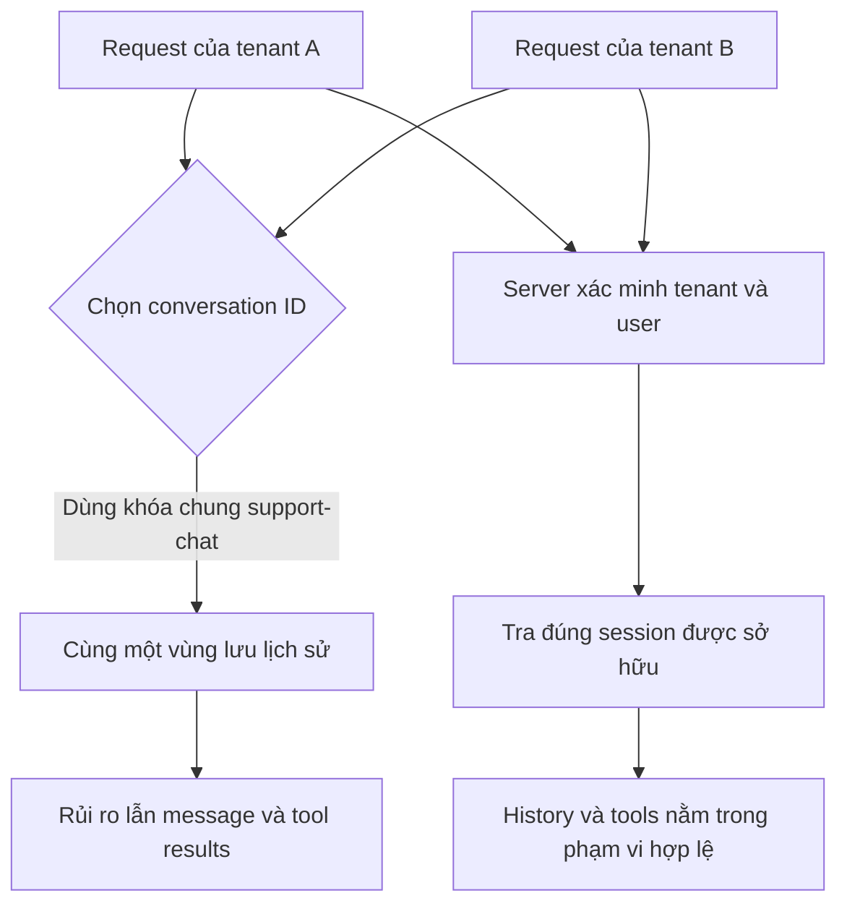

# Lịch sử hội thoại

## Cô lập conversation ID và tenant

Trong ứng dụng AI nhiều người dùng, lịch sử hội thoại có thể chứa câu hỏi, kết quả tra cứu và dữ liệu nghiệp vụ mà chỉ một người hoặc một tenant được xem. Nếu hai request dùng chung khóa bộ nhớ, mô hình có thể nhận nhầm lịch sử của người khác; nếu endpoint chỉ tin vào `conversationId` do client gửi, kẻ gọi API có thể cố truy cập, tiếp tục hoặc xóa hội thoại không thuộc quyền mình.

Với module `SPRING_AI_TOOL_CALLING`, rủi ro không dừng ở văn bản. Một hội thoại có thể lưu `AssistantMessage` yêu cầu gọi công cụ và `ToolResponseMessage` chứa dữ liệu lấy từ database, REST API hoặc MCP server. Spring AI giúp lưu và phát lại lịch sử đúng thứ tự, nhưng **ứng dụng phải quyết định ai được phép sử dụng từng conversation ID** và mỗi tool được phép truy cập dữ liệu tenant nào.

Bài học phân biệt ba khái niệm: **định danh hội thoại** để chọn đúng lịch sử, **quyền sở hữu** để cho phép truy cập lịch sử đó, và **ngữ cảnh thực thi** để giới hạn dữ liệu mà các công cụ có thể đọc hoặc thay đổi. Một UUID khó đoán và một `ToolContext` được truyền đúng là những thành phần hữu ích; không thành phần nào thay thế kiểm tra phân quyền ở ranh giới lưu trữ và nghiệp vụ.

### 1. Ba loại định danh có trách nhiệm khác nhau

| Giá trị | Trả lời câu hỏi | Ai xác định? | Có phải căn cứ phân quyền? |
| --- | --- | --- | --- |
| `tenantId` | Dữ liệu thuộc tổ chức nào? | Hệ thống xác thực/ủy quyền phía server | Là một phần phạm vi kiểm tra quyền |
| `userId` / principal | Ai đang gọi? | Security context/identity provider đã xác minh | Là một phần phạm vi kiểm tra quyền |
| `conversationId` / `sessionId` | Đọc/ghi lịch sử nào? | Server tạo, client có thể giữ để tham chiếu | Không; phải đối chiếu owner và tenant |
| `toolCallId` | Kết quả ứng với lời gọi tool nào? | Model/provider tạo trong response | Không; chỉ để ghép tool call và tool response |
| `requestId` / `turnId` | Lượt xử lý nào cần truy vết? | API gateway/ứng dụng | Không; phục vụ tracing và idempotency |

`tenantId` và `userId` nên được lấy từ token hoặc session đã xác thực, sau đó ánh xạ sang những ID nội bộ ổn định. Không dùng `tenantId` được gửi trong prompt, tool arguments hoặc request body làm danh tính tin cậy. Trước khi sử dụng một `conversationId` từ URL hay request, luôn kiểm tra lịch sử đó thuộc tenant và người dùng hiện tại.

### 2. Vì sao trùng conversation ID có thể rò rỉ dữ liệu?

Với `ChatMemory` truyền thống, memory repository lưu và truy xuất message theo đúng chuỗi `conversationId`. Nếu tenant A và tenant B cùng dùng khóa `support-chat`, cả hai có thể đọc cùng một chuỗi message. Spring AI không thể suy ra tenant đúng chỉ từ một khóa giống nhau.



Ví dụ sai:

```java
String conversationId = "default";

chatClient.prompt()
    .user(question)
    .advisors(a -> a.param(MemoryAdvisor.CONVERSATION_ID, conversationId))
    .call()
    .content();
```

Nếu mọi request đều truyền cùng chuỗi, chúng cùng trỏ đến một history key. Spring AI 2.x yêu cầu memory advisor nhận ID rõ ràng, không còn `ChatMemory.DEFAULT_CONVERSATION_ID`; tuy vậy, ứng dụng vẫn có thể tự tạo lỗi bằng cách gán một giá trị cố định như ví dụ trên.

Lỗi khác là chỉ dựa vào ID do client cung cấp:

```text
GET /api/conversations/8b10.../messages
Authorization: Bearer <token của người dùng khác>
```

Server phải kiểm tra quyền đọc hội thoại trước khi gọi repository hoặc advisor. Việc UUID khó đoán làm giảm khả năng dò quét, nhưng UUID bị lộ qua URL, log, link chia sẻ hoặc lỗi ứng dụng vẫn có thể bị tái sử dụng. Đây là một dạng **Broken Object Level Authorization (BOLA/IDOR)** nếu API cho phép truy cập bằng ID mà không kiểm tra owner.

### 3. Quy tắc cô lập: khóa lưu trữ và quyền truy cập là hai lớp

Đối với mỗi thao tác hội thoại, cần kiểm tra đồng thời ba yếu tố:

```text
(tenantId đã xác thực, userId đã xác thực, conversationId được yêu cầu)
```

Có hai cách phổ biến để đặt khóa bộ nhớ:

1. **ID ngẫu nhiên duy nhất toàn kho:** server tạo UUID không trùng; một bảng ownership hoặc metadata ràng buộc ID với `tenantId` và `userId`.
2. **Namespace theo tenant/người dùng:** khóa nội bộ được tạo từ bộ ba `(tenantId, userId, conversationId)` với phép mã hóa/ghép không mơ hồ; vẫn phải kiểm tra quyền trước khi nhận ID do client gửi.

Với `SessionService` trong Spring AI 2.1, cách thứ nhất thường rõ ràng hơn: `SessionService.create(...)` có thể tự sinh UUID, còn metadata hoặc bảng nghiệp vụ lưu owner. Client nhận ID để tham chiếu; server đối chiếu owner ở mỗi request. Không nên chỉ nối chuỗi `tenantId + ":" + conversationId` rồi xem đó là lớp bảo mật: dữ liệu đầu vào chứa ký tự phân cách có thể tạo khóa nhập nhằng, và một client biết ID vẫn có thể tìm cách giả mạo namespace.

Trong ứng dụng có yêu cầu cô lập mạnh, lưu và truy vấn owner ở database bằng điều kiện tenant ở cùng thao tác đọc/ghi/xóa hoặc dùng Row-Level Security. Metadata của session thuận tiện cho truy vấn và hiển thị, nhưng chưa tự động là một hệ thống ACL.

### 4. Chọn API bộ nhớ theo phiên bản Spring AI

Spring AI có hai hướng quản lý history đang gặp trong dự án:

| Spring AI | API | Cách truyền ID | Giới hạn cần nhớ |
| --- | --- | --- | --- |
| 2.0.x | `ChatMemory` + `MessageChatMemoryAdvisor` | `ChatMemory.CONVERSATION_ID` qua advisor context | Memory chỉ phân vùng theo chuỗi ID; ứng dụng quản lý owner |
| 2.1.0, code cũ | `ChatMemory` + `MessageChatMemoryAdvisor` | `MemoryAdvisor.CONVERSATION_ID` hoặc hằng cũ tương thích | Các API này deprecated từ 2.1, dự kiến bỏ trong 3.0 |
| 2.1.0, code mới | `SessionService` + `SessionAdvisors` | `SessionAdvisors.session(sessionId)` | Lưu event log, tool messages, metadata, compaction theo lượt |

Spring AI 2.1.0 giới thiệu **Session Memory**, trong đó `Session` chứa ID, thời điểm tạo, hạn dùng và metadata; message được lưu dưới dạng các `SessionEvent` có thứ tự. `SessionAdvisors` gồm `SessionTurnAdvisor` bên ngoài vòng tool và `SessionMemoryAdvisor` bên trong, cho phép lưu cả assistant tool-call requests và tool responses đúng thứ tự.

`ChatMemory` và `MessageChatMemoryAdvisor` đã deprecated từ 2.1.0. Với dự án mới, nên ưu tiên Session Memory. Với dự án 2.0.x, có thể tiếp tục dùng memory advisor cũ nhưng phải bảo đảm ID duy nhất và triển khai quyền truy cập ở tầng ứng dụng.

### 5. Khởi tạo `ChatClient` với Session Memory 2.1

Thêm starter cho JDBC session repository khi cần lưu bền vững:

```xml
<dependency>
    <groupId>org.springframework.ai</groupId>
    <artifactId>spring-ai-starter-model-session-jdbc</artifactId>
</dependency>
```

Trong ứng dụng Spring Boot đã có `DataSource`, có thể inject `SessionService` và gắn cặp advisor vào `ChatClient`:

```java
@Configuration
public class ConversationAiConfiguration {

    @Bean
    ChatClient conversationChatClient(
            ChatModel model,
            SessionService sessionService) {

        return ChatClient.builder(model)
            .defaultAdvisors(SessionAdvisors.builder(sessionService).build())
            .build();
    }
}
```

Khi gửi request:

```java
String answer = chatClient.prompt()
    .user("Cho biết trạng thái đơn hàng ORD-2048")
    .advisors(SessionAdvisors.session(sessionId))
    .call()
    .content();
```

**Quan trọng:** `SessionAdvisors.session(sessionId)` chọn session để advisor đọc/ghi, nhưng không kiểm tra người gọi có quyền dùng ID đó hay không. Nếu chưa có session, advisor có thể tự tạo session khi thực hiện lời gọi đầu tiên. Vì vậy, endpoint tiếp tục hội thoại phải kiểm tra ownership trước khi chạy `ChatClient`; endpoint tạo mới phải gắn metadata owner ngay khi tạo.

### 6. Tạo session với tenant và principal từ server

Trong Spring AI 2.1, `Session` không có field owner chuyên biệt. Ứng dụng có thể lưu owner trong metadata bằng `SessionAttributes.PRINCIPAL_NAME` và một key tenant riêng. Hai giá trị phải đến từ danh tính đã xác thực.

```java
record UserScope(String tenantId, String userId) { }

@Service
public class ConversationAccessService {

    private static final String TENANT_KEY = "app.tenantId";

    private final SessionService sessions;
    private final ChatClient chatClient;

    public ConversationAccessService(SessionService sessions, ChatClient chatClient) {
        this.sessions = sessions;
        this.chatClient = chatClient;
    }

    public String createConversation(UserScope currentUser) {
        Session session = sessions.create(CreateSessionRequest.builder()
            .timeToLive(Duration.ofDays(30))
            .metadata(TENANT_KEY, currentUser.tenantId())
            .metadata(SessionAttributes.PRINCIPAL_NAME, currentUser.userId())
            .metadata(SessionAttributes.AGENT_NAME, "order-support")
            .build());

        // Khi không truyền id, service tự sinh UUID cho session mới.
        return session.id();
    }

    public String ask(
            UserScope currentUser,
            String requestedSessionId,
            String question) {

        Session session = requireOwnedSession(currentUser, requestedSessionId);

        return chatClient.prompt()
            .user(question)
            .advisors(SessionAdvisors.session(session.id()))
            .toolContext(Map.of(
                "tenantId", currentUser.tenantId(),
                "userId", currentUser.userId()))
            .call()
            .content();
    }

    private Session requireOwnedSession(UserScope currentUser, String id) {
        Session session = sessions.findById(id);
        if (session == null
                || !Objects.equals(session.metadata().get(TENANT_KEY), currentUser.tenantId())
                || !Objects.equals(
                    session.metadata().get(SessionAttributes.PRINCIPAL_NAME),
                    currentUser.userId())
                || (session.expiresAt() != null
                    && !session.expiresAt().isAfter(Instant.now()))) {
            throw new ResponseStatusException(HttpStatus.NOT_FOUND);
        }
        return session;
    }
}
```

`UserScope` ở đây đại diện cho danh tính đã được server xác minh, không phải DTO mà client tự điền `tenantId` hoặc `userId`. Trong ứng dụng có Spring Security, controller hoặc service tạo `UserScope` từ `Authentication`/JWT claims đã kiểm chứng và hệ thống membership của tenant. Không nên cho client chọn tenant khác chỉ bằng cách gửi một field mới trong JSON.

Ví dụ trả `404 Not Found` cho session không tồn tại và session không thuộc quyền truy cập để tránh tiết lộ một conversation ID hợp lệ có tồn tại hay không. Tùy chính sách sản phẩm, `403` cũng có thể được dùng khi việc tiết lộ sự tồn tại của resource được cho phép.

**Giới hạn của ví dụ:** kiểm tra `findById` trước rồi gọi advisor là hai thao tác riêng. Nếu session bị xóa hoặc đổi quyền trong khoảng giữa, có thể có race điều kiện kiểm tra và sử dụng (TOCTOU). Với hệ thống đòi hỏi cô lập chặt, hãy thực thi kiểm tra tenant/owner ngay trong repository hoặc một `SessionService` được bảo vệ cho mọi lần đọc, ghi, xóa; kết hợp transaction, khóa hoặc row-level security nếu cần. Không dựa duy nhất vào kiểm tra tại controller.

### 7. Không dùng `findOrCreate` để mở session tùy ý của client

`SessionService.findOrCreate(CreateSessionRequest)` trả session đã tồn tại nếu ID được cung cấp đã có trong kho; khi có hai request tạo cùng ID, session đã lưu được ưu tiên. API này hữu ích cho điều phối nhưng **không phải một bước xác thực owner**.

Ví dụ nguy hiểm:

```java
// requestedId đến từ path/query của client.
Session session = sessions.findOrCreate(CreateSessionRequest.builder()
    .id(requestedId)
    .metadata("app.tenantId", currentTenant)
    .build());
// Metadata truyền vào KHÔNG ghi đè owner của session đã tồn tại.
```

Nếu ID thuộc tenant khác, `findOrCreate` có thể trả lại session đó. Cần tách hai API rõ ràng:

- **Tạo mới:** server tự sinh ID và gắn owner ngay lúc `create`.
- **Tiếp tục:** tìm session theo ID, xác minh owner/tenant/expiry, sau đó mới gửi ID đã được chấp nhận tới advisor.

Nếu ứng dụng muốn dùng ID tự đặt, hãy tạo ID ngẫu nhiên khó đoán ở server, kiểm tra trùng và xử lý `SessionAlreadyExistsException`. Không lấy ID chưa xác minh từ client để tạo session mới một cách ngầm định.

### 8. Bảo vệ thao tác đọc, liệt kê, đổi tên và xóa

Đừng chỉ kiểm tra quyền tại endpoint gọi AI. Những endpoint không gọi model vẫn có thể làm rò rỉ hoặc thay đổi lịch sử.

| Thao tác | Kiểm tra tối thiểu | Lỗi nếu bỏ qua |
| --- | --- | --- |
| `create` | Tenant hiện tại hợp lệ; owner từ security context | Session được gán sai tenant/người dùng |
| `send message` | ID tồn tại và thuộc `(tenant,user)` | Model nhận history người khác |
| `list` | Filter theo tenant và owner tại kho dữ liệu | Danh sách session lộ tên, metadata |
| `read messages` | Tenant, owner và quyền được kiểm tra trước `getActiveMessages` | Lộ tool response/PII |
| `rename` / `share` | Chủ sở hữu hoặc quyền chia sẻ cụ thể | Người khác thay đổi metadata hoặc ACL |
| `delete` / `export` | Kiểm tra ownership trước khi xóa/xuất | Xóa hoặc tải dữ liệu của tenant khác |
| `resume tool confirmation` | Cùng owner/tenant và tool call đang chờ | Người khác phê duyệt lệnh có side effect |

Spring AI cho phép `sessionService.findByMetadata(SessionAttributes.PRINCIPAL_NAME, userId)` để liệt kê session theo principal. Khi cùng `userId` có thể xuất hiện ở nhiều tenant, vẫn cần điều kiện `tenantId`. Với hệ thống lớn, nên lưu khóa owner được chuẩn hóa hoặc thêm bảng index `(tenant_id, user_id, session_id)` để truy vấn ngay ở database.

Nếu sản phẩm hỗ trợ hội thoại dùng chung cho nhóm, thay điều kiện owner duy nhất bằng danh sách thành viên và quyền cụ thể như `READ`, `WRITE`, `SHARE`, `DELETE`. Mỗi quyền vẫn phải bị giới hạn trong tenant đã xác thực; việc người dùng được mời tham gia không cho phép vượt qua ranh giới tenant ngoài chính sách chia sẻ chính thức.

Ví dụ một bảng ACL do ứng dụng quản lý, độc lập với schema `JdbcSessionRepository` của Spring AI:

```sql
CREATE TABLE app_conversation_access (
    session_id VARCHAR(64) PRIMARY KEY,
    tenant_id VARCHAR(80) NOT NULL,
    owner_user_id VARCHAR(80) NOT NULL,
    created_at TIMESTAMP NOT NULL
);

CREATE INDEX idx_conversation_owner
    ON app_conversation_access (tenant_id, owner_user_id);

SELECT session_id
FROM app_conversation_access
WHERE session_id = :sessionId
  AND tenant_id = :authenticatedTenantId
  AND owner_user_id = :authenticatedUserId;
```

Truy vấn có điều kiện tenant/owner nên được áp dụng tương tự cho cập nhật/xóa, hoặc triển khai Row-Level Security. Bảo đảm việc tạo row ACL và session bền vững nhất quán bằng transaction/saga phù hợp; nếu một bên lỗi không để lại session mồ côi có thể bị sử dụng.

### 9. `ToolContext` phải mang phạm vi nghiệp vụ tin cậy

Session ID quyết định lịch sử nào được đưa vào prompt. `ToolContext` quyết định dữ liệu runtime nào callback nhận được; nó không được gửi cho mô hình như một phần tool schema.

Một tool tra cứu đơn hàng nên lấy tenant/user từ `ToolContext` do server tạo, sau đó áp dụng điều kiện trong service:

```java
@Component
public class OrderTools {

    private final OrderService orderService;

    public OrderTools(OrderService orderService) {
        this.orderService = orderService;
    }

    @Tool(description = "Tra cứu đơn hàng người dùng hiện tại có quyền xem.")
    public OrderSummary lookupOrder(
            @ToolParam(description = "Mã đơn hàng, ví dụ ORD-2048") String orderId,
            ToolContext context) {

        String tenantId = requiredString(context, "tenantId");
        String userId = requiredString(context, "userId");
        return orderService.findVisibleOrder(tenantId, userId, orderId);
    }

    private String requiredString(ToolContext context, String key) {
        Object value = context.getContext().get(key);
        if (!(value instanceof String text) || text.isBlank()) {
            throw new IllegalStateException("Thiếu ngữ cảnh quyền truy cập.");
        }
        return text;
    }
}
```

Với thao tác đọc, service phải filter `WHERE tenant_id = ...` và kiểm tra user có quyền xem bản ghi. Với thao tác ghi, kiểm tra quyền thay đổi, trạng thái nghiệp vụ và idempotency key trước side effect. Không nhận `tenantId` do mô hình sinh ra như một tham số mà callback dùng thay `ToolContext`.

**Lưu ý:** `ToolContext` chỉ là kênh mang dữ liệu, không tự chứng minh dữ liệu đó đáng tin. Caller có thể cấu hình tool context sai. Cần tạo context tại ranh giới đã xác thực và thực thi kiểm tra phân quyền thực sự bên trong service hoặc repository.

### 10. Tách session ID khỏi tool context khi không cần

`SessionAdvisors.session(sessionId)` đưa ID vào **advisor context** để truy xuất memory. Nó không đồng nghĩa phải đưa ID vào `ToolContext` cho mọi callback.

Trong Spring AI 2.1, `SessionAdvisors.builder(sessionService).sessionIdInToolContext(true)` có thể tự đưa session ID vào context của mọi tool. Tùy chọn này mặc định tắt vì:

- Mọi tool nhận `ToolContext` đều có thể thấy session ID.
- MCP server có thể nhận các entry của `ToolContext` dưới dạng metadata khi tool được gọi.
- Có session ID không đồng nghĩa có `tenantId`, `userId` hay quyền đọc history.

Chỉ bật khi một tool được phép sử dụng session ID để truy xuất lịch sử (ví dụ session recall tool) và hệ thống đã kiểm soát rõ nơi context được chuyển tới. Với MCP tool, cân nhắc `ToolContextToMcpMetaConverter` để loại các khóa không được gửi ra bên ngoài. Bản thân recall tool cũng phải được giới hạn theo session đã được xác minh của người gọi.

### 11. Lưu history qua tool loop đúng theo session đã chọn

Khi mô hình gọi tool, lịch sử một lượt có thể có thứ tự:

```text
USER: Đơn hàng ORD-2048 ở đâu?
ASSISTANT: tool call lookupOrder(id=call-01)
TOOL: kết quả lookupOrder cho call-01
ASSISTANT: Đơn hàng đang được giao.
```

Không bao giờ chuyển `ToolResponseMessage` của conversation A sang Prompt của conversation B, kể cả khi tool name hoặc order ID giống nhau. Với manual orchestration, dùng `ToolExecutionResult.conversationHistory()` để tạo prompt tiếp theo trong **cùng request/session được xác minh**. Nếu ứng dụng tự lưu history, gắn session ID đã kiểm tra với mỗi lượt ghi và giữ tool call IDs khớp với tool results.

Trong Spring AI 2.1, Session Memory lưu toàn bộ các message type cần cho tool loop. `SessionMemoryAdvisor` nằm trong loop, còn `SessionTurnAdvisor` xử lý các kết quả khi loop kết thúc sớm (ví dụ `returnDirect`). Ngược lại, `JdbcChatMemoryRepository` cũ không lưu `AssistantMessage` chứa tool call và `ToolResponseMessage`; những message đó bị lọc khi ghi. Nếu workflow cần phát lại đầy đủ thao tác của agent, dùng JDBC Session Repository phù hợp với 2.1.

### 12. Cache, search và vector memory cũng cần namespace tenant

Ngay cả khi Session Memory đã cô lập đúng, dữ liệu còn có thể đi qua cache, vector store hoặc log. Mỗi lớp cần một ranh giới riêng:

| Thành phần | Khóa hoặc điều kiện an toàn | Rủi ro nếu thiếu tenant |
| --- | --- | --- |
| Session repository | Session ID duy nhất + ownership/tenant kiểm tra khi truy cập | Đọc/ghi nhầm history |
| Tool result cache | Tenant/user/permission scope + tool arguments đã chuẩn hóa | Trả cache của tenant khác |
| Vector search | Metadata filter theo tenant và collection/user hợp lệ | Retrieval đưa tài liệu của tenant khác vào prompt |
| HTTP response cache | User/tenant và quyền truy cập | Lộ câu trả lời hoặc lịch sử |
| Export/download | ACL theo tenant và owner | Lộ file chứa message/PII |
| Observability/log | Request/session ID dạng tham chiếu; không log payload bí mật | Rò rỉ qua log và tracing |

Đối với `VectorStoreChatMemoryAdvisor` cũ, tài liệu mô tả bộ lọc theo `conversationId`. Nếu ứng dụng tạo conversation ID trùng, bộ lọc này cũng không phân biệt tenant. Khi tự thiết kế retrieval hoặc metadata filter, hãy bảo đảm `tenantId` được gắn từ server và được áp dụng trong truy vấn, không thêm tenant sau khi đã truy xuất tài liệu của mọi người dùng.

Dữ liệu lấy từ memory hoặc vector store vẫn là nội dung **không đáng tin về mặt chỉ thị**: câu chữ trong lịch sử có thể chứa prompt injection. Không cho phép một message cũ thay đổi quyền truy cập hoặc lệnh tool trong `ToolContext`.

### 13. Đồng thời trên cùng conversation ID

Hai request có thể cùng sử dụng một session tại cùng thời điểm:

```text
Request A đọc history version 12
Request B đọc history version 12
Request A thêm USER A, TOOL result A, ASSISTANT A
Request B thêm USER B, TOOL result B, ASSISTANT B
```

Nếu ứng dụng không điều phối, hai lượt có thể xen kẽ và mô hình của B không nhìn thấy phần A vừa ghi. Điều này khác lỗi cross-tenant, nhưng vẫn làm hỏng tính nhất quán hội thoại.

Với Spring AI 2.1, `SessionService.getEventVersion(sessionId)` và `appendEvents(sessionId, events, expectedVersion)` hỗ trợ optimistic concurrency: batch append chỉ thành công khi phiên bản log chưa thay đổi. Dùng chúng khi tự quản lý multi-message turn hoặc ghi sự kiện nghiệp vụ phụ thuộc trạng thái đã đọc.

Đối với `ChatClient` chạy nhiều lượt vào **cùng** session, có thể tuần tự hóa mỗi conversation (per-session queue/lock), hoặc dùng version check và chính sách retry toàn lượt theo yêu cầu nghiệp vụ. Trong hệ thống nhiều replica, một lock chỉ nằm trong JVM là chưa đủ. Cần cơ chế phân phối hoặc điều phối theo session ID; không bao giờ dùng mutable field singleton để giữ history/tenant hiện tại.

### 14. Hết hạn, xóa và vòng đời dữ liệu

Session trong Spring AI 2.1 có `expiresAt`; khi tạo bằng `SessionService`, TTL mặc định là 60 ngày nếu request/service không đặt giá trị khác. Expiry không đồng nghĩa dữ liệu đã tự động bị xóa khỏi database: ứng dụng cần gọi `sessionService.deleteExpiredSessions(Instant.now())` từ một scheduler theo chính sách retention.

Khi người dùng yêu cầu xóa hội thoại, cần kiểm tra ownership trước khi gọi `sessionService.delete(sessionId)`. Nếu lịch sử còn được sao lưu, sao chép sang vector store hoặc xuất file, cần phối hợp chính sách xóa với các bản sao đó. Không nhầm compaction với xóa dữ liệu: compaction chỉ thay đổi active view dùng cho prompt, còn event log cũ vẫn còn trong session.

Đối với danh sách/export có chứa dữ liệu nhạy cảm, chỉ trả các trường thật sự cần cho UI; giới hạn pagination, thời gian lưu và quyền chia sẻ. Có thể ghi audit event với session ID, tenant ID, loại hành động và kết quả quyền truy cập nhưng không đổ toàn bộ message hoặc tool arguments vào log.

### 15. Các lỗi triển khai thường gặp

| Lỗi | Hậu quả | Cách sửa |
| --- | --- | --- |
| Dùng `"default"` hoặc `"support-chat"` chung cho mọi request | History các user/tenant trộn vào nhau | Mỗi session dùng ID duy nhất toàn kho |
| Tin ID trong URL như bằng chứng ownership | Lỗi IDOR/BOLA | Đối chiếu tenant/user tại storage access |
| Dùng `findOrCreate` trực tiếp với ID client | Có thể lấy session đã thuộc người khác | Tách create mới và resume có kiểm tra ACL |
| Chỉ kiểm tra ở endpoint chat | List/read/delete/export còn có thể bị lộ | Bảo vệ mọi đường đọc/ghi và các background job |
| Đưa tenant ID từ model arguments vào service | Tool truy cập dữ liệu ngoài phạm vi | Truyền scope tin cậy qua ToolContext và kiểm tra service |
| Dùng `ChatMemory` JDBC cũ để lưu tool messages | Thiếu tool call/result khi phát lại | Dùng Session JDBC trong Spring AI 2.1 |
| Lưu history trong field singleton | Request đồng thời lẫn tenant/context | Giữ state theo session/request và storage riêng |
| Cache tool results không có tenant key | Trả kết quả cũ của tenant khác | Namespace cache và enforce ACL |
| Dựa vào UUID khó đoán để khỏi kiểm tra quyền | ID bị lộ vẫn dùng được | Xác thực và authorize mọi request |
| Xem compaction là xóa hẳn | Dữ liệu cũ vẫn nằm trong event log | Thực thi retention/delete thực tế |

### 16. Ma trận kiểm thử chống lẫn hội thoại

Kiểm thử phải kiểm tra dữ liệu **không bao giờ đi qua ranh giới tenant**, bên cạnh các trường hợp nghiệp vụ thành công.

**Tạo và sử dụng session:**

- Hai người dùng khác nhau trong cùng tenant tạo hai session khác ID; history không trộn.
- Cùng user ID hiển thị ở hai tenant vẫn bị phân vùng bởi tenant ID đã xác thực.
- Cùng người dùng có hai conversation độc lập, không đưa message của conversation này vào conversation kia.
- Session thiếu ID hoặc ID không tồn tại bị từ chối ở endpoint resume; không tự tạo session mới theo ID client.
- ID thuộc user/tenant khác trả 404/403 và không gọi model, tool hoặc đọc history.

**Đọc, liệt kê và xóa:**

- List chỉ trả session thuộc tenant và principal hiện tại.
- Read/export không trả history của tenant khác kể cả khi biết ID hợp lệ.
- Rename/delete không thay đổi session không thuộc quyền truy cập.
- Session hết hạn không thể được dùng lại qua advisor.

**Tool calling và hạ tầng:**

- Tool nhận `tenantId`/`userId` từ scope server, không từ model arguments.
- Một order ID trùng giữa hai tenant chỉ trả kết quả thuộc tenant hiện tại.
- Tool result cache, vector search và session memory đều lọc tenant.
- Request đồng thời không làm trộn `ToolContext` hoặc lịch sử.
- MCP tool không nhận session ID/secret khi ứng dụng không chủ động cho phép.

**Vòng đời và concurrency:**

- Hai request đồng thời tới cùng session được tuần tự hóa hoặc bị xử lý bằng version conflict có kiểm soát.
- Tool call và tool response được lưu đúng thứ tự, cùng call ID.
- TTL/retention và delete được kiểm tra, kể cả dữ liệu đã compact.

Ví dụ test kiểm tra một user không đọc session của user khác:

```java
@Test
void cannotResumeAnotherTenantsConversation() {
    UserScope alice = new UserScope("tenant-a", "alice");
    UserScope bob = new UserScope("tenant-b", "bob");

    String aliceSessionId = conversationService.createConversation(alice);

    assertThatThrownBy(() ->
        conversationService.ask(bob, aliceSessionId, "Nội dung trước đó là gì?"))
        .isInstanceOf(ResponseStatusException.class);

    verifyNoInteractions(chatClient);
}
```

Trong test thực tế, cần mock hoặc spy các dependency theo lifecycle của Spring Test. Điều cần xác minh là tầng AI và tool chưa được gọi khi ownership check không đạt. Với hệ thống JDBC, bổ sung integration test truy vấn cùng session ID bằng hai `Authentication` thuộc hai tenant, kể cả trường hợp ID bị lộ.

### 17. Quy trình an toàn cho mỗi request

1. Xác thực token/session và xác định `tenantId`, `userId` từ server.
2. Nếu tạo mới, sinh session ID và lưu ownership/tenant cùng metadata hoặc ACL database.
3. Nếu tiếp tục, nạp session theo ID và xác minh quyền truy cập, expiry và trạng thái.
4. Chỉ sau khi kiểm tra thành công mới truyền ID vào `SessionAdvisors.session(sessionId)` hoặc memory advisor.
5. Tạo `ToolContext` từ quyền đã xác thực; callback/service kiểm tra tenant trước truy vấn và side effect.
6. Giữ tool-call history, cache và vector retrieval đúng namespace; không tái sử dụng dữ liệu giữa các conversation.
7. Áp dụng điều phối concurrent turns, timeout, idempotency và chính sách lưu/xóa dữ liệu.
8. Ghi audit metadata tối thiểu và kiểm thử thường xuyên các trường hợp truy cập chéo tenant.

Conversation ID giúp Spring AI tìm đúng chuỗi message; tenant và principal giúp ứng dụng xác định ai có quyền sử dụng chuỗi đó. Với Spring AI 2.1, `SessionService` và `SessionAdvisors` là nền tảng lưu history hiện đại, nhưng authorization vẫn phải được thiết kế tại API, repository và service nghiệp vụ. Chỉ khi cả lịch sử, tool context, caches và các luồng đọc/xóa đều cùng tuân thủ phạm vi tenant thì vòng tool calling mới an toàn trong môi trường nhiều người dùng.

### Tài liệu tham khảo

- [Spring AI 2.1.0 — Session Memory](https://docs.spring.io/spring-ai/reference/api/session.html)
- [Spring AI 2.1.0 — Session Concepts và SessionService](https://docs.spring.io/spring-ai/reference/api/session/concepts.html)
- [Spring AI 2.1.0 — Session ChatClient Integration](https://docs.spring.io/spring-ai/reference/api/session/chat-client.html)
- [Spring AI 2.1.0 — Chat Memory và conversation IDs](https://docs.spring.io/spring-ai/reference/api/chat-memory.html)
- [Spring AI 2.1.0 — Tool Calling và ToolContext](https://docs.spring.io/spring-ai/reference/api/tools.html)
- [Spring AI 2.1.0 — Session Recall và ToolContext to MCP](https://docs.spring.io/spring-ai/reference/api/session/recall.html)
- [Spring AI 2.1.0 — Upgrade Notes và chuyển sang Session Memory](https://docs.spring.io/spring-ai/reference/upgrade-notes.html)
- [OWASP API Security Top 10 — Broken Object Level Authorization](https://owasp.org/API-Security/editions/2023/en/0xa1-broken-object-level-authorization/)

Các ví dụ Java minh họa phương pháp cô lập dành cho Spring AI 2.1.0; những class nghiệp vụ như `UserScope`, `ConversationAccessService`, `OrderService` và chính sách owner/tenant là phần ứng dụng tự xây dựng. Với các dependency khác phiên bản, đối chiếu API memory/session tương ứng và cấu hình advisor thực tế trước khi sử dụng.
