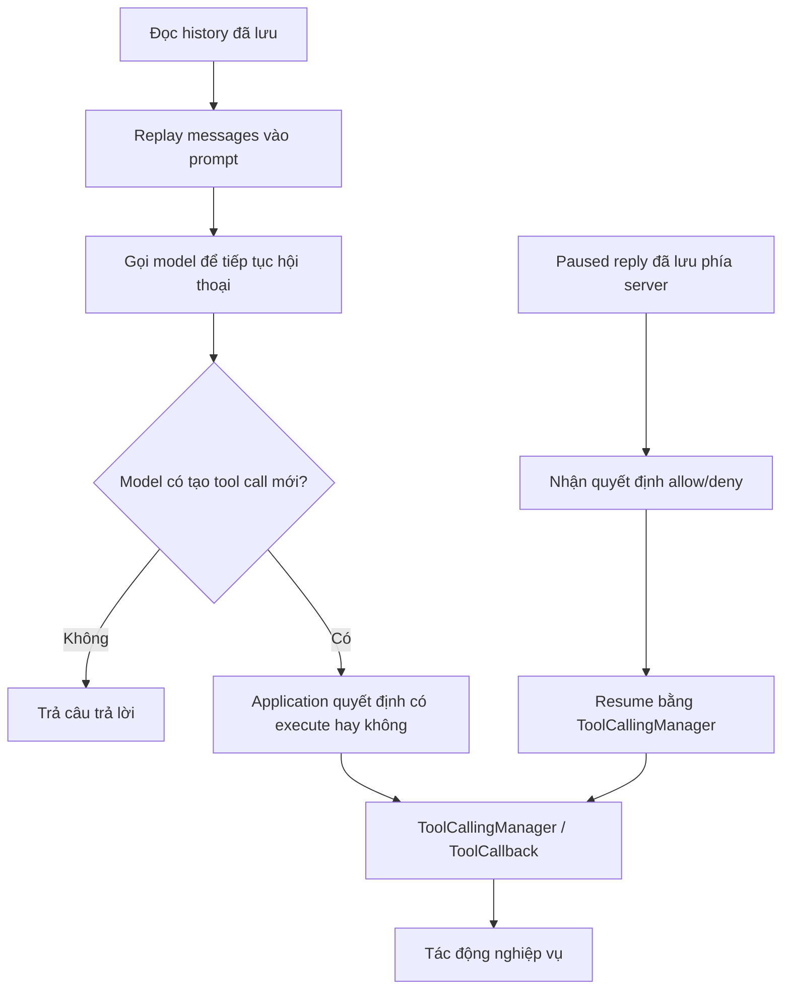
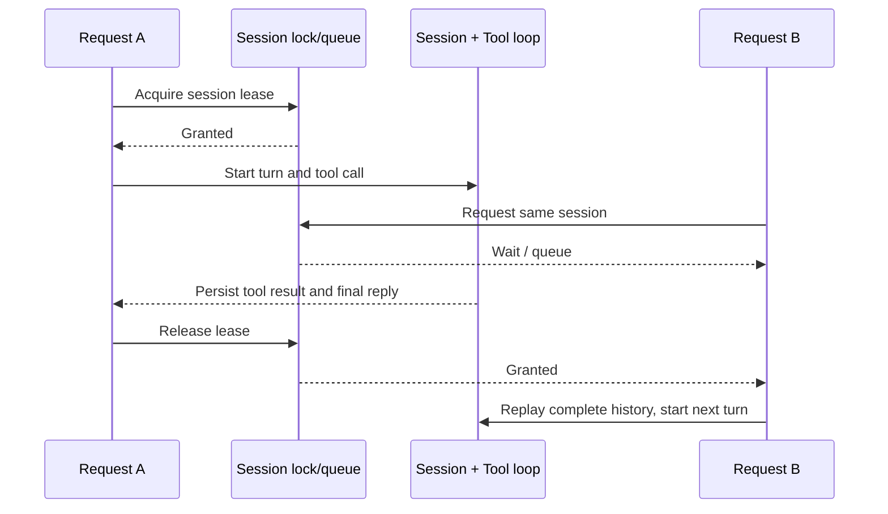

# Phân biệt phát lại lịch sử với cho phép chạy lại hành động

Phát lại lịch sử hội thoại và chạy lại một tool là hai thao tác khác nhau. Phát lại lịch sử đưa các message đã lưu trở lại prompt để mô hình hiểu ngữ cảnh. Chạy lại tool gọi callback và có thể tạo tác động mới lên hệ thống, chẳng hạn gửi email, đặt hàng, chuyển tiền hoặc cập nhật dữ liệu.

Một ứng dụng có thể phát lại cùng lịch sử nhiều lần mà không thực thi lại các hành động cũ. Ngược lại, nếu ứng dụng gọi lại `ToolCallingManager.executeToolCalls(...)` với một tool call đã được duyệt, callback sẽ chạy lại. Spring AI không tự bảo đảm việc resume confirmation là idempotent; tài liệu cảnh báo chạy cùng quyết định hai lần sẽ chạy tool hai lần.

Trong module `SPRING_AI_TOOL_CALLING`, cần quản lý riêng hai loại trạng thái: lịch sử hội thoại cho biết mô hình đã nói gì và nhận được kết quả nào; operation ledger của ứng dụng cho biết hành động nghiệp vụ nào đã được phê duyệt, bắt đầu, hoàn tất hoặc cần đối soát. Không dùng việc lưu một tool call vào history làm bằng chứng rằng hành động đã hoặc chưa xảy ra.

## 1. Bốn thao tác thường bị nhầm lẫn

| Thao tác | Điều gì được thực hiện? | Callback có chạy không? |
|---|---|---|
| Replay history | Đọc message đã lưu và gửi lại trong prompt để khôi phục ngữ cảnh | Không, chỉ vì message được replay |
| Regenerate model response | Gọi model lần nữa với history cũ để sinh phản hồi mới | Có thể model yêu cầu tool call mới |
| Resume tool call | Gửi tool call đang chờ cùng quyết định allow/deny qua `ToolCallingManager` | Có, nếu call được allow |
| Retry action | Thực hiện lại business command sau timeout/lỗi hoặc do client gửi lại request | Có thể tạo tác động lần nữa nếu không có idempotency |

Điểm phân biệt nằm ở ranh giới thực thi. Một `AssistantMessage` có tool calls chỉ là yêu cầu của mô hình. Một `ToolResponseMessage` là kết quả được ghi vào lịch sử. Việc gửi lại hai message này cho model không tự chạy callback. Callback chỉ chạy khi ứng dụng đưa tool call vào execution path, chẳng hạn `ToolCallingManager`.



Replay là thao tác đọc và dựng lại context. Resume/retry là thao tác điều phối thực thi. Một lần replay có thể khiến model đề xuất một hành động tương tự lần trước, vì vậy service vẫn cần idempotency để bảo vệ tác động nghiệp vụ.

## 2. Replay history không có nghĩa chạy lại các tool cũ

LLM thường không giữ trạng thái giữa hai request. Mỗi lần gọi model, ứng dụng gửi system instructions và phần history cần thiết để mô hình tiếp tục. History có thể chứa:

- `UserMessage`: câu hỏi hoặc yêu cầu của người dùng.
- `AssistantMessage`: nội dung trả lời hoặc một hay nhiều tool call.
- `ToolResponseMessage`: kết quả của các tool call trước đó.
- Các message khác theo giao thức của provider.

Ví dụ một lượt đã hoàn tất:

```text
UserMessage: "Gửi hóa đơn INV-2048 cho khách hàng."
AssistantMessage: tool call sendInvoice(call_81, invoiceId=INV-2048)
ToolResponseMessage: call_81 -> {"status":"SENT","receiptId":"R-901"}
AssistantMessage: "Hóa đơn đã được gửi. Mã biên nhận R-901."
```

Khi lượt sau cần tiếp tục, ứng dụng có thể replay các message trên vào prompt. Mô hình nhìn thấy rằng tool call đã có kết quả `SENT` và có thể trả lời dựa trên kết quả đó. Việc replay không gọi `sendInvoice` thêm lần nữa.

Không được bỏ `ToolResponseMessage` khi replay một assistant message có tool calls. Nhiều provider yêu cầu mọi tool call trong assistant message phải có tool response tương ứng. Một history chỉ có assistant tool call nhưng thiếu tool result có thể bị provider từ chối hoặc khiến luồng hội thoại không hợp lệ.

## 3. Model có thể tạo một tool call mới khi replay cùng history

Replay history không tự chạy tool cũ, nhưng việc gọi model lại vẫn có thể sinh ra một tool call mới. Ví dụ:

1. History ghi nhận người dùng muốn gửi hóa đơn.
2. Tool trước đó đã gửi thành công, nhưng tool result chưa được lưu do process bị dừng.
3. Ứng dụng replay history không đầy đủ hoặc gửi lại câu hỏi gốc.
4. Mô hình yêu cầu `sendInvoice` lần nữa.

Tool call mới có thể có ID khác với lần trước, dù tên tool và arguments giống nhau. Nếu business service chỉ dựa vào tool call ID để chống trùng, nó có thể vẫn gửi hóa đơn lần hai.

Vì vậy, phải kiểm tra trạng thái nghiệp vụ trước khi tạo tác động. Với thao tác gửi hóa đơn, server có thể tạo một `operationId` cho ý định gửi hóa đơn cụ thể và giữ ID đó qua mọi lần retry của cùng hành động. Khi service nhận lại cùng operation, nó trả kết quả đã lưu thay vì gọi nhà cung cấp gửi hóa đơn lần nữa.

## 4. Resume một tool call đang chờ xác nhận là thực thi thật

Spring AI 2.1 hỗ trợ Tool Call Confirmation. Khi một tool được đánh dấu `requiresConfirmation=true`, tool-calling loop tạm dừng trước khi thực thi bất kỳ tool call nào trong cùng assistant reply. Ứng dụng nhận `ChatResponse` chứa tool calls đang chờ quyết định.

```java
@Component
public class BookingTools {

    @Tool(description = "Đặt vé máy bay", requiresConfirmation = true)
    public BookingResult bookFlight(String flightNumber) {
        return bookingService.book(flightNumber);
    }
}
```

Nhận phản hồi tạm dừng:

```java
ChatResponse reply = chatClient.prompt()
        .user("Đặt chuyến bay VN204 vào ngày mai")
        .call()
        .chatResponse();

List<String> awaiting = ToolCallDecisions.awaitingDecision(reply);
if (!awaiting.isEmpty()) {
    // Lưu paused reply vào kho server-side, gắn với session và approval ID.
    pendingActionStore.save(reply, awaiting, authenticatedUser.id());
}
```

`content()` có thể rỗng khi loop tạm dừng; cần kiểm tra `chatResponse()` hoặc `chatClientResponse()` và `ToolCallDecisions.awaitingDecision(...)` để nhận biết trạng thái chờ xác nhận.

Khi người dùng duyệt, ứng dụng phải tải paused reply từ kho dữ liệu server-side, xác thực người duyệt và tạo một quyết định cho từng tool call trong reply. Sau đó ứng dụng gọi:

```java
ToolExecutionResult result = toolCallingManager.executeToolCalls(
        promptWithOriginalConversationAndTools,
        serverStoredPausedReply,
        decisions);
```

Đây là lệnh thực thi. Các call được allow sẽ chạy callback; các call bị deny trả thông điệp từ chối về mô hình mà không chạy callback. Kết quả chứa conversation history với paused reply và tool response tương ứng.

## 5. Phải lưu paused reply phía server và giữ nguyên nội dung gốc

Paused reply chứa tool name và arguments mà model đã tạo. Người dùng cuối không được phép tự sửa các giá trị này rồi gửi lại để ứng dụng thực thi.

Không nhận `ChatResponse`, `AssistantMessage` hoặc JSON tool calls từ request body của client làm đầu vào cho resume. Nếu client có thể thay đổi reply, họ có thể sửa `transferMoney` thành một tool khác, thay số tiền hoặc tự tạo yêu cầu có quyền cao hơn.

Hãy lưu tối thiểu:

- `approvalId` do server tạo.
- `sessionId` và user/tenant sở hữu session.
- Paused `ChatResponse` nguyên bản, gồm tool call IDs, names và arguments.
- Tool definitions/callback set hoặc phiên bản contract cần dùng khi resume.
- Các tool call keys đang chờ quyết định.
- Người được phép phê duyệt, quyết định, thời điểm và trạng thái xử lý.
- `operationId` ổn định cho từng hành động có tác động phụ.

Khi resume, đọc lại paused reply từ kho server-side và xác minh nó vẫn thuộc session/user hiện tại. `ToolCallingManager` chạy các tool calls trong reply được truyền vào; việc xác thực người duyệt là trách nhiệm của ứng dụng. Quyết định allow cũng không thay thế việc kiểm tra quyền truy cập tài nguyên ngay tại business service khi callback thực thi.

## 6. Mỗi tool call trong một reply cần có quyết định

Nếu một assistant reply có nhiều tool call và ít nhất một call cần confirmation, toàn bộ reply tạm dừng trước khi bất kỳ call nào chạy. Khi resume, cần có quyết định cho tất cả call trong reply, kể cả những call không bị policy đánh dấu cần confirmation.

Ví dụ model yêu cầu:

| Tool call | Quyết định |
|---|---|
| `getFlightStatus` | Allow |
| `bookFlight` | Allow sau khi người dùng duyệt |
| `sendEmail` | Deny |

```java
ToolCallDecisions decisions = ToolCallDecisions.of(
        ToolCallDecision.allow("call_status"),
        ToolCallDecision.allow("call_booking"),
        ToolCallDecision.deny("call_email", "Người dùng chưa đồng ý gửi email."));
```

Các key thường là tool call ID. Với provider không có ID hoặc có ID trùng, Spring AI dùng vị trí `#0`, `#1`, ... làm key quyết định. Hãy lấy key bằng `ToolCallDecisions.toolCallKeys(assistantMessage)` và resume với paused reply nguyên bản, giữ thứ tự tool calls ban đầu.

Không chỉ gửi quyết định allow cho tool cần confirmation rồi bỏ qua các call còn lại. `ToolCallingManager` kiểm tra một quyết định cho mỗi tool call trong reply và từ chối quyết định không thuộc reply.

Thông điệp deny được gửi về mô hình dưới dạng tool result. Spring AI không tự làm sạch thông điệp này; ứng dụng cần loại bỏ dữ liệu nhạy cảm, nội dung độc hại hoặc chi tiết nội bộ trước khi đưa vào `ToolCallDecision.deny(key, message)`.

## 7. Cùng một quyết định resume có thể chạy tool hai lần

Tool Call Confirmation giữ loop stateless trong Spring AI. Framework trả paused reply về ứng dụng và chờ một request resume. Nó không tự lưu trạng thái đã thực thi hay khóa replay cho quyết định.

Nếu ứng dụng gọi `executeToolCalls(prompt, reply, decisions)` hai lần với cùng paused reply và decisions, các tool được allow có thể được thực thi hai lần. Đây không phải replay history; đó là hai lần gọi execution path.

Các tình huống có thể tạo duplicate execution:

- Người dùng nhấn nút “Duyệt” hai lần.
- Browser gửi lại POST do timeout hoặc retry.
- API gateway retry request sau khi backend đã chạy tool nhưng response bị mất.
- Hai instance xử lý đồng thời cùng `approvalId`.
- Worker chạy lại message trong queue sau khi consumer không ack.
- Process đã gọi dịch vụ ngoài thành công nhưng chết trước khi lưu trạng thái hoàn tất.

Không dựa vào giao diện disable nút hoặc một biến `boolean` trong memory của JVM. Cần trạng thái bền vững trong database và cập nhật nguyên tử để chỉ một worker được nhận quyền thực thi một approval.

## 8. Phân biệt lịch sử hội thoại với operation ledger

History và operation ledger có mục đích khác nhau:

| Dữ liệu | Câu hỏi được trả lời | Dùng để chống chạy trùng? |
|---|---|---|
| Conversation history | Người dùng và mô hình đã trao đổi những gì? Tool đã trả kết quả gì trong hội thoại? | Không đủ |
| Session event log | Những message và runtime event nào đã được ghi vào session? | Có thể hỗ trợ audit/state, nhưng cần operation identity và atomic claim |
| Approval record | Ai đã duyệt paused reply nào, vào lúc nào? | Ngăn resume cùng approval nhiều lần nếu được cập nhật nguyên tử |
| Operation ledger | Hành động nghiệp vụ nào đã bắt đầu/kết thúc với operation ID nào? | Có, là điểm kiểm soát idempotency ở ứng dụng |
| Provider idempotency key | Dịch vụ ngoài đã xử lý command này chưa? | Có, nếu provider hỗ trợ và giữ key theo hợp đồng |

Một `ToolResponseMessage` có nội dung `{"status":"SENT"}` là bằng chứng mô hình đã nhận một kết quả. Nó không thay thế trạng thái giao dịch bền vững của dịch vụ gửi hóa đơn. Ngược lại, operation ledger có thể biết hóa đơn đã gửi dù tool response chưa kịp được ghi vào session.

## 9. Dùng operation ID ổn định cho hành động có tác động phụ

Khi người dùng duyệt một hành động, server tạo một `operationId` và lưu nó cùng paused reply, tool call key, actor, resource và payload hash. Mọi retry của cùng hành động phải dùng lại operation ID đó.

Ví dụ bảng lưu trạng thái:

```sql
CREATE TABLE tool_operation (
    operation_id       VARCHAR(64) PRIMARY KEY,
    approval_id        VARCHAR(64) NOT NULL,
    tool_call_key      VARCHAR(128) NOT NULL,
    tool_name          VARCHAR(128) NOT NULL,
    payload_hash       VARCHAR(128) NOT NULL,
    status             VARCHAR(32) NOT NULL,
    result_json        TEXT,
    created_at         TIMESTAMP NOT NULL,
    updated_at         TIMESTAMP NOT NULL,
    UNIQUE (approval_id, tool_call_key)
);
```

Trạng thái có thể gồm:

```text
PENDING_APPROVAL
       |
       +---- deny ----> DENIED
       |
       +---- allow ---> APPROVED
                            |
                            +---- claim atomically ---> RUNNING
                                                          |
                                                          +--> SUCCEEDED
                                                          +--> FAILED_RETRYABLE
                                                          +--> UNKNOWN_OUTCOME
```

`operationId` được tạo và lưu một lần. Không tạo ID mới mỗi khi client retry. `payloadHash` giúp phát hiện trường hợp một operation ID bị dùng lại với tool name hoặc arguments khác; trường hợp này phải bị từ chối.

## 10. Claim approval một cách nguyên tử

Trước khi gọi `ToolCallingManager`, application service cần claim approval bằng một thao tác compare-and-set trong database. Chỉ một request được chuyển từ `APPROVED` sang `RUNNING`.

Ví dụ SQL:

```sql
UPDATE tool_approval
SET status = 'RUNNING',
    started_at = CURRENT_TIMESTAMP,
    version = version + 1
WHERE approval_id = :approvalId
  AND status = 'APPROVED'
  AND version = :expectedVersion;
```

Nếu số dòng cập nhật là `1`, request hiện tại đã claim được approval. Nếu là `0`, request khác đã claim hoặc approval không còn ở trạng thái có thể chạy. Khi đó đọc trạng thái hiện tại:

- `SUCCEEDED`: trả lại kết quả đã lưu, không chạy callback.
- `RUNNING`: trả trạng thái đang xử lý hoặc cho client kiểm tra lại sau.
- `DENIED`/`CANCELLED`: không chạy.
- `UNKNOWN_OUTCOME`: cần đối soát trước khi quyết định retry.

Đừng giữ một database transaction mở trong lúc gọi model hoặc một dịch vụ mạng lâu dài. Tách bước claim bền vững, thực thi, rồi ghi kết quả. Nếu process chết sau khi claim, worker recovery cần kiểm tra trạng thái operation và hệ thống đích trước khi tiếp tục.

## 11. Idempotency phải nằm sát business side effect

Claim approval ngăn hai request resume cùng một approval cùng lúc. Nó chưa đủ để giải quyết crash sau khi dịch vụ ngoài đã thực hiện hành động nhưng trước khi ứng dụng lưu `SUCCEEDED`.

Ví dụ service gửi hóa đơn:

```java
@Service
public class InvoiceApplicationService {

    private final ToolOperationRepository operations;
    private final InvoiceGateway invoiceGateway;

    public InvoiceApplicationService(
            ToolOperationRepository operations,
            InvoiceGateway invoiceGateway) {
        this.operations = operations;
        this.invoiceGateway = invoiceGateway;
    }

    public InvoiceResult sendOnce(
            String operationId,
            String invoiceId,
            String payloadHash) {

        ToolOperation operation = operations.require(operationId);
        operation.requireSamePayload(payloadHash);

        if (operation.isSucceeded()) {
            return operation.savedResult(InvoiceResult.class);
        }

        if (!operation.isClaimedByCurrentExecution()) {
            throw new OperationAlreadyRunningException(operationId);
        }

        InvoiceResult result = invoiceGateway.send(
                invoiceId,
                operationId); // Gửi operationId làm idempotency key nếu gateway hỗ trợ.

        operations.markSucceeded(operationId, result);
        return result;
    }
}
```

`ToolOperationRepository`, `InvoiceGateway` và các phương thức trạng thái trong ví dụ là thành phần của ứng dụng. `InvoiceGateway.send(..., operationId)` cần truyền operation ID vào idempotency header/field theo hợp đồng của nhà cung cấp. Nếu nhà cung cấp không hỗ trợ idempotency, ứng dụng phải dùng reconciliation hoặc một workflow có thể đối soát; không thể khẳng định exactly-once chỉ bằng một transaction database cục bộ.

Nếu side effect nằm trong cùng database, có thể ghi trạng thái nghiệp vụ và operation ledger trong một transaction. Nếu side effect ở hệ thống ngoài, dùng transactional outbox, provider idempotency key và đối soát trạng thái để xử lý crash giữa hai hệ thống.

## 12. Gắn operation ID với tool call mà không cho mô hình tự chọn

`operationId` là metadata của ứng dụng, không phải tham số để mô hình tự tạo. Không thêm một trường `operationId` vào input schema rồi tin giá trị model gửi.

Với một hành động duy nhất trong một request, ứng dụng có thể truyền operation ID qua context tin cậy hoặc một callback wrapper được tạo cho approval đó. Với một reply có nhiều tool calls, mỗi call cần một operation ID riêng, được lưu theo `approvalId` và tool call key. Khi dispatch callback, adapter/wrapper lấy operation ID tương ứng từ server-side approval state.

Ví dụ một tool đọc operation ID từ `ToolContext` do application tạo:

```java
@Component
public class InvoiceTools {

    private final InvoiceApplicationService invoiceService;

    public InvoiceTools(InvoiceApplicationService invoiceService) {
        this.invoiceService = invoiceService;
    }

    @Tool(description = "Gửi hóa đơn đã được người dùng phê duyệt.")
    public InvoiceResult sendInvoice(
            @ToolParam(description = "Mã hóa đơn") String invoiceId,
            ToolContext toolContext) {

        String operationId = requireTrustedString(toolContext, "operationId");
        String payloadHash = requireTrustedString(toolContext, "payloadHash");
        return invoiceService.sendOnce(operationId, invoiceId, payloadHash);
    }
}
```

Ví dụ này giả định một operation ID đã được bind cho callback/request hiện tại. Nếu một reply chứa nhiều hành động cần thực thi, không dùng chung một `operationId` cho tất cả; hãy bind operation ID riêng cho từng call trong adapter điều phối.

## 13. Resume đúng cách với ToolCallingManager

Khi ứng dụng giữ conversation, hãy lưu prompt/history và paused reply ở server. Khi người dùng duyệt:

1. Xác thực người duyệt và quyền duyệt đối với hành động cụ thể.
2. Đọc paused reply nguyên bản từ storage.
3. Kiểm tra approval còn `APPROVED`, chưa hết hạn và chưa được claim.
4. Claim approval nguyên tử.
5. Tạo `ToolCallDecisions` đầy đủ cho từng call.
6. Gọi cùng `ToolCallingManager` với prompt mang đúng tool callbacks và paused reply đã lưu.
7. Lưu tool results và trạng thái operation.
8. Tiếp tục hội thoại bằng `ToolExecutionResult.conversationHistory()`.

Ví dụ minh họa phần điều phối:

```java
public ResumeResult resumeApprovedAction(
        String approvalId,
        AuthenticatedUser actor) {

    StoredApproval approval = approvalStore.loadForActor(approvalId, actor.id());
    approval.requirePendingOrApproved();
    approval.requireSameSessionAndTenant(actor);

    ClaimResult claim = approvalStore.claimAtomically(approvalId, actor.id());
    if (!claim.acquired()) {
        return claim.toResumeResult(); // Đã chạy, đang chạy hoặc không còn hợp lệ.
    }

    Prompt prompt = approval.toPromptWithOriginalToolsAndHistory();
    ChatResponse pausedReply = approval.pausedReply();
    ToolCallDecisions decisions = approval.toDecisions();

    try {
        ToolExecutionResult result = toolCallingManager.executeToolCalls(
                prompt, pausedReply, decisions);
        approvalStore.complete(approvalId, result.conversationHistory());
        return ResumeResult.completed(result);
    }
    catch (RuntimeException ex) {
        approvalStore.recordFailureOrUnknownOutcome(approvalId, ex);
        throw ex;
    }
}
```

Các kiểu `StoredApproval`, `ClaimResult` và `ResumeResult` là abstraction của ứng dụng. Mã này minh họa nơi đặt claim và nơi gọi manager; transaction claim/complete phải được lưu bền vững. Nếu exception xảy ra sau khi tool đã tạo side effect, không tự động đưa approval về `APPROVED` để chạy lại. Hãy chuyển sang `UNKNOWN_OUTCOME` và đối soát bằng operation ID.

## 14. Đừng resume một pause đã bị đóng bởi lượt người dùng mới

Một confirmation có thể bị bỏ dở: người dùng không duyệt mà gửi câu hỏi mới. Khi lượt mới đã được chấp nhận, pause cũ không còn là một yêu cầu đang chờ có thể resume.

Spring AI Session Memory xử lý open tool calls từ lượt cũ bằng `SessionTurnAdvisor`. Ở lượt tiếp theo, advisor ghi một tool result trung lập:

```text
No result was recorded for this tool call.
```

Thông điệp này nói đúng những gì log biết. Nếu vòng trước thất bại sau khi callback chạy, tool có thể đã tạo side effect dù chưa có tool result được lưu. Advisor không tự chạy lại tool. Nếu ứng dụng muốn ghi nhận người dùng chủ động từ chối, hãy gửi quyết định deny qua confirmation flow trước khi chấp nhận message mới.

Sau khi message mới đã được chấp nhận, không resume pause cũ. Nếu resume sau đó, tool result sẽ là câu trả lời thứ hai cho cùng tool call và read guard có thể loại nó khỏi prompt.

## 15. Session history là append-only log, không phải operation ledger

Spring AI 2.1 Session Memory lưu hội thoại như một append-only log của `SessionEvent`. Event có ID, session ID, timestamp, type, message hoặc payload. Compaction tạo boundary event để thay đổi active view mà không sửa/xóa event cũ.

```java
SessionEvent messageEvent = SessionEvent.builder()
        .sessionId(sessionId)
        .message(new UserMessage("Kiểm tra trạng thái hóa đơn INV-2048"))
        .build();

sessionService.appendEvent(messageEvent);

List<Message> activeHistory = sessionService.getActiveMessages(sessionId);
List<SessionEvent> fullLog = sessionService.getEvents(sessionId, EventFilter.all());
```

Một event có thể được append lại idempotently nếu dùng lại cùng event ID đã commit: Spring AI không tạo duplicate event và không tăng log version. Đây là bảo đảm chống ghi event trùng trong session repository. Nó không có nghĩa `ToolCallback` được gọi lại với cùng event ID sẽ không tạo side effect.

Hãy tách rõ:

- `SessionEvent.id`: định danh một event trong lịch sử.
- `toolCall.id`: định danh một lần model yêu cầu gọi tool.
- `approvalId`: định danh yêu cầu phê duyệt.
- `operationId`: định danh một hành động nghiệp vụ để chống thực thi trùng.

Các ID có thể được liên kết với nhau trong operation ledger, nhưng chúng có phạm vi và ý nghĩa khác nhau. Không dùng event ID thay cho operation ID.

## 16. SessionTurnAdvisor và read guard bảo vệ tính hợp lệ của history

Session advisors giúp giữ lịch sử hợp lệ khi tool loop bị pause hoặc thất bại:

- `SessionMemoryAdvisor` chạy trong tool loop, lưu tool call và tool result theo từng vòng.
- `SessionTurnAdvisor` chạy ngoài loop, lưu kết quả của vòng kết thúc mà không có model round tiếp theo, ví dụ `returnDirect` hoặc vượt tool-call limit.
- Nếu một turn cũ có tool call chưa có kết quả, `SessionTurnAdvisor` ghi `UNANSWERED_TOOL_RESULT` ở lượt tiếp theo.
- Read guard loại assistant tool call không có đủ tool response theo sau và loại tool response không có call trước đó khỏi prompt.
- Khi ghi kết quả cho call đang mở, advisor dùng version check để không append kết quả lần nữa nếu writer khác đã ghi trước.

Read guard giữ prompt hợp lệ. Nó không thể xác nhận tool đã hoặc chưa tạo side effect. Nếu log nói “No result was recorded”, điều đó chỉ có nghĩa không có result event được ghi; không chứng minh callback chưa chạy.

## 17. Serialize các lượt trên cùng một session

Session Memory ghi history theo thứ tự event, nhưng log không tự lưu trạng thái “turn này vẫn đang chạy”. Nếu một request thứ hai tới cùng session khi tool của request đầu chưa hoàn tất, advisor có thể nhìn thấy open tool call và ghi unanswered result. Khi callback đầu tiên hoàn tất, kết quả thật có thể trở thành câu trả lời thứ hai và bị read guard loại khỏi prompt.

Vì vậy, Spring AI khuyến nghị chỉ một call cho mỗi session tại một thời điểm. Ứng dụng cần serialize các request theo session ID bằng hàng đợi, distributed lock hoặc session lease có thời hạn. Không chỉ dùng `synchronized` trong một JVM nếu ứng dụng chạy nhiều instance.



Lease cần có TTL và fencing/version để xử lý process chết. Nếu lease hết hạn trong khi callback cũ vẫn chạy, operation ledger và idempotency ở business service vẫn phải bảo vệ side effect.

## 18. Lưu ý khi dùng ChatMemory cũ

Trong Spring AI 2.1, `ChatMemory`, `ChatMemoryRepository` và `MessageChatMemoryAdvisor` đã deprecated để chuyển sang Session Memory; chúng dự kiến bị loại bỏ ở 3.0. Ngoài ra, các repository như `JdbcChatMemoryRepository` cũ không hỗ trợ tool call messages: `AssistantMessage` có tool calls và `ToolResponseMessage` có thể bị lọc khỏi history khi lưu.

Với ứng dụng dùng tool calling, cần kiểm tra repository có giữ đầy đủ tool-call/result messages hay không. Session JDBC lưu các message type và event cần thiết. Dù chọn repository nào, history chỉ là nguồn context/audit; trạng thái hành động vẫn phải có operation ledger riêng.

## 19. Các tình huống và quyết định đúng

| Tình huống | Hành động đúng | Điều cần tránh |
|---|---|---|
| Người dùng mở lại conversation cũ | Replay active history và tiếp tục model | Chạy lại tất cả callback đã xuất hiện trong history |
| Process chết sau khi tool đã chạy nhưng chưa lưu result | Đối soát operation/provider bằng operation ID; ghi result đã xác minh | Gọi tool lại chỉ vì history thiếu ToolResponseMessage |
| Tool call đang chờ confirmation | Tải paused reply server-side, xác thực approver, claim approval rồi resume | Nhận paused reply từ client hoặc gọi manager hai lần |
| Client retry nút duyệt | Trả trạng thái/result đã lưu từ approval/operation ledger | Tạo operation ID mới và gửi lại side effect |
| Model được gọi lại và sinh tool call mới tương tự | Service kiểm tra idempotency key theo business action | Chỉ so sánh tool call ID do model tạo |
| Người dùng gửi message mới khi pause cũ chưa duyệt | Đóng pause cũ bằng deny/unanswered policy theo ứng dụng | Resume pause cũ sau khi turn mới đã được nhận |
| History bị thiếu một nửa tool pair | Sửa persistence/filter hoặc để read guard loại pair không hợp lệ | Gửi prompt có assistant tool call không có result |
| Hai request đồng thời cùng session | Serialize turn theo session | Để message và tool results xen kẽ |

## 20. Kiểm thử replay và execution độc lập

Test cần chứng minh rằng replay history không chạy callback, còn resume/retry có kiểm soát được side effect.

| Ca kiểm thử | Kịch bản | Kết quả mong đợi |
|---|---|---|
| Replay completed turn | Load user, assistant tool call, tool result và final answer; gọi model với history | Callback cũ không được gọi lại |
| Replay incomplete pair | History có assistant tool call nhưng thiếu tool result | Read guard/validation ngăn gửi history không hợp lệ |
| Resume approved pause | Server lưu paused reply; approver hợp lệ allow | Callback chạy theo đúng tool call đã lưu |
| Duplicate resume | Gửi cùng approval request hai lần | Chỉ một request claim; lần sau nhận trạng thái/result đã lưu |
| Concurrent resume | Hai instance cùng claim approval | Một claimant duy nhất được thực thi |
| Crash after side effect | Provider hoàn tất nhưng app chưa lưu result | Reconciliation/provider idempotency trả cùng kết quả, không tạo tác động lần hai |
| Regenerate model response | Replay history rồi model phát tool call mới cùng business intent | Operation ledger chặn duplicate business effect |
| Deny decision | Người dùng từ chối tool call | Callback không chạy; tool result phản ánh deny |
| New turn closes pause | Có message mới trước khi resume | Pause cũ không được resume |
| Event append retry | Append lại cùng SessionEvent ID | Không tạo event duplicate; không ảnh hưởng operation execution |
| Same session concurrent turns | Hai request cùng session | Application queue/lease chạy từng turn tuần tự |

Ví dụ test đơn giản cho callback counter:

```java
@Test
void replayingHistoryDoesNotExecuteThePreviousToolAgain() {
    List<Message> completedHistory = List.of(
            new UserMessage("Gửi hóa đơn INV-2048"),
            assistantMessageWithToolCall("call_81", "sendInvoice"),
            toolResponse("call_81", "{\"status\":\"SENT\"}"),
            new AssistantMessage("Hóa đơn đã được gửi."));

    chatModel.call(new Prompt(completedHistory));

    verify(invoiceTool, never()).sendInvoice(anyString(), any());
}
```

Ví dụ là test phác họa: `assistantMessageWithToolCall(...)` và `toolResponse(...)` tạo message hợp lệ theo API/provider của ứng dụng. Integration test cần dùng model giả lập để xác minh không có callback nào được dispatch chỉ vì message cũ xuất hiện trong prompt.

## 21. Checklist chống chạy lại hành động ngoài ý muốn

- Phân biệt replay history, regenerate model response, resume confirmation và retry business action.
- Paused reply được lưu server-side, không nhận từ client.
- Người duyệt được xác thực và có quyền duyệt đúng resource/action.
- Mỗi tool call có approval key và operation ID do server quản lý.
- Resume được claim nguyên tử bằng trạng thái bền vững.
- Callback ghi dữ liệu kiểm tra idempotency ngay tại business service.
- Payload hash ngăn reuse operation ID cho arguments khác.
- Provider idempotency key hoặc reconciliation xử lý crash sau side effect.
- Tool result chỉ được ghi sau khi xác định kết quả thực thi.
- Không tự retry operation ở trạng thái `UNKNOWN_OUTCOME`.
- History luôn có assistant tool call và tool response hợp lệ theo protocol.
- SessionTurnAdvisor/read guard được hiểu là bảo vệ history, không phải bảo đảm exactly-once.
- Các request cùng session được serialize ở mức application/distributed.
- Test replay không chạy callback, duplicate resume, concurrent resume và crash window.
- Audit log phân biệt approval, tool execution và message persistence.

## 22. Tài liệu tham khảo

- [Spring AI 2.1 — Session Memory](https://docs.spring.io/spring-ai/reference/api/session.html): session append-only event log, active view, session service và idempotent event append.
- [Spring AI 2.1 — Session Concepts](https://docs.spring.io/spring-ai/reference/api/session/concepts.html): message events, turn boundaries, event IDs, append semantics và optimistic concurrency.
- [Spring AI 2.1 — ChatClient Integration](https://docs.spring.io/spring-ai/reference/api/session/chat-client.html): `SessionMemoryAdvisor`, `SessionTurnAdvisor`, read guard, unanswered tool result và giới hạn một call mỗi session.
- [Spring AI 2.1 — Tool Call Confirmation](https://docs.spring.io/spring-ai/reference/api/tools/tool-call-confirmation.html): paused reply, allow/deny decisions, resume qua `ToolCallingManager` và cảnh báo replay không idempotent.
- [Spring AI 2.1 — Tool Calling](https://docs.spring.io/spring-ai/reference/api/tools.html): application sở hữu tool execution và tool calling loop.
- [Spring AI — Chat Memory and migration to Session Memory](https://docs.spring.io/spring-ai/reference/api/chat-memory.html): trạng thái deprecated của ChatMemory API và bảng chuyển sang Session Memory.

Hãy replay history để mô hình hiểu những gì đã diễn ra. Chỉ resume hoặc retry khi ứng dụng có một hành động đang chờ thực thi, đã xác thực quyết định và có operation ID bền vững. Lịch sử hội thoại giữ ngữ cảnh; operation ledger giữ sự thật về tác động nghiệp vụ. Tách hai trách nhiệm này giúp ứng dụng có thể khôi phục hội thoại sau sự cố mà không gửi email, đặt hàng hoặc cập nhật dữ liệu lần nữa ngoài ý muốn.
