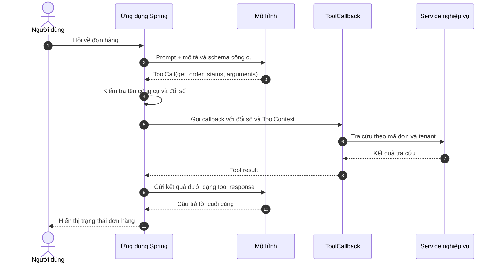

# Mô hình chọn công cụ và sinh đối số thay vì trực tiếp chạy mã

Trong Spring AI, tool calling cho phép mô hình ngôn ngữ yêu cầu ứng dụng thực hiện một thao tác đã được công bố, chẳng hạn tra cứu đơn hàng hoặc lấy dữ liệu thời tiết. Mô hình quyết định **khi nào cần công cụ, chọn công cụ nào và đề xuất các đối số**. Mã Java trong ứng dụng mới là nơi thực sự gọi service, truy cập cơ sở dữ liệu hoặc gửi yêu cầu HTTP.

Sự phân chia này là nền tảng của tích hợp AI an toàn: mô hình xử lý ngôn ngữ và lựa chọn; ứng dụng giữ quyền thực thi, xác thực, phân quyền và áp dụng quy tắc nghiệp vụ.

Sau bài học, bạn có thể:

- Giải thích vì sao một tool call là yêu cầu có cấu trúc chứ không phải đoạn mã do mô hình chạy.
- Mô tả vai trò của tên công cụ, mô tả, JSON Schema, `@Tool`, `ToolCallback` và `ToolContext`.
- Theo dõi vòng trao đổi giữa người dùng, mô hình và ứng dụng khi có một hoặc nhiều tool call.
- Xác định những kiểm tra mà ứng dụng phải thực hiện trước khi gọi chức năng nghiệp vụ.

## 1. Mô hình không trực tiếp chạy mã

Mô hình ngôn ngữ không tự truy cập đối tượng Java, cơ sở dữ liệu hay mạng nội bộ chỉ vì người dùng yêu cầu. Ứng dụng cung cấp cho mô hình danh sách các công cụ được phép dùng. Mỗi công cụ có một hợp đồng gồm:

- **Tên** để nhận diện công cụ.
- **Mô tả** giải thích công cụ làm gì và khi nào nên dùng.
- **Schema đầu vào** mô tả các trường đối số, kiểu dữ liệu và trường bắt buộc.

Khi thấy yêu cầu phù hợp, mô hình có thể trả về một tool call gồm tên công cụ và các đối số theo cấu trúc đã công bố. Đây là một thông điệp yêu cầu thực thi. Ứng dụng nhận thông điệp, tìm callback tương ứng, kiểm tra dữ liệu rồi mới gọi mã Java.

Ví dụ, với câu hỏi “Đơn hàng ORD-2026-001 đang ở trạng thái nào?”, mô hình có thể đề xuất yêu cầu tương đương với:

```json
{
  "name": "get_order_status",
  "arguments": {
    "orderId": "ORD-2026-001"
  }
}
```

Đoạn JSON trên chỉ minh họa nội dung của yêu cầu. Nó không phải lệnh SQL, mã Java hay lời gọi HTTP. Mô hình không tự thực hiện truy vấn. Ứng dụng quyết định có chấp nhận yêu cầu đó hay không và callback nào được phép xử lý nó.

Nếu câu hỏi không cần dữ liệu hoặc hành động bên ngoài, mô hình có thể trả lời bằng văn bản thông thường mà không yêu cầu công cụ. Nếu cần thêm thông tin, nó có thể yêu cầu một công cụ khác sau khi nhận kết quả của lần gọi trước.

## 2. Vòng đời của một tool call

Một lượt gọi công cụ thường diễn ra theo trình tự sau:



Có năm bước cần phân biệt:

1. **Công bố công cụ.** Ứng dụng gửi prompt cùng các định nghĩa công cụ mà lượt hội thoại được phép sử dụng. Mô hình chỉ có thể chọn trong phạm vi mà ứng dụng công bố cho lượt đó.
2. **Đề xuất lời gọi.** Mô hình trả về một hoặc nhiều tool call. Tên và đối số là dữ liệu có cấu trúc trong phản hồi của mô hình, không phải một câu văn yêu cầu người dùng tự thực thi.
3. **Điều phối và thực thi.** Spring AI hoặc bộ điều phối do ứng dụng quản lý ánh xạ tên công cụ tới `ToolCallback`. Callback nhận đối số, có thể nhận thêm `ToolContext`, rồi gọi chức năng Java tương ứng.
4. **Trả kết quả cho mô hình.** Ứng dụng đưa kết quả callback trở lại lịch sử hội thoại dưới dạng phản hồi của công cụ. Kết quả này cho mô hình biết thao tác đã trả về điều gì.
5. **Hoàn tất hoặc tiếp tục.** Mô hình tạo câu trả lời cho người dùng hoặc yêu cầu thêm công cụ. Bộ điều phối tiếp tục vòng lặp cho đến khi có phản hồi cuối cùng hoặc chạm giới hạn điều phối.

Một phản hồi chứa tool call vì vậy chưa chắc đã là câu trả lời cuối cùng. Ứng dụng cần hoàn tất việc thực thi và gửi kết quả trở lại mô hình trước khi trình bày câu trả lời cuối cùng cho người dùng.

## 3. Schema đầu vào là hợp đồng giữa mô hình và ứng dụng

Schema giúp mô hình biết cần tạo ra những đối số nào. Ví dụ, công cụ tra cứu đơn hàng có thể công bố đầu vào tương đương JSON Schema sau:

```json
{
  "type": "object",
  "properties": {
    "orderId": {
      "type": "string",
      "description": "Mã đơn hàng cần tra cứu"
    }
  },
  "required": ["orderId"]
}
```

Schema cho mô hình biết `orderId` là chuỗi và phải có mặt. Nó giúp giảm lỗi định dạng, làm rõ giao diện và cho phép framework chuyển đối số sang kiểu Java phù hợp. Schema không chứng minh rằng mã đơn hàng tồn tại, người gọi có quyền xem đơn hàng hay thao tác đó phù hợp với quy tắc nghiệp vụ.

Do đó, cần kiểm tra ở cả hai lớp:

| Lớp | Trách nhiệm |
|---|---|
| Schema công cụ | Mô tả cấu trúc, kiểu dữ liệu, trường bắt buộc và ý nghĩa đối số cho mô hình |
| Ứng dụng và service | Kiểm tra dữ liệu thực tế, quyền truy cập, trạng thái nghiệp vụ và các bất biến trước khi thực thi |

Đối số do mô hình đề xuất luôn phải được xem là đầu vào không đáng tin cậy. Ứng dụng cần kiểm tra độ dài chuỗi, định dạng mã, giới hạn số, giá trị enum và các ràng buộc nghiệp vụ. Không dùng trực tiếp chuỗi do mô hình tạo ra để ghép SQL, tên bảng, đường dẫn hệ thống hoặc lệnh shell.

Một schema tốt nên có phạm vi nhỏ, kiểu dữ liệu rõ ràng và mô tả cụ thể. Ví dụ, thay vì cung cấp một công cụ `execute_query(sql)` nhận SQL tùy ý, hãy cung cấp `get_order_status(orderId)` chỉ đọc đúng thông tin nghiệp vụ cần thiết. Công cụ càng hẹp thì ứng dụng càng dễ kiểm tra và kiểm soát quyền.

## 4. Khai báo công cụ bằng `@Tool`

Spring AI hỗ trợ khai báo phương thức Java thành công cụ bằng annotation `@Tool`. `@ToolParam` mô tả các tham số để Spring AI xây dựng schema đầu vào.

Ví dụ dưới đây minh họa công cụ chỉ đọc trạng thái đơn hàng:

```java
import org.springframework.ai.chat.model.ToolContext;
import org.springframework.ai.tool.annotation.Tool;
import org.springframework.ai.tool.annotation.ToolParam;
import org.springframework.stereotype.Component;

@Component
public class OrderTools {

    private final OrderQueryService orderQueryService;

    public OrderTools(OrderQueryService orderQueryService) {
        this.orderQueryService = orderQueryService;
    }

    @Tool(
        name = "get_order_status",
        description = "Tra cứu trạng thái một đơn hàng theo mã. "
            + "Chỉ đọc trạng thái và thời điểm cập nhật của đơn hàng."
    )
    public OrderStatusView getOrderStatus(
            @ToolParam(description = "Mã đơn hàng, ví dụ ORD-2026-001")
            String orderId,
            ToolContext toolContext) {

        String tenantId = (String) toolContext.getContext().get("tenantId");
        if (tenantId == null || tenantId.isBlank()) {
            throw new IllegalStateException("Thiếu tenant context");
        }

        return orderQueryService.findStatus(orderId, tenantId)
            .orElseThrow(() -> new OrderNotFoundException(orderId));
    }
}
```

`OrderStatusView` có thể là một kiểu dữ liệu trả về nhỏ, chỉ chứa thông tin cần cho câu trả lời:

```java
import java.time.Instant;

public record OrderStatusView(
    String orderId,
    String status,
    Instant updatedAt
) {}
```

Các điểm quan trọng trong ví dụ:

- `@Tool` cung cấp tên và mô tả mà mô hình dùng để lựa chọn công cụ. Mô tả cần nói đúng phạm vi và tác động của phương thức.
- `@ToolParam` giải thích ý nghĩa tham số và góp phần tạo schema đầu vào.
- Phương thức Java là nơi thực thi thật. Nó gọi `OrderQueryService`, nơi tiếp tục áp dụng truy vấn và quy tắc truy cập.
- `ToolContext` cung cấp dữ liệu phụ do ứng dụng truyền vào. Nó không phải tham số mà mô hình cần tự sinh trong JSON.
- Kiểu trả về gọn giúp giới hạn dữ liệu đưa trở lại mô hình và giảm nguy cơ lộ các trường nội bộ.

Chỉ đặt `@Tool` trên phương thức chưa làm cho phương thức tự động xuất hiện trong mọi lượt hội thoại. Ứng dụng cần đăng ký hoặc truyền đối tượng chứa phương thức đó vào `ChatClient` hay danh sách callback của lượt gọi.

Ví dụ truyền đối tượng công cụ vào một lượt gọi:

```java
String answer = chatClient.prompt()
    .user("Đơn hàng ORD-2026-001 hiện ở trạng thái nào?")
    .toolContext(Map.of("tenantId", authenticatedTenantId))
    .tools(orderTools)
    .call()
    .content();
```

`authenticatedTenantId` phải được lấy từ phiên đăng nhập hoặc ngữ cảnh bảo mật phía máy chủ. Không lấy tenant, vai trò hay danh tính cần tin cậy từ nội dung người dùng hoặc đối số do mô hình sinh ra.

## 5. `ToolCallback` là điểm thực thi của ứng dụng

`@Tool` là cách khai báo tiện lợi. Ở lớp điều phối, Spring AI biểu diễn công cụ bằng abstraction `ToolCallback`. Một callback gắn định nghĩa công cụ với hành vi thực thi: nó cung cấp thông tin mô tả công cụ và nhận chuỗi đầu vào để trả kết quả.

Có thể chuyển các phương thức có `@Tool` thành callback bằng `ToolCallbacks.from(...)`:

```java
ToolCallback[] callbacks = ToolCallbacks.from(orderTools);

String answer = chatClient.prompt()
    .user("Đơn hàng ORD-2026-001 hiện ở trạng thái nào?")
    .toolContext(Map.of("tenantId", authenticatedTenantId))
    .toolCallbacks(callbacks)
    .call()
    .content();
```

Khi cần tích hợp một nguồn công cụ động hoặc một hệ thống có giao diện riêng, ứng dụng cũng có thể cung cấp một triển khai `ToolCallback` phù hợp. Dù callback được tạo từ annotation hay được viết riêng, trách nhiệm của nó vẫn là nối định nghĩa công cụ với mã thực thi mà ứng dụng kiểm soát.

Trong quá trình điều phối, `ToolCallingManager` của Spring AI phối hợp các callback được đăng ký với tool call trong phản hồi mô hình. Nó xử lý việc tìm callback theo tên, gọi callback và tạo thông tin phản hồi công cụ để đưa vào lượt hội thoại tiếp theo. Tùy cách cấu hình, Spring AI có thể quản lý vòng này tự động hoặc để ứng dụng chủ động điều phối.

## 6. `ToolContext` mang dữ liệu nội bộ của ứng dụng

Đối số trong schema là dữ liệu mô hình được phép đề xuất. Có những dữ liệu ứng dụng cần dùng khi thực thi nhưng không nên yêu cầu mô hình tạo ra, chẳng hạn:

- Mã tenant lấy từ phiên xác thực.
- Mã người dùng hoặc principal đã được máy chủ xác minh.
- Correlation ID để nối log của một yêu cầu.
- Ngữ cảnh giới hạn phạm vi dữ liệu hoặc thông tin phục vụ truy vết.

`ToolContext` cho phép truyền loại dữ liệu này đến callback hoặc phương thức `@Tool`. Ví dụ, ứng dụng truyền `tenantId` qua `.toolContext(...)`; phương thức công cụ đọc giá trị đó từ `toolContext.getContext()` và chuyển xuống service.

`ToolContext` không thuộc JSON Schema gửi cho mô hình. Mô hình không được quyền tự đặt giá trị cho các trường trong context. Ứng dụng phải tự tạo context từ nguồn đáng tin cậy cho từng yêu cầu và tránh dùng chung context giữa các phiên hoặc tenant.

Context cũng không thay thế bước phân quyền. Service vẫn phải kiểm tra người dùng có quyền xem tài nguyên cụ thể hay không. Nếu chỉ truyền một `tenantId` rồi tin rằng mọi mã đơn trong tenant đều được phép đọc, ứng dụng vẫn có thể mắc lỗi kiểm soát truy cập ở cấp tài nguyên.

Không đưa mật khẩu, access token, khóa API hoặc bí mật không cần thiết vào `ToolContext`. Dữ liệu context có thể được xử lý trong quá trình gọi công cụ và cần được giới hạn theo nguyên tắc tối thiểu.

## 7. Điều phối tự động và điều phối thủ công

Trong cách dùng thông thường với `ChatClient`, ứng dụng truyền các công cụ qua `.tools(...)` hoặc `.toolCallbacks(...)`. Spring AI quản lý chu trình gọi công cụ: gửi định nghĩa cho mô hình, nhận tool call, gọi callback, gửi tool response trở lại mô hình và tiếp tục cho đến khi có phản hồi cuối cùng.

Điều phối tự động phù hợp khi vòng gọi công cụ tiêu chuẩn đáp ứng yêu cầu. Nó giúp ứng dụng không phải tự xử lý từng thông điệp trung gian.

Trong một số hệ thống, ứng dụng cần kiểm soát rõ từng bước, chẳng hạn phải áp dụng chính sách phê duyệt trước một thao tác ghi, ghi nhận trạng thái từng lần gọi hoặc điều phối một workflow nhiều giai đoạn. Khi đó có thể tắt thực thi công cụ nội bộ bằng tùy chọn `internalToolExecutionEnabled(false)` trong cấu hình tool-calling options phù hợp với phiên bản Spring AI đang dùng.

Khi tự điều phối, ứng dụng phải chịu trách nhiệm cho toàn bộ vòng lặp:

1. Gửi prompt và danh sách callback được phép.
2. Đọc phản hồi và xác định phản hồi có tool call hay đã là câu trả lời cuối.
3. Kiểm tra từng tên công cụ và đối số; áp dụng chính sách quyền hoặc phê duyệt cần thiết.
4. Gọi callback phù hợp và thu nhận kết quả.
5. Đưa kết quả vào lịch sử hội thoại dưới dạng tool response, sau đó gọi mô hình tiếp.
6. Dừng khi có câu trả lời cuối, có lỗi không thể tiếp tục hoặc đạt giới hạn số vòng.

Không được xem phản hồi chứa tool call là nội dung có thể hiển thị ngay cho người dùng. Cũng không nên để vòng lặp chạy vô hạn: cần giới hạn số lượt, thời gian thực thi, số công cụ mỗi lượt và ngân sách tài nguyên. Nếu mô hình yêu cầu một công cụ không nằm trong danh sách cho phép, ứng dụng phải từ chối yêu cầu đó.

Một phản hồi có thể yêu cầu nhiều công cụ. Chỉ thực thi song song khi các thao tác độc lập, an toàn khi chạy đồng thời và không phụ thuộc kết quả của nhau. Nếu công cụ thứ hai cần kết quả từ công cụ thứ nhất, hãy điều phối tuần tự qua các lượt hội thoại.

## 8. Những trách nhiệm ứng dụng phải giữ

Tool calling không chuyển trách nhiệm nghiệp vụ sang mô hình. Ứng dụng vẫn phải kiểm soát ít nhất các điểm sau:

| Trách nhiệm | Cách thực hiện |
|---|---|
| Phạm vi công cụ | Chỉ đăng ký công cụ cần thiết cho tác vụ; ưu tiên công cụ hẹp, rõ tác động và có quyền tối thiểu |
| Xác thực đầu vào | Kiểm tra kiểu, định dạng, độ dài, miền giá trị và dữ liệu tham chiếu trước khi gọi service |
| Phân quyền | Dùng principal đã xác thực; kiểm tra quyền ở cấp chức năng, tenant và tài nguyên |
| Quy tắc nghiệp vụ | Để service thực thi bất biến, trạng thái hợp lệ và quy tắc giao dịch; không để mô hình quyết định thay thế |
| Tác động phụ | Với thao tác ghi, xóa, thanh toán hoặc gửi thông báo, yêu cầu xác nhận/phê duyệt phù hợp và thiết kế chống thực thi trùng |
| Giới hạn tài nguyên | Đặt timeout, giới hạn số vòng, kích thước kết quả và chính sách retry |
| Theo dõi | Ghi nhận tên công cụ, người gọi đã xác thực, correlation ID, thời gian và kết quả; che dữ liệu nhạy cảm trong log |

Đặc biệt, không cung cấp công cụ tổng quát có thể chạy mã tùy ý, truy vấn SQL tùy ý, truy cập toàn bộ filesystem hoặc gọi mọi URL nội bộ nếu tác vụ chỉ cần một thao tác nghiệp vụ nhỏ. Một công cụ càng mạnh thì hậu quả của lựa chọn sai hoặc prompt injection càng lớn.

Nội dung người dùng và kết quả do công cụ trả về đều có thể chứa văn bản gây hiểu nhầm hoặc chỉ thị độc hại. Hãy coi chúng là dữ liệu, không phải chính sách hệ thống. Quyền thực thi phải được quyết định bởi mã ứng dụng và hệ thống phân quyền, không dựa vào việc mô hình nói rằng người dùng đã được phép.

## 9. Xử lý lỗi và kết quả không đáng tin cậy

Tool call có thể thất bại ở nhiều điểm: JSON không hợp lệ, thiếu tham số, tên công cụ không tồn tại, người dùng không có quyền, tài nguyên không tìm thấy, service hết thời gian hoặc hệ thống phụ trợ tạm thời gián đoạn.

Nên phân loại lỗi theo nguyên nhân để ứng dụng xử lý đúng:

- **Lỗi đầu vào:** từ chối trước khi gọi service; trả thông tin lỗi có cấu trúc và đủ an toàn để mô hình giải thích.
- **Lỗi quyền:** dừng thao tác, không tiết lộ dữ liệu hoặc chi tiết giúp dò tìm tài nguyên.
- **Không tìm thấy:** trả kết quả rõ ràng theo chính sách của nghiệp vụ; tránh làm lộ sự tồn tại của tài nguyên mà người gọi không được phép biết.
- **Lỗi tạm thời:** chỉ retry có giới hạn khi thao tác an toàn để lặp lại. Với thao tác ghi, cần cơ chế idempotency hoặc kiểm tra trạng thái trước khi thử lại.
- **Lỗi nội bộ:** ghi chi tiết kỹ thuật trong log có kiểm soát; không gửi stack trace, SQL, token hoặc cấu hình bí mật vào phản hồi mô hình.

Không biến lỗi thành một chuỗi trông giống kết quả thành công. Nếu công cụ không thực hiện được, tool response phải phản ánh trạng thái thất bại đủ rõ để mô hình không khẳng định rằng thao tác đã hoàn tất. Câu trả lời cuối cùng của mô hình vẫn cần được xem là phần diễn giải; với trạng thái giao dịch hoặc dữ liệu quan trọng, ứng dụng nên dựa vào kết quả có cấu trúc từ service.

## 10. Kiểm thử công cụ và vòng điều phối

Kiểm thử nên bao phủ cả phương thức nghiệp vụ lẫn chu trình trao đổi với mô hình.

**Kiểm thử đơn vị cho công cụ và service** cần xác nhận đầu vào hợp lệ được xử lý đúng, dữ liệu sai bị từ chối, tenant không thể đọc dữ liệu của tenant khác và người dùng thiếu quyền không thể thực hiện thao tác. Những kiểm tra quyền phải nằm trong service hoặc lớp bảo vệ có thể kiểm thử độc lập, không phụ thuộc vào việc mô hình có chọn đúng công cụ hay không.

**Kiểm thử hợp đồng công cụ** cần xác nhận tên, mô tả và schema công bố đúng với giao diện Java. Đặc biệt kiểm tra trường bắt buộc, kiểu dữ liệu, enum và các tham số không được để mô hình tự quyết định như tenant hoặc danh tính đã xác thực.

**Kiểm thử tích hợp điều phối** có thể dùng mô hình giả hoặc phản hồi mẫu để mô phỏng các tình huống:

1. Mô hình không yêu cầu công cụ và ứng dụng trả câu trả lời văn bản.
2. Mô hình yêu cầu một công cụ hợp lệ; callback được gọi đúng một lần và kết quả được gửi lại mô hình.
3. Mô hình yêu cầu nhiều công cụ hoặc nhiều lượt liên tiếp; ứng dụng tiếp tục đúng thứ tự và dừng khi có phản hồi cuối.
4. Mô hình yêu cầu tên công cụ lạ, đối số sai hoặc trường vượt phạm vi; ứng dụng từ chối an toàn.
5. Callback ném lỗi, hết thời gian hoặc bị từ chối quyền; mô hình không được nhận một kết quả giả thành công.
6. Một yêu cầu ghi bị lặp; cơ chế idempotency ngăn tạo ra tác động phụ trùng lặp.

Các bài kiểm thử này giúp phát hiện lỗi ở ranh giới giữa quyết định của mô hình và quyền thực thi của ứng dụng — nơi thường phát sinh rủi ro khi tích hợp AI với dịch vụ nghiệp vụ.

## 11. Ghi nhớ

- Mô hình **chọn công cụ và sinh đối số** dựa trên mô tả cùng schema mà ứng dụng cung cấp.
- `@Tool` và `@ToolParam` giúp khai báo phương thức cùng hợp đồng đầu vào; `ToolCallbacks.from(...)` có thể chuyển các phương thức đó thành `ToolCallback`.
- `ToolCallback` là điểm nối từ tool call có cấu trúc sang mã Java thực thi. `ToolCallingManager` hỗ trợ điều phối việc gọi callback và trả kết quả về hội thoại.
- `ToolContext` mang dữ liệu nội bộ do ứng dụng cung cấp, tách biệt với các đối số mà mô hình được phép sinh.
- Schema cải thiện cấu trúc đầu vào nhưng không thay thế xác thực, phân quyền, quy tắc nghiệp vụ, giới hạn tài nguyên hay kiểm thử.
- Chỉ ứng dụng và các service được bảo vệ mới quyết định một yêu cầu có được thực thi hay không.

Khi thiết kế một công cụ mới, hãy bắt đầu từ câu hỏi: ứng dụng cần cho mô hình yêu cầu thao tác nghiệp vụ nhỏ nào? Sau đó định nghĩa đầu vào tối thiểu, mô tả rõ tác động, xác định context đáng tin cậy, đặt kiểm tra quyền ở phía máy chủ và kiểm thử cả đường thành công lẫn đường bị từ chối.
