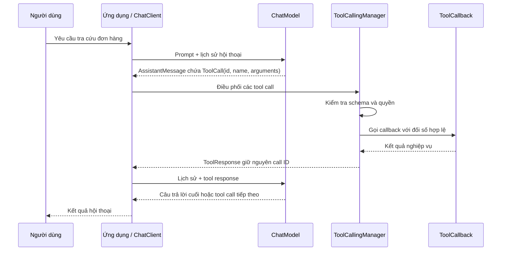

# Tool call ID và liên kết giữa yêu cầu gọi với kết quả

Khi mô hình yêu cầu ứng dụng gọi một công cụ, nó tạo ra một **tool call** gồm tên công cụ và các đối số. Ứng dụng nhận yêu cầu đó, kiểm tra quyền, thực thi mã nghiệp vụ rồi gửi kết quả trở lại mô hình. Trong chu trình này, `tool_call_id` là khóa tương quan giúp ứng dụng và Spring AI biết chính xác kết quả nào trả lời cho yêu cầu gọi nào.

Điều này đặc biệt quan trọng khi một lượt phản hồi chứa nhiều tool call, khi công cụ chạy bất đồng bộ, hoặc khi một công cụ gặp lỗi. Nếu ghép nhầm kết quả, mô hình có thể dùng dữ liệu của đơn hàng này để trả lời về đơn hàng khác dù từng công cụ đều chạy đúng.

## 1. Tool call ID là gì?

Mỗi yêu cầu gọi công cụ do mô hình phát ra có một định danh. Trong giao thức tương thích OpenAI, định danh thường xuất hiện ở trường `id` trong phần tử `tool_calls`. Khi ứng dụng gửi kết quả về, trường `tool_call_id` của thông điệp kết quả phải mang đúng giá trị đó.

Ví dụ dưới đây minh họa một yêu cầu tra cứu trạng thái đơn hàng:

```json
{
  "role": "assistant",
  "tool_calls": [
    {
      "id": "call_7f2a",
      "type": "function",
      "function": {
        "name": "getOrderStatus",
        "arguments": "{\"orderId\":\"ORD-42\"}"
      }
    }
  ]
}
```

Ứng dụng thực thi `getOrderStatus` với `orderId` là `ORD-42`, sau đó gửi kết quả gắn với chính ID `call_7f2a`:

```json
{
  "role": "tool",
  "tool_call_id": "call_7f2a",
  "content": "{\"orderId\":\"ORD-42\",\"status\":\"SHIPPED\"}"
}
```

Giá trị `call_7f2a` là mối liên kết giữa hai thông điệp. Tên công cụ cho biết cần chạy hành động nào; ID cho biết kết quả thuộc về lần yêu cầu cụ thể nào. Một công cụ có thể được gọi nhiều lần trong cùng cuộc hội thoại, vì vậy chỉ dùng tên công cụ để ghép cặp là không đủ.

## 2. Spring AI biểu diễn ID trong message như thế nào?

Spring AI chuẩn hóa dữ liệu của mô hình thành các kiểu message ở tầng `spring-ai-core`. Hai cấu trúc cần nhận biết là:

- `AssistantMessage.ToolCall` biểu diễn yêu cầu gọi công cụ của mô hình. Các trường quan trọng gồm `id`, `type`, `name` và `arguments`.
- `ToolResponseMessage.ToolResponse` biểu diễn kết quả thực thi. Nó mang `id`, `name` và `responseData`.

Trong module `SPRING_AI_TOOL_CALLING`, ứng dụng có thể khai báo phương thức công cụ bằng `@Tool`. Spring AI dùng mô tả công cụ và schema tham số để cho mô hình biết tên, mục đích và cấu trúc đối số được phép gửi. Ví dụ:

```java
@Tool(description = "Tra cứu trạng thái đơn hàng")
public OrderStatus getOrderStatus(
        @ToolParam(description = "Mã đơn hàng") String orderId) {
    return orderService.getStatus(orderId);
}
```

`@Tool` mô tả khả năng mà mô hình có thể yêu cầu; `ToolCallback` là điểm thực thi mà ứng dụng đăng ký với Spring AI. Mô hình sinh `arguments` theo schema, nhưng ứng dụng vẫn phải kiểm tra dữ liệu và quyền trước khi gọi phương thức. Tool call ID được tạo ở bước mô hình yêu cầu thực thi, nên nó không phải một phần của schema nghiệp vụ như `orderId`.

Ứng dụng cần giữ nguyên ID khi chuyển từ đối tượng yêu cầu sang đối tượng kết quả:

```java
AssistantMessage.ToolCall call = assistantMessage.getToolCalls().get(0);

String callId = call.id();
String toolName = call.name();
String argumentsJson = call.arguments();

// Sau khi callback đã được xác thực và thực thi:
String resultJson = "{\"orderId\":\"ORD-42\",\"status\":\"SHIPPED\"}";

ToolResponseMessage.ToolResponse response =
        new ToolResponseMessage.ToolResponse(call.id(), call.name(), resultJson);
```

Đoạn mã tập trung vào quan hệ dữ liệu giữa hai cấu trúc; phần tìm callback, phân tích JSON, xác thực và xử lý lỗi thuộc trách nhiệm của lớp điều phối ứng dụng hoặc `ToolCallingManager`. Tên constructor và cách tạo message hoàn chỉnh có thể thay đổi theo phiên bản Spring AI, nhưng nguyên tắc tương quan vẫn là giữ nguyên `call.id()` trong response tương ứng.

Khi sử dụng `ChatClient` cùng các `ToolCallback` theo luồng thực thi tự động, Spring AI và `ToolCallingManager` đảm nhiệm phần lớn việc điều phối tool call và tool response. Ứng dụng thường không cần tự tạo message kết quả. Việc hiểu ID vẫn cần thiết để ghi log, theo dõi, xử lý lỗi, kiểm thử hoặc xây dựng một bộ điều phối tùy chỉnh.

## 3. Vòng đời của một tool call

Luồng cơ bản gồm các bước sau:

1. Ứng dụng gửi prompt và lịch sử hội thoại đến `ChatModel`.
2. Mô hình trả về một `AssistantMessage` có một hoặc nhiều `ToolCall`.
3. `ToolCallingManager` hoặc bộ điều phối ứng dụng tra cứu callback theo tên công cụ, kiểm tra đối số và quyền thực thi.
4. `ToolCallback` thực thi logic nghiệp vụ. Ứng dụng thu được kết quả hoặc một lỗi có thể xử lý.
5. Bộ điều phối tạo `ToolResponse` cho từng yêu cầu, giữ nguyên ID của yêu cầu tương ứng.
6. Các tool response được thêm vào lịch sử hội thoại và gửi lại cho mô hình.
7. Mô hình có thể trả lời người dùng hoặc yêu cầu thêm công cụ. Chu trình tiếp tục cho đến khi có câu trả lời cuối cùng hoặc ứng dụng chạm giới hạn điều phối.



`ToolCallback` tập trung vào việc thực thi công cụ. ID là dữ liệu điều phối của từng lần gọi và được bộ điều phối giữ để tạo kết quả tương ứng. Không nên buộc logic nghiệp vụ phải tự tạo một ID khác rồi mong Spring AI tự hiểu đó là ID của tool call.

## 4. Một phản hồi có nhiều tool call

Mô hình có thể yêu cầu nhiều công cụ trong cùng một `AssistantMessage`. Ví dụ, để trả lời câu hỏi về một đơn hàng, mô hình có thể yêu cầu tra cứu thông tin đơn hàng và trạng thái thanh toán:

```json
{
  "role": "assistant",
  "tool_calls": [
    {
      "id": "call_order_01",
      "type": "function",
      "function": {
        "name": "getOrder",
        "arguments": "{\"orderId\":\"ORD-42\"}"
      }
    },
    {
      "id": "call_payment_02",
      "type": "function",
      "function": {
        "name": "getPayment",
        "arguments": "{\"orderId\":\"ORD-42\"}"
      }
    }
  ]
}
```

Ứng dụng có thể chạy hai callback tuần tự hoặc song song nếu chúng độc lập và hạ tầng cho phép. Dù chọn cách nào, mỗi kết quả phải mang ID của yêu cầu đã tạo ra nó:

| Tool call | Callback | ID của kết quả |
| --- | --- | --- |
| Tra cứu đơn hàng | `getOrder` | `call_order_01` |
| Tra cứu thanh toán | `getPayment` | `call_payment_02` |

Không ghép kết quả chỉ bằng vị trí phần tử trong hai danh sách. Khi thực thi song song, callback hoàn tất theo thứ tự khác với thứ tự yêu cầu là điều bình thường. Hãy giữ ID cùng tác vụ trong suốt quá trình xử lý, rồi tạo response bằng ID đã lưu. Khi đóng gói các kết quả vào lịch sử, tuân theo thứ tự và quy tắc message mà provider yêu cầu.

Ví dụ mã giả cho một bộ điều phối tùy chỉnh:

```java
List<ToolResponseMessage.ToolResponse> responses = new ArrayList<>();

for (AssistantMessage.ToolCall call : assistantMessage.getToolCalls()) {
    ToolCallback callback = callbacksByName.get(call.name());
    if (callback == null) {
        responses.add(new ToolResponseMessage.ToolResponse(
                call.id(), call.name(), "{\"ok\":false,\"code\":\"UNKNOWN_TOOL\"}"));
        continue;
    }

    String result = callback.call(call.arguments(), trustedToolContext);
    responses.add(new ToolResponseMessage.ToolResponse(
            call.id(), call.name(), result));
}
```

Đây là mã giả để làm rõ điểm ghép ID; một triển khai thực tế cần xử lý ngoại lệ riêng cho từng callback, xác thực JSON theo schema, giới hạn thời gian, giới hạn kích thước kết quả và bảo đảm việc tạo `ToolResponseMessage` đúng với API của phiên bản Spring AI đang dùng.

## 5. Phân biệt tool call ID với các loại định danh khác

Trong hệ thống thực tế, nhiều ID cùng xuất hiện trong một yêu cầu. Chúng có phạm vi và mục đích khác nhau:

| Định danh | Phạm vi | Mục đích |
| --- | --- | --- |
| `tool_call_id` | Một lần gọi công cụ do mô hình yêu cầu | Ghép yêu cầu gọi với kết quả trả về |
| `conversationId` | Một cuộc hội thoại | Tìm lịch sử hội thoại và ngữ cảnh nhiều lượt |
| `traceId` | Một trace phân tán | Theo dõi request qua các service và span |
| `orderId` hoặc `customerId` | Một thực thể nghiệp vụ | Xác định dữ liệu cần đọc hoặc thay đổi |
| Idempotency key | Một thao tác nghiệp vụ cần chống thực thi lặp | Ngăn side effect bị áp dụng nhiều lần khi retry |

Các giá trị này không thay thế cho nhau. `tool_call_id` không chứng minh người dùng có quyền truy cập đơn hàng, không phải mã đơn hàng và cũng không nhất thiết ổn định qua một lần mô hình tạo lại yêu cầu. Ứng dụng có thể ghi `tool_call_id` vào log hoặc span để truy vết, nhưng vẫn phải duy trì `traceId` và định danh nghiệp vụ theo mục đích riêng.

Với công cụ có side effect như tạo thanh toán hoặc gửi yêu cầu hoàn tiền, không nên dựa duy nhất vào tool call ID để chống thực thi lặp. Một lần retry ở tầng hội thoại có thể tạo ID mới cho cùng ý định nghiệp vụ. Hãy dùng idempotency key do ứng dụng hoặc nghiệp vụ xác định, lưu trạng thái xử lý bền vững và kiểm tra trước khi áp dụng side effect.

## 6. Xử lý lỗi mà vẫn giữ liên kết

Callback có thể thất bại vì dữ liệu không tồn tại, người dùng không đủ quyền, dịch vụ phụ thuộc bị lỗi hoặc hết thời gian chờ. Khi bộ điều phối có thể trả lỗi về cho mô hình, response vẫn phải gắn với ID của tool call đã thất bại. Nội dung lỗi nên có cấu trúc ổn định để mô hình hiểu được tình huống và chọn bước tiếp theo.

Ví dụ một lỗi nghiệp vụ có thể được chuyển thành kết quả an toàn:

```json
{
  "ok": false,
  "code": "ORDER_NOT_FOUND",
  "message": "Không tìm thấy đơn hàng được yêu cầu."
}
```

Bộ điều phối đưa nội dung này vào `responseData` của `ToolResponse` có cùng ID với yêu cầu ban đầu. Mô hình có thể thông báo không tìm thấy đơn hàng hoặc hỏi lại mã đơn. Với lỗi tạm thời, ứng dụng có thể thử lại theo chính sách retry; với lỗi quyền truy cập, ứng dụng phải từ chối thao tác theo quy tắc bảo mật.

Không gửi stack trace, câu truy vấn SQL, token, thông tin xác thực hoặc dữ liệu nội bộ vào tool response. Ghi chi tiết kỹ thuật trong log bảo vệ của ứng dụng và trả về mã lỗi cùng thông điệp đã được kiểm soát. Cũng cần phân biệt lỗi callback với lỗi giao tiếp giữa ứng dụng và provider: nếu không biết chắc provider đã nhận kết quả hay chưa, hãy thiết kế retry và side effect theo hướng idempotent.

## 7. Lịch sử hội thoại và điều phối nhiều lượt

Tool response chỉ có ý nghĩa khi được gửi trong đúng lịch sử có chứa assistant message đã yêu cầu tool call đó. Khi lưu hoặc khôi phục hội thoại, ứng dụng cần giữ quan hệ giữa:

- Assistant message chứa danh sách tool call và ID tương ứng.
- Các tool response có ID khớp với từng tool call.
- Những message tiếp theo của người dùng và mô hình trong cùng cuộc hội thoại.

Nếu chỉ lưu câu trả lời cuối cùng mà bỏ mất tool call và tool response, ứng dụng sẽ mất dấu vết vì sao mô hình đưa ra kết luận. Nếu lưu response nhưng làm mất assistant message gốc, provider có thể từ chối lịch sử hoặc mô hình không còn hiểu response đang trả lời yêu cầu nào.

Với `ChatMemory` hoặc cơ chế lưu hội thoại riêng, hãy xác định rõ message nào được lưu và thời điểm lưu. Khi dùng luồng tool calling tự động của Spring AI, kiểm tra cấu hình memory/advisor và hành vi của phiên bản đang triển khai để bảo đảm các message cần thiết được giữ nhất quán. Khi tự điều phối, chỉ gửi lại lịch sử đã được kiểm tra, đúng thứ tự và đúng định dạng provider hỗ trợ.

Nếu một lượt có nhiều tool call, ứng dụng chỉ nên tiếp tục gọi mô hình sau khi đã xử lý đầy đủ tập kết quả cần thiết theo giao thức. Đặt giới hạn số vòng tool call, thời gian tổng và số lần retry để tránh vòng lặp gọi công cụ vô hạn hoặc chi phí tăng ngoài dự kiến.

## 8. Bảo mật: ID không phải quyền truy cập

Tool call do mô hình tạo ra là dữ liệu đầu vào không đáng tin cậy. ID chỉ phục vụ tương quan. Nó không xác thực danh tính, không cấp quyền và không chứng minh rằng đối số là hợp lệ.

Trước khi gọi `ToolCallback`, ứng dụng cần:

1. Phân tích và kiểm tra đối số theo schema của tool; từ chối trường thiếu, sai kiểu hoặc vượt giới hạn.
2. Lấy danh tính người dùng, tenant và quyền từ phiên đăng nhập hoặc ngữ cảnh tin cậy của ứng dụng.
3. Kiểm tra quyền trên tài nguyên cụ thể, chẳng hạn người dùng có được xem `orderId` được yêu cầu hay không.
4. Chỉ truyền dữ liệu ngữ cảnh đã được ứng dụng xác thực qua `ToolContext` hoặc cơ chế tương đương.
5. Ghi log có kiểm soát với `conversationId`, `tool_call_id`, tên tool và kết quả xử lý; tránh ghi dữ liệu nhạy cảm.

Không lấy `userId`, `tenantId`, vai trò hoặc quyền hạn từ arguments do mô hình sinh ra rồi xem đó là dữ liệu xác thực. Nếu tool nhận các trường này vì lý do nghiệp vụ, phải đối chiếu chúng với danh tính và quyền đã được ứng dụng xác minh. `ToolContext` là nơi truyền ngữ cảnh do ứng dụng kiểm soát; nó không tự thay thế bước kiểm tra quyền trong callback hoặc service nghiệp vụ.

## 9. Các lỗi ghép cặp thường gặp

| Lỗi | Hậu quả | Cách xử lý |
| --- | --- | --- |
| Dùng tên tool thay cho ID | Nhiều lần gọi cùng tool không phân biệt được | Giữ ID riêng cho từng lần gọi |
| Tự sinh ID mới khi tạo response | Mô hình không ghép được kết quả với yêu cầu | Sao chép nguyên ID từ `ToolCall` |
| Ghép theo vị trí mảng | Kết quả có thể gắn nhầm khi chạy song song hoặc retry | Mang ID theo từng tác vụ và đối chiếu theo ID |
| Bỏ một response trong nhóm nhiều tool call | Lịch sử hội thoại không hoàn chỉnh | Theo dõi trạng thái hoàn tất cho từng ID |
| Lưu tool response mà thiếu assistant message gốc | Mất ngữ cảnh hoặc lịch sử không hợp lệ | Lưu các message theo đúng chu trình |
| Xem ID là bằng chứng được phép thực thi | Có thể mở ra truy cập trái phép | Xác thực người dùng và kiểm tra quyền độc lập |
| Retry side effect mà không có idempotency | Có thể tạo giao dịch hoặc thao tác trùng | Dùng idempotency key ở tầng nghiệp vụ |

## 10. Kiểm thử liên kết giữa yêu cầu và kết quả

Kiểm thử nên tập trung vào hành vi của bộ điều phối và quan hệ ID. Có thể dùng `ToolCallback` giả để kiểm tra mà không cần gọi dịch vụ bên ngoài.

Các trường hợp quan trọng gồm:

- **Một tool call thành công:** response có cùng ID và tên tool với yêu cầu; nội dung kết quả phản ánh output của callback.
- **Nhiều tool call:** mỗi response ghép với đúng ID dù callback hoàn tất khác thứ tự yêu cầu.
- **Hai lần gọi cùng tên tool:** hai ID khác nhau vẫn tạo hai response độc lập.
- **Callback phát sinh lỗi:** lỗi được chuyển thành nội dung an toàn và giữ nguyên ID của call thất bại.
- **Tool không tồn tại:** ứng dụng xử lý có kiểm soát, không gọi nhầm callback và không làm mất ID.
- **ID trùng hoặc thiếu:** bộ điều phối phát hiện dữ liệu không hợp lệ trước khi ghép kết quả.
- **Người dùng không có quyền:** callback không thực hiện side effect; kết quả lỗi vẫn được liên kết đúng.
- **Retry hoặc timeout:** thao tác có side effect không bị thực thi lặp ngoài ý muốn.
- **Khôi phục hội thoại:** lịch sử sau khi tải lại vẫn có assistant tool call và tool response khớp ID.
- **Streaming:** chỉ thực thi khi đã nhận đủ thông tin của tool call; không gọi lặp do xử lý nhiều chunk.

Ví dụ kiểm tra đơn giản cho hàm tạo response:

```java
ToolResponseMessage.ToolResponse response = toToolResponse(call, resultJson);

assertThat(response.id()).isEqualTo(call.id());
assertThat(response.name()).isEqualTo(call.name());
assertThat(response.responseData()).isEqualTo(resultJson);
```

Ngoài unit test, nên có integration test cho luồng `ChatClient` hoặc `ToolCallingManager` đang dùng để xác nhận provider adapter chấp nhận lịch sử có tool call và tool response. Kiểm tra cả log/trace để chắc chắn có thể tìm từ một `tool_call_id` đến callback, kết quả và lượt hội thoại tương ứng.

## 11. Checklist khi triển khai

- [ ] Giữ nguyên ID do mô hình trả về trong toàn bộ vòng đời của tool call.
- [ ] Tạo đúng một kết quả tương ứng cho mỗi tool call cần xử lý.
- [ ] Theo dõi ID theo từng tác vụ khi chạy song song hoặc bất đồng bộ.
- [ ] Xác thực schema, danh tính và quyền trước khi thực thi callback.
- [ ] Dùng `ToolContext` cho ngữ cảnh tin cậy do ứng dụng cung cấp.
- [ ] Chuyển lỗi thành kết quả an toàn nhưng vẫn giữ ID ban đầu.
- [ ] Lưu lịch sử hội thoại đủ để mô hình liên kết tool response với assistant message.
- [ ] Dùng idempotency key riêng cho nghiệp vụ có side effect.
- [ ] Giới hạn số vòng gọi, thời gian chờ, retry và kích thước kết quả.
- [ ] Kiểm thử trường hợp nhiều tool call, lỗi, retry, khôi phục hội thoại và streaming.

## Kết luận

`tool_call_id` là khóa tương quan của một lần yêu cầu gọi công cụ. Trong Spring AI, `AssistantMessage.ToolCall` mang ID từ mô hình và `ToolResponseMessage.ToolResponse` mang ID đó trở lại cùng kết quả. Khi dùng luồng tự động, `ToolCallingManager` hỗ trợ điều phối; khi tự xây dựng luồng riêng, ứng dụng phải giữ đúng liên kết này qua xác thực, thực thi, xử lý lỗi và lưu lịch sử. Tách bạch tool call ID với conversation ID, trace ID, định danh nghiệp vụ và idempotency key giúp hệ thống dễ truy vết và an toàn hơn.
