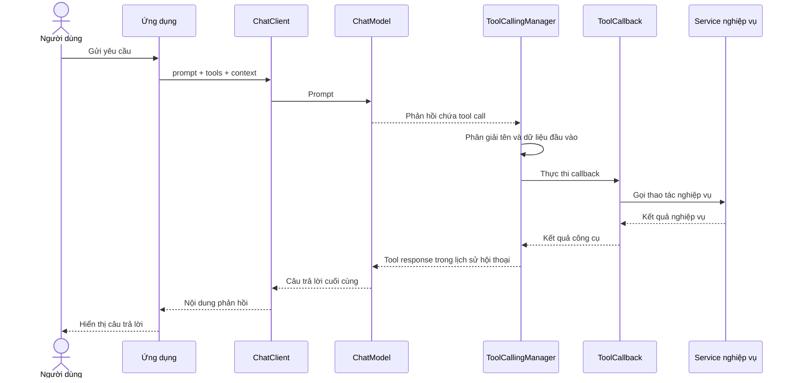

# Vai trò của ChatClient, ChatModel, ToolCallback và ToolCallingManager

Trong Spring AI, tool calling là cơ chế để mô hình ngôn ngữ yêu cầu ứng dụng thực hiện một thao tác mà mô hình không thể tự làm, chẳng hạn tra cứu đơn hàng, kiểm tra tồn kho hoặc lấy dữ liệu từ một dịch vụ nội bộ. Mô hình chỉ đề xuất tên công cụ cùng dữ liệu đầu vào. Ứng dụng Spring mới là nơi cung cấp công cụ, quyết định có cho phép thực thi hay không và thực hiện lời gọi đến hệ thống nghiệp vụ.

Spring AI chia trách nhiệm này thành nhiều thành phần. `ChatClient` cung cấp API hội thoại thuận tiện cho tầng ứng dụng; `ChatModel` đại diện cho mô hình và giao tiếp với nhà cung cấp; `ToolCallback` mô tả một công cụ có thể gọi và thực thi mã ứng dụng; `ToolCallingManager` điều phối việc tìm, gọi công cụ và đưa kết quả trở lại cuộc hội thoại. Hiểu đúng ranh giới giữa chúng giúp thiết kế luồng gọi công cụ dễ kiểm thử và an toàn hơn.

## Bức tranh tổng thể

| Thành phần | Trách nhiệm chính | Câu hỏi mà thành phần giải quyết |
| --- | --- | --- |
| `ChatClient` | API cấp cao để xây dựng yêu cầu hội thoại, gắn công cụ và nhận kết quả | Ứng dụng muốn hỏi mô hình điều gì, với ngữ cảnh và công cụ nào? |
| `ChatModel` | Abstraction giao tiếp với mô hình; chuyển `Prompt` thành yêu cầu của nhà cung cấp và chuyển phản hồi về kiểu Spring AI | Mô hình nhận yêu cầu nào và trả về nội dung hoặc yêu cầu gọi công cụ nào? |
| `ToolCallback` | Định nghĩa và thực thi một công cụ cụ thể | Khi được gọi với dữ liệu đầu vào hợp lệ, ứng dụng sẽ thực hiện thao tác nào? |
| `ToolCallingManager` | Điều phối việc phân giải tên công cụ, gọi callback, xử lý kết quả và cập nhật lịch sử hội thoại | Làm thế nào biến yêu cầu gọi công cụ của mô hình thành kết quả thực thi trong vòng hội thoại? |

Các thành phần này phối hợp với nhau nhưng không thay thế trách nhiệm của tầng nghiệp vụ. `ToolCallback` có thể gọi một service nghiệp vụ, còn service đó vẫn phải kiểm tra quyền và quy tắc miền. Việc mô hình phát ra một tool call không có nghĩa người dùng đã được cấp quyền thực hiện thao tác tương ứng.

## `ChatClient`: điểm vào ở tầng ứng dụng

`ChatClient` là API cấp cao, dạng fluent, để ứng dụng tạo yêu cầu hội thoại. Ứng dụng có thể cung cấp system message, user message, tùy chọn mô hình, advisors, dữ liệu ngữ cảnh và các công cụ khả dụng cho lượt gọi. `ChatClient` tập hợp những thông tin đó thành một `Prompt`, sau đó chuyển yêu cầu đến `ChatModel`.

Ví dụ khởi tạo client:

```java
ChatClient chatClient = ChatClient.create(chatModel);
```

Một lượt hội thoại có đăng ký công cụ có thể được viết như sau:

```java
String answer = chatClient.prompt()
    .user("Kiểm tra số lượng tồn kho của sản phẩm SKU-100")
    .tools(new InventoryTools(inventoryService))
    .call()
    .content();
```

Trong ví dụ này, `.user(...)` cung cấp yêu cầu của người dùng và `.tools(...)` cho Spring AI biết những công cụ nào có thể được mô hình yêu cầu trong lượt gọi. `ChatClient` giúp ứng dụng diễn đạt yêu cầu theo cách thống nhất, không phải tự xây dựng payload riêng cho từng nhà cung cấp mô hình.

Có thể đăng ký đối tượng chứa các phương thức `@Tool` bằng `.tools(...)`, hoặc cung cấp các `ToolCallback` đã được tạo sẵn bằng API đăng ký callback tương ứng như `.toolCallbacks(...)`. Công cụ có thể được gắn cho một yêu cầu cụ thể hoặc cấu hình làm công cụ mặc định của client, tùy phạm vi sử dụng. Nên chọn phạm vi hẹp nhất đáp ứng nhu cầu của lượt hội thoại.

`ChatClient` không phải nơi chứa toàn bộ logic nghiệp vụ của công cụ. Nó cũng không thể tự xác định một yêu cầu có hợp lệ về quyền truy cập hay không. Những quyết định đó thuộc về ứng dụng, callback và các service được callback gọi đến.

## `ChatModel`: abstraction giao tiếp với mô hình

`ChatModel` là abstraction của Spring AI cho các mô hình chat. Nó nhận `Prompt` và trả về `ChatResponse`. Các implementation cụ thể chịu trách nhiệm chuyển đổi message, tham số và cấu hình của Spring AI sang định dạng mà nhà cung cấp mô hình yêu cầu, gửi request, rồi ánh xạ phản hồi của nhà cung cấp về kiểu dữ liệu chung.

Khi không có tool call, phản hồi thường chứa nội dung văn bản của assistant. Khi mô hình quyết định cần một công cụ, phản hồi có thể chứa một hoặc nhiều yêu cầu gọi công cụ, mỗi yêu cầu gồm tên công cụ, dữ liệu đầu vào và thông tin định danh của lần gọi. Đây vẫn là một chỉ dẫn do mô hình tạo ra; bản thân phản hồi đó chưa chứng minh rằng công cụ đã chạy thành công.

Trong luồng tool calling được Spring AI hỗ trợ, implementation của `ChatModel` phối hợp với `ToolCallingManager` để xử lý các yêu cầu gọi công cụ. Với chế độ thực thi tự động, model adapter nhận phản hồi có tool call, chuyển phần việc thực thi cho manager, đưa kết quả vào lịch sử hội thoại rồi gọi mô hình tiếp để mô hình có thể sử dụng kết quả đó. Chu trình tiếp tục cho đến khi mô hình trả về câu trả lời cuối cùng hoặc luồng xử lý kết thúc theo cấu hình.

Điểm cần phân biệt là `ChatModel` đại diện cho khả năng giao tiếp với mô hình, còn `ToolCallingManager` đảm nhiệm điều phối thực thi công cụ. Ứng dụng có thể thay đổi nhà cung cấp mô hình mà vẫn giữ cách xây dựng prompt và định nghĩa callback tương đối ổn định, trong giới hạn các khả năng mà từng model hỗ trợ.

## `ToolCallback`: hợp đồng của một công cụ

`ToolCallback` là abstraction đại diện cho một công cụ mà mô hình có thể yêu cầu ứng dụng gọi. Callback kết hợp hai phần:

- **Định nghĩa công cụ (`ToolDefinition`)**: tên, mô tả và JSON Schema mô tả cấu trúc dữ liệu đầu vào. Mô hình dùng thông tin này để quyết định khi nào gọi công cụ và tạo dữ liệu đầu vào theo schema.
- **Hành vi thực thi**: nhận dữ liệu đầu vào của lần gọi, chuyển dữ liệu đó thành tham số phù hợp và chạy logic ứng dụng để tạo kết quả.

Một cách phổ biến để tạo callback là khai báo phương thức bằng annotation `@Tool`. Ví dụ:

```java
public class InventoryTools {

    private final InventoryService inventoryService;

    public InventoryTools(InventoryService inventoryService) {
        this.inventoryService = inventoryService;
    }

    @Tool(description = "Tra cứu số lượng tồn kho hiện tại theo mã sản phẩm")
    public String getStock(
            @ToolParam(description = "Mã SKU của sản phẩm") String sku) {
        return inventoryService.getStockSummary(sku);
    }
}
```

Khi đối tượng `InventoryTools` được cung cấp cho `ChatClient`, Spring AI có thể tạo callback từ phương thức được đánh dấu `@Tool`. Tên và mô tả giúp mô hình hiểu mục đích công cụ; `@ToolParam` mô tả từng tham số để schema đầu vào rõ ràng hơn. Chất lượng mô tả và schema ảnh hưởng trực tiếp đến khả năng mô hình chọn đúng công cụ và tạo dữ liệu đầu vào phù hợp.

Ứng dụng cũng có thể tạo hoặc cung cấp `ToolCallback` trực tiếp khi cần kiểm soát cách xây dựng schema, chuyển đổi dữ liệu hoặc tích hợp một hàm có sẵn. Dù callback được tạo bằng annotation hay bằng API lập trình, vai trò của nó vẫn là cung cấp một hợp đồng gọi công cụ nhất quán cho phần điều phối.

Kết quả callback được chuyển thành nội dung phản hồi của công cụ để đưa lại cho mô hình. Mô hình có thể dùng kết quả đó để trả lời người dùng hoặc yêu cầu một công cụ khác. Vì vậy, kết quả nên có cấu trúc rõ ràng, đủ thông tin cần thiết và không chứa dữ liệu bí mật mà mô hình không được phép tiếp cận.

### `ToolContext` và dữ liệu ngoài schema

Một số công cụ cần thông tin do ứng dụng cung cấp, chẳng hạn mã người dùng đã xác thực, tenant hiện tại, trace ID hoặc cấu hình theo request. `ToolContext` cho phép truyền ngữ cảnh thực thi bổ sung đến callback mà không cần biến các giá trị này thành tham số do mô hình tự tạo trong JSON đầu vào.

Ví dụ, công cụ “xem đơn hàng của tôi” nên lấy danh tính người dùng từ ngữ cảnh xác thực do ứng dụng truyền vào. Không nên để mô hình tự chọn `userId` rồi dùng giá trị đó để truy cập dữ liệu của người khác. `ToolContext` chỉ là phương tiện chuyển ngữ cảnh; nó không tự xác thực danh tính hay thay thế bước kiểm tra quyền trong service nghiệp vụ.

## `ToolCallingManager`: điều phối vòng gọi công cụ

`ToolCallingManager` chịu trách nhiệm điều phối việc thực thi các tool call mà mô hình trả về. Trong luồng tiêu chuẩn, manager thực hiện các công việc chính sau:

1. Đọc danh sách tool call trong phản hồi của mô hình.
2. Phân giải tên mỗi công cụ sang `ToolCallback` đã được đăng ký hoặc có thể phân giải trong phạm vi request.
3. Chuyển dữ liệu đầu vào của tool call cho callback tương ứng, cùng `ToolContext` nếu có.
4. Thu thập kết quả thực thi hoặc xử lý lỗi theo chính sách được cấu hình.
5. Tạo phần phản hồi công cụ và ghép vào lịch sử hội thoại để mô hình nhận được kết quả ở lượt tiếp theo.

Manager là lớp điều phối chung giữa yêu cầu tool call của mô hình và các callback cụ thể. Nhờ vậy, model adapter không cần tự biết chi tiết từng service nghiệp vụ. Manager cũng là nơi thích hợp để áp dụng chính sách xử lý lỗi ở mức tool calling, trong khi kiểm tra quyền và quy tắc nghiệp vụ vẫn phải được thực hiện tại ranh giới phù hợp của ứng dụng.

Một phản hồi của mô hình có thể yêu cầu nhiều công cụ. Manager xử lý các yêu cầu đó theo cơ chế của implementation và cấu hình đang dùng. Không nên mặc định rằng nhiều tool call luôn được chạy song song hoặc luôn chạy theo một thứ tự nghiệp vụ nhất định; nếu thứ tự, tính nguyên tử hoặc tính đồng thời có ý nghĩa, ứng dụng cần thiết kế và kiểm thử rõ ràng.

Một số metadata của công cụ còn có thể yêu cầu trả kết quả trực tiếp cho ứng dụng/người dùng thay vì tiếp tục đưa kết quả qua mô hình để tổng hợp. Hành vi như `returnDirect` phụ thuộc metadata và khả năng của phiên bản Spring AI đang dùng. Đây là lựa chọn điều khiển luồng trả kết quả, không phải cơ chế cấp quyền.

## Luồng phối hợp từ yêu cầu đến câu trả lời

Sơ đồ dưới đây mô tả luồng khái niệm của chế độ tự động. Chi tiết nội bộ có thể khác nhau giữa các implementation của `ChatModel`, nhưng ranh giới trách nhiệm vẫn như nhau.



Có thể diễn giải chu trình thành các bước:

1. Ứng dụng nhận yêu cầu, xác định người dùng và chuẩn bị ngữ cảnh đáng tin cậy.
2. `ChatClient` tạo prompt và đính kèm danh sách công cụ được phép dùng trong lượt đó.
3. `ChatModel` gửi prompt cùng mô tả công cụ đến nhà cung cấp mô hình.
4. Mô hình trả lời bằng văn bản hoặc yêu cầu gọi một hay nhiều công cụ.
5. Khi có tool call, `ToolCallingManager` tìm callback tương ứng và yêu cầu callback thực thi.
6. Callback gọi service nghiệp vụ. Service xác thực quyền, kiểm tra dữ liệu và thực hiện quy tắc miền.
7. Manager đưa kết quả công cụ vào lịch sử hội thoại. `ChatModel` có thể gọi mô hình tiếp để mô hình giải thích kết quả hoặc chọn công cụ tiếp theo.
8. Khi không còn tool call cần xử lý, câu trả lời cuối cùng được trả qua `ChatClient` về ứng dụng.

Ví dụ tra cứu tồn kho có thể chỉ cần một tool call. Một yêu cầu phức tạp hơn như “kiểm tra đơn hàng và tính thời gian giao dự kiến” có thể khiến mô hình yêu cầu tra cứu đơn hàng trước, sau đó dùng dữ liệu nhận được để yêu cầu dịch vụ tính thời gian giao hàng. Mỗi bước vẫn đi qua callback đã đăng ký và các quy tắc kiểm soát của ứng dụng.

## Thực thi tự động và thực thi do ứng dụng điều khiển

Spring AI hỗ trợ mô hình thực thi tự động: model implementation phối hợp với `ToolCallingManager`, thực thi callback và tiếp tục vòng hội thoại. Đây là lựa chọn thuận tiện cho phần lớn luồng hỏi đáp có công cụ.

Trong một số tình huống, ứng dụng cần tự kiểm soát thời điểm thực thi, ví dụ cần hiển thị yêu cầu xác nhận cho người dùng trước khi ghi dữ liệu hoặc cần áp dụng một workflow riêng. Khi đó có thể tắt thực thi công cụ nội bộ bằng tùy chọn `internalToolExecutionEnabled(false)` trong cấu hình tool calling mà phiên bản đang dùng hỗ trợ. Phản hồi chứa tool call sẽ được trả về cho ứng dụng; ứng dụng chịu trách nhiệm quyết định có thực thi hay không, gọi cơ chế thực thi phù hợp và tiếp tục hội thoại với kết quả. Cần kiểm tra API cụ thể của phiên bản Spring AI đang sử dụng khi triển khai chế độ này.

Hai chế độ khác nhau ở nơi kiểm soát vòng đời thực thi. Dù chọn chế độ nào, ứng dụng vẫn phải kiểm tra quyền và tính hợp lệ trước khi thao tác có tác động đến dữ liệu hoặc hệ thống bên ngoài.

## Ranh giới an toàn khi thiết kế công cụ

Tool calling mở một đường đi từ nội dung do mô hình tạo ra đến mã có thể truy cập hệ thống. Vì vậy, callback cần được thiết kế như một API nội bộ có ranh giới bảo mật rõ ràng.

- **Chỉ đăng ký công cụ cần thiết:** chỉ cung cấp những callback phù hợp với mục tiêu và quyền của lượt hội thoại. Tránh đưa công cụ quản trị hoặc công cụ có quyền rộng vào mọi prompt.
- **Xác thực ở phía máy chủ:** không xem việc mô hình chọn một tool call là sự chấp thuận của người dùng. Service phải kiểm tra principal, tenant và quyền thao tác dựa trên ngữ cảnh xác thực đáng tin cậy.
- **Không tin dữ liệu đầu vào chỉ vì có JSON Schema:** schema kiểm tra hình dạng dữ liệu, không chứng minh người gọi có quyền truy cập tài nguyên hoặc thực hiện hành động. Vẫn cần kiểm tra mã định danh, giới hạn số lượng, trạng thái và các bất biến nghiệp vụ.
- **Tách ngữ cảnh tin cậy khỏi tham số của mô hình:** truyền thông tin xác thực qua `ToolContext` hoặc cơ chế nội bộ tương đương. Không để mô hình quyết định danh tính, vai trò hay tenant của người đang gọi.
- **Kiểm soát tác động phụ:** với thao tác thanh toán, hủy đơn, gửi thông báo hoặc cập nhật dữ liệu, cần có xác nhận và kiểm soát idempotency khi nghiệp vụ yêu cầu. Có thể chọn chế độ thực thi do ứng dụng điều khiển để đặt bước xác nhận trước callback.
- **Giới hạn tài nguyên:** đặt timeout, giới hạn số vòng tool calling, giới hạn kích thước đầu vào/đầu ra và chính sách retry phù hợp để tránh vòng lặp kéo dài hoặc gọi dịch vụ quá mức.
- **Xử lý lỗi có kiểm soát:** không trả stack trace, token, thông tin kết nối hay dữ liệu cá nhân nhạy cảm vào kết quả công cụ. Ghi log đủ để truy vết nhưng phải tuân thủ chính sách bảo vệ dữ liệu.
- **Theo dõi và kiểm thử:** ghi nhận tên công cụ, thời gian thực thi, kết quả thành công/thất bại và correlation ID. Kiểm thử cả trường hợp gọi đúng, tham số sai, công cụ không tồn tại, người dùng không đủ quyền và service gặp lỗi.

Các lớp trong Spring AI cung cấp cơ chế để mô tả và điều phối công cụ; chúng không tự động biến mọi callback thành một API an toàn. Mức độ an toàn phụ thuộc vào thiết kế callback và các service mà callback gọi đến.

## Cách phân tích lỗi theo thành phần

| Hiện tượng | Thành phần cần kiểm tra trước | Hướng kiểm tra |
| --- | --- | --- |
| Mô hình không chọn công cụ dù yêu cầu cần tra cứu | `ChatClient`, định nghĩa công cụ và `ChatModel` | Công cụ đã được gắn vào đúng request chưa; mô tả và schema có đủ rõ không; model có hỗ trợ tool calling không? |
| Mô hình chọn sai hoặc tạo tham số không hợp lệ | `ToolCallback` và schema | Tên, mô tả, kiểu dữ liệu, trường bắt buộc và ví dụ tham số đã phản ánh đúng hợp đồng chưa? |
| Không tìm thấy callback cho tên công cụ | `ToolCallingManager` và cấu hình đăng ký | Callback có nằm trong tập công cụ của request không; tên công cụ có khớp với tên trong định nghĩa không? |
| Callback chạy nhưng trả lỗi nghiệp vụ | `ToolCallback` và service nghiệp vụ | Dữ liệu đầu vào, quyền truy cập, trạng thái tài nguyên và chính sách xử lý lỗi có đúng không? |
| Có kết quả công cụ nhưng mô hình không tiếp tục trả lời | `ToolCallingManager` và `ChatModel` | Kết quả đã được thêm vào lịch sử đúng định dạng và gắn với tool call tương ứng chưa; model có hỗ trợ lượt tiếp theo không? |
| Vòng gọi công cụ kéo dài hoặc lặp lại | Cấu hình điều phối và logic công cụ | Giới hạn số vòng, timeout, kết quả callback và điều kiện kết thúc đã hợp lý chưa? |

Nên xác định lỗi ở ranh giới đầu tiên mà dữ liệu không còn đúng kỳ vọng. Ví dụ, nếu callback nhận JSON sai cấu trúc thì kiểm tra schema và chuyển đổi đầu vào; nếu callback nhận dữ liệu đúng nhưng người dùng không có quyền thì kiểm tra service và ngữ cảnh xác thực, không sửa prompt để bỏ qua kiểm tra quyền.

## Kiểm thử trách nhiệm của từng lớp

Có thể chia kiểm thử theo đúng ranh giới kiến trúc:

1. **Kiểm thử `ToolCallback`:** gọi trực tiếp callback với đầu vào hợp lệ và không hợp lệ; xác nhận tham số được chuyển đổi đúng, service được gọi đúng và lỗi được xử lý như mong đợi.
2. **Kiểm thử định nghĩa công cụ:** xác nhận tên, mô tả, JSON Schema, kiểu dữ liệu và trường bắt buộc phản ánh đúng hợp đồng mà mô hình cần sử dụng.
3. **Kiểm thử `ToolCallingManager`:** mô phỏng phản hồi có một hoặc nhiều tool call; xác nhận callback đúng được phân giải, kết quả được đưa vào lịch sử hội thoại và lỗi được xử lý theo cấu hình.
4. **Kiểm thử tích hợp `ChatModel`:** dùng model giả hoặc phản hồi kiểm soát được để kiểm tra chu trình yêu cầu công cụ, thực thi, gửi kết quả lại mô hình và nhận câu trả lời cuối cùng.
5. **Kiểm thử qua `ChatClient`:** xác nhận công cụ đúng được gắn vào request, ngữ cảnh cần thiết được truyền và ứng dụng nhận được nội dung hoặc phản hồi đúng định dạng.
6. **Kiểm thử bảo mật:** thử truy cập tài nguyên của tenant khác, giả mạo mã người dùng trong tham số, gọi hành động khi thiếu quyền và gửi dữ liệu vượt giới hạn. Các trường hợp này phải bị chặn ở phía ứng dụng.

Không nên chỉ kiểm thử trường hợp mô hình gọi công cụ thành công. Các ca quan trọng gồm công cụ không tồn tại, JSON không hợp lệ, callback ném exception, service timeout, người dùng không đủ quyền, nhiều tool call trong một phản hồi và vòng gọi vượt giới hạn.

## Ghi nhớ trách nhiệm

- Dùng `ChatClient` để mô tả yêu cầu hội thoại và cung cấp tập công cụ cho lượt gọi.
- Dùng `ChatModel` để giao tiếp với mô hình thông qua abstraction thống nhất của Spring AI.
- Dùng `ToolCallback` để công bố hợp đồng và thực thi một hành động cụ thể của ứng dụng.
- Dùng `ToolCallingManager` để điều phối việc phân giải, thực thi callback và đưa kết quả trở lại cuộc hội thoại.
- Đặt xác thực, phân quyền và quy tắc nghiệp vụ trong ứng dụng và service nghiệp vụ; không giao các quyết định đó cho mô hình.

Khi tách đúng các trách nhiệm này, ứng dụng có thể thay đổi mô hình, thay đổi cách đăng ký công cụ hoặc kiểm thử từng callback mà không làm lẫn lộn phần hội thoại với phần thực thi nghiệp vụ.
