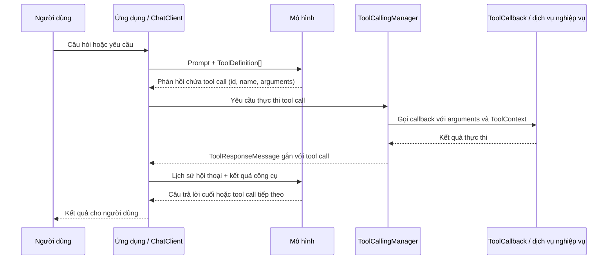

# Luồng gửi định nghĩa, nhận yêu cầu gọi, thực thi và trả kết quả

Tool calling cho phép mô hình đề xuất một thao tác mà ứng dụng có thể thực hiện, chẳng hạn tra cứu đơn hàng, lấy dữ liệu tồn kho hoặc tạo yêu cầu hỗ trợ. Mô hình không tự truy cập cơ sở dữ liệu hay gọi trực tiếp API nội bộ. Ứng dụng gửi cho mô hình mô tả các công cụ được phép dùng, nhận lại yêu cầu gọi có tên và tham số, kiểm tra yêu cầu, thực thi logic nghiệp vụ rồi gửi kết quả về cho mô hình.

Trong Spring AI, luồng này được chuẩn hóa quanh `ToolDefinition`, `ToolCallback`, `ToolCallingManager` và `ToolContext`. Khi dùng `ChatClient`, `ToolCallingAdvisor` có thể điều phối vòng lặp tự động. Khi gọi `ChatModel` ở mức thấp, ứng dụng tự điều phối từng lượt.

Sau bài học, bạn có thể:

- Mô tả được dữ liệu đi từ ứng dụng đến mô hình và quay lại qua một tool call.
- Phân biệt định nghĩa công cụ với mã thực thi công cụ.
- Giải thích vai trò của `@Tool`, `@ToolParam`, `ToolCallback`, `ToolCallingManager` và `ToolContext`.
- Điều phối nhiều lượt gọi công cụ, xử lý kết quả và lỗi.
- Đặt kiểm tra quyền và quy tắc nghiệp vụ tại đúng ranh giới thực thi.

## 1. Các thành phần tham gia vào luồng gọi công cụ

| Thành phần | Trách nhiệm |
| --- | --- |
| `@Tool` | Đánh dấu một phương thức Java có thể được công bố như một công cụ. |
| `@ToolParam` | Mô tả tham số, định dạng mong đợi và việc tham số có bắt buộc hay không. |
| `ToolDefinition` | Mô tả tên, mục đích và JSON Schema đầu vào mà mô hình nhìn thấy. |
| `ToolCallback` | Kết hợp định nghĩa công cụ với hàm thực thi được ứng dụng cung cấp. |
| `ToolCallingManager` | Tìm callback tương ứng, gọi công cụ và tạo lịch sử hội thoại chứa kết quả. |
| `ToolContext` | Mang dữ liệu nội bộ của request đến hàm thực thi mà không đưa dữ liệu đó vào nội dung gửi cho mô hình. |
| `ToolCallingAdvisor` | Điều phối vòng lặp tool calling trong chuỗi advisor của `ChatClient`. |
| `ChatClient` / `ChatModel` | Gửi prompt và định nghĩa công cụ đến nhà cung cấp mô hình, sau đó nhận phản hồi. |

`ToolDefinition` là hợp đồng mô hình dùng để quyết định có nên gọi công cụ và cần cung cấp tham số nào. Hợp đồng này có ba phần quan trọng:

- **Tên**: định danh duy nhất trong tập công cụ được gửi ở một request, ví dụ `get_order_status`.
- **Mô tả**: nói rõ công cụ làm gì và nên dùng trong trường hợp nào.
- **Input schema**: mô tả cấu trúc JSON, kiểu dữ liệu, trường bắt buộc và trường tùy chọn.

`ToolCallback` là phía thực thi của hợp đồng. Callback cung cấp `ToolDefinition`, metadata điều khiển cách xử lý và phương thức `call(...)` để chạy logic ứng dụng. Spring AI có các callback dựng sẵn như `MethodToolCallback` và `FunctionToolCallback`; bạn cũng có thể tự triển khai `ToolCallback` khi cần tích hợp một nguồn công cụ riêng.

## 2. Toàn bộ vòng đời của một tool call

Sơ đồ dưới đây thể hiện đường đi của một request. Tên lớp ở mỗi bước là thành phần Spring AI thường đảm nhiệm phần việc đó; các bước xác thực và thực thi nghiệp vụ vẫn thuộc ứng dụng.



### Bước 1: Ứng dụng đăng ký định nghĩa công cụ

Ứng dụng chọn những công cụ phù hợp với tác vụ và đưa chúng vào request. Với `ChatClient`, có thể truyền đối tượng có phương thức `@Tool` hoặc `ToolCallback` trực tiếp:

```java
String answer = chatClient.prompt()
        .user("Đơn hàng DH-2026-0182 đang ở trạng thái nào?")
        .tools(orderTools)
        .call()
        .content();
```

`@Tool` giúp khai báo công cụ ngay trên phương thức Java. `@ToolParam` cung cấp mô tả chi tiết cho từng tham số:

```java
public class OrderTools {

    private final OrderQueryService orderQueryService;

    public OrderTools(OrderQueryService orderQueryService) {
        this.orderQueryService = orderQueryService;
    }

    @Tool(
        name = "get_order_status",
        description = "Tra cứu trạng thái hiện tại của một đơn hàng mà người dùng có quyền xem"
    )
    public OrderStatusResult getOrderStatus(
            @ToolParam(description = "Mã đơn hàng, ví dụ DH-2026-0182") String orderCode) {
        return orderQueryService.findStatus(orderCode);
    }
}
```

Spring AI tạo JSON Schema từ chữ ký phương thức và các metadata liên quan. Mặc định, tham số được xem là bắt buộc. Dùng `@ToolParam(required = false)` hoặc `@Nullable` nếu tham số có thể vắng mặt. Mô tả nên cụ thể về ý nghĩa, đơn vị, định dạng và giới hạn của dữ liệu. Ví dụ, ghi rõ ngày theo ISO-8601 hoặc số tiền theo đơn vị VND sẽ giúp mô hình tạo đầu vào nhất quán hơn.

Nếu cần tạo callback động hoặc muốn tách hẳn phần khai báo khỏi phương thức nghiệp vụ, có thể dùng `FunctionToolCallback`:

```java
ToolCallback lookupOrder = FunctionToolCallback
        .builder("get_order_status", orderQueryService::findStatus)
        .description("Tra cứu trạng thái đơn hàng theo mã đơn")
        .inputType(OrderLookupRequest.class)
        .build();
```

`inputType` là kiểu dữ liệu đầu vào để Spring AI tạo schema. Với `MethodToolCallback`, ứng dụng có thể dựng callback từ một phương thức và đối tượng thực thi cụ thể. Dù khai báo theo cách nào, các kiểu này đều quy về `ToolCallback` trong bước thực thi.

### Bước 2: Ứng dụng gửi định nghĩa cùng prompt

Spring AI chuyển danh sách định nghĩa công cụ thành phần tool metadata trong request gửi đến nhà cung cấp mô hình. Mô hình biết tên, mô tả và schema của công cụ. Nó không nhận mã Java, thông tin kết nối cơ sở dữ liệu hay quyền truy cập nội bộ của ứng dụng.

Có hai cách phổ biến để cung cấp công cụ cho `ChatClient`:

```java
// Chỉ cung cấp cho request hiện tại
chatClient.prompt()
        .user("Tra cứu đơn hàng DH-2026-0182")
        .tools(orderTools)
        .call();

// Công cụ mặc định cho các request tạo từ ChatClient này
ChatClient client = ChatClient.builder(chatModel)
        .defaultTools(readOnlyTools)
        .build();
```

`.tools(...)` phù hợp với công cụ chỉ nên xuất hiện trong một request hoặc một nhóm tác vụ. `.defaultTools(...)` phù hợp với công cụ đọc dữ liệu có phạm vi sử dụng rộng. Với công cụ có thể thay đổi dữ liệu hoặc tạo tác động bên ngoài, hãy cân nhắc chỉ đăng ký theo từng request để giới hạn bề mặt quyền.

### Bước 3: Mô hình trả về yêu cầu gọi công cụ

Sau khi nhận prompt và schema, mô hình có thể trả lời bằng văn bản thông thường hoặc tạo một hay nhiều yêu cầu gọi công cụ. Một yêu cầu gọi có các thông tin cốt lõi:

- `id`: mã của lần gọi, dùng để ghép kết quả với yêu cầu tương ứng.
- `name`: tên công cụ mà mô hình muốn gọi.
- `arguments`: các tham số theo định dạng JSON.

Ví dụ dưới đây là biểu diễn khái niệm của một yêu cầu, không phải cấu trúc wire format cố định của mọi nhà cung cấp:

```json
{
  "id": "call_01",
  "name": "get_order_status",
  "arguments": {
    "orderCode": "DH-2026-0182"
  }
}
```

Đây mới là **yêu cầu** của mô hình. Việc mô hình chọn tên công cụ và điền tham số không có nghĩa công cụ đã chạy. Ứng dụng cần nhận phản hồi, xác định callback tương ứng và quyết định có cho phép thực thi hay không.

### Bước 4: Spring AI phân giải callback và thực thi

`ToolCallingManager` nhận phản hồi có tool call, tìm `ToolCallback` phù hợp theo tên và chuyển phần arguments đến callback. Callback chuyển dữ liệu đầu vào thành kiểu Java cần thiết, gọi phương thức hoặc hàm nghiệp vụ, rồi chuyển kết quả về dạng nội dung mà mô hình có thể đọc.

Trong ứng dụng thực tế, phương thức tool nên đóng vai trò lớp điều phối mỏng. Logic truy vấn, cập nhật, kiểm tra trạng thái và giao dịch nên nằm trong service nghiệp vụ để có thể tái sử dụng và kiểm thử độc lập.

### Bước 5: Ứng dụng trả kết quả cho mô hình

Kết quả của callback được chuyển thành chuỗi. Bộ chuyển đổi mặc định của Spring AI dùng Jackson để tuần tự hóa các đối tượng Java có thể chuyển đổi. `ToolCallingManager` đưa kết quả vào lịch sử hội thoại dưới dạng thông điệp phản hồi công cụ, gắn với mã của tool call tương ứng.

Việc giữ đúng liên kết giữa yêu cầu và kết quả rất quan trọng. Khi mô hình phát ra nhiều tool call trong cùng một lượt, mỗi kết quả phải tương ứng với đúng lần gọi. Khi dùng `ToolCallingManager`, Spring AI quản lý cấu trúc thông điệp và việc ghép kết quả này.

### Bước 6: Mô hình tiếp tục hoặc kết thúc

Sau khi nhận kết quả công cụ, mô hình có thể:

1. Dùng kết quả để trả lời người dùng.
2. Yêu cầu gọi thêm một công cụ khác.
3. Gọi lại một công cụ với tham số khác nếu cần thêm dữ liệu.

Vòng lặp tiếp tục cho đến khi phản hồi không còn tool call. Nếu kết quả công cụ đã là đầu ra cuối cùng, metadata `returnDirect` cho phép trả kết quả thẳng về ứng dụng mà không cần thêm một lượt gọi mô hình. Chỉ nên dùng chế độ này khi định dạng kết quả công cụ đã phù hợp để hiển thị hoặc xử lý ở phía gọi.

## 3. Điều phối tự động với ChatClient

Trong Spring AI 2.x, `ChatClient` tự đăng ký `ToolCallingAdvisor` khi request có công cụ. Advisor gửi định nghĩa đến mô hình, kiểm tra phản hồi, nhờ `ToolCallingManager` thực thi tool call, bổ sung kết quả vào lịch sử và gọi mô hình tiếp cho đến khi nhận được câu trả lời cuối.

Vì vậy, với luồng thông thường, ứng dụng chỉ cần đăng ký công cụ và gọi `ChatClient`:

```java
String answer = chatClient.prompt()
        .user("Tra cứu đơn hàng DH-2026-0182 và giải thích trạng thái hiện tại")
        .tools(orderTools)
        .call()
        .content();
```

Ứng dụng không cần tự viết vòng `while` cho trường hợp phổ biến. Advisor chịu trách nhiệm điều phối các lượt trao đổi trung gian. Các advisor khác như memory, quan sát hệ thống hoặc logic tùy chỉnh có thể kết hợp trong chuỗi advisor; thứ tự advisor ảnh hưởng đến việc thành phần đó nhìn thấy toàn bộ vòng lặp hay chỉ trao đổi đầu và cuối.

## 4. Tự điều phối khi gọi ChatModel trực tiếp

`ChatModel` là API mức thấp. Trong Spring AI 2.x, `chatModel.call(prompt)` gửi định nghĩa công cụ và trả về phản hồi của mô hình; nếu phản hồi có tool call thì caller phải tự yêu cầu thực thi và gửi kết quả ở lượt tiếp theo. `ChatModel` không tự chạy vòng lặp tool execution như cơ chế trước đây của Spring AI 1.x.

Ví dụ rút gọn:

```java
ToolCallback[] callbacks = ToolCallbacks.from(orderTools);

ChatOptions options = ToolCallingChatOptions.builder()
        .toolCallbacks(callbacks)
        .build();

ToolCallingManager toolCallingManager = ToolCallingManager.builder().build();
Prompt prompt = new Prompt("Tra cứu đơn hàng DH-2026-0182", options);
ChatResponse response = chatModel.call(prompt);

while (response.hasToolCalls()) {
    ToolExecutionResult execution =
            toolCallingManager.executeToolCalls(prompt, response);

    // Nếu dùng returnDirect, ứng dụng cần trả kết quả này trực tiếp.
    if (execution.returnDirect()) {
        return renderDirectToolResult(execution); // Hàm chuyển đổi do ứng dụng định nghĩa
    }

    prompt = new Prompt(execution.conversationHistory(), options);
    response = chatModel.call(prompt);
}

String answer = response.getResult().getOutput().getText();
```

Vòng lặp trên thể hiện rõ trách nhiệm của ứng dụng: kiểm tra `hasToolCalls()`, gọi `executeToolCalls(...)`, dùng `conversationHistory()` làm đầu vào cho lượt tiếp theo và dừng khi mô hình không yêu cầu công cụ nữa. Trong mã hoàn chỉnh, cần xử lý giới hạn số vòng, timeout, lỗi thực thi và đường trả kết quả `returnDirect` theo hợp đồng của ứng dụng.

Chọn `ChatClient` khi muốn dùng cơ chế advisor và tích hợp sẵn. Chọn `ChatModel` trực tiếp khi ứng dụng có bộ điều phối riêng hoặc cần kiểm soát từng lượt ở mức thấp. Không nên trộn hai cơ chế thực thi trong cùng một request vì có thể dẫn đến xử lý tool call hai lần.

## 5. Đưa dữ liệu nội bộ vào ToolContext

Có những dữ liệu công cụ cần để thực thi nhưng mô hình không nên biết hoặc không thể tự quyết định, ví dụ `tenantId`, `userId`, mã phiên hoặc phạm vi dữ liệu của request. `ToolContext` chuyển các giá trị này trực tiếp từ ứng dụng đến phương thức tool. Các giá trị trong context không được gửi cho mô hình như một phần của tool schema.

```java
public class OrderTools {

    private final OrderQueryService orderQueryService;

    public OrderTools(OrderQueryService orderQueryService) {
        this.orderQueryService = orderQueryService;
    }

    @Tool(description = "Tra cứu trạng thái đơn hàng người dùng được phép xem")
    public OrderStatusResult getOrderStatus(
            @ToolParam(description = "Mã đơn hàng") String orderCode,
            ToolContext toolContext) {

        Map<String, Object> context = toolContext.getContext();
        String tenantId = (String) context.get("tenantId");
        String actorId = (String) context.get("actorId");

        return orderQueryService.findStatus(orderCode, tenantId, actorId);
    }
}
```

Ở phía gọi, ứng dụng lấy danh tính và tenant từ ngữ cảnh xác thực đã được kiểm tra, rồi truyền vào request:

```java
String answer = chatClient.prompt()
        .user("Tra cứu đơn hàng DH-2026-0182")
        .tools(orderTools)
        .toolContext(Map.of(
                "tenantId", authenticatedTenantId,
                "actorId", authenticatedActorId))
        .call()
        .content();
```

`authenticatedTenantId` và `authenticatedActorId` trong ví dụ phải đến từ principal hoặc security context do server xác lập. Không lấy các giá trị này từ nội dung prompt, arguments do mô hình tạo hoặc trường request mà người dùng có thể tự sửa. `ToolContext` chỉ là kênh truyền dữ liệu; bản thân nó không xác thực người dùng và không tự thực thi phân quyền. Service nghiệp vụ vẫn phải kiểm tra actor có quyền truy cập bản ghi thuộc tenant đó hay không.

## 6. Kiểm soát quyền và tác động của công cụ

Schema tốt giúp mô hình tạo arguments đúng cấu trúc, nhưng schema không phải hàng rào bảo mật. Arguments vẫn là dữ liệu không đáng tin cậy vì chúng do mô hình sinh ra từ prompt và ngữ cảnh hội thoại.

Áp dụng các nguyên tắc sau tại phía ứng dụng:

- **Chỉ công bố công cụ cần thiết**: mỗi request chỉ nhận các công cụ phù hợp với tác vụ và quyền của người dùng. Tránh đưa công cụ quản trị hoặc ghi dữ liệu vào danh sách mặc định cho mọi cuộc hội thoại.
- **Xác thực và phân quyền ở server**: xác định người gọi từ security context; kiểm tra quyền trên từng tài nguyên và từng hành động trong service nghiệp vụ. Không coi việc mô hình chọn được tên tool là bằng chứng người dùng có quyền.
- **Kiểm tra arguments**: xác thực định dạng, độ dài, miền giá trị, giới hạn số lượng, đơn vị và quan hệ giữa các trường. Dùng truy vấn có tham số và API nghiệp vụ đã kiểm soát.
- **Giới hạn tác động**: áp dụng rate limit, timeout, giới hạn số tool call trong một lượt và giới hạn số lần lặp. Ghi audit cho các thao tác có tác động.
- **Thiết kế thao tác ghi có tính idempotent**: một tool call có thể được gửi lại do timeout, retry hoặc người dùng tiếp tục phiên. Dùng idempotency key hoặc cơ chế chống thực thi trùng cho thao tác tạo đơn, thanh toán hay gửi thông báo.
- **Yêu cầu xác nhận khi cần**: các hành động như đặt chỗ, gửi email hoặc xóa dữ liệu có thể cần người dùng duyệt trước khi chạy.

Từ Spring AI 2.1.0, có thể đánh dấu công cụ cần xác nhận bằng `requiresConfirmation = true`:

```java
@Tool(
    description = "Hủy đơn hàng theo mã đơn",
    requiresConfirmation = true)
public CancellationResult cancelOrder(String orderCode) {
    return orderCommandService.cancel(orderCode);
}
```

Khi mô hình yêu cầu công cụ này, vòng lặp tạm dừng trước khi thực thi để ứng dụng thu thập quyết định cho phép hoặc từ chối. Ứng dụng phải xác minh người duyệt có quyền, lưu phản hồi tool call ở nơi client không thể sửa, chống phát lại quyết định và chỉ tiếp tục với đúng request đang chờ. Cờ xác nhận không thay thế kiểm tra quyền trong service.

## 7. Xử lý lỗi và trả kết quả an toàn

Lỗi có thể xuất hiện ở nhiều điểm: mô hình tạo arguments không hợp lệ, không tìm thấy callback, người dùng không có quyền, dữ liệu nghiệp vụ không tồn tại, dịch vụ phụ thuộc timeout hoặc callback phát sinh exception. Nên phân loại lỗi để ứng dụng có cách xử lý nhất quán.

| Nhóm lỗi | Cách xử lý phù hợp |
| --- | --- |
| Arguments sai định dạng hoặc ngoài giới hạn | Từ chối trước khi gọi service; trả thông báo ngắn, không chứa dữ liệu nhạy cảm. |
| Không tìm thấy tool hoặc tool name không hợp lệ | Dừng thực thi, ghi log có correlation ID và kiểm tra danh sách callback đã đăng ký. |
| Không đủ quyền | Không thực hiện thao tác; trả thông báo từ chối đã được chuẩn hóa. Không tiết lộ bản ghi thuộc người dùng khác. |
| Lỗi nghiệp vụ có thể dự đoán | Chuyển thành kết quả nghiệp vụ rõ ràng, ví dụ `ORDER_NOT_FOUND` hoặc `INVALID_STATE`. |
| Lỗi hạ tầng tạm thời | Retry có giới hạn ở tầng service khi thao tác an toàn để retry; dùng timeout và circuit breaker nếu phù hợp. |
| Lỗi không mong đợi | Ghi stack trace ở log nội bộ có kiểm soát; trả lỗi tổng quát ra ngoài. |

Spring AI cung cấp `ToolExecutionExceptionProcessor` để quyết định exception nào được chuyển thành thông báo kết quả gửi lại cho mô hình và exception nào được ném về caller. Với môi trường thật, nên định nghĩa cách ánh xạ lỗi rõ ràng: không gửi stack trace, câu SQL, token, thông tin xác thực hoặc nội dung nhạy cảm vào thông điệp công cụ. Mô hình có thể dùng thông báo lỗi để giải thích hoặc thử một bước khác, nhưng không nên để mô hình quyết định việc bỏ qua lỗi phân quyền.

Kết quả tool nên nhỏ, có cấu trúc và đủ thông tin cho bước tiếp theo. Thay vì trả toàn bộ entity có nhiều trường nội bộ, hãy trả DTO chỉ chứa các trường cần thiết. Với dữ liệu lớn, trả mã tham chiếu hoặc một tập kết quả đã giới hạn và để ứng dụng kiểm soát bước truy xuất tiếp theo.

## 8. Kiểm thử và quan sát luồng thực thi

Một bài kiểm thử tool calling tốt cần xác minh cả kết quả nghiệp vụ lẫn đường đi của thông điệp:

1. **Kiểm thử service độc lập**: kiểm tra quy tắc nghiệp vụ, quyền truy cập, tenant isolation, trạng thái hợp lệ và idempotency mà không cần gọi mô hình.
2. **Kiểm thử schema**: xác minh tên tool, mô tả, kiểu dữ liệu, trường bắt buộc và trường tùy chọn được tạo đúng.
3. **Kiểm thử callback**: truyền arguments hợp lệ và không hợp lệ; kiểm tra callback gọi đúng service và trả DTO dự kiến.
4. **Kiểm thử vòng lặp tích hợp**: dùng chat model giả hoặc phản hồi dựng sẵn để mô phỏng một lượt không có tool call, một tool call, nhiều tool call và nhiều vòng liên tiếp. Không cần gọi mô hình thật cho mọi test.
5. **Kiểm thử an toàn**: xác minh user A không thể đọc dữ liệu của user B, tenant A không thể truy cập tenant B, thao tác bị từ chối không tạo side effect và yêu cầu xác nhận chưa được duyệt không chạy.
6. **Kiểm thử lỗi và retry**: mô phỏng timeout, exception, tool không tồn tại, phản hồi lỗi và request lặp để kiểm tra hành vi phục hồi.

Trong vận hành, theo dõi số lần gọi công cụ, thời gian thực thi, tỷ lệ lỗi, số vòng lặp và tool name. Gắn correlation ID hoặc trace ID xuyên suốt request mô hình và service. Chỉ ghi arguments hoặc kết quả khi thực sự cần cho điều tra; phải loại bỏ hoặc che dữ liệu cá nhân, bí mật và thông tin nghiệp vụ nhạy cảm.

## 9. Những điểm cần nhớ khi triển khai

- Mô hình **đề xuất** tool call; ứng dụng mới là nơi phân giải, xác thực, phân quyền và thực thi.
- `ToolDefinition` mô tả hợp đồng gửi đến mô hình; `ToolCallback` cung cấp mã thực thi.
- `ToolContext` chuyển dữ liệu nội bộ từ server đến tool, nhưng không tự xác thực hay phân quyền.
- Với `ChatClient` trong Spring AI 2.x, `ToolCallingAdvisor` thường tự điều phối vòng lặp. Với `ChatModel` trực tiếp, caller tự thực thi tool call và gửi lịch sử có kết quả về mô hình.
- Mỗi kết quả phải được ghép với đúng tool call; cần giới hạn số vòng, timeout và tác động phụ.
- Công cụ ghi dữ liệu cần kiểm tra quyền ở service, audit và cơ chế chống thực thi trùng; thao tác nhạy cảm có thể cần xác nhận của con người.

## Tài liệu tham khảo

- [Spring AI Reference — Tool Calling](https://docs.spring.io/spring-ai/reference/api/tools.html)
- [Spring AI Reference — ChatModel Tool Calling](https://docs.spring.io/spring-ai/reference/api/tools/chatmodel-tool-calling.html)
- [Spring AI Reference — ToolCallingAdvisor](https://docs.spring.io/spring-ai/reference/api/tools/tool-calling-advisor.html)
- [Spring AI Reference — Tool Call Confirmation](https://docs.spring.io/spring-ai/reference/api/tools/tool-call-confirmation.html)

Các ví dụ điều phối trong bài bám theo API Spring AI 2.x; riêng `requiresConfirmation` được giới thiệu từ 2.1.0. Khi áp dụng vào dự án, hãy đối chiếu phiên bản Spring AI trong dependency management vì vòng lặp thực thi và một số API đã thay đổi giữa 1.x và 2.x.
