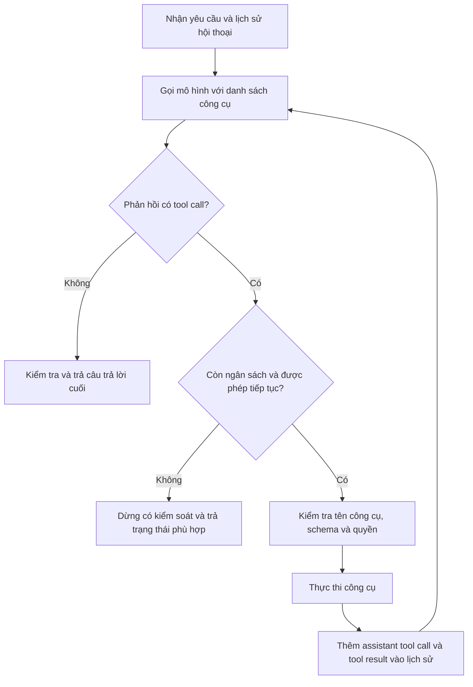

# Vòng lặp nhiều lượt và điều kiện kết thúc

Một yêu cầu tool calling thường không kết thúc ngay sau khi mô hình đề xuất công cụ. Ứng dụng cần thực thi công cụ, đưa kết quả trở lại đúng ngữ cảnh hội thoại rồi gọi mô hình tiếp để mô hình xử lý kết quả. Mô hình có thể trả lời người dùng ở lượt tiếp theo, hoặc tiếp tục yêu cầu một công cụ khác. Chuỗi trao đổi này tạo thành **vòng lặp tool calling nhiều lượt**.

Trong Spring AI, luồng đó kết nối phản hồi của chat model với việc thực thi các `ToolCallback` và phần kết quả công cụ. Hiểu rõ vòng lặp giúp thiết kế ứng dụng biết khi nào tiếp tục, khi nào trả lời, khi nào cần hỏi người dùng và khi nào phải dừng để bảo vệ hệ thống. Đây cũng là nơi ứng dụng áp dụng giới hạn số lượt, timeout, kiểm tra quyền, xử lý lỗi và ngăn một chuỗi gọi công cụ chạy vô hạn.

## Phân biệt lượt hội thoại và vòng thực thi công cụ

Các từ “lượt” và “vòng” thường bị dùng thay thế nhau, nhưng chúng mô tả hai đơn vị khác nhau:

- **Lượt phản hồi của mô hình (model turn):** một lần mô hình nhận ngữ cảnh và tạo ra phản hồi. Phản hồi có thể là văn bản cuối cùng, hoặc một hay nhiều yêu cầu gọi công cụ.
- **Lượt thực thi công cụ (tool execution):** một lần ứng dụng gọi một công cụ cụ thể với bộ đối số đã được kiểm tra.
- **Vòng tool calling (tool cycle):** một chu kỳ gồm phản hồi có yêu cầu gọi công cụ, ứng dụng thực thi các công cụ được yêu cầu và gửi kết quả về cho mô hình.

Một phản hồi của mô hình có thể yêu cầu nhiều công cụ. Vì vậy, một model turn có thể tạo ra nhiều tool execution trong cùng một vòng. Sau khi nhận các kết quả, mô hình có thể tạo model turn tiếp theo và mở thêm vòng mới.

Ví dụ, người dùng hỏi: “Kiểm tra đơn DH-2048 và cho tôi biết phí giao hàng nếu đổi sang địa chỉ mới”. Ứng dụng có thể cần tra cứu đơn hàng trước, sau đó dùng thông tin đơn và địa chỉ để tính phí. Mô hình có thể thực hiện theo hai vòng:

1. Gọi `lookupOrder` để lấy trạng thái và thông tin cần thiết của đơn hàng.
2. Sau khi nhận kết quả, gọi `calculateDeliveryFee` để tính phí theo địa chỉ mới.
3. Nhận kết quả tính phí và tạo câu trả lời cuối cùng.

Nếu mô hình yêu cầu cả hai công cụ cùng lúc và hai thao tác độc lập, ứng dụng có thể xử lý chúng trong cùng một vòng. Nếu công cụ thứ hai cần kết quả của công cụ thứ nhất, ứng dụng phải chờ kết quả đầu tiên rồi mới tiếp tục. Quyết định chạy tuần tự hay song song thuộc chính sách điều phối của ứng dụng và khả năng của cơ chế thực thi đang dùng.

## Vòng lặp hoạt động như thế nào?

Một vòng lặp tổng quát có các bước sau:

1. **Chuẩn bị ngữ cảnh.** Ứng dụng xây dựng prompt từ yêu cầu người dùng và lịch sử hội thoại, đồng thời cung cấp danh sách công cụ được phép dùng trong yêu cầu này.
2. **Gọi mô hình.** Mô hình trả về nội dung văn bản, yêu cầu gọi công cụ, hoặc kết hợp cả hai tùy giao thức và provider.
3. **Kiểm tra phản hồi.** Ứng dụng xác định có tool call hay không. Nếu không có yêu cầu gọi công cụ và phản hồi hợp lệ, luồng có thể kết thúc bằng câu trả lời của mô hình.
4. **Kiểm tra điều kiện tiếp tục.** Trước khi thực thi, ứng dụng kiểm tra ngân sách vòng lặp, số lần gọi, timeout, trạng thái hủy, chính sách xác nhận và giới hạn nghiệp vụ.
5. **Thực thi công cụ.** Với từng yêu cầu, ứng dụng kiểm tra tên công cụ, schema và giá trị tham số, xác thực quyền rồi gọi phần thực thi tương ứng.
6. **Gắn kết quả vào lịch sử.** Ứng dụng lưu phản hồi assistant có chứa tool call và kết quả tương ứng của từng công cụ. Mỗi kết quả phải gắn đúng với tool call mà nó trả lời.
7. **Gọi mô hình tiếp.** Ứng dụng gửi lịch sử đã cập nhật cho mô hình. Mô hình có thể trả lời cuối cùng hoặc yêu cầu công cụ khác; nếu tiếp tục, vòng lặp quay lại bước kiểm tra.



Vòng lặp không đơn giản là gọi lại mô hình với một prompt mới chỉ chứa văn bản kết quả. Lịch sử cần giữ cấu trúc của giao thức: phản hồi assistant đã yêu cầu công cụ và thông điệp kết quả của công cụ. Với các giao thức có mã định danh tool call, kết quả phải tham chiếu đúng mã đó. Nếu bỏ mất mối liên hệ này, provider có thể từ chối lịch sử hoặc mô hình hiểu sai kết quả thuộc yêu cầu nào.

## Lịch sử hội thoại phải được giữ nhất quán

Khi thực hiện nhiều vòng, lịch sử là trạng thái điều phối quan trọng. Ứng dụng cần bảo toàn thứ tự và vai trò của các thông điệp:

| Thành phần lịch sử | Ý nghĩa | Cách xử lý |
|---|---|---|
| System/developer instruction | Quy tắc và phạm vi hoạt động của trợ lý | Giữ ổn định trong suốt yêu cầu, theo chính sách của ứng dụng |
| User message | Câu hỏi hoặc thông tin người dùng cung cấp | Giữ nội dung cần thiết để mô hình hiểu mục tiêu |
| Assistant tool call | Phản hồi của mô hình yêu cầu gọi công cụ | Giữ tên công cụ, đối số và mã định danh theo giao thức |
| Tool result | Kết quả thực thi do ứng dụng tạo | Gắn với đúng tool call; chỉ chứa dữ liệu cần thiết |
| Assistant final response | Câu trả lời dành cho người dùng | Chỉ xem là kết quả cuối khi điều kiện kết thúc được thỏa mãn |

Không nên chỉ lưu văn bản mà người dùng nhìn thấy rồi bỏ các thông điệp tool call và tool result. Khi gọi mô hình ở vòng sau, mô hình cần biết nó đã yêu cầu thao tác nào và ứng dụng đã trả về kết quả gì. Đồng thời, không đưa kết quả của một công cụ vào lịch sử như thể đó là phát biểu của người dùng hoặc một chỉ dẫn hệ thống.

Với hội thoại kéo dài, lịch sử có thể tăng nhanh. Ứng dụng nên giữ phần lịch sử cần thiết cho tác vụ, tóm tắt những phần cũ theo cách có kiểm soát và tôn trọng giới hạn context của model. Việc rút gọn không được làm mất các tool call chưa có kết quả, quan hệ giữa call và result, các ràng buộc an toàn hoặc dữ liệu cần cho quyết định tiếp theo.

## Điều kiện kết thúc vòng lặp

Một vòng lặp tốt phải có điểm kết thúc rõ ràng. Có thể chia điều kiện kết thúc thành hai nhóm: kết thúc bình thường và dừng có kiểm soát.

### Kết thúc bình thường

- **Mô hình trả lời mà không yêu cầu công cụ:** đây là trường hợp phổ biến nhất. Ứng dụng kiểm tra phản hồi hợp lệ rồi trả nội dung cho người dùng.
- **Công cụ hoàn tất trực tiếp yêu cầu:** một số cách cấu hình cho phép kết quả của công cụ được trả trực tiếp thay cho việc gọi mô hình tiếp. Chỉ áp dụng khi hành vi này được thiết kế rõ ràng và kết quả công cụ đã đủ để đáp ứng yêu cầu.
- **Quy trình nghiệp vụ đạt trạng thái hoàn tất:** ứng dụng nhận được kết quả xác nhận từ dịch vụ nghiệp vụ và không còn bước nào được phép hoặc cần thiết. Mô hình có thể diễn đạt kết quả nếu luồng còn yêu cầu một phản hồi cuối.

### Dừng có kiểm soát

- **Đạt giới hạn số vòng:** số lần gọi lại mô hình hoặc số vòng tool calling đã chạm ngưỡng cấu hình.
- **Hết ngân sách thực thi:** tổng số tool call, thời gian, token hoặc chi phí vượt ngân sách của yêu cầu.
- **Bị hủy hoặc hết thời gian:** người dùng hủy yêu cầu, request timeout hoặc một phụ thuộc không phản hồi trong thời gian cho phép.
- **Không thể tiếp tục an toàn:** công cụ không tồn tại, đối số sai, quyền bị từ chối, cần xác nhận người dùng hoặc trạng thái nghiệp vụ không cho phép thao tác.
- **Phát hiện lặp không tiến triển:** mô hình liên tục yêu cầu cùng một công cụ với cùng đối số mà không tạo ra kết quả mới có ích.
- **Lỗi không thể phục hồi:** lỗi cấu hình, lỗi giao thức hoặc lỗi phụ thuộc khiến ứng dụng không thể tiếp tục một cách đáng tin cậy.

Khi dừng, ứng dụng phải phân biệt rõ kết quả nghiệp vụ với trạng thái điều phối. Ví dụ, “đã hết giới hạn vòng gọi” không có nghĩa đơn hàng đã được cập nhật; “bị từ chối quyền” không có nghĩa dữ liệu không tồn tại. Câu trả lời cho người dùng phải phản ánh đúng điều đã xảy ra.

## Giới hạn vòng lặp và chống gọi vô hạn

Không nên để mô hình tự quyết định số vòng tối đa. Một lỗi diễn giải hoặc một kết quả công cụ không đủ thông tin có thể khiến mô hình tiếp tục yêu cầu gọi công cụ. Ứng dụng nên đặt nhiều giới hạn độc lập:

| Giới hạn | Mục đích | Ví dụ chính sách |
|---|---|---|
| Số vòng mô hình | Chặn chuỗi trao đổi quá dài | Tối đa một số vòng đã cấu hình cho mỗi yêu cầu |
| Tổng số tool call | Chặn một phản hồi chứa quá nhiều công cụ hoặc nhiều vòng liên tiếp | Giới hạn tổng số lần thực thi trong một request |
| Timeout tổng | Bảo đảm request không chiếm tài nguyên vô hạn | Một deadline chung cho toàn bộ luồng |
| Timeout từng công cụ | Cô lập dịch vụ chậm hoặc treo | Mỗi công cụ có thời gian chờ phù hợp |
| Ngân sách token/chi phí | Kiểm soát chi phí của các lần gọi mô hình | Đặt ngưỡng theo loại tác vụ hoặc người dùng |
| Giới hạn lặp | Phát hiện yêu cầu không tạo tiến triển | Theo dõi tên công cụ và dấu vân tay đối số trong một cửa sổ vòng gần nhất |

Giới hạn tổng nên được tính xuyên suốt request, không đặt lại sau mỗi lần gọi công cụ. Nếu mỗi vòng đều có timeout riêng mà không có deadline chung, một chuỗi nhiều vòng vẫn có thể kéo dài quá lâu.

Để phát hiện lặp, ứng dụng có thể so sánh tên công cụ cùng bộ đối số đã chuẩn hóa. Nếu một yêu cầu giống hệt đã thất bại hoặc trả kết quả không thay đổi nhiều lần, ứng dụng có thể dừng, yêu cầu người dùng làm rõ hoặc chuyển sang nhánh xử lý lỗi. Không nên chặn máy móc mọi lần gọi cùng công cụ: tra cứu lại có thể hợp lệ nếu dữ liệu hoặc tham số đã thay đổi.

Ví dụ chính sách điều phối dạng giả mã:

```java
while (budget.hasTime()
        && budget.hasModelTurns()
        && budget.hasToolCalls()) {

    ChatResponse response = callModel(conversation, availableTools);

    if (!containsToolCalls(response)) {
        return validateFinalResponse(response);
    }

    List<ToolResult> results = executeValidatedToolCalls(
            response, currentUser, budget);

    conversation.add(response.getResult().getOutput());
    conversation.addAll(toToolMessages(results));
}

return controlledStopResponse();
```

Đây là giả mã mô tả trách nhiệm điều phối, không phải đoạn mã có thể biên dịch nguyên trạng với một phiên bản Spring AI cụ thể. Trong mã thật, kiểu message, cách đọc tool call và cách tạo tool result phụ thuộc API và model provider đang dùng. Điều cần giữ là mọi đường đi đều kiểm tra ngân sách và có kết quả kết thúc xác định.

## Vai trò của Spring AI trong vòng lặp

Spring AI cung cấp các abstraction để mô tả công cụ và nối yêu cầu gọi công cụ với phần thực thi Java. Một số thành phần liên quan trực tiếp đến vòng lặp:

- **`ChatClient`:** API cấp cao để xây dựng lời gọi hội thoại, gửi prompt và cung cấp công cụ cho một yêu cầu. Ứng dụng có thể cấu hình công cụ ở phạm vi mặc định hoặc ở từng prompt tùy nhu cầu.
- **`ToolCallback`:** biểu diễn công cụ mà hệ thống có thể thực thi. Nó kết nối tên, mô tả, schema đầu vào với phần xử lý tương ứng.
- **`ToolCallingManager`:** abstraction quản lý việc xử lý các tool call trong phản hồi của mô hình, bao gồm ánh xạ yêu cầu tới công cụ và tạo kết quả thực thi. Cơ chế mặc định của Spring AI hỗ trợ luồng thực thi công cụ theo các abstraction này.
- **`ToolExecutionResult`:** biểu diễn kết quả của bước thực thi công cụ và thông tin hội thoại cần dùng để tiếp tục xử lý. Khi tùy biến sâu, cần bảo toàn các thông điệp và quan hệ tool call/result mà kết quả cung cấp.
- **`ToolContext`:** truyền dữ liệu ngữ cảnh do ứng dụng cung cấp tới công cụ trong quá trình thực thi. Đây là dữ liệu hỗ trợ xử lý; ứng dụng vẫn chịu trách nhiệm xác thực và phân quyền.

Với cách dùng `ChatClient` tiêu chuẩn, Spring AI có thể đảm nhiệm phần lớn quy trình gọi công cụ và trao đổi tiếp với mô hình. Khi cần chính sách đặc thù như giới hạn nhiều tầng, kiểm soát xác nhận, đo ngân sách hoặc tích hợp một bộ điều phối riêng, ứng dụng cần xác định rõ điểm mở rộng phù hợp và kiểm tra hành vi của phiên bản đang dùng. Không nên đồng thời để hai tầng điều phối độc lập cùng thực thi một tool call, vì có thể dẫn đến gọi lặp hoặc ghi nhận kết quả hai lần.

Một nguyên tắc thực tế là phân định rõ:

1. **Spring AI xử lý giao thức và kết nối công cụ:** chuyển đổi định nghĩa, nhận tool call, gọi callback và chuẩn bị kết quả theo abstraction của framework.
2. **Ứng dụng quyết định chính sách:** công cụ nào được mở, ai được gọi, giới hạn bao nhiêu vòng, hành động nào cần xác nhận, lỗi nào được thử lại và khi nào dừng.
3. **Dịch vụ nghiệp vụ quyết định tính hợp lệ của thao tác:** kiểm tra trạng thái dữ liệu, quy tắc miền và thực hiện giao dịch.

## Xử lý nhiều tool call trong một phản hồi

Một phản hồi của mô hình có thể chứa nhiều tool call. Ứng dụng cần quyết định cách xử lý theo quan hệ phụ thuộc giữa chúng:

- **Độc lập:** có thể cân nhắc thực thi đồng thời nếu các công cụ an toàn khi chạy song song, giới hạn tài nguyên cho phép và framework hoặc bộ điều phối hỗ trợ cách chạy đó.
- **Có phụ thuộc:** thực thi theo thứ tự. Ví dụ cần đọc thông tin đơn hàng trước khi tính phí đổi địa chỉ.
- **Có tác động ghi dữ liệu:** đánh giá rủi ro và yêu cầu xác nhận phù hợp. Không giả định nhiều tool call cùng xuất hiện trong một phản hồi đồng nghĩa chúng đã được người dùng chấp thuận.
- **Có một công cụ thất bại:** áp dụng chính sách cho từng loại lỗi. Ứng dụng có thể trả lỗi có cấu trúc để mô hình giải thích hoặc dừng toàn bộ chuỗi nếu tiếp tục có thể gây sai lệch.

Khi thực thi đồng thời, ứng dụng vẫn phải ghép từng kết quả với đúng tool call, kiểm soát số tác vụ chạy cùng lúc và xử lý trường hợp một tác vụ thành công còn tác vụ khác thất bại. Không để thứ tự hoàn thành bất đồng bộ làm thay đổi ý nghĩa của lịch sử hội thoại.

## Lỗi, thử lại và trạng thái cần dừng

Không phải mọi lỗi công cụ đều nên khiến toàn bộ vòng lặp kết thúc. Cần phân loại lỗi trước khi quyết định:

| Loại tình huống | Hành động phù hợp | Có tiếp tục gọi mô hình? |
|---|---|---|
| Đối số sai định dạng hoặc thiếu dữ liệu | Trả lỗi kiểm tra có cấu trúc hoặc yêu cầu người dùng bổ sung | Có thể, nếu có cách sửa hợp lệ và còn ngân sách |
| Không có quyền | Từ chối thao tác, ghi nhận quyết định và không tiết lộ dữ liệu | Thường dừng thao tác bị từ chối; chỉ tiếp tục nếu có hướng an toàn khác |
| Không tìm thấy tài nguyên | Trả kết quả không tìm thấy theo quy ước nghiệp vụ | Có thể để mô hình giải thích kết quả |
| Xung đột trạng thái nghiệp vụ | Dừng thao tác và yêu cầu làm mới hoặc xác nhận lại | Chỉ tiếp tục khi trạng thái mới được kiểm tra |
| Lỗi tạm thời từ dịch vụ phụ thuộc | Thử lại có giới hạn nếu thao tác an toàn và còn deadline | Có thể sau khi có kết quả thử lại |
| Lỗi không xác định hoặc lỗi giao thức | Dừng an toàn, ghi log và trả thông báo phù hợp | Không nên tiếp tục một cách mù quáng |

Thử lại cần có giới hạn, backoff và deadline chung. Với thao tác ghi dữ liệu, phải xem xét idempotency trước khi thử lại: timeout không chứng minh dịch vụ chưa thực hiện giao dịch. Nếu không có cơ chế chống trùng, một lần thử lại có thể tạo đơn hàng, thanh toán hoặc yêu cầu hỗ trợ hai lần.

Kết quả lỗi gửi cho mô hình nên ngắn gọn và có cấu trúc, chẳng hạn mã lỗi nghiệp vụ, thông điệp an toàn và gợi ý bước tiếp theo. Không gửi stack trace, thông tin xác thực, truy vấn nội bộ hoặc dữ liệu của người dùng khác vào ngữ cảnh mô hình.

## Xác nhận của người dùng và thao tác cần phê duyệt

Một chuỗi tool call có thể chuyển từ thao tác đọc sang thao tác ghi. Ví dụ, mô hình tra cứu lịch trống rồi đề xuất đặt lịch. Việc người dùng hỏi “có lịch nào trống?” không tự động cho phép ứng dụng đặt một lịch cụ thể.

Ứng dụng nên dừng vòng lặp tại điểm cần xác nhận, trình bày rõ hành động dự kiến cùng dữ liệu quan trọng, sau đó chờ người dùng xác nhận qua một tương tác đáng tin cậy. Khi nhận xác nhận, ứng dụng tạo một request tiếp tục có liên kết với phiên hoặc giao dịch ban đầu, kiểm tra lại quyền và trạng thái hiện tại rồi mới thực thi. Không dùng một câu trả lời do mô hình tự tạo trong cùng vòng lặp làm bằng chứng rằng người dùng đã xác nhận.

Nếu người dùng từ chối hoặc xác nhận hết hiệu lực, ứng dụng kết thúc nhánh hành động và phản hồi đúng trạng thái. Nếu thao tác đã được thực hiện trước khi hệ thống nhận ra cần xác nhận, đó là lỗi thiết kế luồng cần được xử lý ở tầng nghiệp vụ.

## Quan sát và kiểm thử vòng lặp

Để hiểu một yêu cầu đã dừng ở đâu, nên ghi nhận theo mã tương quan của request:

- số model turn và số vòng tool calling;
- tên công cụ, thời gian thực thi và kết quả thành công/thất bại;
- số tool call trong từng phản hồi;
- lý do kết thúc: câu trả lời cuối, giới hạn ngân sách, timeout, hủy, từ chối quyền hoặc lỗi;
- số token/chi phí nếu provider cung cấp dữ liệu usage;
- mã tương quan tới dịch vụ nghiệp vụ để tra cứu giao dịch liên quan.

Log cần tuân thủ chính sách dữ liệu: không ghi toàn bộ prompt, đối số nhạy cảm, token truy cập hoặc kết quả có dữ liệu cá nhân nếu không cần thiết. Có thể ghi dấu vân tay đã chuẩn hóa của đối số để phát hiện vòng lặp lặp lại mà không lưu nguyên văn dữ liệu nhạy cảm.

Các ca kiểm thử quan trọng gồm:

1. Mô hình trả lời ngay và không gọi công cụ: vòng lặp kết thúc sau một model turn.
2. Một tool call thành công: kết quả được gửi lại và mô hình tạo câu trả lời cuối.
3. Nhiều tool call độc lập trong một phản hồi: mọi kết quả được ghép đúng với call tương ứng.
4. Tool call thứ hai phụ thuộc kết quả thứ nhất: ứng dụng thực thi đúng thứ tự.
5. Mô hình tiếp tục yêu cầu công cụ qua nhiều vòng: bộ đếm và ngân sách được áp dụng xuyên suốt.
6. Mô hình lặp lại cùng một yêu cầu: cơ chế phát hiện không tiến triển dừng chuỗi theo chính sách.
7. Công cụ timeout, lỗi hoặc từ chối quyền: không phát sinh lần thực thi ngoài dự kiến và thông điệp trả về không làm lộ dữ liệu.
8. Người dùng hủy hoặc không xác nhận: không tiếp tục hành động cần phê duyệt.
9. Request chạm giới hạn vòng, tool call hoặc deadline: ứng dụng trả trạng thái kết thúc có kiểm soát.
10. Lịch sử được gửi lại cho model: assistant tool call và tool result vẫn đúng vai trò, thứ tự và mã liên kết.

Nên kiểm thử cả logic điều phối bằng công cụ giả lập và tích hợp với provider/model thực tế. Kiểm thử giả lập giúp tái tạo chính xác các chuỗi nhiều vòng và lỗi hiếm; kiểm thử tích hợp xác nhận định dạng tool call, finish reason và hành vi của provider tương thích với phiên bản Spring AI đang triển khai.

## Ví dụ tổng hợp: tra cứu rồi cập nhật

Giả sử người dùng yêu cầu: “Kiểm tra trạng thái đơn DH-2048 và nếu đơn chưa giao thì hủy giúp tôi”. Một luồng có kiểm soát có thể diễn ra như sau:

1. Mô hình yêu cầu `lookupOrder`.
2. Ứng dụng kiểm tra người dùng có quyền xem đơn, sau đó gọi dịch vụ tra cứu.
3. Nếu kết quả cho thấy đơn đã giao, ứng dụng gửi kết quả về mô hình; mô hình giải thích rằng không thể hủy theo trạng thái hiện tại. Vòng lặp kết thúc.
4. Nếu đơn chưa giao nhưng chính sách yêu cầu xác nhận, ứng dụng dừng tại bước phê duyệt và hỏi người dùng xác nhận hủy đơn.
5. Sau khi người dùng xác nhận, ứng dụng kiểm tra lại trạng thái và quyền. Nếu vẫn đủ điều kiện, ứng dụng gọi `cancelOrder` với khóa chống thực thi trùng phù hợp.
6. Kết quả hủy được gửi lại cho mô hình để tạo thông báo cuối. Nếu dịch vụ báo xung đột trạng thái, ứng dụng dừng nhánh hủy và thông báo rằng trạng thái đã thay đổi.

Ví dụ cho thấy mô hình có thể điều phối ý định qua nhiều lượt, nhưng ứng dụng vẫn kiểm soát từng lần thực thi và điều kiện kết thúc. Một câu trả lời cuối chỉ nên khẳng định đơn đã hủy khi dịch vụ nghiệp vụ xác nhận giao dịch thành công.

## Kết luận

Vòng lặp nhiều lượt là cơ chế giúp mô hình kết hợp nhiều công cụ và sử dụng kết quả của bước trước để quyết định bước tiếp theo. Để vòng lặp đáng tin cậy, ứng dụng phải giữ lịch sử tool call/result nhất quán, giới hạn thời gian và số lần thực thi, nhận diện trạng thái lặp, phân loại lỗi và dừng tại các điểm cần xác nhận. Spring AI cung cấp abstraction để kết nối model với `ToolCallback` và quản lý việc thực thi; chính sách tiếp tục hay dừng vẫn cần được thiết kế phù hợp với nghiệp vụ của ứng dụng.
