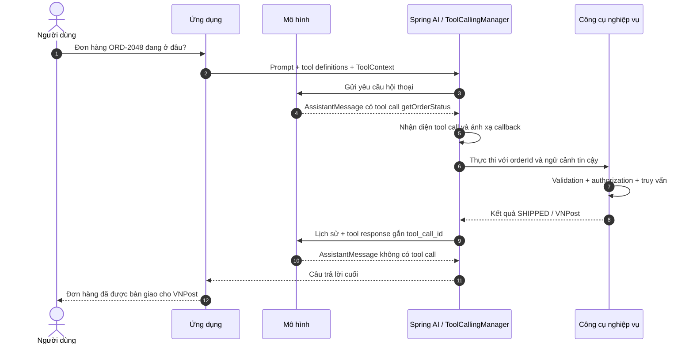

# Phân biệt thông điệp assistant chứa tool call với câu trả lời cuối

Trong một cuộc hội thoại có tool calling, không phải mọi thông điệp do mô hình tạo ra đều là câu trả lời dành cho người dùng. Mô hình có thể gửi một **thông điệp assistant yêu cầu gọi công cụ**. Thông điệp đó cho biết ứng dụng cần thực hiện một thao tác, chẳng hạn tra cứu đơn hàng hoặc tính phí vận chuyển. Sau khi ứng dụng chạy công cụ và gửi kết quả trở lại lịch sử hội thoại, mô hình mới có thể tạo **câu trả lời cuối**.

Điểm phân biệt cốt lõi là ý nghĩa của thông điệp và trạng thái điều phối:

- Assistant message có tool call là một yêu cầu bàn giao việc thực thi cho ứng dụng. Nó chứa tên công cụ, đối số và định danh của từng lần gọi.
- Tool response là kết quả do ứng dụng tạo ra sau khi thực thi công cụ. Kết quả này được gắn với tool call tương ứng.
- Final assistant message là phản hồi mô hình tạo ra sau khi đã nhận các kết quả cần thiết và không còn yêu cầu gọi công cụ trong thông điệp đó.

Nếu ứng dụng nhầm tool call thành câu trả lời cuối, người dùng có thể nhìn thấy tên hàm hoặc JSON đối số thay vì kết quả nghiệp vụ. Nếu ứng dụng coi một câu trả lời cuối là tool call, nó có thể cố chạy một thao tác không tồn tại. Vì vậy, ứng dụng phải kiểm tra cấu trúc thông điệp, đặc biệt là danh sách tool call, thay vì chỉ đọc phần văn bản.

## 1. Ba loại thông điệp trong một vòng tool calling

Hãy xét yêu cầu: “Đơn hàng ORD-2048 đang ở trạng thái nào?”. Ứng dụng đã đăng ký công cụ `getOrderStatus`.

**Thông điệp assistant yêu cầu gọi công cụ**

Mô hình trả về một thông điệp có vai trò `assistant`, trong đó có tool call. Ví dụ theo dạng giao thức function calling phổ biến:

```json
{
  "role": "assistant",
  "content": null,
  "tool_calls": [
    {
      "id": "call_7f31",
      "type": "function",
      "function": {
        "name": "getOrderStatus",
        "arguments": "{\"orderId\":\"ORD-2048\"}"
      }
    }
  ]
}
```

Đây là yêu cầu thực thi, chưa phải kết quả tra cứu. Mô hình chỉ nêu công cụ cần gọi và dữ liệu đầu vào mà nó đề xuất. Ứng dụng phải kiểm tra tên công cụ, giải mã và xác thực đối số, kiểm tra quyền của người dùng, rồi mới gọi mã Java tương ứng.

**Thông điệp kết quả công cụ**

Sau khi thực thi, ứng dụng đưa kết quả vào lịch sử hội thoại. Trong giao thức có vai trò `tool`, kết quả được liên kết với `tool_call_id`:

```json
{
  "role": "tool",
  "tool_call_id": "call_7f31",
  "content": "{\"status\":\"SHIPPED\",\"carrier\":\"VNPost\"}"
}
```

Thông điệp này không phải do mô hình tạo ra và cũng chưa phải câu trả lời cuối dành cho người dùng. Đây là dữ liệu ứng dụng trả về để mô hình sử dụng ở lượt tiếp theo. Tùy provider và phiên bản tích hợp, cách biểu diễn trên giao thức có thể khác; Spring AI chuẩn hóa các kết quả đó thành các kiểu message của framework.

**Câu trả lời cuối của assistant**

Sau khi nhận kết quả công cụ, mô hình có thể trả lời người dùng:

```json
{
  "role": "assistant",
  "content": "Đơn hàng ORD-2048 đã được bàn giao cho VNPost."
}
```

Thông điệp này không chứa tool call mới. Đây mới là nội dung hội thoại mà ứng dụng thường trả về cho người dùng, sau khi áp dụng các chính sách kiểm tra đầu ra cần thiết.

Các ví dụ JSON trên minh họa cấu trúc giao thức theo kiểu function calling phổ biến. Không nên giả định mọi nhà cung cấp đều dùng chính xác cùng tên trường hoặc cùng cách mã hóa nội dung. Trong ứng dụng Spring AI, hãy làm việc với các đối tượng message và tool call đã được framework chuẩn hóa.

## 2. Assistant message có tool call vẫn là thông điệp của assistant

Một nhầm lẫn thường gặp là cho rằng khi mô hình yêu cầu gọi công cụ, thông điệp đó mang vai trò `tool`. Thực tế, yêu cầu gọi công cụ xuất phát từ assistant. Ứng dụng nhận thông điệp assistant, đọc danh sách tool call và thực hiện từng yêu cầu hợp lệ.

Có thể nhận diện các phần chính như sau:

| Thành phần | Ý nghĩa | Ai tạo ra? |
|---|---|---|
| `role = assistant` | Mô hình đang phát biểu hoặc yêu cầu bước tiếp theo | Mô hình |
| `tool_calls` | Danh sách thao tác mô hình muốn ứng dụng thực hiện | Mô hình |
| `id` của tool call | Định danh để ghép yêu cầu gọi với kết quả | Mô hình / giao thức provider |
| `name` | Tên công cụ đã được công bố cho mô hình | Mô hình chọn từ danh sách được cung cấp |
| `arguments` | Đối số có cấu trúc cho lần gọi đó | Mô hình |
| `role = tool` hoặc cấu trúc tool response tương ứng | Kết quả thực thi công cụ | Ứng dụng |
| `role = assistant` không có tool call | Phản hồi hội thoại tiếp theo, có thể là câu trả lời cuối | Mô hình |

Một assistant message có thể có nội dung văn bản đi kèm tool call, tùy model provider. Ví dụ, mô hình có thể phát ra lời dẫn như “Tôi sẽ kiểm tra đơn hàng” cùng một yêu cầu gọi công cụ. Vì vậy, chỉ thấy `content` có chữ không đủ để kết luận đó là câu trả lời cuối. Ứng dụng phải kiểm tra xem thông điệp có tool call hay không.

Ngược lại, một thông điệp assistant không có tool call thường là câu trả lời hoặc nội dung kết thúc lượt. Ứng dụng vẫn nên xem xét trạng thái hoàn tất do model adapter trả về và chính sách của hệ thống; không nên dựa vào một chuỗi văn bản đơn lẻ để quyết định điều phối.

## 3. Spring AI biểu diễn tool call như thế nào?

Trong Spring AI, phản hồi của mô hình được biểu diễn qua `ChatResponse`. Phần đầu ra của một generation là `AssistantMessage`. Khi mô hình yêu cầu gọi công cụ, `AssistantMessage` chứa danh sách `ToolCall` bên cạnh phần nội dung văn bản nếu có.

Đoạn mã sau minh họa cách phân biệt ở mức đối tượng trả về từ `ChatModel`:

```java
ChatResponse chatResponse = chatModel.call(prompt);
AssistantMessage assistantMessage = chatResponse.getResult().getOutput();

if (!assistantMessage.getToolCalls().isEmpty()) {
    // Đây là yêu cầu gọi công cụ, chưa phải câu trả lời cuối.
    // Chuyển chatResponse và prompt cho cơ chế điều phối công cụ.
} else {
    // Không có tool call trong thông điệp assistant này.
    String finalText = assistantMessage.getText();
}
```

Trong `AssistantMessage`, mỗi `ToolCall` cung cấp các thông tin như định danh, loại, tên công cụ và chuỗi đối số. Framework dùng những thông tin đó để ánh xạ tới callback đã đăng ký. Đối số thường được mã hóa dưới dạng JSON; cần để cơ chế chuyển đổi của Spring AI xử lý theo kiểu đầu vào được khai báo, đồng thời vẫn thực hiện validation ở phía ứng dụng.

Khi công cụ được thực thi, Spring AI biểu diễn kết quả bằng thông điệp phản hồi công cụ, thường được thể hiện qua `ToolResponseMessage` trong lịch sử hội thoại. Kết quả phải giữ liên kết với tool call ban đầu để mô hình hiểu dữ liệu nào trả lời cho yêu cầu nào.

Đoạn mã trên chỉ minh họa điểm kiểm tra cấu trúc. API cụ thể của `ChatResponse`, `AssistantMessage` và cơ chế thực thi có thể thay đổi theo phiên bản Spring AI và model adapter. Trong luồng ứng dụng, ưu tiên dùng `ToolCallingManager` hoặc cơ chế điều phối tự động của `ChatClient` thay vì tự phân tích payload giao thức của từng provider.

## 4. Phân biệt bằng cấu trúc, không bằng nội dung văn bản

Không nên dùng các quy tắc như “nếu nội dung có chữ `getOrderStatus` thì chạy công cụ” hoặc “nếu nội dung không rỗng thì trả cho người dùng”. Tên công cụ có thể xuất hiện trong phần giải thích thông thường, còn một tool call hợp lệ có thể có phần `content` rỗng.

Hãy dùng các dấu hiệu theo thứ tự sau:

1. Kiểm tra danh sách tool call trong assistant message. Nếu có ít nhất một tool call, đây là nhánh điều phối công cụ.
2. Xác minh tên từng công cụ nằm trong danh sách callback được phép cho yêu cầu hiện tại.
3. Kiểm tra và chuyển đổi đối số theo schema, sau đó áp dụng validation và kiểm tra quyền.
4. Chỉ sau khi thực thi, tạo tool response gắn với đúng định danh của tool call.
5. Đưa kết quả vào lịch sử hội thoại và yêu cầu mô hình tiếp tục.
6. Khi assistant message tiếp theo không còn tool call và có nội dung trả lời phù hợp, xử lý nó như ứng viên câu trả lời cuối.

Model provider thường có thêm trạng thái kết thúc như `tool_calls`, `stop` hoặc các trạng thái khác. Trạng thái kết thúc giúp giải thích vì sao generation dừng lại, nhưng ứng dụng nên dùng cấu trúc tool call đã được adapter chuẩn hóa làm căn cứ xác định có thao tác công cụ cần xử lý hay không. Không suy luận rằng mọi phản hồi kết thúc đều là câu trả lời cuối.

## 5. Một chu trình đầy đủ từ yêu cầu đến câu trả lời cuối



Chu trình có thể lặp nhiều lần. Sau khi nhận một tool response, mô hình có thể yêu cầu công cụ khác nếu cần thêm dữ liệu. Chỉ kết thúc khi mô hình trả lời mà không yêu cầu gọi công cụ tiếp theo, hoặc khi ứng dụng chủ động dừng vì lỗi, timeout hay giới hạn tài nguyên.

Ví dụ, để trả lời “Đơn hàng mới nhất của tôi đã giao chưa?”, mô hình có thể gọi `findLatestOrder`, nhận mã đơn hàng, rồi gọi `getOrderStatus`. Hai tool call này có thể nằm ở hai assistant message khác nhau vì kết quả của lần gọi đầu là đầu vào cho lần gọi sau.

## 6. Một assistant message có thể chứa nhiều tool call

Mô hình có thể yêu cầu nhiều công cụ trong cùng một assistant message nếu các thao tác có thể được thực hiện độc lập. Ví dụ, nó có thể yêu cầu tra cứu trạng thái đơn hàng và thời gian giao dự kiến cùng lúc:

```json
{
  "role": "assistant",
  "tool_calls": [
    {
      "id": "call_status_01",
      "type": "function",
      "function": {
        "name": "getOrderStatus",
        "arguments": "{\"orderId\":\"ORD-2048\"}"
      }
    },
    {
      "id": "call_eta_02",
      "type": "function",
      "function": {
        "name": "getDeliveryEstimate",
        "arguments": "{\"orderId\":\"ORD-2048\"}"
      }
    }
  ]
}
```

Ứng dụng cần xử lý từng tool call và tạo kết quả tương ứng:

| Tool call ID | Công cụ | Kết quả gắn với ID |
|---|---|---|
| `call_status_01` | `getOrderStatus` | Trạng thái `SHIPPED` |
| `call_eta_02` | `getDeliveryEstimate` | Dự kiến giao ngày 28/11 |

Mỗi kết quả phải liên kết với đúng ID của lần gọi ban đầu. Không ghép kết quả theo thứ tự hoàn thành nếu callback chạy song song. Nếu công cụ độc lập và an toàn khi chạy đồng thời, ứng dụng có thể thực thi song song; nếu có phụ thuộc dữ liệu hoặc tác động phụ, hãy thực thi theo thứ tự được ứng dụng kiểm soát.

Sau khi đã thêm các tool response phù hợp vào lịch sử hội thoại, ứng dụng gửi lịch sử đó lại cho mô hình. Mô hình tổng hợp thông tin thành câu trả lời cuối. Không trả riêng từng tool response như thể đó là lời giải thích của assistant, trừ khi thiết kế sản phẩm chủ động muốn hiển thị dữ liệu công cụ ở dạng riêng.

## 7. Vai trò của ChatClient và ChatModel trong việc nhận câu trả lời cuối

Spring AI hỗ trợ cả cách điều phối tự động và cách điều phối có kiểm soát.

Với `ChatClient`, khi ứng dụng đăng ký các công cụ bằng `.tools(...)` hoặc callback tương ứng, cơ chế tool calling của Spring AI có thể tự nhận tool call, thực thi callback, bổ sung kết quả vào hội thoại và tiếp tục gọi mô hình. Vì vậy, đoạn gọi cấp cao như:

```java
String answer = chatClient.prompt()
        .user("Đơn hàng ORD-2048 đang ở trạng thái nào?")
        .tools(orderTools)
        .call()
        .content();
```

thường trả về nội dung cuối sau chu trình điều phối tự động. Người gọi `content()` ở tầng này không nhất thiết nhìn thấy các assistant message trung gian có tool call.

Khi làm việc trực tiếp với `ChatModel`, ứng dụng thường nhận `ChatResponse` của lần gọi model và cần phối hợp với `ToolCallingManager` để thực thi tool call, tạo kết quả và tiếp tục chu trình. Cách này phù hợp khi cần kiểm soát rõ hơn giới hạn vòng lặp, chính sách thực thi, logging hoặc cách xử lý lỗi.

Không nên trộn hai cơ chế trong cùng một luồng mà không hiểu ai đang sở hữu việc thực thi. Nếu `ChatClient` đã tự điều phối, không gọi lại callback lần nữa dựa trên nội dung cuối. Nếu ứng dụng đang điều phối thủ công, không được bỏ qua bước thực thi và bổ sung tool response trước khi yêu cầu mô hình tiếp tục.

## 8. Xử lý tool call lỗi và trạng thái chưa xác định

Tool call không đảm bảo thao tác thành công. Callback có thể từ chối quyền, không tìm thấy dữ liệu, gặp lỗi nghiệp vụ hoặc timeout. Khi đó, ứng dụng cần tạo kết quả lỗi có kiểm soát hoặc áp dụng cơ chế exception handling phù hợp với cấu hình Spring AI. Nếu tiếp tục hội thoại, kết quả lỗi phải được liên kết với đúng tool call ID để mô hình hiểu thao tác nào thất bại.

Ví dụ kết quả công cụ có thể thể hiện trạng thái:

```json
{
  "success": false,
  "code": "ORDER_NOT_VISIBLE",
  "message": "Không tìm thấy đơn hàng trong phạm vi được phép truy cập."
}
```

Không trả stack trace, câu lệnh SQL, token hoặc thông tin hạ tầng vào tool response. Mô hình có thể diễn giải và lặp lại nội dung đó cho người dùng. Với thao tác ghi, timeout có thể khiến ứng dụng chưa biết giao dịch đã hoàn tất hay chưa; cần tra cứu trạng thái theo mã giao dịch hoặc idempotency key trước khi retry.

Nếu ứng dụng dừng chu trình do lỗi nghiêm trọng, nó không được tạo ra một câu trả lời thành công giả định. Có thể trả thông báo lỗi phù hợp trực tiếp từ ứng dụng, hoặc gửi một tool response lỗi để mô hình giải thích, tùy chính sách sản phẩm.

## 9. Những lỗi điều phối thường gặp

| Lỗi | Hậu quả | Cách xử lý |
|---|---|---|
| Xem assistant message có tool call là câu trả lời cuối | Người dùng nhận tên hàm hoặc đối số thay vì kết quả | Kiểm tra danh sách tool call trước khi kết thúc lượt. |
| Chỉ kiểm tra `content` có rỗng hay không | Bỏ sót tool call có nội dung rỗng hoặc xử lý sai message có cả chữ và tool call | Phân nhánh dựa trên cấu trúc tool call. |
| Chạy công cụ dựa trên tên hàm xuất hiện trong văn bản | Có thể gọi nhầm hoặc gọi công cụ ngoài allowlist | Chỉ xử lý tool call có cấu trúc và xác minh tên callback. |
| Bỏ qua tool call ID | Mô hình ghép nhầm kết quả khi có nhiều lần gọi | Giữ và ghép đúng ID từ yêu cầu đến tool response. |
| Gửi tool response nhưng bỏ mất assistant message chứa yêu cầu | Lịch sử hội thoại không còn đủ ngữ cảnh giao thức | Giữ chuỗi assistant tool call và tool response tương ứng. |
| Trả tool response trực tiếp như câu trả lời cuối | Người dùng có thể nhận dữ liệu thô, mã nội bộ hoặc lỗi kỹ thuật | Gửi kết quả lại cho mô hình hoặc định dạng theo chính sách ứng dụng. |
| Coi mọi phản hồi assistant không có tool call là hợp lệ | Có thể đưa ra câu trả lời rỗng, bị cắt hoặc không phù hợp | Kiểm tra trạng thái kết thúc, nội dung và chính sách đầu ra. |
| Thực thi callback lần thứ hai sau khi ChatClient đã tự xử lý | Gây tác động phụ hoặc giao dịch trùng | Xác định rõ tầng nào sở hữu vòng lặp tool calling. |

## 10. Kiểm thử việc phân biệt tool call và final answer

Kiểm thử nên dùng phản hồi model giả lập để xác minh điều phối một cách ổn định. Những tình huống quan trọng gồm:

1. Assistant message có một tool call và `content` rỗng: callback được gọi, chưa trả nội dung đó như câu trả lời cuối.
2. Assistant message có cả văn bản và tool call: ứng dụng vẫn thực thi nhánh tool call theo chính sách.
3. Assistant message không có tool call và có nội dung: ứng dụng nhận diện ứng viên câu trả lời cuối.
4. Một assistant message có nhiều tool call: mỗi callback được ánh xạ đúng tên và mỗi kết quả giữ đúng tool call ID.
5. Callback trả lỗi hoặc ném exception: lỗi được xử lý theo chính sách, không tạo kết quả thành công giả.
6. Mô hình yêu cầu công cụ ở nhiều vòng liên tiếp: lịch sử hội thoại giữ đủ assistant message và tool response.
7. ChatClient tự điều phối: nội dung trả về sau `call()` là kết quả của chu trình đã hoàn tất, callback không bị chạy lại ở tầng gọi.
8. Vòng lặp vượt giới hạn hoặc timeout: ứng dụng dừng có kiểm soát và trả trạng thái phù hợp.

Có thể kiểm tra số lần callback được gọi, đối số nhận được, tool call ID trong kết quả và số lần model được gọi. Với các công cụ có tác động phụ, cần xác minh retry hoặc xử lý timeout không tạo giao dịch trùng.

## 11. Quy tắc ghi nhớ khi đọc lịch sử hội thoại

Khi đọc một chuỗi message trong tool calling, hãy lần lượt hỏi:

- Assistant có phát ra tool call không? Nếu có, đó là yêu cầu thực thi.
- Ứng dụng đã xác minh và thực thi tool call đó chưa?
- Kết quả công cụ đã được thêm lại vào lịch sử với đúng tool call ID chưa?
- Mô hình đã nhận kết quả và tạo assistant message tiếp theo chưa?
- Assistant message mới còn tool call hay đã chuyển sang câu trả lời cuối?

Trong Spring AI, `AssistantMessage` có danh sách `ToolCall` là dấu hiệu trực tiếp cho nhánh thực thi công cụ. `ToolResponseMessage` thể hiện dữ liệu trả về từ công cụ. Câu trả lời cuối là nội dung assistant được tạo sau khi các bước công cụ cần thiết đã hoàn tất và không còn tool call đang chờ xử lý. Giữ rõ ranh giới giữa ba loại thông điệp giúp luồng hội thoại chính xác, tránh thực thi trùng và không để dữ liệu điều phối nội bộ xuất hiện nhầm như câu trả lời cho người dùng.
