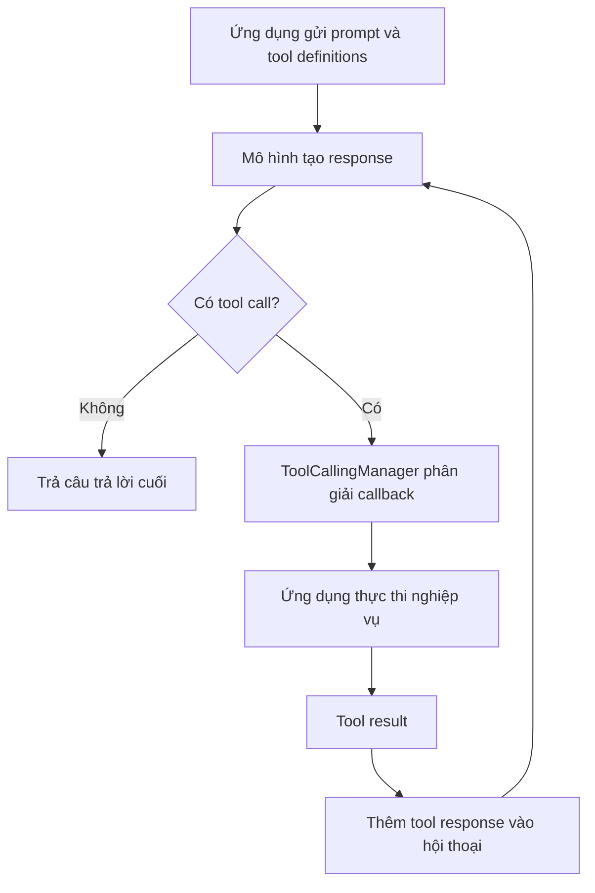
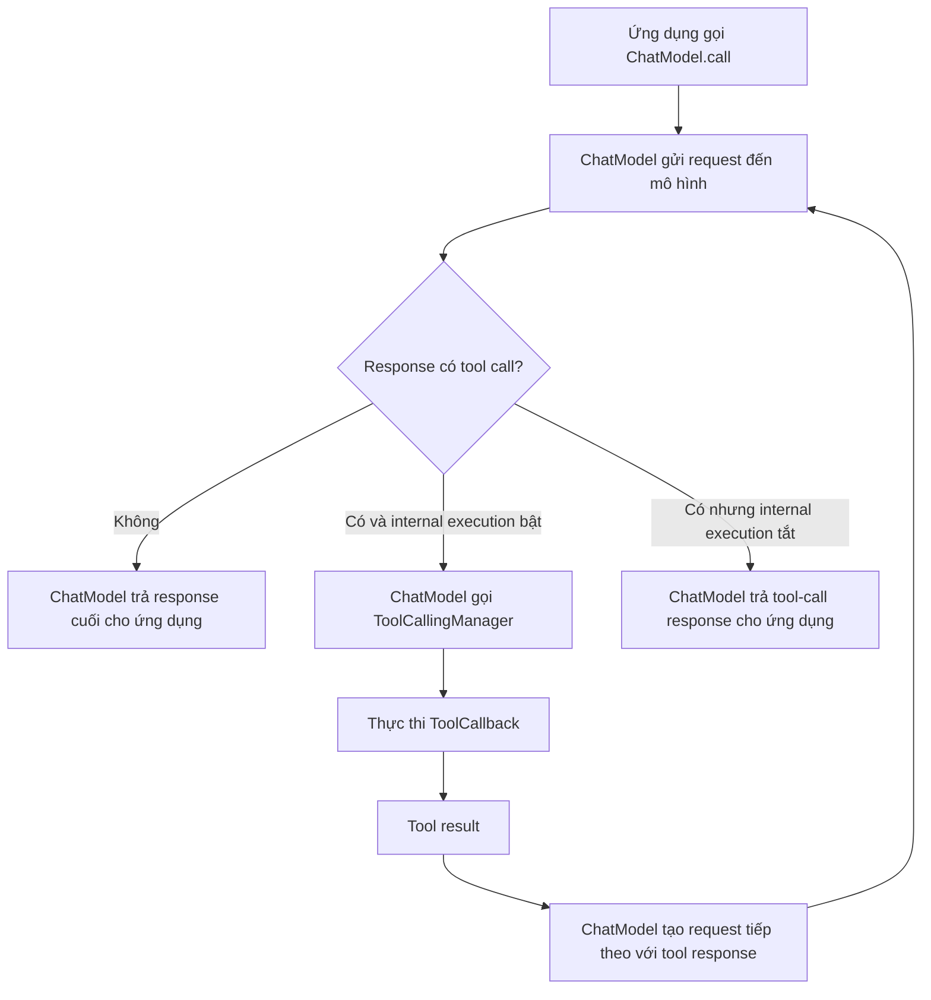
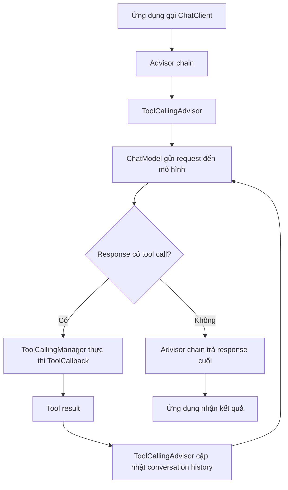

# Luồng gọi công cụ

## Thay đổi vị trí điều phối vòng lặp giữa Spring AI 1.x và 2.x

Trong module `SPRING_AI_TOOL_CALLING`, cần phân biệt hai trách nhiệm: thực thi một lần gọi công cụ và điều phối toàn bộ vòng lặp trao đổi giữa mô hình với công cụ. `ToolCallingManager` đảm nhiệm việc phân giải và thực thi các yêu cầu gọi công cụ. Thành phần điều phối quyết định khi nào gửi yêu cầu đến mô hình, khi nào thực thi tool call, cách đưa kết quả trở lại hội thoại và lúc nào dừng vòng lặp.

Từ Spring AI 1.x sang 2.x, vị trí điều phối mặc định đã thay đổi đáng kể. Ở 1.x, mỗi implementation của `ChatModel` thường chứa vòng lặp tool calling bên trong. Từ 2.0, vòng lặp này được đưa lên advisor chain của `ChatClient` và do `ToolCallingAdvisor` quản lý. `ChatModel` trở thành tầng thấp hơn: nó gửi request tới provider và trả response, còn việc thực thi tool được điều phối ở tầng phía trên hoặc do ứng dụng tự quản lý.

### 1. Vòng lặp tool calling gồm những bước nào?

Tool calling không phải là việc mô hình tự kết nối tới database hoặc gọi trực tiếp một method Java. Ứng dụng công khai định nghĩa công cụ, gồm tên, mô tả và schema đầu vào. Mô hình có thể trả về một yêu cầu gọi công cụ với tên và đối số tương ứng. Ứng dụng mới là bên phân giải callback, kiểm tra quyền, chạy logic nghiệp vụ và gửi kết quả về cho mô hình.

Một vòng lặp đầy đủ thường diễn ra như sau:

1. Ứng dụng tạo prompt và cung cấp các tool có thể sử dụng trong request.
2. Mô hình trả lời trực tiếp hoặc gửi một hay nhiều tool call.
3. Thành phần điều phối kiểm tra response có tool call hay không.
4. Nếu có, thành phần này chuyển các yêu cầu đến `ToolCallingManager`.
5. `ToolCallingManager` phân giải `ToolCallback`, thực thi callback với đối số nhận được và tạo kết quả thực thi.
6. Kết quả được thêm vào lịch sử hội thoại dưới dạng tool response rồi gửi lại cho mô hình.
7. Các bước trên lặp lại cho đến khi mô hình trả về response không còn tool call, hoặc một điều kiện dừng khác được kích hoạt.



Điểm cần theo dõi trong bài này là ai gọi lại mô hình sau khi công cụ chạy xong. `ToolCallingManager` vẫn quan trọng ở cả hai dòng phiên bản, nhưng nó không đồng nghĩa với toàn bộ vòng lặp. Vị trí của vòng lặp quyết định khả năng quan sát từng lượt, kết hợp với memory advisor, chèn bước phê duyệt và thay đổi chiến lược điều phối.

### 2. Spring AI 1.x: vòng lặp nằm bên trong `ChatModel`

Trong Spring AI 1.x, cơ chế mặc định là mỗi implementation của `ChatModel` tự quản lý vòng lặp thực thi công cụ. Khi ứng dụng gọi `chatModel.call(prompt)` và prompt có tool definitions, `ChatModel` gửi request đến provider. Nếu response có tool call và `internalToolExecutionEnabled` đang bật, `ChatModel` chuyển yêu cầu đến `ToolCallingManager`, nhận kết quả rồi gửi tool response trở lại mô hình. `ChatModel` tiếp tục gọi provider cho đến khi nhận được response không còn tool call hoặc điều kiện dừng tương ứng.



Với cách dùng mặc định, ứng dụng thường chỉ nhìn thấy kết quả cuối cùng. Các message trung gian dùng để yêu cầu tool và trả tool result được xử lý bên trong implementation của `ChatModel`. Điều này thuận tiện vì người gọi không phải tự viết vòng lặp, nhưng khiến việc can thiệp vào từng lượt khó hơn: advisor bên ngoài `ChatModel` thường chỉ quan sát được lần gọi tổng thể, không thể dễ dàng bao quanh từng lần model được gọi lại.

Ví dụ dùng mặc định trong 1.x:

```java
ChatModel chatModel = ...;

ToolCallback[] tools = ToolCallbacks.from(new CustomerTools());
ChatOptions options = ToolCallingChatOptions.builder()
    .toolCallbacks(tools)
    .build(); // internalToolExecutionEnabled mặc định là true

Prompt prompt = new Prompt(
    "Cho tôi biết thông tin khách hàng có mã 42.", options);

// ChatModel tự thực thi các tool call và gọi lại mô hình khi cần.
ChatResponse response = chatModel.call(prompt);
String answer = response.getResult().getOutput().getText();
```

Trong cách sử dụng phổ biến với `ChatClient`, ứng dụng cũng có thể viết ngắn gọn:

```java
String answer = ChatClient.create(chatModel)
    .prompt("Cho tôi biết thông tin khách hàng có mã 42.")
    .tools(new CustomerTools())
    .call()
    .content();
```

`ChatClient` là API thuận tiện cho phía ứng dụng, nhưng trong kiến trúc mặc định của 1.x, vòng thực thi tool vẫn do `ChatModel` phía dưới đảm nhiệm.

#### Tắt vòng lặp nội bộ trong 1.x

Nếu cần tự kiểm soát từng bước, ứng dụng có thể đặt `internalToolExecutionEnabled(false)`. Khi đó, `ChatModel` trả về response có tool call và giao việc điều phối cho caller. Caller kiểm tra `hasToolCalls()`, gọi `ToolCallingManager.executeToolCalls(...)`, đưa conversation history mới vào prompt rồi gọi `ChatModel` lần tiếp theo.

```java
ChatModel chatModel = ...;
ToolCallingManager toolCallingManager = ToolCallingManager.builder().build();

ChatOptions options = ToolCallingChatOptions.builder()
    .toolCallbacks(ToolCallbacks.from(new CustomerTools()))
    .internalToolExecutionEnabled(false)
    .build();

Prompt prompt = new Prompt(
    "Cho tôi biết thông tin khách hàng có mã 42.", options);
ChatResponse response = chatModel.call(prompt);

while (response.hasToolCalls()) {
    ToolExecutionResult result =
        toolCallingManager.executeToolCalls(prompt, response);
    prompt = new Prompt(result.conversationHistory(), options);
    response = chatModel.call(prompt);
}

String answer = response.getResult().getOutput().getText();
```

`internalToolExecutionEnabled` có giá trị mặc định là `true`. Trong 1.x, `ToolExecutionEligibilityPredicate` được dùng để quyết định một response có đủ điều kiện chạy tool hay không; implementation mặc định xét cờ này và việc response có tool call. Khi tắt cờ, caller có thể quan sát tool call và tự điều phối. Đây là một lựa chọn ở tầng `ChatModel`, không phải cách điều phối mặc định.

#### Advisor điều phối trong các bản 1.x

Ở các bản 1.x có hỗ trợ advisor này, ứng dụng cũng có thể dùng `ToolCallAdvisor` để đưa vòng lặp vào advisor chain. Advisor gọi `ToolCallingManager`, gửi tool result trở lại mô hình và tiếp tục cho đến khi không còn tool call. Cách này cho phép advisor khác quan sát từng lượt và kết hợp với memory. `ToolCallAdvisor` chủ động tắt vòng lặp nội bộ của model để tránh hai nơi cùng điều phối một request.

Đây là lựa chọn bổ sung trong 1.x. Điểm phân biệt quan trọng là đường mặc định vẫn có vòng lặp bên trong `ChatModel`, trong khi `ToolCallAdvisor` là cách chuyển quyền điều phối lên advisor chain.

### 3. Spring AI 2.x: vòng lặp nằm trong advisor chain

Spring AI 2.0 loại bỏ vòng lặp thực thi tool nội bộ khỏi tất cả implementation của `ChatModel`. Vì vậy, khi gọi trực tiếp `chatModel.call(prompt)` hoặc `chatModel.stream(prompt)`, kết quả là response thô từ mô hình. Nếu response chứa tool call, `ChatModel` trả yêu cầu đó về cho caller; nó không tự gọi `ToolCallingManager` và không gọi lại provider để hoàn thành vòng lặp.

Với luồng ứng dụng thông thường, `ChatClient` tự đăng ký `ToolCallingAdvisor` vào advisor chain. Advisor này chịu trách nhiệm toàn bộ vòng đời tool calling: gửi request, kiểm tra response, yêu cầu `ToolCallingManager` thực thi công cụ, bổ sung tool result vào conversation history và gọi lại mô hình. Vòng lặp dừng khi response không còn tool call hoặc một điều kiện dừng khác được cấu hình.



Ví dụ 2.x dùng `ChatClient`:

```java
ChatModel chatModel = ...;

String answer = ChatClient.create(chatModel)
    .prompt("Cho tôi biết thông tin khách hàng có mã 42.")
    .tools(new CustomerTools())
    .call()
    .content();
```

Code gọi `ChatClient` khá giống ví dụ 1.x. Khác biệt nằm trong kiến trúc bên dưới: từ 2.x, `DefaultChatClient` tự đăng ký `ToolCallingAdvisor` để điều phối vòng lặp. Vì vậy, một lệnh `.call()` có thể thực hiện nhiều lượt gọi mô hình và nhiều lần chạy công cụ trước khi trả kết quả cuối.

`ToolCallingAdvisor` là recursive advisor: nó có thể gọi tiếp phần còn lại của advisor chain nhiều lần. Nó triển khai cả luồng blocking (`CallAdvisor`) và streaming (`StreamAdvisor`), nên cùng một cơ chế điều phối có thể dùng cho `.call()` và `.stream()`.

### 4. Trách nhiệm của từng thành phần sau khi chuyển sang 2.x

Việc chuyển vị trí vòng lặp không làm `ToolCallingManager` biến mất. Các thành phần có trách nhiệm khác nhau:

| Thành phần | Spring AI 1.x mặc định | Spring AI 2.x với `ChatClient` |
| --- | --- | --- |
| `ChatModel` | Gửi request, nhận response và tự điều phối vòng tool nội bộ | Gửi request đến provider và trả response cho advisor; không tự thực thi tool call |
| `ToolCallingManager` | Được `ChatModel` gọi để phân giải và thực thi tool | Được `ToolCallingAdvisor` gọi để phân giải và thực thi tool |
| Thành phần giữ vòng lặp | Code nội bộ của từng implementation `ChatModel` | `ToolCallingAdvisor` trong advisor chain |
| `ChatClient` | API cấp cao để xây dựng request; model bên dưới thực hiện vòng lặp mặc định | API cấp cao và điểm vào của advisor chain chứa vòng lặp mặc định |
| Caller | Nhận kết quả cuối, hoặc tự điều phối khi tắt internal execution | Nhận kết quả cuối, hoặc chủ động tắt advisor auto-registration để tự điều phối |
| Điểm mở rộng | Predicate ở model hoặc advisor tùy cách dùng | Advisor order, hook của `ToolCallingAdvisor`, checker và advisor tùy chỉnh |

`ToolCallingManager` tập trung vào thao tác thực thi: phân giải tên tool, chuyển đối số tới callback và tạo `ToolExecutionResult`. Thành phần sở hữu vòng lặp lại quyết định có gọi mô hình thêm lần nữa hay không. Không nên gộp hai trách nhiệm này thành một khái niệm khi đọc log hoặc thiết kế lớp điều phối riêng.

### 5. Advisor order ảnh hưởng đến khả năng quan sát từng lượt

Một lợi ích chính của kiến trúc 2.x là vòng lặp trở thành một phần của advisor chain. Các advisor khác có thể được đặt bên ngoài hoặc bên trong `ToolCallingAdvisor` tùy theo thứ tự thực thi.

Trong Spring AI 2.1, `ToolCallingAdvisor.DEFAULT_ORDER` là `Ordered.HIGHEST_PRECEDENCE + 300`. Một advisor có order nhỏ hơn thường nằm bên ngoài vòng tool và chỉ nhìn thấy kết quả sau khi vòng lặp hoàn tất. Advisor có order lớn hơn được chạy bên trong vòng tool, nên có thể quan sát từng request/response của các lượt lặp.

Ví dụ, một advisor ghi nhận sự kiện cho từng lượt có thể đặt order là `HIGHEST_PRECEDENCE + 400`:

```java
public class ToolIterationObserver implements CallAdvisor, StreamAdvisor {

    private final Consumer<ChatClientResponse> observer;

    public ToolIterationObserver(Consumer<ChatClientResponse> observer) {
        this.observer = observer;
    }

    @Override
    public int getOrder() {
        // Lớn hơn ToolCallingAdvisor.DEFAULT_ORDER (+300): nằm bên trong vòng lặp.
        return Ordered.HIGHEST_PRECEDENCE + 400;
    }

    @Override
    public ChatClientResponse adviseCall(
            ChatClientRequest request, CallAdvisorChain chain) {
        // Mỗi iteration có request chứa tool response của các lượt trước.
        ChatClientResponse response = chain.nextCall(request);
        observer.accept(response);
        return response;
    }

    @Override
    public Flux<ChatClientResponse> adviseStream(
            ChatClientRequest request, StreamAdvisorChain chain) {
        return chain.nextStream(request).doOnNext(observer);
    }
}
```

Ví dụ trên chỉ minh họa vị trí tương đối của advisor; phần ghi log thực tế cần che dữ liệu nhạy cảm. Nếu advisor chỉ cần xử lý câu trả lời cuối cùng, đặt nó bên ngoài vòng lặp sẽ phù hợp hơn. Khi cần lưu toàn bộ lịch sử tool call và tool response, cần chọn memory advisor và backend có hỗ trợ các message tương ứng.

`ToolCallingAdvisor` còn cung cấp các hook để mở rộng mà không phải tự viết lại vòng lặp:

- `doInitializeLoop`: chạy một lần trước vòng lặp, phù hợp để khởi tạo trạng thái hoặc cache theo request.
- `doBeforeCall`: chạy trước mỗi lượt gửi request đến mô hình, có thể bổ sung ngữ cảnh hoặc điều chỉnh tool khả dụng.
- `doAfterCall`: chạy sau mỗi response, phù hợp để ghi nhận quan sát hoặc kiểm tra điều kiện tiếp tục.
- `doFinalizeLoop`: chạy một lần khi vòng lặp kết thúc, phù hợp để tổng hợp số liệu và dọn trạng thái.

Nếu chỉ cần quan sát hoặc thêm logic quanh từng lượt, dùng advisor bên trong vòng lặp thường đơn giản hơn việc tắt cơ chế tự động rồi tự viết toàn bộ orchestration.

### 6. Tự điều phối vòng lặp trong Spring AI 2.x

2.x vẫn hỗ trợ ứng dụng tự điều phối khi cần tích hợp với workflow engine riêng, cần tạm dừng để chờ phê duyệt, muốn chuyển từng lượt qua SSE/WebSocket hoặc cần điều kiện dừng phụ thuộc trạng thái bên ngoài.

Khi dùng `ChatModel` trực tiếp, không có `ToolCallingAdvisor` nên ứng dụng phải kiểm tra response và chạy vòng lặp. Ví dụ dưới đây minh họa cách dùng `ToolCallingManager`:

```java
ChatModel chatModel = ...;
ToolCallingManager toolCallingManager = ToolCallingManager.builder().build();

ToolCallback[] tools = ToolCallbacks.from(new CustomerTools());
ChatOptions options = ToolCallingChatOptions.builder()
    .toolCallbacks(tools)
    .build();

Prompt prompt = new Prompt(
    "Cho tôi biết thông tin khách hàng có mã 42.", options);
ChatResponse response = chatModel.call(prompt);

while (response.hasToolCalls()) {
    ToolExecutionResult result =
        toolCallingManager.executeToolCalls(prompt, response);

    prompt = new Prompt(result.conversationHistory(), options);
    response = chatModel.call(prompt);
}
```

Đoạn code là khung minh họa cho nhánh tiếp tục hội thoại. Nếu tool được cấu hình `returnDirect`, hãy kiểm tra `ToolExecutionResult.returnDirect()` và trả kết quả thực thi trực tiếp theo hợp đồng của service hoặc controller; không tạo prompt tiếp theo để gửi kết quả đó trở lại mô hình. Cần bổ sung giới hạn số lượt, timeout, xử lý lỗi, lưu trạng thái và cơ chế hủy khi workflow bị dừng.

Nếu vẫn muốn dùng `ChatClient` nhưng tự điều phối, có thể tắt auto-registration của `ToolCallingAdvisor` cho một request:

```java
ChatClientResponse response = chatClient.prompt()
    .user(question)
    .tools(tools)
    .advisors(AdvisorParams.toolCallingAdvisorAutoRegister(false))
    .call()
    .chatClientResponse();
```

Khi đó, tool definitions vẫn được gửi đến mô hình, nhưng tool call trong response không được thực thi tự động. Caller phải dùng `ToolCallingManager` và gửi conversation history trở lại `ChatClient` ở các lượt tiếp theo. Có thể tắt auto-registration toàn cục cho `ChatClient` được auto-configure bằng thuộc tính:

```properties
spring.ai.chat.client.tool-calling.enabled=false
```

Chỉ nên tắt ở phạm vi cần thiết. Nếu ứng dụng tắt auto-registration mà không tự xử lý tool call, mô hình có thể trả về yêu cầu gọi công cụ nhưng nghiệp vụ tương ứng sẽ không được chạy.

### 7. Migration từ 1.x sang 2.x

Khi nâng cấp, cần rà soát cả code lẫn cấu hình. Các thay đổi quan trọng liên quan trực tiếp đến vị trí điều phối gồm:

| Thành phần 1.x | Thay đổi trong 2.x | Việc cần làm |
| --- | --- | --- |
| Vòng lặp nội bộ của `ChatModel` | Bị loại bỏ khỏi mọi implementation | Nếu đang dựa vào vòng lặp tự động, chuyển sang `ChatClient` với `ToolCallingAdvisor` |
| `internalToolExecutionEnabled(true/false)` | Bị loại bỏ khỏi `ToolCallingChatOptions` và các provider options | Xóa lời gọi builder này; chọn advisor-controlled hoặc user-controlled execution |
| `spring.ai.<provider>.chat.internal-tool-execution-enabled` | Thuộc tính bị loại bỏ | Xóa thuộc tính cũ; dùng cấu hình auto-registration của `ChatClient` nếu cần |
| `ToolExecutionEligibilityPredicate` | Được deprecated từ 2.0 và loại bỏ trong 2.1; điều kiện tiếp tục vòng lặp chuyển sang checker của advisor | Chuyển logic điều kiện sang `ToolExecutionEligibilityChecker` trên `ToolCallingAdvisor` |
| `ToolCallAdvisor` trong 1.1.x | Đổi tên thành `ToolCallingAdvisor` trong 2.0 | Cập nhật import và builder; kiểm tra lại thứ tự advisor và cơ chế auto-registration |

#### Trường hợp A: ứng dụng dùng vòng lặp mặc định

Nếu code 1.x chỉ gọi `ChatClient` và truyền `.tools(...)`, thường có thể giữ cách gọi cấp cao này. Khi chạy trên 2.x, `ChatClient` dùng `ToolCallingAdvisor` auto-registered để thực thi vòng lặp. Cần kiểm tra các cấu hình hoặc bean advisor tự đăng ký trước đó để tránh có hai advisor cùng sở hữu vòng tool.

#### Trường hợp B: ứng dụng gọi `ChatModel` trực tiếp

Đây là trường hợp dễ thay đổi hành vi nhất. Trên 1.x, `chatModel.call(prompt)` có thể tự thực thi tool call. Trên 2.x, cùng lời gọi đó chỉ trả response chứa tool call. Nếu ứng dụng vẫn mong chờ nội dung cuối cùng, nó có thể nhận response chưa hoàn tất hoặc không thấy kết quả nghiệp vụ.

Với phần lớn ứng dụng, chuyển sang `ChatClient` là lựa chọn ngắn gọn:

```java
// Spring AI 2.x: ChatClient điều phối tool loop qua ToolCallingAdvisor.
String answer = ChatClient.create(chatModel)
    .prompt(question)
    .tools(new CustomerTools())
    .call()
    .content();
```

Nếu `ChatModel` trực tiếp là yêu cầu có chủ đích, hãy thêm vòng lặp thủ công bằng `ToolCallingManager` như phần trước. Khi đó ứng dụng chịu trách nhiệm giới hạn số lượt, lưu conversation history và xử lý điều kiện kết thúc.

#### Trường hợp C: trước đây đã tắt internal execution

Trong 1.x, code thường có dạng:

```java
ToolCallingChatOptions.builder()
    .toolCallbacks(tools)
    .internalToolExecutionEnabled(false)
    .build();
```

Trong 2.x, xóa `.internalToolExecutionEnabled(false)`. Nếu muốn tự điều phối, gọi `ChatModel` trực tiếp rồi kiểm tra `response.hasToolCalls()` và dùng `ToolCallingManager`. Nếu muốn tiếp tục dùng `ChatClient`, tắt auto-registration bằng `AdvisorParams.toolCallingAdvisorAutoRegister(false)` trên request và tự chạy vòng lặp.

#### Trường hợp D: trước đây tùy biến điều kiện thực thi

Trong 1.x, `ToolExecutionEligibilityPredicate` được gắn với `ChatModel` để quyết định có thực thi tool hay không. Trong 2.x, chính sách lặp nên được đặt tại `ToolCallingAdvisor` thông qua `ToolExecutionEligibilityChecker`. Đây là thay đổi vị trí của điểm mở rộng: điều kiện tiếp tục vòng lặp thuộc thành phần sở hữu vòng lặp, không còn thuộc từng provider `ChatModel`.

### 8. Các điểm cần kiểm tra khi nâng cấp

- **Không còn tool call tự chạy ở `ChatModel`.** Viết integration test xác nhận `ChatModel.call()` trả response có tool call mà không tự thực thi callback; sau đó kiểm tra `ChatClient` thực thi đúng qua advisor.
- **Chỉ có một thành phần sở hữu vòng lặp.** Không cấu hình hai `ToolCallingAdvisor` cùng lúc hoặc vừa dùng advisor tự động vừa tự thực thi cùng response.
- **Advisor order đúng mục đích.** Kiểm tra advisor cần quan sát từng lượt nằm bên trong vòng tool; advisor chỉ cần kết quả cuối nằm bên ngoài.
- **Lịch sử hội thoại đầy đủ.** Mỗi vòng tiếp theo phải có cả yêu cầu tool call và tool response tương ứng. Nếu tự điều phối, dùng `ToolExecutionResult.conversationHistory()` để tạo prompt kế tiếp.
- **Streaming được xử lý đúng.** Với đường điều phối thủ công, tool call có thể trải qua nhiều chunk; cần aggregate response trước khi quyết định chạy tool. Với `ChatClient` và advisor, kiểm tra cả đường `.stream()` và hủy subscription.
- **Giới hạn vòng lặp.** Đặt giới hạn số lượt gọi mô hình, timeout cho tool và giới hạn kích thước kết quả. Xử lý trường hợp mô hình liên tục yêu cầu tool hoặc công cụ trả lỗi.
- **Phân quyền vẫn ở ứng dụng.** Di chuyển vòng lặp không thay đổi trách nhiệm xác thực, kiểm tra quyền, xác thực đối số và audit của tool callback.
- **Kiểm tra cấu hình đã bị loại bỏ.** Tìm `.internalToolExecutionEnabled(...)` và `spring.ai.*.internal-tool-execution-enabled` trong cấu hình, code và test để loại bỏ hoặc chuyển đổi.

Spring AI 2.0 cũng đi cùng thay đổi nền tảng lớn: dòng 2.0 được thiết kế cho Spring Boot 4, Spring Framework 7 và Jackson 3. Khi nâng cấp dự án thực tế, cần kiểm tra compatibility của dependency và các API khác ngoài tool calling theo hướng dẫn nâng cấp đầy đủ.

### 9. Chọn vị trí điều phối nào?

| Nhu cầu | Cách chọn trong Spring AI 2.x |
| --- | --- |
| Chatbot hoặc ứng dụng nghiệp vụ thông thường | Dùng `ChatClient` và để `ToolCallingAdvisor` auto-register |
| Muốn ghi nhận tiến trình, kết hợp memory hoặc thêm logic mỗi lượt | Đặt advisor tùy chỉnh bên trong `ToolCallingAdvisor` bằng advisor order phù hợp |
| Muốn thay đổi điều kiện tiếp tục vòng lặp | Tùy biến `ToolCallingAdvisor` hoặc `ToolExecutionEligibilityChecker` |
| Cần tạm dừng chờ phê duyệt, workflow engine hoặc điều kiện dừng riêng | Tắt auto-registration ở request cần thiết và tự điều phối qua `ToolCallingManager` |
| Xây dựng tầng hạ tầng hoặc orchestrator riêng | Dùng `ChatModel` trực tiếp và sở hữu vòng lặp trong orchestrator |

Nguyên tắc lựa chọn là để `ChatClient` cùng `ToolCallingAdvisor` xử lý vòng lặp khi không có yêu cầu điều phối đặc biệt. Chỉ chuyển sang tự điều phối khi ứng dụng cần quyền kiểm soát từng bước. Dù vòng lặp nằm ở `ChatModel`, advisor chain hay workflow engine, mô hình vẫn chỉ đề xuất tool call; ứng dụng vẫn chịu trách nhiệm thực thi và bảo vệ các dịch vụ nghiệp vụ.

### Tài liệu tham khảo

- [Spring AI 1.1.8 Reference — Tool Calling](https://docs.spring.io/spring-ai/reference/1.1/api/tools.html)
- [Spring AI 2.1.0 Reference — Tool Calling](https://docs.spring.io/spring-ai/reference/api/tools.html)
- [Spring AI 2.1.0 Reference — ToolCallingAdvisor](https://docs.spring.io/spring-ai/reference/api/tools/tool-calling-advisor.html)
- [Spring AI — Upgrading to 2.0](https://docs.spring.io/spring-ai/reference/upgrading/spring-ai-2-0.html)
- [Spring AI 2.0.0 GA — Agentic support improvements](https://spring.io/blog/2026/06/12/spring-ai-2-0-0-GA-available-now/)

Các ví dụ 1.x trong bài dựa trên tài liệu Spring AI 1.1.8; ví dụ advisor và migration trong 2.x dựa trên tài liệu Spring AI 2.1.0. Hãy đối chiếu đúng minor version mà dự án sử dụng vì tên class, builder và cấu hình có thể thay đổi trong các bản phát hành khác nhau.
