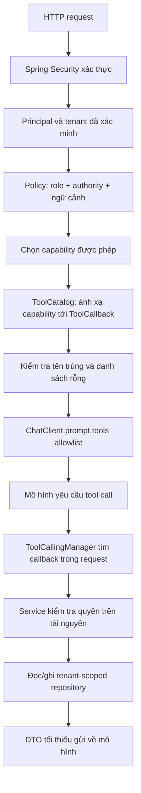

# Xây dựng danh sách công cụ được phép theo yêu cầu và vai trò

Trong Spring AI, mô hình ngôn ngữ được phép **đề xuất** gọi một công cụ, nhưng ứng dụng là nơi quyết định công cụ nào được công bố, được thực thi và có quyền truy cập tài nguyên nào. Nếu ứng dụng luôn đưa toàn bộ `@Tool`, `ToolCallback` và công cụ MCP vào `ChatClient`, người dùng chỉ cần viết một câu hỏi là mô hình có thể yêu cầu một capability không phù hợp với vai trò của họ. Prompt “đừng gọi công cụ quản trị” không phải biện pháp phân quyền.

Giải pháp là xây dựng **allowlist công cụ theo từng request**: sau khi xác thực người dùng, ứng dụng đánh giá role, authority, tenant, loại tác vụ và các điều kiện rủi ro để chọn một tập `ToolCallback` nhỏ nhất cần thiết. Chỉ tập này được truyền cho `ChatClient`. Khi callback chạy, service tiếp tục xác thực quyền trên **tài nguyên cụ thể**, vì quyền xem tên công cụ không đồng nghĩa quyền đọc mọi dữ liệu mà công cụ có thể truy vấn.

Bài này tập trung vào Spring AI 2.0.1 trở đi và API 2.1, đồng thời nêu khác biệt với 1.x. Các ví dụ dùng Spring Security, `@Tool`, `ToolCallbacks`, `ToolContext` và `ToolCallingChatOptions`, phù hợp mục tiêu tích hợp AI với dịch vụ nghiệp vụ an toàn.

## Hai lớp kiểm soát không thể thay thế nhau

Một kiến trúc đúng cần tách hai câu hỏi:

1. **Tool exposure:** Người dùng này, trong request hiện tại, có thể để mô hình biết và đề xuất **loại công cụ nào**?
2. **Tool execution authorization:** Khi tool đã được chọn, người dùng này có quyền thực hiện **hành động đó với tài nguyên, trạng thái và tenant cụ thể** hay không?

| Lớp | Thời điểm | Cần kiểm tra | Ví dụ |
| --- | --- | --- | --- |
| Xác thực request | Trước khi tạo prompt | Danh tính, phiên đăng nhập/token, tenant đã xác minh | Principal thuộc tenant A. |
| Chọn allowlist | Trước khi gửi tool definitions cho model | Role, authority, feature flags, policy, điều kiện xác thực mạnh | Chỉ công bố `local_orders_find`; không công bố `payments_refund`. |
| Kiểm soát gọi tool | Khi model trả tool call | Tool name có thuộc tập cho phép không, có approval nếu cần | Không resolve tool lạ từ registry toàn ứng dụng. |
| Phân quyền service | Ngay trước side effect hoặc đọc dữ liệu | Quyền tại thời điểm thực thi, owner/resource ACL, tenant filter, invariant nghiệp vụ | Chỉ đọc đơn hàng A-100 nếu chủ thể có quyền trên A-100. |
| Xử lý kết quả | Trước khi gửi lại model | Dữ liệu được phép tiết lộ, PII, độ lớn kết quả | Trả trạng thái giao hàng, không trả ghi chú nội bộ. |

**Không hiển thị tool** giúp giảm bề mặt tấn công và nhiễu khi chọn công cụ, nhưng không phải lớp bảo mật duy nhất. Nếu callback được gọi trực tiếp từ code khác, worker chạy nền hoặc MCP endpoint, service vẫn phải từ chối thao tác trái quyền.

## Luồng chọn công cụ theo request



Mô hình chỉ nhìn thấy tên, mô tả và input schema của các tool đã chọn. Nó **không được** chọn vai trò cho người dùng, tự điền `tenantId` để đổi tenant hay yêu cầu ứng dụng nâng quyền. Tool arguments do mô hình sinh ra luôn là dữ liệu không đáng tin, ngay cả khi schema hợp lệ.

## Role, authority và capability có vai trò khác nhau

Trong Spring Security, role thường biểu diễn một nhóm trách nhiệm (`ROLE_SUPPORT`, `ROLE_FINANCE`), còn authority biểu diễn quyền cụ thể (`ORDER_READ`, `REFUND_REQUEST`). Capability là nhóm chức năng AI mà ứng dụng muốn công bố; một capability có thể được triển khai bằng một hoặc nhiều `ToolCallback`.

Ví dụ một hệ thống hỗ trợ đơn hàng:

| Vai trò / điều kiện | Capability được phép công bố | Không được công bố tự động |
| --- | --- | --- |
| `ROLE_VIEWER` + `ORDER_READ` | `ORDER_READ` | Hủy đơn, hoàn tiền, công cụ quản trị. |
| `ROLE_SUPPORT` + `ORDER_READ` | `ORDER_READ`, `INVENTORY_READ` nếu có authority tương ứng | Hoàn tiền trực tiếp. |
| `ROLE_OPERATIONS` + `ORDER_CANCEL_REQUEST` | Tạo yêu cầu hủy đơn | Hủy đơn đã giao, thao tác không đúng trạng thái. |
| `ROLE_FINANCE` + `REFUND_REQUEST` + xác thực mạnh | Tạo yêu cầu hoàn tiền nếu tính năng đã bật | Hoàn tiền không cần approval hoặc cho tenant khác. |
| Người dùng không được xác thực đầy đủ | Không công bố công cụ truy cập dữ liệu riêng | Mọi tool đọc/ghi tài nguyên có bảo vệ. |

Trong ma trận này, **vai trò và authority được kết hợp**, không lấy role làm bằng chứng đủ cho mọi hành động. Tên authority mang ý nghĩa nghiệp vụ; ví dụ `ORDER_CANCEL_REQUEST` chỉ cho phép **tạo yêu cầu**. Quyền thực hiện hủy thực tế còn phụ thuộc quyền trên đơn, trạng thái giao hàng, approval và quy trình workflow.

Spring Security `hasRole("SUPPORT")` thường tương ứng authority `ROLE_SUPPORT`, còn `hasAuthority("ORDER_READ")` so khớp chính xác chuỗi quyền. Quy ước này phải nhất quán giữa JWT mapping, policy service, method security và test; không đưa role do model hoặc body request tự khai báo vào danh sách authority.

## Thiết kế capability registry độc lập với lời nói của mô hình

Thay vì tìm tool bằng tên do mô hình đoán, ứng dụng nên định nghĩa catalog có nguồn rõ ràng. Các tên capability là enum do code kiểm soát, còn `ToolCallback` thực tế có `ToolDefinition.name()` ổn định và duy nhất.

```java
public enum ToolCapability {
    ORDER_READ,
    INVENTORY_READ,
    ORDER_CANCEL_REQUEST,
    REFUND_REQUEST
}
```

Một kiểu context cho request có thể giữ thông tin đã được xác thực:

```java
import java.util.Objects;
import java.util.Set;

public record ActorScope(
        String subjectId,
        String tenantId,
        Set<String> authorities,
        boolean strongAuthentication) {

    public ActorScope {
        Objects.requireNonNull(subjectId);
        Objects.requireNonNull(tenantId);
        authorities = Set.copyOf(Objects.requireNonNull(authorities));
        if (subjectId.isBlank() || tenantId.isBlank()) {
            throw new IllegalArgumentException("Thiếu danh tính hoặc tenant đã xác minh");
        }
    }

    public boolean has(String authority) {
        return this.authorities.contains(authority);
    }
}
```

`ActorScope` không được deserialise từ JSON mà người dùng gửi hoặc lấy từ nội dung prompt. Controller/authentication layer tạo nó sau khi xác minh token, trạng thái phiên, tenant membership và phương thức xác thực mạnh. `strongAuthentication` là kết luận của phía server, không phải cờ `mfa=true` do client khai báo.

### Policy từ authority và điều kiện nghiệp vụ

```java
import java.util.EnumSet;
import java.util.Set;
import org.springframework.stereotype.Service;

@Service
public class ToolExposurePolicy {

    private final TenantFeatureFlags featureFlags;

    public ToolExposurePolicy(TenantFeatureFlags featureFlags) {
        this.featureFlags = featureFlags;
    }

    public Set<ToolCapability> allowedCapabilities(ActorScope actor) {
        EnumSet<ToolCapability> allowed = EnumSet.noneOf(ToolCapability.class);

        if (actor.has("ORDER_READ")) {
            allowed.add(ToolCapability.ORDER_READ);
        }

        if (actor.has("INVENTORY_READ")) {
            allowed.add(ToolCapability.INVENTORY_READ);
        }

        if (actor.has("ROLE_OPERATIONS") && actor.has("ORDER_CANCEL_REQUEST")) {
            allowed.add(ToolCapability.ORDER_CANCEL_REQUEST);
        }

        if (actor.has("ROLE_FINANCE")
                && actor.has("REFUND_REQUEST")
                && actor.strongAuthentication()
                && this.featureFlags.isEnabled(actor.tenantId(), "refund-workflow")) {
            allowed.add(ToolCapability.REFUND_REQUEST);
        }

        return Set.copyOf(allowed);
    }
}
```

`TenantFeatureFlags` là service do ứng dụng triển khai để kiểm tra tính năng có mở cho tenant hay không. Policy nên mặc định trả **tập rỗng** nếu không có quyền, thông tin membership không hợp lệ hoặc hệ thống đánh giá chính sách gặp lỗi. Không tự chuyển sang công bố toàn bộ tool khi feature flag/policy service timeout.

Vai trò chỉ là một đầu vào. Các điều kiện ABAC bổ sung có thể gồm tenant hiện tại, loại yêu cầu, dữ liệu đặc biệt nhạy cảm, vùng hoạt động, rủi ro, khung thời gian, trạng thái xác thực và quota. Tuy nhiên, đừng đẩy kiểm tra từng tài nguyên vào bước exposure rồi cho rằng nó đủ; `orderId` có thể chỉ xuất hiện sau khi model sinh arguments.

## ToolCatalog: ánh xạ capability sang callback được kiểm soát

Để tránh danh sách tool biến đổi theo request, có thể giữ một catalog **immutable** dùng chung. Chỉ **danh sách được chọn** là khác nhau giữa các request.

```java
import java.util.ArrayList;
import java.util.EnumMap;
import java.util.List;
import java.util.Map;
import java.util.Set;

import org.springframework.ai.model.tool.ToolCallingChatOptions;
import org.springframework.ai.tool.ToolCallback;

public final class ToolCatalog {

    private final Map<ToolCapability, List<ToolCallback>> byCapability;

    public ToolCatalog(Map<ToolCapability, List<ToolCallback>> definitions) {
        EnumMap<ToolCapability, List<ToolCallback>> copy =
                new EnumMap<>(ToolCapability.class);

        definitions.forEach((capability, callbacks) ->
                copy.put(capability, List.copyOf(callbacks)));

        this.byCapability = Map.copyOf(copy);

        // Kiểm tra mọi tool trong catalog ngay lúc xây dựng.
        ToolCallingChatOptions.validateToolCallbacks(
                this.byCapability.values().stream().flatMap(List::stream).toList());
    }

    public List<ToolCallback> select(Set<ToolCapability> capabilities) {
        List<ToolCallback> result = new ArrayList<>();

        // Thứ tự enum cố định giúp tên/tool schema ổn định giữa các request.
        for (ToolCapability capability : ToolCapability.values()) {
            if (capabilities.contains(capability)) {
                result.addAll(this.byCapability.getOrDefault(capability, List.of()));
            }
        }

        ToolCallingChatOptions.validateToolCallbacks(result);
        return List.copyOf(result);
    }
}
```

Việc validate loại bỏ trường hợp hai callback từ những capability khác nhau trùng `ToolDefinition.name()`. Đây là tình huống cần phát hiện ngay khi khởi động, trước khi request thực tế có thể chọn nhầm công cụ. Không giải quyết collision bằng cách giữ callback xuất hiện đầu tiên.

Đăng ký catalog bằng các POJO có method `@Tool`:

```java
import java.util.Arrays;
import java.util.Map;

import org.springframework.ai.support.ToolCallbacks;
import org.springframework.context.annotation.Bean;
import org.springframework.context.annotation.Configuration;

@Configuration
class ToolCatalogConfiguration {

    @Bean
    ToolCatalog toolCatalog(
            OrderReadTools orderReadTools,
            InventoryReadTools inventoryReadTools,
            CancelRequestTools cancelRequestTools,
            RefundRequestTools refundRequestTools) {

        return new ToolCatalog(Map.of(
                ToolCapability.ORDER_READ,
                Arrays.asList(ToolCallbacks.from(orderReadTools)),
                ToolCapability.INVENTORY_READ,
                Arrays.asList(ToolCallbacks.from(inventoryReadTools)),
                ToolCapability.ORDER_CANCEL_REQUEST,
                Arrays.asList(ToolCallbacks.from(cancelRequestTools)),
                ToolCapability.REFUND_REQUEST,
                Arrays.asList(ToolCallbacks.from(refundRequestTools))));
    }
}
```

Trong ví dụ, mỗi bean `OrderReadTools`, `InventoryReadTools`, `CancelRequestTools` và `RefundRequestTools` chỉ chứa những method thuộc **một capability**. Nếu một bean có nhiều method khác mức quyền, đừng đưa toàn bộ callback của bean vào cùng capability; hãy tách bean hoặc đăng ký từng `ToolCallback` cụ thể. `ToolCallbacks.from(...)` quét các method được gắn `@Tool`, không tự suy ra role cần thiết.

`ToolCatalog` chỉ chứa metadata và object callback. Không lưu `ActorScope`, `Authentication` hay `ToolContext` của người dùng vào field của singleton catalog; làm vậy có thể khiến request đồng thời dùng nhầm danh tính.

## Chỉ truyền allowlist tại thời điểm gọi ChatClient

Tạo `ChatClient` dùng chung nhưng **không cấu hình tool đặc quyền mặc định**:

```java
import org.springframework.ai.chat.client.ChatClient;
import org.springframework.context.annotation.Bean;
import org.springframework.context.annotation.Configuration;

@Configuration
class AssistantChatConfiguration {

    @Bean
    ChatClient authorizedChatClient(ChatClient.Builder builder) {
        return builder.build();
    }
}
```

Mỗi request, policy chọn capabilities rồi catalog lấy callbacks tương ứng:

```java
import java.util.List;
import java.util.Map;
import java.util.Set;

import org.springframework.ai.chat.client.ChatClient;
import org.springframework.ai.tool.ToolCallback;
import org.springframework.stereotype.Service;

@Service
public class AuthorizedAssistantService {

    private final ChatClient chatClient;
    private final ToolExposurePolicy exposurePolicy;
    private final ToolCatalog toolCatalog;

    public AuthorizedAssistantService(
            ChatClient chatClient,
            ToolExposurePolicy exposurePolicy,
            ToolCatalog toolCatalog) {
        this.chatClient = chatClient;
        this.exposurePolicy = exposurePolicy;
        this.toolCatalog = toolCatalog;
    }

    public String answer(ActorScope actor, String question) {
        Set<ToolCapability> capabilities =
                this.exposurePolicy.allowedCapabilities(actor);
        List<ToolCallback> allowedTools = this.toolCatalog.select(capabilities);

        return this.chatClient.prompt()
                .user(question)
                .tools(allowedTools)
                .toolContext(Map.of(
                        "subjectId", actor.subjectId(),
                        "tenantId", actor.tenantId()))
                .call()
                .content();
    }
}
```

`.tools(allowedTools)` truyền công cụ **cho một request**, không ghi trạng thái vào singleton `ChatClient`. Hai request chạy đồng thời với hai vai trò khác nhau sẽ có hai danh sách callback riêng. Nếu `allowedTools` rỗng, request vẫn có thể nhận câu trả lời văn bản nhưng không có công cụ nghiệp vụ nào để thực thi.

Ở Spring AI 2.x, `ChatClient` tự đăng ký `ToolCallingAdvisor` cho vòng gọi công cụ. `ToolCallingManager` thực thi callback theo danh sách được cung cấp cho request; quyền chi tiết trong service vẫn bắt buộc. Khi tự tạo `ToolCallingManager`, cần giữ chế độ resolver fallback phù hợp được mô tả ở phần sau.

### Lấy ActorScope từ Spring Security, không lấy từ câu hỏi

Endpoint HTTP có thể nhận tenant được người dùng chọn trong URL, nhưng phải **xác minh membership** trước khi dùng nó:

```java
import org.springframework.security.core.Authentication;
import org.springframework.web.bind.annotation.PathVariable;
import org.springframework.web.bind.annotation.PostMapping;
import org.springframework.web.bind.annotation.RequestBody;
import org.springframework.web.bind.annotation.RequestMapping;
import org.springframework.web.bind.annotation.RestController;

@RestController
@RequestMapping("/tenants/{tenantId}/assistant")
public class AssistantController {

    private final TenantMembershipService membershipService;
    private final ActorScopeFactory actorScopeFactory;
    private final AuthorizedAssistantService assistantService;

    public AssistantController(
            TenantMembershipService membershipService,
            ActorScopeFactory actorScopeFactory,
            AuthorizedAssistantService assistantService) {
        this.membershipService = membershipService;
        this.actorScopeFactory = actorScopeFactory;
        this.assistantService = assistantService;
    }

    @PostMapping
    public String ask(
            Authentication authentication,
            @PathVariable String tenantId,
            @RequestBody AssistantRequest request) {

        this.membershipService.requireMember(authentication, tenantId);
        ActorScope actor = this.actorScopeFactory.fromVerifiedAuthentication(
                authentication, tenantId);

        return this.assistantService.answer(actor, request.message());
    }
}
```

Đoạn code dùng các interface nghiệp vụ `TenantMembershipService`, `ActorScopeFactory` và record `AssistantRequest` do ứng dụng định nghĩa. `ActorScopeFactory` đọc authorities từ `Authentication.getAuthorities()`, trạng thái xác thực mạnh từ cơ chế đã xác minh, và có thể kiểm tra tài khoản có bị vô hiệu hóa hay không. Không tin vào `roles`, `authorities`, `tenantId` hoặc `mfa` do người dùng gửi trong JSON body.

Nếu request chứa tenant ID trong path, path chỉ là **lựa chọn**; quyết định có quyền dùng tenant đó thuộc server. Với hệ thống đa tenant, kể cả người dùng có `ROLE_FINANCE` ở tenant A cũng không mặc nhiên có quyền hoàn tiền ở tenant B.

## Phân quyền lần nữa khi callback thực thi

Giả sử người dùng được phép thấy tool `local_orders_find`. Điều đó chưa có nghĩa họ được đọc mọi `orderId` mà mô hình gửi vào. Callback phải nhận `tenantId` và `subjectId` từ context đáng tin, rồi gọi service có authorization thực sự.

```java
import org.springframework.ai.chat.model.ToolContext;
import org.springframework.ai.tool.annotation.Tool;
import org.springframework.ai.tool.annotation.ToolParam;
import org.springframework.stereotype.Component;

@Component
public class OrderReadTools {

    private final OrderService orderService;

    public OrderReadTools(OrderService orderService) {
        this.orderService = orderService;
    }

    @Tool(name = "local_orders_find",
          description = "Tra cứu trạng thái một đơn hàng trong phạm vi được phép")
    public OrderSummary findOrder(
            @ToolParam(description = "Mã đơn hàng") String orderId,
            ToolContext toolContext) {

        String subjectId = requireString(toolContext, "subjectId");
        String tenantId = requireString(toolContext, "tenantId");

        return this.orderService.findAuthorized(subjectId, tenantId, orderId);
    }

    private static String requireString(ToolContext context, String key) {
        if (context == null || context.getContext() == null) {
            throw new IllegalStateException("Thiếu ToolContext đã xác minh");
        }
        Object value = context.getContext().get(key);
        if (!(value instanceof String text) || text.isBlank()) {
            throw new IllegalStateException("Thiếu context bắt buộc: " + key);
        }
        return text;
    }
}
```

`ToolContext` **không được đưa vào JSON Schema mà mô hình nhìn thấy**. Tuy nhiên, nó chỉ đáng tin khi ứng dụng tạo từ principal đã xác thực; nếu một caller nội bộ tự gắn `subjectId`/`tenantId` giả thì context không tự ngăn việc mạo danh. API public và worker phải thực thi authentication/authorization ở ranh giới của mình, còn service cần kiểm tra identity/membership bằng cơ chế đáng tin.

Service kiểm tra quyền và tenant-scoped repository ngay trước khi trả dữ liệu:

```java
import org.springframework.stereotype.Service;

@Service
public class OrderService {

    private final OrderAuthorizationService authorizationService;
    private final OrderRepository orderRepository;

    public OrderService(
            OrderAuthorizationService authorizationService,
            OrderRepository orderRepository) {
        this.authorizationService = authorizationService;
        this.orderRepository = orderRepository;
    }

    public OrderSummary findAuthorized(
            String subjectId,
            String tenantId,
            String orderId) {

        this.authorizationService.requireCanRead(subjectId, tenantId, orderId);

        return this.orderRepository.findSummaryByTenantIdAndOrderId(tenantId, orderId)
                .orElseThrow(() -> new OrderNotFoundException(orderId));
    }
}
```

`OrderAuthorizationService` và `OrderRepository` là các thành phần do ứng dụng định nghĩa. Lần kiểm tra phải xét dữ liệu quyền hiện hành, chủ sở hữu/order ACL và tenant; truy vấn repository vẫn phải **lọc tenant ngay trong query**, không chỉ lọc kết quả sau khi đọc. Khi không có quyền, từ chối hoặc trả not-found theo chính sách tránh lộ sự tồn tại của tài nguyên.

Nếu dùng Spring Security Method Security, có thể bật `@EnableMethodSecurity` và đặt `@PreAuthorize` trên **service bean**:

```java
import org.springframework.context.annotation.Configuration;
import org.springframework.security.access.prepost.PreAuthorize;
import org.springframework.security.config.annotation.method.configuration.EnableMethodSecurity;
import org.springframework.stereotype.Service;

@EnableMethodSecurity
@Configuration
class MethodSecurityConfiguration {
}

@Service
class SecuredOrderLookupService {

    private final OrderRepository orderRepository;

    SecuredOrderLookupService(OrderRepository orderRepository) {
        this.orderRepository = orderRepository;
    }

    @PreAuthorize("hasAuthority('ORDER_READ') and "
            + "@tenantAuthorization.canRead(authentication, #tenantId, #orderId)")
    public OrderSummary findOrderForTenant(String tenantId, String orderId) {
        return this.orderRepository.findSummaryByTenantIdAndOrderId(tenantId, orderId)
                .orElseThrow(() -> new OrderNotFoundException(orderId));
    }
}
```

Đây là phương án thay thế cho kiểm tra quyền tường minh bằng `OrderAuthorizationService` ở ví dụ trước, không cần bắt buộc dùng cả hai trong cùng một lớp. `tenantAuthorization` là bean Spring do ứng dụng định nghĩa. Phương thức phải được gọi qua Spring proxy; nếu chạy ngoài HTTP thread, cần truyền/khôi phục `SecurityContext` đúng cách. SpEL theo tên tham số cần thông tin tên Java (`-parameters`) hoặc dùng `#p0`, `#p1`. Với worker bất đồng bộ, có thể phù hợp hơn nếu service nhận security principal/authorization context được xác minh lại một cách tường minh thay vì phụ thuộc thread-local.

### Role có thể thay đổi giữa lúc chọn và lúc thực thi

Mô hình có thể mất thời gian suy luận hoặc gọi nhiều công cụ. Trong thời gian đó, người dùng có thể bị thu hồi quyền, tenant bị khóa hoặc đơn hàng đổi trạng thái. Đây là vấn đề **time-of-check/time-of-use (TOCTOU)**:

- Bước chọn tool dùng quyền tại thời điểm tạo request để giới hạn danh sách mô hình thấy.
- Bước thực thi phải **kiểm tra lại** quyền trên tài nguyên và invariant ngay trước side effect.
- Với action yêu cầu xác nhận, approval phải gắn với operation/arguments cụ thể và còn hiệu lực lúc thực thi.
- Nếu workflow chạy qua queue sau nhiều phút, worker phải đọc lại trạng thái quyền/ủy quyền của chủ thể hoặc dùng một capability token có thời hạn, phạm vi và điều kiện thu hồi phù hợp.

Không lưu kết luận `isAdmin=true` từ một lần chat rồi tái sử dụng vô thời hạn cho mọi tool call về sau.

## Không để defaultTools vô hiệu hóa allowlist

Trong Spring AI 2.x, `.tools(...)` ở cấp request **cộng thêm** vào `.defaultTools(...)` của `ChatClient`, chứ không thay thế. Vì vậy, cấu hình sau là **không an toàn** nếu mọi role dùng chung client:

```java
// KHÔNG dùng cho client phục vụ nhiều role:
ChatClient chatClient = ChatClient.builder(chatModel)
        .defaultTools(refundTools, adminTools)
        .build();

chatClient.prompt()
        .user(question)
        .tools(orderReadTools) // Không loại refundTools và adminTools!
        .call();
```

Đây là lỗi dễ mắc vì người viết code tưởng `tools(orderReadTools)` là phép thay thế. Mô hình vẫn có thể thấy các tool `refundTools` và `adminTools` từ defaults. Với client chung cho nhiều vai trò, hãy giữ **default tool set rỗng** hoặc chỉ gồm những capability thật sự công khai và an toàn cho mọi principal. Các tool nhạy cảm phải được chọn theo request.

Các nguồn khác có thể âm thầm mở rộng danh sách:

| Nguồn | Rủi ro | Kiểm soát |
| --- | --- | --- |
| `ChatClient.defaultTools(...)` | Công cụ xuất hiện ở mọi request | Không đặt tool đặc quyền vào defaults. |
| `ChatClient.prompt().tools(...)` | Nếu caller truyền nhầm toàn bộ bean/provider | Chỉ truyền callbacks sau khi policy filter. |
| `ToolCallingChatOptions.toolCallbacks(...)` | Tool set có thể được tạo riêng ở tầng `ChatModel` | Kiểm tra precedence của runtime options và request; validate danh sách cuối. |
| `ToolCallback` bean toàn ứng dụng | Có thể được resolver tìm theo tên | Giữ fallback resolution tắt hoặc hạn chế resolver. |
| `ToolCallbackProvider` / MCP provider | Có thể trả nhiều tool hơn mong muốn | Lọc global bằng MCP filter, rồi lọc per request. |
| Advisor/tool-search động | Có thể thay đổi tập tool ở iteration sau | Chỉ cho tìm trong catalog đã được cấp quyền cho request/session. |

Nếu ứng dụng quản lý một `ChatClient` riêng cho từng workflow/role, vẫn cần đánh giá lại khả năng lộ công cụ khi role thay đổi giữa các lần gọi. Tên bean hoặc tên client không phải điều kiện phân quyền.

## Kiểm soát ToolCallbackResolver và fallback

`ToolCallbackResolver` là cơ chế tìm callback theo tên. Trong Spring AI 2.x, các `ToolCallback` bean có thể được đăng ký với resolver toàn ứng dụng. Nếu model gọi một tên **không nằm trong callbacks đính kèm request**, resolver fallback có thể tìm thấy và thực thi tool đó khi được bật.

Từ **Spring AI 2.0.1**, chế độ fallback này **mặc định tắt**. Hãy giữ cấu hình tường minh:

```yaml
spring:
  ai:
    tools:
      resolution:
        fallback:
          enabled: false
```

Với custom `ToolCallingManager` trong 2.0.1+, cũng giữ `.resolutionFallbackEnabled(false)` nếu builder của phiên bản đó có API tương ứng:

```java
ToolCallingManager manager = ToolCallingManager.builder()
        .resolutionFallbackEnabled(false)
        .build();
```

Khi fallback tắt, tool không thuộc request mà mô hình yêu cầu sẽ không được thực thi bởi resolver toàn ứng dụng. `ToolCallingManager` thường báo không tìm thấy callback, ví dụ `IllegalStateException: No ToolCallback found for tool name`.

**Không bật fallback chỉ để sửa lỗi một tool không được đăng ký đúng.** Nếu đặt `enabled: true`, tool được resolver biết đến có thể thực thi dù không được gửi cho model trong danh sách request. Điều này làm mất bảo đảm quan trọng của allowlist và nguy hiểm đặc biệt với tool xóa dữ liệu, thanh toán hoặc quản trị.

Với Spring AI 1.x và 2.0.0, cơ chế resolution và giá trị mặc định có khác biệt; không tự áp dụng giả định của 2.0.1 cho dự án cũ. Cần kiểm tra manager/resolver thực tế và nâng phiên bản hoặc thêm lớp kiểm tra công cụ trước khi thực thi.

### Dùng ChatModel trực tiếp cần validate rõ ràng

Khi ứng dụng tự gọi `ChatModel.call()` hoặc tự tạo tool loop, `ChatClient` không tham gia hợp nhất/kiểm tra danh sách. Cần validate uniqueness và giữ tập callback đúng quyền:

```java
List<ToolCallback> allowed = toolCatalog.select(
        exposurePolicy.allowedCapabilities(actor));

ToolCallingChatOptions.validateToolCallbacks(allowed);

ToolCallingChatOptions options = ToolCallingChatOptions.builder()
        .toolCallbacks(allowed)
        .toolContext(Map.of("subjectId", actor.subjectId(), "tenantId", actor.tenantId()))
        .build();

ChatResponse response = chatModel.call(new Prompt(question, options));
```

Đoạn mã minh họa API low-level của Spring AI 2.x; cần imports `ToolCallingChatOptions`, `ChatResponse`, `Prompt`, `Map` và `List` tương ứng. Từ 2.0, `ChatModel` trả phản hồi tool call thô; ứng dụng tự điều phối việc kiểm tra response và gọi `ToolCallingManager`. Giữ cùng allowlist và fallback tắt trên mọi iteration, không tự thay danh sách bằng toàn bộ catalog khi mô hình yêu cầu một tên lạ.

## Khi tích hợp MCP tools: chọn theo role nhưng vẫn bảo vệ ở server

Remote MCP tools cũng xuất hiện dưới dạng `ToolCallback`. Có thể tạo allowlist theo tên callback đã có prefix và theo quyền của người dùng:

```java
import java.util.Arrays;
import java.util.List;
import org.springframework.ai.mcp.SyncMcpToolCallbackProvider;
import org.springframework.ai.tool.ToolCallback;

public List<ToolCallback> allowedMcpTools(
        ActorScope actor, SyncMcpToolCallbackProvider mcpProvider) {

    return Arrays.stream(mcpProvider.getToolCallbacks())
            .filter(callback -> {
                String name = callback.getToolDefinition().name();
                return switch (name) {
                    case "mcp_crm_customer_search" -> actor.has("CUSTOMER_READ");
                    case "mcp_inventory_stock_check" -> actor.has("INVENTORY_READ");
                    default -> false;
                };
            })
            .toList();
}
```

Đây là ví dụ chỉ công bố hai capability đọc dữ liệu, có tên đã được namespace ổn định. Không bật các tool `mcp_payments_refund`, `mcp_admin_execute` hoặc tên MCP mới bằng chính sách “allow all”. Sau khi hợp nhất local và remote callbacks, tiếp tục gọi `ToolCallingChatOptions.validateToolCallbacks(...)` để tránh xung đột tên.

Phân biệt hai loại filter:

- `McpToolFilter` (và `McpModernToolFilter` ở kết nối modern tương ứng) được Spring AI dùng để lọc tool **theo connection/tool metadata**, thường là chính sách toàn ứng dụng. Nó không tự có principal của từng request.
- Bộ lọc theo `ActorScope` ở trên chạy **mỗi request** để chọn những callbacks người dùng được thấy. Không dùng một biến mutable trên singleton MCP provider để lưu quyền của user hiện tại.

### Lưu ý về danh tính trong phiên MCP dùng chung

Theo tài liệu MCP Client Starter, nhiều bean client có thể giữ **MCP session chung** cho mọi người gọi. `tools/list` có thể thực hiện khi kết nối được tạo, còn tool calls sau đó chạy dưới các principal khác nhau. Nếu MCP server quyết định quyền chỉ theo session hoặc connection credential đặc quyền, lọc tên ở ứng dụng sẽ không ngăn lỗi đọc dữ liệu chéo người dùng.

Với MCP nhiều tenant:

1. Chỉ kết nối đến server MCP đáng tin, có transport authentication và TLS phù hợp.
2. Truyền user/tenant identity bằng cơ chế ủy quyền phía transport đã được xác thực hoặc delegation token phù hợp, không lấy danh tính từ model arguments.
3. MCP server phải kiểm tra quyền trên từng `tools/call` và tài nguyên, không tin vào tên tool do client đã lọc.
4. Nếu `tools/list` khác nhau theo user, cần thiết kế client/transport scope đúng; không cache listing của một người rồi dùng cho người khác.
5. Tránh dùng credential toàn quyền chung để thực thi thay mặt user, trừ khi service đích tự kiểm tra quyền người dùng một cách độc lập.

**Quan trọng về ToolContext:** dù `ToolContext` không được gửi cho mô hình thành JSON arguments, mặc định Spring AI MCP Client có thể **chuyển các mục context không null thành `_meta` gửi tới MCP server** qua `ToolContextToMcpMetaConverter`. Vì vậy, không đưa API key, cookie, raw token hoặc dữ liệu riêng tư vào `ToolContext` chỉ vì nghĩ nó chỉ tồn tại nội bộ JVM.

Nếu MCP server không được phép nhận bất kỳ context metadata nào, có thể cấu hình:

```java
import org.springframework.ai.mcp.ToolContextToMcpMetaConverter;
import org.springframework.context.annotation.Bean;

@Bean
ToolContextToMcpMetaConverter toolContextToMcpMetaConverter() {
    return ToolContextToMcpMetaConverter.noOp();
}
```

Nếu MCP cần một vài trường, hãy dùng converter tùy chỉnh **chỉ allowlist các khóa cần thiết**, thay vì gửi toàn bộ map. Cách tắt trên là cấu hình toàn ứng dụng cho MCP callback converter, nên phải kiểm tra rằng những integration cần metadata khác vẫn hoạt động theo chính sách mới.

## Approval cho công cụ có side effect

Cho phép người dùng **nhìn thấy** tool `orders_cancel_request` không đồng nghĩa cho phép mô hình tự hủy đơn. Với hành động nhạy cảm, nên phân biệt:

| Giai đoạn | Kết quả |
| --- | --- |
| Chọn allowlist | Role/authority cho phép công bố công cụ tạo yêu cầu. |
| Validate arguments | Mã đơn, số tiền, loại hành động đúng schema và điều kiện nghiệp vụ. |
| Service authorization | User có quyền trên đơn/giao dịch và tenant; trạng thái còn cho phép. |
| Approval/confirmation | Người có thẩm quyền xác nhận chính xác thao tác và tham số. |
| Durable execution | Tạo operation ID, idempotency key, audit và ghi kết quả. |

Từ Spring AI **2.1.0**, `@Tool` có thể dùng `requiresConfirmation = true` cho các lời gọi cần xác nhận, và `ToolCallingManager` hỗ trợ `ToolCallConfirmationPolicy`. Ví dụ:

```java
@Tool(
        name = "local_orders_cancel_request",
        description = "Tạo yêu cầu hủy đơn hàng đã được kiểm tra quyền",
        requiresConfirmation = true)
public CancelRequestResult requestCancel(
        @ToolParam(description = "Mã đơn hàng") String orderId,
        ToolContext context) {
    // Chỉ được chạy sau authorization/approval theo hợp đồng ứng dụng.
    return cancelWorkflowService.submitAuthorized(context, orderId);
}
```

Confirmation dừng tool loop để ứng dụng thu quyết định rồi tiếp tục; nó **không** là sự thay thế cho kiểm tra quyền ở service. Nếu đang dùng Spring AI 1.x/2.0 hoặc cần phê duyệt sống qua restart, hãy xây dựng approval workflow ở tầng ứng dụng thay vì dùng thuộc tính chưa được phiên bản hỗ trợ.

Khi người dùng thay đổi quyết định, trạng thái đơn đổi hoặc permission bị thu hồi trong lúc chờ approval, phải kiểm tra lại ngay trước khi thực thi. Không tái dùng một confirmation cũ cho action với arguments khác.

## Tool discovery động phải giới hạn catalog ngay từ đầu

Nếu ứng dụng có hàng chục hoặc hàng trăm công cụ, Spring AI 2.1 có `ToolSearchToolCallingAdvisor` để mô hình tìm tool theo capability thay vì nhận toàn bộ descriptions. Cách này giảm token nhưng **không tự tạo một security boundary**.

Quy tắc áp dụng cho tool search:

- Chỉ lập chỉ mục từ tập callback **đã qua authorization** cho request/session đó.
- Không cho một công cụ tìm kiếm nằm ngoài allowlist trả về mô tả của tool quản trị hoặc tool của tenant khác.
- Nếu chỉ mục được cache theo session/conversation, phải bảo đảm session không bị chia sẻ giữa người dùng không cùng phạm vi; kiểm tra cơ chế invalidation khi danh sách tool thay đổi.
- Vai trò thay đổi thì tính lại allowlist và ngăn execution theo policy hiện hành. Không coi kết quả tool search của lượt trước là một grant vĩnh viễn.
- Phía service vẫn kiểm tra quyền trên arguments/tài nguyên sau khi mô hình chọn tool.

Nguyên tắc tương tự áp dụng cho những advisor tự thêm `ToolCallback` ở từng model iteration, registry động từ plugin, hoặc tool resolver đọc database: **mọi nguồn bổ sung phải đi qua cùng policy**, không mở rộng tập quyền chỉ vì một công cụ mới được phát hiện.

## Tập công cụ được phép nên được giải thích và kiểm toán

Một policy trả list tool nhưng không ghi lý do lựa chọn sẽ khó vận hành khi người dùng phản ánh “hôm qua còn hủy được, hôm nay không”. Hãy ghi một quyết định tối thiểu với metadata đã lọc:

```java
public record ToolExposureDecision(
        String requestId,
        String tenantReference,
        String policyVersion,
        Set<ToolCapability> grantedCapabilities,
        String outcome) {
}
```

`requestId`, `tenantReference` và `policyVersion` phải được tạo/tính từ hệ thống tin cậy. Không lưu nguyên bản token, prompt, raw arguments hoặc PII trong audit record. Nếu cần truy vết một lần gọi tool, kết hợp `requestId`, `traceId`, tool name, decision (`granted`, `denied`, `requires_approval`) và outcome của service. Việc ghi log quyết định cho phép không đồng nghĩa ghi nhận action nghiệp vụ đã thực thi.

Nên theo dõi:

| Chỉ số | Ý nghĩa | Tránh |
| --- | --- | --- |
| Số tool được công bố/request | Kiểm tra tối thiểu hóa capability | Liên kết với hàng triệu user ID làm metric tag. |
| Số lần bị từ chối tại policy | Phát hiện request vượt quyền hoặc policy quá chặt | Log nguyên văn prompt gây từ chối. |
| Số lần service từ chối | Kiểm tra TOCTOU, ACL/tenant violations | Coi mọi lỗi 403 là lỗi mô hình. |
| Số lần model gọi tool không có trong request | Phát hiện config/model/tool call sai | Bật resolver fallback để “chữa cháy”. |
| Tỷ lệ approval bị từ chối | Quan sát hành động nhạy cảm | Tự động thực thi sau nhiều lần thử. |
| Collision trong tên công cụ | Hai capability/nguồn dùng cùng tên | Chọn callback theo thứ tự trong danh sách. |

Lỗi policy service hoặc feature flag service phải được báo với mã lỗi rõ ràng; không bỏ qua policy khi hệ thống quan sát bị hỏng. Hệ thống vẫn có thể cho phép trả lời văn bản công khai với **tập tool rỗng** nếu hợp đồng sản phẩm cho phép, nhưng không tự cấp thêm capability.

## Kiểm thử chính sách không cần model thật

Nên kiểm thử bằng policy và callback giả trước, sau đó mới chạy integration test với model stub. Test quan trọng nhất là chứng minh **tool trái quyền không xuất hiện trong danh sách** và **không thực thi được** ngay cả khi một lời gọi tool bị dựng thủ công.

### Test chọn capability theo role

```java
import static org.assertj.core.api.Assertions.assertThat;
import java.util.Set;
import org.junit.jupiter.api.Test;

@Test
void supportWithoutFinanceRoleCannotSeeRefundTool() {
    ActorScope support = new ActorScope(
            "user-123", "tenant-a",
            Set.of("ROLE_SUPPORT", "ORDER_READ", "INVENTORY_READ"),
            false);

    Set<ToolCapability> allowed = exposurePolicy.allowedCapabilities(support);

    assertThat(allowed)
            .contains(ToolCapability.ORDER_READ, ToolCapability.INVENTORY_READ)
            .doesNotContain(ToolCapability.REFUND_REQUEST,
                    ToolCapability.ORDER_CANCEL_REQUEST);
}
```

`exposurePolicy` ở đây là service policy được inject vào test cùng `TenantFeatureFlags` giả. Test độc lập này không cần ChatModel. Với user `ROLE_FINANCE`, nên bổ sung ca không có `REFUND_REQUEST` authority, chưa xác thực mạnh, và tenant chưa bật feature flag để xác nhận **thiếu bất kỳ điều kiện nào đều từ chối capability**.

### Test danh sách callback thật sự gửi cho ChatClient

```java
@Test
void selectedToolsContainNoPrivilegedCallback() {
    ActorScope viewer = new ActorScope(
            "viewer-1", "tenant-a", Set.of("ROLE_VIEWER", "ORDER_READ"), false);

    List<ToolCallback> allowed = toolCatalog.select(
            exposurePolicy.allowedCapabilities(viewer));

    List<String> names = allowed.stream()
            .map(callback -> callback.getToolDefinition().name())
            .toList();

    assertThat(names).contains("local_orders_find");
    assertThat(names).doesNotContain("local_orders_cancel_request",
            "local_payments_refund_request");
}
```

Ngoài assert danh sách, nên dùng model stub ghi nhận tool definitions ở request để chắc chắn `ChatClient` không cộng thêm default tools ngoài dự kiến. Đồng thời spy service đích để xác nhận callback bị loại không chạy. Đừng chỉ kiểm tra câu trả lời cuối của mô hình vì mô hình có thể nói “không được phép” dù backend đã thực thi thao tác.

### Test phân quyền tài nguyên và tenant

```java
@Test
void cannotReadAnotherTenantOrderEvenWithOrderReadCapability() {
    doThrow(new AccessDeniedException("Denied"))
            .when(authorizationService)
            .requireCanRead("viewer-1", "tenant-a", "B-900");

    assertThatThrownBy(() ->
            orderReadTools.findOrder("B-900", trustedToolContext("viewer-1", "tenant-a")))
            .isInstanceOf(AccessDeniedException.class);

    verify(orderRepository, never())
            .findSummaryByTenantIdAndOrderId("tenant-a", "B-900");
}
```

Đoạn test giả lập `authorizationService.requireCanRead(...)` ném `AccessDeniedException` khi không đủ quyền. `trustedToolContext(...)` là test helper tạo `ToolContext` từ dữ liệu giả lập hợp lệ. Với hệ thống thật, nên dùng integration test qua Spring Security và repository để kiểm tra cả proxy, quyền, truy vấn tenant và cache.

### Ma trận kiểm thử toàn bộ luồng

| Kịch bản | Kết quả bắt buộc |
| --- | --- |
| Role viewer chỉ có `ORDER_READ` | Request chỉ thấy tool đọc; không thấy hủy/hoàn tiền. |
| Role support thiếu authority inventory | Không nhận `INVENTORY_READ` chỉ vì tên role support. |
| Finance thiếu MFA hoặc feature flag | Không được công bố refund request tool. |
| Tenant không thuộc membership của user | Request bị chặn trước khi tạo ChatClient prompt. |
| Model đưa `tenantId` khác trong JSON arguments | Tool schema không dùng tenant từ model; callback/service dùng tenant đã xác minh. |
| Viewer có thể nhìn thấy `orders_find` nhưng yêu cầu ID tenant khác | Service từ chối; repository không trả dữ liệu. |
| Role bị thu hồi sau khi model đã nhận definitions | Service kiểm tra lại và từ chối lúc thực thi. |
| Hai request đồng thời ở hai tenant | Allowlist và ToolContext của mỗi request tách biệt, không có state mutable dùng chung. |
| `.defaultTools(adminTools)` vô tình được cấu hình | Integration test phát hiện tool admin xuất hiện ngoài allowlist. |
| Resolver fallback bị bật | Test cảnh báo/chặn cấu hình; tool chỉ có trong registry không được thực thi trái policy. |
| Model yêu cầu tên tool không thuộc request | Manager từ chối, không thực thi callback có cùng tên ở nơi khác. |
| Local và MCP trùng tên tool | Validator ném lỗi trước khi gửi cho model. |
| MCP tool list thay đổi sau reconnect | Chỉ các tên được allowlist cập nhật mới xuất hiện, không mặc định thêm tool lạ. |
| MCP context chứa secret | Converter/noOp ngăn secret được gửi trong `_meta`. |
| Tool yêu cầu approval nhưng chưa xác nhận | Không tạo side effect; khi xác nhận vẫn kiểm tra quyền tại thời điểm thực thi. |
| Tool execution processor chuyển lỗi thành text | Không lộ stack trace/PII/authorization detail trong tool result. |
| Streaming hoặc worker chạy trên thread khác | Authorization context không mất hoặc được truyền lại qua cơ chế tin cậy. |

Đối với side effect, dùng fake payment/cancellation service có counter để xác nhận số lần thao tác thực tế bằng **0** trong các ca từ chối. Test chạy model thật chỉ kiểm tra chất lượng chọn tool; không thay thế test enforcement deterministically ở backend.

## Các phản ví dụ thường gây lỗ hổng

| Cách làm sai | Vì sao sai | Cách thay thế |
| --- | --- | --- |
| Đưa tất cả tools vào default rồi dặn model không dùng tool nhạy cảm | Prompt không phải security boundary; `.tools(...)` không xóa defaults | Chọn callbacks trước request và giữ default tools an toàn/rỗng. |
| Lấy `role` trong user message để lọc tool | Mô hình/người dùng tự tuyên bố được quyền | Lấy authorities từ `Authentication` đã xác minh. |
| Tin `tenantId` trong JSON arguments | Model có thể tạo hoặc bị prompt injection khiến tạo tenant khác | Đưa tenant được xác minh qua server-side context; service lọc tài nguyên. |
| Chọn tool theo vai trò rồi bỏ kiểm tra ở service | Quyền có thể bị thu hồi; tài nguyên có ACL riêng | Kiểm tra authorization tại mỗi invocation. |
| Lưu danh sách tool được chọn vào field singleton | Request đồng thời có thể giẫm quyền lên nhau | Giữ catalog immutable; tạo list và context cục bộ cho từng request. |
| Chỉ đổi tên tool khi có trùng | Prefix không phải phân quyền; callback vẫn có thể bị expose | Dùng catalog, allowlist và validator sau khi hợp nhất. |
| Bật fallback resolver cho dễ chạy | Tool không đính kèm request có thể được tìm và thực thi | Để fallback tắt từ Spring AI 2.0.1+, kiểm tra wiring. |
| Dùng một MCP session có credential quản trị cho mọi user | Người dùng có thể dùng quyền service rộng hoặc dữ liệu session chung | Phân tách quyền/identity ở transport và server; kiểm tra mỗi call. |
| Coi `ToolContext` là bí mật tuyệt đối khi dùng MCP | MCP converter mặc định có thể gửi context thành metadata | Dùng `noOp()` hoặc converter allowlist và không đưa secret vào context. |
| Dùng `requiresConfirmation` thay cho authorization | Xác nhận một lần không cấp quyền trên tài nguyên | Dùng cả approval và kiểm tra quyền trước side effect. |
| Dùng policy tool search chung cho nhiều role | Search có thể tiết lộ tool bị cấm | Lọc catalog trước khi lập chỉ mục và kiểm tra lại khi đổi quyền. |
| Policy service timeout thì trả toàn bộ catalog | Fail open khi hệ thống thiếu thông tin quyền | Fail closed: từ chối hoặc trả lời không dùng tool. |

## Lưu ý về khác biệt phiên bản Spring AI

| Phiên bản | Cần chú ý khi áp dụng allowlist |
| --- | --- |
| **1.0.x / 1.1.x** | Vòng thực thi tool thường ở trong `ChatModel`; resolver bean/function và cơ chế tool names khác 2.x. Hãy kiểm tra manager/option nội bộ, tránh cho phép resolve tên ngoài allowlist. |
| **2.0.0** | `ToolCallingAdvisor` bắt đầu quản lý vòng tool trong `ChatClient`; cần kiểm tra hành vi resolver fallback của bản cụ thể. |
| **2.0.1 trở đi** | Fallback resolver bị tắt mặc định; tool được đính kèm request là phạm vi được thực thi khi không có custom override. |
| **2.1.0 trở đi** | Bổ sung xác nhận lời gọi tool (`requiresConfirmation`/confirmation policy) và tool search; cả hai là lớp bổ sung cho allowlist, không thay thế phân quyền. |

Nếu ứng dụng đã tùy biến `ToolCallingAdvisor`, `ToolCallingManager`, resolver, ChatModel options hoặc MCP provider, cần kiểm tra **runtime behavior thực tế** thay vì dựa hoàn toàn vào cấu hình mặc định của tài liệu. Một custom manager có thể bật fallback dù property ứng dụng đặt false; một advisor tùy chỉnh có thể bổ sung callback ngoài danh sách ban đầu.

## Quy trình triển khai trong dự án

1. Liệt kê tất cả tool đang có, kể cả `@Tool`, function/method callbacks, MCP và plugin providers; ghi rõ chủ sở hữu, capability, mức độ rủi ro, tên cuối.
2. Thiết kế role → authority → capability; xác định các điều kiện bổ sung như tenant membership, MFA, feature flag và approval.
3. Giữ một `ToolCatalog` immutable với các callback đặt tên rõ, duy nhất; không nhét principal/request state vào singleton.
4. Tạo `ActorScope` từ `Authentication` đã xác minh và tenant đã được kiểm tra membership.
5. Tính allowlist **mỗi request** và truyền đúng callbacks vào `.tools(...)`; tránh default tools có đặc quyền.
6. Giữ resolution fallback tắt, validate tên sau khi hợp nhất và kiểm tra mọi advisor/provider thêm tool động.
7. Truyền context server-side cần thiết bằng `ToolContext`, không đưa token, API key hoặc quyền tự khai báo từ mô hình.
8. Trong callback/service, kiểm tra lại authority, tenant và quyền trên tài nguyên trước khi truy vấn hoặc thực hiện side effect.
9. Với tool từ xa, bảo đảm MCP transport và server tự kiểm tra quyền; giới hạn metadata context chuyển đi và phân tách danh tính người dùng.
10. Áp dụng approval và durable workflow cho hành động rủi ro cao; dùng idempotency và audit cho side effect.
11. Viết unit test policy, integration test danh sách model nhận, test callback bị từ chối, concurrency, role revocation và prompt injection.
12. Theo dõi các quyết định allow/deny, lỗi tool không tìm thấy và tên trùng mà không log dữ liệu nhạy cảm.

**Kết luận:** xây dựng danh sách công cụ được phép là bước thiết kế trước khi mô hình quyết định hành động, không phải bước lọc câu trả lời sau cùng. Spring AI cho phép chọn callback ở cấp request; Spring Security cung cấp danh tính và quyền; ứng dụng xác định capability policy và service bảo đảm quyền trên dữ liệu thật. Khi giữ cả hai lớp — **exposure tối thiểu** và **enforcement tại lúc thực thi** — tool calling mới an toàn trước prompt injection, dữ liệu chéo tenant và thay đổi quyền trong các workflow nhiều bước.

## Tài liệu tham khảo

- [Spring AI — Tool Calling, Passing Tools to ChatClient, Tool Resolution](https://docs.spring.io/spring-ai/reference/api/tools.html)
- [Spring AI — ChatClient API](https://docs.spring.io/spring-ai/reference/api/chatclient.html)
- [Spring AI — Tool Context](https://docs.spring.io/spring-ai/reference/api/tools.html#_tool_context)
- [Spring AI — Upgrading to 2.0, Tool Resolution Fallback Disabled by Default](https://docs.spring.io/spring-ai/reference/upgrade-notes.html)
- [Spring AI — MCP Client Boot Starter, Tool Filtering and Context Meta Converter](https://docs.spring.io/spring-ai/reference/api/mcp/mcp-client-boot-starter-docs.html)
- [Spring AI — Tool Call Confirmation (từ 2.1.0)](https://docs.spring.io/spring-ai/reference/api/tools/tool-call-confirmation.html)
- [Spring AI — Tool Search Tool](https://docs.spring.io/spring-ai/reference/api/tools/tool-search-tool.html)
- [Spring Security — Method Security](https://docs.spring.io/spring-security/reference/servlet/authorization/method-security.html)
- [OWASP — Authorization Cheat Sheet](https://cheatsheetseries.owasp.org/cheatsheets/Authorization_Cheat_Sheet.html)
- [OWASP — LLM Prompt Injection Prevention Cheat Sheet](https://cheatsheetseries.owasp.org/cheatsheets/LLM_Prompt_Injection_Prevention_Cheat_Sheet.html)
