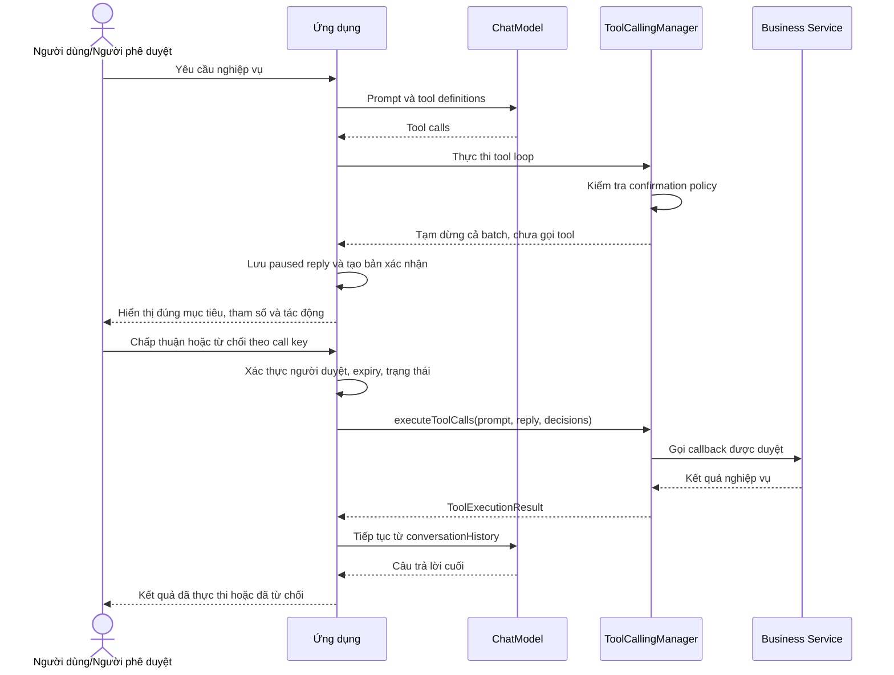

# Xác nhận thao tác nhạy cảm bằng nội dung cụ thể có thể kiểm tra

Một mô hình ngôn ngữ có thể đề xuất gọi công cụ để hoàn tiền, hủy đơn, thay đổi quyền truy cập hoặc gửi dữ liệu cho bên ngoài. Nhưng lời đề xuất của mô hình không phải là sự đồng ý của người dùng và cũng không phải bằng chứng rằng hành động đó phù hợp với chính sách nghiệp vụ. Ứng dụng phải đưa ra một yêu cầu xác nhận có nội dung cụ thể, cho người có thẩm quyền xem đúng thao tác sẽ xảy ra rồi mới thực thi.

Với Spring AI, `@Tool`, `ToolCallback` và JSON Schema giúp mô hình tạo yêu cầu gọi công cụ. Spring AI 2.1.0 bổ sung **tool call confirmation** để tạm dừng trước khi thực thi những công cụ cần phê duyệt. Tuy nhiên, framework không tự tạo màn hình duyệt nghiệp vụ, không xác thực người phê duyệt, không đảm bảo dữ liệu còn hiệu lực và không chống việc gửi lại quyết định. Các trách nhiệm này thuộc ứng dụng.

Bài học này tập trung vào cách xây dựng **bản mô tả hành động có thể kiểm tra**: ai thực hiện, tác động lên tài nguyên nào, thay đổi điều gì, với giá trị bao nhiêu, điều kiện hiện tại ra sao và người duyệt đang chấp thuận chính xác phiên bản nào của yêu cầu.

## Vì sao câu hỏi “Bạn có đồng ý không?” là chưa đủ?

Hãy so sánh hai cách yêu cầu xác nhận cho thao tác hoàn tiền.

**Mơ hồ:**

> Trợ lý muốn hoàn tiền. Bạn có đồng ý không?

Người duyệt không thấy giao dịch nào, số tiền bao nhiêu, khách hàng nhận tiền là ai hoặc trạng thái hiện tại có còn cho phép hoàn tiền hay không. Một lần nhấn “Đồng ý” không giúp kiểm toán được họ đã chấp thuận điều gì.

**Cụ thể và có thể đối chiếu:**

| Trường xác nhận | Giá trị minh họa | Nguồn đáng tin cậy |
|---|---|---|
| Hành động | Hoàn tiền cho giao dịch | Tool name đã map sang nghiệp vụ được phép |
| Mã giao dịch | `PMT-4085` | Đối số đã được xác thực, đối chiếu với backend |
| Đơn hàng | `ORD-2048` | Payment service |
| Số tiền hoàn | `450.000 VND` | Giá trị yêu cầu và hạn mức còn hoàn được |
| Người nhận | Tài khoản thanh toán kết thúc bằng `4832` | Payment service, đã che bớt thông tin |
| Trạng thái hiện tại | Đã thanh toán, còn được hoàn `450.000 VND` | Dữ liệu giao dịch hiện thời |
| Tác động | Tạo giao dịch hoàn tiền; có thể mất thời gian ngân hàng xử lý | Quy tắc nghiệp vụ |
| Hết hạn xác nhận | Trong 5 phút | Chính sách ứng dụng |

Các giá trị đều là minh họa. Hệ thống thực tế phải đọc thông tin từ bản ghi đã được xác thực, không đơn thuần lặp lại lời mô hình. Nếu `amount` trong arguments là `450000` nhưng payment service chỉ cho phép hoàn `300000`, không được hiển thị một giao dịch `450000` như đã hợp lệ; phải từ chối hoặc yêu cầu lập lại đề xuất.

**Nguyên tắc chính:** người phê duyệt phải nhìn thấy cùng một ý nghĩa nghiệp vụ với lời gọi mà hệ thống sẽ thực thi. Không được thay tên tài khoản, số tiền, đơn vị tiền tệ, ID tài nguyên, tập người nhận hoặc quyền cấp sau khi đã được phê duyệt.

## Xác định thao tác nào phải được xác nhận

Không phải mọi tool call đều cần dừng để xin phép. Tra cứu thông tin công khai hoặc đọc trạng thái của tài nguyên được phép thường có thể tự thực thi; ghi dữ liệu hoặc tạo side effect nhạy cảm cần một chính sách chặt hơn.

| Loại thao tác | Ví dụ | Chính sách gợi ý |
|---|---|---|
| Đọc dữ liệu được phép | `getOrderStatus` | Không cần xác nhận riêng nếu đã có authorization |
| Ghi ít ảnh hưởng và có thể hoàn tác | `updateDraftTitle` | Có thể xác nhận theo yêu cầu sản phẩm hoặc mức rủi ro |
| Hoàn tiền / thanh toán | `refundPayment`, `transferMoney` | Xác nhận số tiền, tiền tệ, nguồn và người nhận |
| Xóa dữ liệu | `deleteCustomerRecord` | Xác nhận loại tài nguyên, ID, phạm vi và khả năng khôi phục |
| Gửi ra bên ngoài | `sendEmail`, `publishDocument` | Xác nhận người nhận, tiêu đề, nội dung thực tế hoặc bản xem trước |
| Thay đổi quyền | `grantRole` | Xác nhận principal, resource, vai trò, thời hạn và tác động |
| Thao tác hàng loạt | `cancelOrders` | Xác nhận số lượng, danh sách hoặc tập điều kiện được đóng băng |

Với thao tác hàng loạt, một thông báo như “Xóa các bản ghi không dùng nữa” là quá chung chung. Cần hiển thị số lượng, phạm vi truy vấn, mẫu kết quả và nếu phù hợp danh sách ID hoặc manifest bất biến. Số lượng được phê duyệt phải khớp với số lượng thực thi; nếu tập dữ liệu thay đổi, tạo yêu cầu xác nhận mới.

## Luồng xác nhận trong Spring AI 2.1.0

Tool call confirmation hoạt động ở `ToolCallingManager`. Khi mô hình trả về một hoặc nhiều tool call, manager kiểm tra `ToolCallConfirmationPolicy` **trước khi chạy bất kỳ call nào trong batch**. Nếu một call cần xác nhận mà chưa có quyết định, manager ném `ToolCallConfirmationRequiredException`. `ToolCallingAdvisor` bắt tín hiệu đó, tạm dừng tool loop và trả `ChatResponse` chứa tool calls cho ứng dụng cùng metadata về các call đang chờ.



Mặc định, nếu batch chứa hai lời gọi `getOrderStatus` (đọc) và `refundPayment` (nhạy cảm), cả hai cùng tạm dừng trước khi thực thi. Khi tiếp tục, ứng dụng phải đưa ra quyết định cho **mọi** call trong batch, kể cả call không bị policy yêu cầu xác nhận. Việc một tool read-only được mặc định cho phép sau khi đã qua quy tắc ứng dụng phải là một lựa chọn có chủ đích.

Framework không giữ một “phiên duyệt” trong bộ nhớ khi chờ. Pause là một response bình thường; ứng dụng phải lưu prompt, phản hồi mô hình và trạng thái chờ trong kho đáng tin cậy để có thể tiếp tục sau khi reload hoặc restart.

## Đánh dấu công cụ cần xác nhận

Với phương thức Java, dùng `@Tool(requiresConfirmation = true)`:

```java
@Component
public class PaymentTools {

    private final RefundService refundService;

    public PaymentTools(RefundService refundService) {
        this.refundService = refundService;
    }

    @Tool(
            description = "Hoàn tiền giao dịch đã thanh toán, theo số tiền của đồng tiền",
            requiresConfirmation = true)
    public RefundReceipt refundPayment(
            @ToolParam(description = "Mã giao dịch cần hoàn") String paymentId,
            @ToolParam(description = "Số tiền ở đơn vị nhỏ nhất của đồng tiền")
                    long amountMinor,
            @ToolParam(description = "Mã tiền tệ ISO 4217") String currency,
            ToolContext toolContext) {

        String tenantId = requireTrustedTenant(toolContext);
        return refundService.refundIdempotently(
                tenantId, paymentId, amountMinor, currency);
    }
}
```

`RefundService`, `RefundReceipt` và `requireTrustedTenant(...)` là các thành phần nghiệp vụ minh họa. `amountMinor` là số tiền theo đơn vị nhỏ nhất do tiền tệ quy định (VND dùng đơn vị nguyên VND). Service phải kiểm tra quyền, trạng thái, hạn mức và idempotency. `ToolContext` chứa thông tin tenant/user đã được ứng dụng xác thực; không tin giá trị do mô hình gửi trong arguments.

Với `FunctionToolCallback`, dùng metadata:

```java
ToolCallback callback = FunctionToolCallback
        .builder("refundPayment", refundService::refund)
        .description("Hoàn tiền cho một giao dịch đã được phép")
        .inputType(RefundRequest.class)
        .toolMetadata(ToolMetadata.builder()
                .requiresConfirmation(true)
                .build())
        .build();
```

Nếu công cụ đến từ MCP hoặc nhà cung cấp bên ngoài không sửa được annotation, có thể cấu hình tên tool mà mô hình thực sự nhìn thấy:

```properties
spring.ai.tools.confirmation.enabled=true
spring.ai.tools.confirmation.tools=deleteFile,transferMoney
```

`spring.ai.tools.confirmation.enabled` mặc định là `true`. Tên trong `tools` phải khớp đúng tên tool công bố cho mô hình, bao gồm prefix của adapter nếu có. Auto-configuration kết hợp metadata, danh sách tên trong property và các `ToolCallConfirmationPolicy` bean theo logic OR: một policy bổ sung thêm những call phải xin phép.

## Chính sách xác nhận theo arguments

Có trường hợp chỉ thao tác vượt một hạn mức mới cần bước phê duyệt. Spring AI cho phép policy xét tên, JSON arguments và `ToolMetadata`:

```java
@Bean
ToolCallConfirmationPolicy highValueTransfers(ObjectMapper mapper) {
    return (toolCall, metadata) -> {
        if (!"transferMoney".equals(toolCall.name())) {
            return false;
        }
        try {
            JsonNode args = mapper.readTree(toolCall.arguments());
            return args.path("amountMinor").asLong(Long.MAX_VALUE) > 100_000;
        }
        catch (JsonProcessingException ex) {
            // Đối số không parse được không được tự đi qua luồng không cần duyệt.
            return true;
        }
    };
}
```

Đây là minh họa cho policy; giá trị ngưỡng, đơn vị tiền và cách parse phải được thiết kế riêng theo nghiệp vụ. Trong hệ thống đa tiền tệ, không so sánh thẳng `amountMinor` của các currency khác nhau để quyết định ngưỡng. Giá trị thiếu/không hợp lệ phải bị từ chối qua validation, không được biến thành một con số mặc định khiến tool được bỏ qua confirmation.

Để thêm nhiều quy tắc cho manager tự tạo:

```java
ToolCallingManager manager = ToolCallingManager.builder()
        .toolCallConfirmationPolicy(
                ToolCallConfirmationPolicy.fromToolMetadata()
                        .or(ToolCallConfirmationPolicy.forTools("deleteFile")))
        .build();

ChatClient client = ChatClient.builder(chatModel)
        .defaultAdvisors(ToolCallingAdvisor.builder()
                .toolCallingManager(manager)
                .build())
        .defaultTools(paymentTools)
        .build();
```

Dùng **cùng manager** cho vòng tool calling và bước resume. Không tắt `spring.ai.tools.confirmation.enabled` để né xác nhận trong production. Một custom `ToolCallingManager` phải tự bảo đảm toàn bộ chính sách confirmation; không được giả định delegate tùy chỉnh vẫn tự chặn nếu nó không triển khai logic tương ứng.

## Nhận diện phản hồi đang chờ duyệt

`ToolCallingAdvisor` trả `ChatResponse` có tool calls và danh sách khóa đang chờ trong metadata. Cần lấy response đầy đủ:

```java
ChatResponse reply = chatClient.prompt()
        .user("Hoàn tiền cho giao dịch PMT-4085")
        .tools(paymentTools)
        .call()
        .chatResponse();

List<String> awaiting = ToolCallDecisions.awaitingDecision(reply);

if (!awaiting.isEmpty()) {
    AssistantMessage assistant = reply.getResult().getOutput();
    List<AssistantMessage.ToolCall> calls = assistant.getToolCalls();
    List<String> keys = ToolCallDecisions.toolCallKeys(assistant);

    for (int i = 0; i < calls.size(); i++) {
        AssistantMessage.ToolCall call = calls.get(i);
        String key = keys.get(i);
        // Tra policy, đối chiếu backend và tạo bản mô tả duyệt.
    }
}
```

Đừng chỉ gọi `.content()` để tìm trạng thái chờ: nội dung text của paused reply có thể rỗng. Trong streaming, danh sách khóa chờ nằm ở **chunk cuối** của `.stream().chatResponse()`; một phản hồi sau aggregation có thể không còn metadata này. Lưu đúng last chunk và thông tin cần thiết khi quyết định tiếp tục.

### Khóa của tool call và trường hợp thiếu ID

`ToolCallDecisions.toolCallKeys(assistant)` trả khóa cho từng call theo thứ tự:

- Nếu ID của call có mặt và duy nhất, khóa là ID đó, ví dụ `call_1`.
- Nếu không có ID hoặc trùng ID, khóa là vị trí như `#0`, `#1`.

Không tự đặt khóa theo tên tool vì cùng một batch có thể gọi cùng tool nhiều lần với arguments khác nhau. Không thay đổi thứ tự tool calls đã lưu nếu khóa được tính theo vị trí. Bản xác nhận nên hiển thị một mục duyệt riêng cho từng call key.

## Một yêu cầu duyệt phải chứa thông tin gì?

Mỗi mục xác nhận nên có ít nhất:

1. **Hành động cụ thể:** “Hoàn tiền giao dịch” thay vì “Chạy công cụ”.
2. **Đối tượng chịu tác động:** ID tài nguyên, tenant, tài khoản hoặc nhóm người nhận đã xác thực.
3. **Giá trị thay đổi:** số tiền và tiền tệ; vai trò được cấp; nội dung email; danh sách ID bị xóa; trước/sau của dữ liệu.
4. **Điều kiện hiện tại:** trạng thái bản ghi, phiên bản dữ liệu, hạn mức, thời điểm hiệu lực; dữ liệu lấy từ service có thẩm quyền.
5. **Hệ quả và khả năng hoàn tác:** phí, thời gian xử lý, tác động tới người nhận, việc nào không thể thu hồi.
6. **Phạm vi phê duyệt:** chính xác call nào đang được duyệt, hiệu lực tới khi nào, ai có quyền duyệt.
7. **Hai lựa chọn rõ ràng:** xác nhận thực thi hoặc từ chối, không mặc định coi không phản hồi là đồng ý.

Người duyệt có thể được mở rộng chi tiết JSON đã chuẩn hóa để kiểm tra, nhưng không nên buộc họ đọc raw JSON để hiểu quyết định. Những field trọng yếu phải xuất hiện dưới nhãn nghiệp vụ rõ ràng. Đặc biệt, với `sendEmail` phải hiển thị đúng người nhận, CC/BCC, tiêu đề và bản xem trước nội dung; với `grantRole` phải hiển thị principal, quyền, tài nguyên và thời hạn.

### Phân biệt ba nguồn dữ liệu

| Nguồn | Ví dụ | Cách xử lý |
|---|---|---|
| Mô hình đề xuất | `refundPayment("PMT-4085",450000,"VND")` | Chỉ là đề xuất; parse và validate |
| Backend có thẩm quyền | Chủ sở hữu giao dịch, số tiền có thể hoàn, trạng thái, version | Dùng để xác nhận phạm vi và trạng thái |
| Người duyệt | Đồng ý/từ chối theo bản xem trước và call key | Gắn quyết định vào proposal cụ thể |

Nếu thông tin trên màn hình mâu thuẫn với parameters của tool, không yêu cầu người dùng phê duyệt bằng cách che giấu sự khác biệt. Hãy từ chối proposal hoặc tạo proposal mới đã được kiểm tra.

## Đóng băng proposal trước khi hiển thị

Một bản xem trước phải tương ứng với một **snapshot bất biến** được giữ ở server. Có thể định nghĩa mô hình dữ liệu nghiệp vụ:

```java
public record ApprovalPreview(
        String pauseId,
        String callKey,
        String action,
        String targetId,
        String amount,
        String currency,
        String displaySummary,
        String expectedResourceVersion,
        Instant expiresAt) {
}
```

`ApprovalPreview` dành cho UI, còn server giữ riêng `Prompt`, `ChatResponse` có tool call gốc, danh sách call keys, tenant, authorized requester, phiên bản resource và trạng thái pause. Không gửi toàn bộ `Prompt` hay `ChatResponse` tới client rồi cho client gửi lại khi xác nhận. Client chỉ gửi `pauseId`, `callKey`, `decision` và token/chỉ số snapshot do server xác thực.

Một trạng thái pause có thể là:

| Trạng thái | Ý nghĩa |
|---|---|
| `PENDING` | Đã tạo bản xem trước, chưa có quyết định |
| `RESUMING` | Quyết định được tiếp nhận và server bắt đầu chạy |
| `COMPLETED` | Toàn bộ kết quả đã được ghi nhận |
| `DENIED` | Người duyệt từ chối |
| `EXPIRED` | Hết hiệu lực, không được thực thi |
| `FAILED_RECONCILIATION` | Cần kiểm tra trạng thái sau lỗi/timeout |

Trước khi chuyển `PENDING` sang `RESUMING`, server phải kiểm tra người duyệt đúng thẩm quyền, pause chưa hết hạn, tenant/session hợp lệ và trạng thái resource vẫn đúng điều kiện đã hiển thị. Dùng cập nhật có điều kiện (compare-and-set hoặc optimistic locking) để hai request xác nhận đồng thời không cùng tiếp tục một pause.

### Gắn quyết định vào đúng nội dung đã xem

Một `approval digest` có thể bao gồm:

```text
sessionId
pauseId
callKey
toolName
canonicalJsonArguments
resolvedTenantId
validatedTargetId
validatedAmountAndCurrency
expectedResourceVersion
expiresAt
```

Tạo HMAC-SHA-256 của biểu diễn được chuẩn hóa bằng secret do server quản lý. HMAC giúp đối chiếu snapshot được duyệt khi dữ liệu di chuyển giữa các thành phần; không lưu khóa trong client. Trong một datastore giao dịch tin cậy, có thể lưu immutable proposal + version và so sánh trực tiếp thay vì tự triển khai HMAC. Dù dùng cách nào, không lấy arguments mới từ payload xác nhận để thay vào tool call cũ.

Nếu đơn hàng, số tiền hoặc người nhận thay đổi sau khi hiển thị, yêu cầu duyệt cũ hết hiệu lực. Người dùng phải được xem lại nội dung mới và đưa ra quyết định mới. Một checkbox “Tôi đồng ý” không tự bảo vệ trước lỗi thay đổi dữ liệu giữa lúc đọc và lúc ghi (TOCTOU).

## Resume đúng paused reply bằng ToolCallDecisions

Spring AI cung cấp `ToolCallDecision.allow(key)` và `deny(key[,message])`. Đầu vào của `ToolCallingManager.executeToolCalls(prompt, reply, decisions)` gồm:

- `prompt` chứa lịch sử và **các tool callback được phép** của lượt đã tạo proposal;
- `reply` là **phản hồi mô hình gốc được lưu phía server**;
- `decisions` là quyết định cho **tất cả** tool call của reply.

Ví dụ cho một batch gồm đúng hai call đã kiểm tra, trong đó người duyệt chỉ cho phép call đầu:

```java
ToolCallDecisions decisions = ToolCallDecisions.of(
        ToolCallDecision.allow("call_1"),
        ToolCallDecision.deny("call_2", "Thao tác này đã bị từ chối."));

ToolExecutionResult result = toolCallingManager.executeToolCalls(
        savedPrompt, savedPausedReply, decisions);

if (result.returnDirect()) {
    List<Generation> generations = ToolExecutionResult.buildGenerations(result);
    // Chuyển generations thành response của ứng dụng.
}
else {
    String answer = chatClient.prompt()
            .messages(result.conversationHistory())
            .call()
            .content();
}
```

`savedPrompt` và `savedPausedReply` phải được phục hồi từ kho server-side; `savedPrompt` phải chứa bộ tool callback hợp lệ tại thời điểm resume. Nếu các callback Java không thể serialize qua restart, lưu metadata và dựng lại callback từ registry được phép theo principal/tenant, sau đó xác minh vẫn là cùng tập tool có quyền thực thi.

Manager kiểm tra số quyết định và sự tương ứng với call keys trước khi chạy: thiếu một call, thừa key hoặc key không hợp lệ sẽ gây `IllegalArgumentException`. Khi resume, policy confirmation **không được chạy lại**; manager thực thi các call đã được đánh dấu allow nếu prompt có callback tương ứng. Vì vậy, ứng dụng bắt buộc tự kiểm tra quyền, chính sách và dữ liệu hiện thời trước bước resume. Không được tin rằng việc marker `requiresConfirmation` vẫn còn sẽ tự chặn một decision được giả mạo.

### Khi một batch có nhiều công cụ

Giả sử mô hình trả về ba call: `lookupOrder`, `refundPayment`, `sendEmail`. Dù policy chỉ flag `refundPayment` và `sendEmail`, bước resume vẫn cần ba quyết định. Nếu UI cho phép duyệt riêng từng mục, build danh sách quyết định theo keys gốc; nếu business policy muốn atomic approval, có thể bắt buộc tất cả được duyệt hoặc từ chối toàn batch.

Với call bị từ chối, manager không chạy callback mà trả thông điệp từ chối như một tool result cho mô hình. Thông điệp có thể đến từ người duyệt, vì vậy cần giới hạn độ dài, lọc dữ liệu nhạy cảm và xử lý như input không đáng tin cậy; không chép nguyên văn bí mật hoặc lệnh chỉ dẫn giả vào model context.

`ToolExecutionResult.returnDirect()` chỉ là `true` khi tất cả call đều được cho phép và mọi callback có `returnDirect = true`. Có bất kỳ call nào bị từ chối thì kết quả nên quay lại model để mô hình phản hồi theo quyết định từ chối.

## Thiết kế endpoint xác nhận an toàn

Tầng HTTP chỉ nên nhận một payload nhỏ:

```json
{
  "pauseId": "p-2026-0091",
  "decisions": [
    {"callKey": "call_1", "allow": true},
    {"callKey": "call_2", "allow": false}
  ]
}
```

Server phải thực hiện tuần tự các bước:

1. Xác thực phiên người dùng và xác minh CSRF/session theo cơ chế HTTP đang áp dụng.
2. Lấy pause bằng `pauseId` từ datastore có quyền truy cập theo tenant; không nhận `Prompt`, `ChatResponse` hoặc arguments từ client.
3. Khóa/claim pause đúng một lần và kiểm tra trạng thái `PENDING`, người duyệt được phép, thời hạn, call keys khớp.
4. Tái xác minh proposal dựa trên dữ liệu hiện hành và version mà người dùng đã thấy; thay đổi quan trọng thì không thực thi.
5. Kiểm tra lại authorization trong service đối với từng resource và từng thao tác.
6. Tạo `ToolCallDecisions` cho mọi call; với call chưa được người dùng phê duyệt rõ ràng, chỉ `allow` theo policy server đã xác định.
7. Resume bằng manager và paused reply đã lưu, ghi kết quả và đánh dấu pause hoàn tất.
8. Nếu có lỗi, lưu trạng thái để reconcile; không đánh dấu thất bại rồi gửi cùng lệnh một cách mù quáng.

Để chống replay, lưu `pauseId`, trạng thái xử lý và khóa idempotency. Nếu người dùng gửi cùng approval hai lần, response thứ hai phải trả trạng thái đã xử lý hoặc kết quả đã lưu; không được chạy callback lần nữa. `executeToolCalls(..., decisions)` tự nó không bảo đảm chống replay.

## Authorization vẫn phải chạy tại thời điểm thực thi

Confirmation trả lời câu hỏi “Người được phép đã duyệt nội dung này chưa?”. Authorization trả lời “Người đó và ứng dụng hiện có quyền thực hiện hành động này không?”. Hai kiểm tra khác nhau và đều cần thiết.

Ví dụ, người dùng A có quyền duyệt hoàn tiền tối đa 5 triệu đồng trong tenant X. Họ duyệt một yêu cầu 450.000 VND, nhưng trong lúc chờ, quyền của A bị thu hồi hoặc giao dịch được người khác hoàn trước. Service phải từ chối khi resume, dù UI vẫn có bản xác nhận cũ.

Đừng lấy `tenantId`, `userId`, `role` hoặc cờ `isAdmin` từ JSON do mô hình tạo. Truy xuất từ principal đã xác thực, `ToolContext` được server tạo và policy nghiệp vụ. Nếu dùng step-up authentication (nhập lại mật khẩu, OTP, WebAuthn), chứng cứ xác thực phải gắn với cùng phiên, cùng proposal và thời hạn phù hợp.

### Ngăn thay đổi dữ liệu giữa lúc kiểm tra và ghi

Quy trình xem trước có thể đọc `order.version = 7`. Trước khi hủy hoặc hoàn tiền, service thực hiện update có điều kiện `WHERE version = 7` hoặc dùng cơ chế khóa/transaction phù hợp. Nếu version đã là 8, thao tác bị từ chối và cần xác nhận lại. Không chỉ so sánh version trên UI mà bỏ kiểm tra trong transaction ghi.

Với email hoặc thông báo gửi ra ngoài, cần ràng buộc chính xác content digest, địa chỉ người nhận, CC/BCC, attachment IDs/versions; nếu bản nháp bị chỉnh sau khi duyệt, không được gửi bản mới theo approval cũ.

## Dừng chờ và xử lý lời gọi chưa có kết quả

Nếu người dùng không duyệt, pause sẽ không tự biến thành kết quả tool. Khi một cuộc hội thoại chứa assistant tool call chưa được trả lời mà có thêm user message, nhiều provider có thể từ chối lịch sử. Ứng dụng nên có chính sách timeout, từ chối toàn bộ các call còn chờ bằng message trung tính và hoàn tất cặp tool call/result trước khi tiếp nhận lượt mới.

Với Spring AI Session Memory, `SessionTurnAdvisor` có thể thêm tool result trung tính như `No result was recorded for this tool call.` khi lượt mới bắt đầu. Đây là mô tả trạng thái log, không phải bằng chứng callback chưa chạy. Khi muốn model biết người dùng đã chủ động từ chối, ứng dụng cần lưu quyết định deny rõ ràng.

Một pause đã hết hạn, bị hủy hoặc đã được thay bởi lượt mới không thể được resume sau đó bằng quyết định cũ. Nên có TTL và cleanup job cho các pause chưa giải quyết. Khi hết hạn, trả UI trạng thái `EXPIRED` và yêu cầu tạo proposal mới.

## Lưu các vòng tool calling trước khi tạm dừng

Một lượt có thể chạy `getAccount` hoặc `lookupOrder` trước khi mô hình yêu cầu tool cần xác nhận. Paused reply chỉ chứa phản hồi mới nhất gây dừng; những round trước có thể đang ở lịch sử nội bộ của advisor. Nếu ứng dụng chỉ lưu paused reply rồi resume mà thiếu các round đó, model có thể không hiểu vì sao nó đã đề xuất hành động.

Với ứng dụng dùng `ChatClient`, nên dùng Session Memory hoặc cấu hình memory advisor bên trong tool loop để giữ assistant tool calls và tool results ở từng round. Khi tự điều phối `ChatModel`, lưu toàn bộ `ToolExecutionResult.conversationHistory()`, không bỏ các cặp assistant/tool. Khi resume, tiếp tục với lịch sử hợp lệ và cùng tập công cụ được phép.

Spring AI 2.1.0 cung cấp tool confirmation và Session Memory thuộc core. Một số dự án cộng đồng có hỗ trợ park/resume dựa trên Session Memory, nhưng không nên nhầm tính năng của chúng với API core khi thiết kế ứng dụng.

## Giới hạn rủi ro từ retry và thao tác không thể hoàn tác

Confirmation không đồng nghĩa exactly-once. Một thao tác ghi có thể hoàn tất ở downstream rồi response timeout. Nếu server tự chạy lại `refundPayment` vì chưa nhận tool result, có thể phát sinh hoàn tiền trùng.

Áp dụng:

- Idempotency key ổn định theo lệnh nghiệp vụ đã phê duyệt, không dùng tool call ID có thể thay đổi giữa các lần model sinh lại.
- Lưu bảng trạng thái giao dịch và correlation ID; kiểm tra upstream/downstream trước khi retry.
- Với thao tác ghi, phân biệt `FAILED`, `SUCCEEDED` và `UNKNOWN` để không tuyên bố thất bại hoặc thành công khi chưa có bằng chứng.
- Đặt deadline, giới hạn số lần gọi tool, timeout API và chính sách reconcile.
- Khi batch có nhiều side effect, định nghĩa rõ atomicity hoặc saga/compensation; manager không cung cấp transaction phân tán.

Với thao tác không thể thu hồi như gửi email, cấp quyền hệ thống hoặc xóa vĩnh viễn, việc hiển thị bản xem trước chính xác và xác thực người duyệt cần được ưu tiên hơn trải nghiệm nhấn một nút nhanh.

## Trải nghiệm người dùng để giảm duyệt nhầm

Màn hình xác nhận nên hiển thị một tiêu đề có động từ cụ thể, ví dụ **“Xác nhận hoàn tiền 450.000 VND”**, và biểu diễn trạng thái là **“Chưa thực thi”**. Nút rõ ràng nên là **“Xác nhận hoàn tiền”** và **“Từ chối”**, thay vì “OK”/“Cancel” không có bối cảnh. Sau khi người dùng duyệt, chỉ hiển thị “Đã hoàn tiền” nếu backend đã xác nhận thực thi thành công; trước đó dùng “Đang xử lý”.

Khi duyệt nhiều call trong một batch, phân biệt trạng thái từng call, hiển thị công cụ nào được duyệt và công cụ nào sẽ chạy nếu tất cả điều kiện vẫn hợp lệ. Với lệnh ghi giá trị lớn, cho phép mở phần chi tiết hoặc yêu cầu bước xác thực bổ sung; tránh mặc định chọn sẵn tất cả checkbox “Duyệt”.

Thông tin nhạy cảm trên màn hình cần được che vừa đủ để người duyệt nhận diện đúng tài nguyên mà không lộ số thẻ hoặc thông tin cá nhân đầy đủ. Không hiển thị raw prompt, chain-of-thought hoặc token truy cập như một phần chứng từ duyệt.

## Logging và chứng cứ kiểm toán

Với mỗi quyết định, lưu một audit event có tối thiểu:

| Trường | Mục đích |
|---|---|
| `pauseId` / `callKey` | Truy vết đúng đề xuất và lời gọi |
| `actionType` / `resourceId` | Xác định thao tác trên tài nguyên |
| `proposalDigest` / version | Chứng minh nội dung đã hiển thị không bị đổi |
| `approverId` / tenant | Người phê duyệt và phạm vi quyền |
| `decision` / timestamp | Đồng ý hay từ chối, lúc nào |
| `authorizationResult` | Kết quả kiểm tra quyền tại lúc resume |
| `executionId` / idempotencyKey | Liên kết với giao dịch nghiệp vụ |
| `finalStatus` | Thành công, từ chối, hết hạn hoặc cần reconcile |

Không ghi toàn bộ JSON arguments, số tài khoản, PII, token hoặc nội dung email nhạy cảm vào log nếu không cần và không có chính sách lưu giữ phù hợp. Dùng HMAC hoặc digest có kiểm soát để liên kết audit record với snapshot đã lưu trong kho an toàn. Audit phải phân biệt **được phê duyệt** với **đã thực thi thành công**.

## Kiểm thử confirmation theo giá trị thực tế

Một test chỉ kiểm tra `@Tool(requiresConfirmation = true)` được gọi là chưa đủ. Cần chứng minh không có side effect trước khi người có quyền duyệt đúng nội dung, và quyết định cũ không thể thực thi proposal mới.

| Tình huống | Điều cần xác minh |
|---|---|
| Một tool cần confirmation | Manager tạm dừng; callback chưa chạy |
| Batch gồm read-only và tool nhạy cảm | Không callback nào của batch chạy trước quyết định |
| UI hiển thị proposal | Tên hành động, ID, số tiền, currency, recipient lấy đúng từ nguồn đáng tin |
| Arguments model khác backend | Từ chối tạo approval hợp lệ, không giấu sai khác |
| Approver không có quyền | Không thể approve dù có link hoặc pauseId |
| Client sửa tool name/arguments | Server bỏ qua nội dung sửa và dùng paused reply đã lưu |
| Call key thiếu ID hoặc trùng ID | `toolCallKeys` tạo key theo `#index` và giữ nguyên thứ tự |
| Thiếu một quyết định trong batch | Manager từ chối trước khi thực thi |
| Có decision thừa hoặc sai key | Manager từ chối trước khi thực thi |
| Call bị deny | Callback không chạy; model nhận deny message an toàn |
| Resource thay version lúc chờ | Approval cũ hết hiệu lực; thao tác không chạy |
| Pause hết hạn | Không cho resume |
| Hai request approve đồng thời | Chỉ một request claim được pause |
| Gửi lại cùng approval | Không gọi lại downstream; trả trạng thái đã xử lý |
| Timeout sau ghi | Tìm trạng thái qua idempotency trước retry |
| Không nhận quyết định và có user turn mới | Kết thúc pending call theo chính sách; không resume pause cũ |
| `returnDirect = true` | Chỉ trả trực tiếp khi mọi tool đều allow và direct |
| Streaming pause | Lấy `awaitingDecision` ở chunk cuối, không từ text rỗng |

Một integration test có thể dùng callback giả tăng `AtomicInteger` mỗi khi được gọi. Gửi tool call cần confirmation, xác minh bộ đếm bằng 0 trước approve, bằng 1 sau approve hợp lệ, vẫn bằng 1 khi cùng approval được gửi lại. Thêm test sửa `amountMinor` từ client và test resource version thay đổi trước resume để chứng minh ranh giới đã đóng băng.

## Checklist triển khai

1. Đánh dấu `requiresConfirmation` hoặc policy cho mọi công cụ có side effect nhạy cảm.
2. Dùng `ChatResponse` và `ToolCallDecisions.awaitingDecision(...)` để phát hiện pause.
3. Lấy `toolCallKeys` của reply gốc, phân biệt từng call trong batch.
4. Tạo bản xem trước từ arguments đã validate và dữ liệu backend có thẩm quyền.
5. Hiển thị đúng hành động, tài nguyên, giá trị thay đổi, hệ quả và thời hạn.
6. Lưu bất biến prompt, paused reply, call keys, version và trạng thái ở server.
7. Gắn approval với snapshot cụ thể; không để client gửi lại arguments để thay đổi proposal.
8. Kiểm tra identity, authorization, tenant, expiry và trạng thái tài nguyên ngay trước thực thi.
9. Chỉ cho một request claim/resume pause; có idempotency và reconciliation.
10. Tạo quyết định cho tất cả call trong batch, kể cả call không bị policy flag.
11. Dùng `executeToolCalls(prompt, reply, decisions)` với bộ tool callback hợp lệ.
12. Khi deny, hết hạn hoặc đổi yêu cầu, đóng những tool call chưa có result theo chính sách.
13. Giữ các tool-call/result round trước pause để model có ngữ cảnh đầy đủ.
14. Ghi audit thể hiện nội dung được duyệt, người duyệt và kết quả thực tế.

## Kết luận

Xác nhận thao tác nhạy cảm chỉ có ý nghĩa khi người phê duyệt nhìn thấy đúng nội dung sẽ được thực thi và có thể kiểm tra nội dung đó bằng dữ liệu nghiệp vụ đáng tin cậy. Spring AI 2.1.0 cung cấp cơ chế tạm dừng tool loop, `ToolCallDecisions` và API resume để ứng dụng xây luồng human-in-the-loop. Ứng dụng phải giữ proposal bất biến, gắn quyết định với call key và phiên bản dữ liệu, xác thực người duyệt, kiểm tra quyền lần nữa, chống replay và lưu bằng chứng thực thi. Nhờ vậy, mô hình có thể đề xuất công cụ nhưng quyền thực hiện hành động nhạy cảm vẫn thuộc về người có thẩm quyền và hệ thống nghiệp vụ.

## Tài liệu tham khảo

- [Spring AI 2.1.0 — Tool Call Confirmation](https://docs.spring.io/spring-ai/reference/api/tools/tool-call-confirmation.html) — confirmation policy, pause, decision keys, resume, streaming, security và abandoned pauses.
- [Spring AI 2.1.0 — Tool Calling](https://docs.spring.io/spring-ai/reference/api/tools.html) — `@Tool`, `ToolCallback`, `ToolContext`, quản lý vòng tool calling.
- [Spring AI 2.1.x — ToolCallDecisions API](https://docs.spring.io/spring-ai/docs/2.1.x/api/org/springframework/ai/model/tool/ToolCallDecisions.html) — `awaitingDecision`, `toolCallKeys` và kiểm tra quyết định.
- [Spring AI 2.1.x — ToolCallDecision API](https://docs.spring.io/spring-ai/docs/2.1.x/api/org/springframework/ai/model/tool/ToolCallDecision.html) — `allow`, `deny` và thông điệp từ chối.
- [Spring AI 2.1.x — ToolCallConfirmationPolicy API](https://docs.spring.io/spring-ai/docs/2.1.x/api/org/springframework/ai/model/tool/ToolCallConfirmationPolicy.html) — `fromToolMetadata`, `forTools` và composition.
- [Spring AI — Human in the Loop with Spring AI 2.1: Tool Calls That Survive a Restart](https://spring.io/blog/2026/11/24/spring-ai-tool-call-confirmation-park-resume/) — ví dụ thực tế về trạng thái chờ, session log và giới hạn trách nhiệm của ứng dụng.
