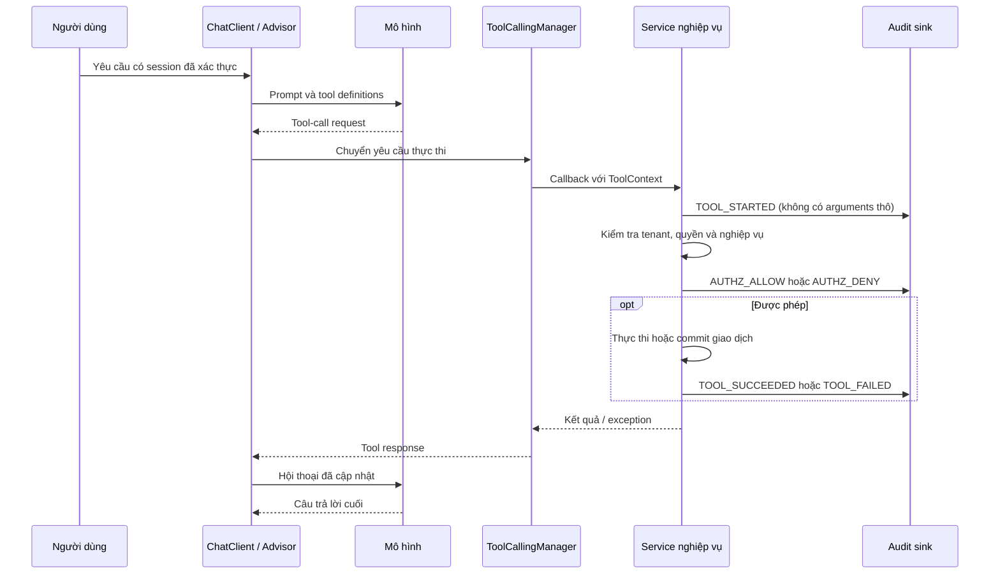
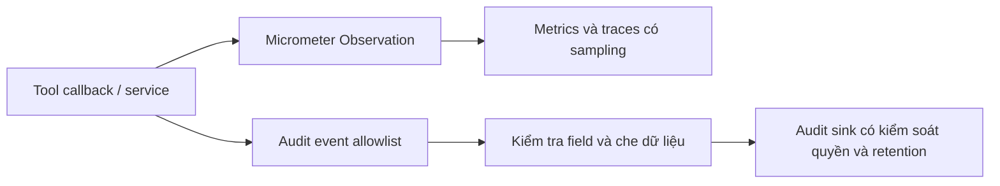

# Bảo mật

## Ghi nhật ký kiểm toán với dữ liệu được che phù hợp

Khi mô hình ngôn ngữ yêu cầu gọi một công cụ, ứng dụng Spring AI có thể đọc dữ liệu khách hàng, tra cứu đơn hàng, cập nhật trạng thái nghiệp vụ hoặc liên hệ dịch vụ ngoài. Những hành động này cần được kiểm toán để giải thích **ai yêu cầu, ứng dụng cho phép điều gì, công cụ nào thực sự chạy, kết quả ra sao**. Tuy nhiên, nếu ghi nguyên prompt, `ToolContext`, JSON arguments và tool results vào log, chính cơ chế kiểm toán lại có thể làm lộ bí mật hoặc dữ liệu cá nhân.

Trong module `SPRING_AI_TOOL_CALLING`, mô hình chỉ đề xuất tool calls. Ứng dụng sở hữu `@Tool`, `ToolCallback`, schema đầu vào, kiểm tra quyền và thực thi service nghiệp vụ. Vì vậy, thiết kế audit phải bám vào các **quyết định và thao tác thực tế của ứng dụng**, đồng thời che dữ liệu ở ranh giới trước khi ghi vào log, trace hoặc hệ thống lưu trữ kiểm toán.

Mục tiêu là tạo một dấu vết đủ để điều tra một tool call mà không cần sao chép toàn bộ hội thoại vào kho log. Bài này dựa trên Spring AI 2.1.0, Spring Boot structured logging và nguyên tắc giảm thiểu dữ liệu trong OWASP Logging Cheat Sheet.

### 1. Phân biệt application log, observability và audit log

Ba loại dữ liệu này bổ trợ nhau nhưng không có cùng mục đích:

| Loại | Câu hỏi cần trả lời | Dữ liệu nên giữ | Khả năng lưu trữ |
| --- | --- | --- | --- |
| Application log | Hệ thống lỗi ở đâu? | Error code, component, trace ID, thời gian | Có thể lấy mẫu/lọc theo level |
| Metrics và traces | Tool nào chậm, một request đi qua những dịch vụ nào? | Duration, tên tool, status, span/trace ID | Có thể sampling; metric labels cần cardinality thấp |
| Security/business audit | Ai thực sự được phép làm gì và thao tác đã hoàn tất chưa? | Actor/tenant tham chiếu, hành động, quyết định quyền, outcome, operation ID | Cần tính toàn vẹn, retention và quyền truy cập riêng |

Ví dụ `spring.ai.tool` có thể đo thời gian một callback. Nó không tự chứng minh rằng người dùng có quyền xem đơn hàng hoặc thao tác cập nhật đã commit. Một application log `Tool call failed` cũng không cho biết có bản ghi nào đã được thay đổi trước khi lỗi xảy ra. Audit phải ghi các sự kiện nghiệp vụ ở ranh giới xác thực, thực thi và commit.

### 2. Vòng đời một tool call và các điểm audit



Một sự kiện `TOOL_REQUESTED` chỉ cho biết mô hình **đề xuất** gọi tool. Nó không chứng minh callback đã được thực thi. `TOOL_STARTED` cho biết ứng dụng đã bắt đầu xử lý. `TOOL_SUCCEEDED` chỉ nên được ghi khi kết quả đã được xác nhận theo hợp đồng nghiệp vụ; với giao dịch database, nên gắn với thời điểm commit thực sự.

| Event | Thời điểm | Ý nghĩa |
| --- | --- | --- |
| `TOOL_REQUESTED` | Mô hình trả tool-call request | Đề xuất, chưa thực thi |
| `TOOL_AUTHZ_ALLOWED` / `TOOL_AUTHZ_DENIED` | Sau kiểm tra quyền | Quyết định sử dụng tool/tài nguyên |
| `TOOL_CONFIRMATION_REQUIRED` | Trước side effect nếu cần người dùng xác nhận | Vòng tool tạm dừng, chưa thực thi |
| `TOOL_STARTED` | Callback/service bắt đầu công việc | Đã đi vào đường thực thi |
| `TOOL_SUCCEEDED` | Kết quả nghiệp vụ thành công | Thành công thực tế theo hợp đồng service |
| `TOOL_FAILED` | Callback/service thất bại | Lỗi được phân loại |
| `TOOL_SKIPPED_LIMIT` | Giới hạn tool call ngăn callback chạy | Chưa thực thi |
| `TOOL_REJECTED` | Chặn bởi policy/approval/validation | Không được phép chạy |
| `TOOL_RESULT_UNKNOWN` | Timeout sau khi gửi thao tác có side effect | Chưa khẳng định được server đích có commit hay không |

Không phải mọi ứng dụng cần lưu từng event giống nhau. Với tool chỉ đọc, thường có thể ghi `TOOL_SUCCEEDED` hoặc `TOOL_FAILED` kèm outcome và latency. Với tool thay đổi dữ liệu, nên tách các quyết định quan trọng để đủ bằng chứng điều tra.

### 3. Thiết kế schema audit theo allowlist

Hãy định nghĩa schema cố định trước khi triển khai ghi log. Mỗi field phải có mục đích điều tra hoặc báo cáo cụ thể.

| Field | Ví dụ an toàn | Mục đích |
| --- | --- | --- |
| `timestamp` | ISO-8601 UTC | Thứ tự sự kiện |
| `eventType` | `TOOL_AUTHZ_DENIED` | Loại sự kiện |
| `toolName` | `lookup_order` | Công cụ liên quan |
| `tenantRef` | `k3:8ba...` | Đối chiếu tenant mà không xuất ID gốc |
| `actorRef` | `k3:2d5...` | Đối chiếu principal trong phạm vi cho phép |
| `conversationRef` | `k3:52c...` | Ghép sự kiện cùng hội thoại |
| `requestId` / `traceId` | ID ngẫu nhiên do server tạo | Correlation với trace |
| `toolCallRef` | Tham chiếu có kiểm soát tới tool-call ID | Ghép call và result |
| `operationRef` | ID idempotency hoặc business command được mã hóa/che | Đối soát thao tác ghi |
| `decision` | `ALLOW`, `DENY`, `PENDING` | Kết quả authorization/approval |
| `outcome` | `SUCCEEDED`, `FAILED`, `NOT_EXECUTED`, `UNKNOWN` | Trạng thái thực thi |
| `errorCode` | `ORDER_NOT_VISIBLE`, `UPSTREAM_TIMEOUT` | Phân loại lỗi không cần stack trace |
| `durationMs` | `87` | Đo latency và điều tra timeout |

Không mặc định ghi các field như `arguments`, `result`, `prompt`, `completion`, `toolContext`, `authorizationHeader` hoặc `exceptionMessage`. Danh sách cho phép cần đủ hẹp để một thay đổi DTO hoặc tool schema không tự đưa trường nhạy cảm mới vào audit sink.

Ví dụ bản ghi kiểm toán đã được che:

```json
{
  "timestamp": "2026-11-27T09:30:11.352Z",
  "eventType": "TOOL_AUTHZ_DENIED",
  "toolName": "lookup_order",
  "tenantRef": "k3:0f91e7c321b7c924d251a603",
  "actorRef": "k3:85b0c12604e9983fa54dc101",
  "conversationRef": "k3:102af60c43ab9f8768b091ea",
  "traceId": "7ce86e0418ad4b5c8a6f33091d024eb7",
  "decision": "DENY",
  "outcome": "NOT_EXECUTED",
  "errorCode": "ORDER_NOT_VISIBLE",
  "durationMs": 6
}
```

Các mã tham chiếu và trace ID ở ví dụ chỉ là giá trị giả. Bản ghi không chứa số điện thoại, mã đơn hàng thô, địa chỉ giao hàng hoặc chi tiết JSON từ mô hình.

### 4. Phân loại dữ liệu trước khi che

Không có một phép `replace("password", "***")` nào đủ an toàn cho mọi tool. Tool arguments thường là JSON lồng nhau, có danh sách, object, mô tả tự do và dữ liệu do người dùng nhập.

| Loại dữ liệu | Ví dụ | Mặc định nên xử lý |
| --- | --- | --- |
| Bí mật xác thực | Password, API key, access token, cookie, private key | **Không ghi** |
| Nội dung hội thoại | System/user prompt, completion, file đính kèm | **Không ghi** trong audit thông thường |
| `ToolContext` | Bearer credential, tenant scope, security principal | Chỉ trích xuất các tham chiếu được phép, không dump toàn map |
| Dữ liệu cá nhân | Email, điện thoại, địa chỉ, giấy tờ định danh | Bỏ hoặc mask/tokenize/HMAC theo mục đích |
| Dữ liệu thanh toán | PAN, tài khoản ngân hàng, thông tin giao dịch | Không ghi trực tiếp; chịu chính sách thanh toán riêng |
| ID nghiệp vụ | Order ID, customer ID, conversation ID | HMAC tham chiếu hoặc mã thay thế nếu cần đối chiếu |
| Tool arguments không nhạy cảm | Enum `status`, khoảng ngày chuẩn hóa | Chỉ ghi những field đã được duyệt |
| Tool result | Danh sách đơn hàng, thông tin khách | Thường chỉ ghi `resultClass`, `itemCount` hoặc status |
| Stack trace/HTTP body | SQL, URL có query, response lỗi từ upstream | Ghi mã lỗi, dependency alias và correlation ID; chi tiết vào kho được bảo vệ nếu thật sự cần |

Các cách che cần được hiểu đúng:

- **Omit:** loại hẳn field; là lựa chọn mặc định cho bí mật và nội dung không cần thiết.
- **Mask:** thay phần lớn ký tự bằng `*`; chỉ phù hợp nếu phần còn lại đã được chính sách duyệt.
- **Tokenize:** thay giá trị bằng token tra ngược qua kho token được quản lý.
- **HMAC/pseudonymize:** tạo tham chiếu nhất quán bằng khóa bí mật để đối chiếu mà không xuất giá trị gốc.
- **Encrypt:** bảo vệ giá trị có thể giải mã; chỉ dùng khi có nhu cầu kiểm toán hợp pháp và kiểm soát khóa/quyền truy cập riêng.

HMAC không làm dữ liệu tự động trở thành “ẩn danh” theo nghĩa pháp lý. Khi còn khả năng liên kết hoặc đối chiếu với người thật, tham chiếu vẫn có thể là dữ liệu cá nhân. Hãy xử lý retention và quyền đọc như với dữ liệu được bảo vệ.

### 5. Giữ mặc định an toàn của Spring AI Observability

Spring AI 2.1.0 ghi observation `spring.ai.tool` cho tool execution, gồm tên tool, thời gian thực thi và tracing context. Một số thuộc tính high-cardinality được đưa vào traces, ví dụ `spring.ai.tool.call.id`, `spring.ai.tool.definition.description` và `spring.ai.tool.definition.schema`.

**Tool-call arguments và results không được xuất vào span attributes theo mặc định**, vì có thể chứa dữ liệu nhạy cảm. Property bật nội dung là `spring.ai.tools.observations.include-content`.

Tương tự, `ChatClient` và `ChatModel` mặc định không log prompt/completion. Với ứng dụng xử lý dữ liệu nghiệp vụ, nên khai báo rõ chính sách này:

```yaml
spring:
  ai:
    tools:
      observations:
        include-content: false
    chat:
      client:
        observations:
          log-prompt: false
          log-completion: false
      observations:
        log-prompt: false
        log-completion: false
        include-error-logging: false

logging:
  level:
    org.springframework.ai: INFO
```

`spring.ai.chat.observations.include-error-logging=false` giữ lỗi raw ngoài observation log của chat model. Spring AI có thể ghi các hoạt động tool ở `DEBUG`; chỉ bật `logging.level.org.springframework.ai=DEBUG` trong môi trường kiểm soát và sau khi đánh giá log cụ thể của phiên bản/provider. Việc tắt `include-content` không chứng minh mọi HTTP wire log hoặc custom interceptor đều đã được che.

Trong Spring AI Observability, `spring.ai.chat.client.conversation.id` là thuộc tính có thể xuất trong trace khi dùng chat memory. Vì vậy, **traces cũng là một nơi lưu dữ liệu cần kiểm soát truy cập**, không mặc nhiên an toàn chỉ vì ứng dụng không ghi prompt.

### 6. Audit không được phụ thuộc hoàn toàn vào traces

Traces có thể bị sampling, collector lỗi hoặc bị xóa sớm hơn dữ liệu kiểm toán. Metric `spring.ai.tool` hữu ích để quan sát latency và số tool calls, nhưng không đủ để kiểm chứng một quyết định phân quyền hoặc kết quả cập nhật database.

Thiết kế hai luồng dữ liệu riêng:



`traceId`/`spanId` giúp liên kết hai luồng trong quá trình điều tra. `traceId` không phải bằng chứng quyền, cũng không phải token để truy cập history. Không đưa tenant/user ID thô vào metric labels: high cardinality làm hỏng khả năng tổng hợp và tăng nguy cơ rò rỉ dữ liệu.

### 7. Structured logging với Spring Boot

Spring Boot hỗ trợ log JSON ở các định dạng `ecs`, `gelf` và `logstash`. Ví dụ bật ECS cho stdout:

```properties
logging.structured.format.console=ecs
```

Structured logging giúp hệ thống phân tích truy vấn theo `eventType`, `toolName`, `outcome` hoặc `errorCode`, thay vì phải parse chuỗi tự do. Nó **không tự che dữ liệu**: nếu ứng dụng thêm nguyên tool arguments vào một field JSON, collector vẫn nhận nguyên giá trị đó.

SLF4J fluent API có thể ghi các trường đã được chuẩn hóa:

```java
private static final Logger AUDIT = LoggerFactory.getLogger("ai.tool.audit");

public void record(AuditEvent e) {
    AUDIT.atInfo()
        .addKeyValue("eventType", e.eventType())
        .addKeyValue("toolName", e.toolName())
        .addKeyValue("tenantRef", e.tenantRef())
        .addKeyValue("actorRef", e.actorRef())
        .addKeyValue("conversationRef", e.conversationRef())
        .addKeyValue("traceId", e.traceId())
        .addKeyValue("outcome", e.outcome())
        .addKeyValue("errorCode", e.errorCode())
        .addKeyValue("durationMs", e.durationMs())
        .log("ai.tool.audit");
}
```

`ToolAuditEvent` là kiểu record **đã được kiểm soát và che dữ liệu** do ứng dụng định nghĩa. Không cho phép `record(...)` nhận một `Map<String,Object>` tùy ý hoặc `ToolContext` nguyên vẹn. Khi cần audit bền vững cho thao tác quan trọng, có thể dùng audit repository/outbox riêng thay vì chỉ phụ thuộc stdout log của ứng dụng.

### 8. Tạo tham chiếu HMAC cho các ID cần đối chiếu

Hash thông thường như `SHA-256(email)` có thể bị đoán bằng dictionary attack, đặc biệt với email, số điện thoại, mã khách hàng ngắn hoặc ID tuần tự. Nếu cần cùng một giá trị luôn có cùng mã tham chiếu để điều tra, có thể dùng HMAC với khóa bí mật chỉ audit service được truy cập.

```java
public final class AuditFingerprint {

    private final byte[] key;
    private final String keyVersion;

    public AuditFingerprint(byte[] keyFromSecretManager, String keyVersion) {
        this.key = keyFromSecretManager.clone();
        this.keyVersion = keyVersion;
    }

    public String of(String namespace, String rawValue) {
        try {
            Mac mac = Mac.getInstance("HmacSHA256");
            mac.init(new SecretKeySpec(key, "HmacSHA256"));
            mac.update(namespace.getBytes(StandardCharsets.UTF_8));
            mac.update((byte) 0);
            byte[] digest = mac.doFinal(rawValue.getBytes(StandardCharsets.UTF_8));

            // 12 byte đầu (96 bit) cho tham chiếu rút gọn, kèm key version.
            return keyVersion + ":" + HexFormat.of().formatHex(digest, 0, 12);
        }
        catch (GeneralSecurityException ex) {
            throw new IllegalStateException("Không thể tạo audit reference.", ex);
        }
    }
}
```

Ví dụ:

```java
String tenantRef = fingerprint.of("tenant", authenticatedTenantId);
String actorRef = fingerprint.of("actor", authenticatedUserId);
String orderRef = fingerprint.of("order", orderIdFromToolArguments);
```

Các namespace như `tenant`, `actor`, `order` tránh việc hai ID giống chuỗi tạo cùng tham chiếu giữa những loại dữ liệu khác nhau. Khóa phải được lấy từ secret manager/KMS, không hardcode vào source hoặc log. Đặt key version để có thể xoay khóa và quyết định cách tương quan dữ liệu cũ. HMAC chỉ phục vụ audit correlation; **không dùng HMAC reference để xác thực quyền**.

Nếu không cần liên kết các sự kiện theo một ID nghiệp vụ, tốt hơn là bỏ field đó hoàn toàn. Với mã phiên có độ ngẫu nhiên cao, đôi khi một request ID độc lập do server tạo đã đủ thay cho mã hóa mọi conversation ID.

### 9. Ghi audit tại service thực thi, không chỉ tại model response

`ToolCallingAdvisor` có thể quan sát vòng model, nhưng sự kiện model yêu cầu tool không chứng minh thao tác đã chạy. Đối với audit đáng tin cậy, ghi tại **callback/service boundary** nơi ứng dụng thực sự kiểm tra quyền và thực thi nghiệp vụ.

Ví dụ sau minh họa một tool tra cứu đơn hàng. Các class `AuditSink`, `AuditScope`, `AuditEvent` là thành phần của ứng dụng; `AuditScope` chỉ chứa tham chiếu đã che và được tạo từ danh tính đã xác thực, còn `ToolContext` do server cấp cho request.

```java
@Component
public class OrderTools {

    private final OrderService orders;
    private final AuditSink audit;

    public OrderTools(OrderService orders, AuditSink audit) {
        this.orders = orders;
        this.audit = audit;
    }

    @Tool(description = "Tra cứu đơn hàng mà người dùng hiện tại được phép xem.")
    public OrderSummary lookupOrder(
            @ToolParam(description = "Mã đơn hàng") String orderId,
            ToolContext context) {

        AuditScope scope = requireServerAuditScope(context);
        String tenantId = requireTrustedContextValue(context, "tenantId");
        String userId = requireTrustedContextValue(context, "userId");
        long started = System.nanoTime();

        audit.write(AuditEvent.started(scope, "lookupOrder"));

        try {
            // Service kiểm tra tenant, quyền và phạm vi orderId.
            OrderSummary result = orders.findVisibleOrder(
                tenantId, userId, orderId);

            audit.write(AuditEvent.succeeded(
                scope, "lookupOrder", elapsedMs(started), "ORDER_SUMMARY"));

            return result;
        }
        catch (AccessDeniedException ex) {
            audit.write(AuditEvent.denied(
                scope, "lookupOrder", elapsedMs(started), "ACCESS_DENIED"));
            throw ex;
        }
        catch (RuntimeException ex) {
            audit.write(AuditEvent.failed(
                scope, "lookupOrder", elapsedMs(started),
                classifySafeErrorCode(ex)));
            throw ex;
        }
    }

    private long elapsedMs(long started) {
        return TimeUnit.NANOSECONDS.toMillis(System.nanoTime() - started);
    }
}
```

`requireServerAuditScope` và `requireTrustedContextValue` là các helper ứng dụng tự định nghĩa, phải **fail closed** nếu thiếu ngữ cảnh đã xác thực. `AuditScope` chỉ giữ tham chiếu đã che; `tenantId` và `userId` thực tế chỉ dùng cho kiểm tra quyền trong service. `classifySafeErrorCode` chỉ trả mã lỗi thuộc tập cho phép như `UPSTREAM_TIMEOUT`, `NOT_FOUND`, `INTERNAL_ERROR`, không trả `ex.getMessage()`. Các factory của `AuditEvent` phải chỉ xuất trường được allowlist.

Ví dụ dùng `@Tool` phía trên đơn giản hóa thời điểm audit. Với tool ghi dữ liệu, cần chuyển `TOOL_SUCCEEDED` sang điểm sau khi transaction thật sự commit, hoặc dùng transactional outbox/commit hook để tránh ghi nhận thành công trước khi dữ liệu được lưu bền vững.

### 10. Lấy danh tính từ `ToolContext` một cách an toàn

Các giá trị `tenantId`, `userId`, quyền hiện tại và `requestId` nên được ứng dụng tạo từ security context, không lấy từ JSON arguments do mô hình sinh. Ví dụ:

```java
String answer = chatClient.prompt()
    .user(question)
    .tools(orderTools)
    .toolContext(Map.of(
        "tenantId", authenticatedScope.tenantId(),
        "userId", authenticatedScope.userId(),
        "auditScope", auditScopeFactory.fromAuthenticatedScope(authenticatedScope),
        "requestId", requestId))
    .call()
    .content();
```

Các khóa trong `ToolContext` được callback dùng theo request. Nhưng `ToolContext` chỉ là phương tiện truyền dữ liệu; tự nó không xác thực người gọi. Service vẫn phải kiểm tra quyền bằng danh tính do server đã xác nhận.

Không ghi nguyên `context.getContext()` vào log hoặc span. Nó có thể chứa access token, tenant scope, session ID, các object nội bộ hoặc metadata được đưa tới MCP tool. Khi cần ghi context, chỉ chọn các reference từ `AuditScope` đã được xây dựng và kiểm tra.

### 11. Ghép tool-call ID với kết quả và audit event

Mô hình có thể yêu cầu nhiều tool calls trong một response. Mỗi call có ID để `ToolResponseMessage` được ghép đúng với yêu cầu. Trong Spring AI Observability, `spring.ai.tool.call.id` là thuộc tính trace có thể dùng cho tương quan.

Tuy nhiên, đừng giả định method `@Tool` sẽ luôn nhận **tool-call ID** trực tiếp trong `ToolContext`. ID đó thuộc thông điệp gọi tool và hệ thống điều phối. Nếu cần một audit row cho mỗi call, có thể đặt instrumentation ở `ToolCallingManager` hoặc trong wrapper `ToolCallback` được đăng ký, rồi nối các sự kiện với business operation ID do ứng dụng tạo.

Một lựa chọn khác là dùng observer advisor có `getOrder()` **lớn hơn** `ToolCallingAdvisor.DEFAULT_ORDER` để quan sát từng vòng. Observer đó có thể ghi `TOOL_REQUESTED`, tên tool và ID tham chiếu sau khi đã sanitization, nhưng **không ghi `TOOL_SUCCEEDED` chỉ vì thấy model request**. Kết quả thực thi phải được xác nhận tại manager/callback/service.

Với streaming, các `ToolCallPart` partial chỉ là mảnh arguments. Không ghi mỗi chunk như một lần gọi tool và không thực thi từ một mảnh JSON chưa hoàn chỉnh. Chỉ dùng tool call hoàn chỉnh và event thực thi để đối soát số lần chạy.

### 12. Audit các nhánh đặc biệt của vòng tool calling

Một vòng tool calling có nhiều nhánh kết thúc hợp lệ mà audit phải phân biệt:

| Tình huống | Nên ghi | Không được suy diễn |
| --- | --- | --- |
| Model đề xuất tool | `TOOL_REQUESTED` | Chưa chắc tool đã chạy |
| Chờ human confirmation | `TOOL_CONFIRMATION_REQUIRED` | Chưa có side effect |
| Người duyệt từ chối | `TOOL_REJECTED`, approverRef và policy version | Không đánh dấu thành công |
| Tool được chấp thuận và chạy | `TOOL_STARTED`, sau đó outcome thực tế | Approval không thay thế authorization |
| Chạm tool-call limit | `TOOL_SKIPPED_LIMIT` hoặc `TOOL_PARTIALLY_COMPLETED` | Không rollback các tool trước đã chạy |
| `returnDirect=true` | Tool outcome + đường trả direct | Không có final model completion thì không được coi là tool failure |
| Timeout upstream sau request ghi | `TOOL_RESULT_UNKNOWN` cho đến khi đối soát | Không khẳng định thao tác chưa chạy |

Spring AI 2.1 hỗ trợ xác nhận tool calls: khi một call trong response cần xác nhận, `ToolCallingManager` có thể tạm dừng **trước khi chạy bất kỳ call nào trong response đó**. Cần audit yêu cầu chờ xác nhận, quyết định allow/deny, danh tính người xác nhận và thời điểm resume như các sự kiện riêng.

Nếu một batch có nhiều tool và chạm giới hạn ở giữa, một số thao tác có thể đã thành công. Chỉ audit thành công đối với những callback thực sự hoàn tất; các call phía sau có thể có trạng thái `NOT_STARTED`. Không ghi “batch success” chỉ vì model vẫn tạo được câu trả lời cuối.

### 13. Giữ thông tin lỗi đủ để điều tra mà không lộ dữ liệu

Một exception có thể chứa thông tin rất nhạy cảm: JDBC SQL statement với tham số, URL có query token, response body từ dịch vụ thanh toán, hoặc đường dẫn file nội bộ. Không dùng:

```java
auditLogger.error("Tool {} failed: {}", toolName, ex.getMessage(), ex);
```

Đối với audit dùng chung, hãy ánh xạ lỗi thành mã ổn định:

```java
String code = switch (classifyException(ex)) {
    case INVALID_INPUT -> "INVALID_ARGUMENT";
    case PERMISSION_DENIED -> "ACCESS_DENIED";
    case UPSTREAM_TIMEOUT -> "UPSTREAM_TIMEOUT";
    case RATE_LIMITED -> "UPSTREAM_RATE_LIMITED";
    default -> "INTERNAL_ERROR";
};

audit.write(AuditEvent.failed(scope, toolName, elapsedMs, code));
```

Log kỹ thuật có thể lưu stack trace trong một kho riêng với quyền truy cập chặt và bộ lọc secret, nếu nhu cầu xử lý sự cố thực sự yêu cầu. Tương tự, tool error response gửi trở lại mô hình phải là thông báo đã được làm sạch; đừng gửi nguyên `Throwable.toString()` vào hội thoại và sau đó ghi lại toàn bộ hội thoại vào audit.

### 14. HTTP, database và MCP: audit hành động ngoài hệ thống

Khi tool gọi dịch vụ ngoài, có thể cần thêm các trường không nhạy cảm như `dependencyAlias`, `httpStatusClass` (`4xx`, `5xx`) và `attemptNumber`.

Không nên ghi URL nguyên văn vì query string có thể chứa token, mã khách hàng hoặc thông tin giao dịch. Dùng tên dịch vụ đã đăng ký (`shipping-service`, `order-db`) và HTTP method nếu thực sự cần.

Với MCP server, `ToolContext` có thể được chuyển thành metadata tùy converter. Không đưa session ID, access token hoặc dữ liệu quyền của người dùng vào audit event từ một MCP payload nguyên bản. Ghi nhận **alias MCP server, tool name, trạng thái và độ trễ**, giữ các raw request/response ngoài kho log chung. Cơ chế scope credential và phân quyền đối với MCP phải được kiểm tra ở ranh giới gọi server.

Nếu timeout xảy ra sau một request có side effect, không thể kết luận remote service chưa commit. Audit `UNKNOWN` và lưu operation ID/idempotency key (ở dạng reference) để đối soát. Khi nhận được trạng thái xác nhận từ dịch vụ đích, ghi một event mới `TOOL_RECONCILED` thay vì sửa âm thầm event cũ.

### 15. Ngăn log injection và nội dung kiểm toán giả

Arguments, tool results và user prompts là dữ liệu không đáng tin. Kẻ tấn công có thể đưa ký tự xuống dòng, dấu điều khiển terminal hoặc chuỗi giống một log entry vào nội dung. Nếu ứng dụng nối chuỗi trực tiếp, một câu trả lời giả có thể làm người vận hành đọc nhầm ranh giới sự kiện.

Biện pháp nên có:

- Ghi structured JSON bằng logger/encoder thực hiện escaping, không tự nối JSON từ chuỗi thô.
- Giữ danh sách field cố định và type rõ ràng; không map toàn bộ JSON do model sinh vào log.
- Chặn hoặc chuẩn hóa control characters, `\r`, `\n` và Unicode format characters cho các text field được phép log.
- Giới hạn độ dài field và kích thước event; không để một tool result lớn làm đầy log queue.
- Không nhận `eventType`, `outcome`, `tenantRef` hoặc tên quyền từ text của mô hình; các giá trị đó phải do code quyết định.
- Nếu dùng logger MDC, chỉ đặt các reference đã được che; nhớ dọn MDC sau request và dùng cơ chế truyền context phù hợp với Reactor/async threads.

Một `errorCode` dạng enum thường tốt hơn một `message` tự do. Nếu cần message cho người vận hành, dùng câu cố định được ánh xạ từ code, không dùng message từ upstream hoặc từ user.

### 16. Tính toàn vẹn và quyền truy cập kho audit

Audit log phục vụ điều tra nên được quản lý như dữ liệu an ninh:

1. **Tách quyền:** service chỉ được append; người dùng và công cụ AI không có quyền sửa/xóa event.
2. **Gửi an toàn:** dùng TLS và xác thực giữa ứng dụng, collector và audit storage.
3. **Chống sửa đổi:** cấu hình append-only/WORM khi phù hợp, hoặc hash chain/chữ ký và cơ chế phát hiện thay đổi.
4. **Theo dõi truy cập:** audit cả các lần đọc/xuất/xóa dữ liệu kiểm toán của người quản trị.
5. **Retention:** giữ đúng thời hạn điều tra/quy định và xóa theo chính sách; tính cả backup và archive.
6. **Phục hồi:** giám sát pipeline bị ngắt, backlog và tình trạng không ghi được event.

Hash chain hoặc chữ ký giúp **phát hiện sửa đổi** khi khóa, checkpoint và môi trường kiểm chứng được bảo vệ. Nó không tự làm một kho log trở nên bất biến nếu attacker có thể thay cả log và khóa. Bảo mật kho lưu trữ và quyền quản trị vẫn là điều kiện bắt buộc.

Audit storage và general application log có thể dùng retention khác nhau. Đừng giữ payload thô dài hơn nhu cầu chỉ vì bộ phận điều tra có thể cần sau này; dữ liệu nhạy cảm tích lũy trong kho log là rủi ro tự thân.

### 17. Khi hệ thống audit gặp lỗi thì xử lý ra sao?

Không có một chính sách chung cho mọi loại tool. Hãy xác định **tính bắt buộc của audit** trước khi triển khai:

| Loại thao tác | Chính sách điển hình | Lưu ý |
| --- | --- | --- |
| Tra cứu ít nhạy cảm | Có thể ghi async/best effort với cảnh báo khi drop | Theo dõi tỷ lệ mất event |
| Đọc dữ liệu nhạy cảm | Cần event quyết định quyền đáng tin cậy | Không bỏ qua lỗi audit một cách âm thầm |
| Thanh toán/xóa dữ liệu/đổi quyền | Audit bền vững theo chính sách nghiệp vụ trước và sau thao tác | Khi không thể ghi event bắt buộc, cân nhắc từ chối thao tác |
| Ghi DB trong transaction | Audit/outbox cùng transaction khi cần atomicity | Không ghi `SUCCEEDED` trước commit |
| Gọi API ghi dữ liệu ngoài | Ghi intent/operation ID bền vững rồi đối soát kết quả | Không có transaction phân tán mặc định |

Nếu audit sink bị lỗi, ứng dụng cần log/alert bằng kênh quan sát tách biệt mà không chứa dữ liệu nhạy cảm. Với thao tác bắt buộc phải có audit, fail closed hoặc dùng transactional outbox để không thực hiện side effect không thể truy vết. Với công việc có thể chấp nhận mất một phần event, có thể dùng queue hữu hạn nhưng phải theo dõi overflow và retry có giới hạn.

Không nên tự động retry **toàn bộ tool** chỉ vì audit gửi event thất bại: side effect có thể đã xảy ra. Retry việc ghi audit và retry nghiệp vụ là hai chính sách khác nhau, cần correlation/idempotency riêng.

### 18. Kiểm thử che dữ liệu và tính đúng của audit

Kiểm thử cần chứng minh **không ghi dữ liệu nhạy cảm**, không chỉ kiểm tra một event có được phát ra.

**Kiểm thử dữ liệu:**

- Đưa một token giả `Bearer audit-test-secret-123` vào `ToolContext`, xác nhận token không xuất hiện trong log/trace/audit event.
- Đưa email, số điện thoại, địa chỉ và `customerId` vào JSON arguments nhiều tầng, xác nhận only allowlisted fields được ghi.
- Tool result chứa danh sách khách hàng; audit chỉ ghi outcome/count hoặc reference đã che.
- Exception message chứa URL có query token; audit chỉ chứa `errorCode` và dependency alias.
- Mã HMAC ổn định trong cùng key version và khác nhau giữa các namespace; không đưa raw ID hoặc key vào output.
- Trường không nằm trong allowlist được bỏ qua khi DTO/schema tool có field mới.

**Kiểm thử lifecycle:**

- `TOOL_REQUESTED` chưa tạo `TOOL_SUCCEEDED` nếu callback không chạy.
- Authorization denied ghi outcome `NOT_EXECUTED`, service nghiệp vụ không được gọi.
- Confirmation pending ghi `PENDING`, không có event success trước khi được duyệt và thực thi.
- Một batch thành công một phần có event riêng cho call thành công và call bị giới hạn.
- Timeout sau thao tác ghi ra `UNKNOWN`, không bị tự hiểu là rollback.
- `returnDirect` vẫn có audit tool outcome dù không có final model completion.
- Audit success chỉ xuất hiện sau khi commit/outbox đạt điều kiện đã định nghĩa.

**Kiểm thử an ninh và vận hành:**

- Chuỗi chứa newline, CRLF, dấu ngoặc kép và control characters không tạo event giả.
- Hai tenant có cùng mã đơn hàng không trộn audit context.
- MDC được dọn khi thread được tái sử dụng; reactive context không lẫn tenant.
- Audit sink outage dẫn đến hành vi fail-closed hoặc degraded đã cấu hình.
- Collector không nhận raw prompt/tool results khi các cờ `include-content` và `log-prompt` đều tắt.
- Quyền đọc/xuất audit chỉ dành cho role được cấp và được ghi lại.

Ví dụ kiểm thử event không chứa dữ liệu mật:

```java
@Test
void auditNeverContainsSecretsOrRawToolPayload() {
    String fakeToken = "audit-test-secret-123";
    String fakeEmail = "nguyenvana@example.test";

    ToolContext context = new ToolContext(Map.of(
        "tenantId", "tenant-a",
        "userId", "user-7",
        "accessToken", fakeToken,
        "untrustedNote", fakeEmail,
        "auditScope", trustedAuditScope));

    auditedTool.lookupOrder("ORD-2048", context);

    List<AuditEvent> events = inMemoryAuditSink.getEvents();
    String serialized = objectMapper.writeValueAsString(events);

    assertThat(serialized)
        .doesNotContain(fakeToken, fakeEmail, "ORD-2048", "tenant-a", "user-7");
    assertThat(events).extracting(AuditEvent::eventType)
        .contains("TOOL_STARTED", "TOOL_SUCCEEDED");
}
```

Đây là test khung; `trustedAuditScope`, `auditedTool`, `inMemoryAuditSink` và `AuditEvent` là thành phần test của ứng dụng. Nên chạy thêm kiểm thử đối với appender JSON và observability exporter thật, vì một event đã che ở service vẫn có thể bị một interceptor khác ghi raw request vào log.

### 19. Các lỗi triển khai dễ bỏ sót

| Lỗi | Hậu quả | Thay đổi cần làm |
| --- | --- | --- |
| Ghi `log.info("Tool args: {}", arguments)` | Lộ PII/token qua log | Ghi action + summary thuộc allowlist |
| Bật `include-content=true` toàn production | Span chứa arguments và results nhạy cảm | Giữ `false`, chỉ bật khi được phê duyệt và có redaction |
| Ghi cả `ToolContext` | Lộ principal, tenant, secret, session | Chỉ đưa reference đã che vào audit scope |
| Chỉ audit model tool request | Tưởng tool đã chạy dù bị deny/limit | Audit tại manager/callback/service |
| Ghi success trước transaction commit | Audit không khớp trạng thái DB | Ghi sau commit hoặc outbox transactional |
| Hash ID bằng SHA-256 không khóa | ID dễ bị dò đoán | HMAC có khóa/namespace hoặc bỏ field |
| Dùng `ex.getMessage()` làm error label | Rò rỉ thông tin upstream | Ánh xạ error code ổn định |
| Log mọi streaming chunk | Quá tải, lộ partial JSON, đếm sai tool calls | Ghi event sau request hoàn chỉnh và khi thực thi |
| Dùng trace sampling làm audit duy nhất | Mất event quan trọng | Có audit sink bền vững riêng |
| Ghi nguyên URL upstream | Query có thể chứa token/PII | Dùng dependency alias và status class |
| Không che dữ liệu trong export log | Người đọc log lấy được PII | Phân quyền audit + masking khi truy xuất/export |

### 20. Checklist áp dụng cho mỗi công cụ

1. Xác định tool chỉ đọc hay có side effect và cần audit những quyết định nào.
2. Tạo schema audit allowlist với `eventType`, `toolName`, tenant/actor/operation references, outcome và mã lỗi.
3. Tạo `ToolContext` từ danh tính đã xác thực; không tin ID do mô hình cung cấp.
4. Không ghi raw prompt, completion, tool arguments, tool results hoặc context theo mặc định.
5. Dùng HMAC/tokenization chỉ khi có yêu cầu tương quan; quản lý khóa riêng.
6. Giữ `spring.ai.tools.observations.include-content=false` và các prompt/completion logging flags ở `false`.
7. Ghi audit tại bước authorization, callback và service commit; tách request của mô hình khỏi execution thực tế.
8. Ghi cấu trúc JSON, escape/sanitize các field còn lại, giới hạn kích thước log.
9. Bảo vệ audit sink bằng quyền append, integrity control, retention và audit truy cập đọc.
10. Định nghĩa chính sách khi audit sink lỗi, đặc biệt với tool có side effect.
11. Kiểm thử redaction trên nested arguments, exception, MCP metadata và structured logging exporter.
12. Kiểm tra định kỳ quyền truy cập, sampling, bảo mật collector và thay đổi schema của tool.

Ghi nhật ký kiểm toán đúng nghĩa là lưu lại **bằng chứng về quyết định và hành động**, không phải lưu lại mọi dữ liệu mô hình nhìn thấy. Với Spring AI, observation giúp đo lường vòng gọi công cụ; audit riêng tại callback/service giúp xác nhận quyền và kết quả thực thi. Bằng cách giới hạn field, che định danh có kiểm soát, bảo vệ kho lưu trữ và kiểm thử các đường rò rỉ, ứng dụng có thể điều tra sự cố mà không biến log thành nguồn dữ liệu nhạy cảm mới.

### Tài liệu tham khảo

- [Spring AI 2.1.0 — Observability](https://docs.spring.io/spring-ai/reference/observability/index.html)
- [Spring AI 2.1.0 — Tool Calling](https://docs.spring.io/spring-ai/reference/api/tools.html)
- [Spring AI 2.1.0 — ToolCallingAdvisor và quan sát từng vòng](https://docs.spring.io/spring-ai/reference/api/tools/tool-calling-advisor.html)
- [Spring AI 2.1.0 — Tool Call Confirmation](https://docs.spring.io/spring-ai/reference/api/tools/confirmation.html)
- [Spring Boot — Structured Logging](https://docs.spring.io/spring-boot/reference/features/logging.html)
- [OWASP — Logging Cheat Sheet](https://cheatsheetseries.owasp.org/cheatsheets/Logging_Cheat_Sheet.html)
- [OWASP — Logging Vocabulary Cheat Sheet](https://cheatsheetseries.owasp.org/cheatsheets/Logging_Vocabulary_Cheat_Sheet.html)

Các ví dụ `AuditSink`, `AuditScope`, `AuditFingerprint`, `AuditEvent`, error-code mapping và chính sách lưu trữ audit trong bài là phần ứng dụng tự triển khai; Spring AI không tự cung cấp hệ thống audit nghiệp vụ hoàn chỉnh. Hãy chọn field, retention và quyền đọc theo tính nhạy cảm của dữ liệu và yêu cầu pháp lý áp dụng cho hệ thống thực tế.
