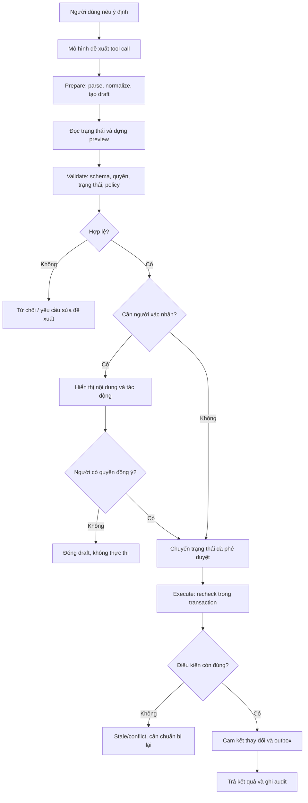
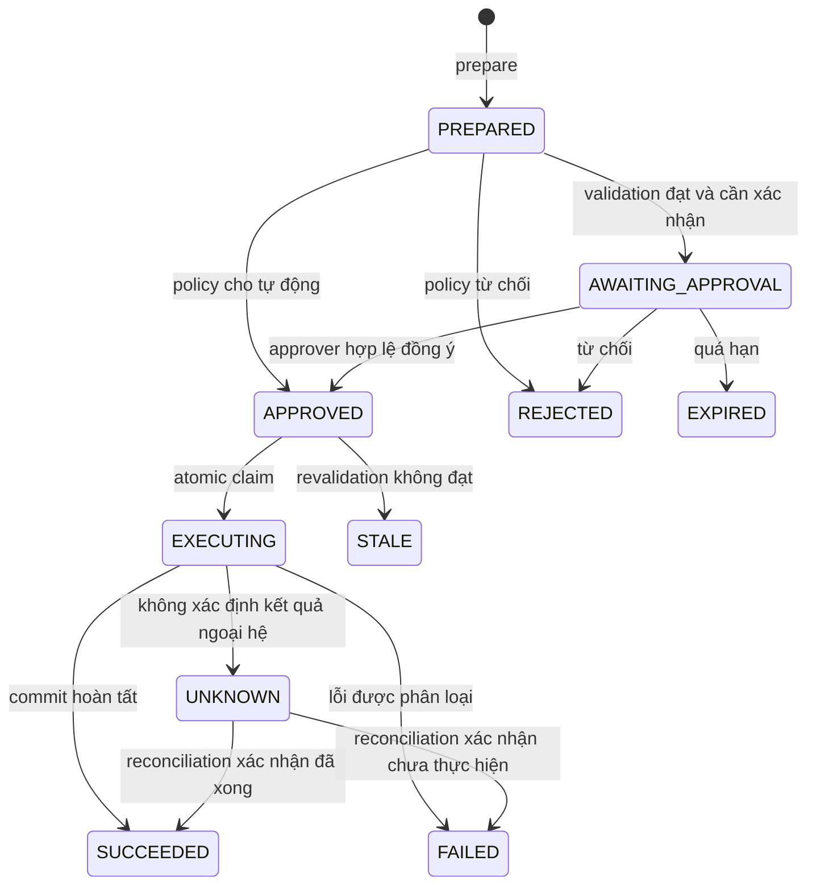

# Tách bước chuẩn bị, kiểm tra và thực hiện hành động

Khi mô hình ngôn ngữ gọi một tool, đó là **đề xuất của mô hình**. Việc thực thi vẫn thuộc ứng dụng Spring AI và các dịch vụ nghiệp vụ phía sau. Sự phân biệt này đặc biệt quan trọng với những tool có tác động thật: hủy đơn hàng, hoàn tiền, chuyển khoản, gửi email, thay đổi quyền truy cập hoặc xóa dữ liệu. Một câu nói như “Hãy hủy đơn ORD-742” không nên biến ngay thành lệnh ghi vào hệ thống.

Một cách thiết kế an toàn là tách quy trình thành **chuẩn bị (prepare) → kiểm tra (validate) → thực hiện (execute)**. Bước chuẩn bị tạo một phương án có thể xem xét; bước kiểm tra quyết định phương án có hợp lệ, có được phép và có cần người xác nhận hay không; chỉ bước thực hiện mới tạo ra tác động nghiệp vụ. Đây là kiến trúc do ứng dụng sở hữu, không phải ba API bắt buộc của Spring AI.

Bài học sử dụng ví dụ hủy đơn hàng để minh họa. Cùng nguyên tắc áp dụng cho các tool được khai báo bằng `@Tool`, `FunctionToolCallback`, `ToolCallback` hoặc được phân giải động. Trong mọi trường hợp, `ToolContext`, kiểm tra quyền, điều phối nhiều lượt gọi, xử lý lỗi và kiểm thử đều góp phần giữ ranh giới giữa mô hình và dịch vụ nghiệp vụ.

## 1. Vì sao không thực thi ngay khi mô hình yêu cầu?

Mô hình có thể hiểu sai yêu cầu, đưa ra arguments thiếu dữ liệu, sử dụng thông tin cũ hoặc bị ảnh hưởng bởi nội dung không đáng tin cậy trong tài liệu, website hay kết quả tool. Ngay cả khi yêu cầu chính xác, tài nguyên có thể đã thay đổi kể từ lần đọc trước.

Ví dụ người dùng nói: “Kiểm tra đơn ORD-742, nếu chưa giao thì giúp tôi hủy”. Mô hình có thể đề xuất `cancelOrder("ORD-742")`. Nhưng ứng dụng vẫn cần biết:

- Đơn có thuộc người dùng và tenant đang đăng nhập không?
- Đơn đang ở trạng thái có thể hủy hay đã được bàn giao cho đơn vị vận chuyển?
- Hủy đơn có kéo theo hoàn tiền, giải phóng tồn kho hoặc gửi thông báo không?
- Người dùng đã nhìn thấy tác động thực tế và xác nhận chưa?
- Yêu cầu này đã được xử lý trước đó hay đang được xử lý từ một request khác?

Nếu một callback thực thi trước khi những câu hỏi ấy được giải quyết, hệ thống có nguy cơ thực hiện sai hành động hoặc thực hiện trùng. Chỉ đưa hướng dẫn “hãy hỏi lại người dùng” vào system prompt không đủ: prompt không thay thế kiểm tra ở backend.

## 2. Ba giai đoạn và ranh giới trách nhiệm

| Giai đoạn | Mục tiêu | Dữ liệu đầu vào đáng tin cậy | Kết quả | Được tạo side effect nghiệp vụ? |
| --- | --- | --- | --- | --- |
| **Prepare** | Chuẩn hóa đề xuất, đọc trạng thái, lập bản xem trước | Arguments đã parse; actor/tenant từ ứng dụng | Draft/action plan có ID, nội dung, version, hạn dùng | Không đối với hệ thống đích; có thể ghi bản nháp nội bộ |
| **Validate** | Kiểm tra schema, quyền, quy tắc miền, phiên bản và yêu cầu xác nhận | Draft lưu ở server, actor đã xác thực, trạng thái nghiệp vụ mới nhất | Allow, deny, stale hoặc awaiting approval | Không thực thi hành động đã đề xuất |
| **Execute** | Cam kết hành động sau khi có đủ điều kiện | Draft/approval hợp lệ, idempotency key, trạng thái được khóa/đối chiếu lại | Kết quả bền vững, event/outbox, audit | Có; chỉ tại đây |

Trong hệ thống có tác động bên ngoài, prepare và validate nên được xem là **tiền điều kiện**; chỉ execute mới được thực hiện thay đổi cuối cùng. Nếu chuẩn bị cần ghi một draft vào cơ sở dữ liệu nội bộ, đó là dữ liệu điều phối, không có nghĩa đơn hàng đã bị hủy.



Trong sơ đồ, mọi nhánh từ chối hoặc hết hạn dừng trước bước cam kết. Đường tự động không cần xác nhận chỉ phù hợp khi chính sách nghiệp vụ cho phép; việc mô hình tự tin không phải căn cứ để bỏ bước xác nhận.

## 3. Một draft đủ tin cậy cần mang gì?

Một action plan là **bản mô tả thao tác dự kiến**, không phải bằng chứng được phép thực thi. Nên lưu bản gốc ở server; client chỉ tham chiếu bằng `draftId`.

Ví dụ draft hủy đơn:

```json
{
  "draftId": "dft_8Qk2",
  "actionType": "CANCEL_ORDER",
  "orderId": "ORD-742",
  "reason": "Khách hàng yêu cầu hủy trước khi giao",
  "orderVersion": 18,
  "estimatedImpact": {
    "inventoryRelease": true,
    "refundRequired": false,
    "notificationWillBeSent": true
  },
  "status": "PREPARED",
  "expiresAt": "2026-11-27T15:00:00Z"
}
```

Đây là dữ liệu minh họa. Server cần lưu thêm các trường nội bộ như chủ sở hữu, tenant, người tạo, session/conversation, policy version, hash của nội dung được xác nhận, timestamps và audit metadata; không cần đưa toàn bộ trường nhạy cảm cho mô hình hoặc giao diện.

| Trường | Vì sao cần |
| --- | --- |
| `draftId` | ID server phát hành để tra cứu phương án, không phải ID do model tự tạo |
| `actionType` | Chỉ rõ loại side effect, giúp chọn rule và callback cho phép |
| Arguments chuẩn hóa | Mục tiêu chính xác: đơn, lý do, số tiền hoặc người nhận |
| `resourceVersion` | Phát hiện tài nguyên đã thay đổi từ lúc chuẩn bị |
| Impact summary | Cơ sở hiển thị cho người xác nhận |
| Owner/tenant | Ngăn dùng draft của tài khoản khác |
| Expiry/status | Ngăn draft cũ được thực thi quá hạn hoặc nhiều lần |
| Approval fingerprint | Gắn sự đồng ý với đúng nội dung đã xem |

Không nên tạo draft chỉ bằng một đoạn văn do model viết rồi dùng chính đoạn văn đó để ra lệnh thực thi. Hãy chuẩn hóa arguments thành kiểu dữ liệu có cấu trúc, lưu phương án ở server và dựng preview từ dữ liệu đã xác minh.

## 4. Prepare: cho model đề xuất và tạo bản xem trước

Trong Spring AI, có thể công bố một tool chỉ dùng để chuẩn bị. Tool này được phép đọc thông tin, tính tác động dự kiến và tạo draft, nhưng không gọi thao tác hủy thật.

```java
import org.springframework.ai.chat.model.ToolContext;
import org.springframework.ai.tool.annotation.Tool;
import org.springframework.stereotype.Component;

record CancelOrderRequest(String orderId, String reason) { }

record CancellationPreview(
        String draftId,
        String orderId,
        String currentStatus,
        String impactSummary,
        String expiresAt) { }

@Component
class CancellationPreparationTools {

    private final CancellationDraftService draftService;
    private final ActorResolver actorResolver;

    CancellationPreparationTools(
            CancellationDraftService draftService,
            ActorResolver actorResolver) {
        this.draftService = draftService;
        this.actorResolver = actorResolver;
    }

    @Tool(description = "Chuẩn bị bản xem trước để hủy đơn hàng; chưa hủy đơn")
    public CancellationPreview prepareCancellation(
            CancelOrderRequest request,
            ToolContext toolContext) {

        AuthenticatedActor actor = actorResolver.require(toolContext);
        return draftService.prepare(actor, request);
    }
}
```

`CancellationDraftService`, `ActorResolver`, `AuthenticatedActor` và các record nghiệp vụ là thành phần do ứng dụng định nghĩa. `ToolContext` do ứng dụng cung cấp, không phải trường do mô hình điền trong JSON schema. `ActorResolver` phải từ chối nếu thiếu actor/tenant đã xác thực; không chấp nhận `userId` trong arguments để thay cho actor.

Service `prepare(...)` có thể làm các việc sau theo thứ tự: kiểm tra cú pháp arguments, chuẩn hóa mã đơn, đọc thông tin tài nguyên theo quyền của actor, tính tác động dự kiến, tạo draft có TTL và trả một preview an toàn. **Không** gọi `orderService.cancel(...)`, hoàn tiền, gửi email hay phát sự kiện nghiệp vụ khi chỉ mới prepare.

### Prepare có được ghi dữ liệu không?

Có thể lưu draft trong một bảng điều phối để hỗ trợ xác nhận sau nhiều request HTTP hoặc sau khi ứng dụng restart. Ghi draft khác với side effect của hành động cuối. Dù vậy, cần giới hạn số draft được tạo, TTL, quota và dọn bản nháp hết hạn để tránh mô hình gọi tool chuẩn bị liên tục gây tăng tải.

Một preview cũng có thể được tính hoàn toàn trong bộ nhớ khi quy trình diễn ra trong một request ngắn. Với luồng có human approval, lưu bền vững ở server giúp xử lý restart, retry và audit tốt hơn.

## 5. Validate: kiểm tra nhiều lớp trước khi cho phép thực hiện

Validation nên diễn ra ít nhất hai lần: lần đầu khi lập hoặc xem draft; lần thứ hai ngay trước khi tạo side effect. Lần đầu giúp hiển thị được phương án hợp lệ; lần sau xử lý tài nguyên và policy có thể đã thay đổi.

| Lớp kiểm tra | Ví dụ với hủy đơn | Nếu thất bại |
| --- | --- | --- |
| Input/schema | `orderId` không rỗng; lý do đúng độ dài và định dạng | Trả lỗi đầu vào, không tạo side effect |
| Resource ownership | Đơn thuộc principal/tenant đã xác thực | Từ chối, không tiết lộ trạng thái đơn ngoài quyền |
| Authorization | Role hiện tại được phép hủy đơn | Từ chối và audit |
| Business state | Đơn còn trạng thái có thể hủy | Đánh dấu `STALE` hoặc `STATE_CONFLICT` |
| Policy/risk | Ngưỡng tiền, loại hàng, quy trình hoàn tiền | Yêu cầu phê duyệt phù hợp hoặc từ chối |
| Human confirmation | Người có thẩm quyền đã xác nhận đúng preview | Đợi xác nhận hoặc từ chối |
| Concurrency/expiry | Draft chưa hết hạn, chưa dùng và resource version khớp | Ngăn chạy, yêu cầu chuẩn bị lại |

Kiểm tra schema chỉ xác minh dữ liệu có hình dạng hợp lệ; nó không chứng minh người dùng có quyền hoặc tài nguyên đủ điều kiện. Ngay cả `@Tool(description = "Chỉ dành cho quản trị viên")` cũng không thay thế authorization ở service.

Ví dụ rule nghiệp vụ trong application service:

```java
public ValidationOutcome validateCancellation(
        AuthenticatedActor actor,
        CancellationDraft draft,
        Order order) {

    authorizationService.assertMayReadAndCancel(actor, order);

    if (draft.isExpired()) {
        return ValidationOutcome.stale("Bản chuẩn bị đã hết hạn.");
    }
    if (order.version() != draft.orderVersion()) {
        return ValidationOutcome.stale("Đơn hàng đã thay đổi. Hãy kiểm tra lại.");
    }
    if (!order.isCancelable()) {
        return ValidationOutcome.denied("Trạng thái hiện tại không cho phép hủy.");
    }
    if (cancellationPolicy.requiresApproval(actor, order)) {
        return ValidationOutcome.awaitingApproval();
    }

    return ValidationOutcome.allowed();
}
```

`ValidationOutcome`, `CancellationDraft` và `Order` là kiểu ví dụ của ứng dụng. Khi dùng trong production, kiểm tra quyền và state phải được lặp lại ở transaction thực thi; kết quả `allowed()` không trở thành giấy phép vô thời hạn.

## 6. Gắn xác nhận của người dùng với chính xác phương án

Màn hình xác nhận cần hiển thị bản preview do backend xây dựng, chẳng hạn:

> **Bạn có muốn hủy đơn ORD-742 không?** Đơn hiện đang chờ đóng gói. Nếu xác nhận, trạng thái đơn sẽ chuyển sang đã hủy, số hàng được giải phóng và khách hàng có thể nhận thông báo. Thao tác không thể khôi phục trực tiếp sau khi được ghi nhận.

Một nút “Đồng ý” chỉ có ý nghĩa nếu backend biết người dùng đã xem **hành động nào**. Approval cần gắn với `draftId`, loại hành động, arguments chuẩn hóa, resource version, actor/tenant, phiên bản chính sách, thời hạn và nội dung impact preview quan trọng.

Tránh quy trình: model đề xuất số tiền A → UI hiển thị A → client gửi lại số tiền B kèm `approved: true` → backend thực thi B. Sau khi preview đã được xác nhận, không cho sửa arguments rồi tái sử dụng approval cũ. Muốn thay nội dung, tạo draft mới và xác nhận lại.

Có thể tính hash từ bản chuẩn hóa có thứ tự ổn định (action type + resource + normalized arguments + version + impact chính). Backend tạo hash; client không có quyền chọn lại nội dung được hash. Hash chỉ giúp phát hiện thay đổi nội dung, không thay thế kiểm tra chữ ký, định danh hoặc quyền phê duyệt.

### Phân biệt đồng ý của người dùng với quyền thực thi

Một người không có quyền hủy đơn không thể có quyền chỉ bằng cách nhấn “Đồng ý”. Tương tự, người từng có quyền có thể bị thu hồi quyền trong lúc draft chờ xác nhận. Backend phải xác thực người quyết định và kiểm tra quyền thực thi lại ngay trước side effect.

## 7. Quản lý trạng thái draft như một state machine

Quy trình nên có trạng thái bền vững, có transition hợp lệ và ghi rõ ai được thực hiện transition đó:



Trạng thái `APPROVED` khác `SUCCEEDED`: phê duyệt chỉ là điều kiện để thực thi, chưa phải bằng chứng đã hủy đơn. Các trạng thái `EXPIRED`, `REJECTED`, `STALE` không được đưa ngược về `APPROVED` bằng một request cũ. Nếu cần thực hiện lại, chuẩn bị một draft mới.

Không chỉ giữ trạng thái này trong hội thoại của mô hình. Nội dung chat có thể bị cắt ngữ cảnh, sửa prompt hoặc được tổng hợp; nguồn trạng thái có thẩm quyền phải là hệ thống dữ liệu nghiệp vụ của ứng dụng.

## 8. Execute: revalidate và cam kết thay đổi trong transaction

Một bản kiểm tra hợp lệ ở thời điểm chuẩn bị có thể không còn đúng vài giây sau. Ví dụ nhân viên kho chuyển đơn từ `PENDING` sang `SHIPPED` trong lúc người dùng đọc màn hình xác nhận. Đây là lỗi **time of check to time of use (TOCTOU)**.

Vì vậy, execute cần đọc lại resource và kiểm tra điều kiện trong phạm vi đồng bộ hóa phù hợp: lock dữ liệu, optimistic locking hoặc một câu lệnh update có điều kiện. Chỉ sau khi điều kiện vẫn đúng mới cam kết tác động.

```java
import org.springframework.stereotype.Service;
import org.springframework.transaction.annotation.Transactional;

@Service
class CancellationExecutionService {

    private final CancellationDraftRepository drafts;
    private final OrderRepository orders;
    private final CancellationGuard guard;
    private final IdempotencyStore idempotency;
    private final OutboxRepository outbox;

    CancellationExecutionService(
            CancellationDraftRepository drafts,
            OrderRepository orders,
            CancellationGuard guard,
            IdempotencyStore idempotency,
            OutboxRepository outbox) {
        this.drafts = drafts;
        this.orders = orders;
        this.guard = guard;
        this.idempotency = idempotency;
        this.outbox = outbox;
    }

    @Transactional
    public CancellationReceipt executeApproved(
            String draftId,
            AuthenticatedActor actor,
            String idempotencyKey) {

        CancellationDraft draft = drafts.lockById(draftId);
        guard.assertOwnedByActor(draft, actor);

        // Chỉ kiểm tra replay sau khi đã xác minh quyền trên draft.
        // claimOrReplay dùng unique key và transaction để chống hai request cùng chạy.
        IdempotencyClaim claim = idempotency.claimOrReplay(
                actor.tenantId(), draftId, idempotencyKey);
        if (claim.isCompleted()) {
            return claim.savedReceipt();
        }

        guard.assertApprovedForActor(draft, actor);
        guard.assertNotExpiredOrConsumed(draft);

        Order order = orders.lockById(draft.orderId());
        guard.assertCanCancelNow(actor, order, draft);
        guard.assertPreviewStillMatches(draft, order);

        order.cancel(draft.reason());
        drafts.markSucceeded(draftId);

        // Notification/ERP ngoài transaction được phát từ outbox sau commit.
        outbox.addOrderCancelledEvent(order.id(), draftId);

        CancellationReceipt receipt = new CancellationReceipt(order.id(), "CANCELLED");
        idempotency.complete(claim, receipt);
        return receipt;
    }
}
```

Đoạn code là khung giải thích, không phải một implementation biên dịch độc lập: `IdempotencyStore`, `CancellationGuard`, repository, entity và cách lock là thành phần do ứng dụng định nghĩa. Điểm quan trọng là **quyền, trạng thái, nội dung approval và idempotency đều được kiểm tra lại trước khi ghi**, trong cùng ranh giới transaction đối với thay đổi dữ liệu cục bộ. Quyền truy cập draft được kiểm tra trước cả nhánh trả receipt do retry để không làm lộ kết quả của người khác.

Với JPA, có thể dùng pessimistic lock khi tải phù hợp; với optimistic locking, dùng `@Version` và xử lý xung đột; hoặc câu `UPDATE orders SET status = ... WHERE id = ? AND version = ? AND status = ?` rồi kiểm tra số dòng cập nhật. Không chỉ kiểm tra `isCancelable()` bên ngoài transaction rồi gọi `save()` không điều kiện.

### Nếu thao tác gọi API bên ngoài thì sao?

Không nên giữ transaction database mở trong khi chờ HTTP tới đối tác. Có thể ghi trạng thái cục bộ và sự kiện outbox trong cùng transaction, sau đó worker giao sự kiện cho đối tác. Nếu đối tác có hỗ trợ idempotency key, truyền một key ổn định để gửi lại an toàn sau lỗi mạng. Nếu trạng thái bên ngoài không chắc chắn, đánh dấu `UNKNOWN`/`PENDING_RECONCILIATION` và tra cứu lại trước khi retry.

Không hứa “exactly once” chỉ nhờ một retry hoặc một transaction cục bộ. Kết quả thường cần kết hợp unique constraint, idempotent consumer, outbox và đối soát thực tế.

## 9. Chống thực thi trùng bằng idempotency key

Hai sự kiện thường gây thực thi trùng: người dùng nhấn xác nhận hai lần và ứng dụng retry sau timeout mà không biết lần trước có thành công không. Do đó execute phải idempotent theo định danh hành động, không chỉ theo request HTTP.

Thiết kế key có thể là `tenantId + actionType + draftId`, hoặc một key client phát hành nhưng được backend ràng buộc vào draft/actor rồi lưu với unique constraint. Nếu dùng header `Idempotency-Key`, phải kiểm tra cùng key không được áp cho payload khác.

| Tình huống | Hành vi mong muốn |
| --- | --- |
| Request đầu tiên, draft hợp lệ | Atomic claim rồi thực thi |
| Retry cùng key, thao tác đã thành công | Trả receipt đã lưu, không làm lại side effect |
| Hai request cùng key đến đồng thời | Chỉ một request claim; request còn lại chờ hoặc nhận trạng thái đang xử lý |
| Cùng key nhưng draft/payload khác | Từ chối xung đột idempotency |
| Timeout sau khi gửi lệnh đối tác | Tra cứu trạng thái bằng action/key, không gửi lặp vô điều kiện |
| Draft đã hết hạn hoặc đã dùng | Từ chối hoặc trả lại kết quả cũ đúng quyền |

Tool-call ID do model/provider cấp chỉ là định danh trong một response hội thoại. Nó có thể không tồn tại, bị trùng hoặc thay đổi khi model sinh lại lời gọi. Không dùng tool-call ID làm idempotency key duy nhất cho side effect nghiệp vụ; hãy dùng định danh action do backend tạo.

## 10. Tích hợp với Spring AI: chỉ công bố tool chuẩn bị

Đường triển khai dễ kiểm soát nhất cho thao tác nhạy cảm là cho model gọi `prepareCancellation`, còn bước execute chỉ nằm trong application service hoặc HTTP endpoint được bảo vệ. Với thiết kế đó, model không có một tool tên `executeCancellation` để tự gọi trước khi người dùng đồng ý.

Ví dụ request xử lý xác nhận tại backend:

```java
import org.springframework.http.ResponseEntity;
import org.springframework.security.core.Authentication;
import org.springframework.web.bind.annotation.*;

record ConfirmCancellationRequest(String approvalFingerprint) { }

@RestController
@RequestMapping("/api/cancellation-drafts")
class CancellationApprovalController {

    private final CancellationApplicationService service;
    private final ActorResolver actorResolver;

    CancellationApprovalController(
            CancellationApplicationService service,
            ActorResolver actorResolver) {
        this.service = service;
        this.actorResolver = actorResolver;
    }

    @PostMapping("/{draftId}/confirm")
    ResponseEntity<CancellationReceipt> confirm(
            @PathVariable String draftId,
            @RequestBody ConfirmCancellationRequest request,
            @RequestHeader("Idempotency-Key") String idempotencyKey,
            Authentication authentication) {

        AuthenticatedActor actor = actorResolver.from(authentication);
        CancellationReceipt receipt = service.confirmAndExecute(
                draftId, request.approvalFingerprint(), actor, idempotencyKey);
        return ResponseEntity.ok(receipt);
    }
}
```

Ứng dụng cần xác minh CSRF theo kiểu xác thực đang dùng, quyền của approver, TTL, trạng thái draft, fingerprint và điều kiện nghiệp vụ trước khi service thực thi. Đoạn code trên thể hiện ranh giới HTTP/application; `confirmAndExecute` phải triển khai các kiểm tra đó trước khi gọi `executeApproved`. Đừng chỉ dựa vào `@PostMapping` hoặc sự hiện diện của một `approvalFingerprint` như bằng chứng người dùng đã được xác thực.

Người dùng có thể yêu cầu sửa phương án sau khi xem preview. Khi đó backend nên tạo draft mới. Không dùng lại draft đã xác nhận rồi thay `reason`, `orderId`, số tiền hoặc đối tượng nhận.

## 11. Phương án khác: Tool Call Confirmation có sẵn từ Spring AI 2.1.0

Nếu ứng dụng muốn model trực tiếp đề nghị tool thực thi nhưng vẫn có một chặng xác nhận trước khi chạy, Spring AI 2.1.0 cung cấp `@Tool(requiresConfirmation = true)` và `ToolCallConfirmationPolicy`.

```java
import org.springframework.ai.chat.model.ToolContext;
import org.springframework.ai.tool.annotation.Tool;

class CancellationExecutionTools {

    private final CancellationApplicationService service;
    private final ActorResolver actorResolver;

    CancellationExecutionTools(
            CancellationApplicationService service,
            ActorResolver actorResolver) {
        this.service = service;
        this.actorResolver = actorResolver;
    }

    @Tool(
            description = "Yêu cầu thực hiện hủy một draft đã chuẩn bị và hợp lệ",
            requiresConfirmation = true)
    CancellationReceipt executeCancellation(
            String draftId,
            ToolContext toolContext) {

        AuthenticatedActor actor = actorResolver.require(toolContext);
        return service.executeApprovedDraft(actor, draftId);
    }
}
```

Tool này vẫn phải kiểm tra draft đã được phê duyệt, quyền, version, expiry và idempotency bên trong service. `requiresConfirmation` là lớp chặn để hỏi người dùng, không thay thế giai đoạn validate. `executeApprovedDraft` là phương thức nghiệp vụ do ứng dụng định nghĩa; service phải dùng action ID của draft làm cơ sở cho khóa chống lặp và lưu approval state ở server thay vì tin vào arguments của model.

Khi `ToolCallingManager` gặp một call cần xác nhận, **toàn bộ batch tool calls của response đó tạm dừng trước khi bất kỳ call nào chạy**. `ToolCallingAdvisor` trả response có metadata chờ quyết định; ứng dụng phải lưu prompt/reply ở nơi client không thể chỉnh sửa và thu thập quyết định cho từng call.

```java
import java.util.List;
import org.springframework.ai.chat.model.ChatResponse;
import org.springframework.ai.model.tool.ToolCallDecisions;

ChatResponse reply = chatClient.prompt()
        .user("Chuẩn bị hủy đơn ORD-742 và xin xác nhận")
        .call()
        .chatResponse();

List<String> awaitingKeys = ToolCallDecisions.awaitingDecision(reply);
if (!awaitingKeys.isEmpty()) {
    // Lưu response nguyên bản ở server và hiển thị thông tin cần xác nhận.
}
```

Sau khi xác thực approver, backend lưu quyết định vào draft (bao gồm chuyển sang `APPROVED` khi phù hợp) bằng một state transition có kiểm soát. Tiếp đó, backend tạo `ToolCallDecision.allow(key)` hoặc `deny(key, message)` cho **mọi** call của response, rồi resume bằng `ToolCallingManager.executeToolCalls(savedPrompt, savedReply, decisions)`. Không chỉ gửi quyết định cho những call trong `awaitingKeys`; Spring AI yêu cầu mỗi call có một decision. Khi deny, tool không chạy và deny message được đưa cho model như tool result, nên phải dùng thông báo an toàn. Phê duyệt do framework thu thập cần được đối chiếu với trạng thái draft ở server trước khi callback thực thi.

`ToolCallConfirmationPolicy` chỉ nhận tool call và metadata, không có principal/tenant hay toàn bộ trạng thái nghiệp vụ. Các bước phân quyền, ownership và revalidation vẫn phải ở ứng dụng. Spring AI cũng không tự xác thực người phê duyệt hoặc ngăn replay; ứng dụng phải lưu trạng thái phê duyệt và idempotency.

**Lưu ý phiên bản:** cơ chế confirmation tích hợp ở trên có từ Spring AI **2.1.0**. Với Spring AI 1.x hoặc 2.0.x, phải tự đặt approval gate trong application/manual tool loop; không copy `ToolCallDecisions` và `requiresConfirmation` vào phiên bản chưa hỗ trợ.

## 12. Tương tác giữa nhiều tool call và nhiều vòng model

Một lượt model có thể gọi cả tool đọc trạng thái và tool đề nghị hủy. Không mặc định các call trong một response được phép chạy theo thứ tự mà người viết mong muốn. Với Spring AI 2.1.0, nếu bất kỳ call nào cần confirmation thì cả batch tạm dừng. Sau khi resume, các call được allow thực thi và kết quả quay lại model để suy luận tiếp.

Khi dùng chiến lược prepare → validate → execute, nên tách những hành động có phụ thuộc dữ liệu thành các bước rõ ràng: model gọi `prepare...`, nhận preview/draft ID, người dùng xác nhận, backend execute, model nhận receipt. Nếu model cố đưa cả prepare và execute trong một batch, execute phải từ chối vì draft/approval hợp lệ chưa tồn tại.

Nếu tự điều khiển loop bằng `ChatModel` và `ToolCallingManager`, ứng dụng cần giữ đúng `AssistantMessage` có tool calls và `ToolResponseMessage` có kết quả gắn với từng tool-call ID. Một lần tạm dừng không cho phép xóa hoặc sửa arguments trong paused reply để thay ý định. Phần lịch sử của các vòng trước cần được lưu trong conversation store hoặc session memory phù hợp để model tiếp tục đúng ngữ cảnh.

Không dùng một công cụ tổng quát như `executeSql(String sql)` hoặc `callUrl(String url)` để thay thế hệ thống quyền riêng cho các hành động nghiệp vụ. Định nghĩa các tool cụ thể giúp xây dựng validation và audit rõ ràng hơn.

## 13. Thiết kế lỗi và khả năng phục hồi theo từng giai đoạn

Lỗi của từng giai đoạn cần được phân loại để frontend, model và người vận hành biết nên làm gì:

| Code | Giai đoạn thường gặp | Ý nghĩa | Cách tiếp tục |
| --- | --- | --- | --- |
| `INVALID_ARGUMENT` | Prepare | Arguments thiếu hoặc sai | Yêu cầu sửa đầu vào |
| `RESOURCE_NOT_FOUND` | Prepare/validate | Không tìm thấy trong phạm vi được phép | Kiểm tra ID, không dò dữ liệu ngoài quyền |
| `ACCESS_DENIED` | Validate/execute | Actor không có quyền | Dừng, ghi audit |
| `APPROVAL_REQUIRED` | Validate | Chưa có phê duyệt hợp lệ | Hiển thị preview, chờ quyết định |
| `DRAFT_EXPIRED` | Validate/execute | Draft quá hạn | Chuẩn bị draft mới |
| `STALE_PLAN` | Execute | Resource/version/impact thay đổi | Đọc lại và xác nhận phương án mới |
| `ALREADY_EXECUTED` | Execute | Cùng action đã được thực thi | Trả receipt trước đó nếu cùng idempotency key |
| `DEPENDENCY_TIMEOUT` | Execute | Chưa xác định kết quả phía ngoài | Reconciliation trước retry |
| `INTERNAL_ERROR` | Bất kỳ | Lỗi hệ thống ngoài dự kiến | Thông báo an toàn, log nội bộ |

Model-facing message chỉ nên chứa code, mô tả nghiệp vụ đã lọc và `nextAction`; không chứa SQL, stack trace, secrets, tài khoản nội bộ hoặc thông tin kiểm soát quyền. Với lỗi an ninh, đôi khi nên trả thông báo chung thay vì tiết lộ tài nguyên có tồn tại hay không.

Một timeout ở bước prepare có thể thử lại theo policy vì chưa có tác động cuối. Timeout sau khi execute bắt đầu **không chứng minh hành động thất bại**; phải tra cứu bằng action ID hoặc idempotency key trước khi lặp lại thao tác ghi.

## 14. Tác động đến trải nghiệm người dùng

Tách giai đoạn cũng giúp UI rõ ràng hơn: người dùng thấy “Đang kiểm tra đơn hàng” → “Đã chuẩn bị phương án hủy” → “Chờ xác nhận” → “Đang thực hiện” → “Đã hủy” hoặc “Không thể hủy vì trạng thái đã thay đổi”. Không hiển thị “Đã hủy thành công” ngay khi model trả một lời hứa hoặc khi draft chuyển sang `APPROVED`.

Một preview nên hiển thị: tên hành động, đối tượng tác động, tình trạng hiện tại, thay đổi sẽ xảy ra, tác động tới thanh toán/thông báo, khả năng hoàn tác, hạn xác nhận và trường hợp cần chờ đối soát. Nếu kết quả bên ngoài vẫn đang chờ, UI hiển thị trạng thái `PENDING`/`UNKNOWN` thay vì thành công giả.

Hạn chế số bước xác nhận không cần thiết với hành động chỉ đọc, nhưng giữ xác nhận rõ ràng cho thao tác không thể hoàn tác hoặc có tác động lớn. Chính sách phải dựa trên mức rủi ro của nghiệp vụ và vai trò người dùng, không dựa vào mức tự tin của mô hình.

## 15. Các bẫy triển khai thường gặp

| Bẫy | Hậu quả | Cách phòng tránh |
| --- | --- | --- |
| Model được truy cập trực tiếp tool thực thi không có gate | Có thể ghi dữ liệu khi chưa kiểm tra | Chỉ expose prepare hoặc dùng confirmation + service guard |
| Đặt authorization trong prompt | Có thể bị bỏ qua hoặc prompt injection | Kiểm tra quyền trong backend |
| Dùng `approved=true` từ JSON của model | Model tự tạo bằng chứng phê duyệt | Approval phải do server lưu sau hành động người thật |
| Validate một lần khi preview | Điều kiện thay đổi giữa check và execute | Revalidate trong transaction, dùng version/lock |
| Dùng `draftId` làm quyền truy cập duy nhất | ID bị đoán/rò có thể bị dùng sai | Kiểm tra actor, tenant, expiry và status |
| Thực thi HTTP ngoài rồi mới ghi idempotency | Crash giữa hai bước có thể gây gửi trùng | Atomic claim, outbox, idempotency phía đối tác |
| Dùng tool-call ID làm key duy nhất | Model có thể sinh ID khác khi retry | Action ID server phát hành, unique constraint |
| Đổi arguments sau xác nhận | Người dùng đồng ý một hành động nhưng chạy hành động khác | Bind approval vào bản canonical, tạo draft mới khi sửa |
| Nuốt lỗi timeout và trả success | Mô hình/UI báo sai trạng thái | Phân biệt `SUCCEEDED`, `FAILED`, `UNKNOWN` |
| Chỉ kiểm thử happy path | Lỗi replay/race/expired không được phát hiện | Test theo state machine và concurrency |

## 16. Kiểm thử từ đề xuất đến side effect

Test đúng luồng cần chứng minh callback thực hiện side effect không chạy trước khi toàn bộ policy và approval hợp lệ. Có thể mock model/tool response, service và repository; kiểm thử bằng fake clock và concurrency primitives thay vì `Thread.sleep()` tùy tiện.

| Kịch bản | Kết quả cần xác minh |
| --- | --- |
| Model đề nghị hủy khi chưa có draft | Không thực hiện, yêu cầu prepare |
| Prepare hợp lệ | Có preview và draft, `orderService.cancel` chưa được gọi |
| Input/schema sai | Không lưu action có thể execute |
| Actor khác tenant | Không xem và không xác nhận được draft |
| Policy từ chối | Draft chuyển rejected, side effect bằng 0 |
| Người dùng chưa xác nhận | Chỉ có trạng thái waiting, không execute |
| Người dùng xác nhận đúng preview | Tiếp tục đúng action đã lưu |
| Preview bị sửa hoặc fingerprint lệch | Từ chối, yêu cầu chuẩn bị lại |
| Đơn thay đổi sau preview | Trả `STALE_PLAN`, không hủy |
| Hai request confirm song song | Chỉ một request claim, một side effect |
| Retry cùng idempotency key | Nhận receipt cũ, không tăng số lần hủy |
| Timeout từ đối tác | Trạng thái pending/unknown, có reconciliation |
| 2.1.0 tool call chờ confirmation | Không call nào trong batch được thực thi trước quyết định |
| Batch có allow và deny | Đúng một decision mỗi call; call deny không chạy |
| Memory/session tiếp tục sau pause | Tool results khớp tool-call IDs, không thiếu lịch sử |

Ví dụ assertion ở cấp service:

```java
CancellationPreview preview = preparationTools.prepareCancellation(
        new CancelOrderRequest("ORD-742", "Khách yêu cầu"),
        trustedToolContext);

verify(outbox, never()).addOrderCancelledEvent(anyString(), anyString());

CancellationReceipt receipt = approvalService.confirmAndExecute(
        preview.draftId(), verifiedFingerprint, authenticatedActor, "idem-742");

assertThat(receipt.status()).isEqualTo("CANCELLED");
verify(outbox, times(1)).addOrderCancelledEvent(eq("ORD-742"), eq(preview.draftId()));

// Retry cùng key phải trả receipt đã lưu.
approvalService.confirmAndExecute(
        preview.draftId(), verifiedFingerprint, authenticatedActor, "idem-742");
verify(outbox, times(1)).addOrderCancelledEvent(eq("ORD-742"), eq(preview.draftId()));
```

Đoạn test minh họa ý định kiểm chứng: `outbox` là mock của `OutboxRepository`, cho thấy chưa có sự kiện hủy đơn ở prepare và chỉ có một sự kiện sau retry. Cần điều chỉnh fixture, collaborator và transaction theo implementation thực tế, đồng thời kiểm tra trạng thái đơn đã thay đổi. Với persistence thật, bổ sung integration test cho unique constraint, optimistic locking, hai request đồng thời, outbox và crash/retry.

## 17. Checklist thiết kế một tool có tác động nghiệp vụ

- [ ] Phân biệt tool chỉ đọc/prepare với hành động có side effect cuối.
- [ ] Chuẩn hóa arguments thành DTO có schema và validation rõ ràng.
- [ ] Lấy actor/tenant từ security context/`ToolContext` được ứng dụng cấp, không từ model.
- [ ] Lập preview phản ánh resource và tác động đã được kiểm tra; lưu draft ở server.
- [ ] Gắn draft với owner, resource version, expiry, policy version và fingerprint.
- [ ] Áp dụng kiểm tra quyền, ownership, trạng thái miền và mức rủi ro.
- [ ] Nếu cần người xác nhận, lưu approval state bền vững và buộc approval đúng nội dung.
- [ ] Không cho chỉnh sửa arguments sau xác nhận; thay đổi phải tạo draft mới.
- [ ] Revalidate các tiền điều kiện trong transaction ngay trước side effect.
- [ ] Dùng optimistic/pessimistic lock hoặc conditional update để tránh TOCTOU.
- [ ] Dùng idempotency key server-bound, unique constraint và receipt được lưu.
- [ ] Dùng outbox/reconciliation cho tác động sang hệ thống bên ngoài.
- [ ] Phân biệt PREPARED, APPROVED, EXECUTING, SUCCEEDED, FAILED, UNKNOWN.
- [ ] Nếu dùng Spring AI 2.1.0 confirmation, kiểm tra approver và resume đúng toàn bộ batch.
- [ ] Giữ audit có ai đề xuất, ai phê duyệt, action nào, lúc nào và kết quả nào.
- [ ] Test denied, stale, expired, replay, concurrency, timeout và partial failure.

Tách chuẩn bị, kiểm tra và thực hiện giúp hệ thống giữ mô hình ở vai trò đề xuất, còn quyền quyết định và side effect thuộc về ứng dụng. Một draft có thể hiển thị rõ tác động cho người dùng; validation áp dụng quyền và quy tắc miền; execute dùng dữ liệu còn mới, approval hợp lệ, transaction và idempotency để cam kết. Đây là nền tảng để xây dựng tool calling Spring AI an toàn với những dịch vụ nghiệp vụ có hậu quả thực tế.

## Tài liệu tham khảo

- [Spring AI — Tool Calling](https://docs.spring.io/spring-ai/reference/api/tools.html)
- [Spring AI — Tool Call Confirmation (từ 2.1.0)](https://docs.spring.io/spring-ai/reference/api/tools/tool-call-confirmation.html)
- [Spring AI — ToolCallingAdvisor](https://docs.spring.io/spring-ai/reference/api/tools/tool-calling-advisor.html)
- [Spring AI — ChatModel Tool Calling và manual loop](https://docs.spring.io/spring-ai/reference/api/tools/chatmodel-tool-calling.html)
- [Spring AI — ToolCallDecisions API](https://docs.spring.io/spring-ai/docs/2.1.x/api/org/springframework/ai/model/tool/ToolCallDecisions.html)
- [Spring Framework — Transaction Management](https://docs.spring.io/spring-framework/reference/data-access/transaction.html)
- [Spring Data JPA — Locking](https://docs.spring.io/spring-data/jpa/reference/jpa/locking.html)
