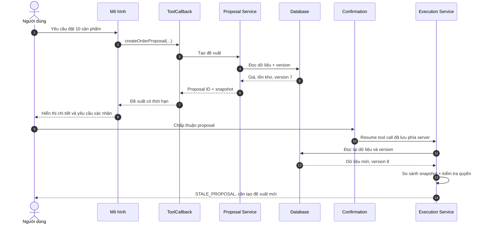
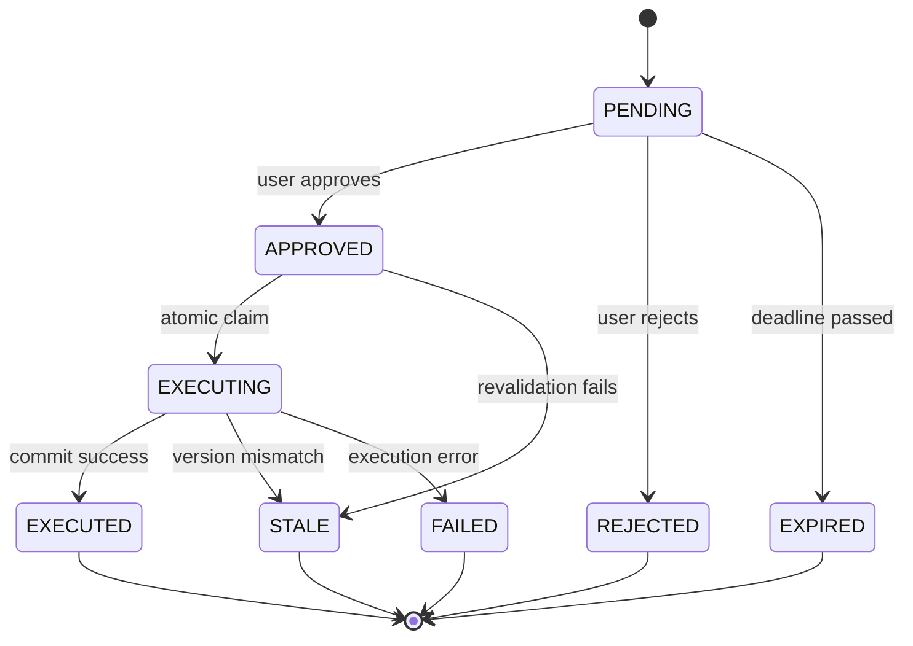

# Kiểm tra dữ liệu thay đổi giữa lúc đề xuất và lúc thực hiện

Một công cụ có thể đề xuất hành động đúng tại thời điểm đọc dữ liệu, nhưng hành động đó có thể trở nên sai hoặc nguy hiểm khi được thực hiện sau vài giây hay vài phút. Giá sản phẩm có thể thay đổi, hàng tồn kho có thể bị đơn hàng khác giữ, hạn mức tài khoản có thể đã được sử dụng hoặc trạng thái đơn hàng có thể đã chuyển sang giao vận.

Khoảng thời gian giữa lúc kiểm tra dữ liệu và lúc ghi thay đổi được gọi là **time-of-check to time-of-use (TOCTOU)**. Trong ứng dụng Spring AI, khoảng thời gian này thường dài hơn vì mô hình cần tạo đề xuất, người dùng xem và phê duyệt, rồi ứng dụng mới chạy `ToolCallback`. Cơ chế xác nhận tool call của Spring AI giúp dừng để chờ phê duyệt, nhưng không tự khóa dữ liệu, không tự kiểm tra phiên bản mới nhất và không bảo đảm đề xuất còn hợp lệ khi resume.

Ứng dụng phải gắn đề xuất với một snapshot có phiên bản, xác minh lại dữ liệu và quyền ngay trước khi commit, rồi dùng optimistic locking hoặc cập nhật có điều kiện để ngăn thay đổi chen vào giữa lần kiểm tra cuối và lần ghi. Nếu dữ liệu đã đổi, cần dừng hành động và tạo đề xuất mới để người dùng xem lại.

Sau bài học, bạn có thể:

- Nhận diện TOCTOU trong quy trình AI đề xuất rồi thực hiện hành động.
- Lưu snapshot, version và thời hạn của một proposal.
- Gắn quyết định phê duyệt với đúng hành động và dữ liệu đã hiển thị.
- Dùng `@Version`, optimistic locking, compare-and-set và HTTP `If-Match`.
- Đọc lại, xác thực quyền và tính lại điều kiện trong transaction trước khi ghi.
- Xử lý stale proposal, expiry, reservation và xung đột dữ liệu.
- Kết hợp idempotency với concurrency control để tránh thực thi trùng.
- Kiểm thử race condition giữa đề xuất, phê duyệt và commit.

## 1. Vấn đề: đề xuất đúng nhưng thực hiện trên dữ liệu cũ

Giả sử người dùng hỏi: “Đặt mua 10 bộ bàn phím nếu tổng tiền không vượt quá 5 triệu đồng”. Công cụ đọc giá 450.000 đồng một bộ và tồn kho 12 bộ. Mô hình đề xuất đơn hàng tổng 4,5 triệu đồng. Người dùng xem và nhấn xác nhận.

Trong lúc người dùng xem đề xuất, một đơn hàng khác mua 8 bộ. Tồn kho còn 4. Giá sản phẩm cũng có thể được cập nhật lên 480.000 đồng. Nếu ứng dụng chỉ dùng kết quả đã đọc ban đầu, nó có thể tạo đơn hàng với số lượng và giá không còn hợp lệ.

| Thời điểm | Dữ liệu | Hành động |
|---|---|---|
| T0 | Giá 450.000; tồn kho 12; version 7 | Tool đọc dữ liệu và tạo đề xuất |
| T1 | Đề xuất 10 bộ, tổng 4,5 triệu | Mô hình yêu cầu người dùng xác nhận |
| T2 | Giá tăng; đơn khác lấy 8 bộ; version 8 | Dữ liệu nghiệp vụ thay đổi |
| T3 | Người dùng chấp thuận đề xuất cũ | Ứng dụng nhận quyết định phê duyệt |
| T4 | Callback thực hiện theo dữ liệu T0 | Có nguy cơ ghi giá cũ hoặc bán vượt tồn kho |

Đây là TOCTOU: kết quả kiểm tra tại T0 không còn đại diện cho trạng thái tại T4.

Vấn đề không chỉ xuất hiện với tiền hoặc kho hàng. Nó có thể xảy ra khi cập nhật hồ sơ, hủy đơn, chuyển tiền, đặt lịch, phân bổ tài nguyên, cấp quyền, phát hành coupon hoặc xử lý một yêu cầu hỗ trợ.

## 2. Quy trình đề xuất và thực hiện an toàn

Tách quy trình thành hai pha nghiệp vụ:

1. **Đề xuất (propose):** đọc dữ liệu, kiểm tra quyền, tính toán và tạo snapshot bất biến có version cùng thời hạn.
2. **Thực hiện (execute):** nhận proposal ID đã được phê duyệt, đọc lại dữ liệu mới nhất, kiểm tra quyền và điều kiện, so sánh snapshot rồi mới commit.



Nếu dữ liệu vẫn khớp, execution service tiếp tục kiểm tra nguyên tắc nghiệp vụ và commit bằng cơ chế concurrency control. Nếu bất kỳ dữ liệu quan trọng nào đã đổi, không âm thầm cập nhật proposal theo dữ liệu mới. Hãy trả trạng thái `STALE_PROPOSAL` và yêu cầu người dùng xem lại đề xuất mới.

## 3. Phân biệt xác nhận của người dùng và kiểm tra tính mới

Spring AI 2.1.0 hỗ trợ `ToolCallConfirmationPolicy`, `requiresConfirmation` và `ToolCallDecisions`. Khi một tool call trong response cần xác nhận, `ToolCallingManager` dừng toàn bộ batch của response trước khi bất kỳ call nào trong batch chạy. Ứng dụng lưu paused reply, hiển thị hành động cho người dùng, thu thập quyết định rồi resume bằng `executeToolCalls(prompt, reply, decisions)`.

Confirmation trả lời câu hỏi: **người có quyền đã đồng ý cho tool call này chạy chưa?** Nó không trả lời:

- Bản ghi còn cùng version với lúc đề xuất không?
- Giá, phí, thuế, tỷ giá hoặc hạn mức còn như cũ không?
- Tồn kho hoặc slot còn được giữ cho proposal không?
- Người dùng còn quyền thực hiện hành động tại thời điểm hiện tại không?
- Điều kiện nghiệp vụ có thay đổi sau khi màn hình xác nhận được hiển thị không?

Do đó, callback phải xác minh lại các điều kiện ngay trước khi ghi. Một quyết định `allow` chỉ mở cổng xác nhận của tool calling manager; nó không phải khóa dữ liệu và không thay thế authorization.

## 4. Snapshot của proposal cần lưu những gì?

Không nên chỉ lưu câu mô tả do mô hình tạo. Proposal phải là dữ liệu nghiệp vụ có cấu trúc, được tạo và lưu bởi ứng dụng.

Ví dụ snapshot cho đơn hàng:

```java
public record OrderProposalSnapshot(
    String orderId,
    long orderVersion,
    long priceListVersion,
    long inventoryVersion,
    int quantity,
    BigDecimal unitPrice,
    BigDecimal tax,
    BigDecimal total,
    Instant expiresAt,
    String calculationDigest,
    String digest
) {}
```

Một proposal record phía server nên có:

| Trường | Mục đích |
|---|---|
| `proposalId` | Định danh proposal bất biến |
| `actorId`, `tenantId` | Chủ thể và phạm vi dữ liệu được phép |
| `resourceId` | Đối tượng nghiệp vụ sẽ thay đổi |
| `expectedVersion` | Phiên bản tài nguyên tại lúc tạo proposal |
| `dependencyVersions` | Phiên bản giá, tồn kho, hạn mức hoặc dữ liệu phụ thuộc |
| `command` | Hành động và đối số chính xác đã đề xuất |
| `before` / `after` | Trạng thái trước và kết quả dự kiến |
| `digest` | Dấu vân tay của command và snapshot đã chuẩn hóa |
| `createdAt`, `expiresAt` | Thời điểm tạo và thời hạn hiệu lực |
| `status` | `PENDING`, `APPROVED`, `EXECUTING`, `EXECUTED`, `STALE`, `EXPIRED`, `REJECTED` |

Snapshot cần bao gồm tất cả dữ liệu có thể làm thay đổi kết quả hoặc quyết định có cho phép thực hiện hay không. Nếu tổng tiền phụ thuộc vào bảng giá, thuế, phí giao hàng và tỷ giá, chỉ lưu version của đơn hàng là chưa đủ.

## 5. Gắn xác nhận với đúng proposal

Người dùng cần xác nhận hành động cụ thể, không phải một câu “đồng ý” chung chung. Màn hình nên hiển thị:

- Tài nguyên đích và chủ sở hữu.
- Hành động sẽ thực hiện.
- Giá trị hiện tại và giá trị dự kiến sau khi thực hiện.
- Số lượng, đơn giá, thuế, phí và tổng tiền nếu có.
- Các điều kiện quan trọng như tồn kho, hạn mức hoặc thời hạn.
- Thời điểm tạo và thời điểm proposal hết hạn.

Ứng dụng lưu proposal ở server và chỉ gửi `proposalId` hoặc một mã tham chiếu không thể tự sửa vào tool arguments. Khi người dùng phê duyệt, lưu quyết định cùng `proposalId`, digest, tool call ID, actor và thời điểm.

Không tin giá trị `total`, `tenantId`, `expectedVersion` hoặc `approved=true` do mô hình hay browser gửi lên. Callback lấy proposal từ kho server-side, kiểm tra người phê duyệt và dùng snapshot do server tạo. Nếu digest không còn khớp với nội dung đã hiển thị, từ chối thực thi.

## 6. Dùng `@Version` cho optimistic locking

Với dữ liệu nằm trong JPA, `@Version` giúp phát hiện bản ghi đã bị transaction khác cập nhật sau khi ứng dụng đọc nó.

```java
@Entity
public class PurchaseOrder {

    @Id
    private String id;

    @Version
    private long version;

    @Enumerated(EnumType.STRING)
    private OrderStatus status;

    private int quantity;

    private BigDecimal total;

    public void applyApprovedChange(int quantity, BigDecimal total) {
        this.quantity = quantity;
        this.total = total;
    }

    public long getVersion() {
        return version;
    }
}
```

Persistence provider quản lý version. Ứng dụng không tự tăng hoặc gán giá trị `version`. Khi ghi entity, provider so sánh version đã đọc với version trong database. Nếu hai giá trị khác nhau, nó ném `OptimisticLockException` và transaction phải rollback.

Ví dụ service kiểm tra proposal:

```java
@Service
public class OrderExecutionService {

    private final PurchaseOrderRepository orders;
    private final AuthorizationService authorization;
    private final PricingService pricing;
    private final EntityManager entityManager;

    public OrderExecutionService(
            PurchaseOrderRepository orders,
            AuthorizationService authorization,
            PricingService pricing,
            EntityManager entityManager) {
        this.orders = orders;
        this.authorization = authorization;
        this.pricing = pricing;
        this.entityManager = entityManager;
    }

    @Transactional
    public void execute(OrderProposal proposal, CallerContext caller) {
        PurchaseOrder order = orders.findById(proposal.orderId())
            .orElseThrow(() -> new OrderNotFoundException(proposal.orderId()));

        authorization.requireCanUpdateOrder(caller, order);

        if (order.getVersion() != proposal.snapshot().orderVersion()) {
            throw new StaleProposalException("Đơn hàng đã thay đổi.");
        }

        // Ví dụ này giả định pricing đọc dữ liệu đã version trong cùng database.
        // Với pricing service bên ngoài, dùng quote token/conditional commit riêng.
        PriceQuote currentQuote = pricing.quote(order, proposal.snapshot().quantity());
        if (!currentQuote.digest().equals(proposal.snapshot().calculationDigest())) {
            throw new StaleProposalException("Giá hoặc điều kiện tính tiền đã thay đổi.");
        }

        order.applyApprovedChange(
            proposal.snapshot().quantity(),
            currentQuote.total()
        );

        // Buộc kiểm tra optimistic version trước khi trả kết quả cho caller.
        entityManager.flush();
    }
}
```

Đoạn code minh họa cho dữ liệu phụ thuộc nằm trong cùng phạm vi transaction. `calculationDigest` đại diện cho kết quả tính toán (quantity, giá, thuế, phí và quy tắc áp dụng); `digest` tổng hợp toàn bộ proposal cùng command để gắn với nội dung đã hiển thị và phê duyệt. Không dùng hai mục đích này thay thế nhau.

`flush()` có thể làm lỗi optimistic lock xuất hiện sớm, nhưng transaction vẫn có thể thất bại tại commit. Hãy chuyển lỗi ở ranh giới transaction thành kết quả `STALE_PROPOSAL` hoặc conflict cho caller. Không bắt `OptimisticLockException` bên trong transaction rồi tiếp tục ghi như thể transaction vẫn an toàn.

Khi phát hiện version mismatch trước khi ghi, ứng dụng có thể chuyển proposal sang `STALE` và trả kết quả nghiệp vụ bình thường trong transaction để trạng thái này được commit. Nếu optimistic conflict chỉ xuất hiện tại `flush` hoặc commit, transaction thực thi bị rollback; facade bên ngoài ranh giới transaction cần bắt lỗi và cập nhật trạng thái proposal trong một transaction riêng (ví dụ `REQUIRES_NEW`) trước khi trả `STALE_PROPOSAL`.

`@Version` trên `PurchaseOrder` chỉ bảo vệ state được quản lý bởi version của entity đó. Nếu bảng giá hoặc hạn mức là entity riêng trong cùng database, hãy đọc chúng như entity có version và yêu cầu optimistic check cho dependency đó (ví dụ `LockModeType.OPTIMISTIC`) hoặc cập nhật bằng điều kiện version. Chỉ đọc một con số version rồi không kiểm tra nó tại commit vẫn để lại race.

## 7. So sánh version và revalidate trong cùng transaction

Luồng thực thi nên theo thứ tự:

1. Tải proposal từ kho server-side bằng `proposalId`.
2. Kiểm tra proposal thuộc đúng user/tenant và chưa hết hạn.
3. Kiểm tra trạng thái proposal chưa được thực thi hoặc từ chối.
4. Tải dữ liệu nghiệp vụ mới nhất.
5. Xác thực lại quyền trên tài nguyên mới nhất.
6. So sánh version và dependency versions với snapshot.
7. Tính lại các giá trị nghiệp vụ quan trọng.
8. Thực hiện update có điều kiện hoặc ghi entity có `@Version`.
9. Ghi trạng thái proposal và kết quả thực thi theo cơ chế idempotent.

Không giữ transaction database mở trong lúc mô hình suy luận hoặc chờ người dùng xác nhận. Khoảng chờ có thể kéo dài, khiến lock và connection bị giữ không cần thiết. Mở transaction ngắn khi thực hiện, đọc lại trạng thái, kiểm tra và commit trong một đơn vị công việc.

## 8. Dùng compare-and-set khi cập nhật trực tiếp

Với thao tác SQL trực tiếp, có thể đặt điều kiện version ngay trong câu lệnh update:

```sql
UPDATE purchase_order
SET quantity = :quantity,
    total = :total,
    version = version + 1
WHERE id = :orderId
  AND tenant_id = :tenantId
  AND version = :expectedVersion
  AND status = 'PENDING';
```

Ứng dụng kiểm tra số dòng bị ảnh hưởng:

- `1`: điều kiện vẫn đúng và update đã được áp dụng.
- `0`: tài nguyên không tồn tại trong phạm vi tenant, version đã đổi hoặc trạng thái không còn cho phép thao tác. Phân biệt chi tiết bằng một lần đọc có quyền hoặc trả conflict tổng quát theo chính sách bảo mật.

Đây là compare-and-set: điều kiện và thay đổi diễn ra trong cùng câu lệnh database. Nó tránh khoảng hở giữa một câu `SELECT` và một câu `UPDATE` riêng biệt. Khi dùng câu lệnh này, ứng dụng phải tự bảo đảm version được tăng đúng và mọi đường ghi khác cũng tuân theo cùng quy ước.

## 9. Dùng ETag và `If-Match` ở API boundary

Nếu tool callback gọi một service REST khác, API đó có thể cung cấp version dưới dạng ETag. Khi đọc tài nguyên, client nhận:

```http
HTTP/1.1 200 OK
ETag: "order-v7"
```

Khi cập nhật, gửi điều kiện version đã đọc:

```http
PUT /orders/ORD-104
If-Match: "order-v7"
Content-Type: application/json

{
  "quantity": 10,
  "total": 4500000
}
```

Nếu tài nguyên đã thay đổi và ETag không còn khớp, server có thể trả `412 Precondition Failed`. Ứng dụng cần tạo proposal mới từ dữ liệu mới và yêu cầu người dùng xác nhận lại.

Spring MVC hỗ trợ ETag và conditional request. Với `POST`, `PUT` hoặc `DELETE`, điều kiện không còn đúng có thể được phản hồi bằng `412`. Không nhầm `304 Not Modified` của conditional GET với kết quả xung đột khi ghi.

ETag phải đại diện cho phiên bản của dữ liệu liên quan tới hành động. Nếu nó chỉ hash phần body không bao gồm tồn kho, giá hoặc quyền truy cập, nó không bảo vệ các phụ thuộc đó.

## 10. Dữ liệu phụ thuộc nhiều nguồn: version vector

Một proposal có thể phụ thuộc vào nhiều aggregate hoặc service. Ví dụ tổng tiền đơn hàng phụ thuộc vào:

- `orderVersion`: số lượng và trạng thái đơn.
- `priceListVersion`: giá bán.
- `inventoryVersion`: tồn kho khả dụng.
- `taxRuleVersion`: quy tắc thuế.
- `accountLimitVersion`: hạn mức thanh toán.
- `exchangeRateVersion`: tỷ giá nếu thanh toán khác tiền tệ.

Snapshot cần lưu version của tất cả nguồn có thể làm thay đổi quyết định. Khi thực thi, kiểm tra từng dependency hoặc dùng một snapshot/quote do service nghiệp vụ phát hành và bảo đảm tính nhất quán của nó.

Nếu các nguồn nằm ở các hệ thống khác nhau và không có transaction chung, không thể chỉ đọc từng version rồi giả định toàn bộ snapshot nhất quán. Cần một trong các cách:

- Dùng quote/reservation có thời hạn do service sở hữu.
- Gọi API commit có điều kiện bằng version/ETag của service đó.
- Dùng saga với bước reserve và compensation rõ ràng.
- Chấp nhận một mức eventual consistency đã được nghiệp vụ phê duyệt, nhưng phải hiển thị giới hạn đó cho người dùng.

## 11. Reservation và thời hạn của đề xuất

Với tài nguyên khan hiếm như vé, phòng, slot lịch hoặc tồn kho, chỉ kiểm tra version có thể không đủ. Tài nguyên có thể bị người khác lấy ngay sau khi proposal được tạo.

Có thể tạo reservation/hold ngắn hạn:

1. Proposal service yêu cầu inventory service giữ số lượng hoặc slot trong một khoảng thời gian ngắn.
2. Service trả `reservationId`, thời điểm hết hạn và version liên quan.
3. UI hiển thị thời gian còn hiệu lực để người dùng quyết định.
4. Khi người dùng xác nhận, execution service commit reservation bằng token/ID đó.
5. Nếu hết hạn, reservation được giải phóng; proposal chuyển `EXPIRED` và phải tạo lại.

Không tạo hold quá lâu chỉ để chờ mô hình hoặc người dùng. Hold dài có thể làm giảm khả năng phục vụ người khác. Nếu không thể giữ tài nguyên, hãy xem proposal như một báo giá có thời hạn và chấp nhận rằng lúc thực hiện có thể phải báo stale.

## 12. `requiresConfirmation` trong Spring AI 2.1.0

Đánh dấu tool thực hiện hành động nhạy cảm bằng `requiresConfirmation = true`:

```java
public class OrderTools {

    @Tool(description = "Tạo đề xuất thay đổi đơn hàng")
    public OrderProposalView proposeChange(
            String orderId, int quantity, ToolContext toolContext) {
        CallerContext caller = (CallerContext) toolContext.getContext().get("caller");
        return proposalService.create(orderId, quantity, caller);
    }

    @Tool(
        description = "Thực hiện proposal đã được người dùng xác nhận",
        requiresConfirmation = true
    )
    public ExecutionResult executeApprovedProposal(
            String proposalId, ToolContext toolContext) {
        CallerContext caller = (CallerContext) toolContext.getContext().get("caller");
        return proposalFacade.execute(proposalId, caller);
    }
}
```

Tool `executeApprovedProposal` chỉ nhận `proposalId`; số lượng, giá và version được lấy từ proposal lưu phía server. Callback vẫn phải kiểm tra actor, tenant, trạng thái, expiry và freshness.

Có thể cấu hình confirmation policy cho tool hoặc điều kiện theo arguments:

```java
ToolCallingManager manager = ToolCallingManager.builder()
    .toolCallConfirmationPolicy(
        ToolCallConfirmationPolicy.fromToolMetadata()
            .or(ToolCallConfirmationPolicy.forTools("executeApprovedProposal"))
    )
    .build();
```

Khi reply bị pause, dùng `ToolCallDecisions.awaitingDecision(reply)` để biết các call cần duyệt. Mỗi tool call trong reply vẫn cần một decision; quyết định phải gắn với đúng key của call. Khi resume, dùng cùng manager, prompt và reply gốc đã lưu ở server.

Confirmation không tự giữ transaction hoặc khóa bản ghi trong lúc chờ. `executeApprovedProposal` phải revalidate dữ liệu và thực hiện commit có điều kiện. Nếu proposal stale, callback trả một kết quả nghiệp vụ rõ ràng như `STALE_PROPOSAL`; mô hình có thể thông báo rằng cần tạo proposal mới, nhưng không được tự áp dụng thay đổi mới mà chưa có xác nhận.

## 13. Approval phải gắn với đúng nội dung đã hiển thị

Một approval record có thể có cấu trúc:

```java
public record ProposalApproval(
    String proposalId,
    String proposalDigest,
    String toolCallKey,
    String approvedBy,
    Instant approvedAt,
    String decision
) {}
```

Trước khi gọi manager resume hoặc callback thực thi, ứng dụng xác minh:

- `proposalId` tồn tại và thuộc actor/tenant hiện tại.
- `proposalDigest` khớp snapshot đã hiển thị.
- `toolCallKey` thuộc paused reply được lưu ở server.
- Người duyệt có quyền phê duyệt hành động này.
- Quyết định chưa được dùng trước đó.
- Proposal chưa hết hạn và chưa bị thu hồi.

Spring AI không xác thực approver và không tự chống replay. Ứng dụng phải làm các bước này. Không nhận paused `ChatResponse` hoặc arguments từ browser làm nguồn dữ liệu thực thi; client có thể sửa chúng để đổi công cụ hoặc đối số.

## 14. Idempotency và optimistic locking giải quyết hai vấn đề khác nhau

Hai cơ chế này thường cần đi cùng nhau:

| Cơ chế | Ngăn vấn đề nào? | Ví dụ |
|---|---|---|
| Optimistic locking / version check | Thực hiện trên dữ liệu cũ hoặc ghi đè thay đổi mới | Proposal được tạo ở version 7 nhưng resource đã lên version 8 |
| Idempotency key | Thực hiện cùng một hành động nhiều lần do retry, timeout hoặc resume lặp | Người dùng nhấn xác nhận hai lần hoặc worker retry sau khi mất response |
| Proposal status transition | Hai worker cùng thực hiện một proposal | Chỉ một worker được chuyển `APPROVED` sang `EXECUTING` |
| Expiry | Thực hiện proposal quá thời hạn nghiệp vụ | Báo giá hoặc reservation đã hết hiệu lực |

Idempotency key nên được tạo từ ứng dụng, gắn với proposal và action, ví dụ `proposalId + actionType`. Không để mô hình tự chọn key tùy ý. Service lưu kết quả theo key và trả lại kết quả cũ nếu cùng một hành động được gửi lại.

Idempotency không thay thế version check: một lệnh có thể được gửi đúng một lần nhưng vẫn dựa trên dữ liệu cũ. Version check cũng không thay thế idempotency: một lệnh hợp lệ có thể bị gửi hai lần và tạo hai side effect.

## 15. Chống hai lần xác nhận đồng thời

Proposal cần một state machine nhỏ:



Chuyển trạng thái từ `APPROVED` sang `EXECUTING` bằng compare-and-set hoặc `@Version`. Ví dụ câu lệnh claim:

```sql
UPDATE order_proposal
SET status = 'EXECUTING', version = version + 1
WHERE proposal_id = :proposalId
  AND tenant_id = :tenantId
  AND status = 'APPROVED'
  AND expires_at > CURRENT_TIMESTAMP;
```

Chỉ tiếp tục nếu đúng một dòng được cập nhật. Nếu hai request cùng xác nhận, chỉ một request lấy được quyền thực thi. Request còn lại đọc trạng thái hiện tại và trả kết quả đã xử lý hoặc `ALREADY_EXECUTING`. Khi proposal và order nằm trong cùng database, claim và cập nhật order nên nằm trong cùng transaction để cùng commit hoặc rollback.

Không chỉ dựa vào nút disable ở giao diện. Hai request có thể đến từ retry mạng, tab khác hoặc hai instance ứng dụng.

## 16. Khi có nhiều hệ thống hoặc side effect ngoài database

`@Transactional` chỉ bảo đảm transaction của resource manager tham gia transaction đó. Nó không tự rollback được email đã gửi, lệnh chuyển tiền đã xử lý ở ngân hàng hoặc reservation đã commit ở một service khác.

Với workflow nhiều hệ thống:

- Dùng idempotency key xuyên suốt các API downstream.
- Ghi một execution record hoặc outbox event trong cùng transaction với thay đổi local.
- Dùng saga để điều phối reserve, commit và compensation.
- Khi downstream trả timeout, tra cứu trạng thái bằng operation ID trước khi gửi lại lệnh.
- Nếu một dependency đổi version sau bước reserve, chạy compensation hoặc yêu cầu tạo proposal mới theo chính sách nghiệp vụ.

Không giữ database lock trong lúc gọi mạng tới hệ thống ngoài. Thực hiện các bước ngắn, lưu trạng thái tiến trình và xử lý kết quả không chắc chắn bằng reconciliation.

## 17. Xử lý proposal stale

Khi phát hiện dữ liệu đã đổi, trả kết quả có cấu trúc:

```java
public record ExecutionResult(
    String status,
    String code,
    String message,
    String proposalId,
    String replacementProposalId
) {
    public static ExecutionResult stale(String proposalId) {
        return new ExecutionResult(
            "NOT_EXECUTED",
            "STALE_PROPOSAL",
            "Dữ liệu đã thay đổi kể từ khi đề xuất được tạo. Cần xem và xác nhận đề xuất mới.",
            proposalId,
            null
        );
    }
}
```

Ứng dụng có thể tự tạo một proposal mới để tiết kiệm thao tác, nhưng phải hiển thị lại các giá trị thay đổi và chờ người dùng xác nhận lần nữa. Không âm thầm thay version, cập nhật tổng tiền hoặc thay đổi số lượng rồi tiếp tục commit dưới approval cũ.

Thông điệp stale nên giải thích dữ liệu nào thay đổi ở mức người dùng cần biết, chẳng hạn “giá tăng từ 450.000 lên 480.000” hoặc “chỉ còn 4 sản phẩm”. Không tiết lộ dữ liệu của người dùng khác hoặc thông tin nội bộ không liên quan.

## 18. Retry khi có xung đột

Optimistic lock conflict không giống timeout mạng. Nó cho biết giả định về trạng thái dữ liệu đã không còn đúng.

- **Không tự retry commit cũ:** approval gắn với snapshot cũ, nên chạy lại cùng command có thể thực hiện hành động người dùng chưa duyệt.
- **Tạo lại proposal:** đọc dữ liệu mới, tính lại và yêu cầu xác nhận lại.
- **Retry kỹ thuật có điều kiện:** nếu lỗi xảy ra trước side effect và dữ liệu vẫn cùng version, có thể retry bounded theo idempotency key.
- **Không retry authorization failure:** quyền bị thu hồi phải được áp dụng ngay.
- **Không retry sau timeout một cách mù quáng:** tra cứu operation/idempotency key để biết side effect đã hoàn tất chưa.

Nếu nghiệp vụ cho phép một thay đổi không phụ thuộc dữ liệu cũ, có thể thiết kế lệnh theo ý định thay vì gửi toàn bộ state cũ. Tuy nhiên, mọi trường ảnh hưởng tới giá trị hoặc quyền phải được tính và kiểm tra lại trong service.

## 19. Kiểm thử TOCTOU và optimistic locking

Test quan trọng nhất là tạo một khoảng dừng có kiểm soát giữa propose và execute:

| Tình huống | Kết quả mong đợi |
|---|---|
| Proposal ở version 7, dữ liệu không đổi, người dùng duyệt | Hành động được commit một lần |
| Proposal ở version 7, resource lên version 8 trước approval | `STALE_PROPOSAL`, không có side effect |
| Resource đổi sau lần đọc cuối nhưng trước flush | `OptimisticLockException`, transaction rollback |
| Giá thay đổi nhưng order version không đổi | Price-list version hoặc digest phát hiện stale |
| Tồn kho bị lấy trong lúc chờ duyệt | Reservation/conditional update từ chối commit |
| Proposal hết hạn | Không thực thi; yêu cầu tạo proposal mới |
| Người dùng khác tenant gửi proposal ID | Authorization từ chối |
| Hai request resume cùng proposal | Chỉ một request claim `EXECUTING` |
| Resume lặp sau khi đã thực thi | Idempotency trả lại kết quả cũ, không lặp side effect |
| Người dùng duyệt nhưng command/digest đã đổi | Từ chối approval không còn khớp |
| Downstream timeout sau khi đã commit | Tra cứu idempotency key trước khi retry |
| Một dependency ngoài đổi version | Revalidate hoặc compensation theo chính sách |

Ví dụ test dùng hai transaction:

```java
@Test
void rejectsProposalWhenOrderChangesBeforeExecution() {
    OrderProposal proposal = proposalService.create("ORD-104", 10);

    // Một transaction khác cập nhật đơn hàng và làm version tăng.
    anotherTransaction.updateQuantity("ORD-104", 8);

    ExecutionResult result = executionFacade.execute(
        proposal.id(), authenticatedCaller
    );

    assertThat(result.code()).isEqualTo("STALE_PROPOSAL");
    verify(paymentGateway, never()).charge(any());
}
```

Fixture `anotherTransaction` cần commit thật để test nhìn thấy version mới. Với race giữa lần đọc và flush, dùng latch hoặc barrier: transaction A đọc entity, transaction B cập nhật và commit, sau đó A flush. Xác nhận A rollback và không có side effect ngoài transaction.

## 20. Lỗi thường gặp

| Triệu chứng | Nguyên nhân | Cách xử lý |
|---|---|---|
| Người dùng đã duyệt nhưng giá cũ vẫn được áp dụng | Approval không gắn với version hoặc quote snapshot | Lưu snapshot/digest và tính lại trước commit |
| Có `requiresConfirmation` nhưng dữ liệu vẫn stale | Confirmation chỉ là approval gate | Re-read, re-authorize và conditional commit trong callback |
| Kiểm tra version rồi vẫn có lost update | Có khoảng hở giữa SELECT và UPDATE | Dùng `@Version`, CAS hoặc `If-Match` |
| Retry tạo hai giao dịch | Không có idempotency key | Lưu action result theo proposal/action key |
| Giữ lock khi chờ người dùng | Transaction bao trùm thời gian model/human wait | Tách propose và execute thành hai transaction ngắn |
| Version đơn hàng không phát hiện giá đổi | Giá thuộc aggregate/service khác | Lưu price-list version hoặc quote token |
| Hai worker cùng xử lý proposal | Không claim trạng thái nguyên tử | CAS `APPROVED -> EXECUTING` |
| Người dùng thấy tổng tiền mới nhưng approval cũ vẫn chạy | UI và server không ràng buộc cùng digest | Bind approval với proposal digest đã hiển thị |

## 21. Checklist triển khai

- Proposal được lưu server-side với ID, actor, tenant, resource và command bất biến.
- Snapshot có version của mọi dữ liệu ảnh hưởng tới kết quả.
- Có `createdAt` và `expiresAt` theo thời hạn nghiệp vụ.
- UI hiển thị đúng before/after, giá trị và tác động để người dùng phê duyệt.
- Approval gắn với proposal ID, digest và tool call đã lưu phía server.
- Callback lấy danh tính từ `ToolContext` hoặc security principal đã xác thực.
- Re-read và re-authorize ngay trước khi thực hiện.
- Recalculate giá, thuế, hạn mức và các điều kiện liên quan.
- Dùng `@Version`, CAS hoặc ETag/`If-Match` để đóng race giữa check và write.
- Xử lý `OptimisticLockException` như conflict/stale, không retry command cũ mù quáng.
- Dùng idempotency key và state transition nguyên tử để chống replay.
- Với tài nguyên khan hiếm, cân nhắc reservation ngắn hạn.
- Với hệ thống ngoài, dùng idempotency, outbox/saga và reconciliation.
- Kiểm thử thay đổi trước approval, trong lúc execute, expiry và hai request đồng thời.

## 22. Ghi nhớ

- Dữ liệu đúng lúc đề xuất có thể sai lúc thực hiện; đây là TOCTOU.
- Cơ chế xác nhận tool call của Spring AI tạo điểm pause/decision cho ứng dụng, nhưng không tự xác thực người duyệt hoặc bảo đảm dữ liệu vẫn mới.
- Proposal cần snapshot, version, digest, actor/tenant và expiry được lưu phía server.
- Callback phải đọc lại dữ liệu, kiểm tra quyền và tính lại điều kiện trước khi commit.
- `@Version` phát hiện entity đã bị thay đổi; compare-and-set và `If-Match` áp dụng điều kiện ngay lúc ghi.
- Nếu dependency nằm ngoài entity hoặc database, cần version vector, quote token hoặc reservation.
- Idempotency ngăn side effect lặp; optimistic locking ngăn ghi trên dữ liệu stale. Hai cơ chế bổ sung cho nhau.
- Khi proposal stale, tạo đề xuất mới và yêu cầu xác nhận lại; không âm thầm dùng approval cũ cho dữ liệu mới.

Trong một workflow Spring AI có tác động nghiệp vụ, hãy xem proposal như một bản cam kết về dữ liệu và hành động cụ thể tại một thời điểm. Chỉ thực hiện khi snapshot còn hợp lệ, người gọi vẫn có quyền và điều kiện commit được bảo vệ nguyên tử. Nếu trạng thái đã đổi, dừng hành động cũ và đưa ra một proposal mới để người dùng quyết định trên dữ liệu hiện tại.

## Tài liệu tham khảo

- [Spring AI 2.1.0 — Tool Call Confirmation](https://docs.spring.io/spring-ai/reference/api/tools/tool-call-confirmation.html)
- [Spring AI 2.1.0 — Tool Calling](https://docs.spring.io/spring-ai/reference/api/tools.html)
- [Spring Data JPA — Locking](https://docs.spring.io/spring-data/jpa/reference/jpa/locking.html)
- [Jakarta Persistence — `@Version`](https://jakarta.ee/specifications/persistence/3.2/apidocs/jakarta.persistence/jakarta/persistence/Version.html)
- [Spring Framework — HTTP Caching, ETag and Conditional Requests](https://docs.spring.io/spring/reference/web/webmvc/mvc-caching.html)
