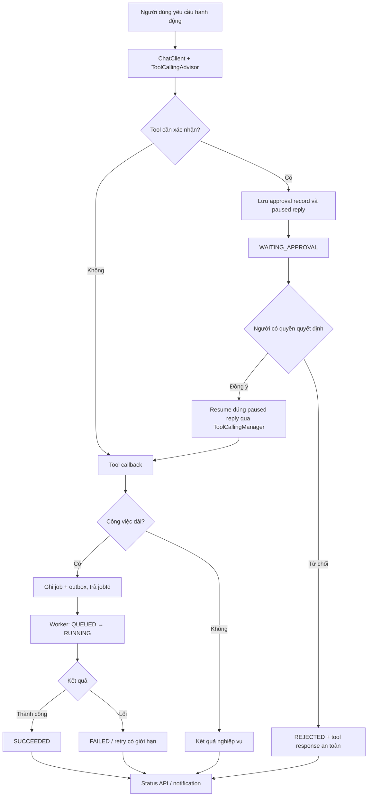
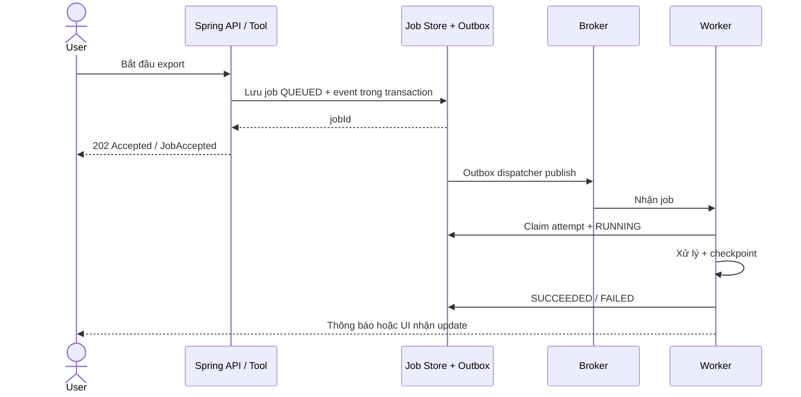

# Quản lý trạng thái chờ xác nhận hoặc tác vụ kéo dài

Khi mô hình yêu cầu thực hiện một hành động nghiệp vụ, kết quả không phải lúc nào cũng có ngay trong một lần gọi tool. Gửi một lệnh chuyển tiền, hủy đơn hàng hoặc xóa tài liệu có thể cần người có thẩm quyền xác nhận trước. Xuất báo cáo lớn, đồng bộ dữ liệu hoặc chạy một quy trình nhiều bước có thể mất vài phút đến vài giờ. Nếu ứng dụng coi mọi tool call như một hàm đồng bộ trả kết quả cuối cùng, nó dễ gây timeout, tạo thao tác trùng khi retry và khiến người dùng không biết yêu cầu đang ở trạng thái nào.

Trong mô-đun Spring AI Tool Calling, mô hình chỉ đề xuất hành động thông qua `@Tool`/`ToolCallback`. **Ứng dụng chịu trách nhiệm giữ trạng thái, kiểm tra quyền, xác nhận, thực thi và thông báo kết quả.** Bài này trình bày hai luồng có liên quan nhưng khác nhau: *chờ xác nhận trước khi tool chạy* và *tool chấp nhận một công việc dài rồi trả về mã công việc*. Cả hai cần dữ liệu bền vững để có thể tiếp tục sau khi HTTP request kết thúc, người dùng đóng giao diện hoặc một instance ứng dụng khởi động lại.

## 1. Phân biệt chờ xác nhận và chờ tác vụ hoàn tất

| Tình huống | Tool đã thực hiện side effect chưa? | Trạng thái nên hiển thị | Bước tiếp theo |
| --- | --- | --- | --- |
| Mô hình đề xuất xóa tệp nhưng chưa được đồng ý | Chưa | `WAITING_APPROVAL` | Người có quyền cho phép hoặc từ chối |
| Người dùng từ chối lệnh xóa | Không được chạy | `REJECTED` | Trả kết quả từ chối cho mô hình/caller |
| Người dùng đồng ý, hệ thống đã ghi yêu cầu vào hàng đợi | Đã nhận lệnh, chưa chắc hoàn tất | `QUEUED` | Worker nhận và thực thi |
| Worker đang xuất báo cáo | Đang chạy | `RUNNING` | Theo dõi tiến độ, đợi kết quả |
| Báo cáo đã được tạo | Hoàn tất | `SUCCEEDED` | Cung cấp file/result đã kiểm tra quyền |
| Worker lỗi sau khi thử lại có giới hạn | Có thể đã thực hiện một phần | `FAILED` | Đối soát và xử lý lỗi an toàn |
| Người dùng yêu cầu hủy | Chưa chắc đã dừng được ngay | `CANCEL_REQUESTED` | Worker kiểm tra và xác nhận trạng thái thực tế |

Một lần gọi tool trả về `ACCEPTED` hoặc `QUEUED` không đồng nghĩa nghiệp vụ đã thành công. Phải tách **kết quả nhận yêu cầu** khỏi **kết quả thực thi**. Tương tự, người dùng bấm “Xác nhận” chỉ có nghĩa đã cho phép thực thi một thao tác cụ thể; nó chưa bảo đảm thao tác đã chạy hoặc đã commit.

Ví dụ: “Hãy đặt 200 vé cho sự kiện” cần duyệt trước khi gọi API đặt vé. Còn “Tạo báo cáo bán hàng 12 tháng” có thể được đưa vào queue và trả `jobId` ngay. Với yêu cầu “Duyệt rồi xuất báo cáo”, hai giai đoạn có thể nối tiếp: `WAITING_APPROVAL → QUEUED → RUNNING → SUCCEEDED`.

## 2. Kiến trúc trạng thái nằm ở ứng dụng

`ChatResponse` của mô hình là dữ liệu của một lượt tương tác. `ToolContext` mang danh tính và tham số ứng dụng tới callback trong lượt thực thi. Cả hai **không thay thế cơ sở dữ liệu trạng thái nghiệp vụ**. Đặc biệt, một `ToolCallingAdvisor` đang chờ người xác nhận không giữ một Java thread chờ vô hạn.

Một kiến trúc thực tế gồm:

- **Chat controller/orchestrator**: gọi mô hình, kiểm tra có tool cần xác nhận, trả trạng thái về giao diện.
- **Approval store**: ghi yêu cầu duyệt, tool call gốc, caller, thời hạn, trạng thái và quyết định; không cho client sửa tool call.
- **Policy/authorization service**: xác thực người duyệt và kiểm tra lại quyền tại thời điểm thực thi.
- **Job store + queue/outbox**: quản lý công việc dài và chuyển giao đáng tin cậy cho worker.
- **Worker/service nghiệp vụ**: xử lý side effect có idempotency, cập nhật tiến độ và kết quả.
- **Status API/notification**: cho người dùng xem trạng thái, hủy yêu cầu hoặc nhận kết quả cuối.



Với tool gọi các dịch vụ thanh toán hoặc đơn vị vận chuyển, luôn có khả năng kết quả ngoài hệ thống đã commit trước khi caller nhận được phản hồi. Vì vậy, không dựa vào một boolean trong memory để khẳng định thao tác đã hoặc chưa chạy.

## 3. Thiết kế state machine rõ ràng

Trạng thái nên là enum/code ổn định, có luật chuyển trạng thái. Không dùng chuỗi tùy ý từ mô hình làm trạng thái thực thi.

```java
public enum WorkflowStatus {
    WAITING_APPROVAL,
    APPROVED,
    REJECTED,
    EXPIRED,
    QUEUED,
    RUNNING,
    SUCCEEDED,
    FAILED,
    CANCEL_REQUESTED,
    CANCELLED
}
```

| Trạng thái hiện tại | Chuyển trạng thái hợp lệ | Điều kiện |
| --- | --- | --- |
| `WAITING_APPROVAL` | `APPROVED`, `REJECTED`, `EXPIRED` | Quyết định hợp lệ, trong thời hạn |
| `APPROVED` | `QUEUED` | Đã kiểm tra lại quyền và ghi lệnh thực thi bền vững |
| `QUEUED` | `RUNNING`, `CANCEL_REQUESTED` | Worker nhận việc hoặc có yêu cầu hủy |
| `RUNNING` | `SUCCEEDED`, `FAILED`, `CANCEL_REQUESTED` | Dựa trên kết quả thực tế của worker |
| `CANCEL_REQUESTED` | `CANCELLED`, `SUCCEEDED`, `FAILED` | Hủy có thể đến quá muộn sau khi side effect xảy ra |
| `REJECTED`, `EXPIRED`, `SUCCEEDED`, `FAILED`, `CANCELLED` | Kết thúc | Không tự chạy lại; retry nghiệp vụ tạo attempt/job phù hợp |

Có thể thêm `FAILED_RETRYABLE` hoặc `TIMED_OUT` nếu vận hành cần phân biệt. Điều quan trọng là xác định **trạng thái nào có thể thay đổi, trạng thái nào terminal, ai có quyền chuyển và sự kiện nào chứng minh chuyển trạng thái**. Một request bị timeout ở HTTP không nhất thiết là tác vụ nền đã thất bại.

Dữ liệu bền vững tối thiểu cho một công việc:

```java
public record WorkflowView(
        String operationId,
        WorkflowStatus status,
        String action,
        String resourceId,
        Instant createdAt,
        Instant updatedAt,
        Instant expiresAt,
        Integer progressPercent,
        String resultReference,
        String errorCode) {
}
```

`operationId` là ID của quy trình nghiệp vụ. Nó khác với `conversationId`, `requestId` và ID của một lần gọi tool. Có thể lưu các ID này để liên kết audit, nhưng không dùng ID tool call làm khóa chống trùng nghiệp vụ xuyên nhiều lần yêu cầu.

## 4. Spring AI 2.1: yêu cầu xác nhận ngay trên tool

Từ Spring AI **2.1.0**, Tool Call Confirmation có cơ chế chính thức. Tool có side effect được đánh dấu `requiresConfirmation = true`. Khi mô hình đề xuất gọi nó, `ToolCallingManager` kiểm tra `ToolCallConfirmationPolicy` **trước khi thực thi**.

```java
import org.springframework.ai.tool.annotation.Tool;
import org.springframework.ai.tool.annotation.ToolParam;

public class ReportTools {

    private final ReportJobService reportJobService;

    public ReportTools(ReportJobService reportJobService) {
        this.reportJobService = reportJobService;
    }

    @Tool(
        description = "Bắt đầu tạo báo cáo doanh thu sau khi người dùng xác nhận.",
        requiresConfirmation = true,
        returnDirect = true
    )
    public JobAccepted requestRevenueReport(
            @ToolParam(description = "Mã kỳ báo cáo, dạng yyyy-MM") String period,
            ToolContext context) {

        CallerContext caller = requireCaller(context);
        return reportJobService.submitIdempotent(caller, period);
    }
}
```

Ví dụ trên giả định `JobAccepted`, `ReportJobService`, `CallerContext` và `requireCaller` là kiểu/hàm do ứng dụng định nghĩa. Tool **chỉ được gọi sau quyết định cho phép**; khi chạy, nó ghi job bền vững rồi trả ngay trạng thái chấp nhận. `returnDirect = true` có thể trả kết quả `JobAccepted` trực tiếp cho caller mà không có thêm một lượt model. Nếu cùng một model reply chứa nhiều tool call, `returnDirect` chỉ có tác dụng khi **tất cả** tool được gọi trong lượt đó đều cấu hình return-direct.

Tool không có `requiresConfirmation` vẫn có thể bị bắt buộc duyệt bởi policy:

```java
ToolCallConfirmationPolicy policy =
        ToolCallConfirmationPolicy.fromToolMetadata()
            .or(ToolCallConfirmationPolicy.forTools("deleteFile", "transferMoney"));

ToolCallingManager manager = ToolCallingManager.builder()
        .toolCallConfirmationPolicy(policy)
        .build();

ChatClient client = ChatClient.builder(chatModel)
        .defaultAdvisors(
                ToolCallingAdvisor.builder()
                    .toolCallingManager(manager)
                    .build())
        .defaultTools(new ReportTools(reportJobService))
        .build();
```

Với Spring Boot auto-configuration, manager mặc định đã tôn trọng flag `requiresConfirmation`. Có thể bổ sung tên tool bằng property `spring.ai.tools.confirmation.tools`; các chính sách custom cũng được hợp nhất. Ví dụ:

```yaml
spring:
  ai:
    tools:
      confirmation:
        enabled: true
        tools: deleteFile,transferMoney
```

Các API trong phần này là API **Spring AI 2.1.0**. Khi ứng dụng dùng Spring AI 1.x hoặc 2.0.x, hãy dùng cổng approval do ứng dụng tự điều phối, không sao chép `requiresConfirmation` hay `ToolCallDecisions` như thể chúng có trên mọi phiên bản.

## 5. Khi cần xác nhận, framework dừng ở đâu?

Với Spring AI 2.1, khi bất kỳ tool call nào trong **cùng một model reply** cần xác nhận:

1. `ToolCallingManager` kiểm tra policy trước khi chạy bất cứ tool nào của reply đó.
2. Nếu cần xác nhận, nó ném `ToolCallConfirmationRequiredException`; **không tool nào của reply đó được chạy**.
3. `ToolCallingAdvisor` dừng loop và trả một `ChatResponse` chứa các tool call đang chờ.
4. Metadata chứa khóa các call cần người quyết định.
5. Ứng dụng lưu paused reply và hiển thị hành động dự kiến.

Không dùng `.content()` để xác định pause: văn bản của reply thường rỗng. Phải đọc `.chatResponse()` hoặc `.chatClientResponse()`, rồi kiểm tra bằng `ToolCallDecisions.awaitingDecision(reply)`.

```java
ChatResponse reply = chatClient.prompt()
        .user("Tạo báo cáo doanh thu tháng 11/2026.")
        .call()
        .chatResponse();

List<String> awaiting = ToolCallDecisions.awaitingDecision(reply);

if (!awaiting.isEmpty()) {
    AssistantMessage assistant = reply.getResult().getOutput();
    List<String> keys = ToolCallDecisions.toolCallKeys(assistant);

    // Ứng dụng: lưu nguyên reply vào store tin cậy và tạo approvalId.
    // Dùng keys để ghép đúng từng tool call với quyết định của người duyệt.
    approvalService.persistPause(
            conversationId, callerContext, reply, keys, awaiting);
}
```

Ví dụ minh họa giả định bean `approvalService` của ứng dụng. Khi stream, metadata chờ quyết định nằm ở **chunk cuối** mang tool calls; kết quả aggregate thông thường có thể không giữ lại metadata này. UI streaming phải kiểm tra final chunk thay vì chỉ hiển thị các đoạn text.

Khóa quyết định thường là tool call ID, nhưng nếu model không trả ID hoặc trả trùng, Spring AI dùng vị trí như `#0`, `#1`. Không tự tái tạo khóa bằng tên tool: cùng một tool có thể xuất hiện nhiều lần với arguments khác nhau.

## 6. Lưu một approval request có thể tiếp tục sau restart

Để duyệt bất đồng bộ, cần lưu trạng thái trong database/transactional store của ứng dụng. Có thể biểu diễn:

```java
public record PendingApproval(
        String approvalId,
        String operationId,
        String conversationId,
        String initiatorSubjectId,
        String tenantId,
        Instant createdAt,
        Instant expiresAt,
        long version,
        String displaySummary,
        String callDigest,
        WorkflowStatus status) {
}
```

Bên cạnh các trường trên, lưu **paused ChatResponse gốc**, prompt/conversation và danh sách tool callback cần cho việc resume trong một kho dữ liệu có kiểm soát truy cập. Khi serializer không thể lưu trực tiếp Java object, dùng định dạng ứng dụng xác định và kiểm thử khôi phục đúng tool-call ID, tên, arguments, thứ tự call và message metadata. Không lưu credentials trong arguments.

Lưu song song bản hiển thị đã chuẩn hóa:

- Tên hành động nghiệp vụ: “Xóa tài liệu”, “Gửi thanh toán”, “Xuất báo cáo”.
- Resource được tác động: mã đơn, số lượng bản ghi hoặc khoảng thời gian.
- Tác động dự kiến và khả năng hoàn tác.
- Caller, tenant, thời điểm tạo và hạn chót xác nhận.
- Phiên bản resource hoặc hash của hành động nếu thông tin có thể thay đổi.

Khi người duyệt nhìn thấy “Xóa 3 tài liệu”, ứng dụng phải ràng buộc quyết định với chính ba tài liệu đã hiển thị. Không cho phép frontend gửi arguments mới hoặc đổi ID tài nguyên ở lúc xác nhận. Nếu action/arguments thay đổi, phải tạo approval request mới.

**Một approval ID không phải quyền truy cập.** Dù ID không đoán được, backend vẫn phải xác thực người duyệt, kiểm tra tenant, vai trò và policy trên resource ở thời điểm chấp thuận.

## 7. Tiếp nhận quyết định một cách an toàn

Một API có thể nhận payload nhỏ như:

```json
{
  "approvalId": "apr_7a4f2c",
  "decision": "APPROVE",
  "expectedVersion": 3
}
```

Frontend không gửi lại original tool call, JSON arguments hoặc conversation history để backend thực thi. Backend tải paused reply **từ store tin cậy**, kiểm tra thời hạn, quyền và trạng thái hiện tại, rồi tạo quyết định tương ứng với từng call.

Với một reply có nhiều call, Spring AI yêu cầu **mỗi call đều có một quyết định**, kể cả call mà policy ban đầu không đánh dấu cần xác nhận. Ví dụ:

```java
ToolCallDecisions decisions = ToolCallDecisions.of(
        ToolCallDecision.allow("call_1"),
        ToolCallDecision.deny("call_2"),
        ToolCallDecision.deny("call_3", "Người dùng không đồng ý.")
);
```

`allow(key)` cho phép call chạy; `deny(key)` tạo tool result từ chối mà không gọi callback. Thông điệp deny được gửi cho mô hình như tool result: phải chuẩn hóa, không đưa lý do nội bộ hoặc bí mật vào đó. Nếu hệ thống chỉ cho phép “duyệt toàn bộ hoặc từ chối toàn bộ”, hãy tạo decision tương ứng cho **tất cả** call, không bỏ sót call mà framework chưa đánh dấu.

Sau xác nhận, kiểm tra lại policy nghiệp vụ như quyền trên tài nguyên, hạn mức và trạng thái giao dịch. Approval không vượt qua authorization và cũng không thay thế bước confirmation tiếp theo nếu thao tác phát sinh side effect mới.

## 8. Resume đúng tool call và lịch sử hội thoại

Spring AI 2.1 cung cấp overload `ToolCallingManager.executeToolCalls(prompt, reply, decisions)`. Prompt phải mang tool definitions/callbacks mà reply ban đầu được phép gọi; `reply` là bản đã lưu và không bị client sửa.

Ví dụ khi **ứng dụng tự sở hữu toàn bộ conversation**:

```java
// Thực thi phía backend sau khi quyết định đã được xác thực và ghi bền vững.
ToolCallingChatOptions options = ToolCallingChatOptions.builder()
        .toolCallbacks(ToolCallbacks.from(reportTools))
        .toolContext(Map.of("caller", callerContext))
        .build();

Prompt originalPrompt = new Prompt(storedConversation, options);
ChatResponse storedReply = approvalStore.loadPausedReply(approvalId);

ToolExecutionResult executed = toolCallingManager.executeToolCalls(
        originalPrompt, storedReply, decisions);

if (executed.returnDirect()) {
    // Ứng dụng chuyển tool result thành response trực tiếp cho caller.
    // Spring AI cũng cung cấp ToolExecutionResult.buildGenerations(executed).
    return respondWithDirectResult(executed);
}

ChatResponse continued = chatClient.prompt()
        .messages(executed.conversationHistory())
        .call()
        .chatResponse();

return respondWithChatResponse(continued);
```

`storedConversation`, `approvalStore` và các hàm `respondWith...` ở đây do ứng dụng triển khai. Khi dùng memory/session advisor thay vì tự giữ history, cách đưa tool response vào prompt phải phù hợp với advisor, tránh gửi lại toàn bộ history dẫn tới trùng message. Spring AI hướng dẫn với `MessageChatMemoryAdvisor`: sau `executeToolCalls`, gửi **ToolResponseMessage cuối cùng** và đúng `conversationId` để memory bổ sung phần trước.

**Không gọi `executeToolCalls(prompt, reply)` không có decisions để “resume tạm” một pause cần xác nhận.** Cần một decision cho mọi call. Đồng thời đảm bảo việc resume chỉ được thực hiện một lần ở tầng ứng dụng: framework không tự chống replay. Nếu cùng quyết định được gửi hai lần, tool side effect có thể chạy hai lần nếu ứng dụng không bảo vệ.

## 9. Chặn double approval, replay và race condition

Hai người duyệt cùng bấm “Cho phép” hoặc frontend retry POST khi mất mạng là tình huống bình thường. Dùng chuyển trạng thái nguyên tử, chẳng hạn optimistic locking/compare-and-swap:

```sql
UPDATE approval_request
SET status = 'APPROVED', version = version + 1,
    decided_by = :approver, decided_at = :now
WHERE approval_id = :approvalId
  AND status = 'WAITING_APPROVAL'
  AND version = :expectedVersion
  AND expires_at > :now;
```

Kiểm tra số row cập nhật:

- `1`: request chuyển trạng thái thành công; tạo execution command/outbox **trong cùng transaction**.
- `0`: request đã được xử lý, hết hạn hoặc version khác; trả trạng thái hiện tại, không chạy lại tool.

Không xem việc đổi `APPROVED` trong database là bằng chứng tool đã thực thi. Sau commit, worker/dispatcher sẽ nhận execution command. Cần ràng buộc command với `operationId`/idempotency key ổn định và lưu kết quả của mỗi attempt. Nếu tiến trình chết giữa lúc commit approval và enqueue trực tiếp sang broker, transactional outbox giúp không mất lệnh.

Để chống retry từ những request giống nhau (ví dụ người dùng gửi lại “Tạo báo cáo tháng 11”), nghiệp vụ có thể đặt unique constraint trên `(tenantId, actorId, action, businessKey)` trong khoảng hợp lệ. Việc có cùng tool call ID chỉ giúp liên kết tool response của một lượt, không bảo đảm exactly-once cho giao dịch.

## 10. Thiết kế tool trả ngay khi chấp nhận công việc dài

Một tool không nên giữ kết nối LLM/HTTP mở đến khi hoàn tất công việc có thời gian chạy lớn. Callback có thể xác thực, tạo job bền vững và trả **biên nhận chấp nhận**:

```java
public enum JobStatus {
    QUEUED, RUNNING, SUCCEEDED, FAILED, CANCEL_REQUESTED, CANCELLED
}

public record JobAccepted(
        String jobId,
        JobStatus status,
        Instant acceptedAt,
        String statusHint) {
}

public record JobProgress(
        String jobId,
        JobStatus status,
        int completedUnits,
        int totalUnits,
        Instant updatedAt,
        String resultReference,
        String errorCode) {
}
```

Tool khởi chạy (các service là thành phần của ứng dụng):

```java
@Tool(description = "Khởi chạy xuất báo cáo. Trả jobId để theo dõi, không chờ file hoàn tất.")
public JobAccepted startExport(
        @ToolParam(description = "Tháng cần báo cáo theo yyyy-MM") String month,
        ToolContext context) {

    CallerContext caller = requireCaller(context);
    return exportService.validateAndEnqueue(caller, month);
}

@Tool(description = "Xem trạng thái công việc xuất báo cáo theo jobId.")
public JobProgress getExportStatus(
        @ToolParam(description = "Mã công việc được trả khi tạo") String jobId,
        ToolContext context) {

    CallerContext caller = requireCaller(context);
    return exportService.findVisibleJob(caller, jobId);
}
```

Ví dụ tool result nhận yêu cầu:

```json
{
  "jobId": "job_e528",
  "status": "QUEUED",
  "acceptedAt": "2026-11-27T09:00:00Z",
  "statusHint": "Dùng getExportStatus với jobId để kiểm tra tiến độ."
}
```

Phản hồi nên nói rõ “Đã tiếp nhận yêu cầu” thay vì “Đã tạo báo cáo”. Không đưa file URL công khai, credential hoặc path nội bộ vào result; khi file hoàn tất, trả một mã tham chiếu và để download endpoint xác thực quyền.

Tool `startExport` là entry point ngắn; tính bền vững nằm ở `exportService`, job store và worker. Việc chạy async bằng `CompletableFuture.runAsync(...)` trong request process mà không có persistence chỉ phù hợp demo vì restart có thể làm mất việc và không có cơ chế retry/đối soát.

## 11. Worker, outbox và khả năng khôi phục

Quy trình job dài thường có các bước:

1. **Validate** input/permission và kiểm tra business idempotency key.
2. **Persist** job `QUEUED` cùng outbox event trong một transaction.
3. **Dispatch** outbox sang broker; nếu gửi thất bại thì retry có giới hạn.
4. **Claim** job bằng lease hoặc chuyển trạng thái nguyên tử để chỉ một worker sở hữu attempt đang chạy.
5. **Execute** các bước nghiệp vụ, cập nhật progress/checkpoint bền vững.
6. **Finish** với kết quả cuối hoặc mã lỗi đã chuẩn hóa, ghi audit và phát notification.



Broker thường có delivery **ít nhất một lần (at-least-once)**; worker có thể nhận trùng cùng job. Muốn chống thực thi trùng cần idempotency key, unique constraint, lease/claim logic và phương án đối soát nếu bước ngoài hệ thống đã commit nhưng chưa ghi trạng thái local.

Với thao tác nhiều bước không thể rollback nguyên tử, dùng workflow/saga và các bước bù trừ (compensation) nếu nghiệp vụ hỗ trợ. Không khẳng định “exactly once” chỉ vì consumer xử lý một lần ở memory.

## 12. Retry, timeout, progress và cancellation

Thiết kế retry theo loại lỗi:

| Lỗi | Hành động phù hợp |
| --- | --- |
| HTTP 503 hoặc timeout tạm thời khi đọc dữ liệu | Retry giới hạn với exponential backoff + jitter |
| Validation sai hoặc thiếu approval | Không retry tự động; yêu cầu sửa/xác nhận |
| Không đủ quyền | Dừng, trả lỗi chung; không cho mô hình đổi ID để dò |
| API thanh toán timeout sau khi gửi lệnh | Tra cứu trạng thái bằng idempotency key; không tự gửi lệnh khác |
| Hết hạn toàn quy trình | Đánh dấu `FAILED`/`TIMED_OUT` theo hợp đồng và đối soát trạng thái ngoài hệ thống |

Có thể lưu `attemptCount`, `nextRetryAt`, `deadlineAt`, `lastHeartbeatAt` và `errorCode` trong job. Dùng heartbeat/lease timeout để phát hiện worker mất kết nối, rồi chỉ giao lại công việc nếu chiến lược idempotency cho phép.

Tiến độ nên là thước đo có ý nghĩa nghiệp vụ: `completedUnits/totalUnits`, số trang đã xuất hoặc giai đoạn “đang tổng hợp dữ liệu”. Không bịa tỷ lệ phần trăm chỉ để UI trông có chuyển động.

Hủy công việc là một yêu cầu **cooperative**:

- `CANCEL_REQUESTED` nghĩa là hệ thống đã nhận yêu cầu hủy; worker phải kiểm tra ở checkpoint.
- `CANCELLED` chỉ được ghi khi đã xác minh không còn công việc chạy hoặc đã dừng an toàn.
- Nếu thao tác ngoài hệ thống đã hoàn tất, trạng thái có thể là `SUCCEEDED` dù người dùng yêu cầu hủy trễ. Khi đó hiển thị kết quả thật và phương án bù trừ nếu có.
- Với lệnh ghi nhiều bước, không “kill” thread tùy ý khi transaction đang commit.

Giới hạn deadline của toàn workflow, timeout từng dependency và số lần retry. Một lệnh đã đưa vào queue phải tiếp tục được quản lý dù người dùng đóng tab hoặc ngắt kết nối SSE.

## 13. Theo dõi trạng thái: REST polling, SSE, WebSocket và webhook

Đối với API, có thể dùng:

```http
POST /api/report-jobs
202 Accepted
Location: /api/report-jobs/job_e528

GET /api/report-jobs/job_e528
200 OK
Content-Type: application/json
```

Payload trạng thái:

```json
{
  "jobId": "job_e528",
  "status": "RUNNING",
  "progress": {
    "completedUnits": 35,
    "totalUnits": 100
  },
  "updatedAt": "2026-11-27T09:02:00Z",
  "resultReference": null
}
```

- **REST polling**: đơn giản, dùng interval có backoff, dừng khi terminal hoặc quá deadline.
- **SSE**: gửi progress one-way theo event ID tăng dần, hỗ trợ reconnect và tải lại trạng thái từ store.
- **WebSocket**: phù hợp UI cần gửi/nhận nhiều loại event; vẫn cần authz theo channel và job.
- **Webhook**: phù hợp service-to-service; ký HMAC/signature, kiểm tra timestamp, chống replay và retry delivery có idempotency.

Ưu tiên UI/status API theo dõi job trực tiếp thay vì để mô hình tự gọi `getExportStatus` mỗi vài giây, vì như vậy tốn token và có thể tạo vòng tool call vô hạn. Nếu cần mô hình tóm tắt tiến độ, chỉ gọi tool khi người dùng yêu cầu hoặc có một mốc đáng kể, kèm giới hạn polling/rounds.

Khi job hoàn thành, notification không được chứa dữ liệu nhạy cảm hoặc link có quyền quá rộng. Result endpoint phải kiểm tra quyền lại lúc tải, không chỉ dựa vào việc ai biết `jobId`.

## 14. Thời hạn xác nhận và pause bị bỏ dở

Một yêu cầu xác nhận phải có `expiresAt` rõ ràng. Khi hết hạn, chuyển `WAITING_APPROVAL → EXPIRED` bằng cập nhật nguyên tử; không thực thi tool. Các tình huống cần xử lý gồm:

- Người dùng từ chối: tạo tool result từ chối, lưu audit và thông báo kết quả.
- Người dùng không phản hồi: hết hạn, đóng pause theo chính sách.
- Người dùng gửi yêu cầu mới trong cùng hội thoại: giải quyết/cancel pause trước khi nhận turn mới.
- Người duyệt chấp thuận nhưng quyền đã bị thu hồi: từ chối ở bước thực thi.
- Client gửi decision lần thứ hai: trả trạng thái đã xử lý; không chạy lại.

Trong Spring AI 2.1, paused reply có thể chứa assistant tool calls **chưa có ToolResponseMessage**. Nhiều provider từ chối một lịch sử có tool call mà không có kết quả tương ứng. Nếu dùng Chat Memory cũ, ứng dụng phải đóng các call bị bỏ dở bằng quyết định từ chối trước khi chấp nhận input mới. Với Session Memory, `SessionTurnAdvisor` có thể ghi kết quả trung tính cho các call bị bỏ dở khi turn mới bắt đầu để giữ lịch sử hợp lệ. Khi input mới đã được nhận, **không resume** pause cũ nữa.

Không để một approval request tồn tại mãi. Đặt TTL, cơ chế hết hạn định kỳ, retention cho audit và quyền xóa dữ liệu theo chính sách nghiệp vụ.

## 15. Chat memory, session và trạng thái công việc là hai kho khác nhau

Spring AI 2.1 khuyến nghị Session Memory cho lịch sử hội thoại nhiều bước. `SessionAdvisors` duy trì tool-call/tool-response transcript theo turn, còn **job store** vẫn chịu trách nhiệm về trạng thái công việc đang chạy.

| Dữ liệu | Nơi nên lưu | Vì sao |
| --- | --- | --- |
| User/assistant/tool messages | Session Memory hoặc conversation store | Cung cấp ngữ cảnh đúng cho model |
| Paused reply đang chờ duyệt | Trusted approval store/session event | Resume đúng call, ID và arguments |
| Quyết định ai đã duyệt khi nào | Approval/audit database | Tính trách nhiệm và chống replay |
| `QUEUED/RUNNING/SUCCEEDED`, progress, result | Job database | Đọc được từ nhiều instance, phục hồi sau restart |
| Retry attempts, lease, outbox | Worker/queue infrastructure | Đảm bảo tiến trình và đối soát |
| Tài liệu đầu ra | Object storage có authorization | Tách file lớn khỏi context mô hình |

Khi một turn có tool đọc dữ liệu trước rồi mới tạm dừng ở tool cần xác nhận, memory đặt ngoài tool loop có thể không lưu đủ các vòng trước pause. Nếu cần resume đúng ngữ cảnh, dùng memory trong loop hoặc Session Memory để giữ tool transcript. Không chỉ giữ last assistant reply rồi giả định mọi thông tin trước đó vẫn còn.

Phiên bản 1.x và 2.0.x không có API Tool Call Confirmation của 2.1. Với các phiên bản này, tạo approval gate ở application orchestration layer: nhận raw tool calls qua user-controlled execution, lưu pending request và chỉ gọi callback sau khi policy quyết định. Cơ sở dữ liệu trạng thái, outbox và nguyên tắc authorization vẫn giống nhau.

## 16. Quy tắc bảo mật cho approval và job

Yêu cầu xác nhận có thể bị lợi dụng nếu ứng dụng tin arguments từ mô hình hoặc thông điệp hiển thị thay vì kiểm tra bản thực thi:

- **Danh tính tin cậy:** `subjectId`, `tenantId` và vai trò đến từ authentication/`ToolContext` do ứng dụng tạo, không đến từ model arguments.
- **Giới hạn quyền:** xác nhận đúng action và resource; kiểm tra quyền cả khi tạo yêu cầu lẫn lúc thực thi sau khi duyệt.
- **Bản yêu cầu bất biến:** backend giữ paused reply gốc trong store không cho client sửa; checksum/hash phục vụ kiểm tra tính toàn vẹn.
- **Không replay:** một approval chỉ được giải quyết một lần; command có idempotency key ổn định.
- **Đúng phạm vi:** `jobId` không cấp quyền xem status/result; mọi request phải kiểm tra tenant, owner và ACL.
- **Không lộ dữ liệu:** message từ chối, status API và thông báo không chứa raw arguments nhạy cảm, exception message, credential hay stack trace.
- **Prompt injection:** nội dung do công cụ trả về hoặc người dùng cung cấp không thể tự phê duyệt tool. Approval là quyết định của người có quyền qua giao diện tin cậy.
- **Dữ liệu nhạy cảm trong audit:** lưu tối thiểu, mã hóa nếu cần, áp dụng retention và phân quyền đọc.

Nếu người dùng duyệt một lệnh có side effect rủi ro cao, giao diện nên hiển thị số tiền, đơn vị, người nhận, tài nguyên và hệ quả dự kiến bằng dữ liệu chuẩn hóa từ backend. Không dùng lời mô hình tự diễn giải làm bằng chứng duy nhất về tác động.

## 17. Kiểm thử state machine và resume

Các test nên chứng minh cả trạng thái lẫn số lần side effect thật sự xảy ra.

| Kịch bản | Kỳ vọng |
| --- | --- |
| Tool yêu cầu confirmation | `ToolCallingAdvisor` pause; callback chưa chạy |
| Reply chứa hai tool, một tool cần confirmation | Không call nào của reply được chạy trước decision |
| Người dùng từ chối | Tool bị từ chối không thực thi; mô hình nhận result từ chối an toàn |
| Không có decision cho một call | Manager từ chối resumption trước khi chạy |
| Paused reply do client tự dựng | Backend không chấp nhận; chỉ tải bản đã lưu |
| Hai approver cùng gửi quyết định | Chỉ một CAS thành công; không có execution trùng |
| Approval hết hạn | Không dispatch; `EXPIRED` được lưu bền vững |
| App restart khi đang chờ | Approval vẫn xuất hiện, có thể xử lý hợp lệ |
| Job được enqueue rồi mất kết nối HTTP | `jobId` truy xuất được, worker vẫn chạy |
| Broker gửi trùng | Chỉ một tác động nghiệp vụ nhờ idempotency/claim |
| Worker crash giữa tác vụ | Lease/reconciliation xử lý, không nhân đôi side effect |
| Người dùng yêu cầu hủy sau khi commit | Hiển thị trạng thái thực tế, không tuyên bố đã rollback |
| Status API với job tenant khác | Từ chối và không lộ dữ liệu |
| Lỗi dependency | Retry có giới hạn; không để model tự lặp tool call |
| Pause bỏ dở rồi user gửi turn mới | Đóng pause; history không còn tool call chưa có result |

Ví dụ test không thực thi khi chờ xác nhận:

```java
@Test
void shouldNotExecuteToolBeforeConfirmation() {
    ChatResponse paused = chatClient.prompt()
            .user("Xóa tệp report-42")
            .call()
            .chatResponse();

    assertThat(ToolCallDecisions.awaitingDecision(paused)).isNotEmpty();
    verify(fileService, never()).delete(anyString());
}
```

Test này giả định model stub trả về một tool call `deleteFile` đã được cấu hình `requiresConfirmation`. Test concurrency nên gọi decision endpoint song song để xác minh một transition thành công, rồi mock downstream và kiểm tra số lần thực thi thực tế. Dùng integration test với database/broker nếu idempotency, outbox hoặc transaction boundaries là thành phần quan trọng.

## 18. Quan sát và tiêu chí vận hành

Để người dùng và đội vận hành biết tác vụ còn sống hay đã mắc kẹt, theo dõi:

- Tỷ lệ yêu cầu bị treo ở `WAITING_APPROVAL`, thời gian chờ duyệt p50/p95 và tỷ lệ hết hạn.
- Thời gian từ `APPROVED` đến `QUEUED`, từ `QUEUED` đến `RUNNING` và từ `RUNNING` đến terminal.
- Số lần retry, timeout, dead-letter, mất heartbeat và job cần đối soát.
- Tỷ lệ hủy thành công và tỷ lệ hủy quá muộn khi side effect đã xảy ra.
- Số quyết định trùng/replay bị chặn, số yêu cầu bị từ chối vì thiếu quyền.
- Tỷ lệ duplicate job được deduplicate bằng idempotency key.

Dùng `approvalId`, `operationId`, `jobId`, `conversationId` và trace ID để correlate mà không đưa raw arguments vào metric labels. Đặt cảnh báo khi job `RUNNING` không heartbeat hoặc `WAITING_APPROVAL` vượt SLA. Một lỗi timeout trong API không đủ để kết luận công việc đã thất bại; cần đối chiếu job store và hệ thống bên ngoài.

## 19. Checklist triển khai

- [ ] Phân biệt trạng thái chờ xác nhận với trạng thái job dài.
- [ ] Có state machine và luật chuyển trạng thái rõ, bao gồm expiry/cancellation.
- [ ] Tool có side effect cần duyệt được đánh dấu `requiresConfirmation` trên Spring AI 2.1 hoặc có approval gate riêng ở phiên bản cũ.
- [ ] Đọc `ChatResponse` và `ToolCallDecisions.awaitingDecision`; không dựa vào `content()` để phát hiện pause.
- [ ] Lưu paused reply và prompt/tool definitions trong kho tin cậy; không nhận chúng từ client ở bước resume.
- [ ] Mỗi tool call có một decision; bảo toàn tool call ID/thứ tự.
- [ ] Xác thực approver, tenant, quyền, resource version, thời hạn và action digest trước khi cho chạy.
- [ ] Dùng CAS/optimistic lock và transactional outbox để chống double approval/mất command.
- [ ] Side effect và retry dùng business idempotency key, không dựa vào tool call ID.
- [ ] Tool dài trả `jobId` với `QUEUED/ACCEPTED` sớm; không giữ LLM call mở đến cuối tác vụ.
- [ ] Worker có claim/lease, deadline, retry có giới hạn, checkpoint và đối soát kết quả.
- [ ] Status API, SSE hoặc webhook có xác thực và quyền truy cập từng job.
- [ ] Hủy job theo quy trình cooperative; không hứa hoàn tác khi external side effect đã commit.
- [ ] Resolve pause bị bỏ dở trước turn mới để lịch sử tool-call/tool-result hợp lệ.
- [ ] Tách Session Memory/conversation store khỏi business job store.
- [ ] Kiểm thử pause/resume, quyết định trùng, restart, broker duplicate, cross-tenant và hủy muộn.

## Tài liệu tham khảo

- [Spring AI 2.1 — Tool Call Confirmation](https://docs.spring.io/spring-ai/reference/api/tools/tool-call-confirmation.html)
- [Spring AI 2.1 — ToolCallingAdvisor](https://docs.spring.io/spring-ai/reference/api/tools/tool-calling-advisor.html)
- [Spring AI 2.1 — Tool Calling](https://docs.spring.io/spring-ai/reference/api/tools.html)
- [Spring AI 2.1 — ChatModel Tool Calling](https://docs.spring.io/spring-ai/reference/api/tools/chatmodel-tool-calling.html)
- [Spring AI 2.1 — Session Memory](https://docs.spring.io/spring-ai/reference/api/session.html)
- [Spring AI 2.1 — ChatClient Session Integration](https://docs.spring.io/spring-ai/reference/api/session/chat-client.html)

Một hệ thống tool calling an toàn không cần mô hình giữ kết nối để chờ người duyệt hoặc chờ một công việc dài. Mô hình đề xuất hành động; ứng dụng dừng, lưu trạng thái và xin quyết định có thẩm quyền; sau đó dispatcher/worker thực thi có idempotency, còn status API phản ánh tiến độ thực tế. Sự tách biệt giữa **quyết định**, **chấp nhận xử lý** và **hoàn tất nghiệp vụ** giúp người dùng luôn biết điều gì đã xảy ra và giúp hệ thống phục hồi đúng sau lỗi hoặc restart.
