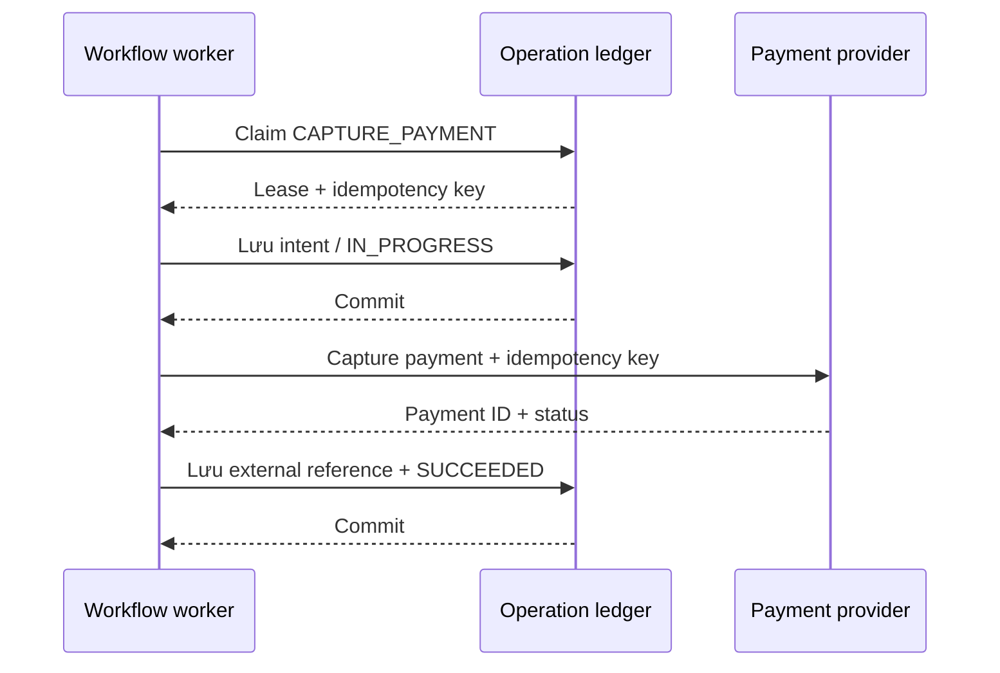
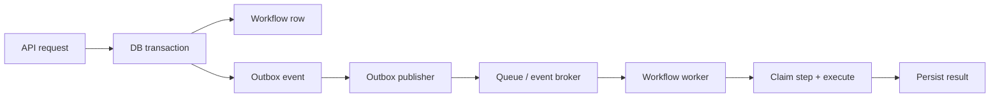

# Khôi phục sau khi ứng dụng dừng giữa chuỗi hành động

Một yêu cầu AI có thể dẫn đến nhiều hành động nghiệp vụ nối tiếp nhau: kiểm tra tồn kho, giữ hàng, thu tiền, tạo vận đơn và gửi thông báo. Nếu tiến trình ứng dụng dừng sau khi đã giữ hàng hoặc thu tiền nhưng trước khi ghi nhận bước tiếp theo, việc gửi lại toàn bộ prompt và chạy lại tool loop có thể tạo ra tác động phụ trùng lặp.

Muốn khôi phục an toàn, ứng dụng phải lưu trạng thái workflow và kết quả từng bước vào nơi lưu trữ bền vững. Conversation history giúp mô hình hiểu ngữ cảnh, nhưng không thể thay thế operation ledger. Khi ứng dụng khởi động lại, worker đọc trạng thái đã lưu, xác định bước nào đã hoàn tất, bước nào cần đối soát và bước nào có thể chạy lại bằng idempotency key.

Spring AI cung cấp cơ chế gọi tool và điều phối vòng lặp; trách nhiệm khôi phục một chuỗi hành động nghiệp vụ thuộc về ứng dụng. Với chuỗi nhiều bước có side effect, hãy thiết kế như một durable workflow hoặc saga thay vì coi một lần gọi `ChatClient.call()` là một giao dịch nguyên tử.

## Vì sao tool loop không tự khôi phục được workflow?

Trong Spring AI 2.x, `ToolCallingAdvisor` điều phối các lượt gọi mô hình và thực thi `ToolCallback` qua `ToolCallingManager`. Vòng lặp giữ lịch sử message để mô hình nhận kết quả tool ở lượt tiếp theo. Trạng thái này phục vụ một lần tương tác đang chạy; nó không tự ghi lại toàn bộ tiến trình nghiệp vụ để khôi phục sau khi JVM bị kill, container bị thay thế hoặc máy chủ mất điện.

Vị trí của vòng tool calling khác nhau theo phiên bản:

| Phiên bản | Cách thực thi | Khi cần quan sát và checkpoint từng iteration |
| --- | --- | --- |
| Spring AI 1.x | Vòng tool execution nằm bên trong `ChatModel` thông qua `ToolCallingManager` | Dùng user-controlled execution, ví dụ tắt `internalToolExecutionEnabled` trong `ToolCallingChatOptions`, rồi tự điều khiển từng lượt. |
| Spring AI 2.x | `ToolCallingAdvisor` quản lý vòng lặp trong advisor chain của `ChatClient` | Dùng user-controlled execution bằng cách tắt auto-registration cho request (`AdvisorParams.toolCallingAdvisorAutoRegister(false)`) hoặc xây dựng advisor/orchestrator phù hợp. |

Các tùy chọn điều khiển vòng lặp giúp ứng dụng quan sát từng tool call, nhưng bản thân chúng vẫn không tạo ra durable workflow. Dù dùng phiên bản nào, ứng dụng vẫn phải persist operation ledger, idempotency key và kết quả side effect. Khi tool callback chỉ tạo một workflow nền, có thể giữ vòng tự động; khi mỗi iteration cần được checkpoint riêng, hãy sở hữu vòng lặp ở tầng ứng dụng.

Ví dụ workflow tạo đơn hàng:

1. Kiểm tra sản phẩm và giá.
2. Giữ tồn kho.
3. Thu tiền.
4. Tạo vận đơn.
5. Gửi thông báo xác nhận.

Giả sử bước 2 và 3 đã hoàn tất, sau đó tiến trình dừng trước khi lưu kết quả bước 3. Khi chạy lại, ứng dụng không thể chỉ nhìn vào conversation history rồi suy luận rằng khoản tiền đã được thu hay chưa. Nếu gọi lại API thu tiền bằng một request mới, khách hàng có thể bị tính phí hai lần.

Có ba trạng thái khác nhau cần phân biệt:

| Trạng thái | Ý nghĩa | Cách khôi phục |
| --- | --- | --- |
| Đã xác nhận hoàn tất | Kết quả bước và external reference đã được lưu bền vững | Bỏ qua bước này và tiếp tục bước kế tiếp. |
| Chưa bắt đầu | Chưa ghi nhận intent hoặc chưa gọi hệ thống đích | Có thể claim và thực thi bước. |
| Không rõ kết quả | Đã gửi request ra ngoài nhưng tiến trình dừng trước khi lưu kết quả | Đối soát với hệ thống đích hoặc retry bằng cùng idempotency key. |

Không được coi trạng thái “không rõ kết quả” là “thất bại”. Đây là khoảng trống phổ biến giữa side effect bên ngoài và commit dữ liệu nội bộ.

## Conversation history khác workflow state

Conversation history lưu message của người dùng, assistant, tool call và tool response. Workflow state lưu những gì đã thực sự xảy ra trong nghiệp vụ: hàng đã giữ chưa, giao dịch thanh toán có mã nào, vận đơn đã tạo chưa và bước tiếp theo là gì.

| Dữ liệu | Conversation history | Workflow state / operation ledger |
| --- | --- | --- |
| Câu hỏi của người dùng | Có | Có thể lưu tham chiếu hoặc bản tóm tắt nếu cần audit. |
| Tool call arguments | Có thể có trong transcript | Lưu input đã validate và định danh bước nếu cần tái thực thi/đối soát. |
| Tool response | Có thể có trong transcript | Lưu kết quả nghiệp vụ có cấu trúc và external reference. |
| Trạng thái side effect | Không đủ tin cậy để kết luận | Nguồn sự thật chính thức. |
| Retry count, lease, next attempt | Không | Có. |
| Compensation và reconciliation | Không | Có. |

Một model response có thể bị mất sau khi service đã thực thi tool. Ngược lại, conversation history có thể đã lưu một tool call request nhưng callback chưa từng chạy. Vì vậy, không dùng sự xuất hiện của message `ToolResponseMessage` hoặc assistant tool call để kết luận trạng thái database hay payment provider.

Khi resume, ứng dụng đọc operation ledger trước. Nếu cần mô hình tiếp tục hội thoại, hãy dựng prompt từ một bản tóm tắt đã được tạo từ trạng thái nghiệp vụ đã xác nhận. Không yêu cầu mô hình tự đoán một side effect có xảy ra hay chưa.

## Mô hình hóa workflow thành các bước bền vững

Thay vì lưu một cờ `completed` cho toàn bộ chuỗi, hãy lưu từng bước. Mỗi bước có một định danh ổn định và một trạng thái riêng.

Ví dụ workflow tạo đơn:

| Thứ tự | Step key | Hành động | Kết quả cần lưu |
| ---: | --- | --- | --- |
| 1 | `VALIDATE_ORDER` | Kiểm tra dữ liệu và giá | Phiên bản giá, tổng tiền, điều kiện hợp lệ. |
| 2 | `RESERVE_STOCK` | Giữ tồn kho | Reservation ID, thời hạn giữ hàng. |
| 3 | `CAPTURE_PAYMENT` | Thu tiền | Payment ID, trạng thái, số tiền và currency. |
| 4 | `CREATE_SHIPMENT` | Tạo vận đơn | Shipment ID, tracking number. |
| 5 | `SEND_CONFIRMATION` | Gửi thông báo | Notification ID hoặc delivery status. |

Mỗi step cần có:

- `workflowId`: định danh workflow.
- `stepKey`: tên bước ổn định trong phiên bản workflow.
- `status`: trạng thái hiện tại.
- `idempotencyKey`: khóa ổn định cho một hành động logic.
- `attemptCount` và `nextAttemptAt`: kiểm soát retry.
- `requestSnapshot` hoặc tham chiếu đến input đã validate.
- `resultSnapshot` hoặc external reference sau khi thực thi.
- `startedAt`, `completedAt`, `lastErrorCode`.
- `leaseOwner`, `leaseUntil` và `version` để phối hợp worker.

Không lưu toàn bộ prompt, ToolContext hoặc dữ liệu cá nhân vào operation ledger nếu không cần thiết. Chỉ lưu payload tối thiểu để tiếp tục nghiệp vụ; mã hóa các trường nhạy cảm và áp dụng retention phù hợp.

### Bảng trạng thái gợi ý

Workflow có thể dùng các trạng thái:

| Status | Ý nghĩa |
| --- | --- |
| `ACCEPTED` | Đã nhận yêu cầu và lưu workflow. |
| `RUNNING` | Có worker đang xử lý. |
| `WAITING_RETRY` | Có bước lỗi tạm thời và chờ đến thời điểm retry. |
| `WAITING_APPROVAL` | Đang chờ người có thẩm quyền xác nhận. |
| `NEEDS_RECONCILIATION` | Kết quả side effect chưa rõ hoặc cần đối soát thủ công. |
| `COMPENSATING` | Đang thực hiện các hành động bù. |
| `SUCCEEDED` | Tất cả bước bắt buộc đã hoàn tất. |
| `FAILED` | Workflow dừng do lỗi không thể tự phục hồi. |
| `COMPENSATED` | Các bước cần bù đã được xử lý thành công. |
| `CANCELLED` | Workflow đã được hủy trước khi có thêm side effect. |

Mỗi step có thể dùng `PENDING`, `IN_PROGRESS`, `SUCCEEDED`, `RETRYABLE_FAILURE`, `TERMINAL_FAILURE`, `UNKNOWN_OUTCOME`, `COMPENSATION_PENDING` và `COMPENSATED`. Việc tách `UNKNOWN_OUTCOME` khỏi `FAILED` giúp worker không vô tình thực hiện lại một thao tác có thể đã thành công.

## Operation ledger là nguồn sự thật

Một schema đơn giản có thể tách workflow và step:

```sql
CREATE TABLE business_workflow (
    id                  UUID PRIMARY KEY,
    tenant_id           VARCHAR(100) NOT NULL,
    workflow_type       VARCHAR(100) NOT NULL,
    workflow_version    INTEGER NOT NULL,
    idempotency_key     VARCHAR(200) NOT NULL,
    status              VARCHAR(40) NOT NULL,
    current_step        VARCHAR(100),
    version             BIGINT NOT NULL DEFAULT 0,
    lease_owner         VARCHAR(150),
    lease_until         TIMESTAMP,
    next_attempt_at     TIMESTAMP,
    last_error_code     VARCHAR(100),
    created_at          TIMESTAMP NOT NULL,
    updated_at          TIMESTAMP NOT NULL,
    CONSTRAINT uq_workflow_tenant_idempotency
        UNIQUE (tenant_id, idempotency_key)
);

CREATE TABLE workflow_step (
    id                  UUID PRIMARY KEY,
    workflow_id         UUID NOT NULL REFERENCES business_workflow(id),
    step_key            VARCHAR(100) NOT NULL,
    status              VARCHAR(40) NOT NULL,
    idempotency_key     VARCHAR(250) NOT NULL,
    attempt_count       INTEGER NOT NULL DEFAULT 0,
    request_ref         VARCHAR(500),
    result_ref          VARCHAR(500),
    external_reference  VARCHAR(200),
    started_at          TIMESTAMP,
    completed_at        TIMESTAMP,
    last_error_code     VARCHAR(100),
    version             BIGINT NOT NULL DEFAULT 0,
    CONSTRAINT uq_workflow_step UNIQUE (workflow_id, step_key),
    CONSTRAINT uq_step_idempotency UNIQUE (idempotency_key)
);
```

Đây là schema khởi đầu, không phải một chuẩn bắt buộc. Có thể bổ sung bảng `workflow_event`, `outbox_event`, `workflow_compensation` hoặc bảng audit tùy yêu cầu. Nếu một step có nhiều lần gọi con, hãy dùng bảng invocation riêng thay vì ghi đè một `external_reference`.

`workflow_version` giúp biết logic nào đã tạo workflow. Khi triển khai phiên bản mới, worker phải tiếp tục workflow cũ theo định nghĩa tương thích hoặc có migration rõ ràng; không âm thầm diễn giải lại step cũ bằng code mới có ý nghĩa khác.

## Ghi intent trước, gọi hệ thống đích sau

Mỗi side effect nên có một bản ghi intent được commit trước khi gọi hệ thống bên ngoài. Sau đó callback gọi provider bằng idempotency key ổn định và lưu kết quả.



Nếu tiến trình dừng sau khi provider đã thu tiền nhưng trước khi bước `SUCCEEDED` được commit, step ở trạng thái `IN_PROGRESS` hoặc `UNKNOWN_OUTCOME`. Khi lease hết hạn, worker mới phải đối soát hoặc retry bằng cùng idempotency key. Provider có hỗ trợ idempotency sẽ trả lại kết quả của thao tác logic cũ thay vì tạo giao dịch mới.

Không dùng `attemptCount` để tạo idempotency key mới cho mỗi retry. Nếu mỗi lần thử có key mới, provider sẽ coi đó là thao tác mới và có thể thu tiền nhiều lần. Key nên gắn với workflow và step, ví dụ `workflowId:CAPTURE_PAYMENT:v1`.

## Idempotency: retry mà không lặp side effect

Trong hệ thống phân tán, worker có thể không biết request trước đã đến hệ thống đích hay chưa. Retry là điều cần thiết, nhưng retry an toàn cần idempotency.

Một operation được xem là idempotent khi thực hiện lại với cùng định danh logic không tạo thêm tác động mới và trả về kết quả tương đương. Ví dụ:

- `reserveStock(orderId, sku)` chỉ tạo một reservation cho cùng order/sku.
- `capturePayment(orderId, paymentAttemptId)` chỉ capture một lần cho cùng payment attempt.
- `createShipment(orderId)` không tạo vận đơn thứ hai nếu một vận đơn đã được tạo cho order đó.
- `sendConfirmation(orderId, notificationType)` không gửi nhiều email giống nhau khi worker retry.

### Tạo idempotency key ổn định

```java
import java.util.UUID;

public record StepIdentity(
        UUID workflowId,
        String stepKey,
        int logicalVersion) {

    public String idempotencyKey() {
        return this.workflowId + ":" + this.stepKey + ":v" + this.logicalVersion;
    }
}
```

Khóa phải được lưu trong ledger trước khi thực thi và được dùng lại qua mọi lần retry. Nếu người dùng gửi lại cùng yêu cầu, API tạo workflow cũng cần idempotency key riêng để không tạo hai workflow tương đương.

### Nếu hệ thống đích không hỗ trợ idempotency

Ưu tiên gửi một `clientReference` duy nhất do ứng dụng tạo và dùng nó để tra cứu trước khi retry. Ví dụ, trước khi gọi lại `createShipment`, truy vấn partner API theo `clientReference` hoặc order reference. Nếu đã có vận đơn, lưu external reference vào ledger và tiếp tục.

Nếu không thể truy vấn và cũng không có idempotency key, không thể đảm bảo retry không tạo side effect trùng. Hãy chuyển step sang `NEEDS_RECONCILIATION`, yêu cầu đối soát thủ công hoặc thiết kế adapter có cơ chế deduplication ở phía mình. Không tự động retry vô hạn một thao tác không thể xác định kết quả.

## Ranh giới transaction: không giữ transaction khi gọi model hoặc API bên ngoài

Không mở một database transaction dài bao trùm toàn bộ tool loop, model request và HTTP call. Những thao tác này có thời gian không xác định; giữ transaction lâu sẽ giữ connection/lock và vẫn không thể rollback side effect đã xảy ra ở hệ thống khác.

Hãy dùng các transaction ngắn:

1. Transaction A: tạo workflow, các step ban đầu và outbox event.
2. Transaction B: claim workflow/step, tăng version/attempt và ghi intent.
3. Không có database transaction mở: gọi model hoặc service bên ngoài.
4. Transaction C: ghi kết quả, external reference và trạng thái step.
5. Transaction D: xác định bước tiếp theo hoặc ghi compensation/outbox event.

Ví dụ transaction tạo workflow:

```java
import java.util.UUID;

import org.springframework.stereotype.Service;
import org.springframework.transaction.annotation.Transactional;

public record CreateOrderCommand(
        String tenantId,
        String subjectId,
        CreateOrderRequest request) {}

@Service
public class WorkflowSubmissionService {

    private final WorkflowRepository workflowRepository;
    private final WorkflowStepRepository stepRepository;
    private final OutboxRepository outboxRepository;

    public WorkflowSubmissionService(
            WorkflowRepository workflowRepository,
            WorkflowStepRepository stepRepository,
            OutboxRepository outboxRepository) {
        this.workflowRepository = workflowRepository;
        this.stepRepository = stepRepository;
        this.outboxRepository = outboxRepository;
    }

    @Transactional
    public UUID submit(CreateOrderCommand command, String idempotencyKey) {
        return this.workflowRepository
                .findByTenantIdAndIdempotencyKey(command.tenantId(), idempotencyKey)
                .map(BusinessWorkflow::getId)
                .orElseGet(() -> {
                    BusinessWorkflow workflow =
                            this.workflowRepository.save(BusinessWorkflow.accepted(command, idempotencyKey));
                    this.stepRepository.saveAll(WorkflowSteps.initialOrderSteps(workflow.getId()));
                    this.outboxRepository.save(OutboxEvent.workflowAccepted(workflow.getId()));
                    return workflow.getId();
                });
    }
}
```

Ví dụ giả định unique constraint `(tenant_id, idempotency_key)` và xử lý race condition khi hai request gửi đồng thời cùng key. Trong code thực tế, bắt duplicate-key violation ở ranh giới transaction rồi đọc lại workflow đã tồn tại; không dựa vào `find` trước `insert` như một biện pháp chống race duy nhất.

Không đặt `.call()` hoặc HTTP request vào bên trong method `@Transactional` này. Transaction chỉ ghi trạng thái ban đầu và sự kiện để worker xử lý sau commit.

## Dùng transactional outbox để không mất yêu cầu khởi chạy

Một lỗi thường gặp là commit workflow vào database rồi publish message lên broker. Nếu ứng dụng dừng giữa hai thao tác, workflow tồn tại nhưng không có message để worker xử lý. Làm ngược lại cũng có thể tạo message trỏ đến workflow chưa được commit.

Transactional outbox giải quyết khoảng trống đó bằng cách ghi workflow và outbox event trong cùng một database transaction. Một publisher đọc các outbox record chưa gửi và phát lên broker. Việc phát có thể lặp, nên consumer vẫn phải idempotent.



Spring Modulith Event Publication Registry có thể hỗ trợ ghi publication record cùng transaction và cho phép resubmit các publication chưa hoàn tất. Với broker hoặc outbox tự xây dựng, cần đảm bảo event được publish lại sau crash và consumer có deduplication. Không xem broker delivery là exactly-once.

## Worker khôi phục sau khi ứng dụng khởi động lại

Worker không nên chỉ quét các workflow có status `FAILED`. Khi tiến trình chết đột ngột, workflow có thể vẫn mang status `RUNNING` hoặc step có `IN_PROGRESS`. Lease giúp xác định worker cũ không còn sở hữu công việc sau một khoảng thời gian.

Quy trình recovery:

1. Tìm workflow có step `PENDING`, `RETRYABLE_FAILURE` đến hạn hoặc `IN_PROGRESS` có lease hết hạn.
2. Claim bằng một thao tác atomic/optimistic lock để chỉ một worker được sở hữu tại một thời điểm.
3. Gia hạn lease khi xử lý lâu; worker cũ không được commit nếu lease/version của nó đã hết hiệu lực.
4. Đọc step đã lưu. Bỏ qua step `SUCCEEDED`.
5. Với `UNKNOWN_OUTCOME`, đối soát hệ thống đích trước khi quyết định retry.
6. Với step chưa bắt đầu, ghi intent rồi thực thi.
7. Lưu kết quả và cập nhật workflow trong transaction ngắn.
8. Tiếp tục step tiếp theo hoặc chuyển sang retry/compensation/reconciliation.

### Claim bằng lease và optimistic locking

Ví dụ repository có thể claim một workflow bằng conditional update:

```sql
UPDATE business_workflow
SET lease_owner = :workerId,
    lease_until = :leaseUntil,
    status = 'RUNNING',
    version = version + 1,
    updated_at = CURRENT_TIMESTAMP
WHERE id = :workflowId
  AND version = :expectedVersion
  AND status IN ('ACCEPTED', 'WAITING_RETRY', 'RUNNING')
  AND (next_attempt_at IS NULL OR next_attempt_at <= CURRENT_TIMESTAMP)
  AND (lease_until IS NULL OR lease_until < CURRENT_TIMESTAMP);
```

Nếu số dòng cập nhật bằng 1, worker đã claim thành công. Nếu bằng 0, workflow đã được worker khác claim hoặc version đã thay đổi. Worker phải đọc lại trạng thái, không được tiếp tục theo dữ liệu cũ.

Lease không đủ nếu worker cũ vẫn chạy sau khi lease hết hạn. Dùng `version` hoặc fencing token tăng đơn điệu; mọi lần ghi kết quả phải kèm token đã claim. Database từ chối ghi từ worker có token cũ. Với hệ thống đích hỗ trợ fencing/version, truyền token đến đó để ngăn stale worker tạo side effect sau khi mất lease.

### Heartbeat và thời hạn lease

Nếu một bước có thể chạy lâu hơn lease, worker cần gia hạn lease định kỳ. Thời hạn lease phải lớn hơn khoảng heartbeat dự kiến và phù hợp timeout của operation. Khi worker không thể gia hạn, nó phải dừng bắt đầu side effect mới; kết quả đang chờ cần được đối soát bởi worker tiếp theo.

Không đặt lease quá ngắn khiến hai worker liên tục giành cùng một workflow. Không đặt lease quá dài khiến công việc chờ lâu sau khi process chết. Hãy đo thời gian xử lý thực tế và chọn giá trị có biên an toàn.

## Pseudocode cho recovery worker

```java
import java.util.UUID;

public void recover(UUID workflowId) {
    ClaimedWorkflow claim = this.workflowTransactions.claim(workflowId, workerId);
    if (claim == null) {
        return; // Worker khác đang sở hữu hoặc workflow không đến hạn.
    }

    try {
        while (claim.hasNextStep()) {
            WorkflowStep step = claim.nextStep();

            if (step.isSucceeded()) {
                claim = this.workflowTransactions.advance(claim);
                continue;
            }

            if (step.hasUnknownOutcome()) {
                ReconciliationResult reconciliation =
                        this.stepExecutor.reconcile(step, claim.fencingToken());
                if (reconciliation.isConfirmedSucceeded()) {
                    claim = this.workflowTransactions.markSucceeded(claim, step, reconciliation.result());
                    continue;
                }
                if (!reconciliation.isSafeToRetry()) {
                    this.workflowTransactions.markNeedsReconciliation(claim, step);
                    return;
                }
            }

            this.workflowTransactions.markInProgress(claim, step);
            StepResult result = this.stepExecutor.execute(
                    step,
                    step.idempotencyKey(),
                    claim.fencingToken());
            claim = this.workflowTransactions.markSucceeded(claim, step, result);
        }

        this.workflowTransactions.markWorkflowSucceeded(claim);
    }
    catch (RetryableStepException ex) {
        this.workflowTransactions.scheduleRetry(claim, ex.errorCode());
    }
    catch (UnknownExternalOutcomeException ex) {
        this.workflowTransactions.markNeedsReconciliation(claim, ex.stepKey());
    }
    catch (Exception ex) {
        this.workflowTransactions.markFailedOrCompensating(claim, ex);
    }
}
```

Đây là pseudocode mô tả thứ tự xử lý, không phải implementation hoàn chỉnh. Các hàm `workflowTransactions` phải mở transaction ngắn và kiểm tra fencing token/version. `stepExecutor.execute(...)` gọi hệ thống đích ngoài transaction. Nếu worker chết giữa hai dòng đó, lease hết hạn và worker sau sẽ đối soát bằng idempotency key.

Không bắt mọi exception rồi đánh dấu `FAILED` ngay. Phải phân loại timeout, lỗi mạng không rõ kết quả, lỗi tạm thời, lỗi nghiệp vụ terminal và lỗi quyền. Mỗi loại có chính sách recovery khác nhau.

## Phân loại retry và giới hạn số lần thử

Không phải lỗi nào cũng retry được:

| Nhóm lỗi | Ví dụ | Hướng xử lý |
| --- | --- | --- |
| Retryable | HTTP 429, 503, timeout trước khi provider nhận request | Retry có backoff, jitter và giới hạn attempt. |
| Unknown outcome | Socket timeout sau khi gửi lệnh thu tiền; mất kết nối trước khi nhận response | Đối soát hoặc retry cùng idempotency key. |
| Terminal business error | Hết hàng, đơn đã bị hủy, trạng thái không cho phép | Dừng workflow hoặc bắt đầu compensation theo chính sách. |
| Authorization error | User/tenant không có quyền | Không retry tự động; ghi audit và dừng. |
| Invalid input | Arguments sai schema hoặc dữ liệu nghiệp vụ không hợp lệ | Yêu cầu sửa input; không retry cùng payload. |
| Internal defect | Lỗi lập trình, invariant bị vi phạm | Dừng, cảnh báo vận hành và điều tra. |

Retry nên dùng exponential backoff có jitter, ví dụ 1s, 2s, 4s, 8s với random jitter và max attempt. Đặt `nextAttemptAt` trong ledger thay vì giữ thread ngủ. Khi hết attempt, chuyển `NEEDS_RECONCILIATION` hoặc `FAILED` tùy khả năng xác định side effect.

Không retry thao tác không idempotent chỉ vì lỗi là HTTP timeout. Timeout không chứng minh provider chưa thực hiện thao tác.

## Dùng Saga để bù các bước đã hoàn tất

Một workflow nhiều hệ thống không thể được bảo vệ bằng một database transaction duy nhất. Nếu một bước sau thất bại và nghiệp vụ yêu cầu hoàn tác các bước trước, dùng Saga: mỗi hành động chính có một hành động bù tương ứng.

Ví dụ:

| Hành động chính | Hành động bù |
| --- | --- |
| Giữ tồn kho | Giải phóng reservation. |
| Thu tiền | Hoàn tiền hoặc void authorization tùy trạng thái payment. |
| Tạo vận đơn | Hủy vận đơn nếu carrier cho phép. |
| Gửi email | Không thể thu hồi email đã gửi; có thể gửi thông báo đính chính. |

Compensation không phải rollback vật lý. Nó là một hành động nghiệp vụ mới, có thể thất bại, có phí hoặc cần phê duyệt. Ví dụ hoàn tiền có thể mất thời gian xử lý; carrier có thể không cho hủy vận đơn sau khi đã nhận hàng.

Khi một bước terminal failure xảy ra:

1. Dừng tạo side effect mới.
2. Đọc danh sách step đã `SUCCEEDED` theo thứ tự thực thi.
3. Tạo compensation record cho các bước cần bù theo thứ tự ngược.
4. Thực thi từng compensation bằng idempotency key riêng.
5. Lưu trạng thái từng compensation và retry an toàn nếu cần.
6. Khi tất cả compensation hoàn tất, chuyển workflow sang `COMPENSATED`; nếu có bước không thể bù, chuyển `NEEDS_RECONCILIATION`.

Không chạy compensation cho một step `UNKNOWN_OUTCOME` trước khi đối soát. Nếu chưa biết khoản tiền đã được thu hay chưa, gọi hoàn tiền có thể tạo giao dịch ngược sai hoặc không có giao dịch gốc.

## Phân biệt retry, resume và compensation

| Hành động | Mục đích | Điều kiện |
| --- | --- | --- |
| Retry | Thực hiện lại một step chưa hoàn tất | Lỗi retryable hoặc đã xác nhận thao tác trước chưa xảy ra; phải dùng idempotency. |
| Resume | Tiếp tục từ step kế tiếp chưa hoàn tất | Các step trước đã có kết quả bền vững và hợp lệ. |
| Reconcile | Xác định kết quả của một side effect không rõ | Đối chiếu external reference/client reference với hệ thống đích. |
| Compensate | Tạo hành động bù cho các step đã thành công | Workflow không thể tiếp tục và nghiệp vụ yêu cầu bù. |
| Manual intervention | Chuyển quyết định cho người vận hành/người có thẩm quyền | Không thể xác định kết quả hoặc không có compensation tự động an toàn. |

Không dùng từ “retry workflow” cho tất cả các tình huống. Một workflow có thể cần resume step 4, retry step 3, reconcile step 2 hoặc compensate step 1. Tên trạng thái rõ ràng giúp dashboard và vận hành không nhầm lẫn.

## Tích hợp durable workflow với Spring AI

`ChatClient` phù hợp để nhận yêu cầu, phân tích ý định và đề xuất hành động. `ToolCallback` nên gọi application service có thể kiểm tra quyền và ghi operation ledger. Với chuỗi dài, API nên tạo workflow rồi trả mã theo dõi; worker thực thi nền.

Luồng đề xuất:

1. Endpoint xác thực user và tenant.
2. Ứng dụng tạo `workflowId` cùng idempotency key từ request.
3. `ChatClient`/mô hình đề xuất plan hoặc gọi tool tạo yêu cầu nghiệp vụ.
4. Ứng dụng validate plan, quyền, giới hạn và yêu cầu approval.
5. Transaction lưu workflow, step và outbox event.
6. Worker claim workflow, gọi tool/service theo từng step và ghi kết quả.
7. Sau restart, recovery worker tiếp tục từ operation ledger.
8. Khi hoàn tất, ứng dụng lưu kết quả và có thể gửi bản tóm tắt cho mô hình để tạo phản hồi thân thiện.

Không yêu cầu mô hình tự quyết định rằng một khoản tiền đã thu hoặc một shipment đã tạo chỉ dựa vào transcript. Trạng thái đó phải đến từ ledger hoặc truy vấn đối soát với hệ thống đích.

### Tool callback nên gọi application service

```java
import org.springframework.ai.chat.model.ToolContext;
import org.springframework.ai.tool.annotation.Tool;
import org.springframework.ai.tool.annotation.ToolParam;
import org.springframework.stereotype.Component;

@Component
public class OrderWorkflowTools {

    private final WorkflowSubmissionService workflowSubmissionService;

    public OrderWorkflowTools(WorkflowSubmissionService workflowSubmissionService) {
        this.workflowSubmissionService = workflowSubmissionService;
    }

    @Tool(description = "Bắt đầu xử lý đơn hàng sau khi ứng dụng xác thực yêu cầu")
    public WorkflowAccepted startOrderFulfillment(
            @ToolParam(description = "Mã đơn hàng") String orderId,
            ToolContext toolContext) {

        String tenantId = requiredString(toolContext, "tenantId");
        String subjectId = requiredString(toolContext, "subjectId");
        return this.workflowSubmissionService.submitFromTool(
                tenantId, subjectId, orderId);
    }
}
```

Tool không trực tiếp gọi liên tiếp payment, inventory và shipping. Nó tạo một workflow đã được kiểm tra. Worker nghiệp vụ mới thực hiện chuỗi hành động có checkpoint và recovery. Nếu yêu cầu chỉ là tra cứu nhẹ, tool có thể gọi service đồng bộ; hãy chuyển sang durable workflow khi chuỗi dài, có side effect hoặc cần tiếp tục sau khi process chết.

`requiredString(...)` là helper đọc khóa bắt buộc từ `ToolContext` và kiểm tra kiểu/giá trị rỗng. `submitFromTool(...)` phải dùng cùng operation ledger và idempotency constraint như endpoint submit; không tạo một đường thực thi bỏ qua quyền hoặc checkpoint chỉ vì yêu cầu đến từ mô hình.

### Trả mã workflow thay vì giữ request HTTP mở

```java
import java.util.UUID;
import org.springframework.http.ResponseEntity;
import org.springframework.security.core.annotation.AuthenticationPrincipal;
import org.springframework.web.bind.annotation.GetMapping;
import org.springframework.web.bind.annotation.PathVariable;
import org.springframework.web.bind.annotation.PostMapping;
import org.springframework.web.bind.annotation.RequestBody;
import org.springframework.web.bind.annotation.RequestHeader;
import org.springframework.web.bind.annotation.RequestMapping;
import org.springframework.web.bind.annotation.RestController;

public record WorkflowAccepted(UUID workflowId, String status) {}

@RestController
@RequestMapping("/workflows")
public class WorkflowController {

    private final WorkflowSubmissionService submissionService;
    private final WorkflowQueryService queryService;

    @PostMapping
    public ResponseEntity<WorkflowAccepted> submit(
            @AuthenticationPrincipal AppPrincipal principal,
            @RequestHeader("Idempotency-Key") String idempotencyKey,
            @RequestBody CreateOrderRequest request) {

        UUID workflowId = this.submissionService.submit(
                new CreateOrderCommand(principal.tenantId(), principal.subjectId(), request),
                idempotencyKey);
        return ResponseEntity.accepted().body(
                new WorkflowAccepted(workflowId, "ACCEPTED"));
    }

    @GetMapping("/{workflowId}")
    public WorkflowStatus getStatus(
            @AuthenticationPrincipal AppPrincipal principal,
            @PathVariable UUID workflowId) {
        return this.queryService.getStatusForTenant(principal.tenantId(), workflowId);
    }
}
```

Ví dụ chỉ minh họa API bất đồng bộ. `getStatusForTenant(...)` phải kiểm tra quyền truy cập workflow và tenant; không được để người dùng đoán UUID rồi đọc workflow của người khác. Endpoint submit phải validate header `Idempotency-Key`, giới hạn độ dài/format và xử lý unique constraint khi request trùng.

Client có thể polling endpoint trạng thái hoặc nhận event/SSE khi workflow thay đổi. Việc đóng kết nối HTTP không được tự động hủy workflow đã được chấp nhận, trừ khi nghiệp vụ có một lệnh cancel riêng được xác thực.

## Không dùng model call làm transaction coordinator

Model có thể đề xuất bước tiếp theo dựa trên kết quả hiện tại, nhưng quyết định có được phép thực hiện hay không thuộc về orchestrator. Không để một lần sinh câu trả lời điều khiển trực tiếp các side effect không có checkpoint.

- Persist plan đã được validate trước khi chạy chuỗi dài.
- Gắn `workflowVersion` và `stepKey` ổn định vào mỗi bước.
- Nếu model được gọi lại sau restart, đưa vào prompt bản tóm tắt từ ledger và danh sách bước còn được phép; không đưa secret hoặc toàn bộ PII.
- Không coi tool call ID do provider sinh ra là idempotency key nghiệp vụ. Tool call ID chỉ dùng để ghép request/response trong transcript.
- Không để model thay đổi thứ tự các step đã thực hiện nếu điều đó làm sai invariant nghiệp vụ.
- Với quyết định mới từ model, lưu đề xuất và kiểm tra lại quyền, trạng thái và điều kiện trước khi cập nhật workflow plan.

Nếu workflow cần một nhánh quyết định dựa trên kết quả tool, orchestrator có thể yêu cầu model đề xuất nhánh. Sau đó ứng dụng validate nhánh, persist quyết định và tiếp tục. Nếu process dừng sau khi model trả lời nhưng trước khi lưu quyết định, có thể gọi model lại; nhưng không được lặp side effect đã thực thi.

## Xử lý thay đổi phiên bản và dữ liệu workflow

Workflow có thể sống lâu hơn một lần deploy. Code mới có thể đổi tên tool, thay schema, thay chính sách giá hoặc thay cách tính compensation. Vì vậy:

- Lưu `workflowVersion` và phiên bản step.
- Giữ adapter tương thích cho workflow đang chạy hoặc viết migration rõ ràng.
- Không dùng lại cùng `stepKey` cho một hành động có ý nghĩa khác.
- Lưu snapshot giá/điều kiện đã được chấp nhận khi workflow bắt đầu nếu nghiệp vụ yêu cầu tính nhất quán.
- Đối với workflow cũ không thể tiếp tục tự động, chuyển sang `NEEDS_RECONCILIATION` thay vì diễn giải lại theo code mới.
- Mã hóa request/result snapshot có PII hoặc dữ liệu tài chính; ưu tiên external reference và dữ liệu tối thiểu.

Không lưu Java serialized object làm định dạng duy nhất cho workflow lâu dài. Dùng JSON/schema có version hoặc cột dữ liệu ổn định để worker mới có thể đọc workflow cũ.

## Quan sát và vận hành recovery

Một workflow bền vững cần dashboard và cảnh báo để đội vận hành biết công việc nào bị mắc kẹt:

- Số workflow theo status và tenant.
- Số step `IN_PROGRESS` có lease hết hạn.
- Số step `UNKNOWN_OUTCOME` và thời gian chờ đối soát.
- Retry count, thời gian chờ và tỷ lệ retry thành công.
- Số compensation đang chờ hoặc thất bại.
- Tuổi của workflow lâu nhất chưa hoàn tất.
- Lỗi provider, timeout, duplicate idempotency key và lease conflict.

Log/trace nên có `workflowId`, `stepKey`, `attempt`, `workerId`, correlation ID và external reference đã được phép ghi. Không log token, payment data nhạy cảm hoặc payload đầy đủ. Mỗi chuyển trạng thái nên có audit event để có thể dựng lại chuỗi quyết định.

Recovery worker cần giới hạn concurrency, backoff và số workflow xử lý mỗi batch. Khi một workflow lỗi lặp lại, đưa nó vào hàng chờ vận hành thay vì để một worker chiếm tài nguyên liên tục.

## Kiểm thử các điểm dừng giữa chuỗi hành động

Kiểm thử bình thường không đủ. Cần mô phỏng process chết ở các khoảng thời gian nguy hiểm:

| Điểm dừng | Trạng thái sau restart | Hành vi mong đợi |
| --- | --- | --- |
| Trước khi ghi intent | Step vẫn `PENDING` | Worker claim và thực thi. |
| Sau khi ghi intent, trước khi gọi provider | `IN_PROGRESS`, chưa có external result | Đối soát; nếu provider xác nhận chưa có thao tác thì retry cùng key. |
| Provider thành công, trước khi lưu kết quả | `UNKNOWN_OUTCOME` hoặc lease hết hạn | Tra cứu theo idempotency/client reference; không tạo thao tác mới. |
| Sau khi lưu kết quả, trước khi phát event tiếp theo | Step `SUCCEEDED`, outbox còn pending | Publisher phát lại event; worker bỏ qua step đã thành công. |
| Worker cũ tiếp tục sau khi lease hết hạn | Version/fencing token cũ | Ghi kết quả bị từ chối; không được cập nhật workflow. |
| Compensation thành công, trước khi đánh dấu hoàn tất | Compensation có thể đã tác động | Retry cùng compensation idempotency key hoặc đối soát trước. |
| Ứng dụng deploy phiên bản mới | Workflow version cũ | Dùng handler tương thích hoặc chuyển reconciliation. |

### Test idempotency cho payment

```java
@Test
void retryAfterCrashDoesNotCapturePaymentTwice() {
    String key = "wf-123:CAPTURE_PAYMENT:v1";

    paymentProvider.capture("order-123", key);
    paymentProvider.capture("order-123", key); // mô phỏng worker retry

    verify(paymentProvider, times(2)).capture("order-123", key);
    assertThat(fakeProvider.capturedTransactionsFor("order-123")).hasSize(1);
}
```

Test trên giả định fake provider mô phỏng đúng hợp đồng idempotency của nhà cung cấp. Với provider thật, cần integration test ở sandbox để xác nhận cùng key trả lại cùng giao dịch và không capture lần hai.

### Test recovery bỏ qua step đã hoàn tất

```java
@Test
void recoveryContinuesAtNextPendingStep() {
    givenWorkflow("wf-123")
            .step("RESERVE_STOCK", SUCCEEDED)
            .step("CAPTURE_PAYMENT", SUCCEEDED)
            .step("CREATE_SHIPMENT", PENDING);

    recoveryWorker.recover(UUID.fromString("wf-123"));

    verify(inventoryService, never()).reserve(any(), any());
    verify(paymentService, never()).capture(any(), any());
    verify(shippingService).createShipment(any(), any());
}
```

### Test kết quả không rõ

Giả lập provider đã nhận payment request và hoàn tất capture nhưng worker bị dừng trước khi ghi ledger. Khi recovery chạy, xác minh nó tra cứu theo client reference hoặc gọi lại cùng idempotency key; không sinh key mới và không tạo giao dịch thứ hai.

Các test khác cần có:

1. Hai worker cùng claim một workflow: chỉ một worker được nhận lease/version hợp lệ.
2. Worker cũ ghi sau khi lease bị worker mới claim: fencing token ngăn ghi đè.
3. Lỗi retryable: `nextAttemptAt` được tính và worker không retry trước hạn.
4. Lỗi terminal: workflow dừng và tạo compensation theo thứ tự ngược.
5. Compensation thất bại: workflow vẫn ở `COMPENSATING` hoặc `NEEDS_RECONCILIATION`, không báo `COMPENSATED`.
6. Outbox publisher chết sau khi broker nhận event nhưng trước khi đánh dấu sent: event có thể phát lại và consumer không lặp side effect.
7. Request submit lặp cùng idempotency key: trả lại cùng workflow ID.
8. Request từ tenant khác đọc workflow ID: bị từ chối.
9. Model được gọi lại sau restart: prompt dựng từ ledger, không lặp step đã thành công.
10. Workflow cũ gặp code version mới: handler tương thích hoặc chuyển sang reconciliation.

## Những sai lầm thường gặp

| Sai lầm | Hậu quả | Cách khắc phục |
| --- | --- | --- |
| Chỉ lưu conversation history | Không biết side effect đã xảy ra chưa | Dùng operation ledger cho từng step. |
| Retry toàn bộ tool loop | Thu tiền/đặt hàng/gửi thông báo trùng | Resume từ step chưa hoàn tất và dùng idempotency. |
| Đánh dấu `FAILED` ngay khi timeout | Có thể bỏ sót side effect đã thành công | Dùng `UNKNOWN_OUTCOME` và reconciliation. |
| Giữ transaction trong lúc gọi provider | Lock/connection kéo dài nhưng không rollback được API ngoài | Dùng transaction ngắn quanh state transition. |
| Publish event sau commit mà không outbox | Mất sự kiện nếu process chết ở giữa | Ghi outbox trong cùng transaction. |
| Dùng lease nhưng không có fencing/version | Worker cũ có thể ghi đè kết quả worker mới | Kiểm tra fencing token ở mọi lần commit. |
| Tạo idempotency key mới theo attempt | Provider coi retry là thao tác mới | Dùng key ổn định theo workflow và step. |
| Compensation ngay khi kết quả chưa rõ | Hoàn tiền hoặc giải phóng tài nguyên sai | Reconcile trước khi bù. |
| Xem compensation như rollback | Không xử lý được side effect bên ngoài | Thiết kế compensation như step bền vững, idempotent và retryable. |
| Dùng model làm nguồn xác nhận trạng thái | Mô hình có thể suy luận sai | Đọc ledger hoặc truy vấn hệ thống đích. |
| Không version workflow | Deploy mới có thể diễn giải sai workflow cũ | Lưu workflow/step version và giữ handler tương thích. |

## Quy trình triển khai

1. Xác định chuỗi hành động nào có side effect và điểm nào có thể dừng giữa chừng.
2. Mô hình hóa workflow cùng các step có key ổn định và trạng thái rõ ràng.
3. Tạo operation ledger, unique idempotency constraint và lưu external reference.
4. Tạo workflow và outbox event trong cùng transaction.
5. Dùng worker claim bằng lease/version, heartbeat và fencing token.
6. Ghi intent trước side effect; gọi provider ngoài transaction; lưu kết quả trong transaction ngắn.
7. Dùng idempotency key ổn định và reconciliation cho kết quả không rõ.
8. Phân loại retryable, terminal và authorization errors; đặt backoff và max attempts.
9. Thiết kế saga compensation cho side effect có thể bù; đưa trường hợp không thể bù vào hàng chờ vận hành.
10. Tích hợp `ToolCallback` với application service và workflow orchestrator; không để model tự xác nhận kết quả nghiệp vụ.
11. Kiểm thử crash ở từng ranh giới, request lặp, worker đồng thời, outbox replay và workflow version cũ.
12. Theo dõi workflow mắc kẹt, lease hết hạn, reconciliation và compensation qua dashboard/audit.

Khôi phục sau khi ứng dụng dừng không phải là phát lại nguyên chuỗi tool call. Đó là việc tiếp tục một quy trình nghiệp vụ từ trạng thái bền vững, biết chính xác bước nào đã hoàn tất, bước nào chưa rõ kết quả và bước nào cần bù. Khi operation ledger, idempotency, outbox, lease và saga được thiết kế cùng nhau, ứng dụng có thể chịu được process restart mà không biến retry thành một side effect mới.

## Tài liệu tham khảo

- [Spring AI Reference — Tool Calling](https://docs.spring.io/spring-ai/reference/api/tools.html)
- [Spring AI Reference — User-Controlled Tool Execution](https://docs.spring.io/spring-ai/reference/api/tools.html#_user_controlled_tool_execution)
- [Spring Framework Reference — Declarative Transaction Management](https://docs.spring.io/spring-framework/reference/data-access/transaction/declarative/annotations.html)
- [Spring Modulith Reference — Event Publication Registry](https://docs.spring.io/spring-modulith/reference/events.html)
- [Spring Batch Reference — Restartability](https://docs.spring.io/spring-batch/reference/job/configuring-job.html)
- [Spring Batch Reference — Recovering a Job](https://docs.spring.io/spring-batch/reference/job/advanced-meta-data.html)
