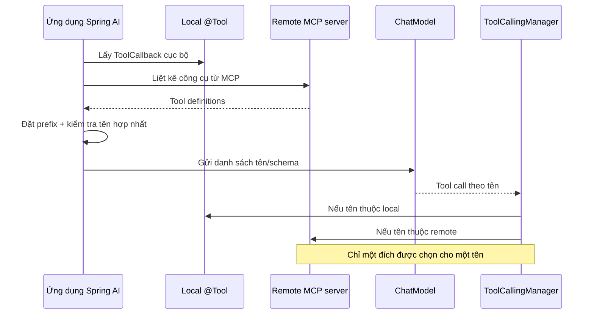

# Đặt tiền tố tên và xử lý xung đột công cụ cục bộ với công cụ từ xa

Khi tích hợp Spring AI với các dịch vụ nghiệp vụ, ứng dụng thường có hai nhóm công cụ: **tool cục bộ** do các method `@Tool`, `FunctionToolCallback` hoặc `MethodToolCallback` tạo ra, và **tool từ xa** được phát hiện qua máy chủ MCP (Model Context Protocol). Cả hai đều được đưa về `ToolCallback` để mô hình lựa chọn. Vì vậy, tên tool là một phần của hợp đồng chung: một tên phải xác định đúng **một** hành động trong tập công cụ của một request.

Nếu ứng dụng có `@Tool(name = "search")` để tìm đơn hàng nội bộ, trong khi MCP server CRM cũng công bố `search`, mô hình chỉ nhìn thấy tên `search`. Nếu hai callback mang cùng tên, việc chọn sai callback có thể tạo truy vấn nhầm dịch vụ, sai phạm vi dữ liệu hoặc side effect không mong muốn. Đổi tên sau khi đã xảy ra lỗi không đủ; cần thiết kế namespace ổn định, kiểm tra xung đột trước khi gọi model và chỉ công bố các công cụ được phép dùng.

Mục tiêu của bài là xây dựng một quy tắc đặt tên và cơ chế xác minh cho Spring AI tool calling khi kết hợp local tools với remote MCP tools, bao gồm khác biệt giữa Spring AI 1.x, 2.0.x và 2.1.x.

## Vì sao tên công cụ cần duy nhất?

Mỗi `ToolCallback` cung cấp một `ToolDefinition` gồm `name`, `description` và `inputSchema`. Mô hình nhận các định nghĩa đó, rồi tạo tool call chứa tên và JSON arguments. `ToolCallingManager` dùng tên để tìm callback tương ứng và yêu cầu ứng dụng thực thi.



Tên tool không phải tên class Java, tên bean Spring hay URL của MCP server. Đây là tên mà mô hình sử dụng để gọi công cụ. Khi đăng ký, Spring AI không thể dựa vào tên `ToolCallback` để tự hiểu rằng `search` của CRM khác `search` của ứng dụng nếu cả hai được công bố cùng tên.

Ví dụ các tên gây mơ hồ:

| Nguồn | Tên ban đầu | Chức năng thực | Rủi ro |
| --- | --- | --- | --- |
| Local Spring bean | `search` | Tìm đơn hàng của tenant hiện tại | Trùng tên với công cụ CRM. |
| MCP server CRM | `search` | Tìm khách hàng | Mô hình có thể gọi nhầm nguồn. |
| MCP server tài liệu | `search` | Tìm bài viết nội bộ | Nhiều MCP server cũng trùng tên với nhau. |
| Local Spring bean | `refund` | Đề xuất yêu cầu hoàn tiền | Có thể bị hiểu nhầm là tool hoàn tiền thật từ xa. |
| MCP server thanh toán | `refund` | Tạo giao dịch hoàn tiền | Side effect nhạy cảm nếu chọn sai callback. |

Giải pháp là đặt tên có namespace thể hiện **nguồn và capability**, ví dụ `local_orders_search`, `mcp_crm_customer_search`, `mcp_docs_search` và `mcp_payments_refund`.

## Cơ chế xung đột tên thực tế trong Spring AI

Spring AI có nhiều nơi kiểm tra trùng tên, nhưng phạm vi kiểm tra khác nhau. Đây là điểm phải xác minh trước khi chọn chiến lược:

| Vị trí | Phạm vi kiểm tra | Khi trùng tên |
| --- | --- | --- |
| `DefaultMcpToolNamePrefixGenerator` (MCP legacy) | Công cụ được phát hiện qua các MCP connection | Tự đổi tên trùng trong phía MCP bằng prefix đếm, ví dụ `alt_1_search`. |
| `.tools(...)`, `.defaultTools(...)` qua `ChatClient` | Danh sách callback hợp nhất trong request, gồm local và MCP | Phát hiện duplicate và ném `IllegalStateException` thay vì âm thầm chọn callback. |
| `ChatModel.call()`/`.stream()` với `ToolCallingChatOptions` tự dựng | Không tự có bước kiểm tra danh sách hợp nhất như `ChatClient` | Khi có tên trùng, callback đứng trước có thể được chọn im lặng. |
| `ToolCallingChatOptions.validateToolCallbacks(...)` | Danh sách callback mà ứng dụng đưa vào | Ném `IllegalStateException` nếu có tên trùng. |
| MCP server tự công bố tools | Danh sách trên từng server | Quy tắc trùng tên phía server không thay thế kiểm tra ở MCP client. |

Điểm mấu chốt: **MCP prefix generator mặc định không biết các method `@Tool` cục bộ**. Nó chỉ xử lý xung đột trong tập MCP tools. Vì thế, tên local `search` vẫn có thể trùng với MCP `search` đầu tiên ngay cả khi default generator đang bật.

Không nên dựa vào thứ tự của callback để phân xử. Thứ tự có thể thay đổi khi provider phát hiện thêm tool, khi server cập nhật danh mục, hoặc khi ứng dụng đổi cách đăng ký. Một cấu hình gây trùng phải được phát hiện và dừng có thông báo rõ ràng.

## Quy tắc namespace đề xuất

Với ứng dụng có nhiều nguồn công cụ, nên định nghĩa tên theo mẫu ổn định:

```text
local_<domain>_<action>
mcp_<serverAlias>_<domain>_<action>
```

Ví dụ:

| Tool | Tên dùng cho mô hình | Ý nghĩa |
| --- | --- | --- |
| Local tra cứu đơn hàng | `local_orders_find` | Gọi service đơn hàng nội bộ. |
| Local tạo workflow | `local_orders_start_workflow` | Tạo yêu cầu nghiệp vụ để worker xử lý. |
| CRM MCP tìm khách hàng | `mcp_crm_customer_search` | Gọi tool từ server CRM. |
| CRM MCP lấy hồ sơ | `mcp_crm_customer_get` | Lấy hồ sơ từ CRM. |
| Inventory MCP xem tồn kho | `mcp_inventory_stock_check` | Tra cứu tồn kho từ service ngoài. |
| Payments MCP hoàn tiền | `mcp_payments_refund` | Thao tác nhạy cảm trên hệ thống thanh toán. |

Quy tắc vận hành:

1. Giữ tên ngắn, có nghĩa và ổn định. Dùng ký tự ASCII, chữ/số/dấu gạch dưới khi có thể.
2. Tách `local` và `mcp`; với MCP, thêm alias server do ứng dụng định nghĩa và quản lý.
3. Dùng tên hành động cụ thể như `customer_search` hoặc `orders_cancel_request`; tránh tên quá chung như `execute`, `get` và `search`.
4. Không đưa user ID, tenant ID, access token, endpoint động hoặc request ID vào tên; các giá trị đó phải được xử lý ở tầng xác thực/context.
5. Đảm bảo tên sau chuẩn hóa không vượt giới hạn của provider/model. Các MCP prefix generator được tài liệu hóa theo giới hạn 64 ký tự; không cắt tùy tiện làm hai tên dài trở nên giống nhau.
6. Chỉ thêm phiên bản vào tên khi thực sự thay đổi hợp đồng capability, ví dụ `mcp_crm_customer_search_v2`; nâng version triển khai nhỏ không nhất thiết đổi tên tool.
7. Duy trì một bảng đăng ký tên và nguồn sở hữu. Nếu một tool đổi tên, cập nhật các test, prompt và workflow đã lưu có tham chiếu tên cũ.

**Tên là định danh thực thi**, vì vậy việc đổi tên tool đang được dùng trong agent workflow là thay đổi contract. Nếu transcript hoặc workflow cũ chứa tên cũ, cần alias có kiểm soát hoặc migration; không để tên cũ bất ngờ trỏ sang callback khác.

## Đặt tên tường minh cho tool cục bộ

Mặc định, `@Tool` dùng tên method Java. Khi kết hợp với remote MCP tools, nên đặt `name` tường minh để giữ namespace ổn định ngay cả khi refactor tên method.

```java
import org.springframework.ai.tool.annotation.Tool;
import org.springframework.ai.tool.annotation.ToolParam;
import org.springframework.stereotype.Component;

@Component
public class LocalOrderTools {

    private final OrderService orderService;

    public LocalOrderTools(OrderService orderService) {
        this.orderService = orderService;
    }

    @Tool(
            name = "local_orders_find",
            description = "Tra cứu đơn hàng thuộc tenant hiện tại")
    public OrderSummary findOrder(
            @ToolParam(description = "Mã đơn hàng cần tìm") String orderId) {
        return this.orderService.findForAuthenticatedTenant(orderId);
    }
}
```

`OrderService` vẫn phải tự kiểm tra quyền và tenant. Prefix `local_` giúp định danh nguồn, nhưng không cấp quyền hay chống truy cập trái phép. Nếu một remote server công bố công cụ có tên `local_orders_find`, ứng dụng vẫn phải phát hiện và chặn collision.

Nếu tạo tool bằng `FunctionToolCallback.builder("local_orders_find", function)` hoặc `MethodToolCallback.builder()`, tên cũng phải tuân theo quy ước chung. Đừng để các code path xây dựng callback tự tạo tên khác với annotation.

## Nhận công cụ từ MCP bằng ToolCallbackProvider

Spring AI MCP Client Starter kết nối đến một hoặc nhiều MCP server và cung cấp các tool đã phát hiện thông qua `SyncMcpToolCallbackProvider` hoặc `AsyncMcpToolCallbackProvider`, tùy cấu hình client. Hai loại này triển khai `ToolCallbackProvider` để có thể đưa tool vào `ChatClient` cùng với local tools.

Dependency Maven ví dụ:

```xml
<dependency>
    <groupId>org.springframework.ai</groupId>
    <artifactId>spring-ai-starter-mcp-client</artifactId>
</dependency>
```

Một ứng dụng có thể dùng `ChatClient` với cả hai nguồn:

```java
import org.springframework.ai.chat.client.ChatClient;
import org.springframework.ai.chat.model.ChatModel;
import org.springframework.ai.mcp.SyncMcpToolCallbackProvider;
import org.springframework.context.annotation.Bean;
import org.springframework.context.annotation.Configuration;

@Configuration
class HybridChatConfiguration {

    @Bean
    ChatClient hybridChatClient(
            ChatModel chatModel,
            LocalOrderTools localOrderTools,
            SyncMcpToolCallbackProvider mcpTools) {

        return ChatClient.builder(chatModel)
                .defaultTools(localOrderTools, mcpTools)
                .build();
    }
}
```

`defaultTools(...)` trong ví dụ khiến các tool được đưa vào những request dùng client này. Khi dùng nhiều nhóm quyền, không nên để mọi tool MCP (đặc biệt tool có side effect) thành default toàn hệ thống. Có thể tạo các `ChatClient` theo chức năng hoặc truyền danh sách được cấp quyền ở mức request:

```java
String answer = chatClient.prompt()
        .user("Tìm đơn hàng ORD-1001 và tra cứu khách hàng liên quan")
        .tools(localOrderTools, mcpTools)
        .call()
        .content();
```

Danh sách cuối cùng phải được xem xét cùng default tools. Đừng mặc định rằng `.tools(...)` cấp request sẽ xóa các tool đã đăng ký mặc định ở `ChatClient`.

MCP provider có thể phát hiện danh sách tool khi được sử dụng lần đầu, do phải liên hệ MCP server. Vì thế xung đột local/remote có thể chỉ xuất hiện khi request đầu tiên thực sự hợp nhất tool callbacks, thay vì tại lúc application context khởi tạo.

## Prefix mặc định của MCP giải quyết được đến đâu?

Với các MCP connection sử dụng giao thức legacy, Spring AI dùng `DefaultMcpToolNamePrefixGenerator` nếu ứng dụng không đăng ký bean khác. Generator này chuẩn hóa ký tự đặc biệt, theo dõi tên công cụ giữa các kết nối và thêm một prefix đếm cho các bản trùng. Ví dụ:

| MCP connection | Tool gốc | Tên được sinh (minh họa) |
| --- | --- | --- |
| `crm` | `search` | `search` |
| `docs` | `search` | `alt_1_search` |
| `inventory` | `stock-check` | `stock_check` |

Đây là cơ chế tránh trùng phía MCP. Nó không bảo đảm rằng `search` không trùng với local `@Tool(name = "search")`, cũng không cho biết `alt_1_search` thuộc server nào chỉ từ tên. Đối với hệ thống cần audit, tên có namespace tường minh dễ hiểu và ổn định hơn.

`McpToolNamePrefixGenerator.noPrefix()` trả nguyên tên tool từ MCP server. Khi nhiều MCP server cùng công bố một tên, provider có thể ném `IllegalStateException`; không nên bật `noPrefix()` khi chưa có biện pháp kiểm tra và phân tách tên khác.

## Tạo McpToolNamePrefixGenerator theo namespace cố định

Để công cụ từ CRM luôn có prefix `mcp_crm_` và công cụ từ inventory luôn có `mcp_inventory_`, có thể cung cấp một bean `McpToolNamePrefixGenerator`:

```java
import io.modelcontextprotocol.spec.McpSchema;
import org.springframework.ai.mcp.McpConnectionInfo;
import org.springframework.ai.mcp.McpToolNamePrefixGenerator;
import org.springframework.context.annotation.Bean;
import org.springframework.context.annotation.Configuration;

@Configuration
class McpToolNamingConfiguration {

    @Bean
    McpToolNamePrefixGenerator mcpToolNamePrefixGenerator() {
        return (McpConnectionInfo connection, McpSchema.Tool tool) -> {
            String serverName = connection.initializeResult().serverInfo().name();

            String alias = switch (serverName) {
                case "crm-tool-server" -> "crm";
                case "inventory-tool-server" -> "inventory";
                default -> throw new IllegalStateException(
                        "MCP server chưa được khai báo: " + serverName);
            };

            String normalized = tool.name().replace('-', '_');
            if (!normalized.matches("[A-Za-z][A-Za-z0-9_]*")) {
                throw new IllegalArgumentException(
                        "Tên MCP tool không hợp lệ: " + tool.name());
            }

            String finalName = "mcp_" + alias + "_" + normalized;
            if (finalName.length() > 64) {
                throw new IllegalArgumentException(
                        "Tên tool sau khi thêm prefix vượt 64 ký tự");
            }
            return finalName;
        };
    }
}
```

Đây là một chính sách **fail closed** minh họa: server không được khai báo, tên chứa ký tự ngoài quy ước hoặc tên quá dài sẽ làm quá trình phát hiện tool thất bại để người vận hành sửa cấu hình. Ứng dụng cũng có thể chọn một thuật toán rút ngắn tên có hash ổn định, nhưng phải kiểm thử rằng hai tên khác nhau không bị trùng sau khi rút gọn.

`initializeResult().serverInfo().name()` là thông tin MCP server tự công bố. Nó hữu ích cho ánh xạ tên, **không tự chứng minh danh tính hoặc độ tin cậy của endpoint**. Trong môi trường production, chỉ kết nối đến endpoint đã được cấu hình/kiểm chứng, sử dụng TLS và cơ chế xác thực phù hợp, rồi mới áp dụng ánh xạ tên theo server identity. Nếu có hai connection khác nhau khai báo cùng `serverInfo.name()`, chính sách trên có thể dẫn đến collision; hãy sử dụng danh tính connection đáng tin cậy hoặc ánh xạ tách biệt và kiểm tra toàn bộ kết quả.

Đừng xây tên từ version của server nếu version thay đổi theo mỗi deployment nhưng capability không thay đổi. Khi đó các tên tool sẽ biến động không cần thiết, ảnh hưởng prompt, test và các workflow đã lưu.

## Lọc tool từ xa trước khi công bố

Một MCP server có thể công bố nhiều tool, trong đó có tool thử nghiệm, tool quản trị hoặc tool thay đổi dữ liệu. Đặt prefix chỉ tránh trùng tên; cần thêm `McpToolFilter` để giới hạn công cụ được đưa vào tập callback.

```java
import java.util.Set;
import org.springframework.ai.mcp.McpToolFilter;
import org.springframework.context.annotation.Bean;
import org.springframework.context.annotation.Configuration;

@Configuration
class McpToolExposureConfiguration {

    @Bean
    McpToolFilter approvedRemoteTools() {
        Set<String> crmAllowed = Set.of("customer_search", "customer_get");
        Set<String> inventoryAllowed = Set.of("stock_check");

        return (connection, tool) -> {
            String server = connection.initializeResult().serverInfo().name();
            return switch (server) {
                case "crm-tool-server" -> crmAllowed.contains(tool.name());
                case "inventory-tool-server" -> inventoryAllowed.contains(tool.name());
                default -> false;
            };
        };
    }
}
```

Filter nhận tên **gốc** do MCP server trả về, trước khi prefix generator tạo tên cuối. Vì thế filter ở ví dụ so sánh `customer_search`, không phải `mcp_crm_customer_search`.

Spring AI tự áp dụng bean `McpToolFilter` cho cả sync và async MCP callback providers. Chỉ nên định nghĩa một bean filter; nếu có nhiều nguồn chính sách, kết hợp chúng trong một implementation tổng hợp.

Filter là lớp hạn chế phạm vi công bố ở mức ứng dụng. Nếu quyền phụ thuộc người dùng, tenant hoặc từng request, phải bổ sung bước chọn tool theo principal đã xác thực trước khi gọi `ChatClient`, và kiểm tra quyền ở service/MCP server khi tool thực thi. Một filter toàn cục không thay thế phân quyền per-user.

## Dùng validator cho danh sách callback hợp nhất

Với `ChatClient`, Spring AI kiểm tra tên tool của tập hợp local và remote. Nhưng khi ứng dụng tự gọi `ChatModel` hoặc tự điều khiển loop bằng `ToolCallingChatOptions`, phải kiểm tra danh sách callback trước khi đưa vào model.

```java
import java.util.Arrays;
import java.util.List;
import java.util.stream.Stream;

import org.springframework.ai.model.tool.ToolCallingChatOptions;
import org.springframework.ai.mcp.SyncMcpToolCallbackProvider;
import org.springframework.ai.support.ToolCallbacks;
import org.springframework.ai.tool.ToolCallback;

ToolCallback[] localCallbacks = ToolCallbacks.from(localOrderTools);
ToolCallback[] remoteCallbacks = mcpTools.getToolCallbacks();

List<ToolCallback> allCallbacks = Stream.concat(
        Arrays.stream(localCallbacks),
        Arrays.stream(remoteCallbacks))
        .toList();

// Ném IllegalStateException nếu hai callback cùng ToolDefinition.name().
ToolCallingChatOptions.validateToolCallbacks(allCallbacks);

ToolCallingChatOptions options = ToolCallingChatOptions.builder()
        .toolCallbacks(allCallbacks)
        .build();
```

`mcpTools` trong ví dụ là `SyncMcpToolCallbackProvider` được inject vào cấu hình hoặc service. Danh sách sau khi validate có thể dùng trong `Prompt` truyền cho `ChatModel.call(...)` hoặc custom loop. Không cần gọi model để xác minh uniqueness.

Nếu nhiều nơi cùng bổ sung tools (default callback, request-level callback, plugin provider, resolver), hãy kiểm tra **danh sách thực sự được dùng trong request** sau khi tất cả nguồn đã được hợp nhất. Kiểm tra riêng từng source không phát hiện collision giữa local và remote.

### Tạo bảng tên nguồn để điều tra collision

Để xác định tool nào trùng, một lớp registry của ứng dụng có thể ghi lại metadata nguồn trước khi hợp nhất:

```java
public record ToolEntry(String source, ToolCallback callback) {
    public String name() {
        return callback.getToolDefinition().name();
    }
}

static void assertUniqueNames(List<ToolEntry> entries) {
    Map<String, List<String>> sourcesByName = entries.stream()
            .collect(Collectors.groupingBy(
                    ToolEntry::name,
                    Collectors.mapping(ToolEntry::source, Collectors.toList())));

    sourcesByName.forEach((name, sources) -> {
        if (sources.size() > 1) {
            throw new IllegalStateException(
                    "Duplicate tool name '" + name + "' from " + sources);
        }
    });
}
```

Ví dụ giả định có imports `java.util.List`, `java.util.Map`, `java.util.stream.Collectors` và `org.springframework.ai.tool.ToolCallback`. `source` là nhãn do ứng dụng gắn theo nơi tạo callback, ví dụ `local:orders`, `mcp:crm` hoặc `mcp:docs`, không phải tham số được mô hình tự khai báo. Khi ghi log, chỉ ghi nguồn và tên tool; không log arguments hoặc ToolContext chứa dữ liệu nhạy cảm.

Việc kiểm tra này giúp giải thích xung đột rõ hơn nhưng không thay thế `ToolCallingChatOptions.validateToolCallbacks(...)` trong low-level path. Hãy dùng cả hai khi cần thông báo lỗi có nguồn gốc và kiểm tra theo contract của Spring AI.

## Ví dụ xung đột thực tế và cách xử lý

Giả sử local bean công bố `search`, MCP CRM và MCP Docs cũng công bố `search`.

```text
Local: search          -> tra cứu đơn hàng
MCP CRM: search        -> tìm khách hàng
MCP Docs: search       -> tìm tài liệu
```

Nếu chỉ dựa vào default MCP generator, phần remote có thể được phát hiện thành `search` và `alt_1_search`; local `search` vẫn trùng với remote `search`. Khi dùng `ChatClient`, request sẽ thất bại bởi `IllegalStateException`. Khi dùng raw `ChatModel` mà không validate, callback đứng trước có thể được chọn và làm sai chức năng.

Cách sửa nhất quán:

```text
local_orders_search
mcp_crm_customer_search
mcp_docs_search
```

Sau khi đổi tên, kiểm tra `ToolDefinition.name()` thật của mỗi callback. Đừng chỉ nhìn vào tên method hoặc tên gốc trên MCP server, vì tên model nhìn thấy có thể đã bị prefix generator thay đổi.

Các lựa chọn xử lý collision:

| Cách xử lý | Phù hợp khi | Lưu ý |
| --- | --- | --- |
| Đổi tên local `@Tool(name = ...)` | Ứng dụng sở hữu tool cục bộ | Dễ nhất nếu chưa có workflow phụ thuộc tên cũ. |
| Đặt namespace MCP bằng custom generator | Có nhiều server hoặc muốn tên ổn định và dễ audit | Cần kiểm soát độ dài và collision sau chuẩn hóa. |
| Lọc bớt tool bằng `McpToolFilter` | Một số remote tools không cần thiết/không được phép | Filter là allowlist phạm vi, không thay thế authorization. |
| Tách `ChatClient` hoặc danh sách tools theo workflow | Các chức năng không nên cùng xuất hiện trong một request | Mỗi request vẫn phải validate tập tên cuối. |
| Fail request khi tên trùng | Không có quy tắc đổi tên an toàn | Giữ hành vi rõ ràng; không chọn callback theo thứ tự. |

Không âm thầm xóa một callback trùng rồi giữ callback đầu tiên. Việc xóa có thể khiến một capability biến mất khỏi mô hình, hoặc nguy hiểm hơn là giữ đúng tên nhưng sai nguồn. Hãy ghi nhận collision, fail theo chính sách và sửa registry/filter/naming để có kết quả có chủ đích.

## Khác biệt API theo phiên bản và giao thức MCP

Các dự án Spring AI có thể đang dùng 1.x, 2.0.x hoặc 2.1.x. Nên khóa version BOM và đọc tài liệu tương ứng khi triển khai.

| Dòng phiên bản | Điểm liên quan |
| --- | --- |
| Spring AI 1.x | Tool calling loop nằm trong `ChatModel`; `ToolCallbackProvider` có thể lấy MCP callbacks. Việc unique naming vẫn cần thiết; không mặc định áp dụng các cơ chế advisor của 2.x. |
| Spring AI 2.0.x | `ToolCallingAdvisor` nằm trong advisor chain; local và MCP đều được truyền vào `ChatClient`. Có `McpToolNamePrefixGenerator`, `McpToolFilter` và validator cho callback list. |
| Spring AI 2.1.x với MCP legacy | `McpToolNamePrefixGenerator` và `McpToolFilter` vẫn dùng cho legacy connections. Prefix mặc định xử lý duplicate giữa MCP connections. |
| Spring AI 2.1.x với MCP modern | Tài liệu 2.1 mô tả namespace `<connection>_<tool>` và API riêng `McpModernToolNamePrefixGenerator`, `McpModernToolFilter`. |

Nếu dùng MCP modern theo tài liệu Spring AI 2.1, các tool của connection `tickets` được đặt tên dạng `tickets_search` theo mặc định. Chúng có cơ chế rút ngắn tên dài và kiểm tra trùng với legacy tools. `McpToolNamePrefixGenerator` của legacy **không tự áp dụng** cho modern connections; ứng dụng cần cấu hình `McpModernToolNamePrefixGenerator` nếu muốn đổi naming, và `McpModernToolFilter` nếu muốn lọc danh sách modern tools.

Có một ràng buộc cấu hình đáng chú ý: nếu ứng dụng định nghĩa `McpToolFilter` cho legacy và cũng có modern connection, phải định nghĩa thêm `McpModernToolFilter` (có thể dùng `McpModernToolFilter.acceptAll()` nếu không cần lọc modern). Nếu thiếu, Spring AI 2.1 sẽ báo lỗi khi startup để tránh việc bỏ qua filter mà ứng dụng tưởng đã áp dụng. Với custom legacy prefix generator nhưng không có modern generator, Spring AI cảnh báo và vẫn dùng quy tắc tên modern mặc định.

Ví dụ cấu hình filter modern trong Spring AI 2.1:

```java
@Bean
McpModernToolFilter modernToolFilter() {
    return (connection, tool) ->
            !(connection.name().equals("tickets")
                    && tool.name().startsWith("admin_"));
}
```

Đoạn này minh họa API hiện hành của modern MCP; cần thêm import phù hợp với minor version và loại MCP protocol của dự án. Nếu ứng dụng dùng cả legacy và modern, hãy áp dụng đầy đủ các filter/generator tương ứng và kiểm tra toàn bộ tên cuối. Không dùng `noPrefix()` cho cả hai giao thức chỉ để có tên ngắn hơn.

## Kết hợp với quyền người dùng và ToolCallbackResolver

Tên tool duy nhất giải quyết **định danh**, không giải quyết **quyền thực thi**. Sau khi prefix và validate, mô hình vẫn có thể đề xuất gọi tool mà nó thấy, kể cả công cụ có side effect.

Để giới hạn phạm vi:

- Dùng danh sách tool theo workflow và quyền của principal hiện tại; không công bố sẵn mọi tool nhạy cảm trong `defaultTools`.
- Với MCP, lọc tool không cần thiết, kiểm tra quyền và tenant ở server/backend trước mỗi lần thực thi.
- Không dùng remote MCP server tự công bố tên hoặc mô tả như bằng chứng rằng tool đáng tin.
- Gắn timeout, xác thực transport, audit và chính sách retry/idempotency cho tool từ xa.
- Không truyền nguyên vẹn secret trong `ToolContext` hoặc tool result; kiểm tra việc chuyển `ToolContext` sang MCP metadata. Converter mặc định có thể chuyển nhiều trường context không null sang remote server.

Trong Spring AI 2.x, `ToolCallbackResolver` hỗ trợ tìm callback theo tên. Tính năng fallback resolution cho phép dùng tên để tìm callback không gắn trực tiếp vào request, nhưng có thể vô tình mở rộng tập công cụ được thực thi. Property an toàn mặc định là:

```yaml
spring:
  ai:
    tools:
      resolution:
        fallback:
          enabled: false
```

Giữ fallback tắt trừ khi ứng dụng kiểm soát rõ callback được resolver expose. Đặt prefix không làm resolver có kiểm soát quyền; công cụ chỉ thực thi được hay không vẫn phải do service và cấu hình request quyết định.

## Khi remote tool thay đổi lúc runtime

MCP server có thể thêm, xóa hoặc đổi tên tool sau khi ứng dụng khởi động. Một số MCP callback providers cache danh sách tool và invalidate khi nhận thông báo thay đổi. Vì vậy, uniqueness cần được kiểm tra sau mỗi lần làm mới danh mục hoặc khi lấy danh sách mới cho request.

Quy trình khi danh mục thay đổi:

1. Nhận thông báo tool list changed hoặc phát hiện cache đã hết hạn.
2. Lấy lại tool definitions từ MCP server trong phạm vi xác thực phù hợp.
3. Áp dụng filter, prefix và chuẩn hóa.
4. So sánh tên cuối với local tools và các remote tools khác.
5. Nếu có collision, không đưa danh sách mơ hồ cho mô hình; ghi log và báo tình trạng cấu hình.
6. Với tool đã đổi tên/schema, quyết định migration hoặc cập nhật catalog theo version.
7. Kiểm tra quyền trước khi dùng lại callback cũ đã cache.

Không nên thay đổi naming dựa trên thứ tự server trả tool trong mỗi lần refresh. Một prefix có tính xác định theo nguồn và capability giúp audit, test và prompt ổn định qua nhiều lần reconnect.

## Quan sát và ghi log khi phát hiện collision

Khi có xung đột, log tối thiểu nên ghi:

| Trường | Ý nghĩa |
| --- | --- |
| `toolName` | Tên sau khi prefix, là tên mà model thấy. |
| `toolSource` | Nguồn local/MCP và alias đã được kiểm chứng. |
| `connectionAlias` | Kết nối MCP do ứng dụng cấu hình. |
| `catalogVersion` | Phiên bản cấu hình/danh mục hiện dùng. |
| `outcome` | `accepted`, `filtered`, `collision`, `disabled`, `unavailable`. |
| `correlationId` | Liên kết request mà không ghi arguments nhạy cảm. |

Không log toàn bộ `toolInput`, system prompt, access token, tool result hoặc ToolContext. Để điều tra, giữ bản snapshot an toàn của danh sách `{name, source, description summary, schema hash}` thay vì payload nghiệp vụ.

Một lỗi collision nên được báo với tên và các nguồn liên quan, ví dụ: `Duplicate tool name 'search': local:orders, mcp:crm`. Tránh chỉ ghi `Tool execution failed` vì sẽ khó phân biệt với lỗi mạng hoặc lỗi service nghiệp vụ.

## Kiểm thử tên và collision

Có thể kiểm thử local/remote naming mà không gọi model thật. Tạo callback giả hoặc provider giả có `ToolDefinition.name()` kiểm soát được, sau đó validate list.

```java
import static org.assertj.core.api.Assertions.assertThatThrownBy;

import java.util.List;
import org.junit.jupiter.api.Test;
import org.springframework.ai.model.tool.ToolCallingChatOptions;
import org.springframework.ai.tool.ToolCallback;

class ToolNameCollisionTest {

    @Test
    void rejectsDuplicateLocalAndRemoteNames() {
        ToolCallback localCallback = callbackNamed("search");
        ToolCallback remoteCallback = callbackNamed("search");

        assertThatThrownBy(() -> ToolCallingChatOptions.validateToolCallbacks(
                List.of(localCallback, remoteCallback)))
                .isInstanceOf(IllegalStateException.class)
                .hasMessageContaining("search");
    }
}
```

`callbackNamed(...)` đại diện cho test helper tạo `ToolCallback` với định nghĩa tên tương ứng. Khi test tích hợp thật, dùng `ToolCallbacks.from(localTools)` và callback trả về từ `SyncMcpToolCallbackProvider` để bảo đảm tên cuối đúng như cấu hình.

Các ca cần kiểm thử:

| Kịch bản | Kết quả mong đợi |
| --- | --- |
| Hai MCP server có tool `search` | Generator mặc định đặt tên phân biệt; custom generator dùng alias cố định. |
| Local `@Tool(name = "search")` và MCP `search` | `ChatClient` phát hiện duplicate và ném lỗi; low-level path phải gọi validator. |
| Đổi tên local thành `local_orders_search` | Không còn trùng với `mcp_crm_customer_search`. |
| Hai tên gốc khác nhau chuẩn hóa thành cùng một tên | Registry/validator phát hiện và từ chối. |
| Tên dài hơn giới hạn | Generator xử lý theo chính sách hoặc fail; không tạo collision do cắt tên. |
| MCP server lạ công bố tool | Filter/generator từ chối theo allowlist. |
| Remote tool `refund` bị filter | Tool không xuất hiện trong danh mục gửi model. |
| Local và remote tools có cùng tên nhưng schema khác | Vẫn bị từ chối; khác schema không làm tên trở nên duy nhất. |
| `ChatClient` dùng default tools và tools cấp request | Kiểm tra danh sách hợp nhất, bao gồm nguồn từ default. |
| `ChatModel.call()` với callbacks trùng | Validator phải ném trước khi gọi model, không dựa vào callback đứng trước. |
| MCP server thay danh mục sau reconnect | Validate lại, không chấp nhận tên trùng mới. |
| Người dùng không có quyền với remote tool | Tool không được công bố cho request hoặc backend từ chối khi thực thi. |

Trong integration test, mô phỏng model yêu cầu `local_orders_search` rồi `mcp_crm_customer_search`; xác minh đúng callback được gọi theo từng tên. Với tool có side effect, kiểm tra service authorization và audit độc lập. Nếu một tool cùng tên được gửi đến model theo hai definitions, test phải thất bại trước khi tool được thực thi.

## Lỗi thường gặp và cách khắc phục

| Hiện tượng | Nguyên nhân | Cách xử lý |
| --- | --- | --- |
| `IllegalStateException: Multiple tools with the same name` khi gọi ChatClient | Local và remote cùng tên, hoặc hai nguồn remote bị chuẩn hóa trùng | Đọc danh sách tên cuối, đổi `@Tool(name)`/prefix hoặc lọc nguồn. |
| MCP riêng lẻ hoạt động, nhưng kết hợp local bị lỗi | Default MCP generator chỉ biết MCP connections | Đặt namespace riêng cho local và remote rồi validate full set. |
| Tool khác được chạy khi gọi `ChatModel` trực tiếp | Danh sách callbacks trùng và low-level path không validate | Dùng `ToolCallingChatOptions.validateToolCallbacks(...)` trước model call. |
| Tên `alt_1_search` không ổn định như mong muốn | Dựa vào cách generator xử lý trùng thay vì alias nghiệp vụ | Dùng custom `McpToolNamePrefixGenerator`. |
| Sau chuẩn hóa hai tên trở thành một | Chuyển ký tự đặc biệt thành `_` hoặc cắt tên quá dài | Dùng namespace ngắn, hash ổn định nếu cần và kiểm tra collision. |
| Custom prefix bean không ảnh hưởng modern MCP | Dùng generator legacy cho modern connection | Cấu hình `McpModernToolNamePrefixGenerator` tương ứng. |
| Filter không loại tool | So sánh tên đã prefix trong khi filter nhận tên gốc | So sánh `tool.name()` gốc hoặc cập nhật chính sách. |
| MCP provider không có tools tại startup nhưng request đầu lỗi | Tool listing thực hiện khi provider được dùng | Kiểm tra danh mục trước khi phục vụ workflow quan trọng hoặc fail request rõ ràng. |
| Có prefix rồi nhưng người dùng vẫn gọi được tool cấm | Prefix không thực hiện authorization; tool vẫn có thể được expose | Kiểm tra quyền ở service/server và giới hạn tool theo request. |
| Callback resolver gọi được tool không gắn vào request | Bật resolution fallback không kiểm soát | Tắt fallback hoặc giới hạn tool resolver rõ ràng. |

## Quy trình triển khai khuyến nghị

1. Liệt kê toàn bộ nguồn tool: local `@Tool`, function/method callbacks, MCP servers, provider beans và các default tools.
2. Chọn namespace ổn định theo nguồn và capability; công bố quy ước tên cho nhóm phát triển.
3. Đặt `@Tool(name = ...)` cho local tools để tránh phụ thuộc tên method Java.
4. Giữ default MCP prefix generator nếu chỉ cần tránh trùng giữa MCP connections; dùng custom generator để có alias rõ ràng và tránh trùng với local.
5. Dùng `McpToolFilter`/`McpModernToolFilter` để chỉ đưa những remote tools đã được phép vào catalog.
6. Hợp nhất danh sách callbacks thực sự dùng trong request và kiểm tra trùng tên; low-level `ChatModel` path phải gọi validator tường minh.
7. Khi có collision, fail theo chính sách và ghi nguồn trùng; không chọn callback dựa trên thứ tự.
8. Kiểm tra quyền người dùng/tenant ở service và MCP server khi thực thi; tắt fallback resolution nếu không cần.
9. Kiểm thử reconnect, catalog refresh, chuẩn hóa tên dài, default/request-level tools và phương thức gọi model trực tiếp.
10. Theo dõi thay đổi tên/schema như thay đổi hợp đồng API và migration các workflow đang dùng tên cũ.

Khi local và remote tools cùng nằm trong một `ChatClient`, tên duy nhất là điều kiện cần để mô hình gọi đúng capability. Prefix có ý nghĩa giúp người phát triển nhận ra nguồn công cụ; validator đảm bảo không có xung đột; filter và authorization quyết định công cụ nào được phép thực thi. Ba lớp này phải hoạt động cùng nhau để việc mở rộng sang nhiều MCP server không làm thay đổi hành vi các tool nghiệp vụ đang có.

## Tài liệu tham khảo

- [Spring AI 2.1 Reference — Tool Calling, Combining Local and MCP Tools](https://docs.spring.io/spring-ai/reference/api/tools.html)
- [Spring AI 2.1 Reference — MCP Client Boot Starter, Tool Name Prefix Generation](https://docs.spring.io/spring-ai/reference/api/mcp/mcp-client-boot-starter-docs.html)
- [Spring AI 2.1 Reference — MCP Utilities](https://docs.spring.io/spring-ai/reference/api/mcp/mcp-helpers.html)
- [Spring AI 2.0 Reference — Tool Calling](https://docs.spring.io/spring-ai/reference/2.0/api/tools.html)
- [Spring AI 1.0 Reference — Tool Calling](https://docs.spring.io/spring-ai/reference/1.0/api/tools.html)
- [Spring AI 2.1 Javadocs — McpToolNamePrefixGenerator](https://docs.spring.io/spring-ai/docs/2.1.0-M1/api/org/springframework/ai/mcp/McpToolNamePrefixGenerator.html)
- [Spring AI 2.1 Javadocs — ToolCallingChatOptions](https://docs.spring.io/spring-ai/docs/2.1.x/api/org/springframework/ai/model/tool/ToolCallingChatOptions.html)
