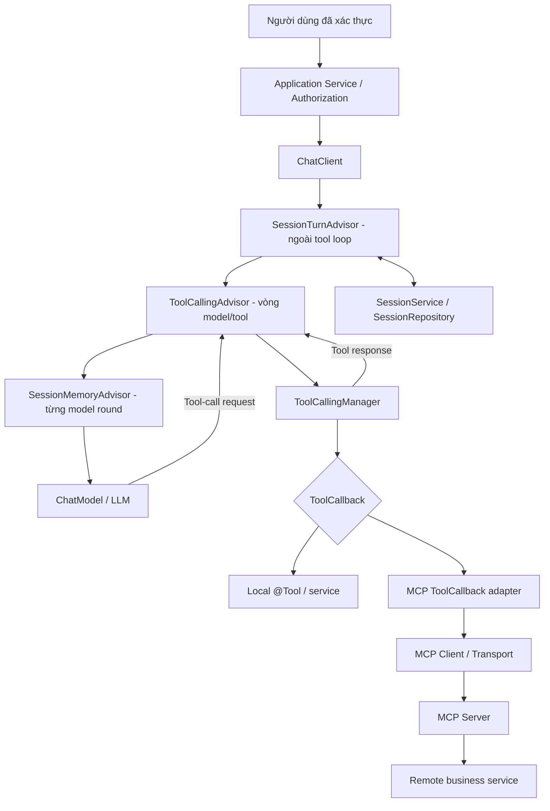
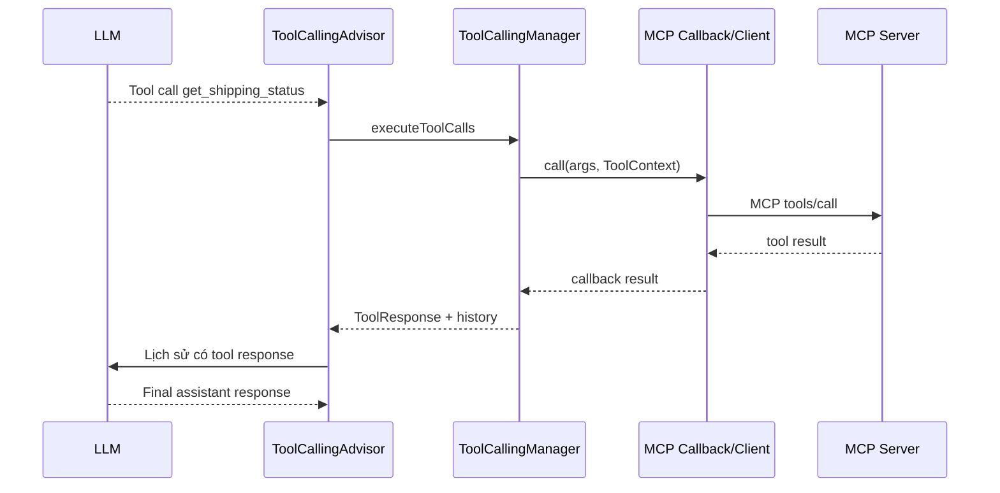
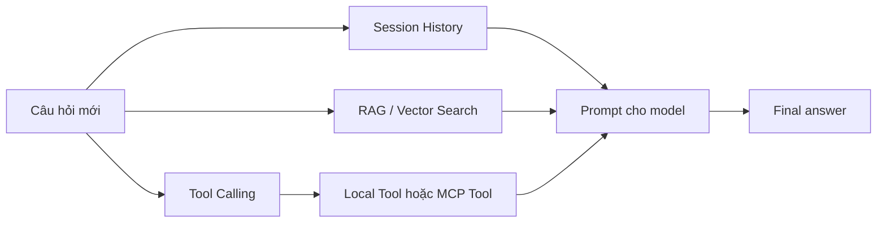

# Tích hợp dịch vụ

## Ranh giới của module Tool Calling với module MCP và Memory Advisors

Một ứng dụng Spring AI có thể sử dụng `@Tool` để tra cứu dữ liệu nghiệp vụ, kết nối tới nhiều MCP server và ghi nhớ lịch sử hội thoại. Ba chức năng này thường cùng xuất hiện trong một `ChatClient`, nhưng chúng có **hợp đồng, trạng thái và ranh giới tin cậy riêng**.

Trong module `SPRING_AI_TOOL_CALLING`, trọng tâm là việc mô hình tạo yêu cầu gọi công cụ; `ToolCallback` và `ToolCallingManager` thực thi yêu cầu; `ToolCallingAdvisor` tiếp tục gọi mô hình với các tool response. **MCP** là giao thức cung cấp tool/resources/prompts ở hệ thống khác, còn **Memory Advisors** là tầng nạp và lưu lịch sử. MCP không tự tạo vòng tool calling; Memory Advisor không tự chạy callback; và sự tồn tại của một tool không tự trao quyền truy cập cho người dùng.

Bài học này dựa trên Spring AI **2.1.0**, đồng thời nêu khác biệt chính với legacy `ChatMemory` ở 2.0.x và vòng thực thi trong `ChatModel` của 1.x.

### 1. Nhìn kiến trúc theo các ranh giới



| Câu hỏi | Tool Calling | MCP | Memory Advisors |
| --- | --- | --- | --- |
| Giải quyết việc gì? | Model yêu cầu công cụ, app thực thi, model tiếp tục | Giao thức kết nối tới tool/resource/prompt ở hệ thống ngoài | Nạp, ghi và thu gọn lịch sử hội thoại |
| Thành phần chính | `ToolCallback`, `ToolCallingManager`, `ToolCallingAdvisor` | MCP client/server, transport, `SyncMcpToolCallbackProvider` | `SessionService`, `SessionTurnAdvisor`, `SessionMemoryAdvisor` |
| Có tự quyết định quyền? | Không, service vẫn kiểm tra quyền | Không, MCP server và client cùng phải kiểm tra quyền | Không, app phải kiểm tra session owner/tenant |
| Có tự chạy lại model? | Có, khi qua `ToolCallingAdvisor` | Không | Memory advisor chạy trong các round mà tool loop tạo |
| Có lưu history lâu dài? | Chỉ history nội bộ của loop, tùy config | Không phải repository hội thoại | Có, tùy repository và retention |
| Có thể có side effect? | Có nếu callback thực hiện lệnh ghi | Có nếu remote MCP tool cho phép | Lưu sự kiện, không thực thi lệnh nghiệp vụ |

**Phân công trách nhiệm:** mô hình *đề nghị*; Spring AI *điều phối*; local service/MCP server *thực hiện*; memory *ghi lại và phát lại*. Không một thành phần nào tự đảm bảo cả authorization, transaction, retry, idempotency và audit.

### 2. `ToolCallback` là hợp đồng chung cho local tool và MCP tool

Dù tool đến từ method Java hay remote MCP server, `ToolCallingManager` làm việc với abstraction `ToolCallback`. Model thường nhận tên, mô tả, JSON Schema; khi trả tool call, callback tương ứng được gọi với arguments và `ToolContext`.

| Nguồn | Cách tích hợp | Chạy ở đâu |
| --- | --- | --- |
| Local method | Object có `@Tool` hoặc `MethodToolCallback` | Trong ứng dụng |
| Local function | `FunctionToolCallback` | Trong ứng dụng |
| MCP tool | `SyncMcpToolCallbackProvider`/provider async | Qua MCP client đến server ngoài |
| Custom tool | `ToolCallback` tự triển khai | Nơi adapter quyết định |

Ví dụ local tool:

```java
@Component
public class OrderTools {

    private final OrderService orders;

    public OrderTools(OrderService orders) {
        this.orders = orders;
    }

    @Tool(description = "Tra cứu đơn hàng người dùng hiện tại được phép xem")
    public OrderSummary lookupOrder(
            @ToolParam(description = "Mã đơn hàng") String orderId,
            ToolContext context) {

        String tenant = requiredTrustedContext(context, "tenantId");
        String user = requiredTrustedContext(context, "userId");

        return orders.findVisibleOrder(tenant, user, orderId);
    }
}
```

`requiredTrustedContext` là helper của ứng dụng, phải fail closed nếu scope thiếu hoặc không được xác thực. Model không được tự điền `tenantId` làm căn cứ phân quyền. Callback có thể dùng cùng schema với MCP tool nhưng remote tool thêm ranh giới mạng, credential, server policy và timeout.

### 3. MCP là giao thức, không phải cơ chế tool loop

MCP chuẩn hóa việc khám phá/call công cụ và các capability khác như resource, prompt, progress notification. Khi model yêu cầu `get_shipping_status`, đường xử lý đi qua:

1. `ToolCallingAdvisor` nhận response từ model chứa tool call.
2. `ToolCallingManager` tìm callback theo tên được gắn trong request.
3. MCP adapter chuyển arguments thành lời gọi MCP.
4. MCP client gửi request qua STDIO, SSE hoặc Streamable HTTP.
5. MCP server kiểm tra quyền và gọi service/datasource.
6. Adapter trả kết quả hoặc báo lỗi cho manager.
7. Advisor đưa tool response vào lịch sử rồi gọi model tiếp.



MCP server **không mặc nhiên biết session history của Spring AI** và không tự thay `ToolCallingAdvisor` quyết định bao nhiêu lần model được gọi. Một MCP resource cũng không tự biến thành `ChatMemory`. Nếu dùng resource làm ngữ cảnh prompt, cần bước tải/chọn/kiểm tra quyền riêng.

### 4. Tiêu thụ MCP tools qua Spring AI client starter

Spring AI MCP Client Starter có thể kết nối nhiều server và tạo `SyncMcpToolCallbackProvider` hoặc `AsyncMcpToolCallbackProvider`. Ví dụ:

```xml
<dependency>
    <groupId>org.springframework.ai</groupId>
    <artifactId>spring-ai-starter-mcp-client</artifactId>
</dependency>
```

```yaml
spring:
  ai:
    mcp:
      client:
        enabled: true
        type: SYNC
        request-timeout: 20s
        streamable-http:
          connections:
            shipping:
              url: https://shipping-mcp.example.internal
              endpoint: /mcp
```

Các địa chỉ chỉ mang tính minh họa. Trong production cần TLS, authentication, allowlist server, kết nối có timeout, retry budget và quyền hẹp. Spring AI cũng có `spring-ai-starter-mcp-client-webflux` cho transport WebFlux; client config chọn `SYNC` hoặc `ASYNC` nhất quán.

**Điểm dễ nhầm:** MCP starter tạo bean provider nhưng **không tự đăng ký các MCP callback vào mọi `ChatClient`**. Spring AI chủ động tránh eager listing của tất cả remote tools lúc khởi động. Ứng dụng phải truyền provider qua `.tools(mcpTools)` hoặc `.defaultTools(mcpTools)`.

```java
@Bean
ChatClient assistantClient(
        ChatModel model,
        SessionService sessionService) {

    return ChatClient.builder(model)
        .defaultAdvisors(SessionAdvisors.builder(sessionService).build())
        .build();
}
```

Đường gọi một request kết hợp local và remote:

```java
public String ask(
        ChatClient client,
        OrderTools localTools,
        SyncMcpToolCallbackProvider allowedMcpTools,
        String sessionId,
        String question,
        AuthenticatedScope currentUser) {

    requireOwnedSession(currentUser, sessionId);

    return client.prompt()
        .user(question)
        .tools(localTools, allowedMcpTools)
        .advisors(SessionAdvisors.session(sessionId))
        .toolContext(Map.of(
            "tenantId", currentUser.tenantId(),
            "userId", currentUser.userId()))
        .call()
        .content();
}
```

`AuthenticatedScope` và `requireOwnedSession` là phần ứng dụng. Trước khi gắn provider, phải xác định người dùng có quyền thấy những tool nào. Nếu nhiều tenant có quyền khác nhau, hãy lọc theo request; đừng dùng một danh sách mặc định quá rộng.

### 5. Phân biệt `.tools(...)`, `.defaultTools(...)` và resolver fallback

`ChatClient.builder(...).defaultTools(...)` đặt danh sách tool áp dụng cho mọi request của client. `prompt().tools(...)` **thêm vào defaults**, không thay thế defaults. Tool có tác dụng phá hủy hoặc rủi ro cao nên được gắn theo request khi có policy phù hợp.

```java
ChatClient client = ChatClient.builder(model)
    .defaultTools(readOnlyUtilities)
    .build();

String response = client.prompt()
    .user("Tra cứu trạng thái giao hàng")
    .tools(allowedMcpShippingTools)
    .call()
    .content();
```

`ToolCallbackResolver` phục vụ tìm callback theo tên trong các trường hợp phù hợp. Static resolver mặc định nhận các `ToolCallback` beans và callback của một số `ToolCallbackProvider`, **ngoại trừ MCP providers** để tránh liệt kê remote tool quá sớm. Resolution fallback mặc định `false`:

```properties
spring.ai.tools.resolution.fallback.enabled=false
```

Không bật fallback chỉ để sửa lỗi “MCP tool chưa được gắn request”: fallback có thể cho phép model gọi callback mà request không chủ đích công khai. Gắn MCP provider tường minh và kiểm soát quyền ở service/remote server.

### 6. Khám phá, lọc công cụ và giải quyết xung đột tên

Một ứng dụng có thể dùng nhiều MCP server, mỗi server có tool tên `search`. Spring AI có `McpToolFilter` để lọc theo connection và tool, cùng `DefaultMcpToolNamePrefixGenerator` để tránh trùng **giữa các MCP connections**. Tên local `@Tool` không được prefix generator MCP tự quản lý.

```java
@Component
public class TrustedShippingFilter implements McpToolFilter {

    @Override
    public boolean test(
            McpConnectionInfo connection,
            McpSchema.Tool tool) {

        return "trusted-shipping".equals(connection.clientInfo().name())
            && Set.of("get_eta", "get_shipping_status").contains(tool.name());
    }
}
```

Tên connection trong ví dụ phải được ánh xạ theo cấu hình thật. Bộ lọc này hoạt động ở phạm vi khám phá; nó **không thay thế authorization theo từng user**.

`ChatClient` kiểm tra danh sách callback sau khi hợp nhất local+MCP, ném `IllegalStateException` nếu còn hai tên trùng. Nhưng nếu tự gọi `ChatModel.call()`/`stream()` cùng `ToolCallingChatOptions` ghép thủ công, đường kiểm tra này không tự chạy. Cần tự gọi `ToolCallingChatOptions.validateToolCallbacks(...)` hoặc dùng namespace chắc chắn để tránh callback khác cùng tên được chọn nhầm.

MCP tool catalog lớn cũng gây tốn token và giảm độ chính xác lựa chọn tool. Spring AI 2.1 có `ToolSearchToolCallingAdvisor` để khám phá công cụ theo nhu cầu; vẫn phải xây allowlist trước khi cho model tìm, không biến tool search thành bypass quyền.

### 7. Hướng ngược lại: xuất công cụ của ứng dụng làm MCP server

Khi ứng dụng đóng vai MCP server, nó mở một **bề mặt API mới** cho client khác. Spring AI MCP Server Starter có thể quét các method `@McpTool` và công khai chúng cho MCP clients.

```xml
<dependency>
    <groupId>org.springframework.ai</groupId>
    <artifactId>spring-ai-starter-mcp-server-webmvc</artifactId>
</dependency>
```

```java
@Component
public class ShippingMcpApi {

    private final ShippingService shipping;

    public ShippingMcpApi(ShippingService shipping) {
        this.shipping = shipping;
    }

    @McpTool(description = "Tra cứu ETA của đơn hàng được phép xem")
    public EtaResult getEta(
            @McpToolParam(description = "Mã đơn hàng") String orderId) {

        // Kiểm tra MCP caller ở server boundary và service.
        return shipping.findEtaForAuthorizedCaller(orderId);
    }
}
```

`@McpTool` khác với việc chỉ gắn `@Tool` object vào `ChatClient.tools(...)`. Server cần xác thực MCP client, kiểm tra tenant/resource, rate limit, audit và idempotency. Có thể chuyển `ToolCallback` beans sang MCP tool specs qua converter của MCP server starter, nhưng phải kiểm soát callback nào được công khai và tránh re-expose remote MCP tools không có chủ đích.

### 8. `ToolContext` và MCP metadata: ranh giới dễ lộ thông tin

`ToolContext` chứa runtime data cho callback, như `tenantId`, `userId`, request reference hoặc nội dung xác thực. Mô hình không mặc nhiên nhìn thấy map này như schema/arguments, nhưng MCP callback có thể **chuyển nó ra server** qua `ToolContextToMcpMetaConverter`.

Spring AI 2.1 converter mặc định:
1. Loại khóa MCP exchange nội bộ.
2. Loại entry có giá trị `null`.
3. Chuyển **mọi context entry còn lại** sang MCP metadata.

Do đó, đừng đặt access token hoặc đối tượng principal trong context rồi giả định chúng không thể ra khỏi ứng dụng. Nếu remote tool không cần metadata, tắt hoàn toàn:

```java
@Configuration
public class McpMetadataConfiguration {

    @Bean
    ToolContextToMcpMetaConverter toolContextToMcpMetaConverter() {
        return ToolContextToMcpMetaConverter.noOp();
    }
}
```

Hoặc chỉ cho phép một mã tham chiếu ngẫu nhiên do server tạo:

```java
@Bean
ToolContextToMcpMetaConverter toolContextToMcpMetaConverter() {
    return context -> {
        if (context == null || context.getContext() == null) {
            return Map.of();
        }

        Object requestRef = context.getContext().get("requestRef");
        if (!(requestRef instanceof String ref)
                || !ref.matches("[A-Za-z0-9_-]{1,64}")) {
            return Map.of();
        }
        return Map.of("requestRef", ref);
    };
}
```

**Hai bean trên là hai phương án thay thế, không đăng ký cùng lúc.** `requestRef` không nên là session ID, bearer token hoặc email. Nếu MCP server cần biết end-user, truyền danh tính qua cơ chế xác thực transport có scope phù hợp, kiểm tra ở server. Không tin `tenantId` do model sinh như tool argument.

### 9. Security boundary không biến mất khi dùng chung callback

| Ranh giới | Kiểm tra trách nhiệm |
| --- | --- |
| Client → ứng dụng | Xác thực người dùng, lấy tenant/principal từ security context |
| Ứng dụng → ChatClient | Chỉ công khai tool được quyền dùng, kiểm tra session ownership |
| ChatClient → local tool | `ToolContext` từ server, kiểm tra quyền trong business service |
| ToolCallback → MCP client | Chọn server đã cho phép, TLS/timeout, lọc metadata |
| MCP client → MCP server | Scope credential, authorization trên tool/resource |
| MCP server → DB/API | Least privilege, validation, audit và idempotency |
| Remote result → LLM/memory | Chỉ giữ dữ liệu cần thiết, sanitize, chống prompt injection |

Tool discovery chỉ cho biết tool có tồn tại, không chứng minh caller được phép thực hiện. MCP server phải tự kiểm tra quyền vì còn những MCP clients khác có thể gọi trực tiếp.

Nếu nhiều request dùng chung một MCP connection/session, cần xác định danh tính theo **request**, không lưu mutable `userId`/`tenantId` vào field singleton callback. Session của MCP transport không đồng nghĩa session hội thoại của Spring AI.

### 10. Memory Advisors nằm ở đâu so với `ToolCallingAdvisor`?

Spring AI 2.1.0 khuyến nghị Session Memory mới; `ChatMemory` và `MessageChatMemoryAdvisor` đã deprecated. Vị trí advisor quyết định thành phần đó có thấy từng model round hay chỉ thấy kết quả cuối của toàn bộ lượt.

| Advisor | Order mặc định | Vị trí | Công việc |
| --- | --- | --- | --- |
| `SessionTurnAdvisor` | `HIGHEST_PRECEDENCE + 200` | Ngoài tool loop | Quản lý toàn bộ turn, kết thúc đặc biệt, compaction |
| `ToolCallingAdvisor` | `HIGHEST_PRECEDENCE + 300` | Chủ vòng model–tool | Thực thi tool calls và gọi model tiếp |
| `SessionMemoryAdvisor` | `HIGHEST_PRECEDENCE + 1000` | Trong tool loop | Nạp active view, ghi request/reply từng round |
| Legacy `MessageChatMemoryAdvisor` | `HIGHEST_PRECEDENCE + 200` | Ngoài loop mặc định | Lưu user/final assistant, không thấy tool traffic |

`SessionAdvisors.builder(sessionService).build()` tạo **cả** `SessionTurnAdvisor` lẫn `SessionMemoryAdvisor`. Nếu chỉ dùng Memory Advisor, tool result thuộc đường `returnDirect` có thể chưa được lưu và không có compaction. Nếu chỉ dùng Turn Advisor, nó không lưu toàn bộ message của một lượt model thông thường.

```java
ChatClient chatClient = ChatClient.builder(chatModel)
    .defaultAdvisors(SessionAdvisors.builder(sessionService).build())
    .build();

String answer = chatClient.prompt()
    .user("Đơn hàng ORD-2048 đã được giao chưa?")
    .advisors(SessionAdvisors.session(authorizedSessionId))
    .tools(localOrderTools, allowedMcpTools)
    .call()
    .content();
```

Với Session Memory trong loop, `DefaultChatClient` tự tắt internal history của auto-registered `ToolCallingAdvisor` để memory advisor dựng history của từng iteration. Nếu dùng custom advisor chain, hãy kiểm tra `conversationHistoryEnabled` và thứ tự chain, tránh nhân đôi history hoặc làm mất tool responses.

### 11. Sự khác nhau giữa Spring AI 1.x, 2.0.x và 2.1

| Phiên bản | Tool loop | Memory | Hệ quả |
| --- | --- | --- | --- |
| Spring AI 1.x | Vòng tool nằm trong `ChatModel` | Memory advisor không quan sát các call nội bộ | Cách manual loop và advisor khác 2.x |
| Spring AI 2.0.x | `ToolCallingAdvisor` trong `ChatClient`; `ChatModel` không tự gọi tool | `MessageChatMemoryAdvisor` theo advisor order | Ngoài loop chỉ lưu final exchange; trong loop phải chọn repository hỗ trợ tool messages |
| Spring AI 2.1.0 | `ToolCallingAdvisor` và `ToolCallingManager` | `SessionAdvisors` + `SessionService` | Event log lưu tool transcript và hỗ trợ turn-aware compaction |

Với legacy `MessageChatMemoryAdvisor` order +200, memory nạp history trước khi tool loop chạy và lưu user/final assistant sau khi loop kết thúc. Nếu muốn lưu tool calls trung gian, có thể đặt legacy advisor bên trong với order lớn hơn +300, nhưng storage phải hỗ trợ `ToolResponseMessage` và assistant tool-call requests.

Không phải mọi `ChatMemoryRepository` đều hỗ trợ. Spring AI 2.1 khuyến nghị Session Memory có JDBC Session Repository khi cần persistence bền vững cho đầy đủ tool messages.

### 12. Memory lưu gì và không lưu gì?

Một turn gồm local tool và MCP tool có thể có các message:

```text
UserMessage: Đơn ORD-2048 khi nào được giao?
AssistantMessage: tool call lookupOrder(id=call-01)
ToolResponseMessage: kết quả lookupOrder(id=call-01)
AssistantMessage: tool call getEta(id=call-02)
ToolResponseMessage: kết quả MCP getEta(id=call-02)
AssistantMessage: Dự kiến giao ngày mai.
```

| Thành phần | Phạm vi |
| --- | --- |
| Internal history của `ToolCallingAdvisor` | Message cần cho các iteration trong **một request** |
| `SessionMemoryAdvisor` | Message/events bền vững trong một session |
| `SessionTurnAdvisor` | Kết thúc turn, một số tool outcomes không có model round tiếp |
| MCP client | Remote protocol calls; **không** phải SessionRepository |
| MCP server | Dữ liệu và trạng thái riêng của dịch vụ ngoài |
| RAG/vector advisor | Tài liệu phù hợp query, không phải mặc định tool-call transcript |

**Tool response không đồng nghĩa final assistant answer.** Dữ liệu MCP trả về là kết quả của server; model có thể diễn giải nó sau đó. Để xác minh hành động hoặc side effect, xem business service/audit, không chỉ dựa vào lời diễn giải của model.

### 13. Giữ đúng cặp tool-call request và tool response

Provider thường yêu cầu assistant tool-call message phải có các tool responses tương ứng đúng call IDs. Nếu history chỉ lưu một nửa, model request tiếp theo có thể bị từ chối.

Spring AI Session Memory 2.1 bảo vệ tính toàn vẹn bằng cách:
- Ghi các tool calls và tool results ngay cả khi `MessageFilter` bỏ một số message thường.
- Đọc active view có cơ chế bỏ orphaned call/result khỏi prompt.
- Đặt window/compaction theo ranh giới turn.
- `SessionTurnAdvisor` lưu tool results khi loop kết thúc không có thêm model round, ví dụ `returnDirect` hoặc giới hạn tool calls.
- Khi turn trước kết thúc với open call chưa có result, advisor có thể ghi “không có kết quả được ghi” để đóng cặp cho lượt sau.

Thông báo chưa có kết quả **không chứng minh tool chưa từng chạy**. Một MCP server có thể đã thực hiện side effect trước khi kết nối bị timeout. Với lệnh ghi, dùng operation ID, idempotency và đối soát trạng thái remote.

### 14. Session ID là khóa lưu trữ, không phải quyền truy cập

`SessionAdvisors.session(sessionId)` chọn session nhưng không tự tạo ACL theo tenant/user. Khi session ID chưa có, advisor có thể tự tạo session ở lần sử dụng đầu tiên. API nên tách:

1. **Create:** server sinh ID, gắn owner và tenant từ security context.
2. **Resume:** tra session ID và kiểm tra owner, tenant, expiry.
3. **Run:** chỉ sau khi được phép mới gọi `SessionAdvisors.session(id)`.
4. **Read/list/export/delete:** áp dụng điều kiện authorization tương tự.

```java
public String continueConversation(
        AuthenticatedScope scope, String sessionId, String question) {

    Session session = sessionService.findById(sessionId);
    if (session == null || !ownershipService.canAccess(
            scope.tenantId(), scope.userId(), sessionId)) {
        throw new ResponseStatusException(HttpStatus.NOT_FOUND);
    }

    return chatClient.prompt()
        .user(question)
        .advisors(SessionAdvisors.session(session.id()))
        .tools(allowedToolsFor(scope))
        .call()
        .content();
}
```

`ownershipService` và `allowedToolsFor` thuộc ứng dụng. Với hệ thống đòi hỏi cô lập nghiêm ngặt, cần enforce tenant/owner ở storage boundary để ngăn race giữa kiểm tra và ghi, không chỉ kiểm tra trong controller. Session ID khó đoán không thay thế phân quyền.

### 15. Advisor context, `ToolContext` và MCP metadata không giống nhau

| Kênh | Cách truyền | Ai dùng? | Ghi chú |
| --- | --- | --- | --- |
| Advisor context | `.advisors(SessionAdvisors.session(id))` | Session advisors | Chọn memory/session |
| Tool context | `.toolContext(Map.of(...))` | Local hoặc MCP callback | Scope runtime, có thể ra ngoài qua converter |
| Model input | `.user(question)`, tool definitions | Model | Prompt và schema |
| MCP metadata | `ToolContextToMcpMetaConverter` | MCP server | Đi qua transport |
| MCP arguments | Tool-call JSON do model tạo | Tool handler | Không đáng tin, cần validation |

`SessionAdvisors.builder(sessionService).sessionIdInToolContext(true)` mặc định **tắt**. Khi bật, session ID được đưa vào tool context của mỗi tool, hữu ích cho session recall nhưng cũng có thể bị MCP converter đưa sang remote metadata. Chỉ bật khi có nhu cầu rõ và chính sách cho từng server.

`ToolContext` không phải token xác thực. Dữ liệu trong context phải được server tạo từ principal đã xác thực, và service vẫn phải kiểm tra quyền thật sự.

### 16. MCP Resources, RAG và Memory là ba dạng ngữ cảnh khác nhau

Ứng dụng có thể kết hợp:
- **Session Memory:** nhớ người dùng đã nói gì và các tool calls trước đó.
- **RAG/VectorStore:** tìm tài liệu liên quan đến câu hỏi mới.
- **MCP Resource:** tải nội dung từ MCP server.
- **MCP Tool:** thực thi truy vấn dữ liệu live hoặc lệnh có side effect.



Memory không tự thay API thời gian thực: nếu user hỏi trạng thái mới nhất, hãy gọi service thay vì chỉ lặp lại một tool result cũ. MCP resource không tự thêm vào history; cần adapter hoặc ứng dụng nạp nội dung có kiểm tra quyền.

Dữ liệu từ MCP, memory hoặc RAG có thể chứa prompt injection. Nó chỉ là **thông tin tham chiếu**, không được tự đổi tool allowlist, tenant scope hoặc authentication.

### 17. Chẩn đoán lỗi theo đúng tầng

| Triệu chứng | Tầng chịu trách nhiệm | Hướng xử lý |
| --- | --- | --- |
| Có MCP provider nhưng model không thấy tool | Registration | Gắn `.tools(mcpTools)` hoặc `.defaultTools(mcpTools)` |
| Model gọi sai tên tool | Catalog/schema/name | Kiểm tra filter, prefix và tên trùng |
| Model phát call nhưng không có execution | ToolCallingManager | Kiểm tra callback request, policy, resolver fallback |
| Remote call timeout | MCP client/transport | Deadline, server health, retry budget |
| Remote 401/403 | MCP authentication | Credential/tenant scope, không retry để vượt quyền |
| Model quên tool result từ lượt trước | Memory advisors | Session ID, order, repository, active view |
| Provider báo thiếu tool response | Session integrity | Cặp call/result IDs, filter hoặc interrupted turn |
| History lẫn tenant | App/storage authorization | ACL owner/tenant và cache namespace |
| Tool commit nhưng model không có result | Remote transaction/orchestration | Audit, idempotency và reconciliation |
| Hai turn cùng session xen kẽ | Session concurrency | Serialize per-session hoặc version check |

Không ghi raw MCP error, URL chứa token hoặc stack trace vào tool response rồi để Memory Advisor lưu chúng. Ánh xạ lỗi thành mã và thông báo an toàn.

### 18. Confirmation, `returnDirect` và call limit thuộc Tool Calling

- **Confirmation:** manager/advisor có thể tạm dừng khi tool cần người phê duyệt; việc model yêu cầu không đồng nghĩa callback đã chạy.
- **`returnDirect`:** tool result được trả cho caller, không nhất thiết có final model response; Turn Advisor giúp lưu đường kết thúc này.
- **Call limit:** giới hạn số lần gọi tool trong một turn; có thể xảy ra thành công một phần, không rollback tool đã chạy.

MCP server vẫn phải xác thực và authorize ngay khi lệnh được thực thi, kể cả caller đã phê duyệt. Memory lưu sự kiện, không tạo transaction phân tán giữa ứng dụng và MCP server.

### 19. Streaming, timeout và đồng thời

Với `ChatClient.stream()`, `ToolCallingAdvisor` vẫn sở hữu vòng model–tool. Một số provider phát arguments dạng partial `ToolCallPart`; không thực thi callback từ chunk chưa hoàn chỉnh.

Remote MCP callbacks có thể block do network/STDIO. Connection pool, timeout, bulkhead và retry thuộc MCP transport, callback và business service, không do memory advisor cung cấp.

**Một session không nên có hai turn đang chạy đồng thời.** Session docs cảnh báo một turn mới có thể xử lý open tool calls của turn cũ như đã bỏ dở; result đến muộn làm history không nhất quán. Serialize theo session ID hoặc xử lý version conflict có kiểm soát. Trong môi trường nhiều replica, lock chỉ trong JVM không đủ.

Hủy stream không đảm bảo remote side effect đã rollback. Lưu operation ID và trạng thái nghiệp vụ để đối soát.

### 20. Ma trận kiểm thử ba ranh giới

**Tool Calling ↔ MCP:**
- MCP tool có trong provider nhưng chưa gắn request: không được chạy.
- Gắn provider theo request: model thấy đúng tên/schema và callback gọi đúng server.
- Tool local và remote trùng tên: ChatClient phát hiện; manual loop có validation riêng.
- Filter discovery loại tool ngoài allowlist.
- `ToolContextToMcpMetaConverter` không chuyển secrets/session ID/principal raw.
- Timeout, 401/403, 429/5xx, disconnect đi vào đúng error policy; retry có giới hạn và idempotency.

**Tool Calling ↔ Memory:**
- Session không thuộc quyền caller không được gọi model/tool.
- Session lưu đủ `AssistantMessage` tool call, `ToolResponseMessage` và final answer.
- `returnDirect` và call-limit partial results không mất kết quả đã hoàn tất.
- Memory trong loop không nhân đôi history; compaction không cắt call/result.
- Hai session/tenant không đọc hoặc ghi chéo history.
- Concurrent turns cùng session được tuần tự hóa hoặc có version check.

**MCP ↔ Memory:**
- MCP server không đọc SessionRepository chỉ vì biết session ID.
- MCP response chứa prompt injection không thể sửa tool allowlist hoặc tenant scope.
- Sensitive data không lọt vào trace/log/cache ngoài policy.
- Xóa session hoặc hết TTL được phối hợp với các bản sao/history liên quan.

### 21. Checklist áp dụng

1. Quy định rõ tool đến từ local `@Tool`, `FunctionToolCallback` hay MCP provider.
2. Dùng một `ToolCallingAdvisor` cho vòng tự động; nếu manual loop, chịu trách nhiệm full history.
3. Gắn MCP provider tường minh, chọn tool theo policy của request.
4. Namespace tên và kiểm tra conflict giữa local với MCP.
5. Giữ resolver fallback tắt nếu không có yêu cầu được kiểm soát.
6. Tạo `ToolContext` từ security context, không từ model arguments.
7. Cấu hình converter MCP metadata bằng allowlist hoặc `noOp()`.
8. Bảo vệ MCP server/client bằng authentication, TLS, timeout và audit.
9. Dùng `SessionAdvisors` ở Spring AI 2.1, xác minh owner/tenant trước mỗi turn.
10. Giữ đúng cặp tool call/result trong history, kể cả đường `returnDirect`.
11. Không nhầm MCP resource, RAG document và tool result với final answer.
12. Thiết kế retry, confirmation, limit, idempotency theo từng tầng.
13. Tuần tự hóa các lượt cùng session, kiểm thử multi-tenant và cancellation.
14. Giảm thiểu dữ liệu nhạy cảm được chuyển tới model, MCP, memory và logs.

### Kết luận

**Tool Calling điều phối hành động của mô hình; MCP là kết nối giao thức tới hệ thống ngoài; Memory Advisors duy trì ngữ cảnh qua nhiều lượt.** Chúng hoạt động cùng nhau nhưng không tự thay nhau kiểm tra quyền, quyết định commit, quản lý credential hoặc bảo vệ dữ liệu. Việc phân biệt đúng ranh giới giúp ứng dụng kết hợp công cụ nội bộ và remote an toàn, giữ lịch sử đúng cấu trúc và kiểm thử từng tầng độc lập.

### Tài liệu tham khảo

- [Spring AI 2.1.0 — Tool Calling](https://docs.spring.io/spring-ai/reference/api/tools.html)
- [Spring AI 2.1.0 — ToolCallingAdvisor](https://docs.spring.io/spring-ai/reference/api/tools/tool-calling-advisor.html)
- [Spring AI 2.1.0 — MCP Client Boot Starter](https://docs.spring.io/spring-ai/reference/api/mcp/mcp-client-boot-starter-docs.html)
- [Spring AI 2.1.0 — MCP Server Boot Starter](https://docs.spring.io/spring-ai/reference/api/mcp/mcp-streamable-http-server-boot-starter-docs.html)
- [Spring AI 2.1.0 — Session Memory](https://docs.spring.io/spring-ai/reference/api/session.html)
- [Spring AI 2.1.0 — Session ChatClient Integration](https://docs.spring.io/spring-ai/reference/api/session/chat-client.html)
- [Spring AI 2.1.0 — Legacy Chat Memory](https://docs.spring.io/spring-ai/reference/api/chat-memory.html)
- [Spring AI 2.1.0 — Advisors API](https://docs.spring.io/spring-ai/reference/api/advisors.html)

Các helper như `requiredTrustedContext`, `AuthenticatedScope`, `requireOwnedSession` và `allowedToolsFor` là các thành phần ứng dụng tự xây dựng. Các ví dụ tập trung vào ranh giới và trách nhiệm trong Spring AI 2.1.0; trước khi đưa vào production cần kiểm tra phiên bản dependency, transport MCP, ACL session và chính sách dữ liệu cụ thể.


