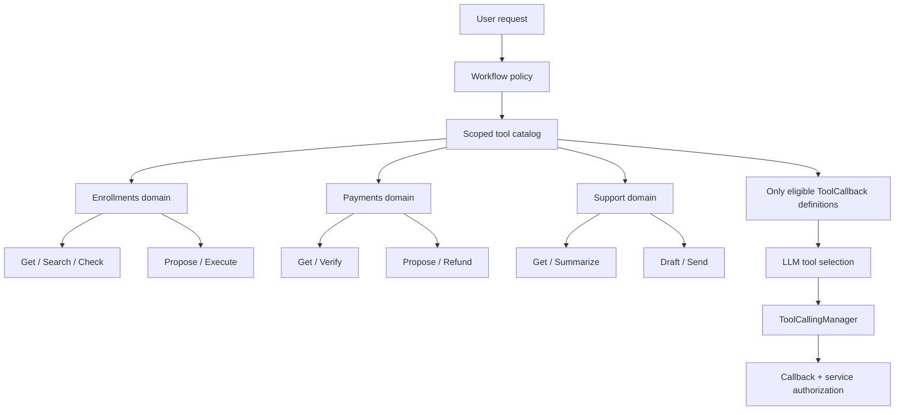
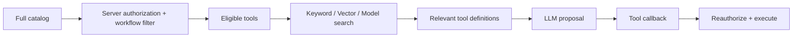

# Nhóm công cụ theo miền nghiệp vụ và tác vụ

Khi một ứng dụng mới tích hợp vài công cụ vào Spring AI, việc truyền trực tiếp một danh sách `@Tool` cho `ChatClient` thường đủ dùng. Tuy nhiên, khi hệ thống có hàng chục hoặc hàng trăm công cụ thuộc nhiều bộ phận, danh sách phẳng bắt đầu gây khó khăn: mô hình thấy nhiều tên gần giống nhau, input schema chiếm context, công cụ không liên quan xuất hiện trong cuộc hội thoại và rất khó kiểm soát quyền theo từng tác vụ.

Trong module **SPRING_AI_TOOL_CALLING**, mô hình ngôn ngữ chỉ **đề xuất** gọi công cụ thông qua tên và arguments; ứng dụng giữ `ToolCallback` và quyết định thực thi. Vì thế, cách nhóm công cụ không chỉ là cách tổ chức Java package. Nó ảnh hưởng tới khả năng chọn đúng công cụ, số token gửi cho mô hình, độ phức tạp của việc điều phối, giới hạn quyền và khả năng kiểm thử tích hợp với dịch vụ nghiệp vụ.

Bài học hướng dẫn thiết kế danh mục theo **miền nghiệp vụ** (*business domain*) và **tác vụ** (*task/operation*), sau đó chọn tập công cụ phù hợp với từng workflow và quyền của caller. Ta sẽ dùng `@Tool`, `ToolCallbacks`, `ToolCallback`, `ToolCallbackProvider` và `ToolContext` của Spring AI, đồng thời tìm hiểu `ToolSearchToolCallingAdvisor` trong Spring AI 2.1.0 để tìm công cụ theo nhu cầu mà không phải đưa toàn bộ schema vào mỗi request.

Sau bài học, bạn có thể:

- Phân loại danh mục công cụ bằng các trục miền nghiệp vụ, tác vụ và mức rủi ro.
- Thiết kế tên, mô tả và schema nhất quán, tránh công cụ trùng nghĩa hoặc trùng tên.
- Tách nhóm đọc, lập đề xuất, thực hiện và quản trị trong cùng miền nghiệp vụ.
- Tạo registry có metadata riêng của ứng dụng và chọn công cụ cho từng request.
- Phân biệt `.defaultTools(...)` và `.tools(...)` trên `ChatClient`.
- Biết khi nào dùng `ToolCallbackProvider`, MCP, công cụ tìm kiếm và router theo workflow.
- Giữ kiểm soát quyền ở callback/service ngay cả khi catalog đã lọc công cụ.
- Kiểm thử lựa chọn, phân quyền, cập nhật danh mục và hiệu năng của catalog lớn.

## 1. Vì sao danh sách công cụ phẳng khó mở rộng?

Giả sử nền tảng học tập có các nhóm dịch vụ: học viên, khóa học, đăng ký học, hóa đơn, thanh toán, hỗ trợ và thông báo. Mỗi nhóm có công cụ tra cứu, tìm kiếm, tổng hợp, tạo đề xuất, cập nhật và hủy. Nếu lấy trung bình 8 công cụ cho 7 nhóm, assistant có thể nhận 56 định nghĩa công cụ trong mỗi lần gọi mô hình.

Một định nghĩa thường gồm tên, description và JSON input schema. Khi đưa tất cả vào prompt, các vấn đề sau dễ xuất hiện:

- **Tốn context và chi phí:** model nhận cả schema của những hành động không liên quan.
- **Chọn sai công cụ:** `getEnrollment`, `lookupEnrollment`, `searchEnrollment` dễ bị nhầm nếu ranh giới không rõ.
- **Khó mở rộng theo nhóm phát triển:** nhiều team có thể tạo công cụ cùng tên.
- **Khó kiểm soát rủi ro:** công cụ đọc báo cáo và công cụ hoàn tiền xuất hiện trong cùng bộ mặc định.
- **Khó kiểm thử:** một thay đổi description hoặc schema có thể ảnh hưởng nhiều workflow không liên quan.
- **Khó quản lý vòng đời:** công cụ bị đổi tên, ngừng hoạt động hoặc thu hồi quyền nhưng vẫn còn trong danh mục cũ.

Không có con số cố định mà tại đó danh mục trở nên “quá lớn”; điều này phụ thuộc model, độ dài schema và mức trùng lặp nghiệp vụ. Dấu hiệu cần chia nhóm là độ chính xác chọn tool giảm, context chứa nhiều định nghĩa không dùng tới hoặc khó đảm bảo mỗi workflow chỉ thấy công cụ hợp lệ.

## 2. Hai trục chính: miền nghiệp vụ và tác vụ

**Miền nghiệp vụ** trả lời câu hỏi “công cụ tác động lên đối tượng nào và team nào sở hữu?”. Ví dụ: `students`, `courses`, `enrollments`, `billing`, `payments`, `support`.

**Tác vụ** trả lời câu hỏi “công cụ làm gì?”. Ví dụ: `get`, `search`, `summarize`, `propose`, `approve`, `execute`, `cancel`. Có thể coi các hành động này là một chuỗi từ đọc thông tin tới tạo tác động thực tế.

| Miền | Đọc/tra cứu | Phân tích | Đề xuất | Thực hiện |
|---|---|---|---|---|
| Khóa học (`courses`) | `courses_get_details` | `courses_compare_options` | `courses_propose_schedule` | `courses_publish_schedule` |
| Đăng ký (`enrollments`) | `enrollments_get_status` | `enrollments_check_eligibility` | `enrollments_propose_change` | `enrollments_execute_change` |
| Thanh toán (`payments`) | `payments_get_receipt` | `payments_check_refundability` | `payments_propose_refund` | `payments_execute_refund` |
| Hỗ trợ (`support`) | `support_get_ticket` | `support_summarize_ticket` | `support_draft_reply` | `support_send_reply` |

Đây là ví dụ **quy ước thiết kế của ứng dụng**, không phải tập tên mà Spring AI tự sinh. Mỗi tên phải duy nhất trong tập công cụ mà model có thể gọi trong một request. Nếu hai team đều dùng `get_status`, chúng cần tên đủ đặc trưng, chẳng hạn `payments_get_status` và `enrollments_get_status`.

## 3. Thêm trục thứ ba: mức rủi ro

Chỉ nhóm theo miền và tác vụ chưa đủ để ra quyết định cấp quyền. Hai công cụ trong cùng miền `payments` có tác động rất khác nhau:

| Nhóm rủi ro do ứng dụng định nghĩa | Ví dụ | Cách công khai |
|---|---|---|
| `READ` | Lấy trạng thái thanh toán | Cung cấp khi caller có quyền đọc |
| `ANALYZE` | Phân tích các khoản phí | Cung cấp khi caller có quyền truy cập dữ liệu đầu vào |
| `PROPOSE` | Lập đề xuất hoàn tiền | Cung cấp khi workflow cho phép lập đề xuất |
| `WRITE` | Thay đổi thông tin thanh toán | Chỉ cung cấp cho workflow có quyền ghi; callback xác thực lại |
| `HIGH_IMPACT` | Thực hiện hoàn tiền hoặc xóa dữ liệu | Quyền cụ thể, phê duyệt và kiểm tra điều kiện tại service |

Các giá trị `READ`, `PROPOSE`, `HIGH_IMPACT` là metadata **riêng của ứng dụng**, không phải enum sẵn có của Spring AI. Spring AI biết `ToolDefinition` và `ToolMetadata` như `requiresConfirmation`, `returnDirect`; một hệ thống nhiều công cụ thường cần thêm registry nghiệp vụ để lưu miền, tác vụ, quyền và người sở hữu.

Một công cụ `propose` cũng có thể ghi bản nháp, giữ chỗ hoặc tiêu tốn tài nguyên. Vì vậy đừng mặc định `PROPOSE` luôn an toàn: phải phân loại theo side effect thực tế và kiểm tra nghiệp vụ tương ứng.

## 4. Đặt ranh giới theo bounded context

Một miền nên tương ứng tương đối với khả năng nghiệp vụ có người sở hữu rõ ràng. Ví dụ:

- `EnrollmentTools` quản lý trạng thái đăng ký học, không truy cập trực tiếp bảng thanh toán.
- `PaymentTools` kiểm tra và tạo giao dịch, không tự sửa tiến độ học tập.
- `NotificationTools` tạo hoặc gửi thông báo, không tự quyết định người học đủ điều kiện được hoàn tiền.

Nếu một hành động cần dữ liệu từ nhiều miền, hãy đặt orchestration ở application service hoặc workflow service. Không nên tạo một tool tên `doEverything` vừa cập nhật đăng ký vừa trừ tiền vừa gửi email mà không thể diễn giải từng bước. Trường hợp nghiệp vụ yêu cầu một giao dịch thống nhất, có thể tạo composite tool với hợp đồng rõ ràng, idempotency và cơ chế bù trừ.

Sơ đồ tổ chức:



Workflow policy quyết định tập ứng viên. Mô hình chỉ chọn trong tập công cụ đã được ứng dụng cung cấp. Service vẫn chịu trách nhiệm xác thực quyền trên bản ghi và kiểm tra điều kiện lúc thực thi.

## 5. Quy ước tên công cụ

Một quy ước dễ quản lý là:

```text
<domain>_<operation>_<resource-or-qualifier>

enrollments_get_status
enrollments_check_eligibility
enrollments_propose_change
enrollments_execute_change
payments_get_receipt
payments_propose_refund
payments_execute_refund
support_draft_reply
support_send_reply
```

Nên dùng tên ASCII, ổn định và nhất quán vì provider có thể áp dụng giới hạn độ dài hoặc tập ký tự. Mô tả tool bằng tiếng Việt hoặc tiếng Anh đều được, miễn phù hợp ngôn ngữ người dùng và mô hình. Đừng nhồi mọi metadata vào tên; domain, task, risk, owner và version có thể lưu trong registry.

Tránh các mẫu sau:

| Tên khó dùng | Vì sao khó dùng? | Tên rõ hơn |
|---|---|---|
| `update` | Không biết cập nhật đối tượng nào | `enrollments_update_status` |
| `getSomething` | Không nói dữ liệu trả về | `courses_get_outline` |
| `refund` ở hai hệ thống | Dễ trùng tên tool | `payments_execute_refund` |
| `performAction` | Mô tả quá rộng, khó đánh giá rủi ro | `support_send_reply` |
| `admin_tool_2` | Không có ý nghĩa nghiệp vụ | `admin_revoke_access` |

Tên là một phần của giao diện mà mô hình sử dụng. Khi đổi tên, cần cập nhật tests, workflow policies, analytics, prompt examples và những paused conversations còn lưu tên cũ.

## 6. Description là hợp đồng lựa chọn

`ToolDefinition` của Spring AI đưa cho mô hình ba phần chính: `name`, `description` và `inputSchema`. Model dựa vào chúng để quyết định khi nào gọi công cụ và cách tạo arguments.

Description tốt nên nêu:

1. Đối tượng nghiệp vụ và kết quả đầu ra.
2. Khi nào nên dùng.
3. Khi nào không nên dùng hoặc giới hạn quan trọng.
4. Tác động phụ, nếu có.
5. Dữ liệu nào cần thiết để thực thi.

Ví dụ:

```java
@Tool(
    name = "enrollments_get_status",
    description = "Tra cứu trạng thái đăng ký học theo mã đăng ký. "
        + "Chỉ đọc dữ liệu, không thay đổi trạng thái."
)
public EnrollmentStatusView getStatus(
        @ToolParam(description = "Mã đăng ký học") String enrollmentId,
        ToolContext context) {
    // Service thực hiện kiểm tra quyền theo user/tenant từ context.
    return enrollmentService.findVisibleStatus(enrollmentId, context);
}
```

Không dùng description để hứa quyền mà code không kiểm tra. Câu “chỉ dùng cho quản trị viên” trong mô tả không ngăn model gọi tool và không thay thế authorization trong service.

## 7. JSON input schema phải phân biệt được các công cụ gần nhau

Schema nên ngắn gọn, rõ tên trường và đủ ràng buộc để model không phải đoán. Ví dụ `enrollments_get_status` chỉ cần `enrollmentId`, trong khi `enrollments_search` có thể dùng `studentId`, `courseId`, `status` và pagination.

Trong Spring AI, tham số có thể mô tả bằng `@ToolParam`; mặc định tham số là required. Dùng `required = false` hoặc annotation nullable được hỗ trợ khi nó thật sự optional. Không khai báo một tham số required mà model không có cách tìm giá trị vì điều đó khuyến khích nó bịa giá trị.

```java
@Tool(
    name = "enrollments_search",
    description = "Tìm đăng ký học theo bộ lọc; không dùng để cập nhật hồ sơ."
)
public List<EnrollmentSummary> search(
        @ToolParam(description = "Mã học viên", required = false) String studentId,
        @ToolParam(description = "Mã khóa học", required = false) String courseId,
        ToolContext context) {
    return enrollmentService.searchVisible(studentId, courseId, context);
}
```

Ràng buộc schema hỗ trợ lựa chọn và kiểm tra định dạng. **Validation nghiệp vụ và authorization phải được thực thi ở callback/service**. Đừng để `userId`, `tenantId`, `role` hoặc `isAdmin` trở thành tool arguments do model tự quyết định.

## 8. Dùng `@Tool` để tạo nhóm theo domain trong Java

Mỗi lớp Java có thể đại diện một miền và mức tác động. Ví dụ một nhóm chỉ đọc:

```java
@Component
public class EnrollmentReadTools {

    private final EnrollmentService service;

    public EnrollmentReadTools(EnrollmentService service) {
        this.service = service;
    }

    @Tool(
        name = "enrollments_get_status",
        description = "Đọc trạng thái đăng ký học trong tenant hiện tại."
    )
    public EnrollmentStatusView getStatus(
            @ToolParam(description = "Mã đăng ký") String enrollmentId,
            ToolContext context) {

        CallerContext caller = (CallerContext) context.getContext().get("caller");
        return service.getStatusForCaller(enrollmentId, caller);
    }

    @Tool(
        name = "enrollments_check_eligibility",
        description = "Kiểm tra người học có đủ điều kiện đổi lớp hay không; chỉ đọc."
    )
    public EligibilityResult checkEligibility(
            @ToolParam(description = "Mã đăng ký") String enrollmentId,
            ToolContext context) {

        CallerContext caller = (CallerContext) context.getContext().get("caller");
        return service.checkEligibility(enrollmentId, caller);
    }
}
```

Nhóm tác vụ ghi có thể ở lớp khác:

```java
@Component
public class EnrollmentChangeTools {

    private final EnrollmentWorkflow workflow;

    public EnrollmentChangeTools(EnrollmentWorkflow workflow) {
        this.workflow = workflow;
    }

    @Tool(
        name = "enrollments_propose_change",
        description = "Tạo đề xuất đổi lớp để người dùng kiểm tra trước khi áp dụng."
    )
    public ProposalView propose(
            @ToolParam(description = "Mã đăng ký") String enrollmentId,
            @ToolParam(description = "Mã lớp đích") String targetClassId,
            ToolContext context) {
        return workflow.propose(enrollmentId, targetClassId, context);
    }

    @Tool(
        name = "enrollments_execute_change",
        description = "Thực hiện đề xuất đổi lớp đã được xác nhận; có thay đổi dữ liệu.",
        requiresConfirmation = true
    )
    public ChangeResult execute(
            @ToolParam(description = "Mã đề xuất đã lưu ở server") String proposalId,
            ToolContext context) {
        return workflow.executeApproved(proposalId, context);
    }
}
```

`requiresConfirmation` giúp Spring AI 2.1.0 dừng trước khi gọi công cụ và chờ quyết định từ người duyệt. Nó không tự xác thực người duyệt, không bảo vệ proposal khỏi bị replay và không thay thế kiểm tra quyền hoặc kiểm tra dữ liệu đã thay đổi. `workflow.executeApproved` vẫn phải xác minh caller, trạng thái proposal, tính mới và idempotency trước khi commit.

## 9. Dùng `ToolCallbacks.from(...)` để chuyển nhóm thành callback

`ToolCallbacks.from(...)` chuyển các phương thức `@Tool` trên POJO thành các `ToolCallback`. Khi đó ta có thể đưa callback vào registry nghiệp vụ hoặc truyền trực tiếp cho `ChatClient`:

```java
ToolCallback[] readCallbacks = ToolCallbacks.from(enrollmentReadTools);
ToolCallback[] changeCallbacks = ToolCallbacks.from(enrollmentChangeTools);

String answer = chatClient.prompt()
    .user("Đăng ký EN-104 của tôi đang ở trạng thái nào?")
    .tools(readCallbacks)
    .toolContext(Map.of("caller", authenticatedCaller))
    .call()
    .content();
```

Với một câu hỏi tra cứu, chỉ nhóm đọc được đính kèm. Nhóm thay đổi vẫn được định nghĩa trong ứng dụng nhưng không cần được đưa vào request đó.

Nếu callback tạo từ nhiều đối tượng bị trùng tên, Spring AI có thể báo lỗi khi tạo callback. Nên kiểm tra tên trùng ở bước xây catalog để lỗi rõ ràng và phát hiện trước khi request tới model.

## 10. Metadata catalog do ứng dụng quản lý

Để phân nhóm một danh mục lớn, mỗi callback nên có descriptor riêng:

```java
public enum Domain {
    ENROLLMENTS, PAYMENTS, SUPPORT
}

public enum Task {
    READ, ANALYZE, PROPOSE, EXECUTE
}

public enum Risk {
    LOW, MEDIUM, HIGH
}

public record ToolEntry(
    Domain domain,
    Task task,
    Risk risk,
    String requiredPermission,
    String ownerTeam,
    ToolCallback callback
) {
    public String name() {
        return callback.getToolDefinition().name();
    }
}
```

`ToolEntry` không phải interface của Spring AI. Nó là lớp quản trị riêng của ứng dụng, liên kết một `ToolCallback` với domain/task/risk/scope và team chịu trách nhiệm.

Với danh mục lớn, có thể bổ sung `schemaVersion`, `enabled`, `deprecated`, `eligibleWorkflows`, `timeout`, `rateLimit`, `dataClassification`, `requiresApproval` và `auditCategory`. Không cần đưa tất cả các field này vào `ToolDefinition` gửi cho model; nhiều field chỉ phục vụ policy, vận hành và kiểm thử nội bộ.

## 11. Tạo registry kiểm tra tên trùng từ lúc khởi động

Một registry đơn giản có thể tạo index theo tên và từ chối duplicate ngay khi ứng dụng khởi động:

```java
public final class ScopedToolCatalog {

    private final List<ToolEntry> entries;
    private final Map<String, ToolEntry> byName;

    public ScopedToolCatalog(List<ToolEntry> entries) {
        this.entries = List.copyOf(entries);
        Map<String, ToolEntry> unique = new LinkedHashMap<>();

        for (ToolEntry entry : this.entries) {
            Objects.requireNonNull(entry.callback(), "ToolCallback is required");
            String name = entry.name();
            if (name == null || name.isBlank()) {
                throw new IllegalArgumentException("Tool name must not be blank");
            }
            if (unique.putIfAbsent(name, entry) != null) {
                throw new IllegalArgumentException("Duplicate tool name: " + name);
            }
        }

        this.byName = Map.copyOf(unique);
    }

    public ToolEntry require(String name) {
        ToolEntry entry = byName.get(name);
        if (entry == null) {
            throw new IllegalArgumentException("Unknown catalog tool: " + name);
        }
        return entry;
    }

    public List<ToolEntry> entries() {
        return entries;
    }
}
```

Ví dụ đăng ký những callback đã được tạo:

```java
ToolCallback[] callbacks = ToolCallbacks.from(
    enrollmentReadTools,
    enrollmentChangeTools
);

Map<String, ToolCallback> callbacksByName = Arrays.stream(callbacks)
    .collect(Collectors.toMap(
        cb -> cb.getToolDefinition().name(),
        Function.identity()
    ));

ScopedToolCatalog catalog = new ScopedToolCatalog(List.of(
    new ToolEntry(Domain.ENROLLMENTS, Task.READ, Risk.LOW,
        "enrollment:read", "Enrollment Team",
        callbacksByName.get("enrollments_get_status")),
    new ToolEntry(Domain.ENROLLMENTS, Task.READ, Risk.LOW,
        "enrollment:read", "Enrollment Team",
        callbacksByName.get("enrollments_check_eligibility")),
    new ToolEntry(Domain.ENROLLMENTS, Task.PROPOSE, Risk.MEDIUM,
        "enrollment:propose", "Enrollment Team",
        callbacksByName.get("enrollments_propose_change")),
    new ToolEntry(Domain.ENROLLMENTS, Task.EXECUTE, Risk.HIGH,
        "enrollment:write", "Enrollment Team",
        callbacksByName.get("enrollments_execute_change"))
));
```

Trong production, hãy dùng factory/helper kiểm tra callback không null ngay khi tra từ `callbacksByName`; ví dụ `Objects.requireNonNull(callbacksByName.get(name), name)`. Nếu catalog lấy metadata từ cấu hình, schema thay đổi cần có migration và kiểm tra trước khi triển khai.

## 12. Chọn đúng công cụ cho từng workflow

Đừng yêu cầu mô hình tự xác định toàn bộ quyền được cấp. Ứng dụng đã biết route, actor, tenant và workflow đang được phép thì phải dùng dữ liệu đó để lọc catalog.

Ví dụ một workflow có danh sách domain và task cho phép:

```java
public record WorkflowPolicy(
    Set<Domain> domains,
    Set<Task> tasks
) {}

public ToolCallback[] selectTools(
        ScopedToolCatalog catalog,
        WorkflowPolicy workflow,
        CallerContext caller) {

    return catalog.entries().stream()
        .filter(entry -> workflow.domains().contains(entry.domain()))
        .filter(entry -> workflow.tasks().contains(entry.task()))
        .filter(entry -> caller.permissions().contains(entry.requiredPermission()))
        .map(ToolEntry::callback)
        .toArray(ToolCallback[]::new);
}
```

Ví dụ chọn nhóm cho các màn hình:

| Workflow được server xác định | Domain hợp lệ | Task tối đa |
|---|---|---|
| Xem đăng ký học | `ENROLLMENTS` | `READ` |
| Xem điều kiện và lập đề xuất đổi lớp | `ENROLLMENTS` | `READ`, `ANALYZE`, `PROPOSE` |
| Thực hiện đề xuất đã duyệt | `ENROLLMENTS` | `READ`, `EXECUTE` với quyền ghi và confirmation |
| Tra cứu hoàn tiền | `PAYMENTS` | `READ`, `ANALYZE` |
| Gửi trả lời hỗ trợ | `SUPPORT` | `READ`, `PROPOSE`, `EXECUTE` theo quyền và phê duyệt |

`CallerContext.permissions()` trong ví dụ đại diện cho quyền đã được server xác thực và cấp tại thời điểm request. Không lấy permissions từ câu trả lời của mô hình hoặc tool arguments. Đây là lớp lọc catalog; callback/service vẫn phải kiểm tra quyền cụ thể trên đối tượng ngay trước khi thực hiện.

Nếu quyền thay đổi trong lúc hội thoại đang chạy, phải áp dụng lại policy khi bắt đầu lượt mới. Với tool call đang tạm dừng để xác nhận, service kiểm tra lại quyền khi resume.

## 13. Đưa nhóm đã chọn vào `ChatClient`

Với `ChatClient`, cung cấp callback theo từng request:

```java
ToolCallback[] allowedTools = selectTools(catalog, workflowPolicy, caller);

String answer = chatClient.prompt()
    .user(question)
    .tools(allowedTools)
    .toolContext(Map.of("caller", caller))
    .call()
    .content();
```

Ở đây `chatClient` được xây dựng không có các default tool nhạy cảm. `.tools(...)` trên `ChatClient` **bổ sung** vào `.defaultTools(...)`; nó không ghi đè tập default. Vì vậy, nếu client đã đặt `payments_execute_refund` làm default thì việc request chỉ truyền nhóm đăng ký học không làm công cụ hoàn tiền biến mất.

Một cách thiết kế an toàn:

- Dùng client mặc định không có công cụ, hoặc chỉ có một số công cụ đọc phù hợp mọi caller.
- Chọn danh sách cho phép theo workflow và quyền server rồi dùng `.tools(...)` ở request.
- Với nhóm rủi ro cao, dùng một client hoặc luồng riêng có confirmation và chính sách kiểm toán.
- Không trộn công cụ quản trị vào danh mục mặc định của assistant dành cho người học.

Lưu ý thêm: khi dùng `ChatModel` trực tiếp, request-level `ToolCallingChatOptions` thay thế model defaults thay vì cộng thêm giống `ChatClient`. Nên viết test kiểm tra chính xác danh sách tool cuối cùng mà model nhận, thay vì giả định hai API có cùng quy tắc gộp.

## 14. Phân lớp bộ lọc: business policy trước, tìm kiếm sau

Trong catalog lớn, thường cần hai thao tác khác nhau:

1. **Eligibility filter:** dựa trên quyền, tenant, workflow và trạng thái tính năng để loại công cụ không được phép.
2. **Relevance selection:** từ tập đã được phép, tìm các công cụ có khả năng xử lý yêu cầu nhất.



Relevance selection có thể không chính xác. Một semantic search hoặc router mô hình chọn nhầm `payments_execute_refund` không được biến một hành động thiếu quyền thành hợp lệ. Công cụ đó phải bị loại ngay từ eligibility filter và callback vẫn xác thực quyền trước khi thực thi.

Một quy tắc hữu ích: **hệ thống tìm kiếm không được nâng quyền**. Nó chỉ có quyền thu hẹp tập công cụ đã qua kiểm tra của ứng dụng.

## 15. Khi nào dùng `ToolCallbackProvider`?

`ToolCallbackProvider` cung cấp nhiều callback từ một nguồn. Nó phù hợp khi cần đóng gói một nhóm tool theo miền hoặc lấy tool từ service/MCP server. `ChatClient` 2.1.0 chấp nhận cả POJO có `@Tool`, `ToolCallback` và `ToolCallbackProvider` trong `.tools(...)` hoặc `.defaultTools(...)`.

Ví dụ đăng ký provider cho một nhóm callback:

```java
@Configuration(proxyBeanMethods = false)
class EnrollmentToolConfiguration {

    @Bean
    ToolCallbackProvider enrollmentToolProvider(
            EnrollmentReadTools readTools,
            EnrollmentChangeTools changeTools) {

        ToolCallback[] callbacks = ToolCallbacks.from(readTools, changeTools);
        return ToolCallbackProvider.from(callbacks);
    }
}
```

Provider là nguồn sinh/danh sách callback; nó không tự kiểm tra quyền theo actor trong từng request. Nếu provider chứa cả công cụ đọc và ghi, không truyền toàn bộ provider vào một request chỉ đọc. Có thể tách `enrollmentReadProvider` và `enrollmentWriteProvider`, hoặc lọc callback thu được bằng registry/policy trước khi đính kèm.

`ToolCallback` bean cũng có thể được Spring AI đưa vào `ToolCallbackResolver`. Tuy nhiên, có mặt trong bean registry không có nghĩa mọi request được phép thực thi nó. Tập tool attached trong request mới là ranh giới mặc định khi resolution fallback bị tắt.

## 16. Dynamic catalog và `ToolCallbackResolver`

Trong hệ thống có nhiều module hoặc plugin, một số callback được tải động. `ToolCallbackResolver` có nhiệm vụ phân giải callback theo tên, còn application catalog cần quản lý metadata, quyền và lifecycle.

```java
public interface ToolCallbackResolver {
    @Nullable
    ToolCallback resolve(String toolName);
}
```

Theo mặc định Spring AI 2.1.0, `ToolCallingManager` thực thi các callback đã gắn với request. Cấu hình `spring.ai.tools.resolution.fallback.enabled` mặc định là `false`. Nếu bật fallback, manager có thể phân giải và thực thi một tool chỉ bằng tên ngay cả khi nó không được đính kèm vào request.

```properties
# Nên giữ mặc định khi catalog chứa công cụ có quyền khác nhau.
spring.ai.tools.resolution.fallback.enabled=false
```

Không bật fallback để “tiện” gọi mọi tool trong catalog lớn. Nó có thể làm mất hiệu lực của việc giới hạn tập tool theo workflow. Nếu một hệ thống thực sự cần dynamic resolution, resolver phải tự áp dụng policy cho caller và không được mở đường vòng tới các tool bị thu hồi. Với phần lớn ứng dụng, hãy lọc đúng tập callback rồi truyền tường minh trong `.tools(...)`.

## 17. Nhiều MCP server: lọc và đặt tên

Một ứng dụng có thể kết nối nhiều MCP server: quản lý ticket, repository, tài liệu, thanh toán hoặc vận hành. Hai server có thể cùng xuất công cụ tên `search` hoặc `get_status`, gây xung đột khi gộp vào cùng catalog.

Spring AI MCP Client hỗ trợ `McpToolFilter` để lọc tool khi khám phá và `McpToolNamePrefixGenerator` để tạo tên đủ khác biệt giữa các kết nối. Prefix generator mặc định giúp tránh trùng tên; tắt prefix không phù hợp khi có nhiều server cung cấp tool trùng tên.

Quy trình phù hợp:

1. Chỉ kết nối tới MCP server đã được phê duyệt.
2. Lọc tool theo server, domain, khả năng và môi trường sử dụng.
3. Kiểm tra tên sau prefix, description và input schema.
4. Ánh xạ tool đã chấp nhận vào domain/task/risk của catalog ứng dụng.
5. Lọc lại theo caller/workflow trước khi đưa vào request.
6. Tại service/MCP backend, kiểm tra quyền trên mỗi thao tác; không coi filter phía client là lớp phân quyền cuối.

Mô tả tool do MCP server cung cấp cũng là một bề mặt prompt injection vì nó được đưa vào context để model lựa chọn. Không cho nội dung description tự mở rộng quyền hay thay đổi chính sách server. Khi MCP server báo danh mục thay đổi, cần invalidation/refresh có kiểm soát và đánh giá tool mới trước khi cho phép người dùng sử dụng.

## 18. Dùng `ToolSearchToolCallingAdvisor` với catalog lớn

Spring AI 2.1.0 có `ToolSearchToolCallingAdvisor` để thực hiện **progressive tool disclosure**. Thay vì gửi mọi tool definition ngay từ đầu, advisor ban đầu chỉ cung cấp `toolSearchTool`. Khi model cần một khả năng, nó tìm trong `ToolIndex`, nhận các tên công cụ liên quan rồi mới thấy định nghĩa chi tiết để gọi.

Các chiến lược `ToolIndex` gồm:

| Chiến lược | Khi nào phù hợp? |
|---|---|
| `RegexToolIndex` | Tên có quy ước rõ, tìm theo pattern |
| `LuceneToolIndex` | Từ khóa và thuật ngữ nghiệp vụ cụ thể |
| `VectorToolIndex` | Người dùng mô tả ý định bằng cách diễn đạt đa dạng |
| `DecisionToolIndex` | Cần model đánh giá xem tool nào phù hợp hoặc không có tool nào phù hợp |

Ví dụ cấu hình thủ công:

```java
@Bean
ToolIndex toolIndex(VectorStore vectorStore) {
    return new VectorToolIndex(vectorStore);
}

@Bean
ToolSearchToolCallingAdvisor toolSearchAdvisor(ToolIndex toolIndex) {
    return ToolSearchToolCallingAdvisor.builder()
        .toolIndex(toolIndex)
        .maxResults(5)
        .build();
}
```

```java
ChatClient client = ChatClient.builder(chatModel)
    .defaultAdvisors(toolSearchAdvisor)
    .build();

String answer = client.prompt()
    .user(question)
    .tools(allowedTools)
    .advisors(a -> a.param(MemoryAdvisor.CONVERSATION_ID, sessionId))
    .toolContext(Map.of("caller", caller))
    .call()
    .content();
```

`allowedTools` trong ví dụ **đã được lọc bởi ứng dụng** theo workflow/permission trước khi advisor lập index cho session. Không đưa toàn bộ tool quản trị và thanh toán vào index rồi trông chờ semantic search tự loại hành động nguy hiểm.

Spring AI còn có starter `spring-ai-starter-tool-search-advisor` và cấu hình `spring.ai.chat.client.tool-search-advisor.enabled=true`. Khi bật, auto-configuration thay thế vòng lặp advisor mặc định bằng dạng tìm công cụ. Không đăng ký thêm một `ToolCallingAdvisor` tự chạy vòng lặp song song một cách tùy ý.

## 19. Scoping theo session và thay đổi quyền giữa chừng

`ToolSearchToolCallingAdvisor` lập chỉ mục theo session. Session ID cần được cung cấp rõ ràng, ví dụ thông qua `MemoryAdvisor.CONVERSATION_ID`. Dùng ID bền vững trong một phiên, có ranh giới user/tenant và không để người dùng tùy ý truy cập session của người khác.

Nếu một user bị thu hồi quyền hoặc đổi workflow trong cùng session, tập công cụ hợp lệ đã thay đổi. Ứng dụng cần cập nhật hoặc tạo lại session index; không để các tool đã mất quyền vẫn hiện diện chỉ vì được khám phá trước đó.

Trong tool search, công cụ đã tìm ở các lượt trước có thể tiếp tục được đưa vào mô hình tùy cấu hình `referenceToolNameAccumulation`. Vì vậy, đối với danh mục có thay đổi quyền, cần kiểm soát lifecycle của session, lọc lại khả năng thực thi và dùng `evictSession(sessionId)` hoặc cơ chế reset phù hợp khi cần.

Ngoài quyền, một tool mới triển khai có thể đổi schema hoặc bị ngừng hỗ trợ. Không replay một paused tool call với definition đã bị thay đổi mà không kiểm tra tính tương thích và quyền tại thời điểm resume.

## 20. Lộ trình chọn kiến trúc theo kích thước danh mục

| Quy mô và đặc điểm | Phương án khởi đầu | Khi cần nâng cấp |
|---|---|---|
| Vài tool, một miền | Một POJO `@Tool` + `.tools(...)` | Khi xuất hiện thêm workflow hoặc quyền khác nhau |
| Nhiều miền, vài chục tool | Registry domain/task/risk + per-request filter | Khi descriptions/schema chiếm quá nhiều context |
| Hàng chục tới hàng trăm tool | Eligibility filter + `ToolSearchToolCallingAdvisor` | Khi cần index nhiều nguồn hoặc routing theo ngữ nghĩa |
| Nhiều MCP server có tool thay đổi | MCP filter/prefix + catalog policy + search | Khi cần refresh lifecycle, cache và quan sát chính xác |
| Nhiều hành động phụ thuộc | Workflow service/composite tool có state | Khi yêu cầu transaction, approval và compensation |

Đây là định hướng kiến trúc, không phải các mốc do Spring AI cưỡng chế. Hãy đo token/tool definitions, độ chính xác chọn tool, latency và tác động lỗi thực tế trước khi đầu tư vào router phức tạp.

## 21. Quy trình quản trị vòng đời công cụ

Danh mục cần người sở hữu và quy trình thay đổi:

| Giai đoạn | Việc cần làm |
|---|---|
| Đăng ký | Tên duy nhất, schema hợp lệ, domain/task/risk, owner, quyền cần thiết |
| Công bố | Đánh giá description và test mô hình chọn đúng tool |
| Vận hành | Theo dõi tần suất, lỗi, chi phí, timeout và quyết định confirmation |
| Thay đổi | Xem tác động của schema/version tới prompt, client và paused workflow |
| Thu hồi | Loại khỏi registry/index, chặn execution tại service và xử lý phiên đang chờ |
| Xóa bỏ | Cập nhật alias/migration, tests và tài liệu sử dụng |

Không chỉ xóa tool khỏi mô tả hoặc index rồi cho rằng công cụ đã bị thu hồi. Nếu callback còn có thể thực thi qua một API hoặc resolver khác, service phải từ chối khi quyền hoặc feature flag không còn hợp lệ.

Nên lưu `catalogVersion` trong audit event để biết câu trả lời nào được tạo với nhóm tool nào. Điều này hữu ích khi công cụ được thêm, đổi tên hoặc thay schema trong lúc hội thoại dài đang diễn ra.

## 22. Giới hạn số lần gọi và chi phí

Nhóm công cụ giúp giảm số schema mà model thấy, nhưng nó không ngăn model lặp gọi một công cụ quá nhiều. Spring AI 2.1.0 hỗ trợ giới hạn số lần gọi mỗi tool và tổng số tool call trong một turn:

```java
ToolCallingManager manager = ToolCallingManager.builder()
    .maxCallsPerTool(20)
    .maxCallsPerTool("enrollments_search", 5)
    .maxTotalToolCalls(60)
    .onLimitExceeded(ToolCallLimitBehavior.RETURN_ERROR_RESPONSE)
    .build();
```

Đây là cấu hình ví dụ, cần điều chỉnh theo nghiệp vụ. Giới hạn gọi tool không thay thế rate limit ở downstream service, timeout, budget theo người dùng hoặc giới hạn kích thước dữ liệu trả về.

Khi theo dõi chi phí, đo riêng token dành cho definitions, số lượt tool search, số callback được thực thi, số lỗi chọn tool và số lần người dùng phải diễn đạt lại. Progressive disclosure có thể tiết kiệm context nhưng thêm lượt tìm kiếm; hãy đo độ trễ tổng, không chỉ kích thước prompt đầu tiên.

## 23. Kiểm thử danh mục và phân nhóm

Các test nên kiểm tra cả cấu trúc catalog và hành vi của ứng dụng:

| Trường hợp | Kết quả mong đợi |
|---|---|
| Hai callback có cùng tên | Registry từ chối với lỗi rõ ràng |
| POJO không có `@Tool` như mong đợi | Phát hiện trong cấu hình, không lặng lẽ bỏ nhóm |
| Workflow chỉ đọc đăng ký học | Chỉ callback `ENROLLMENTS`/`READ` xuất hiện |
| Caller không có `enrollment:write` | `enrollments_execute_change` không được đính kèm |
| Model vẫn gửi tên tool không được đính kèm | Execution bị từ chối khi fallback tắt |
| Caller có quyền nhưng truy cập enrollment tenant khác | Callback/service từ chối theo tài nguyên |
| Tool thuộc nhóm `HIGH` | Có confirmation và kiểm tra quyền khi resume |
| MCP server có tool tên `search` trùng | Có prefix hoặc lỗi trùng được phát hiện |
| MCP tool bị thu hồi trong session | Lập chỉ mục lại/evict và service chặn execution |
| Model hỏi ngoài miền nghiệp vụ | Không gọi một tool không phù hợp; trả lời giới hạn rõ ràng |
| Mẫu yêu cầu dùng từ đồng nghĩa | Search/routing vẫn tìm đúng nhóm được phép |
| Tool schema được đổi | Contract tests và migration cảnh báo phiên bản không tương thích |
| Danh mục mở rộng từ 10 lên 100 tool | Đo token, độ trễ và precision của lựa chọn |

Ví dụ test registry:

```java
@Test
void rejectsDuplicateNamesAcrossDomains() {
    ToolCallback first = callbackNamed("shared_search");
    ToolCallback second = callbackNamed("shared_search");

    assertThatThrownBy(() -> new ScopedToolCatalog(List.of(
        new ToolEntry(Domain.ENROLLMENTS, Task.READ, Risk.LOW,
            "enrollment:read", "Enrollment Team", first),
        new ToolEntry(Domain.SUPPORT, Task.READ, Risk.LOW,
            "support:read", "Support Team", second)
    )))
        .isInstanceOf(IllegalArgumentException.class)
        .hasMessageContaining("Duplicate tool name");
}
```

`callbackNamed` là fixture của test. Với integration test, dùng model giả ghi lại tool definitions thực sự được gửi trong request và tool callback stub ghi nhận lần thực thi. Điều này kiểm tra được cả lỗi công cụ bị đính kèm nhầm và lỗi quyền không được áp dụng tại service.

## 24. Những lỗi thiết kế thường gặp

| Triệu chứng | Nguyên nhân | Cách khắc phục |
|---|---|---|
| Model gọi nhầm giữa hai công cụ gần giống | Tên/description/schema không phân biệt nhiệm vụ | Đặt tên theo domain và hành động, bổ sung ranh giới sử dụng |
| Prompt quá dài dù chỉ hỏi một miền | Tất cả callback được truyền qua `.defaultTools(...)` | Giới hạn default tools và chọn theo request |
| Công cụ ghi xuất hiện ở workflow đọc | Lẫn policy với semantic routing | Lọc authorization/workflow trước tool search |
| Tool có trong registry nhưng không gọi được | Chưa đính kèm vào request, fallback tắt | Đính kèm explicit nếu người dùng/workflow được phép |
| Bật fallback làm mất giới hạn quyền | Resolver tìm được tool ngoài tập request | Giữ fallback tắt hoặc kiểm soát resolver chặt |
| Hai MCP server trả tên tool trùng | Không dùng prefix/namespace | Bật name prefix và kiểm tra uniqueness |
| Tool bị xóa nhưng session vẫn thấy | Tool search giữ index/session cũ | Evict/reindex và chặn ở service |
| Đổi tên tool gây lỗi resume | Workflow hoặc paused reply dùng tên cũ | Lưu version, migration hoặc xử lý phiên cũ có chủ đích |
| Chọn tool đúng nhưng vẫn truy cập sai tenant | Chỉ lọc catalog, thiếu kiểm tra tài nguyên | Authorization trong callback và service |
| Không biết catalog nào tạo lỗi | Không lưu version và quyết định selection | Audit catalog version, workflow và tool names |

## 25. Checklist triển khai

- Chia công cụ theo miền nghiệp vụ có owner rõ ràng.
- Chuẩn hóa trục tác vụ: đọc, phân tích, đề xuất, thực hiện và quản trị.
- Phân loại rủi ro dựa trên side effect thực tế.
- Đặt tên duy nhất, ổn định, có prefix domain.
- Viết description nêu đầu ra, khi dùng và giới hạn.
- Dùng schema đủ chặt; không đưa user/tenant/role do model tự chọn vào arguments.
- Lưu metadata domain/task/risk/permission/owner trong catalog riêng.
- Kiểm tra tên trùng, callback thiếu và schema lỗi lúc khởi động.
- Từ quyền và workflow của server, chọn nhóm callback cho từng request.
- Hiểu `.tools(...)` cộng thêm `.defaultTools(...)` trên ChatClient.
- Giữ resolution fallback tắt khi có nhiều tầng quyền.
- Với MCP, lọc tool, xử lý prefix và đánh giá server/description.
- Nếu catalog lớn, cân nhắc `ToolSearchToolCallingAdvisor` sau eligibility filter.
- Revalidate quyền và dữ liệu ở callback/service kể cả khi model đã chọn tool đúng.
- Làm mới session index khi quyền hoặc danh mục thay đổi.
- Kiểm thử cả lựa chọn đúng, không được phép và thay đổi phiên bản.

## 26. Ghi nhớ

- Nhóm theo **domain** cho biết công cụ thuộc đối tượng và team nào; nhóm theo **task** cho biết hành động; **risk** quyết định mức kiểm soát cần áp dụng.
- `ToolDefinition` (name, description, input schema) là giao diện mô hình nhìn thấy; metadata quản trị domain/task/risk là trách nhiệm của ứng dụng.
- `@Tool`, `ToolCallbacks.from(...)`, `ToolCallback` và `ToolCallbackProvider` có thể cùng phục vụ một catalog.
- Với `ChatClient`, `.tools(...)` thêm vào defaults; cần cẩn thận với các công cụ ghi được đăng ký mặc định.
- `ToolCallbackResolver` là cơ chế phân giải theo tên, không tự thay thế quyền nghiệp vụ. Resolution fallback mặc định tắt.
- `ToolSearchToolCallingAdvisor` hỗ trợ khám phá dần định nghĩa công cụ trong Spring AI 2.1.0; search chỉ được thu hẹp tập callback đã qua policy.
- Lọc catalog giúp model chọn đúng hơn, nhưng callback/service mới là nơi phải xác thực quyền và bảo vệ side effect.
- Tên duy nhất, vòng đời rõ ràng, versioning, quan sát và test hồi quy giúp danh mục lớn phát triển bền vững.

Khi danh mục Spring AI lớn dần, hãy bắt đầu từ bản đồ miền nghiệp vụ và tác vụ, gắn rủi ro với mỗi hành động rồi chỉ công khai những callback phù hợp trong từng request. Khi cần giảm số schema đưa vào context, dùng công cụ tìm kiếm theo nhu cầu trên **tập đã được phép**. Quy tắc phân nhóm làm mô hình dễ chọn đúng; quyền thực thi và tính nhất quán nghiệp vụ vẫn phải được ứng dụng bảo đảm.

## Tài liệu tham khảo

- [Spring AI 2.1.0 — Tool Calling](https://docs.spring.io/spring-ai/reference/api/tools.html)
- [Spring AI 2.1.0 — Tool Specification Reference](https://docs.spring.io/spring-ai/reference/api/tools.html#tool-specification-reference)
- [Spring AI 2.1.0 — Tool Search Tool](https://docs.spring.io/spring-ai/reference/api/tools/tool-search-tool.html)
- [Spring AI 2.1.0 — MCP Client Boot Starter](https://docs.spring.io/spring-ai/reference/api/mcp/mcp-client-boot-starter-docs.html)
- [Spring AI 2.1.0 — Tool Call Confirmation](https://docs.spring.io/spring-ai/reference/api/tools/tool-call-confirmation.html)
