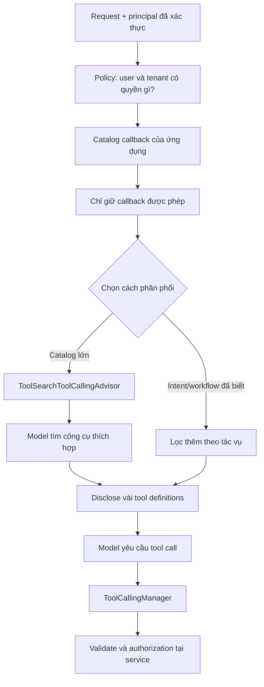
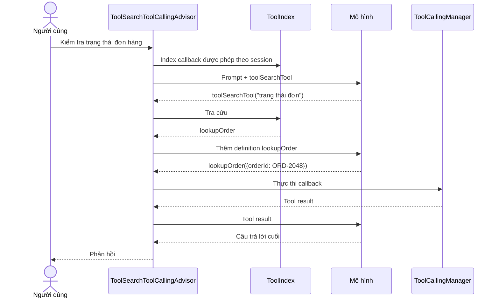

# Chỉ cung cấp công cụ liên quan tới yêu cầu hiện tại

Ứng dụng Spring AI có thể tích hợp rất nhiều công cụ: tra cứu đơn hàng, kiểm tra tồn kho, tính phí vận chuyển, cập nhật địa chỉ, gửi thông báo, hoàn tiền, cấp quyền và hàng chục dịch vụ MCP. Tuy nhiên, mỗi yêu cầu người dùng chỉ cần một phần nhỏ trong danh mục đó. Nếu công bố toàn bộ công cụ ở mọi lượt, mô hình phải đọc nhiều tên, mô tả và JSON Schema, dễ chọn nhầm công cụ và tiêu tốn token không cần thiết.

Nguyên tắc của bài là **chỉ đưa vào request những công cụ vừa liên quan đến yêu cầu hiện tại, vừa được ứng dụng cho phép sử dụng**. Mô hình được đề xuất tool call, còn ứng dụng quyết định công cụ nào có thể được công bố và thực thi. Đây là một phần quan trọng của hệ thống tool calling an toàn bằng `@Tool`, `ToolCallback`, `ToolContext` và `ToolCallingManager` trong Spring AI.

## Khi nào danh mục lớn trở thành vấn đề?

Mỗi tool definition thường chứa tên, mô tả và schema đầu vào. Những definitions này được gửi cho mô hình để nó quyết định có cần gọi công cụ hay không. Khi số công cụ tăng, prompt phình ra; nhiều công cụ có chức năng gần giống nhau còn khiến việc lựa chọn kém ổn định hơn.

Ví dụ với yêu cầu **“Kiểm tra trạng thái đơn ORD-2048”**:

| Công cụ trong ứng dụng | Có nên cung cấp ở lượt này? | Lý do |
|---|---|---|
| `lookupOrder` | Có | Trực tiếp lấy trạng thái đơn |
| `getShipmentStatus` | Có thể | Cần nếu người dùng hỏi cả hành trình giao hàng |
| `getInventory` | Không | Không liên quan đến trạng thái đơn |
| `refundPayment` | Không | Có side effect tài chính |
| `deleteCustomer` | Không | Không liên quan và nhạy cảm |
| `grantAdminRole` | Không | Không liên quan đến nghiệp vụ đơn hàng |

Với câu “Xin chào”, ứng dụng có thể **không cung cấp công cụ nào**. Không nên ép một chatbot phải tìm công cụ khi kiến thức sẵn có đủ để trả lời.

| Hệ quả khi luôn gửi toàn bộ danh mục | Tác động |
|---|---|
| Tool definitions dài | Tăng token và chi phí đầu vào qua nhiều vòng |
| Nhiều tên/schema tương tự | Mô hình dễ chọn sai hoặc gọi dư công cụ |
| Công cụ nhạy cảm xuất hiện trong prompt | Tăng phạm vi lộ thông tin về khả năng nội bộ |
| Too many tool choices | Khó kiểm soát, đánh giá và giải thích việc chọn công cụ |
| Khả năng MCP từ nhiều nguồn | Tăng độ phức tạp khi lọc, định danh và kiểm soát quyền |

Không có một số lượng tối đa phù hợp với mọi model. Với danh mục ít công cụ, gọi tìm kiếm thêm một vòng có thể tốn hơn lợi ích. Khi có hàng chục hoặc hàng trăm công cụ, nên cân nhắc chọn theo request và công bố tăng dần.

## Ba tập công cụ khác nhau

Không được nhầm **đăng ký**, **có quyền dùng** và **cần dùng**:

1. **Registered tools:** callback tồn tại trong ứng dụng hoặc được provider cung cấp.
2. **Authorized tools:** principal, tenant, entitlement và chính sách cho phép người dùng hiện tại sử dụng.
3. **Relevant tools:** công cụ cần thiết cho intent hoặc workflow hiện tại.

Danh sách cuối có thể diễn đạt:

```text
exposed = registered ∩ authorized ∩ relevant
```

Ví dụ, người dùng chỉ có quyền đọc nhưng yêu cầu “xóa khách hàng C-100” thì `deleteCustomer` có liên quan nhưng không được cấp. Một quản trị viên có quyền hoàn tiền nhưng đang hỏi trạng thái đơn cũng không cần nhìn thấy `refundPayment` trong prompt.

**Relevance không phải authorization.** Bộ chọn theo ý định hoặc vector search có thể hỗ trợ tìm công cụ phù hợp; nó không được tự cấp quyền. Ngay cả với công cụ đã được công bố, service vẫn phải xác thực quyền trên đúng resource trước khi thực thi.

## Hai phương pháp giảm danh mục

| Phương pháp | Cách hoạt động | Dùng khi |
|---|---|---|
| Chọn trước theo request | Ứng dụng lọc và truyền một tập `ToolCallback` nhỏ vào `ChatClient.tools(...)` | Route/intent tương đối rõ, số capability hạn chế |
| Progressive tool disclosure | Ban đầu mô hình chỉ nhận `toolSearchTool`, sau đó tìm những công cụ cần thiết | Catalog lớn, câu hỏi tự nhiên đa dạng, nhiều MCP servers |

Có thể phối hợp: **lọc quyền trước**, đưa danh mục được phép cho `ToolSearchToolCallingAdvisor` rồi để advisor chỉ công bố những definitions vừa tìm được. Khi dùng cách này, tập index được phép lớn hơn tập definitions thực sự gửi tới model.



## Truyền công cụ theo từng request với ChatClient

Trong Spring AI 2.1.0, dùng `.tools(...)` để đính một nhóm công cụ cho request:

```java
String answer = chatClient.prompt()
        .user("Tra cứu đơn ORD-2048 và vận chuyển")
        .tools(orderLookupTools, shippingLookupTools)
        .call()
        .content();
```

Phương thức có thể nhận các object có phương thức `@Tool`, các `ToolCallback`, `ToolCallbackProvider` hoặc collection/array của chúng. Spring AI biến chúng thành tool definitions và đưa đến mô hình.

### Cẩn thận với công cụ mặc định

Đây là khác biệt dễ gây lỗi:

```java
ChatClient client = ChatClient.builder(chatModel)
        .defaultTools(accountTools, paymentTools, orderTools)
        .build();

client.prompt()
        .user("Kiểm tra đơn ORD-2048")
        .tools(shippingTools)
        .call();
```

`.tools(shippingTools)` **bổ sung** vào `.defaultTools(...)`, không thay thế các defaults. Model vẫn có thể thấy các công cụ account/payment/order đang gắn mặc định. Nếu muốn kiểm soát chặt theo từng request, hãy dùng `ChatClient` không có default tools thừa:

```java
@Bean
ChatClient scopedChatClient(ChatModel chatModel) {
    return ChatClient.builder(chatModel).build();
}
```

Chỉ đưa vào default những công cụ thực sự cần và được phép cho mọi request của client đó. Công cụ ghi dữ liệu, hoàn tiền, gửi email, xóa bản ghi hoặc cấp quyền nên được cân nhắc theo từng request và áp dụng confirmation khi cần.

## Xây registry và lọc theo workflow

Một lớp đăng ký riêng giúp ứng dụng chọn callback theo tên đã kiểm soát, thay vì tin tên công cụ được mô hình tự đề xuất.

Ví dụ giả định `OrderReadTools`, `ShippingTools` và `OrderWriteTools` có các phương thức `@Tool` với tên đã khai báo là `lookupOrder`, `getShippingQuote`, `validateAddress`, `requestAddressChange`:

```java
@Component
public class ToolRegistry {

    private final Map<String, ToolCallback> callbacksByName;

    public ToolRegistry(
            OrderReadTools orderReadTools,
            ShippingTools shippingTools,
            OrderWriteTools orderWriteTools) {

        ToolCallback[] callbacks = ToolCallbacks.from(
                orderReadTools, shippingTools, orderWriteTools);

        this.callbacksByName = Arrays.stream(callbacks)
                .collect(Collectors.toUnmodifiableMap(
                        callback -> callback.getToolDefinition().name(),
                        Function.identity()));
    }

    public ToolCallback require(String name) {
        ToolCallback callback = callbacksByName.get(name);
        if (callback == null) {
            throw new IllegalStateException("Unknown registered tool: " + name);
        }
        return callback;
    }
}
```

Registry ở server có tên duy nhất. Nếu hai callback trùng tên, collector báo lỗi thay vì âm thầm chọn một. Với MCP tools, cần kiểm tra trùng tên giữa công cụ nội bộ và công cụ bên ngoài.

Ứng dụng có thể xây một router theo quy trình:

```java
public enum TaskKind {
    GENERAL_CHAT,
    TRACK_ORDER,
    QUOTE_SHIPPING,
    CHANGE_ADDRESS
}
```

`TaskKind` nên đến từ route/workflow đáng tin cậy hoặc kết quả classifier chỉ dùng để gợi ý mức độ liên quan. Nó không được dùng thay authorization.

```java
@Component
public class RequestToolSelector {

    private final ToolRegistry registry;
    private final ToolPermissionService permissions;

    public RequestToolSelector(
            ToolRegistry registry, ToolPermissionService permissions) {
        this.registry = registry;
        this.permissions = permissions;
    }

    public List<ToolCallback> select(
            TaskKind kind, AuthenticatedUser principal) {

        List<String> names = switch (kind) {
            case GENERAL_CHAT -> List.of();
            case TRACK_ORDER -> List.of("lookupOrder");
            case QUOTE_SHIPPING -> List.of(
                    "lookupOrder", "getShippingQuote");
            case CHANGE_ADDRESS -> List.of(
                    "lookupOrder", "validateAddress",
                    "requestAddressChange");
        };

        for (String name : names) {
            if (!permissions.canUse(principal, name)) {
                throw new AccessDeniedException(
                        "Không đủ quyền sử dụng capability được yêu cầu.");
            }
        }
        return names.stream().map(registry::require).toList();
    }
}
```

`ToolPermissionService` và `AuthenticatedUser` là các kiểu nghiệp vụ minh họa. Permission policy cần xem role, tenant, feature flag hoặc entitlement thực, không chỉ so sánh một tên tool. Với route cần capability nhưng người dùng không có quyền, nên từ chối rõ ràng; đừng âm thầm cấp một công cụ khác có quyền cao hơn.

### Chỉ truyền các callback đã được duyệt

```java
@Service
public class ScopedAssistant {

    private final ChatClient chatClient;
    private final RequestToolSelector selector;

    public ScopedAssistant(
            ChatClient chatClient, RequestToolSelector selector) {
        this.chatClient = chatClient;
        this.selector = selector;
    }

    public String answer(
            String question,
            TaskKind task,
            AuthenticatedUser principal) {

        List<ToolCallback> selected = selector.select(task, principal);
        return chatClient.prompt()
                .user(question)
                .tools(selected)
                .toolContext(Map.of(
                        "userId", principal.userId(),
                        "tenantId", principal.tenantId()))
                .call()
                .content();
    }
}
```

Ví dụ này giả định `chatClient` không có default tools ngoài ý muốn. `ToolContext` được tạo theo request từ principal đã xác thực; mô hình không được tự điền user/tenant ID. Service phía sau callback vẫn phải kiểm tra quyền trên từng bản ghi.

Với `GENERAL_CHAT`, danh sách rỗng và model có thể trả lời trực tiếp. Nếu một object `@Tool` khai báo 10 phương thức nhưng request chỉ cần 1 phương thức, truyền nguyên object sẽ làm cả 10 trở thành callback; hãy chọn những `ToolCallback` cụ thể từ registry như ví dụ.

## Trường hợp yêu cầu có nhiều bước

Thu hẹp quá mức cũng có thể làm workflow thất bại. Ví dụ câu hỏi “Tính phí vận chuyển của đơn ORD-2048” cần:

```text
lookupOrder(orderId) -> lấy địa chỉ, cân nặng
getShippingQuote(address, weight) -> lấy chi phí
```

Ứng dụng có ba lựa chọn:

1. Công bố một nhóm nhỏ gồm cả `lookupOrder` và `getShippingQuote` từ đầu.
2. Tạo một tool nghiệp vụ `quoteShippingForOrder(orderId)` để service thực hiện chuỗi bước đáng tin cậy.
3. Cho mô hình tìm công cụ tiếp theo bằng `ToolSearchToolCallingAdvisor` ở vòng sau.

Nếu không rõ intent, có thể hỏi người dùng làm rõ hoặc dùng cơ chế tool search. Không cần đưa cả catalog vào prompt “để phòng trường hợp mô hình cần”.

Với công cụ ghi dữ liệu hoặc nhạy cảm, bước sau không được tự động chạy chỉ vì có liên quan. Vẫn phải kiểm tra quyền, trạng thái tài nguyên và confirmation phù hợp.

## Cần nhớ: ChatModel có quy tắc defaults khác ChatClient

Với API thấp hơn:

```java
ToolCallback[] selected = ToolCallbacks.from(orderReadTools);

ToolCallingChatOptions options = ToolCallingChatOptions.builder()
        .toolCallbacks(selected)
        .build();

ChatResponse response = chatModel.call(
        new Prompt("Tra cứu đơn ORD-2048", options));
```

| API | Khi truyền tools tại request |
|---|---|
| `ChatClient.tools(...)` | Cộng với `ChatClient.defaultTools(...)` |
| `ChatModel` với `ToolCallingChatOptions.toolCallbacks(...)` | Thay thế tool callbacks trong default options của model |

Với `ChatModel`, nếu muốn kết hợp defaults và công cụ mới phải tự ghép một danh sách đã qua policy. Trong Spring AI 2.x, `ChatModel.call(...)` trả phản hồi thô; ứng dụng phải tự gọi `ToolCallingManager` và gửi tool result cho mô hình. Với ứng dụng chat thông thường, `ChatClient` quản lý vòng lặp qua `ToolCallingAdvisor`.

Không sử dụng hướng dẫn Spring AI 1.x dùng `toolNames(...)` để phân giải `Function` bean thường: cách này đã được thay bằng đăng ký `ToolCallback` tường minh trong Spring AI 2.x.

## Progressive disclosure bằng ToolSearchToolCallingAdvisor

Spring AI 2.1.0 cung cấp `ToolSearchToolCallingAdvisor` cho danh mục lớn. Nó thay `ToolCallingAdvisor` mặc định và sử dụng mẫu **progressive tool disclosure**:

1. Index tập callback của một session bằng `ToolIndex`.
2. Request ban đầu chỉ công bố định nghĩa công cụ tìm kiếm `toolSearchTool`.
3. Mô hình yêu cầu `toolSearchTool` với mô tả capability cần thiết.
4. Index tìm những công cụ liên quan.
5. Advisor bổ sung definitions của các công cụ vừa tìm vào lượt model tiếp theo.
6. Mô hình gọi một công cụ đã được công bố; `ToolCallingManager` thực thi callback.
7. Mô hình đọc kết quả rồi trả lời hoặc tiếp tục tìm công cụ khác.



Khác với router xác định trước, tool search cần thêm round-trip để tìm công cụ. Đổi lại, model không phải đọc toàn bộ schema ở vòng đầu. Đây là lựa chọn tốt khi câu hỏi mở, khả năng cần dùng chưa rõ hoặc công cụ đến từ nhiều server.

## Thiết lập Tool Search với Spring Boot

Thêm starter:

```xml
<dependency>
    <groupId>org.springframework.ai</groupId>
    <artifactId>spring-ai-starter-tool-search-advisor</artifactId>
</dependency>
```

Bật advisor và chọn chiến lược index:

```properties
spring.ai.chat.client.tool-search-advisor.enabled=true
spring.ai.chat.client.tool-search-advisor.tool-index-type=lucene
spring.ai.chat.client.tool-search-advisor.max-results=5
```

Starter có Lucene và tự cấu hình advisor. Khi bật, `ToolSearchToolCallingAdvisor` được dùng thay cho `ToolCallingAdvisor` mặc định. Không cài thêm một advisor điều khiển tool loop khác cho cùng client.

Mặc định tool search dùng `RegexToolIndex`. `LuceneToolIndex` thường thích hợp với thuật ngữ từ khóa; nếu yêu cầu dùng nhiều cách diễn đạt không giống tên/mô tả tool, cân nhắc vector search hoặc decision model.

## Cấu hình thủ công và danh mục có quyền theo request

Nếu cần kiểm soát chính xác các công cụ có thể được tìm, khai báo advisor:

```java
@Bean
ChatClient toolSearchChatClient(ChatModel chatModel) {
    ToolSearchToolCallingAdvisor advisor =
            ToolSearchToolCallingAdvisor.builder()
                    .toolIndex(new LuceneToolIndex())
                    .maxResults(5)
                    .build();

    return ChatClient.builder(chatModel)
            .defaultAdvisors(advisor)
            .build();
}
```

Ở đây `ChatClient` không gắn toàn bộ catalog vào `defaultTools`. Ứng dụng chọn tập được phép **trước** rồi mới đưa vào request:

```java
List<ToolCallback> permittedTools =
        permissionScopedCatalog.forUser(principal);

String sessionId =
        sessionService.sessionFor(principal, conversationId);

String answer = toolSearchChatClient.prompt()
        .user(question)
        .tools(permittedTools)
        .advisors(a -> a.param(
                MemoryAdvisor.CONVERSATION_ID, sessionId))
        .call()
        .content();
```

`permissionScopedCatalog` và `sessionService` là service do ứng dụng định nghĩa. `sessionId` phải được phân giải từ server và gắn với đúng user/tenant/conversation, không tin tùy tiện ID client gửi lên. `ToolSearchToolCallingAdvisor` sẽ index tập `permittedTools` theo session và chỉ công bố các định nghĩa liên quan khi mô hình tìm kiếm.

Nếu dùng auto-configuration, cũng có thể inject `ChatClient.Builder` và tiếp tục truyền `.tools(permittedTools)` theo request. Dù chọn cách nào, **đừng để một danh mục nhạy cảm không qua lọc quyền nằm trong `defaultTools`** của client dùng chung.

## Chọn ToolIndex phù hợp

Spring AI 2.1.0 có bốn kiểu tìm kiếm chính:

| Index | Cơ chế | Phù hợp |
|---|---|---|
| `RegexToolIndex` | Khớp tên/pattern | Danh mục đặt tên nhất quán, không cần thêm dịch vụ |
| `LuceneToolIndex` | Tìm từ khóa trong tên/mô tả | Nhiều tool và thuật ngữ khá rõ |
| `VectorToolIndex` | Tương đồng ngữ nghĩa | Yêu cầu diễn đạt khác tên công cụ; cần `VectorStore` |
| `DecisionToolIndex` | Mô hình xét mức độ liên quan và liệu có tool phù hợp hay không | Khi câu hỏi đôi khi không cần tool nào; cần `DecisionModel` |

Ví dụ tinh chỉnh số kết quả và số definitions tích lũy:

```java
ToolSearchToolCallingAdvisor advisor =
        ToolSearchToolCallingAdvisor.builder()
                .toolIndex(new LuceneToolIndex(0.4f))
                .maxResults(4)
                .referenceToolNameAccumulation(false)
                .build();
```

`maxResults(4)` giới hạn số tool references trong một lượt search. `referenceToolNameAccumulation(false)` chỉ giữ công cụ được tìm ở search turn gần nhất (bao gồm các tìm kiếm song song trong turn đó), thay vì cộng dồn công cụ đã tìm trước đây. Với workflow nhiều bước, tắt tích lũy có thể làm mất công cụ model còn cần ở lượt sau; chọn theo kết quả thử nghiệm.

Index keyword và vector có thể trả kết quả gần nhất ngay cả khi không công cụ nào thực sự phù hợp. `DecisionToolIndex` có thể trả danh sách rỗng khi mức độ phù hợp không đủ. Đừng ép mô hình phải dùng một công cụ “gần đúng” khi câu hỏi không cần tool.

## Session ID, eviction và thay đổi quyền

Tool search giữ index theo session. Mặc định session ID lấy từ advisor context key `MemoryAdvisor.CONVERSATION_ID`. Index được tạo theo session và có cơ chế eviction.

| Tùy chọn | Mục đích |
|---|---|
| `sessionIdKeyName(...)` | Đổi key session trong advisor context |
| `maxResults(n)` | Giới hạn công cụ trả về trong search |
| `referenceToolNameAccumulation(true)` | Mặc định tích lũy tools đã được tìm |
| `LruEvictionStrategy(1000)` | Giới hạn 1.000 session gần đây theo mặc định |
| `TtlEvictionStrategy(...)` | Evict session sau thời gian không sử dụng |
| `evictSession(sessionId)` | Chủ động xóa index khi logout/đổi quyền |

Không dùng một session ID chung cho nhiều user có quyền khác nhau. Khi người dùng logout, đổi tenant hoặc mất quyền, nên làm mới hoặc evict tool index:

```java
toolSearchAdvisor.evictSession(sessionId);
```

Việc làm mới index **không thu hồi những nội dung model đã từng thấy**. Nếu tool name vẫn nằm trong lịch sử hoặc model gọi thử tool cũ, execution layer vẫn phải kiểm tra quyền hiện hành. Danh mục gắn với session chỉ là công cụ tối ưu context và cách lựa chọn; nó không thay thế authorization.

## Fallback phân giải callback là ranh giới quan trọng

Spring AI có `ToolCallbackResolver` để tìm callback theo tên. Mặc định `DefaultToolCallingManager` chỉ chạy callback được đính kèm request; fallback dùng resolver toàn cục bị **tắt**:

```properties
spring.ai.tools.resolution.fallback.enabled=false
```

Nếu bật fallback, một tool tồn tại trong registry/resolver có thể được phân giải và chạy ngay cả khi không được cung cấp cho request. Điều đó làm suy yếu việc chỉ công bố công cụ liên quan, nhất là với tool ghi hoặc nhạy cảm.

Không bật fallback tùy tiện để “chữa” lỗi model gọi tên công cụ không có trong request. Hãy sửa bộ chọn, routing hoặc tool search. Dù fallback tắt, service vẫn cần validation, `ToolContext` đáng tin cậy, authorization trên từng resource và confirmation cho hành động nhạy cảm.

## MCP: đừng đưa nguyên mọi server vào context

Spring AI biểu diễn tool của MCP qua `ToolCallbackProvider`. Có thể truyền provider vào `ChatClient` như công cụ Java:

```java
chatClient.prompt()
        .user("Tra cứu đơn hàng")
        .tools(orderTools, mcpToolProvider)
        .call()
        .content();
```

Tuy nhiên, truyền nguyên provider có thể làm cả tập callback của server đó trở thành ứng viên. Với nhiều server hoặc dữ liệu nhạy cảm, nên lọc theo nguồn, tên công cụ, capability và quyền trước khi cung cấp hoặc index. Spring AI có `McpToolFilter` để lọc remote tools. Kiểm tra trùng tên giữa MCP tools và local tools; prefix phía MCP không tự tránh trùng với `@Tool` của ứng dụng.

Liệt kê công cụ từ remote server có thể gây network round-trip. Spring AI không tự đưa tất cả MCP provider làm tools mặc định của `ChatClient`. Hãy kiểm soát quá trình discovery, cache vừa đủ và cập nhật quyền khi server/tool thay đổi.

Mô tả của tool do một MCP server bên ngoài cung cấp là dữ liệu có nguồn gốc bên ngoài. Không dùng description như một chỉ thị cấp quyền và không tin nó để bỏ qua kiểm tra service. Chỉ kết nối MCP server đã được ứng dụng cho phép.

## Khi nào gộp nhiều công cụ thành một công cụ nghiệp vụ?

Nếu một workflow đã biết trước, thay vì công bố quá nhiều tool kỹ thuật, ứng dụng có thể tạo một tool cấp nghiệp vụ:

```java
@Tool(description = "Tra cứu tổng hợp đơn và trạng thái vận chuyển")
public TrackingSummary trackOrder(
        String orderId, ToolContext toolContext) {

    String tenantId = requireTenantId(toolContext);
    Order order = orderService.findVisibleOrder(tenantId, orderId);
    Shipment shipment = shipmentService.findByOrder(tenantId, orderId);
    return new TrackingSummary(order, shipment);
}
```

Cách này rút gọn danh mục và để service kiểm soát thứ tự, timeout, authorization và nhất quán dữ liệu. Không tạo một “siêu công cụ” nhận tên hành động bất kỳ rồi gọi mọi service; như vậy rất khó thiết kế schema, kiểm soát quyền và kiểm thử.

Nếu workflow có bước ghi hoặc cần xác nhận của người dùng, nên tách hành động đó ra thành callback rõ nghĩa và bảo vệ bằng `requiresConfirmation`/policy phù hợp.

## Đo chất lượng lựa chọn công cụ

Không chỉ đếm số tool definitions. Một selector quá hẹp có thể khiến mô hình không hoàn thành workflow hoặc phải thử nhiều lần, làm chi phí tăng.

| Metric | Ý nghĩa |
|---|---|
| Số definitions/model request | Mức độ thu hẹp |
| Token của tool schemas | Chi phí context do tools |
| Số tool-search round-trips | Chi phí khám phá bổ sung |
| Tỷ lệ chọn đúng tool | Độ chính xác của selector/index |
| Tỷ lệ thiếu tool cần thiết | Recall của bộ chọn |
| Tỷ lệ gọi tool không cần thiết | Độ nhiễu và chi phí thực thi |
| Tỷ lệ no-tool requests bị gọi tool | Khả năng trả lời trực tiếp |
| Latency p50/p95 và tổng token cả lượt | Hiệu quả cuối cùng |
| Số lần bị chặn do callback ngoài request scope | Hiệu quả ranh giới bảo mật |

Tài liệu Spring AI nêu benchmark với 28 tools trong một thử nghiệm: giảm token khoảng 34% (OpenAI), 60% (Gemini) và 64% (Anthropic) khi dùng tool search. Đây là kết quả theo bộ công cụ và model của thử nghiệm, không phải mức tiết kiệm bảo đảm. Với danh mục nhỏ, chi phí một lượt search bổ sung có thể lớn hơn phần token tiết kiệm.

## Lỗi triển khai thường gặp

| Sai sót | Hậu quả | Cách sửa |
|---|---|---|
| Gắn toàn bộ catalog vào `defaultTools` | Mọi request đều thấy danh mục quá rộng | Cấp tools theo request hoặc search trên danh mục đã lọc |
| Nghĩ `ChatClient.tools` ghi đè defaults | Công cụ ngoài ý muốn vẫn được gửi | Dùng client không có defaults dư và test options |
| Để intent classifier tự chọn quyền | Có thể cấp tool nhạy cảm theo prompt | Intersection với permission policy của server |
| Chỉ cấp tool của bước đầu | Workflow sau đó thiếu capability | Cấp nhóm workflow nhỏ hoặc progressive disclosure |
| Luôn chọn top-K dù không phù hợp | Model gọi tool không cần thiết | Ngưỡng phù hợp hoặc `DecisionToolIndex` |
| Bật global resolver fallback | Callback ngoài request có thể bị gọi | Giữ fallback `false` |
| Trùng tên local/MCP | Ambiguous tool resolution | Namespace và kiểm tra uniqueness |
| Dùng chung session cho nhiều quyền | Chỉ mục công cụ có thể lộ chéo | Session ID do server quản lý, gắn principal/tenant |
| Không làm mới index sau đổi quyền | Tool cũ có thể được tìm lại | Evict/re-index; authorization tại execution |
| Dựa hoàn toàn vào ẩn tool khỏi model | Không ngăn được thao tác trái quyền | Validate và kiểm tra quyền tại service |

## Kiểm thử bộ chọn và công bố công cụ

Một test chỉ nhìn câu trả lời text là chưa đủ. Hãy kiểm tra thực tế những `ToolDefinition` nào được gửi cho model hoặc những `ToolCallback` nào gắn vào request.

| Tình huống | Kỳ vọng |
|---|---|
| “Xin chào” | Không có tool definition |
| Yêu cầu tra cứu đơn | Chỉ có callback đọc đơn liên quan |
| Yêu cầu tính phí vận chuyển | Có đủ các tools cần cho workflow, không có công cụ phá hủy |
| User chỉ có quyền đọc | Không có tool ghi/xóa dù prompt yêu cầu |
| Admin hỏi trạng thái | Không gửi tool nhạy cảm không liên quan |
| Có default tools không phù hợp | Test phát hiện union ngoài mong đợi |
| Hai tool cùng tên | Registry fail fast |
| Model gọi tool không được cấp | Manager từ chối khi fallback tắt; không chạm service |
| Tool search có catalog lớn | Ban đầu chỉ có `toolSearchTool`; sau tìm chỉ công bố kết quả phù hợp |
| Không có tool phù hợp | Trả lời trực tiếp hoặc hỏi làm rõ; không ép gọi tool gần nhất |
| Hai session của user/tenant khác nhau | Không trộn danh mục đã index |
| Quyền thay đổi | Catalog refresh và callback bị thu hồi không còn thực thi |
| MCP chứa tool không được phép | Bị lọc trước khi model thấy |
| Top-K bỏ sót tool cần thiết | Có metric/test recall và cơ chế phục hồi phù hợp |

Ví dụ unit test bộ chọn:

```java
@Test
void orderTrackingExposesOnlyLookupOrder() {
    AuthenticatedUser reader = testUserWith("lookupOrder");

    List<ToolCallback> selected =
            selector.select(TaskKind.TRACK_ORDER, reader);

    assertThat(selected)
            .extracting(callback -> callback.getToolDefinition().name())
            .containsExactly("lookupOrder");
}

@Test
void aReadOnlyUserCannotGetAddressChangeTool() {
    AuthenticatedUser reader = testUserWith("lookupOrder");

    assertThatThrownBy(() ->
            selector.select(TaskKind.CHANGE_ADDRESS, reader))
            .isInstanceOf(AccessDeniedException.class);
}
```

`testUserWith(...)` là helper test. Ngoài unit test, cần integration test với một model giả hoặc interceptor ghi nhận options đã gửi, kiểm tra rằng default tools và resolution fallback không âm thầm mở lại công cụ bị lọc. Với tool search, kiểm tra cả session scoping, thay đổi quyền và tình huống câu hỏi không cần công cụ.

## Checklist triển khai

1. Thống kê tên, mô tả, schema, side effect và quyền của từng callback.
2. Không để tools nhạy cảm trong `defaultTools` chung cho mọi người dùng.
3. Chọn tập tools được phép từ principal, tenant và policy nghiệp vụ.
4. Thu hẹp tiếp theo intent/workflow, hoặc dùng `ToolSearchToolCallingAdvisor` trên tập đã lọc quyền.
5. Cho phép không có công cụ khi người dùng chỉ cần câu trả lời thông thường.
6. Với workflow nhiều bước, bảo đảm còn đường sử dụng công cụ kế tiếp.
7. Nhớ quy tắc union của `ChatClient` và override của `ChatModel`.
8. Giữ `spring.ai.tools.resolution.fallback.enabled=false` nếu không có nhu cầu đã được kiểm soát đặc biệt.
9. Kiểm tra trùng tên local/MCP và giới hạn nguồn MCP.
10. Với tool search, dùng session ID đáng tin, giới hạn kết quả và cập nhật index khi quyền thay đổi.
11. Giữ validation, authorization và confirmation ở tầng ứng dụng/service.
12. Đo token, latency, selection accuracy, no-tool rate và số lần bị chặn.

## Kết luận

Một danh mục lớn chỉ hữu ích khi ứng dụng có cách chọn đúng công cụ cho từng yêu cầu. Với tác vụ đã biết, hãy chọn các `ToolCallback` theo request qua `ChatClient.tools(...)` và tránh đăng ký quá nhiều `defaultTools`. Với nhiều công cụ hoặc MCP server, `ToolSearchToolCallingAdvisor` giúp công bố definitions tăng dần theo nhu cầu. Dù chọn cách nào, hãy phân biệt tính liên quan với quyền truy cập: lọc theo quyền trước khi công bố/index, giới hạn phạm vi callback được thực thi và kiểm tra lại tại service. Nhờ vậy, mô hình ít bị nhiễu, sử dụng token hiệu quả hơn và quyền thực thi vẫn nằm trong ứng dụng.

## Tài liệu tham khảo

- [Spring AI 2.1.0 — Tool Calling](https://docs.spring.io/spring-ai/reference/api/tools.html) — `.tools(...)`, `.defaultTools(...)`, `ToolCallback`, callback resolution và MCP tools.
- [Spring AI 2.1.0 — Tool Search Tool](https://docs.spring.io/spring-ai/reference/api/tools/tool-search-tool.html) — progressive disclosure, `ToolSearchToolCallingAdvisor`, các chiến lược index và session eviction.
- [Spring AI 2.1.0 — Dynamic Tool Discovery](https://docs.spring.io/spring-ai/reference/guides/dynamic-tool-search.html) — cách triển khai công cụ tìm kiếm và kết quả benchmark.
- [Spring AI 2.1.0 — ChatModel Tool Calling](https://docs.spring.io/spring-ai/reference/api/tools/chatmodel-tool-calling.html) — tool callbacks theo request và override defaults.
