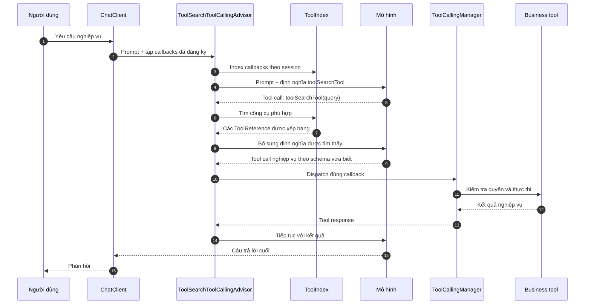

# Progressive tool disclosure và tìm kiếm định nghĩa khi cần

Khi ứng dụng chỉ có vài công cụ, gửi toàn bộ tên, mô tả và input schema trong mỗi lần gọi mô hình là cách đơn giản. Tuy nhiên, một hệ thống kết nối nhiều nghiệp vụ hoặc nhiều MCP server có thể có hàng chục đến hàng trăm công cụ. Gửi tất cả định nghĩa từ đầu làm tăng token, khiến mô hình khó chọn đúng công cụ trong một danh sách dài và có thể làm lộ những khả năng không cần thiết cho request.

**Progressive tool disclosure** là cách công bố từng phần: ban đầu mô hình chỉ được biết một công cụ tìm kiếm khả năng; khi cần thực hiện nhiệm vụ, mô hình tìm kiếm theo ngôn ngữ tự nhiên, hệ thống trả những công cụ phù hợp và chỉ lúc đó mới gửi định nghĩa chi tiết cho lượt tiếp theo. Trong Spring AI 2.1, `ToolSearchToolCallingAdvisor` thực hiện mẫu này trên nền `ToolCallingAdvisor` và `ToolIndex`.

Trong module `SPRING_AI_TOOL_CALLING`, các công cụ cuối cùng vẫn là `@Tool`, `MethodToolCallback`, `FunctionToolCallback` hoặc `ToolCallback` được ứng dụng cung cấp. Progressive disclosure thay đổi **khi nào định nghĩa được công bố**, không thay thế trách nhiệm của ứng dụng về kiểm tra quyền, thực thi callback, quản lý phiên bản, xử lý lỗi hoặc bảo vệ thao tác ghi.

## 1. Vấn đề khi danh mục công cụ quá lớn

Giả sử một trợ lý nghiệp vụ có 80 công cụ thuộc các nhóm đơn hàng, hóa đơn, tồn kho, khách hàng và vận chuyển. Mỗi công cụ chứa tên, mô tả vài câu, input schema và enum hoặc nested object. Khi đưa toàn bộ vào request, ứng dụng có thể gặp:

- **Tốn context và token:** định nghĩa không liên quan vẫn được gửi ở các lượt gọi model.
- **Độ chính xác lựa chọn giảm:** các tool gần tên/ý nghĩa như `findOrder`, `searchOrders`, `getOrderDetails` dễ bị chọn nhầm.
- **Nâng chi phí mỗi lượt:** nếu vòng hội thoại gọi model nhiều lần, định nghĩa có thể được đưa vào prompt lặp lại.
- **Tăng độ trễ:** prompt lớn hơn có thể làm tăng thời gian xử lý và khó giữ lịch sử dài.
- **Phức tạp kiểm soát quyền:** danh mục đến từ nhiều nguồn phải được lọc theo tenant, actor và use case trước khi giới thiệu cho mô hình.
- **Khó thay đổi phiên bản:** tool definitions được nạp hoặc cache theo session cần cùng contract với callback thực thi.

Đối với một hệ thống có chưa đến khoảng 10 tool ngắn, overhead thêm lượt tìm kiếm có thể lớn hơn phần token tiết kiệm. Với 10+ tool, định nghĩa chiếm trên khoảng 10.000 token hoặc nhiều MCP server, tài liệu Spring AI khuyến nghị xem xét Tool Search. Đây là tín hiệu để đo và thử nghiệm, không phải ngưỡng hiệu năng tuyệt đối.

## 2. Khác biệt giữa công bố toàn bộ và công bố dần

| Khía cạnh | Cách truyền thống | Progressive tool disclosure |
|---|---|---|
| Tool definitions ở lượt đầu | Toàn bộ danh mục đăng ký | Chỉ `toolSearchTool` |
| Lựa chọn công cụ | Mô hình chọn ngay từ danh sách lớn | Mô hình tìm khả năng, sau đó chọn từ tập đã phát hiện |
| Chi phí token ban đầu | Tỷ lệ với tổng kích thước catalog | Phụ thuộc định nghĩa công cụ tìm kiếm |
| Số lượt model | Có thể ít hơn khi tool đã được biết sẵn | Có thể thêm một lượt tìm kiếm |
| Truy xuất tool ít dùng | Có sẵn ngay | Cần tìm thấy bằng index |
| Rủi ro chọn sai | Dễ lẫn công cụ tương tự khi catalog lớn | Phụ thuộc chất lượng retrieval và mô tả tool |
| Quản lý quyền | Vẫn phải lọc catalog và kiểm tra callback | Vẫn phải lọc trước khi index/disclose và kiểm tra callback |

Từ góc nhìn model, `toolSearchTool` là một công cụ bình thường dùng để hỏi “Tôi cần khả năng nào?”. Từ góc nhìn ứng dụng, đây là bước **tra cứu định nghĩa**; nó không tự thực hiện hành động như hủy đơn hoặc gửi hóa đơn.

## 3. Luồng hoạt động trong Spring AI 2.1

`ToolSearchToolCallingAdvisor` mở rộng `ToolCallingAdvisor` và dùng các hook của vòng lặp để lập chỉ mục, bổ sung hướng dẫn tìm kiếm và công bố các callback được tìm thấy.



Quá trình gồm sáu điểm cần nhớ:

1. **Lập chỉ mục:** ứng dụng cung cấp các callback hợp lệ, advisor ghi `ToolReference` của chúng vào `ToolIndex` cho session.
2. **Yêu cầu đầu tiên:** mô hình nhận `toolSearchTool`; định nghĩa đầy đủ của catalog chưa được đưa vào context.
3. **Tìm kiếm:** mô hình tạo truy vấn theo khả năng cần thiết, ví dụ “tra cứu trạng thái đơn hàng của khách”.
4. **Mở rộng:** index trả công cụ phù hợp; advisor đưa định nghĩa và schema của chúng vào lượt model kế tiếp.
5. **Gọi tool:** model tạo arguments theo schema của tool được công bố; `ToolCallingManager` thực thi callback tương ứng.
6. **Tiếp tục:** model đọc tool result và trả lời hoặc thực hiện vòng tìm kiếm/gọi tool tiếp theo.

Việc gọi `toolSearchTool` không trực tiếp thực thi một công cụ nghiệp vụ trong cùng thao tác tìm kiếm. Hai sự kiện “tìm thấy một định nghĩa” và “thực thi callback” cần được log và đánh giá riêng.

## 4. Tích hợp nhanh bằng Spring Boot Starter

Spring AI 2.1 cung cấp starter `spring-ai-starter-tool-search-advisor`. Khai báo dependency bằng Gradle:

```gradle
dependencies {
    implementation 'org.springframework.ai:spring-ai-starter-tool-search-advisor'
}
```

Sau đó bật advisor:

```yaml
spring:
  ai:
    chat:
      client:
        tool-search-advisor:
          enabled: true
          tool-index-type: lucene
          max-results: 5
```

Theo tài liệu Spring AI 2.1, auto-configuration đăng ký builder chuyên dụng của `ToolSearchToolCallingAdvisor` để thay cho builder mặc định của `ToolCallingAdvisor`. Starter cũng đăng ký `ToolIndex` nếu ứng dụng chưa tự cung cấp bean riêng. `lucene` dùng công cụ tìm kiếm theo từ khóa; starter đã bao gồm dependency Lucene cần thiết.

Property `enabled` mặc định là `false`. Khi muốn tắt để so sánh với hành vi công bố toàn bộ tool, chuyển về `false` và đo các metric tương đương. Không cần tự đăng ký thêm một `ToolCallingAdvisor` bên cạnh tool-search advisor.

## 5. Cấu hình thủ công khi cần kiểm soát nhiều hơn

Nếu muốn tự chọn chiến lược tìm kiếm, giới hạn số kết quả hoặc session key, thêm thư viện:

```gradle
dependencies {
    implementation 'org.springframework.ai:spring-ai-tool-search-advisor'
}
```

Ví dụ với Lucene:

```java
@Configuration(proxyBeanMethods = false)
class ToolSearchConfiguration {

    @Bean
    ToolIndex toolIndex() {
        return new LuceneToolIndex();
    }

    @Bean
    ChatClient toolSearchChatClient(
            ChatModel chatModel,
            ToolIndex toolIndex,
            OrderLookupTools orderLookupTools,
            ShippingTools shippingTools) {

        ToolSearchToolCallingAdvisor searchAdvisor =
                ToolSearchToolCallingAdvisor.builder()
                        .toolIndex(toolIndex)
                        .maxResults(5)
                        .sessionIdKeyName("toolSearchSessionId")
                        .build();

        return ChatClient.builder(chatModel)
                .defaultTools(orderLookupTools, shippingTools)
                .defaultAdvisors(searchAdvisor)
                .build();
    }
}
```

`OrderLookupTools` và `ShippingTools` là các class do ứng dụng định nghĩa có phương thức `@Tool`. Ví dụ này chỉ thích hợp nếu mọi callback trong `defaultTools` được phép xuất hiện trong mọi request dùng client đó. Nếu mỗi actor/tenant có một danh mục khác nhau, nên dùng tool set đã lọc theo request như phần bảo mật bên dưới.

## 6. Session ID quyết định phạm vi index

Tool Search index công cụ **theo session**. Mỗi request cần có ID nhất quán để advisor biết những định nghĩa nào thuộc conversation hiện tại. Mặc định advisor đọc từ advisor context tại key `MemoryAdvisor.CONVERSATION_ID`.

```java
String answer = toolSearchChatClient.prompt()
        .user("Kiểm tra đơn ORD-2048 và tình trạng giao hàng")
        .advisors(a -> a.param("toolSearchSessionId", authenticatedSessionId))
        .call()
        .content();
```

Ở ví dụ này advisor được cấu hình bằng `.sessionIdKeyName("toolSearchSessionId")`. ID phải đến từ session phía server gắn với người dùng đã xác thực. Không dùng một giá trị `sessionId` do prompt hoặc client tùy ý khai báo làm khóa chia sẻ index giữa các tenant.

Nếu dùng key mặc định:

```java
chatClient.prompt()
        .user(question)
        .advisors(a -> a.param(MemoryAdvisor.CONVERSATION_ID, sessionId))
        .call()
        .content();
```

Một session có thể giữ danh sách công cụ đã được phát hiện qua nhiều lượt. Khi cùng session được sử dụng bởi hai người dùng khác quyền hoặc một tenant khác, index có nguy cơ giữ định nghĩa không phù hợp. Phân tách session IDs theo actor/tenant, thiết kế ownership và kiểm tra lại quyền ở callback. Việc phân tách index không phải hàng rào authorization duy nhất.

## 7. ToolIndex là tầng tìm kiếm, không phải executor

`ToolIndex` nhận `ToolReference` và trả kết quả tìm kiếm các khả năng phù hợp. API chính trong Spring AI 2.1:

```java
public interface ToolIndex {

    void indexTool(String sessionId, ToolReference toolReference);

    void indexTools(String sessionId, List<ToolReference> references);

    ToolSearchResponse search(ToolSearchRequest request);

    void clearIndex(String sessionId);
}
```

`ToolIndex` không gọi `ToolCallback.call(...)`. Nó chọn **định nghĩa nào cần giới thiệu**, trong khi `ToolCallingManager` chịu trách nhiệm dispatch callback khi mô hình gửi một tool call nghiệp vụ hợp lệ.

Lựa chọn index phụ thuộc tên tool, description, số lượng và cách người dùng đặt câu hỏi:

| Strategy | Class Spring AI | Điểm mạnh | Hạn chế chính |
|---|---|---|---|
| Regex | `RegexToolIndex` | Nhẹ, không cần dịch vụ ngoài, tốt với quy ước tên | Hạn chế khi mô hình diễn đạt khác tên tool |
| Keyword | `LuceneToolIndex` | Từ khóa chính xác, nhanh, hữu ích cho thuật ngữ nghiệp vụ | Có thể bỏ sót câu hỏi dùng từ đồng nghĩa |
| Semantic | `VectorToolIndex` | Khớp nghĩa và paraphrase, tên không cần trùng câu hỏi | Cần `VectorStore`/embedding và đánh giá retrieval |
| Decision | `DecisionToolIndex` | Model đánh giá tool có thực sự phù hợp hay không | Tốn thêm một lần model/chi phí và có lỗi phân loại |

Index chỉ tốt khi metadata tốt. Tên mơ hồ như `processData` và description “Process information” khiến cả keyword lẫn semantic index khó biết công cụ nào đúng.

## 8. Khi nào chọn RegexToolIndex?

`RegexToolIndex` là mặc định khi không cấu hình loại index. Nó phù hợp với catalog có tên theo quy ước rõ ràng như `order_get`, `order_search`, `invoice_find` hoặc khi mô hình có thể tạo pattern dựa trên tên.

```java
@Bean
ToolIndex toolIndex() {
    return new RegexToolIndex();
}
```

Lợi ích lớn nhất là không cần model embedding hoặc hạ tầng vector. Tuy nhiên, tên tool thường dùng tiếng Anh còn người dùng có thể hỏi tiếng Việt. Nếu model truy vấn “tra cứu vận đơn” nhưng định nghĩa chỉ có `shipment_lookup` và description mơ hồ, regex có thể không tìm thấy công cụ mong muốn.

Đừng đánh đồng regex với tìm kiếm ngữ nghĩa. Hãy thử nhiều cách diễn đạt thực tế trước khi dùng chiến lược này cho catalog đa ngôn ngữ.

## 9. Khi nào chọn LuceneToolIndex?

`LuceneToolIndex` tìm theo từ khóa trong tên và mô tả. Đây là lựa chọn cân bằng khi tên nghiệp vụ nhất quán, tài liệu có nhiều từ khóa và không muốn phụ thuộc model embedding.

```java
@Bean
ToolIndex toolIndex() {
    return new LuceneToolIndex(0.4f);
}
```

Mức score threshold cao loại nhiều kết quả có độ khớp yếu, giúp giảm công cụ không liên quan. Đổi lại, recall có thể giảm và tool đúng bị loại bỏ khi truy vấn không chứa từ khóa chính xác. Mặc định threshold của `LuceneToolIndex` là `0.25` theo tài liệu 2.1.

Đối với tên tương tự nhau, thêm description giải thích **khi nào dùng** và **khi nào không dùng** là cách cải thiện retrieval. Ví dụ `getOrderStatus` chỉ lấy trạng thái, còn `getOrderDetails` trả dòng hàng và địa chỉ nếu người dùng có quyền.

## 10. Khi nào chọn VectorToolIndex?

`VectorToolIndex` phù hợp nếu người dùng mô tả nhu cầu bằng ngôn ngữ tự nhiên, câu hỏi dài hoặc cách gọi khác tên tool. Nó lập embedding cho metadata của tool và dùng `VectorStore` để tìm gần nghĩa.

```java
@Bean
ToolIndex toolIndex(VectorStore vectorStore) {
    return new VectorToolIndex(vectorStore);
}
```

`VectorStore` là dependency cần được cấu hình riêng, chẳng hạn qua starter của một vector database được Spring AI hỗ trợ. Với nhiều tenant, cần bảo đảm index/namespace/filter và session scoping không trộn định nghĩa khác quyền. Nếu embedding được gửi đến dịch vụ bên ngoài, hãy đánh giá chính sách dữ liệu đối với mô tả nội bộ và schema nhạy cảm.

Vector retrieval không bảo đảm kết quả đúng. Một công cụ có description rất gần nghĩa nhưng thực hiện thay đổi trạng thái có thể được xếp cao hơn một công cụ chỉ đọc. Chính sách exposure/authorization vẫn phải được thực thi độc lập.

## 11. Khi nào chọn DecisionToolIndex?

`DecisionToolIndex` dùng `DecisionModel` để đánh giá một yêu cầu có phù hợp với công cụ nào trong catalog hay không. Nó có thể trả **không công cụ nào** khi không có khả năng phù hợp, thay vì luôn chọn một ứng viên gần nhất.

```java
@Bean
ToolIndex toolIndex(DecisionModel decisionModel) {
    return DecisionToolIndex.builder(decisionModel)
            .applicabilityThreshold(0.7)
            .minimumRelevance(0.0)
            .build();
}
```

Threshold cao phù hợp khi gọi sai tool gây hậu quả lớn; nhưng cũng tăng nguy cơ không tìm thấy công cụ đúng. `DecisionToolIndex` gửi tất cả tool trong session đến decision model ở mỗi lần tìm, vì vậy với hàng trăm tool, chi phí của chính bước tìm kiếm có thể lớn. Khi đó có thể dùng vector/keyword index để chọn shortlist, rồi cho decision model đánh giá tập nhỏ nếu ứng dụng triển khai pipeline riêng.

Không nên tự động coi quyết định của một model là bằng chứng người dùng có quyền gọi công cụ. Decision index chỉ đánh giá mức phù hợp, không xác thực danh tính hoặc tài nguyên.

## 12. Giới hạn kết quả và tích lũy tool đã phát hiện

Builder cung cấp các tùy chọn quan trọng:

```java
ToolSearchToolCallingAdvisor advisor =
        ToolSearchToolCallingAdvisor.builder()
                .toolIndex(toolIndex)
                .maxResults(5)
                .referenceToolNameAccumulation(true)
                .sessionIdKeyName("toolSearchSessionId")
                .build();
```

- `maxResults(5)`: giới hạn số tool references được trả trong một lần model tìm kiếm. Nếu để `null`, model có thể quyết định số lượng (mô tả tích hợp gợi ý khoảng 5).
- `referenceToolNameAccumulation(true)`: giữ những tên tool đã phát hiện ở các lần tìm trước để chúng tiếp tục được công bố trong các vòng sau; đây là mặc định.
- `referenceToolNameAccumulation(false)`: chỉ giữ kết quả của lượt tìm gần nhất, bao gồm các lời gọi search song song trong cùng lượt đó.

Khi model phải làm một chuỗi nhiệm vụ như tra cứu khách hàng, đọc đơn hàng rồi tạo hóa đơn, tích lũy định nghĩa giúp giữ các công cụ trước đó trong các lượt tiếp theo. Tuy nhiên, nếu tìm kiếm nhiều lần trong một conversation dài, tập đã khám phá có thể lớn dần. Đặt giới hạn và quan sát số định nghĩa hiện đang được công bố.

Việc một tool đã từng được công bố không cho phép dùng nó sau khi quyền bị thu hồi. Khi quyền hoặc catalog đổi, cần cập nhật/evict session index và kiểm tra lại quyền tại callback.

## 13. Quản lý cache và vòng đời session index

Spring AI dùng `ToolIndexEvictionStrategy` để quản lý bộ nhớ theo session. Các lựa chọn chính:

| Strategy | Hành vi | Khi dùng |
|---|---|---|
| `LruEvictionStrategy` | Giữ tối đa số session; loại session ít dùng khi vượt ngưỡng | Mặc định, nhiều session thông thường |
| `TtlEvictionStrategy` | Loại session không truy cập sau thời hạn | Giới hạn retention theo thời gian |
| `AlwaysEvictStrategy` | Xóa index trước mỗi request, buộc lập lại | Test hoặc catalog thay đổi theo từng request |
| `NeverEvictStrategy` | Không tự loại, ứng dụng phải dọn | Kiểm soát cache bằng vòng đời riêng |
| `CompositeEvictionStrategy` | Kết hợp nhiều chiến lược | Vừa giới hạn số lượng vừa giới hạn TTL |

Mặc định tài liệu Spring AI sử dụng LRU tối đa 1.000 session. Có thể cấu hình:

```yaml
spring:
  ai:
    chat:
      client:
        tool-search-advisor:
          enabled: true
          eviction:
            lru-max-sessions: 500
            ttl: 30m
```

Khi logout, thu hồi quyền hoặc kết thúc phiên, ứng dụng có thể gọi `advisor.evictSession(sessionId)` nếu quản lý advisor instance trực tiếp. Không để index của một session cũ được tái sử dụng bởi actor khác chỉ vì trùng ID.

Eviction trong Spring AI được kiểm tra lười ở các request, không phải một background timer tự động dọn ngay thời điểm TTL hết hạn. Với yêu cầu bảo mật cần thu hồi tức thời, chủ động invalidate và kiểm tra permission ở execution layer thay vì chỉ dựa vào TTL.

## 14. Phân quyền phải diễn ra trước khi lập chỉ mục

Một catalog tìm kiếm chỉ nên chứa tool **được phép công bố trong phạm vi session/use case đó**. Không index toàn bộ công cụ của mọi tenant rồi trông chờ model tự tránh gọi những tên không được quyền.

Ví dụ ứng dụng quyết định tập tool theo principal và use case trước khi gửi prompt:

```java
List<ToolCallback> allowedTools = catalogPolicy.allowedToolsFor(
        authenticatedActor.id(),
        authenticatedActor.tenantId(),
        requestedWorkflow);

String answer = chatClientWithoutDefaultBusinessTools.prompt()
        .user(question)
        .tools(allowedTools)
        .toolContext(Map.of(
                "actorId", authenticatedActor.id(),
                "tenantId", authenticatedActor.tenantId()))
        .advisors(a -> a.param("toolSearchSessionId", validatedSessionId))
        .call()
        .content();
```

`catalogPolicy` và `chatClientWithoutDefaultBusinessTools` là các thành phần của ứng dụng. Client đó được cấu hình `ToolSearchToolCallingAdvisor`, nhưng **không có** `defaultTools` ngoài nhóm thật sự an toàn cho mọi người dùng. `.tools(...)` trên mỗi request được cộng thêm vào `.defaultTools(...)`, vì vậy dùng defaults chứa công cụ nguy hiểm có thể vô tình làm chúng khả dụng ngoài phạm vi policy.

Lọc trước khi index giúp tránh công bố schema và description của công cụ nhạy cảm. Tuy nhiên, nếu session index được giữ qua nhiều lượt và quyền thay đổi, index cũ có thể chứa reference từng hợp lệ. Khi đó phải invalidate/rotate session hoặc dùng cơ chế lọc theo chính sách hiện hành ở bước tìm kiếm và trước thực thi.

## 15. Tool được tìm thấy chưa chắc được phép thực thi

Xét ba lớp riêng:

| Lớp | Trách nhiệm | Ví dụ |
|---|---|---|
| Catalog/Index | Tool nào có thể được tìm và công bố cho model | Tenant A không thấy công cụ quản trị tenant B |
| Tool execution policy | Tool call có được dispatch trong request không | Tool ghi chỉ được phép trong workflow phù hợp |
| Business authorization | Actor có quyền thực hiện hành động trên tài nguyên hiện tại không | Người dùng không được hủy đơn của người khác |

Spring AI có `ToolCallbackResolver` để phân giải tên tool thành callback. Tùy chọn `spring.ai.tools.resolution.fallback.enabled` mặc định **false**. Khi bật fallback, một tool không được đăng ký trong request vẫn có thể được resolver tìm theo tên rồi thực thi; điều này làm suy yếu ranh giới công bố theo request nếu resolver chứa công cụ ghi hoặc công cụ khác quyền.

```yaml
spring:
  ai:
    tools:
      resolution:
        fallback:
          enabled: false
```

Giữ fallback tắt trừ khi có yêu cầu rõ và resolver được giới hạn theo quyền. Với thao tác ghi, callback/service phải kiểm tra `actorId`, `tenantId`, action và resource ở thời điểm thực thi; tool search không có nhiệm vụ đó.

## 16. Progressive disclosure không thay confirmation

Một tool `cancelOrder` có thể được tìm thấy vì người dùng muốn hủy đơn. Việc được tìm thấy chỉ có nghĩa model đã nhận định nghĩa của tool, **không** có nghĩa người dùng đã đồng ý hủy.

```java
@Tool(
        name = "cancel_order",
        description = "Hủy một đơn hàng đã được xác nhận. Có tác động nghiệp vụ.",
        requiresConfirmation = true)
public CancellationReceipt cancelOrder(String orderId, ToolContext context) {
    return orderService.cancelAuthorizedOnce(orderId, context);
}
```

Trong Spring AI 2.1, `requiresConfirmation=true` cho phép tool calling loop tạm dừng trước khi callback chạy để ứng dụng lấy quyết định allow/deny. Tài liệu Tool Search cũng mô tả cách confirmation được áp dụng cho công cụ được tìm thấy. Một tool được công bố dần vẫn phải giữ metadata confirmation và execution policy như khi công bố đầy đủ.

Nếu một assistant reply có nhiều tool calls và ít nhất một call yêu cầu confirmation, loop sẽ tạm dừng toàn bộ reply trước khi thực thi. Ứng dụng cần xác minh người duyệt, đọc paused reply nguyên bản từ server, tạo decisions đầy đủ và chỉ sau đó mới resume; không cho model hoặc client tự chỉnh arguments hoặc approval state.

## 17. Lựa chọn description phục vụ retrieval

Mô tả tool đồng thời phục vụ mô hình chọn công cụ sau discovery và phục vụ index tìm kiếm ngay từ đầu. Vì vậy, hãy viết description nêu **nhiệm vụ, đối tượng, điều kiện, đầu ra và tác động**.

Ví dụ yếu:

```java
@Tool(description = "Xử lý đơn hàng.")
public OrderView order(String id) { /* ... */ }
```

Ví dụ rõ hơn:

```java
@Tool(description = "Chỉ đọc trạng thái vận chuyển của đơn hàng theo orderId; "
        + "không cập nhật, hủy hoặc tạo vận đơn.")
public ShipmentStatus lookupShipment(String orderId) { /* ... */ }
```

Một description tốt nên phân biệt công cụ dễ nhầm:

| Tool | Khi nào phù hợp | Khi nào không dùng |
|---|---|---|
| `get_order_status` | Cần trạng thái đơn hiện tại | Cần toàn bộ dòng hàng hoặc hủy đơn |
| `get_order_details` | Cần thông tin chi tiết đơn thuộc quyền truy cập | Chỉ cần trạng thái ngắn hoặc cập nhật đơn |
| `preview_cancellation` | Cần ước tính hoàn tiền và điều kiện hủy | Chưa được dùng để thực sự hủy |
| `cancel_order` | Người dùng có quyền và đã xác nhận hủy | Chỉ đang hỏi “nếu hủy thì sao?” |

Nên thêm từ đồng nghĩa tiếng Việt/tiếng Anh ở description khi hệ thống phục vụ cả hai ngôn ngữ, nhưng tránh nhồi những từ không đúng chức năng chỉ để đạt điểm tìm kiếm. Tên phải duy nhất trong tập công cụ; nếu có conflict giữa local và MCP tool, giải quyết trước khi công bố.

## 18. Các tình huống tìm kiếm không thành công

Tool search tạo thêm một bước retrieval nên cần chính sách khi index không trả kết quả hữu ích.

| Hiện tượng | Nguyên nhân khả dĩ | Cách xử lý |
|---|---|---|
| Search trả rỗng | Không có tool phù hợp hoặc threshold quá cao | Để model trả lời không có khả năng hoặc hỏi rõ; không tự mở toàn catalog |
| Trả quá nhiều tool | `maxResults` quá lớn, description quá chung | Giảm maxResults, cải thiện metadata |
| Tool đúng không có trong kết quả | Từ đồng nghĩa, index chưa cập nhật, filter sai | Bổ sung metadata/test recall; kiểm tra session index |
| Công cụ ghi bị tìm thấy trong câu hỏi đọc | Description giống nhau hoặc policy lỏng | Tách preview/commit, lọc catalog theo workflow |
| Model tìm kiếm lặp mà không gọi tool | Search query không hội tụ, index chất lượng kém | Giới hạn số vòng, telemetry và fallback an toàn ở application |
| Tool definition đổi giữa discovery và execution | Catalog/version/cache không đồng nhất | Pin catalog snapshot theo request/session và validate contract |
| Search lỗi vì VectorStore/MCP không khả dụng | Dependency timeout/remote outage | Xử lý lỗi có giới hạn, báo capability tạm không sẵn sàng |

Đừng dùng việc tìm kiếm thất bại làm lý do bật tool resolution fallback toàn cục. Một kết quả `[]` nên dẫn tới câu trả lời trung thực hoặc một bước hỏi rõ, không tự nâng quyền để gọi công cụ khác.

## 19. Quản lý thay đổi catalog khi conversation đang chạy

Với catalog động, công cụ có thể được thêm, xóa, đổi tên hoặc thay schema. Một tool đã được model khám phá ở lượt trước có thể không còn hợp lệ sau khi deploy phiên bản mới.

Thiết kế catalog cần giữ:

- **Catalog version:** snapshot của toàn danh mục đã được ứng dụng duyệt.
- **Tool contract version:** tên, description, input schema và hành vi callback tương ứng.
- **Session/index version:** index và những tên đã được công bố thuộc snapshot nào.
- **Callback binding:** model được cung cấp schema nào thì executor phải chạy callback tương thích với schema đó.

Không thay một callback cũ bằng callback mới không tương thích trong lúc tool call đã được model tạo nhưng chưa thực thi. Nếu quyền thay đổi, phải xóa hoặc tái tạo session index; nếu hợp đồng thay đổi breaking, giữ version/alias cũ tạm thời hoặc bắt đầu một session hợp lệ mới. Mọi callback vẫn re-check quyền hiện hành, kể cả khi index đã được lọc.

## 20. Chi phí token và độ trễ: cần đo hai chiều

Tool Search giảm token định nghĩa đầu vào nhưng có thể thêm một hoặc nhiều lượt model và truy vấn index.

Ví dụ minh họa: catalog gồm 60 định nghĩa, mỗi định nghĩa trung bình 300 token, tức khoảng 18.000 token nếu gửi cả catalog. Một search round có thể chỉ đưa `toolSearchTool`, rồi công bố 5 công cụ với tổng khoảng 1.500 token. Nhưng còn phải cộng token của search request, tool response và lượt model bổ sung. Con số thực tế tùy provider, schema, câu hỏi và số vòng hội thoại.

Đo các chỉ số sau trước và sau thay đổi:

| Metric | Điều muốn biết |
|---|---|
| Prompt tokens per task | Có thực sự giảm tokens ở toàn bộ workflow không? |
| Model call count | Search bổ sung bao nhiêu lượt? |
| End-to-end latency | Người dùng có nhận kết quả nhanh hơn không? |
| Search recall@K | Tool đúng có xuất hiện trong top K không? |
| Tool selection accuracy | Sau disclosure, model có chọn đúng tool không? |
| False positive rate | Có đưa tool không liên quan hoặc nguy hiểm vào danh sách không? |
| Tool execution success | Tool được tìm thấy có chạy đúng schema và quyền không? |
| Cost per successful task | Tổng chi phí để hoàn tất nhiệm vụ là bao nhiêu? |
| Session index memory | Cache có tăng quá nhiều khi session kéo dài không? |

Các benchmark Spring AI công bố mức tiết kiệm token 34–64% trên một tập thử nghiệm cụ thể với 28 tool và nhiều model. Đây là kết quả tham khảo, không phải cam kết cho hệ thống của bạn. Thử với workload, provider, ngôn ngữ và mô tả tool thực tế.

## 21. Thiết kế bộ kiểm thử retrieval và execution

Hãy tách bài kiểm thử thành hai tầng: tìm đúng định nghĩa và thực thi đúng callback.

### 21.1. Kiểm thử tìm kiếm định nghĩa

Tạo một catalog giả lập gồm công cụ đọc, ghi và nhiều tên tương tự. Chạy các truy vấn đại diện:

| Query | Kết quả mong đợi |
|---|---|
| “Kiểm tra tình trạng giao hàng” | `lookup_shipment` được tìm thấy |
| “Hủy đơn ORD-2048” | `cancel_order` có thể được tìm thấy nếu workflow cho phép |
| “Nếu hủy thì được hoàn bao nhiêu?” | `preview_cancellation` được ưu tiên |
| “Xem tồn kho SKU A” | Tool đọc tồn kho, không phải giữ hàng |
| “Thêm người dùng làm quản trị viên” ở tài khoản thường | Không có tool ghi quyền trong catalog khả dụng |
| “Nói về một chủ đề không có tool” | Index trả rỗng hoặc model không thực thi tool |

Với semantic/decision index, test cũng nên bao phủ từ đồng nghĩa, lỗi chính tả và câu hỏi tiếng Việt/tiếng Anh. Đo recall@K và top-1, không chỉ kiểm tra index có trả bất kỳ kết quả nào.

### 21.2. Kiểm thử tool loop thật

Các ca cần xác minh:

1. Request đầu chỉ có `toolSearchTool` ở tool definitions gửi model.
2. Model gửi một search query; index trả những tool đã đăng ký và được phép.
3. Lượt model tiếp theo có schema của tool được tìm thấy.
4. Model tạo arguments hợp lệ; callback tương ứng được thực thi đúng một lần trong luồng bình thường.
5. Tool không tìm thấy hoặc không được công bố không thể bị thực thi qua fallback ngoài ý muốn.
6. Tool ghi có `requiresConfirmation=true` phải tạm dừng trước khi callback chạy.
7. Hai session khác tenant không chia sẻ reference hoặc result.
8. Khi thu hồi quyền hoặc evict session, định nghĩa không còn được công bố cho lượt mới.
9. Khi index không trả tool phù hợp, assistant không tự bịa ra tool name.
10. Khi model/search lỗi hoặc vượt giới hạn vòng, ứng dụng kết thúc bằng phản hồi an toàn.
11. Khi cùng một công cụ được tìm kiếm ở hai lượt, chính sách accumulation giữ hoặc thay danh sách đúng như cấu hình.
12. Nếu provider không hỗ trợ một schema cụ thể, test integration xác minh tool arguments và result contract vẫn hợp lệ.

Không nên chỉ mock `ToolIndex.search()` rồi kết luận hệ thống an toàn. Cần test toàn bộ đường từ advisor discovery, công bố schema, callback, authorization và conversation history.

## 22. Observability cho tool discovery

Tool retrieval là một bước riêng ngoài callback execution, nên nên ghi metadata riêng:

```text
conversationId  = conversation-2048
catalogVersion  = catalog-v17
sessionIndexId  = hashed-session-key
searchStrategy  = lucene
searchRound     = 2
searchQueryHash = ...
matchedToolCount= 5
disclosedTools  = [get_order_status, lookup_shipment]
executedTool    = lookup_shipment
executionStatus = SUCCESS
```

Các trường trên là gợi ý instrumentation của ứng dụng, không phải một schema logging mặc định bắt buộc của Spring AI. Phân biệt **công cụ được tìm thấy** và **công cụ đã chạy** để kiểm tra vì sao model chọn sai và tránh kết luận nhầm một lượt search là một business action.

Không log nguyên văn truy vấn hoặc schema nếu chứa dữ liệu nội bộ nhạy cảm; có thể hash, chuẩn hóa hoặc loại bỏ các trường không cần thiết. Với model-provider khác nhau, theo dõi cả token và độ trễ end-to-end để đánh giá lợi ích thực.

## 23. Những lỗi phổ biến

| Sai lầm | Hệ quả | Cách xử lý |
|---|---|---|
| Gửi toàn bộ catalog rồi vẫn bật search advisor | Token không giảm như kỳ vọng | Để advisor sở hữu quá trình disclosure; kiểm tra tool definitions gửi model |
| Tự đăng ký thêm `ToolCallingAdvisor` | Có thể xung đột với `ToolSearchToolCallingAdvisor` | Chỉ giữ một `ToolAdvisor` quản lý vòng lặp |
| Quên session ID | Index không được cô lập đúng theo hội thoại | Truyền ID xác thực vào advisor context ở mọi request |
| Dùng session key chung cho hai tenant | Có thể lộ tool definitions | Tạo session ID riêng, lọc catalog và evict khi thay quyền |
| Coi search hit là quyền thực thi | Tool nhạy cảm được gọi trái quyền | Re-check authorization tại callback/service |
| Để destructive tools trong defaultTools của mọi người dùng | Công cụ nguy hiểm có thể được index/disclose ngoài mục đích | Lọc theo actor/workflow trước khi đăng ký |
| Bật global resolver fallback để sửa lỗi retrieval | Công cụ ngoài request có thể được gọi | Giữ fallback false, sửa index/description |
| Dùng Regex cho mọi câu hỏi tự nhiên | Recall thấp, đặc biệt đa ngôn ngữ | Chọn Lucene/Vector/Decision dựa trên test |
| `maxResults` rất lớn | Phá lợi ích giảm context | Giới hạn top K và theo dõi số tool đang disclose |
| Không invalidate index khi quyền/schema đổi | Session còn reference cũ | Evict/rotate session và quản lý catalog version |
| Chỉ đo số token của lượt đầu | Bỏ qua search round-trips | Đo cost/latency toàn bộ task |

## 24. Checklist triển khai

- Đã đo kích thước thực tế của tool definitions và số công cụ theo request.
- Có lý do dùng progressive disclosure thay cho công bố toàn bộ.
- Đã chọn index phù hợp với ngôn ngữ, tên tool và truy vấn người dùng.
- Tool name và description đủ rõ để index tìm được đúng khả năng.
- Mỗi request/session dùng khóa riêng đã được xác thực.
- Công cụ được lọc theo actor, tenant, use case trước khi index và công bố.
- Không dùng cùng session index cho các quyền khác nhau nếu chưa kiểm soát invalidation.
- `ToolSearchToolCallingAdvisor` là `ToolAdvisor` duy nhất sở hữu loop.
- `maxResults`, accumulation và eviction được cấu hình có chủ đích.
- Resolver fallback được giữ tắt hoặc kiểm soát nghiêm ngặt.
- Callback re-check quyền và trạng thái hiện hành trước khi thực thi.
- Công cụ ghi dùng confirmation, operation ID và idempotency phù hợp.
- Khi catalog đổi, định nghĩa/model schema khớp với callback version thực thi.
- Có test tìm đúng tool, trả rỗng, cùng tên gần nghĩa, đa ngôn ngữ và tenant isolation.
- Có test end-to-end xác minh discovery dẫn tới đúng callback, không thực thi tool ngoài quyền.
- Theo dõi token, latency, model call count, recall@K và cost per successful task.

## 25. Tài liệu tham khảo

- [Spring AI 2.1 — Tool Search Tool](https://docs.spring.io/spring-ai/reference/api/tools/tool-search-tool.html): kiến trúc `ToolSearchToolCallingAdvisor`, `ToolIndex`, cấu hình, chiến lược tìm kiếm và session eviction.
- [Spring AI 2.1 — Dynamic Tool Discovery Guide](https://docs.spring.io/spring-ai/reference/guides/dynamic-tool-search.html): ví dụ kết nối nhiều tool và luồng tìm kiếm định nghĩa theo nhu cầu.
- [Spring AI 2.1 — Tool Calling](https://docs.spring.io/spring-ai/reference/api/tools.html): `ToolCallback`, `ToolCallingAdvisor`, registration, fallback và khả năng mở rộng đến hàng trăm công cụ.
- [Spring AI 2.1 — ToolCallingAdvisor](https://docs.spring.io/spring-ai/reference/api/tools/tool-calling-advisor.html): vòng lặp, marker `ToolAdvisor`, hook mở rộng và quản lý một lifecycle owner.
- [Spring AI 2.1 — Tool Call Confirmation](https://docs.spring.io/spring-ai/reference/api/tools/tool-call-confirmation.html): cách tạm dừng và yêu cầu phê duyệt khi tool được tìm thấy có tác động nghiệp vụ.

Progressive disclosure giúp ứng dụng giữ catalog lớn nhưng chỉ đưa một tập nhỏ, liên quan vào prompt tại thời điểm cần. `ToolSearchToolCallingAdvisor` và `ToolIndex` quản lý việc tìm định nghĩa; `ToolCallingManager` và các callback vẫn thực thi nghiệp vụ. Hiệu quả phải được xác minh bằng số token, độ trễ và chất lượng lựa chọn công cụ, đồng thời giữ nguyên ranh giới phân quyền, confirmation và idempotency của ứng dụng.
