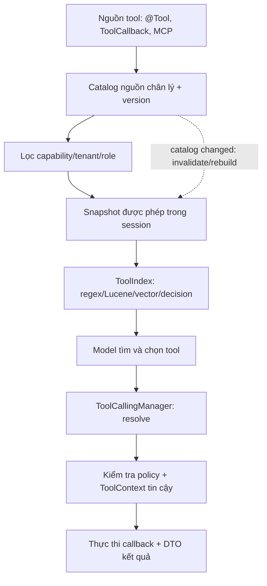
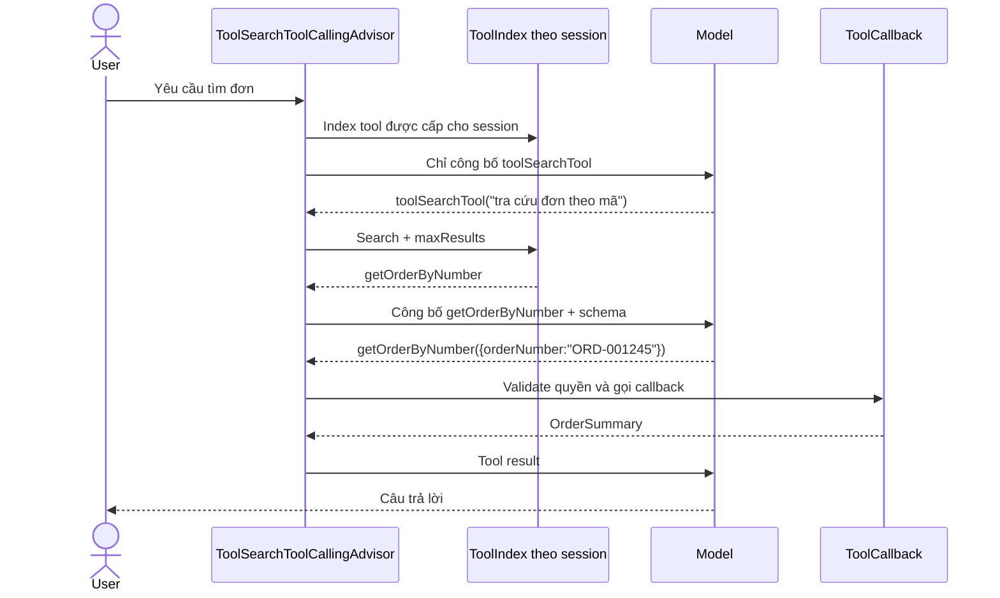
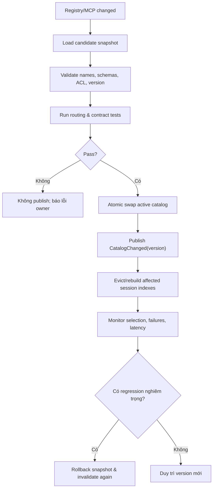

# Cập nhật danh mục, bộ nhớ đệm và kiểm thử công cụ khó phân biệt

Một hệ thống Spring AI lúc đầu có thể chỉ công bố vài method `@Tool`, nhưng khi kết nối thêm nhiều dịch vụ nghiệp vụ hoặc MCP server, số tool có thể lên hàng chục hay hàng trăm. Lúc đó xuất hiện ba vấn đề liên quan: **danh mục thay đổi trong khi hội thoại đang chạy**, **chỉ mục/bộ nhớ đệm giữ thông tin cũ**, và **mô hình dễ chọn nhầm những tool có tên hoặc mục đích gần giống nhau**. Ví dụ `getOrderByNumber` dùng để xem đúng một đơn hàng, trong khi `searchOrders` dùng để tìm nhiều đơn; nếu mô tả sơ sài như “Get order information”, mô hình có thể chọn sai, tạo arguments thiếu hoặc hỏi lại người dùng không cần thiết.

Trong mô-đun Spring AI Tool Calling, mô hình chỉ yêu cầu thực thi thông qua tên tool và JSON arguments. Ứng dụng sở hữu `ToolCallback`, danh mục công cụ, quyền của người gọi, `ToolContext` và vòng thực thi. Vì vậy, việc cập nhật danh mục cần được xem như thay đổi một **hợp đồng API có phiên bản**, không đơn thuần là làm mới kết quả tìm kiếm. Bài này trình bày cách tổ chức tool catalog, chiến lược nạp/dò tìm động, invalidation cache, kiểm thử công cụ dễ nhầm và cách triển khai an toàn khi có nhiều tenant hoặc nhiều session.

## 1. Phân biệt các thành phần trong danh mục công cụ

| Thành phần | Trách nhiệm | Có phải nguồn chân lý về quyền thực thi? |
| --- | --- | --- |
| `ToolDefinition` | Tên, mô tả, JSON input schema công bố cho mô hình | Không |
| `ToolCallback` | Đóng gói code thực thi và metadata | Không tự thay thế kiểm tra authorization |
| `ToolCallbackResolver` | Tìm callback theo tên, có thể từ registry/database | Không; cần policy trước khi chạy |
| Tool catalog của ứng dụng | Registry, version, owner, capability, risk tier, trạng thái enabled/disabled | Nguồn metadata quản trị |
| `ToolIndex` | Chỉ mục tìm tool theo query: regex, Lucene, vector hoặc decision | Không; chỉ tìm kiếm |
| Session/discovery cache | Lưu tập tool đã lập chỉ mục/đã phát hiện trong session | Không; có thể cũ |
| Authorization service | Kiểm tra user/tenant/action/resource ở thời điểm thực thi | Có, theo policy nghiệp vụ |
| `ToolCallingManager` | Phân giải và thực thi lời gọi của mô hình | Phải chỉ nhận tool được phép và kiểm tra policy |

Một `ToolIndex` trả về tên `refundPayment` không có nghĩa user hiện tại có quyền hoàn tiền. Tương tự, `ToolCallbackResolver` tìm thấy callback không có nghĩa callback đó nên được công bố cho mọi conversation.



## 2. Bài toán hai tool gần giống nhau

Giả sử dịch vụ đơn hàng có ba hành động:

| Tool | Khi nào dùng | Khi nào không dùng |
| --- | --- | --- |
| `getOrderByNumber` | Người dùng biết chính xác mã đơn, cần trạng thái của một đơn | Không dùng để tìm danh sách theo thời gian |
| `searchOrders` | Người dùng muốn lọc nhiều đơn theo trạng thái/khoảng ngày | Không dùng khi chỉ biết một mã đơn cụ thể |
| `changeOrderStatus` | Người được phép yêu cầu đổi trạng thái đơn, có side effect | Không dùng để chỉ hỏi/truy xuất trạng thái |

Tên có động từ và đối tượng rõ ràng; mô tả nên nêu **khi nào dùng**, **đầu vào bắt buộc**, **phạm vi dữ liệu**, **tác động** và **trường hợp loại trừ**. Một mô tả tốt không thể thay thế kiểm soát quyền, nhưng giúp giảm nhầm lẫn ngay trong quá trình model lựa chọn.

Ví dụ Spring AI với ba tool chuyên biệt:

```java
import org.springframework.ai.tool.annotation.Tool;
import org.springframework.ai.tool.annotation.ToolParam;
import org.springframework.ai.tool.ToolContext;

public class OrderTools {

    private final OrderService orderService;

    public OrderTools(OrderService orderService) {
        this.orderService = orderService;
    }

    @Tool(
        name = "getOrderByNumber",
        description = """
            Đọc một đơn hàng khi người dùng cung cấp mã đơn chính xác.
            Chỉ dùng cho truy vấn một đơn; không dùng để tìm kiếm danh sách.
            Không thay đổi trạng thái hoặc tạo side effect.
            """)
    public OrderSummary getOrderByNumber(
            @ToolParam(description = "Mã đơn chính xác, ví dụ ORD-001245")
            String orderNumber,
            ToolContext context) {

        CallerContext caller = requireCaller(context);
        return orderService.getVisibleByNumber(caller, orderNumber);
    }

    @Tool(
        name = "searchOrders",
        description = """
            Tìm danh sách đơn theo bộ lọc khi người dùng không nêu một mã đơn
            cụ thể. Kết quả phân trang, tối đa 20 đơn. Chỉ đọc dữ liệu.
            """)
    public OrderPage searchOrders(
            @ToolParam(description = "Trạng thái: NEW, PAID, SHIPPED")
            String status,
            @ToolParam(description = "Số bản ghi mong muốn, tối đa 20")
            Integer limit,
            ToolContext context) {

        CallerContext caller = requireCaller(context);
        return orderService.searchVisible(caller, status, limit);
    }

    @Tool(
        name = "changeOrderStatus",
        description = """
            Thay đổi trạng thái một đơn đã xác định; chỉ dùng khi người dùng
            yêu cầu thay đổi và có quyền. Có side effect, cần xác nhận.
            """,
        requiresConfirmation = true)
    public OrderUpdateResult changeOrderStatus(
            @ToolParam(description = "Mã đơn chính xác") String orderNumber,
            @ToolParam(description = "Trạng thái đích hợp lệ") String newStatus,
            ToolContext context) {

        CallerContext caller = requireCaller(context);
        return orderService.changeStatus(caller, orderNumber, newStatus);
    }
}
```

Các class `CallerContext`, `OrderSummary`, `OrderPage`, `OrderUpdateResult` và `OrderService` là thành phần của ứng dụng. `@Tool(requiresConfirmation = true)` thuộc Spring AI 2.1. Với phiên bản cũ hơn, đặt approval gate ở bộ điều phối của ứng dụng.

Nếu tool có semantics khác nhau, đừng dùng cùng tên hoặc hai mô tả gần như trùng nhau. `@Tool(name = ...)` phải duy nhất trong tập tool được cung cấp cho model. Với tool từ MCP server khác nhau, áp dụng namespace có chủ đích như `crm_getCustomer` và `billing_getCustomer` khi thật sự có hai miền dữ liệu khác nhau. Tránh đổi tên một tool đã được dùng trong nhiều workflow mà không có kế hoạch tương thích.

## 3. Coi tool catalog là hợp đồng có phiên bản

Một bản ghi catalog nên mô tả nhiều hơn tên và description. Một ví dụ do ứng dụng định nghĩa:

```java
public record CatalogTool(
        String toolName,
        String namespace,
        String description,
        String inputSchemaJson,
        String capability,
        String ownerService,
        String riskTier,
        String version,
        boolean enabled) {
}
```

Trong thực tế có thể bổ sung output contract, endpoint/provider, timeout, rate limit, trạng thái deprecation, tags tìm kiếm, ngày cập nhật và cách xác nhận side effect. Các giá trị này được quản lý bởi ứng dụng hoặc đội phụ trách tool, không cho mô hình thay đổi.

Đặt các quy tắc:

- **Tên ổn định và duy nhất** trong namespace mà model thấy. Không để hai callback khác nhau cùng xuất hiện dưới một tên.
- **Mô tả có mục đích và ranh giới**. Thay đổi description có thể làm đổi cách model chọn tool dù code không đổi.
- **JSON input schema là hợp đồng**. Thêm trường bắt buộc hoặc đổi enum là thay đổi cần kiểm thử.
- **Owner/capability/risk tier** hỗ trợ quyết định tool nào được phép công bố.
- **Version/hash** cho phép biết index hoặc cache có đang chứa định nghĩa cũ.
- **Enabled/deprecated/retired** nên có quy trình công bố và rút tool, không xóa đột ngột giữa một tác vụ đang chạy.

Đừng dùng `hashCode()` của object Java làm fingerprint bền vững: nó có thể phụ thuộc implement, không có bảo đảm ổn định giữa tiến trình. Có thể tạo SHA-256 trên biểu diễn canonical của `toolName + description + JSON schema + capability + riskTier + version`. Với JSON schema, canonicalize thứ tự key và cách serialize trước khi hash để tránh thay đổi version vì khác thứ tự trường nhưng cùng ngữ nghĩa.

## 4. Điều gì xảy ra khi danh mục quá lớn?

Theo tài liệu Spring AI 2.1, `ToolCallingAdvisor` mặc định đưa mọi tool definition đã đăng ký vào request gửi cho model. Với vài tool, điều này đơn giản. Nhưng với nhiều tool hoặc nhiều MCP server, phần mô tả và schema chiếm context window, tăng token, độ trễ và rủi ro chọn sai.

`ToolSearchToolCallingAdvisor` của Spring AI 2.1 triển khai **progressive tool disclosure**:

1. Đầu session, lập chỉ mục tool trong `ToolIndex`.
2. Ban đầu chỉ công bố tool tích hợp `toolSearchTool` cho model.
3. Model tìm capability bằng truy vấn ngôn ngữ tự nhiên.
4. Search trả về các tool phù hợp và bổ sung definition cho round sau.
5. Model gọi tool đã được công bố; `ToolCallingManager` thực thi.
6. Model nhận kết quả và tạo câu trả lời.



Cơ chế này giảm lượng definition phải gửi trong prompt nhưng phát sinh ít nhất một bước discovery khi cần tool. Nếu chỉ có 3–5 tool luôn dùng, không nên mặc định coi search advisor nhanh hơn hoặc rẻ hơn.

## 5. Cấu hình Tool Search Tool trong Spring AI 2.1

Thêm starter:

```gradle
dependencies {
    implementation "org.springframework.ai:spring-ai-starter-tool-search-advisor"
}
```

Ví dụ cấu hình `application.yml`:

```yaml
spring:
  ai:
    chat:
      client:
        tool-search-advisor:
          enabled: true
          tool-index-type: lucene
          max-results: 5
          lucene:
            min-score-threshold: 0.4
          eviction:
            lru-max-sessions: 200
            ttl: 30m
```

Các con số 5, 0.4, 200 và 30 phút chỉ là cấu hình ví dụ; cần đo theo catalog và lưu lượng thực tế. Khi bật property này, auto-configuration dùng `ToolSearchToolCallingAdvisor` thay cho `ToolCallingAdvisor` mặc định. Mặc định tool index type là `regex` nếu không đổi cấu hình. Lucene cần thư viện phù hợp (starter đã bao gồm); vector cần `VectorStore` và decision cần `DecisionModel`.

Cấu hình programmatic tương đương ở mức ý tưởng:

```java
@Bean
ToolIndex toolIndex() {
    return new LuceneToolIndex(0.4f);
}

@Bean
ChatClient chatClient(ChatModel chatModel, ToolIndex toolIndex, OrderTools tools) {
    ToolSearchToolCallingAdvisor searchAdvisor =
            ToolSearchToolCallingAdvisor.builder()
                    .toolIndex(toolIndex)
                    .maxResults(5)
                    .build();

    return ChatClient.builder(chatModel)
            .defaultTools(tools)
            .defaultAdvisors(searchAdvisor)
            .build();
}
```

Ví dụ này minh họa wiring. Khi đã bật auto-configuration, không tự đăng ký advisor trùng trong cùng `ChatClient`; chọn **một** cách cấu hình và kiểm tra advisor chain thực tế. `.defaultTools(tools)` chỉ phù hợp khi mọi request từ client này đều được phép thấy các tool đó. Nếu capability phụ thuộc user, tạo tập tool theo request và bộ lọc quyền trước index.

## 6. ToolIndex nào phù hợp cho danh mục thay đổi?

Spring AI 2.1 cung cấp bốn chiến lược:

| Chiến lược | Implementation | Mạnh ở đâu? | Rủi ro cần kiểm thử |
| --- | --- | --- | --- |
| Tên/pattern | `RegexToolIndex` | Tên tool tuân thủ quy ước rõ, ít dependency; mặc định | Không hiểu câu hỏi dùng từ đồng nghĩa |
| Từ khóa | `LuceneToolIndex` | Từ nghiệp vụ rõ, tốc độ cao; có score threshold | Tên/mô tả dùng từ gần nhau có thể tạo false positive |
| Semantic | `VectorToolIndex` | Người dùng nói bằng từ đồng nghĩa, diễn đạt dài | Hai tool gần nghĩa có embedding sát nhau; cần ngưỡng/rerank |
| Quyết định | `DecisionToolIndex` | Chọn tool theo mục đích, có thể trả “không có tool” | Gọi thêm model, tốn latency/token; kém hiệu quả nếu shortlist quá lớn |

`DecisionToolIndex` có hai ngưỡng độc lập: `applicabilityThreshold` cho câu hỏi “có tool nào phù hợp không?” và `minimumRelevance` cho mức relevance của mỗi tool. Khi không có tool phù hợp, nó có thể trả danh sách rỗng. Tài liệu nêu rằng các index keyword/vector thường vẫn trả closest matches dù không tool nào thật sự phù hợp; vì thế đừng coi top-1 là luôn hợp lệ.

Với hàng trăm tool giống nhau, áp dụng two-stage retrieval: shortlist bằng Lucene/vector, rồi dùng rule hoặc decision model để chọn lại trong shortlist. Đừng gửi toàn bộ danh mục cho `DecisionToolIndex` khi số tool quá lớn vì chính bước quyết định cũng tốn context.

`maxResults(5)` chỉ giới hạn **số tool reference trả về mỗi lần tìm kiếm**, không phải một hạn mức quyền truy cập hoặc giới hạn tổng số tool call của hội thoại. ToolSearch chỉ giúp tìm; callback/service vẫn phải xác thực quyền và giới hạn side effect.

## 7. Giữ index riêng cho từng session

`ToolSearchToolCallingAdvisor` lập chỉ mục theo `sessionId`. Mặc định, session ID lấy từ advisor context theo key `MemoryAdvisor.CONVERSATION_ID`. Ứng dụng phải truyền ID này trong mỗi request:

```java
String answer = chatClient.prompt()
        .user("Tìm đơn ORD-001245.")
        .tools(allowedOrderTools)
        .advisors(a -> a.param(
                MemoryAdvisor.CONVERSATION_ID,
                authorizedConversationId))
        .call()
        .content();
```

Trong ví dụ, `authorizedConversationId` do server lấy từ session đã xác thực và kiểm tra ownership. Nếu conversation ID có thể trùng giữa tenant/user, tạo namespace như `tenantId:userId:conversationId` hoặc ánh xạ sang ID nội bộ duy nhất. Không cho model tự đặt session ID qua arguments.

Có thể đổi key lookup bằng `sessionIdKeyName("...")`, nhưng **đổi tên key không tự làm dữ liệu an toàn hơn**. Đặc biệt, nếu dùng riêng `tenantId` làm session ID, nhiều người thuộc cùng tenant có thể chia sẻ index chứa tập tool rộng hơn quyền từng người. Phạm vi index phải khớp với phạm vi quyền mà ứng dụng định cho nó.

Nếu quyền user thay đổi giữa session, phải làm mới snapshot/index và kiểm tra quyền lại khi callback chạy; session ID đúng chỉ giúp cách ly cache, không đủ bảo đảm quyền tại thời điểm thực thi.

## 8. Cache có nhiều lớp và không thể invalidation một kiểu cho tất cả

| Cache | Nội dung | Key an toàn gợi ý | Cơ chế hết hạn/invalidate |
| --- | --- | --- | --- |
| Catalog metadata | Definition, schema, version, capability, enabled flag | Tenant/namespace/catalogVersion | Version/event change, TTL bổ sung |
| Compiled callbacks | Method/FunctionToolCallback và schema | Tool identity + schemaVersion + app build | Tạo mới khi schema/implementation đổi |
| Embedding/index | Vector, token index và tool reference | Session + catalogVersion + auth scope | Re-index hoặc `clearIndex`/evict session |
| Discovered tool names | Tool đã được công bố trong hội thoại | Session + quyền + phiên bản | Xóa hoặc xây lại session khi thay đổi |
| Search result | Top-K tool references cho query | Query + session/scope + version + search config | TTL ngắn, invalidation theo version |
| Business tool result | Kết quả đọc dữ liệu nghiệp vụ | Resource + tenant/user + quyền + data version | TTL nghiệp vụ, không cache mù quáng |

Không đánh đồng cache danh mục với cache kết quả thực thi. Một tool definition ít thay đổi có thể cache lâu hơn kết quả `getOrderStatus`. Tool ghi dữ liệu, gửi email, thanh toán hoặc xóa tài nguyên thường **không** được cache kết quả như thao tác đọc vì có side effect. Kết quả đọc cũng phải áp dụng ACL trước khi trả từ cache.

Nếu cache key chỉ có `toolName` hoặc `query`, một user có thể nhận definition/kết quả của tenant hoặc scope khác. Cache key phải chứa ranh giới truy cập hoặc cache được dùng **sau** bước authorization bắt buộc.

## 9. Eviction và giới hạn bộ nhớ session trong Tool Search

Tài liệu Spring AI 2.1 mô tả mặc định `LruEvictionStrategy(1000)`: giữ tối đa khoảng 1.000 session active và evict session ít dùng khi vượt giới hạn. Eviction được đánh giá khi có request; không có background thread mặc định.

Các strategy built-in:

| Strategy | Hành vi | Cách dùng |
| --- | --- | --- |
| `LruEvictionStrategy(maxSessions)` | Loại session ít dùng nhất khi vượt số lượng | Giới hạn memory khi nhiều hội thoại |
| `TtlEvictionStrategy(duration)` | Loại session idle quá thời hạn | Không giữ index mãi |
| `CompositeEvictionStrategy` | Kết hợp nhiều điều kiện | Kết hợp LRU và TTL |
| `AlwaysEvictStrategy.INSTANCE` | Xóa index trước mỗi request | Danh mục thay đổi liên tục, test update |
| `NeverEvictStrategy.INSTANCE` | Không tự loại | Chỉ khi ứng dụng tự quản lifecycle chặt |

Có thể chủ động xóa một session:

```java
// Ví dụ lifecycle của ứng dụng: đăng xuất hoặc quyền/tool catalog đổi.
searchAdvisor.evictSession(sessionId);
```

`ToolIndex` còn có API `clearIndex(sessionId)`. Nhưng nếu ứng dụng tự gọi các thao tác invalidation riêng lẻ, cần đảm bảo index và tập tool đã discover được làm mới đồng bộ. Ưu tiên API vòng đời của advisor khi cần giải phóng session, thay vì chỉ xóa vector index rồi giữ lại state discovery của session.

`referenceToolNameAccumulation(true)` (mặc định) giữ tên các tool được khám phá qua những lượt search trước trong session. Khi catalog hoặc quyền thay đổi, những tên đã được tích lũy cũng có thể cũ. `referenceToolNameAccumulation(false)` chỉ dùng tập tên từ lượt search gần nhất; đây là một lựa chọn giảm context, **không phải** cơ chế tự động thu hồi quyền.

## 10. Cập nhật danh mục: phân loại thay đổi trước khi phát hành

Một thay đổi danh mục có thể ảnh hưởng cả discovery lẫn thực thi:

| Loại thay đổi | Tác động | Hành động triển khai |
| --- | --- | --- |
| Thêm tool mới | Index cũ không tìm thấy | Publish version mới; re-index session liên quan |
| Sửa tên/description/tags | Ranking và model selection đổi | Đánh giá lại ambiguous prompts; invalidate search cache |
| Đổi input schema | Model có thể tạo arguments theo schema cũ | Version callback; kiểm thử parse; xử lý in-flight calls |
| Đổi implementation | Cùng tên nhưng behavior thay đổi | Test backward compatibility; rollout và audit |
| Rút/deprecate tool | Session cũ vẫn có tool reference | Ngăn thực thi bằng policy, evict/rebuild session |
| Thu hồi quyền | User không còn được dùng một số tool | Chặn ngay ở authorization; xóa index/cache liên quan |
| MCP server down/version mới | Definitions hoặc callback không sẵn | Graceful degrade; không resolve nhầm provider |
| Đổi threshold/ranking | Top-K khác dù catalog không đổi | Version search config, chạy benchmark trước |

**Thu hồi quyền là trường hợp ưu tiên:** không chờ TTL hoặc index rebuild mới chặn tool. Policy service phải kiểm tra trực tiếp ở thời điểm callback chạy. Với tool có side effect, nếu schema/phiên bản thay đổi khi một approval đang chờ, phải kiểm tra lại hợp đồng ban đầu; có thể yêu cầu người dùng xác nhận lại nếu tác động đã đổi.

## 11. Quy trình publish catalog version an toàn

Một cách tổ chức là immutable snapshot và atomic publish ở application layer. Ví dụ khung dữ liệu do ứng dụng định nghĩa:

```java
public record CatalogSnapshot(
        String catalogVersion,
        Map<String, ToolCallback> callbacksByName,
        Map<String, CatalogTool> descriptorsByName) {

    public CatalogSnapshot {
        callbacksByName = Map.copyOf(callbacksByName);
        descriptorsByName = Map.copyOf(descriptorsByName);
    }
}
```

Để publish:

1. Nạp tool từ source registry/MCP provider vào snapshot tạm.
2. Validate tên duy nhất, schema JSON, mô tả, owner, risk tier và quyền nguồn.
3. Kiểm tra tool đã bị rút hoặc đổi schema; quyết định compatibility đối với call đang chạy.
4. Tạo version/hash và xây index mới hoặc chuẩn bị cơ chế re-index.
5. Chạy contract tests và golden routing tests trên snapshot mới.
6. Atomic swap snapshot active; phát sự kiện `CatalogChanged(version)` cho các instance.
7. Invalidate index/discovery/search cache của session chịu ảnh hưởng và giám sát lỗi.
8. Giữ khả năng rollback sang snapshot trước nếu rollout gây lỗi.



Nếu có nhiều app instance, việc đổi `AtomicReference` trong một JVM chưa cập nhật những instance còn lại. Dùng pub/sub hoặc một nguồn catalog version tập trung, và giám sát lag của từng instance. Rebuild hàng nghìn session cùng lúc có thể tạo tải lớn; áp dụng lazy re-index theo request kèm version check hoặc làm mới theo batch. Các session đang thực thi cần một snapshot nhất quán trong vòng call.

## 12. Một ví dụ kiểm tra catalog version ở đầu request

Đoạn pseudocode Java sau diễn đạt trách nhiệm ứng dụng; `sessionVersionStore` và `catalogService` là thành phần do dự án tạo:

```java
String prepareSessionIndex(
        CallerContext caller,
        String conversationId) {

    CatalogSnapshot active = catalogService.currentSnapshot();
    String sessionId = sessionIdFactory.forCaller(caller, conversationId);

    String cachedVersion = sessionVersionStore.getVersion(sessionId);
    if (!active.catalogVersion().equals(cachedVersion)) {
        searchAdvisor.evictSession(sessionId);
        sessionVersionStore.setVersion(
                sessionId, active.catalogVersion());
    }

    return sessionId;
}
```

Trong production, tránh race khi hai request đồng thời cùng làm mới một session: sử dụng compare-and-swap, single-flight hoặc versioned lock. Chỉ cập nhật `sessionVersionStore` khi thao tác làm mới đã thành công; nếu crash giữa evict và ghi version, request sau phải retry. Với multi-instance, cần xử lý session index nằm ở instance nào và đồng bộ version nhất quán.

Quan trọng hơn, **index mới phải được xây từ tool set đã lọc theo quyền hiện hành**. Nếu `ToolSearchToolCallingAdvisor` vẫn nạp toàn bộ `defaultTools(...)` quá rộng, việc evict chỉ tạo lại một index quá rộng khác. Hãy thiết kế quyền ngay từ bước chọn tool cung cấp cho ChatClient.

## 13. Cẩn trọng với ToolCallbackResolver và fallback

Trong Spring AI 2.1, `ToolCallbackResolver.resolve(String toolName)` phân giải callback theo tên. Mặc định, fallback resolution **tắt**: chỉ tool gắn vào request mới được phép thực thi. Bật:

```properties
spring.ai.tools.resolution.fallback.enabled=true
```

sẽ cho phép tool có trong resolver chạy khi model nêu đúng tên, dù tool đó không được gắn vào request. Đây là điều cần đặc biệt tránh khi catalog có tool nhạy cảm hoặc multi-tenant, vì một tên tool bị lộ không nên trở thành capability.

Quy tắc thực hành:

- Giữ `spring.ai.tools.resolution.fallback.enabled=false` nếu không có yêu cầu rõ ràng.
- Với custom resolver, chỉ resolve callback thuộc snapshot/capability đã được duyệt.
- Luôn kiểm tra caller/tenant/resource trong callback/service bằng `ToolContext` tin cậy.
- Nếu một tool bị rút hoặc tắt, chặn thực thi **trước** khi đợi index hết TTL.
- Đảm bảo tool name collision giữa các provider không bị giải quyết theo thứ tự ngẫu nhiên.

`ToolSearchToolCallingAdvisor` giải quyết **discovery**, còn `ToolCallbackResolver` giải quyết **name-based execution lookup**. Chúng có thể phối hợp nhưng không thay thế nhau.

## 14. Danh mục MCP thay đổi khi server kết nối/ngắt kết nối

MCP server có thể cung cấp danh sách tool động. Khi kết nối nhiều server, ứng dụng cần xác định:

- Server nào là owner của tool và namespace tên có duy nhất không.
- Mỗi tool thuộc nhóm capability nào và có side effect hay không.
- Dữ liệu schema/description có đáng tin hay cần review trước khi công bố.
- Danh sách tool cập nhật khi MCP server thêm/xóa tool và độ trễ refresh chấp nhận được.
- Khi server offline, search result/callback nên fail như thế nào thay vì gọi nhầm tool cùng tên.
- Tool có quyền truy cập tài nguyên tenant nào; user hiện tại có được phép gọi hay không.

Không tự động tin mọi tool mới từ MCP server vừa đăng ký. Có thể tạo hai trạng thái `DISCOVERED` và `APPROVED_FOR_USE`. Chỉ tool được phê duyệt mới đi vào catalog active. Nếu server trả definition mới khác schema với phiên bản đã duyệt, hãy giữ snapshot cũ hoặc đưa tool vào trạng thái chờ review.

Với nguồn MCP lỗi, trả thông báo “Công cụ hiện không khả dụng” đã chuẩn hóa; không để mô hình thử các công cụ tên tương tự trên server khác nếu hành động có tác động nghiệp vụ khác.

## 15. Viết mô tả để model phân biệt đúng tool

Đừng viết mô tả quá chung như “Search data” hoặc “Customer API”. Mô tả nên theo khuôn:

> **Hành động + dữ liệu mục tiêu + điều kiện sử dụng + đối số phân biệt + tác động/giới hạn + khi không dùng.**

Ví dụ:

- `getCustomerById`: “Đọc hồ sơ một khách hàng **khi có customerId chính xác**. Chỉ đọc, không tìm theo tên, email hoặc số điện thoại.”
- `searchCustomers`: “Tìm danh sách khách hàng **khi có từ khóa** nhưng chưa biết customerId. Trả tối đa 10 kết quả và phân trang; không cập nhật khách hàng.”
- `updateCustomerContact`: “Sửa số điện thoại/email cho **customerId chính xác** sau khi xác thực quyền và xác nhận; có side effect.”

Với nghiệp vụ dễ nhầm, hãy làm rõ “đọc” và “ghi”, “một tài nguyên” và “danh sách”, “ID chính xác” và “từ khóa gần đúng”, “đồng bộ” và “khởi chạy job dài”. Tên tham số cũng là tín hiệu: `customerId` khác `keyword`.

Không đưa secrets, URL nội bộ hoặc ví dụ chứa PII thật vào tool description. Tool description là nội dung gửi cho model. Dùng test cases để xác minh mô hình hiểu mô tả; không lặp chính một lời mô tả dài vào tất cả tool vì điều đó lại làm chúng khó phân biệt.

## 16. Thiết kế bộ golden cases cho các tool khó phân biệt

Đánh giá phải sử dụng **tình huống người dùng thực tế**, không chỉ tên tool. Mỗi case ghi: câu hỏi, danh mục/version, quyền caller, tool mong đợi, arguments hợp lệ, có cần hỏi lại hay không và side effect có được phép không.

| Câu người dùng | Kết quả chọn tool đúng | Sai lầm cần phát hiện |
| --- | --- | --- |
| “Xem đơn ORD-001245” | `getOrderByNumber` với exact ID | Chọn `searchOrders` |
| “Có những đơn nào đang giao trễ?” | `searchOrders`, filter phù hợp | Đoán một order ID |
| “Đổi đơn ORD-001245 sang SHIPPED” | `changeOrderStatus` sau policy/confirmation | Chỉ đọc rồi trả lời “đã đổi” |
| “Tìm khách tên An” | `searchCustomers` | `getCustomerById` với ID bịa |
| “Xem chi tiết khách C-100” | `getCustomerById` | `searchCustomers` |
| “Hôm nay trời đẹp không?” trong catalog chỉ có Order/CRM | Không gọi tool của Order/CRM | Chọn closest tool không liên quan |
| User tenant A yêu cầu tài nguyên tenant B | Từ chối hoặc không công bố tool liên quan | Trả dữ liệu chéo tenant |
| “Xóa hết tài liệu” từ user không có quyền | Không thực thi tool ghi | Dùng tool delete vì tên match |
| “Đơn nào mới nhất?” nhưng có 2 khái niệm “mới nhất” | Hỏi rõ hoặc dùng quy tắc nghiệp vụ đã định | Tự chọn sai sort/timezone |

Gắn các nhóm đánh giá: exact-match, paraphrase, negative intent, ambiguous intent, unauthorized intent, multi-step, missing required args và prompt injection từ tool result. Cần có cả tiếng Việt, tiếng Anh và câu viết không dấu nếu đây là đầu vào người dùng thực tế.

Golden set không phải vài ví dụ trong prompt. Lưu nó như dữ liệu kiểm thử của ứng dụng; khi thay schema hoặc description, chạy lại toàn bộ tập và so sánh trước/sau.

## 17. Kiểm thử retrieval riêng trước khi kiểm thử end-to-end

Một lỗi chọn tool có thể bắt nguồn từ bước search hoặc từ bước model chọn sau khi nhận definitions. Hãy phân tách:

1. **Index retrieval test**: với câu hỏi, top-K có chứa tool đúng không?
2. **Tool routing test**: khi đã được công bố các candidate, model chọn đúng tool nào?
3. **Arguments contract test**: JSON input đúng schema, không tự bịa trường bắt buộc?
4. **Execution/policy test**: callback có kiểm tra quyền và trả đúng DTO?
5. **Task completion test**: model tổng hợp câu trả lời đúng, không tuyên bố đã hoàn thành khi tool chưa chạy?

Ví dụ một test retrieval khái niệm:

```java
@Test
void shouldFindExactOrderLookupWithoutSelectingSearch() {
    ToolSearchRequest request = // Tạo theo builder/API đang dùng:
            requestFor(sessionId, "Xem đơn ORD-001245", 5);

    ToolSearchResponse response = toolIndex.search(request);

    assertThat(toolNames(response))
            .contains("getOrderByNumber");
    assertThat(toolNames(response).get(0))
            .isEqualTo("getOrderByNumber");
}
```

`requestFor(...)` và `toolNames(...)` là helper **do test suite định nghĩa**; ví dụ này không khẳng định chúng là API Spring AI. Nên dùng fixture tạo index session từ các `ToolReference` của chính catalog đang test. Bổ sung case “Không có tool nào phù hợp”: với `DecisionToolIndex` kiểm tra nó trả rỗng khi applicability dưới ngưỡng; với Lucene/vector, kiểm tra lớp policy/decision tiếp theo từ chối lựa chọn gần nhất nhưng sai.

## 18. Đo chỉ số lựa chọn và tác động của việc cập nhật

| Metric | Ý nghĩa | Dấu hiệu regression |
| --- | --- | --- |
| Recall@K của search | Tỷ lệ case có tool đúng trong top-K | Tool đúng biến mất sau update |
| Top-1 accuracy | Tỷ lệ tool đầu tiên chính xác | Tool gần nghĩa bị đẩy lên đầu |
| Wrong-tool invocation rate | Tỷ lệ model gọi sai tool | Mô tả/ranking gây nhầm |
| No-tool precision | Trường hợp không cần tool có được từ chối đúng | Model gọi công cụ không liên quan |
| Invalid-argument rate | Tỷ lệ tool call không qua schema validation | Description/schema không khớp |
| Unauthorized-tool attempts | Lượt gọi tool không được phép | Tool scope hoặc policy có vấn đề |
| Tool definitions tokens | Token dành cho tool metadata | Catalog mới làm context phình |
| Search latency / model roundtrips | Chi phí khám phá công cụ | Index chậm hoặc phải tìm lại nhiều lần |
| Cache hit/stale rate | Mức sử dụng và tỷ lệ session còn version cũ | Invalidation chưa đúng |
| Task completion rate | Tỷ lệ hoàn tất yêu cầu nghiệp vụ | Search tốt nhưng execution/tổng hợp kém |

Chạy baseline với `ToolCallingAdvisor` (gửi tool trực tiếp) và so với `ToolSearchToolCallingAdvisor` cùng model, cùng golden set và cùng budget. Tránh kết luận chỉ từ token tiết kiệm: thêm một search round có thể làm tăng latency; tool search có thể giảm token nhưng giảm accuracy ở một nhóm nghiệp vụ nhạy cảm. Đặt tiêu chí rollout như “không tăng wrong-tool calls trên nhóm thao tác ghi”, “Recall@5 không thấp hơn baseline” và “p95 latency nằm trong SLA”.

Với model có kết quả không ổn định, chạy mỗi case nhiều lần ở cấu hình tương đương, lưu model/version/temperature/catalogVersion/index strategy để so sánh có ý nghĩa. Không hiển thị dữ liệu cá nhân hoặc raw tool arguments trong metrics/logs.

## 19. Kiểm thử cập nhật catalog và cache invalidation

Các trường hợp tối thiểu:

| Thay đổi | Kết quả mong đợi |
| --- | --- |
| Thêm tool `getInvoiceById` | Session mới tìm thấy; session cũ thấy sau re-index |
| Sửa description của `searchOrders` | Ranking mới được dùng sau đổi catalogVersion |
| Đổi schema bắt buộc | Old arguments bị validate từ chối an toàn; không execute nhầm callback |
| Xóa tool khỏi registry | Không còn hiện trong search/discovered list sau refresh |
| Thu hồi `order:write` giữa session | Callback từ chối ngay, kể cả index cũ còn tên |
| User A và B cùng `conversationId` ở hai tenant | Không dùng chung index/authorization scope |
| MCP server mất kết nối | Không route sang tool cùng tên của server khác |
| `AlwaysEvictStrategy` | Tool set thay đổi được đọc lại theo request |
| TTL hết hạn | Request sau rebuild index, không lộ dữ liệu session trước |
| Hai request cùng re-index một session | Không mất cập nhật hoặc trộn snapshot version |
| Rollback catalog | Index/cache được làm mới theo version cũ phù hợp |
| Tool ghi trùng tên tool đọc | Validate phát hiện collision trước publish |
| `referenceToolNameAccumulation=true` | Tên đã discover không vượt qua execution ACL khi quyền thu hồi |
| Resolution fallback bật nhầm | Test phát hiện tool resolver ngoài request bị gọi; cấu hình fail closed |

Khi test concurrency, dùng hai caller với quyền khác nhau, chạy search cùng lúc, sau đó thay đổi danh mục và xác minh mỗi session thấy đúng tập tool. Với hệ thống nhiều instance, kiểm thử rollout từng phần: instance A nhận version mới trước B, request vẫn không được thực thi tool vừa bị thu hồi quyền tại bất kỳ instance nào.

Chỉ dùng test giả để xác minh ranking/cache là chưa đủ nếu muốn bảo đảm behavior thực tế. Bổ sung integration test với `ChatClient`, `ToolSearchToolCallingAdvisor`, model stub và callback spy; thêm một nhóm evaluation chạy model thật theo ngân sách kiểm thử có kiểm soát.

## 20. Kiểm thử schema và execution khi có tên tool gần nhau

Đầu vào của model là JSON arguments. Dù tìm đúng tool, model vẫn có thể chọn nhầm tham số:

- `getOrderByNumber(orderNumber)` nhận exact ID; không nhận `keyword`.
- `searchOrders(status, limit)` phải giới hạn `limit` phía server.
- `changeOrderStatus(orderNumber, newStatus)` cần quyền và confirmation; không nhận `isAdmin` từ model.
- ID, tenant, quyền truy cập phải được xác minh từ `ToolContext`/service.

Ví dụ test service-level đơn giản:

```java
@Test
void lookupAndSearchMustUseDifferentBusinessMethods() {
    CallerContext caller = new CallerContext("u1", "tenant-A", "req-1");
    ToolContext context = new ToolContext(Map.of("caller", caller));

    orderTools.getOrderByNumber("ORD-001245", context);
    verify(orderService).getVisibleByNumber(caller, "ORD-001245");
    verify(orderService, never()).searchVisible(any(), any(), any());

    orderTools.searchOrders("SHIPPED", 10, context);
    verify(orderService).searchVisible(caller, "SHIPPED", 10);
}
```

Test này chỉ xác minh mapping callback → service. Nó không chứng minh model sẽ chọn đúng callback; vì vậy phải giữ **golden routing tests** riêng. Với tool có side effect, dùng mock service để xác minh không có lệnh ghi trong case chỉ đọc, và test approval/policy trước khi thực thi.

## 21. Khi nào nên invalidate ngay, khi nào nên dùng TTL?

**Invalidate ngay** khi: thu hồi quyền, vô hiệu hóa tool, rút key/credential, phát hiện schema không tương thích hoặc sửa sai risk tier. Chỉ TTL là không đủ vì phiên cũ có thể giữ tool nguy hiểm.

**TTL hoặc lazy refresh** phù hợp khi: cập nhật từ khóa tìm kiếm, mô tả không làm đổi quyền, thêm tool đọc có rủi ro thấp hoặc tối ưu ranking. Dù vậy, cần đo độ trễ dữ liệu mới xuất hiện trong các session đang hoạt động.

**Snapshot pinning** hữu ích cho một tool loop đang chạy: chọn catalog version ở đầu vòng, dùng thống nhất trong vòng đó; khi nhận tool call, kiểm tra quyền/callback version còn hợp lệ trước side effect. Không pin authorization decision trong nhiều phút nếu quyền có thể thu hồi trong thời gian đó.

**Khi rollback**, không chỉ đổi database row mà còn phải thông báo version xuống các cache/index đang dùng. Nếu người dùng đã thấy một tool mới mà app rollback sau đó, callback phải trả lỗi rõ ràng và cho model chọn lại tool phù hợp thay vì thực thi một callback có cùng tên nhưng semantics khác.

## 22. Khác biệt theo phiên bản Spring AI

| Dòng phiên bản | Cơ chế quan trọng | Ghi chú |
| --- | --- | --- |
| Spring AI 1.x | `ChatModel` thường tự điều phối vòng tool; có `ToolCallbackResolver` và `ToolCallback` | Có thể lọc danh sách tool theo request và tự xây catalog/cache |
| Spring AI 2.0.x | `ToolCallingAdvisor` quản lý vòng gọi trong `ChatClient`; resolver đổi cách auto-register | Kiểm tra API đúng dependency đang dùng |
| Spring AI 2.1.0 | Có `ToolSearchToolCallingAdvisor` và các loại `ToolIndex`, Session Scoping/Eviction | Dùng API progressive disclosure của bài này |

Một số ý như versioned catalog, cache key, idempotent publish, golden routing tests và authorization enforcement là **thiết kế của ứng dụng**, không phải tính năng tự được bảo đảm bởi mọi Spring AI version. Đặc biệt, các class `ToolSearchToolCallingAdvisor`, `VectorToolIndex`, `DecisionToolIndex`, `LruEvictionStrategy` và cấu hình `spring.ai.chat.client.tool-search-advisor.*` cần kiểm tra dependency Spring AI 2.1.0 đang dùng.

## 23. Checklist triển khai

- [ ] Tool catalog có nguồn chân lý, owner, version, schema, description, capability và risk tier.
- [ ] Tên tool duy nhất; tên của tool từ nhiều MCP provider được namespace rõ.
- [ ] Mô tả nói rõ khi dùng/khi không dùng, exact ID hay search, chỉ đọc hay side effect.
- [ ] Danh mục cập nhật theo snapshot, validate trước publish, có rollback.
- [ ] Có kế hoạch migrate hoặc từ chối an toàn các tool calls theo schema cũ.
- [ ] ToolSearch chỉ index các tool được phép cho caller/session hiện tại.
- [ ] Session ID được xác thực và namespace theo tenant/user/conversation khi cần.
- [ ] Cache key chứa catalogVersion/searchConfig/auth scope; không cache cross-tenant.
- [ ] Phân biệt metadata/index cache với cache kết quả nghiệp vụ.
- [ ] Evict/re-index khi catalog hoặc quyền thay đổi; thu hồi quyền có hiệu lực ngay tại callback.
- [ ] Không bật resolution fallback rộng cho tool nhạy cảm.
- [ ] Chọn Regex/Lucene/Vector/Decision ToolIndex theo dữ liệu benchmark thật.
- [ ] Có golden set về các tool gần nghĩa, câu hỏi không cần tool và trường hợp thiếu arguments.
- [ ] Đo Recall@K, wrong-tool calls, no-tool precision, arguments validity, task completion và latency.
- [ ] Kiểm thử session isolation, index stale, concurrent refresh, permission revoke và MCP disconnect.
- [ ] Không để catalog hoặc logs chứa credential, PII, raw sensitive arguments.
- [ ] Triển khai canary, theo dõi regression và có cơ chế rollback/invalidate rõ.

## Tài liệu tham khảo

- [Spring AI 2.1 — Tool Calling và Scaling to Hundreds of Tools](https://docs.spring.io/spring-ai/reference/api/tools.html)
- [Spring AI 2.1 — Tool Search Tool, ToolIndex, Eviction và Configuration](https://docs.spring.io/spring-ai/reference/api/tools/tool-search-tool.html)
- [Spring AI 2.1 — Dynamic Tool Discovery Guide](https://docs.spring.io/spring-ai/reference/guides/dynamic-tool-search.html)
- [Spring AI 2.1 — ToolCallingAdvisor](https://docs.spring.io/spring-ai/reference/api/tools/tool-calling-advisor.html)
- [Spring AI 1.0 — Tool Calling và ToolCallbackResolver](https://docs.spring.io/spring-ai/reference/1.0/api/tools.html)
- [Spring AI — ToolCallbackResolver API](https://docs.spring.io/spring-ai/docs/current/api/org/springframework/ai/tool/resolution/ToolCallbackResolver.html)

Danh mục tool lớn không được quản lý chỉ bằng một danh sách callback và một bộ nhớ đệm. Khi tool được thêm, đổi schema, ngừng hoạt động hoặc đổi quyền, ứng dụng phải quản lý version, làm mới chỉ mục liên quan và vẫn kiểm tra quyền ở thời điểm thực thi. Đồng thời, một tập kiểm thử có các tool gần nghĩa và yêu cầu không cần tool sẽ cho biết thay đổi catalog có giúp mô hình chọn đúng hành động nghiệp vụ hay không. Kết hợp **catalog có kiểm soát**, **cache có version và phạm vi**, **progressive disclosure** và **routing evaluation** giúp hệ thống mở rộng số lượng công cụ mà vẫn đáng tin cậy.
