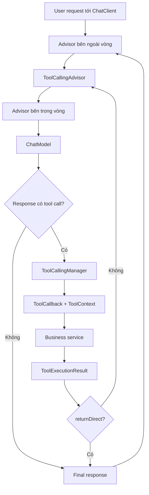
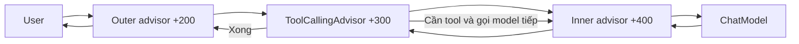

# Khi nào mở rộng vòng lặp thay vì tự viết lại toàn bộ điều phối

Trong Spring AI, khi mô hình yêu cầu gọi công cụ thay vì trả lời trực tiếp, ứng dụng phải tìm callback, kiểm tra dữ liệu, thực thi service nghiệp vụ, chuyển kết quả về mô hình và tiếp tục đến khi có câu trả lời cuối. Một lựa chọn dễ nghĩ tới là tự viết vòng `while` gọi `ChatModel` và `ToolCallingManager`. Cách đó cho quyền kiểm soát cao nhưng khiến ứng dụng phải gánh lại nhiều trách nhiệm mà framework đã có: lịch sử tool-call/result, xử lý exception, streaming, return-direct, giới hạn vòng gọi, advisor chain, observability và xác nhận hành động nhạy cảm.

Trong Spring AI 2.1.0, `ToolCallingAdvisor` là một *recursive advisor* thuộc `ChatClient`. Nó đã quản lý vòng model–tool. Nếu chỉ cần quan sát từng vòng, thay đổi công cụ trước khi gọi mô hình, điều chỉnh điều kiện kết thúc hoặc thêm chính sách, hãy ưu tiên **mở rộng advisor hoặc cấu hình component có sẵn**. Chỉ tự điều phối khi các điểm mở rộng không đáp ứng được quy trình giao dịch và trạng thái mà ứng dụng cần sở hữu.

## Nhận diện đúng loại yêu cầu mở rộng

Một trợ lý quản lý đơn hàng có thể cần:

- Ghi metric tên công cụ được mô hình đề xuất sau mỗi lần gọi.
- Chọn lại tool definitions theo quyền tenant, trạng thái workflow hoặc intent.
- Đặt ngân sách model/tool cho mỗi lượt người dùng.
- Dừng trước khi thực hiện một lệnh hoàn tiền để đợi người có thẩm quyền phê duyệt.
- Gửi tiến độ streaming tới giao diện SSE/WebSocket.
- Lưu đủ lịch sử assistant tool calls và tool results.
- Điều phối tool calls thành DAG, quản lý transaction và khôi phục tiến độ sau khi server restart.

Những yêu cầu này không cùng một cấp độ. Ghi log là quan sát; chọn tools là thay đổi request; xác nhận có cơ chế riêng của Spring AI; transaction phân tán phải được service/workflow bảo đảm. Tự viết lại toàn bộ vòng chỉ vì cần log vài sự kiện sẽ tạo thêm nhiều code và rủi ro không cần thiết.

## Vòng tool calling mặc định làm những gì?

`ChatClient` tự đăng ký `ToolCallingAdvisor` khi tool calling được bật. Advisor gửi prompt và các định nghĩa công cụ tới mô hình. Nếu response có tool calls, nó giao cho `ToolCallingManager` tìm và gọi `ToolCallback`, lấy `ToolExecutionResult` rồi đưa các tool responses vào lịch sử để mô hình tiếp tục. Vòng lặp kết thúc khi mô hình không còn gọi công cụ hoặc gặp một điều kiện dừng như `returnDirect`, confirmation, lỗi hoặc vượt giới hạn.



Phân biệt ba trách nhiệm:

| Thành phần | Sở hữu |
|---|---|
| `ToolCallingAdvisor` | Vòng gọi model, lịch sử giữa các vòng và điều kiện kết thúc |
| `ToolCallingManager` | Phân giải callback, thực thi tool calls, confirmation, giới hạn và kết quả thực thi |
| `ToolCallback` / business service | Parse/validate arguments, authorization, idempotency và side effect nghiệp vụ |

Mô hình chỉ đề xuất tên và đối số; nó không nhận quyền truy cập trực tiếp tới database, HTTP client hoặc service phía sau callback. Trong Spring AI 2.x, `ChatModel.call(...)` trực tiếp chỉ trả `ChatResponse` thô; nó **không** tự thực thi tool calls như cơ chế cũ của 1.x.

## Ma trận: dùng cấu hình, advisor hay loop thủ công?

| Nhu cầu | Điểm mở rộng ưu tiên | Khi nào cần tự điều phối? |
|---|---|---|
| Log tool intent mỗi vòng | `CallAdvisor`/`StreamAdvisor` bên trong vòng | Hầu như không cần |
| Đếm số vòng, ghi latency/token | Advisor trong vòng và Micrometer observation | Khi ngân sách do workflow khác sở hữu |
| Thay tool definitions mỗi vòng | Override `doBeforeCall`/`doBeforeStream` | Khi cần một execution engine riêng |
| Khởi tạo/dọn state vòng | `doInitializeLoop` / `doFinalizeLoop` và biến thể stream | Khi state cần checkpoint bền qua nhiều request |
| Điều kiện nhận diện tool response | `ToolExecutionEligibilityChecker` | Khi provider protocol hoặc workflow cần kiểm soát riêng |
| Lịch sử giữa các vòng | MemoryAdvisor hoặc `doGetNextInstructionsForToolCall` | Khi workflow bên ngoài sở hữu transcript |
| Tìm tool trong catalog lớn | `ToolSearchToolCallingAdvisor` | Khi discovery có kiến trúc ngoài framework |
| Xác nhận thao tác nguy hiểm | `@Tool(requiresConfirmation=true)`, `ToolCallConfirmationPolicy` | Khi quy trình phê duyệt phân tán đòi hỏi state store phức tạp |
| Chuyển lỗi thành message/exception | `ToolExecutionExceptionProcessor` | Khi thực sự cần orchestration ngoài manager |
| Giới hạn tool call | Cấu hình `DefaultToolCallingManager` | Khi có quota/điều kiện dừng xuyên nhiều hệ thống |
| DAG/saga/partial commit nhiều tool | Tool nghiệp vụ hoặc workflow chuyên trách | Khi phải kiểm soát batch, transaction và rollback |

**Nguyên tắc chọn:** cấu hình trước, advisor đơn giản sau, subclass/hook khi cần, rồi mới đến vòng gọi thủ công. Không phải mọi yêu cầu mới đều cần custom `ToolAdvisor`.

## Bốn mức mở rộng

### Mức 1 — Cấu hình callback hoặc manager

Khi hành vi chỉ thuộc một tool, không sửa loop:

- `@Tool(returnDirect=true)`: không cần một vòng model nữa khi kết quả tool đã đủ.
- `@Tool(requiresConfirmation=true)`: pause trước khi tool nhạy cảm thực thi.
- `ToolContext`: truyền user ID, tenant ID và request ID đáng tin cậy tới callback, không gửi cho model.
- `ToolExecutionExceptionProcessor`: trả lỗi an toàn cho model hoặc ném lên caller.
- `DefaultToolCallingManager`: giới hạn số lần gọi và điều kiện khi vượt giới hạn.

Ví dụ:

```java
@Tool(
        description = "Hủy đơn hàng được phép hủy",
        requiresConfirmation = true)
public CancelResult cancelOrder(
        String orderId, ToolContext toolContext) {

    String tenantId = requireTrustedTenant(toolContext);
    return orderService.cancelIfAuthorized(tenantId, orderId);
}
```

Ứng dụng vẫn phải tạo bản xem trước để người dùng duyệt, giữ pause ở server và kiểm tra lại quyền khi thực thi; nhưng không phải viết lại vòng model chỉ vì có bước phê duyệt.

### Mức 2 — Advisor bình thường để quan sát hoặc biến đổi

Một `CallAdvisor`/`StreamAdvisor` có thể đọc request và response, ghi metrics, bổ sung context hoặc chuyển sự kiện tới UI. Nó không tự sở hữu tool loop và không được gọi callback lần thứ hai.

### Mức 3 — Tùy chỉnh ToolCallingAdvisor

Khi cần thay đúng một thời điểm nội bộ của vòng (chọn lại tool definitions, sửa instructions vòng sau, tạo state theo session), subclass `ToolCallingAdvisor` và override hook phù hợp. Giữ nguyên logic framework để tạo tool responses và gọi model tiếp.

### Mức 4 — Tự điều phối qua ChatModel/ToolCallingManager

Dùng khi ứng dụng phải kiểm soát từng round, checkpoint bền vững, chạy DAG, điều phối transaction hoặc nhận tín hiệu ngoại vi có thể dừng một workflow. Lúc này ứng dụng phải tự bảo vệ các bất biến về history, error handling, streaming và idempotency.

## Advisor order quyết định quan sát một lần hay nhiều lần

`ToolCallingAdvisor` mặc định có order:

```java
ToolCallingAdvisor.DEFAULT_ORDER
// Ordered.HIGHEST_PRECEDENCE + 300
```

Với chain đệ quy, order nhỏ hơn được đặt **bên ngoài**, order lớn hơn được đặt **bên trong**:

| Advisor order | Vị trí | Hành vi |
|---|---|---|
| `Ordered.HIGHEST_PRECEDENCE + 200` | Ngoài tool loop | Chạy một lần trong lượt user, thấy final answer |
| `Ordered.HIGHEST_PRECEDENCE + 300` | `ToolCallingAdvisor` | Quản lý các lần gọi model/tool |
| `Ordered.HIGHEST_PRECEDENCE + 400` | Trong tool loop | Chạy mỗi lần loop gọi model |



**Bên ngoài** phù hợp với kiểm tra request một lần, tổng latency, áp chính sách đầu lượt hoặc format câu trả lời cuối.

**Bên trong** phù hợp với giám sát từng model call, thấy tool-call intent, đo từng vòng hoặc theo dõi streaming chunks. Nếu đặt observer bên ngoài rồi kỳ vọng nó bắt mọi tool call, bạn có thể chỉ thấy response cuối. Nếu đặt memory advisor bên trong nhưng vẫn coi mỗi iteration là một user turn mới, có thể làm trùng lịch sử.

## Ví dụ: quan sát từng vòng mà vẫn dùng ToolCallingAdvisor mặc định

Giả sử cần đếm tên tool được mô hình yêu cầu. Tạo advisor thường, order lớn hơn `DEFAULT_ORDER`, không implement `ToolAdvisor`:

```java
import org.springframework.ai.chat.client.ChatClientRequest;
import org.springframework.ai.chat.client.ChatClientResponse;
import org.springframework.ai.chat.client.advisor.api.CallAdvisor;
import org.springframework.ai.chat.client.advisor.api.CallAdvisorChain;
import org.springframework.ai.chat.client.advisor.api.StreamAdvisor;
import org.springframework.ai.chat.client.advisor.api.StreamAdvisorChain;
import org.springframework.ai.chat.messages.AssistantMessage;
import org.springframework.core.Ordered;
import reactor.core.publisher.Flux;

public final class ToolIntentMetricAdvisor
        implements CallAdvisor, StreamAdvisor {

    private final ToolMetrics metrics;

    public ToolIntentMetricAdvisor(ToolMetrics metrics) {
        this.metrics = metrics;
    }

    @Override
    public String getName() {
        return "toolIntentMetricAdvisor";
    }

    @Override
    public int getOrder() {
        return Ordered.HIGHEST_PRECEDENCE + 400;
    }

    @Override
    public ChatClientResponse adviseCall(
            ChatClientRequest request, CallAdvisorChain chain) {
        ChatClientResponse response = chain.nextCall(request);
        recordCompleteToolCalls(response);
        return response;
    }

    @Override
    public Flux<ChatClientResponse> adviseStream(
            ChatClientRequest request, StreamAdvisorChain chain) {
        // Không thực thi tool trong subscriber; chỉ quan sát.
        return chain.nextStream(request)
                .doOnNext(this::recordCompleteToolCalls);
    }

    private void recordCompleteToolCalls(ChatClientResponse response) {
        if (response.chatResponse() == null
                || response.chatResponse().getResult() == null) {
            return;
        }
        for (AssistantMessage.ToolCall call :
                response.chatResponse().getResult()
                        .getOutput().getToolCalls()) {
            metrics.recordRequestedTool(call.name());
        }
    }
}
```

`ToolMetrics` là interface do ứng dụng định nghĩa, có thể ghi Micrometer counter theo tool name. Đoạn code đếm **ý định gọi tool**, không phải số lần thực thi thành công. Muốn đo callback success/failure hãy instrument manager/callback/service riêng.

Trong streaming, `getToolCalls()` bỏ qua các `ToolCallPart` partial. Chỉ complete call mới được đếm; nếu adapter có thể phát complete call lặp lại trong nhiều chunks, deduplicate theo request/response ID và tool call ID. Không log raw JSON arguments chứa dữ liệu khách hàng.

Đăng ký advisor cạnh tool loop được auto-register:

```java
@Bean
ChatClient chatClient(ChatModel model, ToolMetrics metrics) {
    return ChatClient.builder(model)
            .defaultAdvisors(new ToolIntentMetricAdvisor(metrics))
            .build();
}
```

Ứng dụng vẫn gọi như thường:

```java
String answer = chatClient.prompt()
        .user("Đơn ORD-2048 đã được giao chưa?")
        .tools(orderTools)
        .call()
        .content();
```

`ToolCallingAdvisor` tự quản lý model rounds và tool results; observer chỉ thấy từng model response trong quá trình đó.

## Ví dụ: thay manager và điều kiện kích hoạt mà không cần subclass

Nếu ứng dụng chỉ muốn đặt giới hạn thấp hơn cho một lượt hoặc thay chính sách lỗi, hãy cấu hình manager rồi truyền cho `ToolCallingAdvisor`:

```java
ToolCallingManager manager = ToolCallingManager.builder()
        .maxCallsPerTool(8)
        .maxCallsPerTool("lookupOrder", 4)
        .maxTotalToolCalls(24)
        .onLimitExceeded(ToolCallLimitBehavior.THROW)
        .build();

ToolCallingAdvisor toolAdvisor = ToolCallingAdvisor.builder()
        .toolCallingManager(manager)
        .advisorOrder(Ordered.HIGHEST_PRECEDENCE + 300)
        .build();

ChatClient chatClient = ChatClient.builder(chatModel)
        .defaultAdvisors(toolAdvisor)
        .build();
```

`DefaultToolCallingManager` mặc định giới hạn 40 lần gọi mỗi công cụ và 150 tool call tổng mỗi turn. Những con số `8`, `4`, `24` trên chỉ là ví dụ giới hạn chặt hơn. Giới hạn số lần gọi không thay thế timeout, concurrency cap hoặc idempotency trong nghiệp vụ.

Có thể cấu hình bằng properties mà không cần tạo manager thủ công:

```properties
spring.ai.tools.limits.max-calls-per-tool-default=8
spring.ai.tools.limits.max-calls-per-tool.lookupOrder=4
spring.ai.tools.limits.max-total-tool-calls=24
spring.ai.tools.limits.on-limit-exceeded=THROW
```

### Thay cách nhận diện một response chứa tool call

`ToolExecutionEligibilityChecker` mặc định trả true khi `ChatResponse` có tool calls. Có thể dùng checker tùy chỉnh nếu một provider còn có điều kiện finish reason đặc biệt:

```java
ToolExecutionEligibilityChecker checker = response ->
        response != null
                && response.hasToolCalls()
                && "tool_calls".equals(
                        response.getMetadata().getFinishReason());

ToolCallingAdvisor advisor = ToolCallingAdvisor.builder()
        .toolExecutionEligibilityChecker(checker)
        .build();
```

Chỉ dùng kiểu kiểm tra này khi provider thực sự có finish reason đó. Nếu response hợp lệ chứa tool call nhưng finish reason có giá trị khác, một checker quá nghiêm sẽ chặn vòng thực thi. Đây là điểm mở rộng **giao thức**, không phải nơi kiểm tra quyền truy cập; authorization vẫn thuộc service.

## Các hook protected của ToolCallingAdvisor

Khi yêu cầu cần can thiệp đúng vào một thời điểm bên trong vòng, `ToolCallingAdvisor` cung cấp các hook. Subclass giữ nguyên logic của framework, chỉ thay phần cần thiết.

| Hook blocking | Khi nào chạy | Phù hợp để làm gì |
|---|---|---|
| `doInitializeLoop` | Một lần trước iteration đầu | Chuẩn bị state/index/cache của session |
| `doBeforeCall` | Trước mỗi model call | Cập nhật tools, instructions hoặc context theo vòng |
| `doAfterCall` | Sau mỗi model response | Ghi tool intent/usage và đọc trạng thái kết quả |
| `doGetNextInstructionsForToolCall` | Sau khi callback chạy, trước model call kế tiếp | Quyết định messages gửi model ở vòng sau |
| `doFinalizeLoop` | Khi vòng kết thúc | Gộp metrics, dọn state hoặc biến đổi kết quả |

Các hook tương ứng cho streaming:

| Blocking | Streaming |
|---|---|
| `doInitializeLoop` | `doInitializeLoopStream` |
| `doBeforeCall` | `doBeforeStream` |
| `doAfterCall` | `doAfterStream` |
| `doGetNextInstructionsForToolCall` | `doGetNextInstructionsForToolCallStream` |
| `doFinalizeLoop` | `doFinalizeLoopStream` |

`doAfterStream` làm việc với response đã **aggregate** trong một iteration, không phải từng delta token. `doFinalizeLoopStream` xử lý `Flux<ChatClientResponse>` của toàn lượt, khác chữ ký trả về của `doFinalizeLoop`. Nếu ứng dụng hỗ trợ cả `.call()` lẫn `.stream()`, hãy triển khai và kiểm thử cả hai đường thay vì chỉ sửa hook blocking.

Ví dụ bên dưới là **phần override** trong một subclass đã có constructor và builder phù hợp:

```java
@Override
protected ChatClientResponse doAfterCall(
        ChatClientResponse response,
        CallAdvisorChain chain) {

    if (response.chatResponse() != null
            && response.chatResponse().hasToolCalls()) {

        for (AssistantMessage.ToolCall call :
                response.chatResponse().getResult()
                        .getOutput().getToolCalls()) {
            audit.recordToolIntent(call.name());
        }
    }
    return response;
}
```

Mẫu trên không thay lịch sử hoặc tự gọi tool. Với logic phức tạp, nên chuẩn hóa tool name và ID, dùng correlation ID trong metrics; không log arguments hoặc dữ liệu người dùng theo mặc định.

Khi tự viết subclass đầy đủ, sử dụng `ToolCallingAdvisor.Builder<T extends Builder<T>>` để bảo toàn các cấu hình inherited như manager, checker, order và trạng thái quản lý lịch sử. Builder của subclass cần hỗ trợ việc copy/mutate khi ứng dụng tùy chỉnh advisor theo request. Không lưu state theo người dùng trong một mutable field của advisor singleton; dùng per-request context hoặc session state được quản lý rõ ràng.

### Ví dụ đã có trong framework: ToolSearchToolCallingAdvisor

`ToolSearchToolCallingAdvisor` là một subclass thực tế:

- `doInitializeLoop` tạo index tool theo session và bổ sung hướng dẫn tìm kiếm cho model.
- `doBeforeCall` chỉ công bố các tools đã được tìm phù hợp.
- Phần vòng thực thi, xử lý tool results và gọi model tiếp vẫn kế thừa từ `ToolCallingAdvisor`.

Nếu yêu cầu chỉ là catalog lớn hoặc progressive tool disclosure, dùng thành phần này thay vì viết lại loop và tự tạo một công cụ tìm kiếm tương đương.

## Chỉ một ToolAdvisor trong một advisor chain

`ToolAdvisor` là marker interface cho thành phần sở hữu tool loop. `ToolCallingAdvisor` implements `ToolAdvisor` cùng với `CallAdvisor` và `StreamAdvisor`.

Spring AI 2.1.0 bảo đảm:

- Không có custom tool advisor: `DefaultChatClient` tự đăng ký `ToolCallingAdvisor`.
- Có một custom `ToolCallingAdvisor` hoặc subclass: advisor này thay thế auto-registered instance.
- Có **hai custom ToolAdvisor**: framework fail fast, ngăn hai vòng tool calling tiềm ẩn.

Một advisor chỉ ghi log như `ToolIntentMetricAdvisor` **không** implement `ToolAdvisor` nên có thể đứng cạnh tool advisor duy nhất. Ngược lại, tự viết một lớp `CallAdvisor` rồi chạy `ToolCallingManager` trong đó, song song với `ToolCallingAdvisor` mặc định, có thể tạo đường thực thi kép dù lớp không implement marker; cần tránh hoàn toàn cách làm đó.

### Khi nào cần tùy biến qua auto-configuration?

Nếu đang xây một **Spring Boot starter hoặc platform library** muốn thay tool advisor mặc định cho nhiều ứng dụng, Spring AI có extension point `ToolCallingAdvisor.Builder<?>`. Có thể đăng ký builder bean trước `ChatClientAutoConfiguration`:

```java
@AutoConfiguration(beforeName =
        "org.springframework.ai.model.chat.client.autoconfigure.ChatClientAutoConfiguration")
@ConditionalOnProperty(
        prefix = "my.advisor",
        name = "enabled",
        havingValue = "true")
public class MyToolAdvisorAutoConfiguration {

    @Bean
    @ConditionalOnMissingBean
    ToolCallingAdvisor.Builder<?> toolCallingAdvisorBuilder(
            ToolCallingManager manager) {

        return MyCustomToolCallingAdvisor.builder()
                .toolCallingManager(manager);
    }
}
```

`MyCustomToolCallingAdvisor` là subclass do dự án tự tạo. Khi triển khai một starter, còn cần khai báo và import auto-configuration theo cơ chế Spring Boot hiện hành. Ví dụ trên là cấu hình extension point; nó **không** tự định nghĩa đầy đủ custom advisor.

Với một ứng dụng đơn, thường chỉ cần `ChatClient.builder(...).defaultAdvisors(customToolAdvisor)`. Chỉ tạo bean builder auto-configuration khi thực sự cần cơ chế thay thế có thể tái sử dụng ở nhiều module.

## Dùng component sẵn có trước khi đụng tới loop

### A. Chọn công cụ theo lượt

Nếu chỉ cần công cụ khác nhau theo request:

```java
chatClient.prompt()
        .user(question)
        .tools(authorizedCallbacks)
        .toolContext(Map.of(
                "userId", principal.userId(),
                "tenantId", principal.tenantId()))
        .call()
        .content();
```

`authorizedCallbacks` phải được lọc từ chính sách của server. `.tools(...)` trên `ChatClient` **cộng** với `.defaultTools(...)`, không thay thế defaults. Không gắn những công cụ nhạy cảm vào default của client dùng chung cho tất cả user.

Nếu danh mục có hàng trăm tools, `ToolSearchToolCallingAdvisor` có thể chỉ công bố `toolSearchTool` trước, sau đó thêm vài definitions liên quan vào từng vòng. Cơ chế tìm kiếm chỉ xác định độ phù hợp, không thay authorization.

### B. Xác nhận tool nhạy cảm

`@Tool(requiresConfirmation = true)` và `ToolCallConfirmationPolicy` giúp manager tạm dừng **cả batch** khi có call cần duyệt. Advisor trả paused reply và metadata để ứng dụng hiển thị bản xem trước có thông tin cụ thể; ứng dụng lưu `Prompt` và `ChatResponse` ở server rồi resume bằng `executeToolCalls(prompt, reply, decisions)`.

Một luồng duyệt có thể kéo dài sang request HTTP khác hoặc qua restart, nhưng không cần giữ vòng `while` sống trong bộ nhớ. Dùng state store và resume đúng yêu cầu đã được phê duyệt. Không xem confirmation là thay thế authorization hoặc idempotency.

### C. Memory đầy đủ trong tool loop

Theo mặc định `ToolCallingAdvisor` giữ transcript đầy đủ trong vòng. Nếu memory advisor được đặt **bên trong**, nó có thể quản lý lịch sử thay cho advisor; cần tránh quản lý hai bản history song song.

Với auto-registered advisor, `DefaultChatClient` tự phát hiện `MemoryAdvisor` bên trong vòng và tắt internal history tương ứng. Nếu tự tạo `ToolCallingAdvisor`, có thể cấu hình:

```java
ToolCallingAdvisor advisor = ToolCallingAdvisor.builder()
        .disableInternalConversationHistory()
        .advisorOrder(Ordered.HIGHEST_PRECEDENCE + 300)
        .build();
```

Chỉ tắt history nội bộ khi có một thành phần khác chịu trách nhiệm dựng history giữa các vòng. Nếu tắt mà không có memory advisor hoặc không tự truyền đúng messages, mô hình có thể mất tool call và tool result của các round trước.

Trong Spring AI 2.1.0, `ChatMemory` và `MessageChatMemoryAdvisor` legacy đã deprecated để nhường chỗ cho **Session Memory**. Với tool calling, `SessionMemoryAdvisor` có thể giữ các round trung gian; `SessionTurnAdvisor` quản lý turn completion và compaction. Lựa chọn memory đúng hiệu quả hơn nhiều so với tự lưu các `List<Message>` không rõ ranh giới.

### D. Xử lý lỗi và ngân sách

Nếu tool ném exception, `ToolExecutionExceptionProcessor` lựa chọn trả chuỗi lỗi đã làm sạch cho model hoặc ném lên ứng dụng. Nếu số lần gọi tool vượt giới hạn, manager áp dụng `ToolCallLimitBehavior` đã cấu hình. Hai nhu cầu này không đòi hỏi subclass.

Muốn dừng vì chi phí token hoặc giới hạn thời gian toàn request, cần kết hợp quota, deadline và telemetry; một advisor trong vòng có thể ghi nhận và từ chối vòng mới. Không dựa duy nhất vào số tool call để chặn chi phí của những model rounds không gọi tool.

## Khi nào phải tự điều phối thật sự?

Tự điều phối ở mức `ChatModel`/`ToolCallingManager` hợp lý trong một số trường hợp:

1. **Workflow engine sở hữu checkpoint:** mỗi bước có trạng thái bền vững, phải pause/resume nhiều ngày theo sự kiện ngoài ChatClient.
2. **DAG có phụ thuộc dữ liệu:** các công cụ cần lập lịch theo kết quả hoặc locks; một số độc lập chạy song song, một số phải nối tiếp.
3. **Transaction nghiệp vụ theo batch:** ứng dụng phải quyết định commit/compensation khi có partial failure hoặc hành động ghi.
4. **Thực thi qua queue/worker khác:** từng tool call được dispatch sang service riêng, kết quả về bất đồng bộ và cần reconciliation.
5. **Điều kiện dừng phức tạp từ nhiều nguồn:** engine cần quyết định chính xác khi nào bắt đầu một model round dựa trên signal, budget hay policy bên ngoài.

Chỉ muốn log tool call, hiển thị progress SSE, lọc danh mục hoặc dùng confirmation mặc định **không** phải lý do đủ mạnh để tự viết lại mọi thứ. Ngay cả khi cần orchestration riêng, vẫn có thể tái sử dụng `ToolCallingManager` cho việc phân giải callback, thực thi và dựng `ToolExecutionResult`.

## Ví dụ vòng thủ công tối thiểu khi thực sự cần

Khi gọi `ChatModel` trực tiếp, ứng dụng phải tự nhận diện tool calls, giữ lịch sử và quyết định bước tiếp:

```java
public String answerWithManualLoop(
        ChatModel model,
        ToolCallingManager manager,
        ToolCallingChatOptions options,
        String question) {

    Prompt prompt = new Prompt(question, options);
    ChatResponse response = model.call(prompt);
    int modelRounds = 0;
    final int maxModelRounds = 12;

    while (response.hasToolCalls()) {
        if (++modelRounds > maxModelRounds) {
            throw new IllegalStateException(
                    "Đã vượt ngân sách số vòng gọi mô hình.");
        }

        ToolExecutionResult result =
                manager.executeToolCalls(prompt, response);

        if (result.returnDirect()) {
            return convertDirectToolResult(result);
        }

        prompt = new Prompt(result.conversationHistory(), options);
        response = model.call(prompt);
    }

    return response.getResult().getOutput().getText();
}
```

`convertDirectToolResult(...)` là hàm của ứng dụng, không phải API Spring AI. `conversationHistory()` phải giữ cả assistant tool calls và tool responses. Không nối kết quả thành một `UserMessage` mới rồi bỏ tool call ID; provider có thể từ chối hoặc mô hình sẽ mất ngữ cảnh.

`returnDirect()` chỉ đúng khi tất cả tool calls của batch đều cho phép trả trực tiếp. Nếu tool cần confirmation, manager có thể tạm dừng trước khi chạy và ứng dụng cần quy trình resume an toàn.

Với `ChatClient`, có thể tắt tự đăng ký advisor **chỉ cho request**:

```java
ChatClientResponse reply = chatClient.prompt()
        .user(question)
        .options(options)
        .advisors(AdvisorParams.toolCallingAdvisorAutoRegister(false))
        .call()
        .chatClientResponse();
```

Khi tự điều phối, nhớ áp dụng `AdvisorParams.toolCallingAdvisorAutoRegister(false)` cho **tất cả request ChatClient tiếp theo** trong vòng; nếu quên, bạn tạo vòng tự động bên trong vòng thủ công. Để tắt toàn cục:

```properties
spring.ai.chat.client.tool-calling.enabled=false
```

Chỉ tắt toàn cục khi mọi đường gọi chịu ảnh hưởng đã có cơ chế thực thi riêng; không dùng cấu hình này chỉ để gắn observing advisor.

## Những trách nhiệm phát sinh nếu rời advisor mặc định

Vòng thủ công không chỉ là một đoạn `while` ngắn. Phải thiết kế và kiểm thử lại các ranh giới:

| Trách nhiệm | Khi giữ advisor mặc định | Khi tự điều phối |
|---|---|---|
| Phát hiện tool call và lặp model | Advisor quản lý | App kiểm tra `hasToolCalls()` |
| Ghép kết quả với call ID | Manager xử lý | Vẫn dùng manager hoặc tự dựng đúng |
| Lịch sử assistant/tool | Advisor quản lý trong lượt | App giữ đúng `conversationHistory()` |
| Return direct | Advisor dừng khi phù hợp | App kiểm tra `returnDirect()` |
| Streaming | Advisor aggregate rồi thực thi complete calls | App tự aggregate trước khi gọi manager |
| Confirmation | Manager/advisor tạm dừng | App lưu/khôi phục `Prompt`, paused reply, decisions |
| Limits và exception | Manager áp dụng cấu hình | App không được bỏ qua chính sách manager |
| Advisor composition | Spring AI chain chạy có thứ tự | App phải quyết định advisors nào còn được chạy |
| Cumulative token usage | Recursive advisor gộp các round | App cần gộp usage cho quota/telemetry |
| Timeout, cancel, retry | Framework và service xử lý một phần | App quản lý deadline/checkpoint và trạng thái side effect |
| Idempotency | Vẫn cần trong service | Càng quan trọng khi resume/retry qua nhiều worker |

Với streaming, model có thể phát nhiều `ToolCallPart` partial với arguments chưa hoàn chỉnh. Không gọi service từ một chunk. Khi tự điều phối, dùng `MessageAggregator` hoặc `ChatClientMessageAggregator` để tạo `ChatResponse` hoàn chỉnh cho từng round rồi mới gọi manager. Nếu dùng WebFlux, tránh gọi `blockLast()` trực tiếp trên Reactor event-loop.

Nếu tự viết **recursive advisor** mới thay vì dùng `ToolCallingAdvisor`, hãy lưu ý cách `CallAdvisorChain.copy(this)` tạo chuỗi downstream để gọi lại; các advisors phía trước không bị chạy lại. Spring AI cung cấp `UsageAccumulator` để cộng token của từng round. Nếu bạn chỉ giữ usage của model call cuối, quota và báo cáo chi phí sẽ sai dù câu trả lời cuối vẫn đúng.

## Bảo mật: mở rộng loop không làm thay đổi nơi kiểm soát quyền

Advisor có thể thay tools hoặc instructions, nhưng không tự chứng minh quyền truy cập tài nguyên:

- `ToolContext` phải được ứng dụng tạo từ principal đã xác thực. Không lấy user/tenant từ lời nhắc hay JSON do mô hình sinh.
- `ToolCallback` nhận arguments không đáng tin và phải parse/validate trước khi gọi downstream.
- Service kiểm tra quyền trên đúng resource, tenant và trạng thái ngay trước khi đọc/ghi.
- Tool gửi email, hoàn tiền, cấp quyền hoặc xóa dữ liệu vẫn cần confirmation nếu chính sách yêu cầu.
- Không ghi raw arguments, token, SQL, thông tin xác thực hoặc dữ liệu nhạy cảm trong advisor metrics.
- `doBeforeCall` không được bổ sung callback mà người dùng không được phép thực thi, kể cả khi model cho rằng công cụ đó liên quan.
- Giữ `spring.ai.tools.resolution.fallback.enabled=false` trừ khi có resolver tùy chỉnh được kiểm soát đặc biệt.
- Không dựa vào một advisor để bảo đảm exactly-once. Side effect cần idempotency và transaction policy tại service.

Với các yêu cầu nâng cao như chạy tool theo DAG, việc chuyển thread còn ảnh hưởng `SecurityContext`, transaction và tracing context. Nếu tự lập lịch, truyền execution context đáng tin, dùng concurrency limit/timeout, không chia sẻ `EntityManager` hoặc mutable JPA entity giữa các tác vụ.

## Kiểm thử kiến trúc mở rộng

Kiểm thử không chỉ xem model có trả câu trả lời đúng không. Phải chứng minh không có gọi tool trùng, không mất tool result và không sai số lượt advisor:

| Tình huống | Kết quả cần kiểm tra |
|---|---|
| Không có tool call | Advisor dừng và không có callback nào chạy |
| Một tool call | Callback được gọi một lần, kết quả trở lại model đúng call ID |
| Hai round tool rồi mới trả lời | Inner advisor quan sát từng round, outer advisor chạy một lần |
| `returnDirect` | Không gọi model thêm khi tất cả tool trong batch direct |
| Tool cần confirmation | Toàn batch dừng trước khi callback chạy; app nhận paused reply |
| Vượt limit manager | Không tiếp tục gọi tool; xử lý đúng `ToolCallLimitExceededException` |
| Hai custom ToolAdvisors | `DefaultChatClient` fail fast |
| Một custom ToolAdvisor | Default không bị auto-register thêm lần nữa |
| Memory bên trong | Không ghi trùng hoặc tách rời assistant tool call/tool result |
| Memory bên ngoài | Không nhầm final response với từng model round |
| Streaming partial tool call | Không thực thi từ fragments chưa hoàn chỉnh |
| Observer streaming | Không ghi trùng một call vì nhiều chunks |
| Provider-specific eligibility checker | Không bỏ sót response có tool call hợp lệ |
| Nhiều user đồng thời | Không lẫn context, metrics hoặc trạng thái ngân sách |
| Tool ngoài phạm vi được phép | Service không chạy dù model có yêu cầu tên |
| Vòng thủ công | Không có vòng `ToolCallingAdvisor` ẩn chạy bên trong |
| Cumulative usage | Tổng phản ánh mọi model round, không chỉ lượt cuối |

Ví dụ test với fake model có ba phản hồi định trước:

```text
Round 1 -> assistant gọi lookupOrder(orderId = ORD-2048)
          -> tool trả trạng thái PROCESSING
Round 2 -> assistant gọi getShipmentStatus(orderId = ORD-2048)
          -> tool trả ETA
Round 3 -> assistant trả câu trả lời cuối
```

Kỳ vọng `ToolIntentMetricAdvisor` ghi hai tool intents (không phải ba); callback được gọi đúng một lần mỗi tool; outer advisor chỉ thấy một lượt user; model nhận đúng lịch sử gồm hai cặp tool call/result. Thêm test `returnDirect` và confirmation để đảm bảo các đường kết thúc đặc biệt được giữ nguyên khi đổi advisor.

Với streaming, tạo nhiều `ToolCallPart` partial rồi một complete part, kiểm tra không ghi hoặc thực thi trùng. Với lỗi callback, xác minh `ToolExecutionExceptionProcessor` có gửi thông báo an toàn cho model hoặc ném exception cho caller như cấu hình. Với cancellation và retry, kiểm tra không có side effect không mong muốn.

## Checklist lựa chọn

1. Yêu cầu thuộc tool/service hay thuộc vòng gọi mô hình? Nếu chỉ thuộc nghiệp vụ, giải quyết ở service.
2. `@Tool` metadata, `ToolContext`, exception processor, confirmation hay manager limits đã giải quyết được chưa?
3. Chỉ cần ghi log hoặc SSE progress? Dùng advisor thường nằm trong tool loop.
4. Chỉ cần thay model request/response tại một điểm? Dùng hook phù hợp của `ToolCallingAdvisor`.
5. Catalog lớn có thể dùng `ToolSearchToolCallingAdvisor` hay không?
6. Thứ tự advisor có đúng inside/outside? Có nguy cơ trùng history không?
7. Trong chain có **đúng một** `ToolAdvisor` không?
8. Nếu cần approval, tool-call confirmation có đủ để pause/resume không?
9. Nếu cần loop thủ công, đã thiết kế transcript, return-direct, streaming aggregation, limits và exception handling chưa?
10. Có deadline, idempotency, concurrency budget, session state và authorization tại service không?
11. Đã kiểm thử blocking và streaming, nhiều vòng, lỗi, retry và request đồng thời chưa?
12. Đã đo latency, token cost, số lần thực thi tool và kết quả cuối trước/sau khi mở rộng chưa?

## Kết luận

Spring AI 2.1.0 đã cung cấp `ToolCallingAdvisor` và `ToolCallingManager` để quản lý phần lớn công việc điều phối tool calling. Do đó, khi nhu cầu chỉ là quan sát, thay đổi tool definitions, điều chỉnh history, yêu cầu xác nhận hoặc giới hạn số lần gọi, hãy dùng cấu hình, advisor thường hoặc protected hooks trước. Chỉ tự viết vòng điều phối nếu ứng dụng thực sự phải sở hữu checkpoint, DAG, transaction và side effect ngoài phạm vi của advisor. Chọn điểm mở rộng nhỏ nhất giúp giảm code, giữ đúng giao thức tool-call/result và bảo đảm quyền thực thi vẫn thuộc ứng dụng.

## Tài liệu tham khảo

- [Spring AI 2.1.0 — ToolCallingAdvisor](https://docs.spring.io/spring-ai/reference/api/tools/tool-calling-advisor.html) — builder, `ToolExecutionEligibilityChecker`, hook blocking/streaming, thứ tự advisor và single-ToolAdvisor invariant.
- [Spring AI 2.1.0 — Tool Calling](https://docs.spring.io/spring-ai/reference/api/tools.html) — kiến trúc, extension points, tool limits, memory, user-controlled execution và auto-configuration.
- [Spring AI 2.1.0 — Recursive Advisors](https://docs.spring.io/spring-ai/reference/api/advisors-recursive.html) — recursive advisor chain, `copy(this)` và `UsageAccumulator`.
- [Spring AI 2.1.0 — Advisors API](https://docs.spring.io/spring-ai/reference/api/advisors.html) — `CallAdvisor`, `StreamAdvisor`, chaining và observability.
- [Spring AI 2.1.0 — Tool Call Confirmation](https://docs.spring.io/spring-ai/reference/api/tools/tool-call-confirmation.html) — pause và resume tool call có tác động.
- [Spring AI 2.1.0 — ChatModel Tool Calling](https://docs.spring.io/spring-ai/reference/api/tools/chatmodel-tool-calling.html) — vòng tự điều phối và `ToolExecutionResult`.
