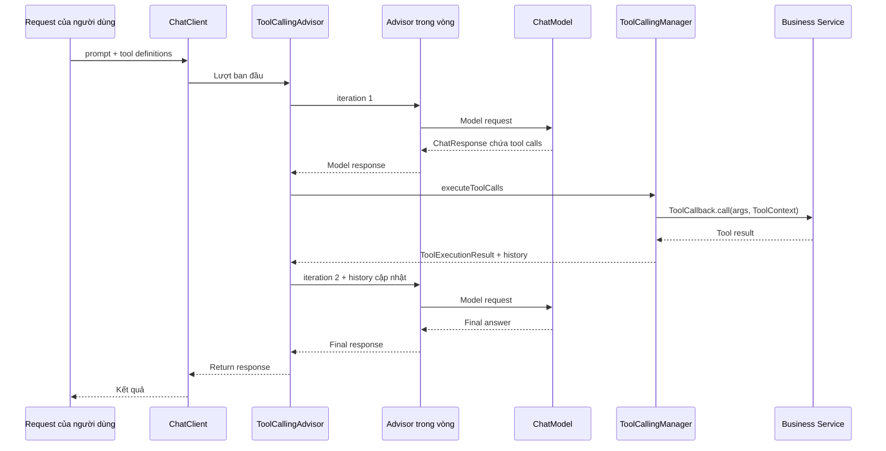
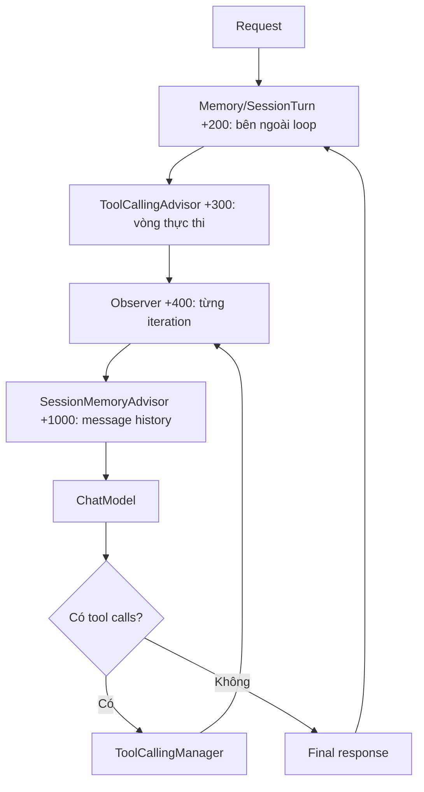

# Mở rộng advisor

## Tạo ToolAdvisor hoặc mở rộng ToolCallingAdvisor theo phiên bản

Trong Spring AI, ứng dụng có thể yêu cầu mô hình gọi `@Tool` hoặc `ToolCallback`, sau đó nhận kết quả công cụ và tiếp tục hỏi mô hình. Một phần đáng giá của `ChatClient` là khả năng đặt các **advisor** vào quá trình ấy: quan sát mỗi lượt, điều chỉnh danh sách tool, kiểm soát ngân sách hoặc phối hợp với service nghiệp vụ. Tuy nhiên, nếu mở rộng sai lớp hoặc đăng ký hai vòng gọi công cụ cùng lúc, một tool có thể bị chạy hai lần, lịch sử bị nhân đôi hoặc kết quả từ dịch vụ ngoài bị ghi sai.

Bài thuộc module `SPRING_AI_TOOL_CALLING`, tập trung vào trách nhiệm thực thi của ứng dụng: `@Tool`, `ToolCallback`, input schema, `ToolContext`, phân quyền, giới hạn, lỗi và kiểm thử. Với chủ đề này, chúng ta phân biệt ba quyết định thiết kế:

1. **Chỉ quan sát hoặc can thiệp nhẹ mỗi model round:** tạo `CallAdvisor`/`StreamAdvisor` thông thường, **không** đánh dấu `ToolAdvisor`.
2. **Thay đổi cách vòng tool gọi model, giữ hầu hết logic framework:** kế thừa `ToolCallingAdvisor` và override protected hooks.
3. **Tự sở hữu toàn bộ lifecycle công cụ:** triển khai advisor mang marker `ToolAdvisor`, rồi tự thực hiện hoặc ủy quyền (delegate) toàn bộ vòng; cần cẩn trọng hơn.

Các ví dụ chính sử dụng **Spring AI 2.1.0**, sau đó đối chiếu Spring AI 1.1.x và 2.0.x.

### 1. Vòng tool calling hoạt động ở đâu?

Với `ChatClient` trong Spring AI 2.x, `DefaultChatClient` tự đăng ký một `ToolCallingAdvisor` nếu không được vô hiệu hóa hoặc thay thế. Advisor này triển khai đường gọi đồng bộ `CallAdvisor` và đường streaming `StreamAdvisor`.



`ToolCallingAdvisor` sở hữu vòng lặp và dùng `ToolCallingManager` để phân giải, thực thi callback. Một advisor nằm **bên ngoài** vòng lặp thường chỉ thấy request khởi đầu và final response; advisor nằm **bên trong** có thể thấy từng model iteration và tool response từ những iteration trước. Vì vậy, cần chọn lớp mở rộng và advisor order phù hợp.

### 2. `ToolAdvisor` thực chất là marker interface

Trong Spring AI **2.0+**, interface `org.springframework.ai.chat.client.advisor.api.ToolAdvisor` kế thừa `Advisor` và `Ordered` nhưng **không tự có phương thức execute tool**. Nó là marker nói với `DefaultChatClient` rằng advisor này **sở hữu lifecycle của tool calls**.

Mỗi advisor muốn vận hành trong blocking/streaming path còn cần triển khai `CallAdvisor`, `StreamAdvisor` hoặc cả hai, với `adviseCall(...)`/`adviseStream(...)` tương ứng.

| Interface/lớp | Mục đích | Có nên dùng khi chỉ cần logging? |
| --- | --- | --- |
| `CallAdvisor` | Chặn/biến đổi call path đồng bộ | Có |
| `StreamAdvisor` | Chặn/biến đổi streaming path | Có |
| `ToolAdvisor` | Đánh dấu advisor sở hữu **vòng thực thi tool** | Không |
| `ToolCallingAdvisor` | Loop đã được framework triển khai, có protected hooks | Chỉ khi cần custom loop |
| `ToolSearchToolCallingAdvisor` | Kế thừa loop và thêm progressive tool disclosure | Khi catalog lớn và cần tìm tool |
| `ToolCallingManager` | Giải quyết callback và thực thi các lời gọi tool | Đổi manager nếu chỉ cần đổi tầng execution |

**Single-ToolAdvisor invariant:** trong một advisor chain chỉ được có **một** advisor mang `ToolAdvisor`. Nếu không có cái nào, `DefaultChatClient` tự gắn `ToolCallingAdvisor` mặc định. Nếu có một custom `ToolAdvisor`, auto-registration được bỏ qua. Nếu có hai custom `ToolAdvisor`, việc tạo chain thất bại thay vì cho phép chạy tool hai lần.

Không đặt marker `ToolAdvisor` trên một advisor chỉ đếm token, ghi log hoặc kiểm tra prompt. Làm như thế sẽ thay thế vòng tool mặc định trong khi advisor của bạn chưa biết thực thi công cụ.

### 3. Chọn extension point theo nhu cầu

| Yêu cầu | Giải pháp ưu tiên | Vì sao |
| --- | --- | --- |
| Ghi metric, audit intent, phát progress | Advisor thường ở trong vòng | Không cần viết lại tool loop |
| Đổi input trước mỗi model call | Override `doBeforeCall` và `doBeforeStream` | Có request từng iteration |
| Kiểm tra/ghi nhận response mỗi round | Override `doAfterCall` và `doAfterStream` | Có kết quả mô hình từng lượt |
| Setup index một lần | Override `doInitializeLoop` và bản stream | Khởi tạo theo vòng |
| Biến đổi kết quả cuối, cleanup | Override `doFinalizeLoop` và bản stream | Sau khi loop kết thúc |
| Chọn history cho iteration kế | Override `doGetNextInstructionsForToolCall` và bản stream | Tác động trực tiếp protocol messages |
| Đổi điều kiện model response cần tiếp tục | `ToolExecutionEligibilityChecker` trên builder | Không cần override toàn bộ loop |
| Đổi resolver, limits, exception processor | Tùy chỉnh `ToolCallingManager` rồi gắn builder | Đổi execution thay vì orchestration |
| Tự pause/điều phối workflow phức tạp | Custom `ToolAdvisor` hoặc user-controlled loop | Cần quyền sở hữu lifecycle |
| Chỉ cần người dùng xác nhận tool nguy hiểm | Chính sách confirmation của `ToolCallingManager` | Không cần tự viết approval protocol |

Ưu tiên lớp mở rộng nhỏ nhất có thể hoàn thành yêu cầu. Mọi lần tự viết lại loop đều phải xử lý tool call IDs, `ToolContext`, tool errors, `returnDirect`, streaming, cancellation và conversation history.

### 4. Chỉ quan sát từng iteration: không cần `ToolAdvisor`

Một `CallAdvisor`/`StreamAdvisor` có `getOrder()` **lớn hơn** `ToolCallingAdvisor.DEFAULT_ORDER` sẽ nằm bên trong vòng. Order mặc định của `ToolCallingAdvisor` là `Ordered.HIGHEST_PRECEDENCE + 300`; ví dụ observer dùng `+400`.

```java
public final class ToolIterationObserver
        implements CallAdvisor, StreamAdvisor {

    private final AuditSink audit;

    public ToolIterationObserver(AuditSink audit) {
        this.audit = audit;
    }

    @Override
    public String getName() {
        return "ToolIterationObserver";
    }

    @Override
    public int getOrder() {
        return Ordered.HIGHEST_PRECEDENCE + 400;
    }

    @Override
    public ChatClientResponse adviseCall(
            ChatClientRequest request, CallAdvisorChain chain) {

        ChatClientResponse response = chain.nextCall(request);
        recordRequestedTools(response);
        return response;
    }

    @Override
    public Flux<ChatClientResponse> adviseStream(
            ChatClientRequest request, StreamAdvisorChain chain) {

        return chain.nextStream(request)
            .doOnNext(this::recordRequestedTools);
    }

    private void recordRequestedTools(ChatClientResponse response) {
        if (response == null || response.chatResponse() == null) {
            return;
        }
        response.chatResponse().getResults().forEach(generation -> {
            generation.getOutput().getToolCalls().forEach(call ->
                audit.recordIntent(call.name(), call.id()));
        });
    }
}
```

Đăng ký observer:

```java
ChatClient client = ChatClient.builder(chatModel)
    .defaultAdvisors(new ToolIterationObserver(auditSink))
    .build();

String answer = client.prompt()
    .user("Kiểm tra trạng thái đơn hàng ORD-2048")
    .tools(orderTools)
    .call()
    .content();
```

`DefaultChatClient` vẫn tự đăng ký `ToolCallingAdvisor`. Observer không sở hữu vòng và không cần gọi `ToolCallingManager`. Với `.stream()`, observer có thể nhận nhiều chunks trong một iteration; cần phân biệt partial argument deltas với tool call hoàn chỉnh và deduplicate theo call ID nếu provider phát nhiều response liên quan.

**Audit intent khác execution audit.** `recordIntent(...)` chứng minh mô hình *đã yêu cầu* công cụ, không chứng minh callback chạy hoặc service đã commit. Ghi thực thi và authorization tại `ToolCallback`/business service; không log raw arguments hay `ToolContext`.

### 5. Khi nào dùng custom `ToolAdvisor` thay vì subclass?

Có thể tự triển khai advisor mang `ToolAdvisor` khi ứng dụng có engine riêng hoặc cần ghép nhiều policy theo một giao thức không được protected hooks hỗ trợ. Tuy nhiên, marker **không tự thực thi tool**. Một cách giảm rủi ro là **ủy quyền** việc chạy vòng cho một `ToolCallingAdvisor` bên trong, rồi thêm precondition.

```java
public final class GuardedToolAdvisor
        implements ToolAdvisor, CallAdvisor, StreamAdvisor {

    private final ToolCallingAdvisor delegate;
    private final RequestPolicy policy;

    public GuardedToolAdvisor(
            ToolCallingManager manager, RequestPolicy policy) {

        this.delegate = ToolCallingAdvisor.builder()
            .toolCallingManager(manager)
            .build();
        this.policy = policy;
    }

    @Override
    public String getName() {
        return "GuardedToolAdvisor";
    }

    @Override
    public int getOrder() {
        return delegate.getOrder();
    }

    @Override
    public ChatClientResponse adviseCall(
            ChatClientRequest request, CallAdvisorChain chain) {

        policy.validateRequestScope(request);
        return delegate.adviseCall(request, chain);
    }

    @Override
    public Flux<ChatClientResponse> adviseStream(
            ChatClientRequest request, StreamAdvisorChain chain) {

        return Flux.defer(() -> {
            policy.validateRequestScope(request);
            return delegate.adviseStream(request, chain);
        });
    }
}
```

`RequestPolicy` là thành phần do ứng dụng định nghĩa. Đăng ký **chỉ** `GuardedToolAdvisor` vào chain; `delegate` được gọi bên trong Java, **không đăng ký như một advisor riêng**. Vì marker đã có, `DefaultChatClient` không gắn vòng mặc định lần hai.

Ví dụ wrapper chỉ kiểm tra scope trước lúc bắt đầu, **không** thay kiểm tra quyền ở từng tool/service. Nếu policy cần kiểm tra các tool sinh động ở iteration tiếp theo, thực thi ở callback/manager hoặc protected hook tương ứng, không chỉ một preflight ban đầu.

### 6. Nếu chỉ đổi manager hoặc checker, không cần subclass

Trong Spring AI 2.1, `ToolCallingAdvisor.builder()` hỗ trợ:
- `toolCallingManager(...)`: thay đổi manager thực thi.
- `toolExecutionEligibilityChecker(...)`: xác định response nào kích hoạt vòng tiếp theo.
- `advisorOrder(...)`: thay đổi vị trí trong chain.
- `conversationHistoryEnabled(...)`: bật/tắt history nội bộ.
- `disableInternalConversationHistory()`: shortcut khi memory advisor nằm bên trong loop.

```java
ToolCallingManager manager = ToolCallingManager.builder()
    .maxCallsPerTool(12)
    .maxTotalToolCalls(35)
    .build();

ToolExecutionEligibilityChecker checker =
    response -> response != null && response.hasToolCalls();

ToolCallingAdvisor toolAdvisor = ToolCallingAdvisor.builder()
    .toolCallingManager(manager)
    .toolExecutionEligibilityChecker(checker)
    .advisorOrder(ToolCallingAdvisor.DEFAULT_ORDER)
    .build();

ChatClient client = ChatClient.builder(chatModel)
    .defaultAdvisors(toolAdvisor)
    .build();
```

`checker` ở đây chỉ kiểm tra có tool calls. Nếu cần xét thêm finish reason của provider, có thể kết hợp metadata, nhưng phải kiểm thử vì các provider dùng tên reason khác nhau; đừng chặn tool call hợp lệ chỉ vì một chuỗi finish reason không khớp.

Các tool-call limits trong manager khác với giới hạn số request hoặc thread đồng thời. `ToolCallingManager` cũng chịu trách nhiệm xử lý confirmation, errors, `ToolContext` và `ToolExecutionResult`. Dùng manager tùy chỉnh nếu cần thay cách thực thi tool, còn advisor tùy chỉnh nếu cần thay **cách gọi lại mô hình**.

### 7. Kế thừa `ToolCallingAdvisor`: thay đổi loop qua protected hooks

Khi cần logic ở mỗi vòng nhưng vẫn muốn framework tự xử lý tool calls, hãy kế thừa `ToolCallingAdvisor`. Class Spring AI 2.1 cung cấp protected constructor:

```java
protected ToolCallingAdvisor(
    ToolCallingManager manager,
    ToolExecutionEligibilityChecker checker,
    int advisorOrder,
    boolean conversationHistoryEnabled);
```

Các protected hooks cho blocking và streaming tương ứng:

| Call path | Stream path | Khi nào |
| --- | --- | --- |
| `doInitializeLoop` | `doInitializeLoopStream` | Một lần trước iteration đầu |
| `doBeforeCall` | `doBeforeStream` | Trước mỗi model request |
| `doAfterCall` | `doAfterStream` | Sau từng model response |
| `doGetNextInstructionsForToolCall` | `doGetNextInstructionsForToolCallStream` | Sau tool result, trước iteration tiếp |
| `doFinalizeLoop` | `doFinalizeLoopStream` | Khi vòng lặp kết thúc |

`doAfterStream` nhận response **đã aggregate** từ chunks của một iteration. `doFinalizeLoopStream` có thể biến đổi toàn bộ `Flux<ChatClientResponse>` cuối cùng. Nếu ứng dụng hỗ trợ cả `.call()` và `.stream()`, phải implement cả hai đường cần thiết.

### 8. Ví dụ subclass ghi ý định gọi công cụ cho cả call và stream

Ví dụ giữ nguyên lõi `adviseCall` và `adviseStream`, chỉ bổ sung audit event đã được giảm thiểu dữ liệu. Một audit intent cho biết **model yêu cầu** công cụ, không chứng minh service đã thực thi.

```java
public final class AuditingToolCallingAdvisor extends ToolCallingAdvisor {

    private final AuditSink audit;

    public AuditingToolCallingAdvisor(
            ToolCallingManager manager,
            ToolExecutionEligibilityChecker checker,
            int order,
            boolean historyEnabled,
            AuditSink audit) {

        super(manager, checker, order, historyEnabled);
        this.audit = Objects.requireNonNull(audit, "audit");
    }

    @Override
    protected ChatClientResponse doAfterCall(
            ChatClientResponse response, CallAdvisorChain chain) {

        recordToolIntent(response);
        return response;
    }

    @Override
    protected ChatClientResponse doAfterStream(
            ChatClientResponse aggregatedResponse,
            StreamAdvisorChain chain) {

        recordToolIntent(aggregatedResponse);
        return aggregatedResponse;
    }

    private void recordToolIntent(ChatClientResponse response) {
        if (response == null || response.chatResponse() == null) {
            return;
        }

        response.chatResponse().getResults().forEach(generation ->
            generation.getOutput().getToolCalls().forEach(call ->
                audit.recordIntent(call.name(), call.id())));
    }

    public static Builder<?> builder() {
        return new Builder<>();
    }

    public static class Builder<T extends Builder<T>>
            extends ToolCallingAdvisor.Builder<T> {

        private AuditSink audit;

        public T audit(AuditSink audit) {
            this.audit = Objects.requireNonNull(audit);
            return self();
        }

        @Override
        public AuditingToolCallingAdvisor build() {
            return new AuditingToolCallingAdvisor(
                getToolCallingManager(),
                getToolExecutionEligibilityChecker(),
                getAdvisorOrder(),
                isConversationHistoryEnabled(),
                audit);
        }

        @Override
        protected ToolCallingAdvisor.Builder<?> newCopy() {
            return new Builder<>();
        }

        @Override
        public ToolCallingAdvisor.Builder<?> copy() {
            ToolCallingAdvisor.Builder<?> copied = super.copy();
            ((Builder<?>) copied).audit = this.audit;
            return copied;
        }
    }
}
```

Các type `AuditSink` và service ghi event là thành phần do ứng dụng định nghĩa. Không ghi raw `call.arguments()`, token hoặc toàn bộ `ToolContext` vào audit. Để biết callback đã chạy và transaction đã commit, đặt audit tại `ToolCallback`/service, không suy đoán từ model response.

Subclass tự kế thừa marker `ToolAdvisor`, không cần thêm `implements ToolAdvisor`.

### 9. Vì sao builder phải xử lý `copy()` và `newCopy()`?

`DefaultChatClient` có thể dùng `ToolCallingAdvisor.Builder.copy()` để lấy cấu hình cho request cụ thể. Nếu subclass builder chứa thêm `audit` hoặc `policy` mà không sao chép, advisor mới có thể bị mất dependency hoặc không còn là subclass như mong đợi.

Builder 2.1 cung cấp các getter:
- `getToolCallingManager()`.
- `getToolExecutionEligibilityChecker()`.
- `getAdvisorOrder()`.
- `isConversationHistoryEnabled()`.

Và hai extension points:
- `newCopy()` tạo một blank builder **đúng type subclass**.
- `copy()` sao chép cả cấu hình cơ sở lẫn dữ liệu riêng của subclass.

Ví dụ kiểm thử copy semantics:

```java
AuditingToolCallingAdvisor.Builder<?> original =
    AuditingToolCallingAdvisor.builder()
        .audit(auditSink)
        .toolCallingManager(manager)
        .advisorOrder(ToolCallingAdvisor.DEFAULT_ORDER);

ToolCallingAdvisor.Builder<?> copied = original.copy();

assertThat(copied).isInstanceOf(AuditingToolCallingAdvisor.Builder.class);
assertThat(copied.build()).isInstanceOf(AuditingToolCallingAdvisor.class);
```

State của một conversation không được giữ trong singleton builder hoặc singleton advisor. Builder giữ cấu hình; request/session state nên đi qua request context hoặc storage có khóa riêng.

### 10. Spring Boot: cung cấp builder custom cho auto-configuration

Spring AI Spring Boot tạo `ChatClient.Builder` và builder tool advisor mặc định theo điều kiện `@ConditionalOnMissingBean`. Ứng dụng có thể cung cấp bean **typed as `ToolCallingAdvisor.Builder<?>`** để thay thế template đó:

```java
@Configuration(proxyBeanMethods = false)
public class CustomToolAdvisorConfiguration {

    @Bean
    ToolCallingAdvisor.Builder<?> toolCallingAdvisorBuilder(
            ToolCallingManager manager, AuditSink audit) {

        return AuditingToolCallingAdvisor.builder()
            .toolCallingManager(manager)
            .audit(audit)
            .advisorOrder(ToolCallingAdvisor.DEFAULT_ORDER);
    }

    @Bean
    ChatClient orderChatClient(ChatClient.Builder builder) {
        return builder.build();
    }
}
```

Không đồng thời tạo custom builder rồi lại đăng ký thêm một custom `ToolAdvisor` bằng `defaultAdvisors(...)` trên cùng client.

Nếu viết một reusable starter, Spring AI hướng dẫn auto-configuration chạy trước `ChatClientAutoConfiguration`:

```java
@AutoConfiguration(
    beforeName =
        "org.springframework.ai.model.chat.client.autoconfigure.ChatClientAutoConfiguration"
)
@ConditionalOnProperty(
    prefix = "app.audit-tool-advisor",
    name = "enabled",
    havingValue = "true"
)
public class AuditingAdvisorAutoConfiguration {

    @Bean
    @ConditionalOnMissingBean
    ToolCallingAdvisor.Builder<?> toolCallingAdvisorBuilder(
            ToolCallingManager manager, AuditSink audit) {

        return AuditingToolCallingAdvisor.builder()
            .toolCallingManager(manager)
            .audit(audit);
    }
}
```

Với starter, còn cần đăng ký class qua auto-configuration imports của Spring Boot và kiểm thử tình huống có nhiều module cùng muốn sở hữu tool loop. Tránh để hai starter đăng ký hai `ToolAdvisor` độc lập.

### 11. Không dùng Boot: đăng ký instance hoặc builder

**Cách A — đăng ký subclass instance:**

```java
AuditingToolCallingAdvisor advisor =
    AuditingToolCallingAdvisor.builder()
        .toolCallingManager(manager)
        .audit(auditSink)
        .build();

ChatClient client = ChatClient.builder(chatModel)
    .defaultAdvisors(advisor)
    .build();
```

**Cách B — đưa builder vào overload auto-registration:**

```java
ChatClient client = ChatClient.builder(
        chatModel,
        observationRegistry,
        null,
        null,
        AuditingToolCallingAdvisor.builder()
            .toolCallingManager(manager)
            .audit(auditSink))
    .build();
```

Cách B là overload dành cho cấu hình trực tiếp của Spring AI 2.x; chỉ dùng nếu dependency thật có chữ ký đó. Với Spring Boot, nên inject `ChatClient.Builder` hoặc dùng `ChatClientBuilderConfigurer` để không bỏ qua customizers và observability.

Một custom subclass đã triển khai marker tự khiến auto-registration bỏ qua advisor mặc định. Không cần đặt một `ToolCallingAdvisor` thứ hai trong chain.

### 12. Advisor order và Memory Advisor



| Vị trí advisor | Hành vi |
| --- | --- |
| Order nhỏ hơn `ToolCallingAdvisor.DEFAULT_ORDER` | Ngoài loop: thường một lần cho toàn bộ lượt |
| Order lớn hơn `ToolCallingAdvisor.DEFAULT_ORDER` | Bên trong loop: một lần mỗi model round |
| Legacy `MessageChatMemoryAdvisor` +200 | Ngoài loop, lưu user/final assistant mặc định |
| `SessionTurnAdvisor` +200 | Bao quanh turn, xử lý result đặc biệt |
| `SessionMemoryAdvisor` +1000 | Trong loop, giữ tool transcript Spring AI 2.1 |

`ToolCallingAdvisor` mặc định giữ internal history. Nếu có `MemoryAdvisor` bên trong, phải tắt internal history để không append hai lần. Auto-registration của `DefaultChatClient` có thể tự điều chỉnh khi phát hiện memory advisor bên trong. Với **custom advisor instance hoặc builder**, phải chủ động kiểm tra `conversationHistoryEnabled(false)`/`disableInternalConversationHistory()` theo cấu hình thực.

Với Spring AI 2.1, `SessionAdvisors.builder(sessionService).build()` tạo cặp `SessionTurnAdvisor` và `SessionMemoryAdvisor`. Chúng cần phối hợp để không đánh mất tool results tại nhánh `returnDirect` hoặc giới hạn.

### 13. Override history hook khi nào là an toàn?

`doGetNextInstructionsForToolCall(request, response, result)` nhận `ToolExecutionResult` sau khi callback đã chạy. Theo cấu hình, default trả toàn bộ history hoặc tập message tối thiểu để memory advisor bên trong dựng lại ngữ cảnh.

Nếu không có lý do rất cụ thể, nên giữ mặc định:

```java
@Override
protected List<Message> doGetNextInstructionsForToolCall(
        ChatClientRequest request,
        ChatClientResponse response,
        ToolExecutionResult result) {

    return super.doGetNextInstructionsForToolCall(
        request, response, result);
}
```

Khi thay đổi history, hãy bảo đảm các bất biến:

- Giữ `AssistantMessage` có tool calls và các `ToolResponseMessage` tương ứng đúng call IDs.
- Không gửi nhầm tool results của một session sang session khác.
- Không append lại history cũ nếu `result.conversationHistory()` đã chứa nó.
- Không xóa tool response hiện tại chỉ để giảm token; thay vào đó dùng turn-aware compaction.
- Không làm rơi system/developer policy message hoặc `ToolContext` runtime cần thiết.
- Không coi model final answer là bằng chứng callback đã commit nghiệp vụ.

Khi muốn lưu nhiều lượt trò chuyện, nên dùng Session Memory (Spring AI 2.1) với `SessionAdvisors` thay vì tự ghép các message giữa nhiều turn trong một singleton advisor.

### 14. Streaming hooks, cancellation và lập trình reactive

Một custom advisor phải hỗ trợ cả request blocking và streaming nếu ứng dụng dùng cả hai. Vòng streaming có thể phát hàng loạt chunks trước khi model tool call hoàn chỉnh; `doAfterStream` nhận response **aggregate cho iteration**, còn `doFinalizeLoopStream` nhận `Flux` cuối cùng.

```java
@Override
protected Flux<ChatClientResponse> doFinalizeLoopStream(
        Flux<ChatClientResponse> output,
        StreamAdvisorChain chain) {

    return output.doFinally(signal ->
        metrics.recordLoopTermination(signal.name()));
}
```

`metrics` là service do ứng dụng định nghĩa. Với lỗi hoặc cancellation, callback `doFinally` được gọi theo tín hiệu của Reactor. Nhưng cancellation một HTTP streaming response **không bảo đảm** một side effect từ MCP/REST service đã rollback.

Không gọi JDBC, HTTP đồng bộ hoặc `block()` trong `doOnNext` trên Reactor event loop. Với audit bền vững, ghi ở business callback/outbox thay vì cố đẩy nội dung nhạy cảm qua stream observer. Một `ToolCallPart` partial là mảnh arguments đang phát; không chạy tool từ partial. Nếu tự điều phối streaming, dùng `ChatClientMessageAggregator` trước khi kiểm tra `hasToolCalls()`.

### 15. Khi nào dùng `ToolSearchToolCallingAdvisor`?

Với catalog lớn, gửi tất cả tool schemas vào mỗi prompt có thể tốn token và khiến mô hình chọn sai tool. Spring AI 2.1 cung cấp `ToolSearchToolCallingAdvisor`, một subclass của `ToolCallingAdvisor` áp dụng progressive disclosure: khởi tạo index danh mục, công khai công cụ tìm kiếm và chỉ đưa tools đã được tìm ra vào các iteration tiếp.

Đây là ví dụ thực tế của cách **override hooks** để thay đổi tool set từng lượt mà không tự viết lại toàn bộ tool loop. Trong ứng dụng nhiều tenant, hãy giới hạn index và danh sách tool theo quyền đã xác thực trước khi cho mô hình tìm.

Bật chức năng auto-configuration theo tài liệu:

```properties
spring.ai.chat.client.tool-search-advisor.enabled=true
# Index type: regex (mặc định), lucene hoặc vector theo dependency.
```

Không gắn thêm `ToolSearchToolCallingAdvisor` cạnh `ToolCallingAdvisor` mặc định. Vì cả hai đều mang marker `ToolAdvisor`, cần chọn **một** vòng tool duy nhất.

### 16. Migration theo phiên bản

| Version | Class/interface cần dùng | Vòng thực thi tool | Điểm cần kiểm tra |
| --- | --- | --- | --- |
| Spring AI 1.0.x/1.1.x | `ToolCallAdvisor` ở 1.1.x; chưa có marker `ToolAdvisor` | Thường nằm trong `ChatModel`; `ToolCallAdvisor` có thể chuyển điều phối lên advisor chain | Constructor và builder khác 2.x; `streamToolCallResponses` có trong API 1.1 |
| Spring AI 2.0 milestone/RC | `ToolCallingAdvisor`, `ToolAdvisor` marker | Vòng advisor dần trở thành mặc định | Một số RC còn `streamToolCallResponses`; xem lại auto-registration |
| Spring AI 2.0 GA/2.0.x | `ToolCallingAdvisor` và `ToolAdvisor` | `ChatClient` auto-register, `ChatModel` không chạy tool nội bộ | Không đăng ký hai vòng; `streamToolCallResponses` bị loại từ GA |
| Spring AI 2.1.0 | `ToolCallingAdvisor`, `ToolExecutionEligibilityChecker`, Session Memory | Advisor recursive hỗ trợ call/stream và session | `ToolCallAdvisor` deprecated; builder copy/newCopy; memory mặc định chuyển sang Session API |

Các thay đổi dễ gây lỗi compile khi chuyển phiên bản:

**Tên advisor:**

```java
// Spring AI 1.1.x:
ToolCallAdvisor legacy = ToolCallAdvisor.builder().build();

// Spring AI 2.1.0:
ToolCallingAdvisor current = ToolCallingAdvisor.builder().build();
```

`ToolCallAdvisor` còn tồn tại dạng deprecated ở 2.1 để tương thích, nhưng không nên dùng cho code mới.

**Không dùng option streaming đã loại bỏ:**

```java
// Code cũ trong 1.x hoặc 2.0 preview:
// ToolCallAdvisor.builder().streamToolCallResponses(true);
// ToolCallingAdvisor.builder().streamToolCallResponses(true);

// Spring AI 2.0 GA / 2.1: bỏ option đó.
ToolCallingAdvisor currentAdvisor =
    ToolCallingAdvisor.builder().build();
```

Option `streamToolCallResponses` bị loại vì phát assistant tool-call request chunks ra downstream mà không phát tool responses đi kèm có thể làm memory advisor lưu transcript không hợp lệ. Muốn quan sát từng iteration, dùng observer ở order +400 hoặc user-controlled streaming.

**Không dùng model-internal execution flag cũ:**

```java
// Không còn là API để điều khiển tool loop trong Spring AI 2.x hiện hành:
// options.internalToolExecutionEnabled(false);

// Giờ dùng ChatClient auto loop, hoặc tắt auto-registration có chủ đích.
ChatClientResponse raw = client.prompt()
    .user(question)
    .tools(allowedTools)
    .advisors(AdvisorParams.toolCallingAdvisorAutoRegister(false))
    .call()
    .chatClientResponse();
```

Trong mode tắt auto-registration, model vẫn thấy tool definitions nhưng callback **không tự chạy**. Caller chịu trách nhiệm thực thi bằng `ToolCallingManager` và dựng prompt tiếp theo từ `ToolExecutionResult.conversationHistory()`.

### 17. Tránh auto-registration kép

Trong Spring AI 2.1, `DefaultChatClient` tự gắn vòng mặc định khi chưa thấy `ToolAdvisor`. Các cấu hình đúng:

1. **Không custom tool loop:** dùng `ChatClient.builder(model).build()`, sau đó `.tools(...)` trên request.
2. **Chỉ observer:** đăng ký `CallAdvisor`/`StreamAdvisor`, không marker `ToolAdvisor`.
3. **Thay loop bằng subclass:** đăng ký đúng một `AuditingToolCallingAdvisor` hoặc builder custom.
4. **User-controlled:** tắt auto-registration cho request hoặc toàn client, tự chạy `ToolCallingManager`.

Cấu hình nguy hiểm:

```java
// Không đăng ký hai ToolAdvisor trong cùng chain.
ChatClient client = ChatClient.builder(chatModel)
    .defaultAdvisors(
        ToolCallingAdvisor.builder().build(),
        AuditingToolCallingAdvisor.builder()
            .toolCallingManager(manager)
            .audit(auditSink)
            .build())
    .build();
```

Trường hợp này phải fail fast bởi single-`ToolAdvisor` invariant. Không cố sửa bằng thay đổi order để cả hai vẫn cùng tồn tại: order chỉ điều chỉnh vị trí, không biến hai vòng thực thi thành một vòng.

Nếu cùng ứng dụng có nhiều `ChatClient` dành cho workflow khác nhau, mỗi client được cấu hình một tool advisor riêng phù hợp quyền và mục đích; không chia sẻ state mutable của hội thoại giữa các client.

### 18. Kiểm thử code mở rộng không chạy tool hai lần

Các ca kiểm thử tối thiểu:

| Nhóm | Kịch bản | Điều cần khẳng định |
| --- | --- | --- |
| Auto-register | Client không custom tool advisor | Đúng một loop và callback chạy một lần |
| Custom marker | Có đúng một `GuardedToolAdvisor` | Không xuất hiện default tool loop thứ hai |
| Trùng marker | Hai custom `ToolAdvisor` | Fail fast khi tạo chain |
| Observer | Advisor order +400 | Được gọi sau mỗi model round; không tự execute |
| Subclass hooks | Call và stream paths | Hook tương ứng chạy đúng lần và đúng dữ liệu |
| Custom builder | `copy()` và `newCopy()` | Bản sao giữ subclass và dependencies |
| Eligibility checker | Model trả tool calls hoặc final answer | Không bỏ sót tool calls hợp lệ, dừng đúng |
| Multi-tool batch | Model yêu cầu hai tools | Giữ call IDs, đúng hai tool responses |
| Memory | Session advisor ở trong loop | History không duplicate và không mất tool results |
| `returnDirect` | Mọi tools direct | Không gọi model thêm |
| Confirmation | Tool có yêu cầu phê duyệt | Chưa thực thi trước khi xác nhận |
| Call limits | Model yêu cầu tool liên tục | Dừng theo giới hạn, giữ kết quả một phần |
| Streaming | Provider trả partial argument deltas | Không thực thi trước complete tool call |
| Authorization | Model đề nghị tool ngoài allowlist | Tool không được gọi dù advisor đang hoạt động |

Ví dụ khung test subclass:

```java
@Test
void customToolAdvisorOwnsExactlyOneExecutionLoop() {
    // modelStub: response 1 yêu cầu lookupOrder,
    // response 2 là final answer.
    ChatClient client = ChatClient.builder(modelStub)
        .defaultAdvisors(customToolAdvisor)
        .build();

    String result = client.prompt()
        .user("Tra cứu ORD-2048")
        .tools(orderTools)
        .call()
        .content();

    verify(orderService, times(1))
        .findVisibleOrder(tenantId, userId, "ORD-2048");
    assertThat(result).contains("ORD-2048");
}
```

Các object `modelStub`, `customToolAdvisor`, `tenantId`, `userId` và `orderTools` được dựng trong test fixture. Nên bổ sung test stream bằng `StepVerifier`, test `Builder.copy()` và test lỗi cấu hình nhiều `ToolAdvisor`. Không chỉ kiểm tra final text; phải kiểm tra **số lần callback chạy** và message history.

### 19. Bảo mật, lỗi và trạng thái nghiệp vụ vẫn nằm ở service

Advisor extension không trao quyền tự động. Khi một subclass thêm tool trong `doBeforeCall`, chỉ chọn callbacks theo role/tenant đã được xác thực ở server. `ToolContext` mang runtime scope, còn authorization thực sự phải được kiểm tra ở callback/service.

Lưu ý:
- Không đưa token hoặc `ToolContext` nguyên bản vào log, prompt hoặc metadata gửi MCP.
- Không sửa tool-call IDs hoặc bỏ một phần history khi biến đổi response.
- Không retry lệnh có side effect chỉ vì lỗi streaming/cancellation.
- Audit việc mô hình **yêu cầu** tool khác audit việc tool **đã chạy**.
- Với exception, giữ `ToolExecutionExceptionProcessor` hoặc mapping an toàn; không đưa stack trace cho model.
- Với tool confirmation, giới hạn và `returnDirect`, ưu tiên sử dụng cơ chế framework ở `ToolCallingManager`.

### 20. Checklist quyết định và triển khai

1. Xác định cần quan sát, đổi per-iteration behavior hay thay toàn bộ lifecycle.
2. Chỉ quan sát: dùng `CallAdvisor`/`StreamAdvisor` order lớn hơn `ToolCallingAdvisor.DEFAULT_ORDER`, **không** gắn `ToolAdvisor`.
3. Chỉ đổi callback execution/resolver/limits: tùy chỉnh `ToolCallingManager` rồi đưa vào builder.
4. Cần hook vòng: kế thừa `ToolCallingAdvisor` và override cả blocking/streaming tương ứng.
5. Nếu dùng builder subclass, đảm bảo `build()`, `copy()` và `newCopy()` bảo toàn subtype/dependencies.
6. Với Spring Boot, cung cấp bean `ToolCallingAdvisor.Builder<?>` hoặc auto-configuration được sắp thứ tự phù hợp.
7. Không tạo hai `ToolAdvisor` trong cùng chain.
8. Kiểm tra vị trí memory advisor và cờ internal history; Spring AI 2.1 ưu tiên Session Memory.
9. Giữ nguyên call ID/result protocol và chỉ cấp tool theo quyền đã xác thực.
10. Kiểm thử callback count, history, `returnDirect`, confirmation, limits, lỗi và streaming.
11. Khi migration, đối chiếu API **đúng minor version**, xóa các flag/builder options đã loại.
12. Ghi log đã che dữ liệu và kiểm soát state theo request/session, không trong singleton.

### Kết luận

`ToolAdvisor` là **quy ước sở hữu vòng thực thi tool**, còn `ToolCallingAdvisor` là **vòng lặp đã được framework triển khai**. Đối với phần lớn nhu cầu, chỉ cần observer advisor hoặc tùy chỉnh manager/builder. Khi cần thay đổi hành vi giữa các iteration, subclass với protected hooks là con đường ít rủi ro hơn tự viết lại toàn bộ lifecycle. Hiểu rõ API Spring AI 1.x, 2.0 và 2.1 giúp tránh đăng ký kép, mất tool results và sai history, đồng thời giữ trách nhiệm bảo mật/transaction ở ứng dụng.

### Tài liệu tham khảo

- [Spring AI 2.1.0 — ToolCallingAdvisor](https://docs.spring.io/spring-ai/reference/api/tools/tool-calling-advisor.html)
- [Spring AI 2.1.0 — Tool Calling và custom ToolAdvisor](https://docs.spring.io/spring-ai/reference/api/tools.html)
- [Spring AI 2.1.0 — ChatClient và auto-registration](https://docs.spring.io/spring-ai/reference/api/chatclient.html)
- [Spring AI 2.1.x API — ToolAdvisor](https://docs.spring.io/spring-ai/docs/2.1.x/api/org/springframework/ai/chat/client/advisor/api/ToolAdvisor.html)
- [Spring AI 2.1.x API — ToolCallingAdvisor](https://docs.spring.io/spring-ai/docs/2.1.x/api/org/springframework/ai/chat/client/advisor/ToolCallingAdvisor.html)
- [Spring AI 2.1.x API — ToolCallingAdvisor.Builder](https://docs.spring.io/spring-ai/docs/2.1.x/api/org/springframework/ai/chat/client/advisor/ToolCallingAdvisor.Builder.html)
- [Spring AI 2.1.0 — Upgrade Notes](https://docs.spring.io/spring-ai/reference/upgrade-notes.html)
- [Spring AI 1.1.8 API — ToolCallAdvisor](https://docs.spring.io/spring-ai/docs/1.1.x/api/org/springframework/ai/chat/client/advisor/ToolCallAdvisor.html)
- [Spring AI 2.1.0 — Session Memory](https://docs.spring.io/spring-ai/reference/api/session.html)

Các đoạn mã về `AuditSink`, `RequestPolicy`, `OrderTools`, `OrderService` và test stubs là ví dụ nghiệp vụ do ứng dụng tự xây dựng. Chúng minh họa các extension points Spring AI 2.1.0; khi chuyển thành code production, cần đối chiếu imports, dependency và cách tổ chức Spring Boot/configuration cụ thể của dự án.

