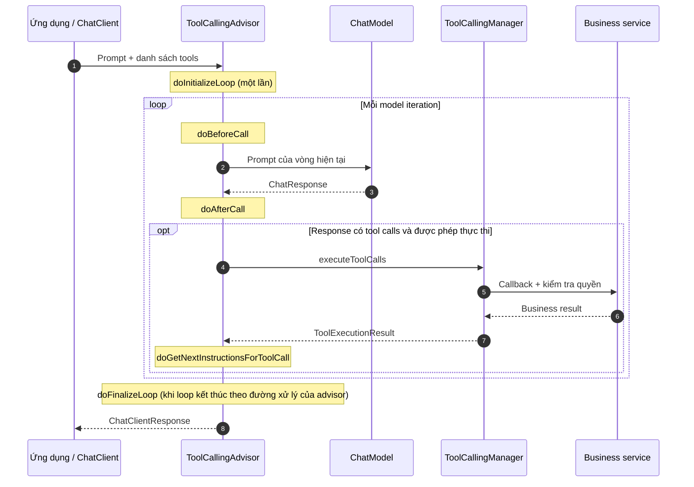
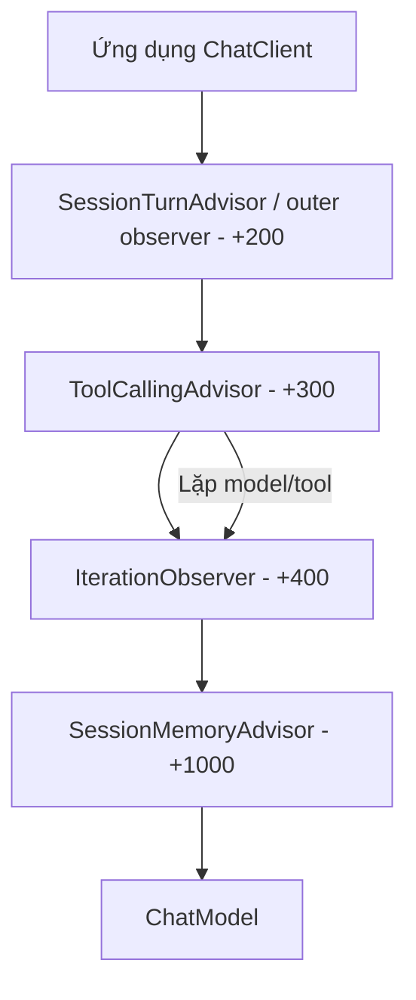

# Hook khởi tạo, trước gọi, sau gọi và kết thúc vòng lặp

Trong Spring AI, `ToolCallingAdvisor` không chỉ là thành phần tự động thực thi các yêu cầu gọi công cụ. Nó còn là một **recursive advisor** có những điểm mở rộng (`protected hook`) để ứng dụng chuẩn bị ngữ cảnh trước vòng lặp, điều chỉnh mỗi lần gọi mô hình, quan sát từng phản hồi và xử lý kết quả khi vòng lặp kết thúc.

Ví dụ, một trợ lý chăm sóc khách hàng có thể cần khởi tạo dữ liệu theo phiên, chỉ gửi những `ToolCallback` được phép trong lượt hiện tại, ghi nhận số lần mô hình đề xuất gọi tool và xuất metric tổng khi kết thúc. Các hook cho phép bổ sung logic đó mà không cần viết lại toàn bộ vòng lặp model → tool → model.

Trong module `SPRING_AI_TOOL_CALLING`, mô hình vẫn chỉ yêu cầu tool qua tên và JSON arguments; `ToolCallingManager` mới phân giải và thực thi callback, còn application service phải kiểm tra quyền, xử lý lỗi và bảo vệ tác động nghiệp vụ. **Hook là điểm mở rộng điều phối, không phải cơ chế mặc định trao quyền thực thi cho mô hình.**

Các tên phương thức và chữ ký bên dưới được đối chiếu theo Spring AI **2.1.0**. Một số API khác đáng kể giữa Spring AI 1.x, 2.0 và 2.1, vì vậy cần kiểm tra phiên bản dependency thực tế khi áp dụng.

## 1. Vòng lặp mà advisor sở hữu

Khi dùng `ChatClient` với công cụ, `DefaultChatClient` thông thường tự đăng ký `ToolCallingAdvisor`. Advisor này bao quanh chuỗi advisor ở phía sau nó và có thể gọi lại phần chuỗi đó nhiều lần:

1. Chuẩn bị request và tool definitions.
2. Gửi request đến mô hình.
3. Nếu mô hình trả lời bằng tool calls, `ToolCallingManager` tìm callback tương ứng, thực thi và tạo tool responses.
4. Đưa kết quả vào lịch sử, gọi mô hình ở vòng kế tiếp.
5. Lặp cho đến câu trả lời cuối hoặc điều kiện dừng khác, ví dụ `returnDirect`, confirmation hay giới hạn tool.



Điều quan trọng là **mỗi iteration là một lần gọi mô hình**, không đồng nghĩa với một lần gọi callback. Một assistant response có thể không gọi tool, gọi một tool hoặc gọi nhiều tool trong cùng batch. Vì vậy số lần `doBeforeCall`/`doAfterCall` không phải số lần tool thực thi.

## 2. Bốn giai đoạn chính và hook dựng vòng kế tiếp

`ToolCallingAdvisor` cung cấp năm cặp hook, trong đó bốn cặp đầu tương ứng trực tiếp với tiêu đề bài học:

| Giai đoạn | Blocking `.call()` | Streaming `.stream()` | Tần suất và mục đích |
|---|---|---|---|
| Khởi tạo vòng | `doInitializeLoop` | `doInitializeLoopStream` | Một lần trước iteration đầu; chuẩn bị dữ liệu cho request |
| Trước gọi mô hình | `doBeforeCall` | `doBeforeStream` | Trước mỗi iteration; bổ sung/lọc tool, options, context |
| Sau phản hồi mô hình | `doAfterCall` | `doAfterStream` | Sau mỗi iteration; quan sát response và tool-call intent |
| Kết thúc vòng | `doFinalizeLoop` | `doFinalizeLoopStream` | Một lần trên đường vòng kết thúc; tổng hợp/thay đổi final response |
| Dựng request tiếp theo | `doGetNextInstructionsForToolCall` | `doGetNextInstructionsForToolCallStream` | Sau khi tool đã chạy; chọn các messages gửi ở iteration kế tiếp |

Không có một hook có tên `onBeforeToolExecution` hay `onAfterToolExecution` trong danh sách trên. **`doBeforeCall` và `doAfterCall` bao quanh lần gọi model, không trực tiếp bao quanh mỗi lần thực thi tool.** Nếu cần chặn trước khi gửi email, chuyển tiền hoặc ghi database, hãy đặt authorization và confirmation ở `ToolCallingManager`/callback/service, không chỉ trong `doBeforeCall`.

## 3. Chữ ký chính xác của hook blocking

Theo Spring AI 2.1, những phương thức sau là `protected` trong `ToolCallingAdvisor` và được phép override ở subclass:

```java
protected ChatClientRequest doInitializeLoop(
        ChatClientRequest request,
        CallAdvisorChain chain);

protected ChatClientRequest doBeforeCall(
        ChatClientRequest request,
        CallAdvisorChain chain);

protected ChatClientResponse doAfterCall(
        ChatClientResponse response,
        CallAdvisorChain chain);

protected ChatClientResponse doFinalizeLoop(
        ChatClientResponse response,
        CallAdvisorChain chain);

protected List<Message> doGetNextInstructionsForToolCall(
        ChatClientRequest request,
        ChatClientResponse response,
        ToolExecutionResult executionResult);
```

`doInitializeLoop` và `doBeforeCall` nhận/trả `ChatClientRequest`: đây là nơi có thể thay đổi prompt, tool options hoặc context một cách có kiểm soát. `doAfterCall` và `doFinalizeLoop` nhận/trả `ChatClientResponse`: đây là nơi quan sát hoặc biến đổi response nếu thực sự cần. Hook thứ năm nhận cả kết quả tool để xây dựng lịch sử cho vòng kế tiếp.

**Nguyên tắc an toàn:** nếu chỉ quan sát, không sửa nội dung request/response; luôn trả lại object gốc hoặc gọi `super` để giữ nguyên hành vi nền của framework.

## 4. Chữ ký hook streaming và điểm khác biệt quan trọng

Đường streaming có các tên phương thức tương ứng:

```java
protected ChatClientRequest doInitializeLoopStream(
        ChatClientRequest request,
        StreamAdvisorChain chain);

protected ChatClientRequest doBeforeStream(
        ChatClientRequest request,
        StreamAdvisorChain chain);

protected ChatClientResponse doAfterStream(
        ChatClientResponse response,
        StreamAdvisorChain chain);

protected Flux<ChatClientResponse> doFinalizeLoopStream(
        Flux<ChatClientResponse> responseFlux,
        StreamAdvisorChain chain);

protected List<Message> doGetNextInstructionsForToolCallStream(
        ChatClientRequest request,
        ChatClientResponse response,
        ToolExecutionResult executionResult);
```

Hai khác biệt thường gây nhầm:

- `doAfterStream` nhận **một `ChatClientResponse` đã được tổng hợp từ các chunk của iteration**, không phải callback chạy cho từng delta streaming. Nếu cần đẩy progress cho mỗi chunk, dùng `StreamAdvisor` quan sát bên trong loop hoặc thao tác trên `Flux`.
- `doFinalizeLoopStream` nhận và trả **`Flux<ChatClientResponse>`**, không phải một `ChatClientResponse` đơn lẻ. Có thể dùng các toán tử Reactor như `doOnNext`, `doOnError`, `doFinally`, nhưng không `block()` hay `subscribe()` chủ động trong hook.

`ToolCallPart` xuất hiện khi model đang stream một phần arguments là **partial chunk**, chưa phải tool call hoàn chỉnh. Đừng thực thi callback từ từng delta; để `ToolCallingManager` xử lý tool call đầy đủ sau khi framework đã tổng hợp phản hồi.

## 5. Hook khởi tạo: `doInitializeLoop`

Hook khởi tạo chạy trước iteration đầu của một **lượt gọi `ChatClient` có loop**, không có nghĩa chạy đúng một lần cho toàn bộ cuộc trò chuyện kéo dài nhiều HTTP request.

Các tác vụ phù hợp:

- Khởi tạo correlation ID hoặc cấu hình ngữ cảnh của lượt request.
- Kiểm tra cấu hình catalog version, chiến lược tool hoặc timeout của lượt hiện tại.
- Tạo một view read-only của danh mục callback được phép cho actor/tenant.
- Tăng metric “loop started” hoặc tạo span/hồ sơ quan sát.
- Đưa hướng dẫn chỉ dẫn model về cách tìm tool vào system prompt khi dùng dynamic disclosure.

Một ví dụ thật từ Spring AI là `ToolSearchToolCallingAdvisor`: nó override `doInitializeLoop` để lập chỉ mục tool và bổ sung hướng dẫn tìm kiếm định nghĩa, rồi dùng `doBeforeCall` để công bố tập công cụ đã tìm thấy.

Không thực hiện side effect nghiệp vụ như gửi hóa đơn hay hủy đơn ở hook này. Đây chưa phải bằng chứng mô hình đã yêu cầu hành động cụ thể, và càng chưa có confirmation của người dùng.

## 6. Hook trước mỗi iteration: `doBeforeCall`

`doBeforeCall` chạy **trước khi request của iteration hiện tại xuống `ChatModel`**. Có thể sử dụng nó để cập nhật thông tin vốn thay đổi giữa các vòng:

- Chỉ gửi những `ToolCallback` được phép công bố theo policy hiện tại.
- Chọn tool schemas theo trạng thái workflow hoặc catalog snapshot.
- Cập nhật options như giới hạn tokens/metadata đã được kiểm tra.
- Bổ sung hệ thống chỉ dẫn tĩnh phù hợp với nhiệm vụ.
- Kiểm tra deadline của toàn request trước khi gọi model lần tiếp theo.

Ví dụ tình huống: ở iteration đầu, model chỉ thấy công cụ tra cứu. Sau khi tool trả kết quả, một policy engine có thể cho phép công bố thêm tool tạo bản nháp. Dù vậy, **không đưa tool ghi vào request chỉ vì model gợi ý “tôi cần quyền”**; policy phải dựa trên actor, session, quyền và use case do server xác định.

Nếu thay tool options trong hook, đảm bảo định nghĩa mà model nhìn thấy sẽ khớp với callback được resolver/manager thực thi. Một `ToolDefinition` cũ đi cùng callback phiên bản mới không tương thích có thể làm parse sai arguments hoặc tạo tác động không mong muốn.

## 7. Hook sau mỗi iteration: `doAfterCall`

`doAfterCall` nhìn thấy response của mô hình ở iteration vừa hoàn tất. Các việc phù hợp:

- Đếm số tool calls mà model **đã đề xuất**.
- Ghi model latency, token usage của lượt phản hồi hoặc finish reason.
- Đánh giá tính hợp lệ của cấu trúc response trước khi vòng tiếp tục.
- Ghi audit metadata về tool-call intent theo dạng đã làm sạch.
- Phân tích lỗi model/provider theo policy nhưng không nuốt lỗi âm thầm.

Không ghi `tool-executed=true` chỉ vì `response.chatResponse().hasToolCalls()` là `true`: tại thời điểm này manager có thể chưa được gọi. Tool call có thể bị chặn do confirmation, vượt giới hạn, không có callback phù hợp hoặc thất bại trước khi service chạy.

Chẳng hạn, một assistant message có hai tool calls thì `doAfterCall` có thể đếm hai **yêu cầu**. Nhưng nếu một tool cần xác nhận, Spring AI 2.1 có thể tạm dừng cả batch trước khi chạy bất kỳ callback nào. Muốn có số lần thực thi thực tế, cần instrumentation tại `ToolCallingManager`, callback hoặc business service.

## 8. Hook kết thúc: `doFinalizeLoop`

`doFinalizeLoop` xử lý `ChatClientResponse` sau khi advisor quyết định vòng lặp đã kết thúc theo luồng hoạt động của nó. Đây là nơi phù hợp để:

- Xuất metric về một lượt hội thoại đã hoàn thành.
- Đính kèm metadata tổng hợp hoặc biến đổi final response nếu hợp đồng API yêu cầu.
- Đánh dấu trạng thái hoàn thành trong một tracker của request.
- Ghi dấu mốc kết thúc phục vụ tracing.

**Không nhầm hook kết thúc với `finally` của Java.** Khi provider ném exception, callback không xử lý được, subscriber hủy streaming hoặc process chết, không được mặc định suy ra `doFinalizeLoop` đã luôn chạy. Nếu hệ thống cần cleanup cả khi lỗi/hủy, dùng `try/finally` ở ranh giới blocking phù hợp và `Flux.doFinally(...)` hoặc lifecycle management của Reactor cho streaming.

Ngoài câu trả lời cuối thông thường, `ToolCallingAdvisor` có thể kết thúc sớm do `returnDirect=true`, yêu cầu confirmation hoặc giới hạn tool calls. Hãy kiểm tra finish reason, response metadata và điều kiện thực tế để phân biệt **thành công**, **đang chờ phê duyệt**, **bị giới hạn** và **thất bại**. Chỉ sự kiện `finalize` không đủ để khẳng định mọi side effect đã hoàn thành.

## 9. Hook thứ năm: lịch sử cho lượt kế tiếp

`doGetNextInstructionsForToolCall(...)` chạy sau khi `ToolCallingManager` đã tạo `ToolExecutionResult`; nó chọn message list để gửi trong iteration kế tiếp. Đây là điểm mở rộng riêng, không thay thế bốn hook lifecycle chính.

Hành vi mặc định phụ thuộc `conversationHistoryEnabled`:

| Cấu hình | Dữ liệu gửi tới chain ở lượt sau | Phù hợp |
|---|---|---|
| `true` (mặc định) | Full history của vòng hiện tại: user, assistant tool call và tool response | Loop tự giữ lịch sử; memory nằm ngoài loop |
| `false` | Chỉ system message và tool response mới nhất theo hợp đồng advisor | Memory advisor nằm trong loop chịu trách nhiệm lưu/tải history |

```java
@Override
protected List<Message> doGetNextInstructionsForToolCall(
        ChatClientRequest request,
        ChatClientResponse response,
        ToolExecutionResult result) {

    List<Message> messages = super.doGetNextInstructionsForToolCall(
            request, response, result);
    audit.record("next-iteration-history", messages.size());
    return messages;
}
```

Không tự bỏ assistant tool-call message hoặc đổi tool-call IDs khi dựng history; nhiều provider yêu cầu mỗi tool call có tool response tương ứng. Nếu cần tóm tắt hoặc compaction, dùng thành phần session/memory có khả năng giữ tính toàn vẹn của tool pairs, không tùy tiện cắt giữa assistant tool call và tool result.

## 10. Ví dụ subclass ghi nhận bốn hook blocking

Ví dụ sau dùng một `ToolCallingAdvisor` subclass để ghi sự kiện ở bốn thời điểm. `LoopAuditSink` là interface của ứng dụng, cố ý chỉ nhận phase và số tool calls để không phát tán arguments hoặc kết quả nhạy cảm.

```java
public interface LoopAuditSink {
    void record(String phase, int count);
}

public final class AuditedToolCallingAdvisor extends ToolCallingAdvisor {

    private final LoopAuditSink audit;

    public AuditedToolCallingAdvisor(
            ToolCallingManager manager,
            LoopAuditSink audit) {

        this(
                manager,
                response -> response != null && response.hasToolCalls(),
                ToolCallingAdvisor.DEFAULT_ORDER,
                true,
                audit);
    }

    public AuditedToolCallingAdvisor(
            ToolCallingManager manager,
            ToolExecutionEligibilityChecker checker,
            int order,
            boolean conversationHistoryEnabled,
            LoopAuditSink audit) {

        super(
                manager,
                checker,
                order,
                conversationHistoryEnabled);
        this.audit = audit;
    }

    @Override
    protected ChatClientRequest doInitializeLoop(
            ChatClientRequest request,
            CallAdvisorChain chain) {
        audit.record("loop-initialized", 0);
        return super.doInitializeLoop(request, chain);
    }

    @Override
    protected ChatClientRequest doBeforeCall(
            ChatClientRequest request,
            CallAdvisorChain chain) {
        audit.record("before-model-call", 0);
        return super.doBeforeCall(request, chain);
    }

    @Override
    protected ChatClientResponse doAfterCall(
            ChatClientResponse response,
            CallAdvisorChain chain) {

        int requestedCalls = 0;
        if (response.chatResponse() != null
                && response.chatResponse().hasToolCalls()) {
            requestedCalls = response.chatResponse()
                    .getResult()
                    .getOutput()
                    .getToolCalls()
                    .size();
        }

        audit.record("after-model-call", requestedCalls);
        return super.doAfterCall(response, chain);
    }

    @Override
    protected ChatClientResponse doFinalizeLoop(
            ChatClientResponse response,
            CallAdvisorChain chain) {
        audit.record("loop-finalized", 0);
        return super.doFinalizeLoop(response, chain);
    }
}
```

`AuditedToolCallingAdvisor` kế thừa `ToolAdvisor` marker từ `ToolCallingAdvisor`, nên nó trở thành chủ sở hữu vòng lặp. Constructor ngắn sử dụng checker mặc định và giữ internal conversation history; constructor đầy đủ cho phép nhận các giá trị từ builder. Không cần tự gọi `ToolCallingManager` ở bất kỳ hook nào trong ví dụ, vì base class đã thực thi nó theo đúng lifecycle.

Các import và implementation của `LoopAuditSink` được lược bỏ; interface sink nên có implementation thread-safe, không ném exception chỉ vì hệ thống ghi metric không khả dụng. Trong sản phẩm thật, audit event cũng cần trace/request ID do server tạo để phân biệt nhiều request đồng thời.

## 11. Đăng ký subclass mà không tạo hai ToolAdvisor

Đưa subclass vào `ChatClient` thay cho auto-registered advisor:

```java
@Configuration(proxyBeanMethods = false)
public class ChatClientConfiguration {

    @Bean
    ChatClient assistantChatClient(
            ChatModel chatModel,
            ToolCallingManager toolCallingManager,
            LoopAuditSink auditSink) {

        AuditedToolCallingAdvisor advisor =
                new AuditedToolCallingAdvisor(toolCallingManager, auditSink);

        return ChatClient.builder(chatModel)
                .defaultAdvisors(advisor)
                .build();
    }
}
```

Trong Spring AI 2.1, `DefaultChatClient` áp dụng invariant **mỗi advisor chain có đúng một `ToolAdvisor`**. Khi thấy subclass của `ToolCallingAdvisor`, nó không tự thêm `ToolCallingAdvisor` mặc định. Nếu đăng ký hai custom `ToolAdvisor` cùng lúc, chain sẽ fail fast thay vì âm thầm chạy hai vòng và tạo side effect trùng.

Nếu chỉ cần quan sát mà không cần thay lifecycle, **không cần tạo subclass**. Một `CallAdvisor`/`StreamAdvisor` bình thường có order đặt bên trong loop thường đơn giản hơn và ít xung đột hơn (xem phần 14).

## 12. Hook tương đương trong streaming

Khi hỗ trợ `.stream()`, cần override các hook `*Stream` tương ứng. Không mặc định các hook blocking sẽ được gọi trên đường reactive.

```java
@Override
protected ChatClientRequest doInitializeLoopStream(
        ChatClientRequest request,
        StreamAdvisorChain chain) {
    audit.record("stream-initialized", 0);
    return super.doInitializeLoopStream(request, chain);
}

@Override
protected ChatClientRequest doBeforeStream(
        ChatClientRequest request,
        StreamAdvisorChain chain) {
    audit.record("before-model-stream", 0);
    return super.doBeforeStream(request, chain);
}

@Override
protected ChatClientResponse doAfterStream(
        ChatClientResponse response,
        StreamAdvisorChain chain) {
    audit.record("after-aggregated-iteration", 0);
    return super.doAfterStream(response, chain);
}

@Override
protected Flux<ChatClientResponse> doFinalizeLoopStream(
        Flux<ChatClientResponse> responseFlux,
        StreamAdvisorChain chain) {

    return super.doFinalizeLoopStream(responseFlux, chain)
            .doFinally(signal ->
                    audit.record("stream-finished-" + signal, 0));
}
```

Đoạn này là phần bổ sung cho subclass ở mục 10, không phải một class độc lập. `doFinally` có thể được gọi khi publisher complete, error hoặc cancel. Nếu audit đòi hỏi ghi bền vững, cần thiết kế bất đồng bộ và tránh chặn event loop của Reactor; không gọi `.block()` bên trong advisor.

Một subscription có thể được tạo nhiều lần từ một publisher cold. Không giữ bộ đếm của subscription vào field mutable của singleton advisor. Nếu cần số vòng hoặc tổng thời gian riêng, tạo scope theo request/subscription, hoặc dùng tracing context phù hợp và thread-safe store được dọn ở trạng thái cuối.

## 13. Tùy chỉnh builder và tích hợp auto-configuration

Spring AI 2.1 hỗ trợ builder cho `ToolCallingAdvisor`:

```java
ToolCallingAdvisor advisor = ToolCallingAdvisor.builder()
        .toolCallingManager(toolCallingManager)
        .advisorOrder(ToolCallingAdvisor.DEFAULT_ORDER)
        .conversationHistoryEnabled(true)
        .build();
```

Builder còn có `toolExecutionEligibilityChecker(...)` và `disableInternalConversationHistory()`. Trong hệ thống cần subclass nhưng muốn giữ khả năng cấu hình qua Spring Boot, có thể mở rộng `ToolCallingAdvisor.Builder<T>` bằng builder của subclass. Các protected getter như `getToolCallingManager()` và `isConversationHistoryEnabled()` hỗ trợ việc xây dựng instance.

Ví dụ khung builder:

```java
public static class Builder<T extends Builder<T>>
        extends ToolCallingAdvisor.Builder<T> {

    private LoopAuditSink audit;

    public T audit(LoopAuditSink sink) {
        this.audit = sink;
        return self();
    }

    @Override
    public AuditedToolCallingAdvisor build() {
        return new AuditedToolCallingAdvisor(
                getToolCallingManager(),
                getToolExecutionEligibilityChecker(),
                getAdvisorOrder(),
                isConversationHistoryEnabled(),
                audit);
    }
}
```

Đây là khung builder của chính subclass ở mục 10, dùng constructor đầy đủ nhận năm tham số. Nếu chỉ cần constructor ngắn thì không cần builder tùy chỉnh. Khi tạo builder subclass cho auto-configuration, phải triển khai `newCopy()` và `copy()` để bản sao giữ được cả trường riêng như `audit`. Bỏ qua điều này có thể làm mất cấu hình khi `DefaultChatClient` tạo bản copy của builder theo request.

Spring Boot auto-configuration có điểm mở rộng cho bean `ToolCallingAdvisor.Builder<?>`; khi người dùng cung cấp builder tùy chỉnh, cấu hình mặc định dùng builder đó. Chỉ thêm builder riêng khi thật sự cần thay đổi loop toàn ứng dụng. Nếu một client riêng cần hook, cấu hình `.defaultAdvisors(...)` như mục 11 thường rõ ràng hơn.

## 14. Khi chỉ quan sát, dùng advisor nằm **bên trong** tool loop

Nếu mục tiêu chỉ là phát tiến trình hoặc ghi metric từng lượt, có thể giữ `ToolCallingAdvisor` mặc định và thêm một `CallAdvisor`/`StreamAdvisor` có order **lớn hơn** `ToolCallingAdvisor.DEFAULT_ORDER`.

```java
public final class IterationObserver implements CallAdvisor, StreamAdvisor {

    private final LoopAuditSink audit;

    public IterationObserver(LoopAuditSink audit) {
        this.audit = audit;
    }

    @Override
    public String getName() {
        return "iterationObserver";
    }

    @Override
    public int getOrder() {
        return Ordered.HIGHEST_PRECEDENCE + 400;
    }

    @Override
    public ChatClientResponse adviseCall(
            ChatClientRequest request,
            CallAdvisorChain chain) {
        audit.record("model-iteration-start", 0);
        ChatClientResponse response = chain.nextCall(request);
        audit.record("model-iteration-finished", 0);
        return response;
    }

    @Override
    public Flux<ChatClientResponse> adviseStream(
            ChatClientRequest request,
            StreamAdvisorChain chain) {
        return chain.nextStream(request)
                .doOnNext(chunk -> audit.record("stream-chunk", 1));
    }
}
```

Advisor quan sát này **không** triển khai `ToolAdvisor` và **không** gọi `ToolCallingManager`. Nó chỉ bao quanh mỗi model iteration. Khi đăng ký vào `ChatClient`, `ToolCallingAdvisor` mặc định vẫn sở hữu việc thực thi tool:

```java
ChatClient client = ChatClient.builder(chatModel)
        .defaultAdvisors(new IterationObserver(auditSink))
        .build();
```

Với streaming, observer nằm trong loop có thể thấy các chunk mà caller ngoài loop không nhận được, chẳng hạn message về tool call; các partial argument deltas được phát trực tiếp tùy provider. Không đọc dữ liệu nhạy cảm từ chunk và gửi ra UI không kiểm soát.

## 15. Advisor order quyết định phạm vi hook quan sát

Spring AI sắp xếp advisor theo `getOrder()`; giá trị **nhỏ hơn** chạy ở vòng ngoài, giá trị **lớn hơn** chạy ở vòng trong. Với cấu hình mặc định của Spring AI 2.1:

| Advisor | Order tương đối | Quan sát bao nhiêu lần? |
|---|---:|---|
| `SessionTurnAdvisor` | `HIGHEST_PRECEDENCE + 200` | Một lần cho mỗi ChatClient turn, ở ngoài loop |
| `ToolCallingAdvisor` | `HIGHEST_PRECEDENCE + 300` | Sở hữu vòng model/tool |
| Advisor observer ở ví dụ trên | `HIGHEST_PRECEDENCE + 400` | Một lần mỗi model iteration, ở trong loop |
| `SessionMemoryAdvisor` | `HIGHEST_PRECEDENCE + 1000` | Mỗi model iteration, tải/lưu session history |



Order +200/+300/+400/+1000 chỉ minh họa mặc định, không phải mọi ứng dụng đều có các advisor này. Nếu đổi `ToolCallingAdvisor` order, điều chỉnh order của observer tương ứng. Một observer ở ngoài loop chỉ thấy response cuối, không nhìn đầy đủ các vòng trung gian.

API `ChatMemory`/`MessageChatMemoryAdvisor` cũ đã deprecated trong Spring AI 2.1; các ứng dụng mới nên dùng Session Memory. Cần phối hợp `conversationHistoryEnabled` với memory advisor bên trong loop để tránh gửi trùng history. Khi `DefaultChatClient` tự đăng ký tool advisor, framework tự xử lý một số phối hợp memory; với subclass dựng thủ công, cần thiết kế rõ cấu hình này.

## 16. ToolSearchToolCallingAdvisor: ví dụ hook thực tế

Một ứng dụng có hàng trăm công cụ không muốn đưa toàn bộ định nghĩa vào prompt ngay từ đầu. `ToolSearchToolCallingAdvisor` là subclass của `ToolCallingAdvisor` dùng progressive tool disclosure:

1. Ở `doInitializeLoop`/`doInitializeLoopStream`, nó lập index của các callback và chuẩn bị hướng dẫn tìm kiếm tool.
2. Ở `doBeforeCall`/`doBeforeStream`, nó công bố những tool được tìm thấy cho iteration hiện tại.
3. Khi mô hình gọi công cụ nghiệp vụ đã được tìm thấy, loop cơ sở vẫn gọi `ToolCallingManager` để thực thi.
4. Các hook còn lại được thừa kế để giữ chu kỳ thực thi và xử lý lịch sử.

Đây là ví dụ rõ rằng hook dùng để **thay đổi bề mặt tool mà model nhìn thấy**, không cần thay manager mặc định. Nếu làm tương tự với catalog theo tenant, phải lọc và kiểm tra quyền của actor trước khi index/disclose, rồi kiểm tra lại quyền ở callback lúc tool thực thi.

## 17. ToolExecutionEligibilityChecker khác authorization

`ToolExecutionEligibilityChecker` được cấu hình trên builder; mặc định nó kiểm tra `ChatResponse` có tool calls hay không:

```java
ToolExecutionEligibilityChecker checker = response ->
        response != null && response.hasToolCalls();

ToolCallingAdvisor advisor = ToolCallingAdvisor.builder()
        .toolExecutionEligibilityChecker(checker)
        .build();
```

Một checker tùy chỉnh có thể thêm điều kiện `finishReason` đặc thù provider. Tuy nhiên, checker chỉ quyết định **vòng có đi vào nhánh xử lý tool calls hay không**, không xác định user có quyền gọi `cancelOrder` hay `transferMoney`.

Không dùng một predicate dựa trên text của mô hình làm điểm phân quyền duy nhất. Các chính sách quyền, tenant, resource, confirmation, quota và idempotency vẫn phải được enforced tại `ToolCallingManager` và service.

## 18. Giới hạn vòng, deadline và budget

Một loop có thể kéo dài nhiều model calls. Hook hữu ích để thu thập số iteration, độ trễ và token, nhưng không nên tự đặt điều kiện dừng bằng cách xóa tool call khỏi response hoặc bỏ message để “thoát vòng”. Cách đó có thể tạo history không hợp lệ.

Với Spring AI 2.1, có thể cấu hình giới hạn tool calls ở `ToolCallingManager`:

```java
ToolCallingManager manager = ToolCallingManager.builder()
        .maxCallsPerTool(20)
        .maxTotalToolCalls(80)
        .onLimitExceeded(ToolCallLimitBehavior.THROW)
        .build();
```

Khi chạm giới hạn, framework xử lý theo `ToolCallLimitBehavior` và giữ thông tin về các call đã thực thi theo contract phiên bản. Ngoài ra ứng dụng nên đặt deadline end-to-end, giới hạn token/chi phí và rate limit theo actor/tenant.

Đừng dùng `doAfterCall` để tự retry một tool ghi sau timeout mà không có operation ID hoặc idempotency; kết quả có thể đã được commit nhưng chưa trả về. Nếu cần workflow tạm dừng, resume hoặc approval phức tạp, cân nhắc Tool Call Confirmation, service orchestration hoặc user-controlled loop phù hợp.

## 19. Exception, cancellation và `returnDirect`

Các đường thoát không phải lúc nào cũng giống nhau:

| Đường kết thúc | Điều xảy ra | Điểm cần quan sát |
|---|---|---|
| Model trả lời cuối, không có tool call | Advisor dừng tự nhiên | Final response và tổng số iteration |
| Tool result `returnDirect=true` | Trả kết quả tool thẳng cho caller; không gửi model vòng nữa | Đã có business result, không nhất thiết có câu trả lời mới của model |
| Tool call cần confirmation | Manager tạm dừng batch trước khi chạy tool | Paused reply và keys chờ quyết định; không đánh dấu tool đã thực thi |
| Vượt giới hạn tool | Advisor/manager trả lỗi hoặc dừng theo behavior | Finish reason, partial results và trạng thái workflow |
| Provider hoặc callback ném exception | Request có thể thất bại trước bước finalize bình thường | Metrics/error handler ngoài loop và cause chain |
| Streaming subscriber cancel | Publisher bị hủy | `doFinally(CANCEL)`, giải phóng tài nguyên subscription |

`returnDirect` có hiệu lực cho batch khi các tool cần gọi đều được cấu hình trả trực tiếp; nếu có tool không `returnDirect`, manager có thể gửi results về mô hình như bình thường. Confirmation là yêu cầu phê duyệt của ứng dụng, không phải một tool result thành công.

Nếu tool callback thất bại, `ToolExecutionExceptionProcessor` xử lý lỗi đã đóng gói đúng hợp đồng; các hook sau model call không thay thế exception processor đó. Đối với lỗi authorization hoặc lỗi nghiêm trọng, fail closed và không âm thầm chuyển thành thông báo thành công chỉ để kết thúc vòng.

## 20. Trạng thái theo request và thread safety

Một `ToolCallingAdvisor` thường được tái sử dụng giữa nhiều request. Không lưu số vòng, `actorId`, `tenantId`, tool call gần nhất hoặc mutable history của request vào field không đồng bộ của bean:

```java
// Không an toàn nếu advisor được chia sẻ giữa các requests.
private int currentRound;
private String currentActorId;
```

Giải pháp an toàn hơn:

- Tạo context/trace ID theo request ở ranh giới đã xác thực.
- Dùng `ChatClientRequest`/advisor context hoặc một store theo request/trace ID để giữ metadata cần thiết.
- Dùng metric counters thread-safe cho số liệu tổng, nhưng không xem chúng là trạng thái của từng conversation.
- Với Reactor, giữ state theo subscription (`Flux.defer`, Reactor Context) nếu cần và dọn bằng `doFinally`.
- Không chia sẻ mutable map `ToolContext` giữa các request hoặc tenant.
- Không dùng `SecurityContextHolder` thread-local làm nguồn bảo mật duy nhất nếu đường streaming/async có thể chuyển thread.

Nếu cần biết tool đã hoàn tất, instrument callback/service. Hook trước/sau model không đủ để đo chắc số lần mutation thực tế, nhất là khi batch có nhiều tool hoặc tool được phép chạy song song.

## 21. Kiểm thử lifecycle hook

Một fake model có thể trả lần lượt: một phản hồi có tool call, rồi một phản hồi không có tool call. Dùng audit sink ghi phase và kiểm tra thứ tự, đồng thời spy callback để xác minh số lần service chạy.

| Ca kiểm thử | Kỳ vọng |
|---|---|
| Không có tool call | Initialize một lần, before/after một vòng, finalize trên đường hoàn tất |
| Một tool call rồi final answer | Initialize một lần; before/after hai iteration; callback một lần; finalize một lần |
| Hai tool calls trong một response | `doAfterCall` đếm hai yêu cầu nhưng chỉ một model iteration |
| Nhiều vòng tool | Before/after chạy theo từng model call; history được duy trì đúng |
| `returnDirect=true` | Không có lượt model tiếp theo; kết quả direct đi ra caller |
| Tool cần confirmation | Chưa callback nào chạy; response có pending decision metadata |
| Callback lỗi | Exception/error policy áp dụng đúng; không dựa vào finalize để làm cleanup duy nhất |
| Observer order +400 | Observer được gọi từng iteration, không tự gọi manager |
| Outer observer order +200 | Observer chỉ thấy turn cuối, không được đếm từng iteration |
| Streaming | `doAfterStream` nhận response đã aggregate; finalize hook nhận Flux |
| Streaming cancel | `doFinally` nhận CANCEL; không giữ state của request trong singleton |
| Hai user cùng lúc | Không trộn actor, session, counter hoặc tool definitions giữa requests |
| Hai `ToolAdvisor` | Tạo chain fail fast; không thực thi trùng |

Ví dụ pseudocode assertion cho một tool round:

```java
// Fake ChatModel: response 1 có một tool call;
// response 2 trả final answer. LoopAuditSink là spy/stub.

String answer = client.prompt()
        .user("Đơn ORD-2048 đang ở trạng thái nào?")
        .tools(orderTools)
        .call()
        .content();

verify(audit, times(1)).record("loop-initialized", 0);
verify(audit, times(2)).record("before-model-call", 0);
verify(audit, times(1)).record("after-model-call", 1);
verify(audit, times(1)).record("after-model-call", 0);
verify(audit, times(1)).record("loop-finalized", 0);
verify(orderService, times(1)).getOrderStatus("ORD-2048");
```

Đây là khung test; các import, fake model và fixture tạo tools chưa được trình bày. Khi test streaming, nên kiểm tra cả tín hiệu complete, error, cancel; không chỉ mock `Flux.just(...)` rồi suy ra mọi request thực tế có cùng lịch trình.

## 22. Những lỗi thường gặp

| Sai lầm | Hậu quả | Cách khắc phục |
|---|---|---|
| Xem `doAfterCall` là hook sau khi callback xong | Audit ghi nhận sai một giao dịch đã hoàn thành | Đếm tool intent tại đây; đo execution ở manager/service |
| Dùng `doInitializeLoop` như setup một lần cho toàn session | Request thứ hai không được khởi tạo như mong đợi | Hiểu scope là một loop/ChatClient invocation |
| Chỉ override hook blocking | `.stream()` không được instrument giống `.call()` | Override cặp `*Stream` tương ứng |
| Nghĩ `doAfterStream` chạy cho mỗi chunk | Thiếu sự kiện progress | Dùng `StreamAdvisor` bên trong loop hoặc operator trên Flux |
| Dùng `doFinalizeLoop` làm cleanup trong mọi trường hợp | Leak tài nguyên khi exception/cancel | `finally`, Reactor `doFinally`, lifecycle handler riêng |
| Thêm custom `ToolAdvisor` cùng advisor mặc định khác | Xung đột ownership hoặc double execution | Giữ đúng một `ToolAdvisor` |
| Quan sát iteration bằng advisor đặt ở ngoài loop | Chỉ thấy final response | Chọn order lớn hơn `ToolCallingAdvisor.DEFAULT_ORDER` |
| Ghi arguments/result toàn bộ vào log | Lộ dữ liệu cá nhân, token hoặc secret | Dùng metadata tối thiểu, masking/hash |
| Sửa history mà bỏ tool response | Provider từ chối prompt hoặc model suy luận sai | Giữ assistant tool call và tool response đúng cặp |
| Giữ `currentRound` ở field singleton | Race condition giữa nhiều request | State theo request/subscription, metric thread-safe |
| Dùng hook để bỏ kiểm tra quyền | Tool ghi có thể chạy ngoài ý muốn | Authorization/confirmation ở manager và business service |
| Không giới hạn tool loop | Có thể gọi tool quá nhiều, tăng chi phí | Manager call limits và deadline toàn request |

## 23. Checklist khi mở rộng ToolCallingAdvisor

- Đã xác định cần subclass hook hay chỉ cần một observer advisor bên trong loop.
- Đã xác định rõ version Spring AI 2.1 và chữ ký hook blocking/streaming.
- `doInitializeLoop` chỉ làm initialization theo invocation, không lưu user state trong singleton.
- `doBeforeCall` chỉ điều chỉnh tool/options theo policy server-side đã kiểm tra.
- `doAfterCall` ghi model response/tool-call intent, không suy ra callback đã chạy.
- `doFinalizeLoop` xử lý kết quả cuối theo contract; có cleanup riêng cho exception/cancellation.
- Nếu sửa `doGetNextInstructionsForToolCall`, đã giữ nguyên tool call/result pair và memory semantics.
- Với streaming, không block/subscribe trong hook, hiểu `doAfterStream` là aggregated response.
- Có đúng một `ToolAdvisor` trong chain; observer thông thường không implement marker này.
- Advisor order phù hợp với việc cần quan sát một turn hay từng iteration.
- Phối hợp `conversationHistoryEnabled` với Session Memory/MemoryAdvisor một cách có chủ đích.
- Tool ghi vẫn có authorization, confirmation, idempotency và giới hạn tác động ở service.
- Có giới hạn vòng, thời gian, số callback và chi phí; metric không chứa dữ liệu nhạy cảm.
- Có unit/integration test cho một vòng, nhiều vòng, returnDirect, confirmation, lỗi, streaming và concurrency.

## 24. Tài liệu tham khảo

- [Spring AI 2.1 — ToolCallingAdvisor](https://docs.spring.io/spring-ai/reference/api/tools/tool-calling-advisor.html): năm cặp hook, builder, advisor ordering, subclass và các đường kết thúc.
- [Spring AI 2.1 — ToolCallingAdvisor Javadoc](https://docs.spring.io/spring-ai/docs/2.1.x/api/org/springframework/ai/chat/client/advisor/ToolCallingAdvisor.html): chữ ký blocking/streaming của các phương thức protected.
- [Spring AI 2.1 — ToolCallingAdvisor.Builder Javadoc](https://docs.spring.io/spring-ai/docs/2.1.x/api/org/springframework/ai/chat/client/advisor/ToolCallingAdvisor.Builder.html): constructor/builder fields, copy semantics và getters cho subclass.
- [Spring AI 2.1 — Recursive Advisors](https://docs.spring.io/spring-ai/reference/api/advisors-recursive.html): vòng lặp advisor, `CallAdvisorChain.copy(this)` và accumulation của usage.
- [Spring AI 2.1 — Tool Calling](https://docs.spring.io/spring-ai/reference/api/tools.html): manager/callback, streaming partials, Tool Call Limits và ranh giới execution.
- [Spring AI 2.1 — Session ChatClient Integration](https://docs.spring.io/spring-ai/reference/api/session/chat-client.html): SessionTurnAdvisor/SessionMemoryAdvisor ở ngoài/trong loop và bảo toàn lịch sử.
- [Spring AI 2.1 — Tool Call Confirmation](https://docs.spring.io/spring-ai/reference/api/tools/tool-call-confirmation.html): pause trước thực thi, quyết định allow/deny và resume an toàn.

Nắm đúng lifecycle giúp ứng dụng mở rộng `ToolCallingAdvisor` mà không phải viết lại tool loop. **Khởi tạo một lần, can thiệp trước/sau từng lần gọi model, và tổng kết khi vòng kết thúc** là bốn điểm chính; hook dựng next instructions xử lý lịch sử giữa các vòng. Dù sử dụng hook nào, việc xác thực quyền, thực thi callback và bảo vệ tác động nghiệp vụ vẫn thuộc trách nhiệm của ứng dụng.
