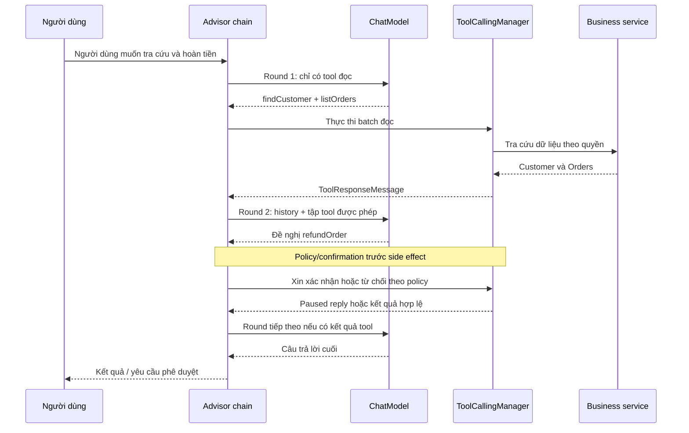
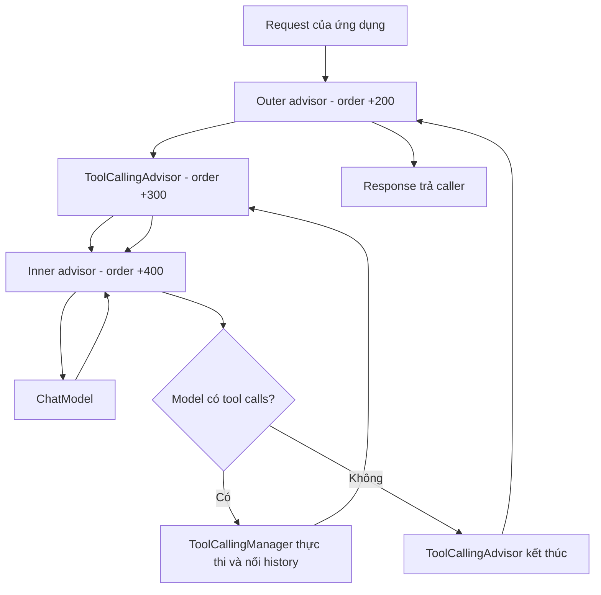
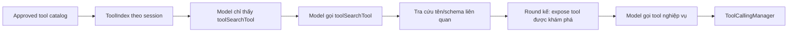

# Chèn chính sách, quan sát hoặc điều chỉnh tập công cụ giữa các vòng

Trong một ứng dụng Spring AI, mô hình có thể yêu cầu gọi một tool, nhận kết quả rồi tiếp tục yêu cầu tool khác. Ví dụ, trợ lý hỗ trợ bán hàng gọi `findCustomer` để xác định khách hàng, gọi `listOrders` để lấy đơn và cuối cùng đề nghị `refundOrder`. Giữa các lần gọi mô hình, ứng dụng có thể muốn ghi tiến trình cho UI, giới hạn công cụ được model nhìn thấy, thay đổi ngân sách, kiểm tra chính sách hoặc dừng để xin xác nhận.

**Advisor** là một điểm mở rộng thích hợp cho những nhu cầu ấy. Trong Spring AI 2.1.0, `ToolCallingAdvisor` giữ vòng lặp model–tool bên trong chuỗi advisor. Nó gửi tool definitions cho model, nhận `AssistantMessage` có tool calls, chuyển cho `ToolCallingManager` thực thi callback, nối `ToolResponseMessage` và gọi lại model cho đến khi có câu trả lời cuối. Các advisor đặt **bên trong** vòng lặp có thể quan sát từng model round; các hook của `ToolCallingAdvisor` cho phép tùy chỉnh điểm trước/sau mỗi round mà không cần viết lại vòng lặp.

Tuy nhiên, có một ranh giới phải giữ: **quan sát** không phải **phân quyền**. Một advisor chỉ ghi log hoặc sửa danh sách tool trong prompt không thể thay thế kiểm tra quyền, schema, trạng thái nghiệp vụ, idempotency và human confirmation ngay trước khi callback tạo side effect. Bài này giải thích cách chọn extension point theo trách nhiệm và triển khai các bước kiểm soát theo nguyên tắc an toàn của module `SPRING_AI_TOOL_CALLING`.

## 1. Phân biệt lượt người dùng, vòng model và một batch tool call

Một **user turn** bắt đầu từ khi ứng dụng nhận câu hỏi đến khi trả lời hoặc tạm dừng. Trong một turn có thể có nhiều **model rounds**; mỗi round là một lần gọi model. Một round có thể chứa nhiều **tool calls** trong cùng `AssistantMessage`.



Trong ví dụ, phần “cho phép hiển thị refundOrder trong round 2” là quyết định **tool exposure**. Phần “actor có thật sự được hoàn tiền đơn này không” là **authorization** tại service. Phần “người dùng đã đồng ý đúng số tiền và đối tượng chưa” là **confirmation**. Ba việc liên quan nhưng khác nhau.

| Thao tác | Khi nào | Nơi phù hợp |
| --- | --- | --- |
| Ghi nhận mỗi request/response của model | Trước/sau mỗi round | `CallAdvisor`/`StreamAdvisor` nằm bên trong vòng lặp |
| Lọc/thêm callback trước vòng model tiếp theo | Trước khi gửi prompt của round | `ToolCallingAdvisor.doBeforeCall` / `doBeforeStream` |
| Khởi tạo index/catalog cho một lượt | Khi bắt đầu tool loop | `doInitializeLoop` / `doInitializeLoopStream` |
| Ghi tổng kết token, độ trễ và kết quả | Khi kết thúc lượt | `doFinalizeLoop` / `doFinalizeLoopStream` hoặc outer advisor |
| Kiểm tra actor có quyền dùng tài nguyên không | Ngay trước thực thi và trong service | `ToolCallback` decorator/service authorization |
| Xin người dùng duyệt side effect | Trước bất kỳ call nào của batch được chạy | `ToolCallConfirmationPolicy` trong `ToolCallingManager` |
| Chặn vượt giới hạn số tool calls | Trước/cùng lúc execution | Tool-call limits của `ToolCallingManager` |
| Tự thay đổi thứ tự, retry hay chọn kết thúc vòng | Theo đặc thù ứng dụng | Custom `ToolCallingAdvisor`/manual orchestration, kiểm soát có giới hạn |

## 2. Vị trí advisor quyết định nó chạy một lần hay mỗi vòng

Spring AI sắp advisor bằng `getOrder()`: **giá trị nhỏ hơn chạy trước**. Chuỗi thực thi như stack: advisor chạy trước ở request nhưng nhận response sau cùng.

`ToolCallingAdvisor.DEFAULT_ORDER` trong Spring AI 2.1.0 là `Ordered.HIGHEST_PRECEDENCE + 300`. Advisor có order **nhỏ hơn** nằm *ngoài* vòng lặp; advisor có order **lớn hơn** nằm *trong* vòng lặp và được gọi lại ở mỗi iteration khi `ToolCallingAdvisor` dùng chuỗi downstream.



Sơ đồ rút gọn luồng sync. `ToolCallingAdvisor` là recursive advisor: nó gọi lại một bản sao chain chỉ chứa các advisor phía sau nó (ví dụ `CallAdvisorChain.copy(this)`). Advisor phía trước nó không chạy lại ở mỗi round. Với streaming, nguyên lý tương tự nhưng dùng `StreamAdvisorChain` và `Flux`.

**Quy tắc thực hành:** một advisor để kiểm tra request ban đầu hoặc gắn correlation ID một lần nên ở ngoài; advisor đo từng model round và quan sát tool intentions nên ở trong. Nếu hai advisor có cùng order, thứ tự giữa chúng không được bảo đảm; hãy dùng các giá trị khác nhau khi thứ tự tác động đến kết quả.

Một lựa chọn cấu hình:

```properties
# Order của ToolCallingAdvisor được ChatClient tự đăng ký.
spring.ai.chat.client.tool-calling.advisor-order=-2147483348
```

Con số này bằng `Integer.MIN_VALUE + 300`; trong code, nên dùng `ToolCallingAdvisor.DEFAULT_ORDER` thay vì hard-code. Chỉ đổi property khi cần sắp các advisor quanh vòng lặp; đừng chỉnh thứ tự tùy tiện khi memory, RAG hoặc tracing đang phụ thuộc vào nó.

## 3. Spring AI 2.x: chỉ có một ToolAdvisor

Trong Spring AI 1.x, model adapter tự điều khiển vòng tool. Từ Spring AI 2.x, `ChatClient` tự đăng ký `ToolCallingAdvisor` theo mặc định và đưa vòng tool calling vào advisor chain. Gọi `ChatModel` trực tiếp chỉ trả response có tool calls; nó **không** tự thực thi callback.

`ToolCallingAdvisor` triển khai `CallAdvisor`, `StreamAdvisor` và marker interface `ToolAdvisor`. `DefaultChatClient` bảo đảm chỉ có **một** `ToolAdvisor` trong một chain:

- Nếu chỉ thêm advisor quan sát thông thường, giữ advisor tự đăng ký.
- Nếu tự đăng ký một custom `ToolCallingAdvisor`, nó thay thế default advisor.
- Nếu đăng ký hai custom `ToolAdvisor`, ứng dụng fail-fast để tránh một tool call bị chạy hai lần.
- Không cần tắt auto-registration chỉ để log từng vòng; đặt `CallAdvisor`/`StreamAdvisor` bên trong là đủ.

Mẫu wiring khi muốn manager tùy chỉnh:

```java
import org.springframework.ai.chat.client.ChatClient;
import org.springframework.ai.chat.client.advisor.ToolCallingAdvisor;
import org.springframework.ai.chat.model.ChatModel;
import org.springframework.ai.model.tool.ToolCallingManager;

ToolCallingManager manager = ToolCallingManager.builder().build();

ChatClient client = ChatClient.builder(chatModel)
        .defaultAdvisors(ToolCallingAdvisor.builder()
                .toolCallingManager(manager)
                .build())
        .build();
```

Trong Spring Boot, nếu đã có bean `ToolCallingManager` với chính sách confirmation/limits/observability của ứng dụng, nên dùng **cùng instance** ở nơi tạo advisor và chỗ resume các call đang chờ xác nhận. Nếu tự dựng manager bằng builder, phải cấu hình đầy đủ policy và observation cần thiết thay vì vô tình bỏ qua auto-configured defaults.

## 4. Quan sát từng vòng bằng một advisor nhẹ

Đối với logging và progress event, không cần subclass `ToolCallingAdvisor`. Một advisor ở order `DEFAULT_ORDER + 100` có thể quan sát mỗi lần model được gọi. Dùng response từ `chain.nextCall(request)` và chỉ ghi metadata an toàn.

```java
import java.util.List;

import org.springframework.ai.chat.client.ChatClientRequest;
import org.springframework.ai.chat.client.ChatClientResponse;
import org.springframework.ai.chat.client.advisor.ToolCallingAdvisor;
import org.springframework.ai.chat.client.advisor.api.CallAdvisor;
import org.springframework.ai.chat.client.advisor.api.CallAdvisorChain;
import org.springframework.ai.chat.client.advisor.api.StreamAdvisor;
import org.springframework.ai.chat.client.advisor.api.StreamAdvisorChain;
import reactor.core.publisher.Flux;

public final class ToolRoundObservingAdvisor implements CallAdvisor, StreamAdvisor {

    private final RoundEventSink events;

    public ToolRoundObservingAdvisor(RoundEventSink events) {
        this.events = events;
    }

    @Override
    public String getName() {
        return "ToolRoundObservingAdvisor";
    }

    @Override
    public int getOrder() {
        return ToolCallingAdvisor.DEFAULT_ORDER + 100;
    }

    @Override
    public ChatClientResponse adviseCall(
            ChatClientRequest request, CallAdvisorChain chain) {

        events.modelRoundStarted(request.context());
        ChatClientResponse response = chain.nextCall(request);
        events.modelRoundCompleted(
                request.context(), toolNames(response));
        return response;
    }

    @Override
    public Flux<ChatClientResponse> adviseStream(
            ChatClientRequest request, StreamAdvisorChain chain) {

        return Flux.defer(() -> {
            events.modelRoundStarted(request.context());
            return chain.nextStream(request)
                    .doOnNext(chunk ->
                            events.modelChunkObserved(request.context(), chunk))
                    .doOnComplete(() ->
                            events.modelRoundStreamFinished(request.context()));
        });
    }

    private List<String> toolNames(ChatClientResponse response) {
        if (response.chatResponse() == null
                || response.chatResponse().getResult() == null) {
            return List.of();
        }

        return response.chatResponse().getResult().getOutput()
                .getToolCalls().stream()
                .map(call -> call.name())
                .toList();
    }
}
```

`RoundEventSink` là interface ứng dụng định nghĩa: nhận sự kiện và chuyển đến Micrometer, audit log hoặc SSE/WebSocket. Khi stream, `modelChunkObserved` chỉ nên xử lý metadata/chunk đã lọc; không ghi raw token, JSON arguments hay customer PII vào log mặc định.

Wiring:

```java
ChatClient chatClient = ChatClient.builder(chatModel)
        .defaultAdvisors(new ToolRoundObservingAdvisor(events))
        .defaultTools(readOnlyTools)
        .build();
```

`ToolCallingAdvisor` được tự đăng ký bên ngoài advisor quan sát. Mỗi model round đi qua observer. Đối với streaming, chunk trước khi được aggregate có thể chỉ là phần của arguments; không xem một chunk partial như một tool call đã hoàn chỉnh. Cần giữ cơ chế aggregate của Spring AI nếu muốn hiển thị đầy đủ tool call ở cuối round.

## 5. Ghi điều gì và không ghi điều gì?

Từ một vòng tool calling, có thể thu thập:

| Thông tin | Lợi ích | Cách bảo vệ |
| --- | --- | --- |
| `conversationId`/`correlationId` | Liên kết các round và tool events | Dùng ID server cấp, không đưa token vào log |
| `roundIndex` | Kiểm tra số vòng model | Gắn theo request, không dùng field mutable trong singleton |
| Tool name | Theo dõi tool nào được đề nghị | Chỉ tên trong registry đã phê duyệt |
| Số tool calls trong batch | Phát hiện workload bất thường | Không log arguments đầy đủ |
| Model latency/token usage | Phân tích chi phí | Đo theo round, tránh cộng sai token cumulative |
| Tool execution latency/outcome | Biết dependency nào chậm/lỗi | Dùng observation của tool manager/decorator |
| Policy decision | Audit allow/deny/needs approval | Log mã quyết định, không ghi thông tin quyền bí mật |
| Return-direct/finish reason | Giải thích vì sao dừng loop | Dùng các giá trị giới hạn cardinality |

Observer per-round nhìn thấy response của **model** trong inner chain, không nhất thiết nhìn thấy **kết quả đã thực thi** của callback. Tool execution diễn ra ở `ToolCallingAdvisor`/`ToolCallingManager` sau đó. Muốn đo chính xác thời gian thực thi, input/output và exception của callback, dùng observation tích hợp hoặc một decorator bao quanh `ToolCallback` — đừng suy tool đã thành công chỉ từ sự xuất hiện của tool name.

Spring AI có Micrometer observations cho tool execution và advisor processing. Dữ liệu arguments/results nhạy cảm mặc định không được xuất đầy đủ làm span attributes; chỉ bật khi có chính sách PII, phân quyền log và retention rõ ràng.

## 6. Chọn extension point theo mức độ can thiệp

Có ba mức mở rộng phổ biến:

**Mức 1 — Một advisor quan sát trong loop.** Chỉ cần đo mỗi round, progress stream hay đọc request/response thì dùng `CallAdvisor`/`StreamAdvisor`, không thay tool loop. Đây là cách ít rủi ro nhất.

**Mức 2 — Một custom `ToolCallingAdvisor`.** Cần thay danh mục tool trước từng lần gọi model, lưu state per-turn, thêm context hoặc điều chỉnh conversation history thì subclass advisor và override các hook. Giữ lại logic vòng lặp của Spring AI.

**Mức 3 — Manual orchestration hoặc custom `ToolCallingManager`.** Cần điều phối side effect theo workflow, approval ngoài hệ thống, batch đặc biệt hoặc transaction phức tạp thì dùng các API thực thi có kiểm soát. Cách này đòi hỏi ứng dụng tự quản lý lịch sử message, tool limits, return-direct, exception và streaming.

| Nhu cầu | Cách phù hợp | Không nên làm |
| --- | --- | --- |
| Audit intent model đề nghị gọi tool | Inner observer hoặc `doAfterCall` | Log toàn bộ arguments/PII vào console |
| Thu hẹp tool definitions model nhìn thấy | Per-request tool registry hoặc `doBeforeCall` | Tin prompt “không gọi tool cấm” |
| Thay đổi catalog khi đã có thêm dữ liệu | Custom advisor với per-session catalog | Dùng field singleton chứa tên tool đang mở cho từng user |
| Chặn một thao tác ghi theo quyền | Service guard + callback decorator | Chỉ xóa tool khỏi prompt rồi bỏ authorization |
| Chờ human approval | `ToolCallConfirmationPolicy`/`ToolCallDecisions` | Tự cho `approved=true` từ model làm bằng chứng |
| Đếm budget mỗi vòng | Inner advisor + manager call limits | Chỉ giới hạn số token ở prompt |
| Biên tập history mỗi vòng | Hook `doGetNextInstructionsForToolCall` khi thật sự cần | Cắt bỏ assistant tool call nhưng giữ tool response |
| Bỏ mặc định loop và điều phối thủ công | `AdvisorParams.toolCallingAdvisorAutoRegister(false)` | Đăng ký hai `ToolAdvisor` cùng lúc |

Điểm thiết kế cốt lõi là đặt kiểm soát ở nơi còn đủ thông tin: advisor thấy request/response model; callback và service biết identity, tài nguyên và nghiệp vụ; transaction biết trạng thái thật tại thời điểm side effect.

## 7. Vòng đời hook của ToolCallingAdvisor

Spring AI 2.1.0 công bố các protected hooks. Một subclass có thể override hook sync và stream tương ứng:

| Hook sync | Hook stream | Thời điểm và mục đích |
| --- | --- | --- |
| `doInitializeLoop` | `doInitializeLoopStream` | Một lần trước round đầu, tạo session index/cache |
| `doBeforeCall` | `doBeforeStream` | Trước **mỗi** round; thay options, tool catalog hoặc context |
| `doAfterCall` | `doAfterStream` | Sau model response của từng round, ghi intent hoặc observation |
| `doFinalizeLoop` | `doFinalizeLoopStream` | Khi loop kết thúc; ghi tổng hợp, cleanup |
| `doGetNextInstructionsForToolCall` | `doGetNextInstructionsForToolCallStream` | Sau execution, chọn history cho round kế tiếp |

Hợp đồng cơ bản của các hook:

```java
protected ChatClientRequest doBeforeCall(
        ChatClientRequest request, CallAdvisorChain chain);

protected ChatClientResponse doAfterCall(
        ChatClientResponse response, CallAdvisorChain chain);

protected ChatClientRequest doBeforeStream(
        ChatClientRequest request, StreamAdvisorChain chain);

protected ChatClientResponse doAfterStream(
        ChatClientResponse response, StreamAdvisorChain chain);
```

`doAfterStream` nhận response **đã aggregate của một model iteration**, khác với inner `StreamAdvisor.adviseStream(...)` có thể quan sát từng chunk. `doFinalizeLoopStream` nhận cả một `Flux<ChatClientResponse>`, không phải một response đơn.

**Phân biệt intent và execution:** `doAfterCall` được gọi sau khi model trả về tool-call request, nhưng trước khi `ToolCallingManager` thực thi chúng. Vì vậy, audit ở hook này nên ghi trạng thái `PROPOSED`, không ghi `EXECUTED`. Audit thực thi cần thêm event từ callback/service hoặc manager observation.

## 8. Ví dụ: điều chỉnh tập công cụ trước từng vòng

Giả sử hệ thống có ba tool: `findCustomer` (đọc), `listOrders` (đọc) và `refundOrder` (ghi). Người dùng nhân viên hỗ trợ bình thường chỉ được xem hai tool đọc. Người dùng có quyền hoàn tiền và đã qua policy thì có thể nhìn thấy `refundOrder` ở round thích hợp.

Một custom subclass có thể chỉnh `ToolCallingChatOptions` của request ngay trước khi gửi tới model. Ví dụ dưới đây dùng một danh mục tool **được backend đăng ký trước**, không lấy tên tool từ model:

```java
import java.util.List;

import org.springframework.ai.chat.client.ChatClientRequest;
import org.springframework.ai.chat.client.advisor.ToolCallingAdvisor;
import org.springframework.ai.chat.client.advisor.api.CallAdvisorChain;
import org.springframework.ai.chat.client.advisor.api.StreamAdvisorChain;
import org.springframework.ai.chat.prompt.Prompt;
import org.springframework.ai.model.tool.ToolCallingChatOptions;
import org.springframework.ai.model.tool.ToolCallingManager;
import org.springframework.ai.tool.ToolCallback;

public final class PolicyAwareToolCallingAdvisor extends ToolCallingAdvisor {

    private final ApprovedToolCatalog catalog;
    private final ToolExposurePolicy exposurePolicy;
    private final AuthenticatedActorResolver actorResolver;

    public PolicyAwareToolCallingAdvisor(
            ToolCallingManager manager,
            ApprovedToolCatalog catalog,
            ToolExposurePolicy exposurePolicy,
            AuthenticatedActorResolver actorResolver) {
        super(manager,
                response -> response != null && response.hasToolCalls(),
                ToolCallingAdvisor.DEFAULT_ORDER,
                true);
        this.catalog = catalog;
        this.exposurePolicy = exposurePolicy;
        this.actorResolver = actorResolver;
    }

    @Override
    protected ChatClientRequest doBeforeCall(
            ChatClientRequest request, CallAdvisorChain chain) {
        return selectTools(request);
    }

    @Override
    protected ChatClientRequest doBeforeStream(
            ChatClientRequest request, StreamAdvisorChain chain) {
        return selectTools(request);
    }

    private ChatClientRequest selectTools(ChatClientRequest request) {
        if (!(request.prompt().getOptions() instanceof ToolCallingChatOptions options)) {
            return request;
        }

        // Danh tính phải do backend đã xác thực đưa vào advisor context.
        AuthenticatedActor actor = actorResolver.require(request.context());

        // Catalog là nguồn đầy đủ per request/session, không phải tập đã lọc round trước.
        List<ToolCallback> approved = catalog.forActor(actor);
        List<ToolCallback> visible = exposurePolicy.allowedForNextRound(
                actor, request.prompt().getInstructions(), approved);

        ToolCallingChatOptions.validateToolCallbacks(visible);
        ToolCallingChatOptions nextOptions = options.mutate()
                .toolCallbacks(visible)
                .build();

        Prompt nextPrompt = request.prompt().mutate()
                .chatOptions(nextOptions)
                .build();

        return request.mutate().prompt(nextPrompt).build();
    }
}
```

`ApprovedToolCatalog`, `ToolExposurePolicy`, `AuthenticatedActorResolver` và `AuthenticatedActor` là abstraction của ứng dụng. Callback được chọn từ catalog đã duyệt; chính sách nên mặc định deny khi thiếu actor hoặc khi không thể kiểm tra quyền. Một provider như MCP có thể thay đổi danh mục theo session: lúc đó catalog cần lấy callbacks theo caller đúng quyền, không cache mảng của user khác.

Wiring một advisor thay thế:

```java
ToolCallingManager manager = ToolCallingManager.builder().build();

var policyAdvisor = new PolicyAwareToolCallingAdvisor(
        manager, approvedToolCatalog, exposurePolicy, actorResolver);

ChatClient chatClient = ChatClient.builder(chatModel)
        .defaultAdvisors(policyAdvisor)
        .build();
```

Khi ứng dụng nhận request, backend phải gắn identity vào advisor context theo cơ chế application quản lý:

```java
String result = chatClient.prompt()
        .user(question)
        .advisors(a -> a.param("authenticatedActor", authenticatedActor))
        .call()
        .content();
```

Không lấy `authenticatedActor` từ JSON arguments model sinh hoặc tham số do client tùy ý khai báo. Nếu dùng JWT/session, adapter controller xác minh chữ ký/phiên trước khi tạo đối tượng actor.

### Những chi tiết quan trọng của dynamic tool selection

1. **Đồng nhất definitions và execution:** model chỉ được thấy callback đã qua policy, và manager chỉ được resolve từ chính callbacks phù hợp của round đó. Không gửi tool description “được phép” nhưng cho manager một registry đầy đủ không kiểm soát.
2. **Catalog bất biến theo request:** nếu lấy tập đã lọc từ round 1 làm nguồn của round 2, không thể bổ sung tool vừa được mở theo policy. Hãy giữ source catalog đã duyệt riêng và xây tập visible cho từng round.
3. **Không xóa quyền kiểm tra thực thi:** sau khi model đề nghị tool, service kiểm tra actor/resource/tenant lần nữa. Quyền có thể bị thu hồi trong lúc model suy luận.
4. **Tên tool duy nhất:** local `@Tool`, `FunctionToolCallback` và MCP callbacks có thể trùng tên. Validate toàn bộ tập visible; có thể đặt prefix ổn định theo nguồn.
5. **Schema/version:** một callback được mở ở round 2 có thể mang schema khác callback round 1. Không tái dùng kết quả đã cache từ schema cũ như thể vẫn hợp lệ.
6. **Context scope:** không lưu `currentActor`, `roundNumber` hoặc `allowedTools` của một conversation vào field mutable singleton của advisor.

Ví dụ lý do mở công cụ theo giai đoạn:

| Round | Model được thấy | Điều kiện cho round kế |
| --- | --- | --- |
| 1 | `findCustomer`, `listOrders` | Đã xác định đúng khách hàng trong tenant |
| 2 | `findCustomer`, `listOrders`, `previewRefund` | Đã có order ownership và policy cho xem preview |
| 3 | `previewRefund` và tool ghi có confirmation | Người có quyền xác nhận; backend vẫn recheck |

Đây là **tool exposure**, không phải chứng nhận quyền. Nếu một tool ghi được công bố ở round 3, bản thân callback vẫn phải kiểm tra approval và idempotency trước khi chuyển tiền hoặc cập nhật sổ sách.

## 9. Progressive tool disclosure với ToolSearchToolCallingAdvisor

Khi có hàng chục đến hàng trăm công cụ từ local services và MCP servers, gửi toàn bộ JSON Schema cho model ở mọi round có thể tốn nhiều token và khiến model chọn nhầm tên gần giống. Spring AI 2.1.0 cung cấp `ToolSearchToolCallingAdvisor`, một subclass của `ToolCallingAdvisor` triển khai **progressive tool disclosure**:

1. Đầu lượt, index các tool callbacks đã được công bố theo session.
2. Model ban đầu chỉ thấy tool tìm kiếm danh mục `toolSearchTool`.
3. Model mô tả khả năng đang cần; tool search trả về tên/định nghĩa phù hợp.
4. Ở round tiếp theo, advisor thêm các tool đã được khám phá vào options.
5. Model gọi tool nghiệp vụ như bình thường; manager thực thi callbacks.



Ví dụ:

```java
import org.springframework.ai.chat.client.ChatClient;
import org.springframework.ai.chat.client.advisor.toolsearch.ToolSearchToolCallingAdvisor;
import org.springframework.ai.tool.toolsearch.LuceneToolIndex;

var advisor = ToolSearchToolCallingAdvisor.builder()
        .toolIndex(new LuceneToolIndex())
        .maxResults(5)
        .build();

ChatClient chatClient = ChatClient.builder(chatModel)
        .defaultTools(approvedTools)
        .defaultAdvisors(advisor)
        .build();
```

`approvedTools` ở đây **phải là tập callbacks đã được lọc theo quyền**. Không gửi toàn bộ catalog chứa tool cấm vào `ToolIndex` rồi mong search tự thực hiện authorization. Một kết quả tìm kiếm tool phù hợp về ngữ nghĩa không chứng minh actor có quyền gọi nó.

Với Spring Boot, có thể bật starter:

```properties
spring.ai.chat.client.tool-search-advisor.enabled=true
spring.ai.chat.client.tool-search-advisor.tool-index-type=lucene
spring.ai.chat.client.tool-search-advisor.max-results=5
```

Cần dependency `spring-ai-starter-tool-search-advisor` và các implementation index tương ứng. Khi bật auto-configuration, Tool Search Advisor thay thế default ToolCallingAdvisor, không chạy thành một vòng tool gọi thứ hai. Với catalog nhỏ dưới khoảng 10 tool, cơ chế này thường không cần thiết; các round search bổ sung có thể tốn thời gian hơn việc gửi sẵn danh mục ngắn.

### Chú ý session scope

ToolIndex được scope theo session. ID phải do backend cấp và ràng buộc với principal/tenant đã xác thực, không dùng một ID cố định cho tất cả user. Nếu hai user dùng chung session key, họ có thể nhìn thấy tool references được lập chỉ mục từ context người kia.

`ToolSearchToolCallingAdvisor` thường lấy session ID từ advisor context qua `MemoryAdvisor.CONVERSATION_ID`; ứng dụng có thể cấu hình `sessionIdKeyName(...)`. Thiết kế eviction (LRU/TTL/logout) để giải phóng index cũ; khi quyền của actor thay đổi, cần lập chỉ mục lại tập công cụ được phép. Session scoping không thay thế authorization ở service.

**Lưu ý về tích hợp:** `ToolSearchToolCallingAdvisor` và subclass `PolicyAwareToolCallingAdvisor` ở trên đều là `ToolAdvisor`. Không đăng ký cả hai cùng lúc. Nếu cần kết hợp progressive disclosure và policy đặc thù, tích hợp policy vào nguồn catalog/`ToolIndex` hoặc thiết kế một subclass duy nhất kế thừa các hook cần thiết.

## 10. Chèn policy: nơi nào có quyền chặn side effect thật sự?

Ứng dụng có thể đặt policy ở nhiều tầng, nhưng mỗi tầng đảm nhiệm việc khác:

| Tầng | Có thể biết gì? | Có thể chặn gì? |
| --- | --- | --- |
| Advisor trước model call | Actor từ context; tool set; lịch sử | Không công bố một tool cho model ở round này |
| Advisor sau model response | Tool name, JSON arguments, metadata model | Quan sát, từ chối tiếp tục hoặc biến đổi response theo policy |
| Tool manager trước execution | Tool call batch, callback metadata, tool limits, confirmation | Tạm dừng cả batch để xác nhận, giới hạn tool calls |
| ToolCallback decorator | Tên tool, arguments, `ToolContext`, loại callback | Từ chối một invocation trước delegate |
| Business service/transaction | Actor, tenant, resource state, version, approval | Chặn side effect bất hợp lệ ngay tại nguồn dữ liệu |

Một advisor có thể “không đưa `refundOrder` cho model” nhưng không đủ để bảo vệ nếu một đường khác (manual `ChatModel`, REST endpoint, retry worker) vẫn có thể gọi callback. Vì thế, **authorization phải nằm tại execution boundary và service**, không chỉ ở lớp advisor.

Ví dụ decorator ở tầng callback:

```java
import org.springframework.ai.chat.model.ToolContext;
import org.springframework.ai.tool.ToolCallback;
import org.springframework.ai.tool.definition.ToolDefinition;
import org.springframework.ai.tool.metadata.ToolMetadata;

public final class AuthorizedToolCallback implements ToolCallback {

    private final ToolCallback delegate;
    private final ToolAuthorizationService authorization;

    public AuthorizedToolCallback(
            ToolCallback delegate, ToolAuthorizationService authorization) {
        this.delegate = delegate;
        this.authorization = authorization;
    }

    @Override
    public ToolDefinition getToolDefinition() {
        return delegate.getToolDefinition();
    }

    @Override
    public ToolMetadata getToolMetadata() {
        return delegate.getToolMetadata();
    }

    @Override
    public String call(String toolInput, ToolContext toolContext) {
        authorization.assertCanInvoke(
                getToolDefinition().name(), toolInput, toolContext);
        return delegate.call(toolInput, toolContext);
    }
}
```

`ToolAuthorizationService` là thành phần ứng dụng: phải đọc actor/tenant từ `ToolContext` đáng tin cậy, validate arguments theo schema và kiểm tra quyền trên tài nguyên. Decorator giữ nguyên `ToolDefinition` và `ToolMetadata` để model vẫn thấy hợp đồng đúng; có thể bổ sung quan sát thời gian thực thi hoặc ánh xạ lỗi nhưng không nên tự ghi raw secrets.

Trong production, callback nên chuẩn hóa lỗi theo `ToolExecutionException`/`ToolExecutionExceptionProcessor` của Spring AI để chính sách trả lỗi hoặc ném về caller hoạt động thống nhất. Khi công cụ có side effect, service phải recheck quyền và trạng thái trong transaction trước commit; decorator chỉ là tuyến phòng thủ bổ sung.

### Dùng ToolContext thay vì arguments cho danh tính

```java
String response = chatClient.prompt()
        .user(question)
        .tools(authorizedCallbacks)
        .toolContext(Map.of(
                "principalId", authenticatedPrincipalId,
                "tenantId", authenticatedTenantId))
        .call()
        .content();
```

`authenticatedPrincipalId` và `authenticatedTenantId` phải lấy từ session/JWT đã được xác thực ở controller. Model không được tự đặt các giá trị đó trong JSON. Nếu callback gọi MCP server, nhớ `ToolContext` có thể bị chuyển vào MCP `_meta` theo converter mặc định; chỉ forward những trường cần thiết hoặc cấu hình allowlist/no-op để không lộ token/identity ngoài ranh giới tin cậy.

## 11. Confirmation: tạm dừng cả batch trước khi chạy

Spring AI 2.1.0 có `ToolCallConfirmationPolicy` ở `ToolCallingManager`. Khi bất kỳ call nào trong response cần xác nhận, **không call nào của batch đó được chạy trước khi ứng dụng thu thập quyết định**.

```java
import org.springframework.ai.chat.client.ChatClient;
import org.springframework.ai.chat.client.advisor.ToolCallingAdvisor;
import org.springframework.ai.model.tool.ToolCallConfirmationPolicy;
import org.springframework.ai.model.tool.ToolCallingManager;

ToolCallConfirmationPolicy policy =
        ToolCallConfirmationPolicy.fromToolMetadata()
                .or(ToolCallConfirmationPolicy.forTools(
                        "refundOrder", "cancelInvoice"));

ToolCallingManager manager = ToolCallingManager.builder()
        .toolCallConfirmationPolicy(policy)
        .build();

ChatClient chatClient = ChatClient.builder(chatModel)
        .defaultAdvisors(ToolCallingAdvisor.builder()
                .toolCallingManager(manager)
                .build())
        .defaultTools(paymentTools)
        .build();
```

Với local `@Tool`, có thể dùng `@Tool(requiresConfirmation = true)`. Với MCP tools hoặc tools được tạo từ nguồn khác, dùng `forTools(...)` theo tên mà model nhìn thấy, kể cả prefix. Một policy chỉ xem tool name/arguments/metadata, không nhận principal/tenant; authorization theo user vẫn phải được kiểm tra riêng.

Ứng dụng có thể phát hiện paused reply bằng:

```java
import org.springframework.ai.model.tool.ToolCallDecisions;

ChatResponse reply = chatClient.prompt()
        .user("Hoàn tiền đơn ORD-742")
        .call()
        .chatResponse();

List<String> awaiting = ToolCallDecisions.awaitingDecision(reply);
if (!awaiting.isEmpty()) {
    // Lưu paused reply và prompt ở server; hiển thị preview đã kiểm chứng.
}
```

Sau khi người có quyền xác nhận, tạo **một decision cho mọi tool call của response**, dùng `ToolCallDecision.allow(key)` hoặc `deny(key, safeMessage)` và tiếp tục với overload `executeToolCalls(savedPrompt, savedReply, decisions)`. Không dùng paused reply mà client được phép sửa; không re-execute khi nhận hai request approve giống nhau; dùng action ID server cấp và idempotency.

Đặc biệt: một advisor quan sát `doAfterCall` không phải cơ chế pause bền vững. Nếu cố chặn bằng exception tùy ý, ứng dụng phải tự duy trì trạng thái, transcript và resume. Khi chỉ cần human approval, sử dụng confirmation API sẽ an toàn và ít công hơn.

## 12. Giới hạn vòng lặp và ngân sách

Một mô hình có thể gọi tool lặp lại khi không tìm thấy kết quả mong muốn. Việc điều chỉnh danh mục tool không thay thế giới hạn ngân sách.

Spring AI 2.1.0 giới hạn số lần gọi tool theo mỗi user turn bằng `ToolCallingManager`. Giới hạn mặc định hiện tại là 40 call cho mỗi tool và 150 call tổng cộng mỗi turn; có thể cấu hình qua builder/properties.

```java
import org.springframework.ai.model.tool.ToolCallLimitBehavior;
import org.springframework.ai.model.tool.ToolCallingManager;

ToolCallingManager manager = ToolCallingManager.builder()
        .maxCallsPerTool(12)
        .maxCallsPerTool("searchOrders", 6)
        .maxTotalToolCalls(30)
        .onLimitExceeded(ToolCallLimitBehavior.RETURN_ERROR_RESPONSE)
        .build();
```

```properties
spring.ai.tools.limits.max-calls-per-tool-default=12
spring.ai.tools.limits.max-total-tool-calls=30
spring.ai.tools.limits.on-limit-exceeded=RETURN_ERROR_RESPONSE
```

Đây là **call limits**, không phải concurrency limits hay token/latency limits. Ngoài ra nên có:

- Deadline toàn request và per-tool timeout.
- Giới hạn số model rounds hoặc tổng token theo chính sách của ứng dụng.
- Rate limit theo principal/tenant và dependency.
- Bounded executor/backpressure khi có nhiều callback tốn I/O.
- Circuit breaker và idempotency cho thao tác ghi/retry.

Nếu dùng một inner advisor để đếm model rounds, state phải **per request/stream subscription**, không dùng field singleton. Có thể dùng advisor context với key application-owned hoặc một state object riêng theo request. Khi chạm budget, trả trạng thái có kiểm soát hoặc dừng, không biến lỗi thành một vòng model vô hạn nữa.

### Giới hạn và kết quả từng phần

Khi giới hạn bị vượt, `DefaultToolCallingManager` có thể ném `ToolCallLimitExceededException`; advisor tạo final response biểu thị vượt giới hạn, đồng thời giữ metadata của các tool responses đã chạy trước đó nếu có. Với `RETURN_ERROR_RESPONSE`, manager trả thông báo cho model như tool result để nó có cơ hội phản hồi. Hành vi này không rollback side effect trước giới hạn; việc giới hạn bị chạm sau một thao tác ghi cần audit kết quả đã hoàn tất.

## 13. Lịch sử thông điệp khi có advisor trong vòng lặp

Tool loop phải bảo toàn chuỗi:

```text
UserMessage
AssistantMessage(toolCalls=[call-a, call-b])
ToolResponseMessage(responses=[result-a, result-b])
AssistantMessage(toolCalls=[call-c])
ToolResponseMessage(responses=[result-c])
AssistantMessage(finalAnswer)
```

Mỗi tool response phải giữ đúng tool-call ID (và tên khi có) của assistant message ban đầu. Nếu hook tự tạo history cho round kế, không được gửi một `ToolResponseMessage` mà thiếu assistant tool call tương ứng, hoặc tự ghép kết quả của call trước vào ID mới. Nhiều provider sẽ từ chối transcript không hợp lệ.

`ToolCallingAdvisor` mặc định quản lý full conversation history **bên trong một turn**. Khi memory advisor ở bên ngoài loop, nó thường chỉ nhìn thấy request và câu trả lời cuối, không tự giữ mọi round trung gian. Nếu memory advisor quản lý từng round bên trong loop, cần cấu hình để tránh cả memory và ToolCallingAdvisor cùng chèn lịch sử trùng.

```java
var toolAdvisor = ToolCallingAdvisor.builder()
        .disableInternalConversationHistory()
        .build();

// Chỉ dùng khi một memory advisor đặt bên trong loop thật sự
// sở hữu việc đọc/ghi assistant tool calls và tool responses.
```

Trong Spring AI 2.1.0, `MessageChatMemoryAdvisor`/`ChatMemory` là API cũ đang được thay bởi **Session Memory**. Với cấu hình tự động, framework có thể nhận biết một `MemoryAdvisor` nằm trong loop và điều chỉnh internal history; khi tự xây advisor cần kiểm tra rõ behavior của builder mình dùng.

### Không sửa history chỉ để “xóa” một tool call lỗi

Hook `doGetNextInstructionsForToolCall(...)` cho phép thay các messages gửi round tiếp theo. Hãy dành hook này cho trường hợp cần thiết như compaction theo turn hoặc định hình context; không dùng nó để xóa lệnh đã thực thi nhưng giữ kết quả. Nếu phải bỏ nội dung nhạy cảm khỏi context, cần thiết kế redaction giữ đủ metadata/ID để transcript vẫn hợp lệ; bản ghi audit gốc được bảo quản ở server theo quyền truy cập riêng.

Nếu dùng Session Memory trong một phiên nhiều request, phải kiểm tra session ownership theo principal/tenant. Không coi conversation ID do client gửi là bằng chứng người đó có quyền đọc lịch sử. Các tool results live như giá, số dư và trạng thái đơn có thể cũ khi lượt mới bắt đầu; chính sách TTL hoặc gọi lại tool là quyết định ứng dụng.

## 14. Streaming và quan sát progress an toàn

Streaming không có nghĩa một model tool call đã hoàn chỉnh trong mỗi chunk. Arguments có thể được gửi theo nhiều delta; callback chỉ được thực thi khi Spring AI đã nhận/aggregate thành tool call hoàn chỉnh.

Có hai vị trí theo dõi:

- **Inner `StreamAdvisor`:** thấy chuỗi `ChatClientResponse` chunks của mỗi round, phù hợp progress UI, nhưng có thể chỉ thấy partial arguments.
- **`ToolCallingAdvisor.doAfterStream`:** chạy sau khi model iteration đã được aggregate, phù hợp quan sát intent/tool calls đã hoàn chỉnh trước execution.

Với UI SSE, không nên tự gửi toàn bộ raw response/arguments; chỉ phát event như `MODEL_ROUND_STARTED`, `TOOL_PROPOSED`, `AWAITING_APPROVAL`, `TOOL_COMPLETED`, `ASSISTANT_COMPLETED` sau khi dữ liệu đã được lọc.

```java
import reactor.core.publisher.Flux;

@Override
public Flux<ChatClientResponse> adviseStream(
        ChatClientRequest request, StreamAdvisorChain chain) {
    return Flux.defer(() -> {
        progressSink.emitStarted(correlationIdOf(request));
        return chain.nextStream(request)
                .doOnNext(chunk -> progressSink.emitSafeChunk(chunk))
                .doOnError(error -> progressSink.emitFailure(safeCodeOf(error)))
                .doOnComplete(() -> progressSink.emitCompleted());
    });
}
```

Đoạn trên minh họa phần thân method của một `StreamAdvisor` tự định nghĩa; `progressSink`, `correlationIdOf` và `safeCodeOf` là thành phần của ứng dụng, không phải API Spring AI. Nếu kết nối UI ngắt, `doOnComplete` không nhất thiết chạy; có thể dùng `doFinally(signal -> ...)` để ghi nhận completed/error/cancel rõ hơn.

Không gọi `.block()`, `.blockLast()`, `Thread.sleep()` hoặc HTTP/JDBC đồng bộ trên Reactor event loop. Nếu cần offload callback blocking hoặc gửi audit tới service đồng bộ, dùng một scheduler/queue chuyên dụng có giới hạn, tránh block ngay trong `doOnNext`. Sự kiện progress nên được đẩy bất đồng bộ; UI chậm không được làm nghẽn đường gọi mô hình.

Trong hệ thống yêu cầu human approval, `ToolCallingAdvisor` có thể trả paused reply thay vì final answer. Với streaming, chunk cuối có metadata các tool đang chờ quyết định; backend phải quan sát metadata thay vì chỉ đọc `content()` rồi mặc định rằng mô hình đã trả lời xong.

## 15. Kết hợp với RAG, MCP và ToolContext

Advisor mở rộng thường đi kèm những thành phần khác:

| Thành phần | Ranh giới với tool loop | Nguy cơ nếu đặt sai |
| --- | --- | --- |
| `QuestionAnswerAdvisor` hoặc `RetrievalAugmentationAdvisor` | Thêm bằng chứng tài liệu trước model call | Retrieval bị lặp mỗi round gây tăng chi phí; tài liệu cũ điều khiển model |
| `SessionAdvisors`/conversation store | Quản lý lịch sử nhiều lượt | Nhân đôi history hoặc mất tool-call/result pairs |
| MCP callback provider | Khám phá tool từ remote server | Listing/schema không đúng actor hoặc lộ tool nhạy cảm |
| `ToolContext` | Truyền principal/tenant/correlation data đến callback | Trộn tenant, lấy identity từ model, lộ dữ liệu qua remote `_meta` |
| Micrometer observation | Ghi model/tool/advise timings | Double-count hoặc log raw arguments/PII |

Với RAG, quyết định truy xuất một lần hay mỗi model round phải có chủ đích. Với MCP, một provider có thể lấy tool danh mục theo request; không giữ callback của user A thành singleton để công bố cho user B. Với `ToolContext`, chỉ chứa dữ liệu do ứng dụng xác thực và dùng scope request/session thích hợp.

Nếu gửi `ToolContext` đến MCP callback, Spring AI có thể chuyển các entry vào MCP `_meta` theo `ToolContextToMcpMetaConverter` mặc định. Không giả định những gì model không nhìn thấy thì remote server cũng không nhìn thấy. Dùng converter có allowlist/no-op hoặc transport authentication phù hợp để giới hạn dữ liệu vượt ranh giới.

## 16. Xử lý lỗi khi chèn advisor vào vòng lặp

Đặt hook sai hoặc nuốt exception có thể khiến model tiếp tục khi đáng lẽ phải dừng.

| Lỗi | Tầng phát sinh | Hành vi an toàn |
| --- | --- | --- |
| Không có actor trong advisor context | Pre-round policy | Fail closed, không gửi tool nhạy cảm cho model |
| Tool catalog trùng tên | Pre-round tool selection | Từ chối cấu hình; không chọn callback theo thứ tự ngẫu nhiên |
| Tool schema không tương thích | Model/tool resolution | Dừng hoặc thông báo yêu cầu sửa; không tự map arguments tùy tiện |
| Tool trả `ACCESS_DENIED` | Callback/service | Không retry với ID khác; ghi audit có kiểm soát |
| Tool timeout | Business dependency | Retry có giới hạn theo idempotency/risk |
| Tool call cần confirmation | Manager | Pause batch, lưu paused reply, xin quyết định |
| Tool limit bị vượt | Manager/advisor | Dừng hoặc trả error response theo cấu hình |
| Observer/SSE sink lỗi | Observability layer | Không khiến giao dịch nghiệp vụ giả thành công |
| RAG advisor lỗi | Retrieval layer | Không tự tạo nguồn/citation, nêu thiếu bằng chứng |
| Stream bị cancel | WebFlux/application | Không giả định callback đã rollback side effect |

Theo chính sách, `ToolExecutionExceptionProcessor` quyết định lỗi callback nào được chuyển thành tool response và lỗi nào phải ném về application. Exception phát sinh ở trước vòng tool (ví dụ resolution của provider), ở advisor logic hoặc ở ChatModel có thể **không** đi qua processor của tool. Bởi vậy cần handler phù hợp ở từng tầng và logging với correlation ID.

Với lỗi observer, chọn một trong hai chiến lược rõ ràng:

- **Best-effort telemetry:** nếu chỉ là metrics không bắt buộc, catch lỗi phát event, ghi cảnh báo tối thiểu và không làm đổi kết quả nghiệp vụ.
- **Mandatory audit:** nếu phải ghi audit trước thao tác tài chính, thực hiện audit theo transaction/outbox hoặc fail closed trước side effect. Không coi một `doOnNext` log sau khi tool chạy là bằng chứng đã được phê duyệt.

Không viết một blanket `catch(Throwable)` rồi trả thành công cho mọi trường hợp; `Error` của JVM và lỗi bảo mật cần được xử lý đúng cấp.

## 17. Kiểm thử advisor extension theo đúng ranh giới

Một test chỉ nhìn thấy câu trả lời cuối không chứng minh advisor đã chạy mỗi round hay policy có chặn side effect. Nên dùng fake ChatModel (trả tool calls định trước), fake callbacks và event sink để kiểm tra từng bước.

| Trường hợp | Assertion chính |
| --- | --- |
| Advisor ở order nhỏ hơn tool loop | Chỉ nhận request ban đầu và final response |
| Inner observer ở `DEFAULT_ORDER + 100` | Ghi mỗi model round, không ghi trùng callback execution |
| ToolCallingAdvisor và hai custom ToolAdvisor | Chain fail-fast, không double-execute |
| Model trả nhiều tool calls một batch | Observer ghi đúng số intent; callback nhận đúng call IDs |
| Round 1 chỉ có tool đọc | `refundOrder` không nằm trong definitions gửi model |
| Policy mở `previewRefund` ở round 2 | Tool xuất hiện từ đúng round và schema không đổi |
| Actor thiếu/khác tenant | Fail closed trước exposure; service cũng từ chối |
| Model gọi tool ghi chưa xác nhận | Manager pause, không callback nào của batch chạy |
| Người dùng deny/allow | Đủ một decision cho từng call; deny không có side effect |
| Idempotency/retry | Cùng action chỉ thực hiện một lần |
| ToolSearchToolCallingAdvisor | Chỉ công bố search tool ban đầu, rồi bổ sung tool đúng session |
| Session A/B chạy đồng thời | Tool catalog/observability không lẫn actor hoặc tenant |
| Streaming partial arguments | Không thực thi tool chỉ từ một delta |
| Memory ở trong/ngoài loop | History không trùng, tool call/result pairs đầy đủ |
| Tool limit exceeded | Có finish reason/error theo cấu hình, không vòng vô hạn |
| Return-direct batch | Chỉ return direct khi mọi callback yêu cầu tương ứng đều phù hợp |
| Lỗi event sink | Không làm sai audit hay thay đổi kết quả tool ngoài policy |

### Một ví dụ test quan sát round

```java
@Test
void innerObserverSeesEachModelRound() {
    // Fake ChatModel:
    //   round 1 -> AssistantMessage có getOrderStatus
    //   round 2 -> AssistantMessage chứa câu trả lời cuối
    RoundEventSink events = mock(RoundEventSink.class);
    ChatClient client = fakeChatClientWithAdvisor(
            new ToolRoundObservingAdvisor(events), fakeModel, readOnlyTools);

    String answer = client.prompt()
            .user("Đơn ORD-742 đang ở đâu?")
            .call()
            .content();

    verify(events, times(2)).modelRoundStarted(anyMap());
    verify(events, times(2)).modelRoundCompleted(anyMap(), anyList());
    verify(orderQueryService, times(1)).findVisibleOrder(
            any(), eq("ORD-742"));
    assertThat(answer).isNotBlank();
}
```

`fakeChatClientWithAdvisor(...)` là helper/fixture của dự án, không phải API Spring AI. Test phải setup fake ChatModel có hai responses và callbacks cụ thể. Đừng chỉ assert số lần log: phải kiểm tra tool name + arguments được resolve đúng, principal đúng và không có side effect ngoài policy.

### Test riêng thứ tự advisor

Có thể ghi marker `before/after` vào một sink trong hai advisor với order khác nhau. Với request duy nhất có hai vòng, kiểm tra advisor ngoài loop chạy một lần, advisor trong loop chạy hai lần. Thêm test stream để xác nhận `doOnNext` nhận chunk theo thứ tự và `doFinally` ghi cancellation. Không sử dụng `Thread.sleep()` làm bằng chứng concurrency nếu có thể thay bằng latches/fake publishers.

## 18. Các lỗi thiết kế thường gặp

| Sai lầm | Hệ quả | Cách khắc phục |
| --- | --- | --- |
| Thêm hai `ToolCallingAdvisor` để “bọc” nhau | Double loop hoặc lỗi single-ToolAdvisor invariant | Một tool advisor + inner observer hoặc subclass |
| Đặt observer trước tool advisor rồi mong log mọi round | Chỉ quan sát lượt ngoài | Dùng order lớn hơn `DEFAULT_ORDER` |
| Chỉ ẩn tool khỏi model để phân quyền | Đường khác vẫn gọi được callback | Authorization tại callback/service |
| Sửa tool schema sau khi model đã trả tool call | Arguments và definition không khớp | Đặt tool set trước round, validate schema/version |
| Lưu current actor/round vào bean singleton | Rò state giữa request/tenant | State per request/session |
| Không cập nhật history khi tự điều phối | Transcript bị sai/thiếu tool results | Giữ `AssistantMessage`/`ToolResponseMessage` đúng ID |
| Dùng RAG advisor mỗi round không chủ đích | Chi phí embedding/retrieval nhân lên | Đặt đúng order hoặc cache theo request |
| Gửi raw tool arguments vào trace | Lộ dữ liệu cá nhân/secrets | Metrics an toàn, masking và access control |
| Dùng `ToolCallConfirmationPolicy` làm authorization | Policy không có principal/tenant | Thực thi quyền ở service |
| Không chống replay sau approve | Chạy side effect hai lần | Atomic state + idempotency |
| Gọi blocking code trong stream advisor | Nghẽn WebFlux event loop | Non-blocking sink/scheduler có giới hạn |

## 19. Checklist triển khai

- [ ] Xác định rõ user turn, model round và tool-call batch.
- [ ] Biết advisor nào cần chạy một lần và advisor nào cần chạy từng round.
- [ ] Dùng `ToolCallingAdvisor.DEFAULT_ORDER` làm mốc; tránh order trùng khi thứ tự quan trọng.
- [ ] Giữ một `ToolAdvisor` trong chain; dùng inner observer cho telemetry đơn giản.
- [ ] Chỉ dùng custom `ToolCallingAdvisor` khi thực sự cần hook per-round.
- [ ] Khi chỉnh tool set, dùng catalog server-owned đã qua allowlist, authorization và scope theo actor.
- [ ] Preserve `ToolDefinition`/schema/`ToolMetadata` cho callbacks đã chọn, validate tên không trùng.
- [ ] Truyền identity đáng tin cậy qua `ToolContext` hoặc advisor context do backend cấp, không lấy từ model.
- [ ] Bảo vệ execution bằng decorator/service guard và revalidate ngay trước side effect.
- [ ] Dùng `ToolCallConfirmationPolicy` cho human approval; lưu paused reply ở server và chống replay.
- [ ] Đặt call limits, round budgets, deadline, retry/idempotency và rate limits.
- [ ] Không làm hỏng các cặp tool-call/result khi điều chỉnh conversation history.
- [ ] Với streaming, không thực thi từ chunk partial và không block event loop.
- [ ] Với Tool Search, cô lập session index và làm mới khi quyền/callback catalog thay đổi.
- [ ] Đo model/tool/advise timings không chứa secrets; phân biệt intent với completed execution.
- [ ] Kiểm thử order, policy deny, allow, multi-round, pause/resume, tenant isolation, tool collision và partial failure.

Advisor extension giúp ứng dụng Spring AI quan sát và điều chỉnh **cách mô hình sử dụng công cụ qua nhiều vòng** mà không phải viết lại toàn bộ vòng tool calling. Với trường hợp đơn giản, một inner `CallAdvisor`/`StreamAdvisor` là đủ. Khi cần thay đổi danh mục theo round, dùng hook của `ToolCallingAdvisor` hoặc progressive disclosure đã có. Còn quyền thực thi, xác nhận, idempotency và trạng thái nghiệp vụ phải nằm ở những ranh giới server-side đáng tin cậy. Sự phân chia này tạo nên hệ thống tool calling có thể theo dõi, mở rộng và vận hành an toàn.

## Tài liệu tham khảo

- [Spring AI 2.1 — ToolCallingAdvisor](https://docs.spring.io/spring-ai/reference/api/tools/tool-calling-advisor.html)
- [Spring AI 2.1 — Recursive Advisors](https://docs.spring.io/spring-ai/reference/api/advisors-recursive.html)
- [Spring AI 2.1 — Advisors API và order](https://docs.spring.io/spring-ai/reference/api/advisors.html)
- [Spring AI 2.1 — Tool Calling](https://docs.spring.io/spring-ai/reference/api/tools.html)
- [Spring AI 2.1 — Tool Search Tool](https://docs.spring.io/spring-ai/reference/api/tools/tool-search-tool.html)
- [Spring AI 2.1 — Tool Call Confirmation](https://docs.spring.io/spring-ai/reference/api/tools/tool-call-confirmation.html)
- [Spring AI 2.1 — ToolCallingAdvisor Javadoc](https://docs.spring.io/spring-ai/docs/2.1.x/api/org/springframework/ai/chat/client/advisor/ToolCallingAdvisor.html)
- [Spring AI 2.1 — ChatClientRequest.Builder Javadoc](https://docs.spring.io/spring-ai/docs/2.1.x/api/org/springframework/ai/chat/client/ChatClientRequest.Builder.html)
- [Spring AI 2.1 — ToolCallingChatOptions Javadoc](https://docs.spring.io/spring-ai/docs/2.1.x/api/org/springframework/ai/model/tool/ToolCallingChatOptions.html)
- [Spring AI 2.1 — ToolSearchToolCallingAdvisor Javadoc](https://docs.spring.io/spring-ai/docs/2.1.x/api/org/springframework/ai/chat/client/advisor/toolsearch/ToolSearchToolCallingAdvisor.html)
