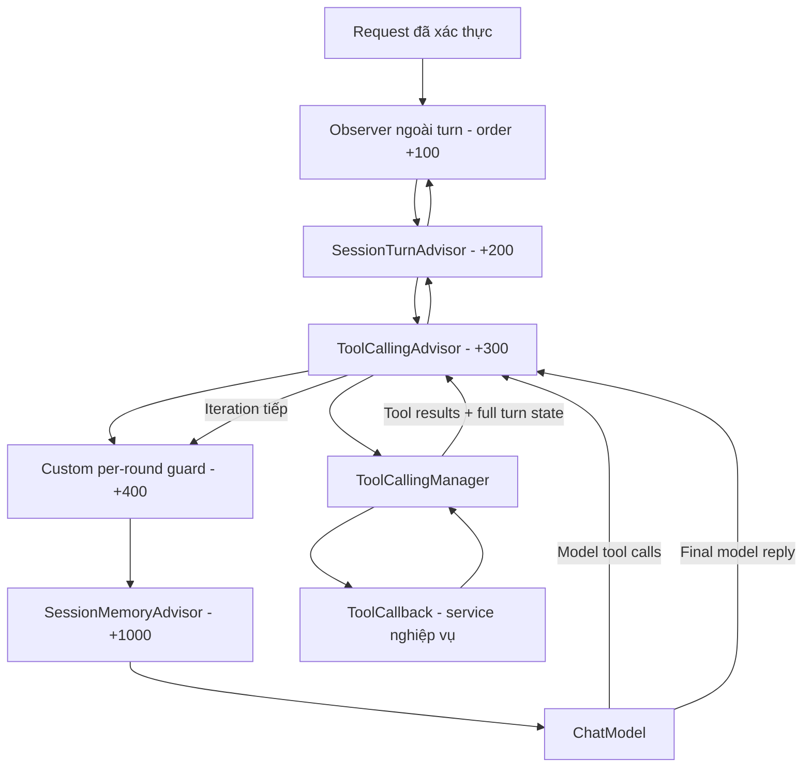
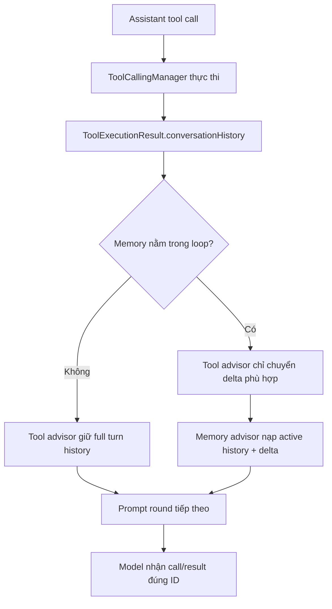
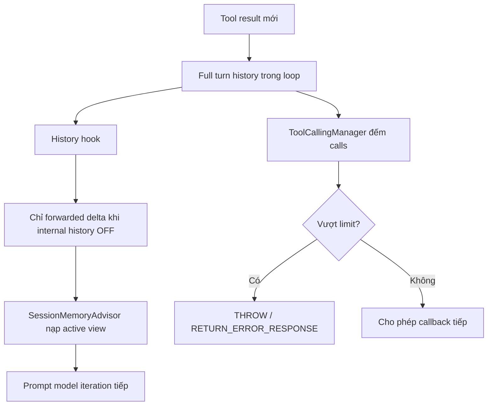
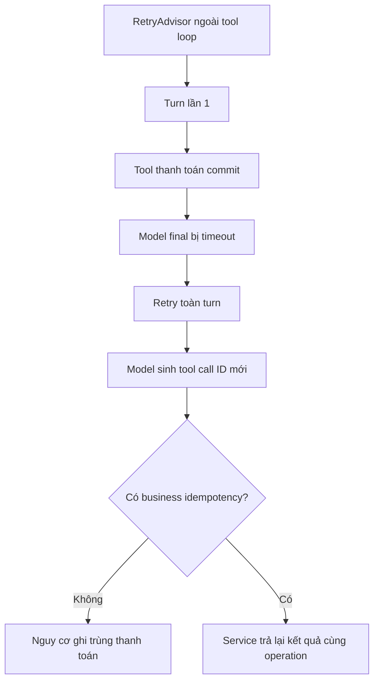

# Mở rộng advisor

## Kiểm tra tương tác giữa advisor tùy chỉnh, lịch sử và giới hạn thực thi

Một advisor tùy chỉnh có thể hoạt động đúng khi mô hình trả lời trong một lượt, nhưng làm hỏng ứng dụng khi mô hình yêu cầu gọi nhiều `@Tool` liên tiếp. Ví dụ: một advisor lọc lịch sử để tiết kiệm token vô tình xóa `ToolResponseMessage`; một advisor tự retry toàn bộ `ChatClient` làm công cụ thanh toán chạy lại; hoặc hai advisor cùng quản lý history khiến mỗi tool response bị lặp. Nếu chỉ kiểm tra câu trả lời cuối, những lỗi đó rất dễ bị bỏ sót.

Trong module `SPRING_AI_TOOL_CALLING`, mô hình tạo tool-call request gồm tên và JSON arguments, còn ứng dụng sở hữu `ToolCallback`, schema, `ToolContext`, phân quyền và trách nhiệm thực thi. Bài này tập trung vào **kiểm tra tương tác** giữa ba cơ chế: (1) advisor tùy chỉnh trong chain, (2) lịch sử hội thoại được gửi lại mô hình, (3) giới hạn số lần thực thi công cụ. Mục đích là xây dựng các bất biến và test có thể tái lập, để tối ưu prompt hoặc thêm guardrail mà không vô tình mở đường vượt giới hạn, bỏ kết quả đã hoàn tất hay chạy side effect hai lần.

Các API được trình bày theo **Spring AI 2.1.0**. Ở phiên bản này, `ChatClient` tự đăng ký `ToolCallingAdvisor` khi không có custom `ToolAdvisor`; `ChatModel` được gọi trực tiếp chỉ trả response của model, không tự thực thi tool. `ChatMemory`/`MessageChatMemoryAdvisor` là API cũ đã deprecated, còn `SessionAdvisors` là hướng mới để lưu lịch sử có tool calls.

### 1. Ba bất biến phải kiểm tra cùng lúc

Một bài test chỉ khẳng định “advisor đã được gọi” là chưa đủ. Ba nhóm bất biến tương tác như sau:

| Nhóm | Bất biến phải giữ | Ví dụ lỗi |
| --- | --- | --- |
| **Advisor chain** | Đúng **một** thành phần sở hữu tool loop; advisor nằm đúng vị trí | Một custom `ToolAdvisor` thay thế mặc định nhưng không thực thi callback |
| **Conversation history** | Mỗi lượt model nhìn thấy đúng các message cần thiết, tool call IDs khớp tool response IDs, không có bản sao thừa | User message bị append hai lần; assistant tool request bị xóa khi memory nạp lại |
| **Execution limits** | Bộ đếm tool chỉ tính các lần đã được ghi nhận trong **turn hiện tại** và không biến mất khi nén lịch sử chuyển tiếp | Model lặp tool vô hạn sau khi custom hook cắt history; giới hạn của turn trước bị tính nhầm vào turn mới |

Một yêu cầu có thể thỏa hai nhóm nhưng vẫn sai nhóm thứ ba. Ví dụ output và history đều hợp lệ nhưng callback gọi 11 lần trong khi `maxCallsPerTool("search", 10)` là giới hạn; ngược lại, giới hạn có hoạt động nhưng tool response thành công trước khi vượt hạn mức không được giữ lại.

### 2. Sơ đồ advisor chain và vị trí quan sát



Trong Spring AI 2.1, order nhỏ hơn chạy **xa mô hình hơn** (bên ngoài); order lớn hơn chạy **gần mô hình hơn** (bên trong). Các giá trị mặc định dưới đây là tương đối so với `Ordered.HIGHEST_PRECEDENCE`:

| Advisor | Order mặc định | Phạm vi |
| --- | --- | --- |
| Custom outer observer `+100` | Trước `SessionTurnAdvisor` | Một lần cho toàn bộ request/turn |
| `SessionTurnAdvisor` `+200` | Bên ngoài vòng tool | Xử lý turn, session, kết thúc đặc biệt, compaction |
| `ToolCallingAdvisor` `+300` | Vòng tool loop | Gọi model, thực thi callback, lặp |
| Custom per-round advisor `+400` | Bên trong vòng tool | Mỗi model round, cả `.call()` và `.stream()` nếu hỗ trợ |
| `SessionMemoryAdvisor` `+1000` | Bên trong vòng tool | Nạp và lưu transcript cho từng round |

**Lưu ý:** các giá trị là mặc định của Spring AI 2.1. Nếu ứng dụng đổi `advisorOrder(...)` của tool loop hoặc memory, phải tính lại quan hệ trong/ngoài; đừng chỉ dựa vào số của ví dụ. Những advisor có cùng order cần kiểm tra cách sắp xếp thực tế, tốt hơn đặt order khác nhau để tránh hành vi phụ thuộc cấu hình.

### 3. Đừng đánh dấu advisor quan sát là `ToolAdvisor`

`ToolAdvisor` là **marker sở hữu vòng thực thi**. `DefaultChatClient` bảo đảm có đúng một tool advisor: nếu không có, hệ thống thêm `ToolCallingAdvisor`; nếu có custom marker, hệ thống không thêm vòng mặc định; có hai marker sẽ báo lỗi.

| Mục đích | Nên triển khai | Có mang marker `ToolAdvisor`? |
| --- | --- | --- |
| Đo latency, ghi intent, kiểm tra request scope | `CallAdvisor`, `StreamAdvisor` | Không |
| Chèn/chọn tool mỗi iteration mà vẫn giữ loop gốc | Subclass `ToolCallingAdvisor` với protected hooks | Có, kế thừa |
| Thay full orchestration | Custom `ToolAdvisor` kết hợp Call/Stream advisor | Có, chịu trách nhiệm đầy đủ |
| Đổi giới hạn, resolver hoặc error processor | Custom `ToolCallingManager` truyền vào builder | Không cần thêm advisor |

Test đầu tiên phải kiểm tra **số lần callback thực sự chạy**, không chỉ xem final text. Nếu advisor logging vô tình triển khai `ToolAdvisor` mà không gọi manager, mô hình vẫn có thể trả một assistant tool-call request nhưng tool không được thực thi. Nếu custom advisor tự thực thi và còn đăng ký vòng mặc định, có nguy cơ duplicate execution hoặc startup/request bị từ chối theo single-marker invariant.

### 4. Tập dữ liệu kiểm thử ổn định: hai công cụ và một chuỗi model rounds

Không nên dùng một LLM thật để quyết định khi nào gọi tool trong unit/component tests. Hãy tạo response cố định:

```text
Round 1: User "Kiểm tra hai đơn hàng"
         AssistantToolCall(id=call-A, name=lookupOrder, args={"orderId":"ORD-1"})
Round 2: ToolResponse(id=call-A, name=lookupOrder, data="SHIPPED")
         AssistantToolCall(id=call-B, name=lookupOrder, args={"orderId":"ORD-2"})
Round 3: ToolResponse(id=call-B, name=lookupOrder, data="PENDING")
         Assistant final: "Đã kiểm tra hai đơn hàng"
```

Với hai call cùng tên nhưng ID khác nhau, test có thể xác minh cả:
- Công cụ được gọi đúng hai lần.
- Mỗi `ToolResponseMessage.ToolResponse.id()` khớp với `AssistantMessage.ToolCall.id()`.
- Prompt của round sau chứa một cặp call/result hoàn chỉnh cho round trước.
- Không có message của session khác hoặc duplicate do advisor tự ghép.

Một fixture Java dùng `@Tool` và bộ đếm, dễ dùng với JUnit 5/Mockito:

```java
final class OrderTools {

    final AtomicInteger lookups = new AtomicInteger();

    @Tool(description = "Tra cứu đơn hàng thuộc phạm vi được phép")
    public String lookupOrder(
            @ToolParam(description = "Mã đơn hàng") String orderId,
            ToolContext context) {

        String tenantId = (String) context.getContext().get("tenantId");
        if (!"tenant-test".equals(tenantId)) {
            throw new AccessDeniedException("Tenant không hợp lệ");
        }
        lookups.incrementAndGet();
        return "ORD-1".equals(orderId) ? "SHIPPED" : "PENDING";
    }
}
```

Trong production, `tenantId` phải đến từ security context đã xác thực và service kiểm tra quyền trên từng resource; đoạn test dùng giá trị cố định để loại bất định. Không sử dụng dữ liệu do model sinh làm căn cứ xác thực tenant.

### 5. Quan sát đúng phạm vi: outer observer khác per-round observer

Một observer chạy **ngoài** tool loop thấy một request/turn và kết quả cuối; observer chạy **bên trong** có thể thấy nhiều model rounds. Do đó cùng một request ở mục 4 có số lượng quan sát khác nhau.

| Vị trí | Request before | Response after | Kỳ vọng ở fixture 3 rounds |
| --- | --- | --- | --- |
| Outer, order `+100` | Trước toàn turn | Sau loop (hoặc lỗi) | Một lần |
| Per-round, order `+400` | Mỗi lần model được gọi | Mỗi model round | Ba lần |
| `ToolCallingAdvisor` | Một lifecycle có recursion | Dừng khi không còn calls/direct/limit | Một loop, hai executions |
| Session Memory, order `+1000` | Mỗi lần nạp view | Mỗi response được ghi | Ghi đúng transcript, không nhân đôi |

Số lượng tương ứng không phải “số công cụ đã chạy”. Một model round có thể yêu cầu nhiều tools trong cùng response; một vòng có thể kết thúc ở confirmation, limit hoặc refusal mà không chạy tool. Khi ghi audit, tách `TOOL_REQUESTED` (mô hình đề nghị), `TOOL_STARTED` (callback thực thi), `TOOL_SUCCEEDED` (business service xác nhận) và `TOOL_SKIPPED_LIMIT`.

### 6. Ví dụ per-round observer không can thiệp lịch sử

Một advisor quan sát nên giữ nguyên `ChatClientRequest`/`ChatClientResponse` để tránh làm thay tool-call IDs hoặc cấu trúc message. Dưới đây là ví dụ cho blocking path; streaming path cần triển khai tương ứng nếu ứng dụng sử dụng `.stream()`.

```java
public final class RoundCounterAdvisor implements CallAdvisor {

    private final AtomicInteger modelRounds = new AtomicInteger();

    @Override
    public String getName() {
        return "RoundCounterAdvisor";
    }

    @Override
    public int getOrder() {
        return Ordered.HIGHEST_PRECEDENCE + 400;
    }

    @Override
    public ChatClientResponse adviseCall(
            ChatClientRequest request,
            CallAdvisorChain chain) {

        modelRounds.incrementAndGet();
        return chain.nextCall(request); // Không tự thực thi tool.
    }

    public int observedRounds() {
        return modelRounds.get();
    }
}
```

`AtomicInteger` ở đây chỉ dành cho **test fixture**; trong ứng dụng có nhiều request đồng thời, không dùng biến singleton này làm per-conversation counter hoặc limit, vì nó sẽ trộn giữa các user. Giữ state theo request/session hoặc đưa số liệu tổng hợp vào Micrometer metric.

Ví dụ kiểm tra sau khi dùng stub `ChatModel` với hai tool-call rounds và một final round:

```java
assertThat(roundObserver.observedRounds()).isEqualTo(3);
assertThat(orderTools.lookups.get()).isEqualTo(2);
verify(chatModel, times(3)).call(any(Prompt.class));
```

Đừng dùng counter của advisor để áp dụng giới hạn **số tool calls**: một round có thể có 0, 1 hoặc nhiều tool calls; người gọi cũng có thể dùng stream, `returnDirect` hoặc confirmation làm số round khác số execution.

### 7. Ai sở hữu history giữa các iteration?

`ToolCallingAdvisor` mặc định bật `conversationHistoryEnabled(true)`. Trong chế độ này, advisor giữ history cho **turn hiện tại** và chuyển đầy đủ tới model ở iteration tiếp theo. Cách này phù hợp khi memory advisor nằm **ngoài** vòng lặp hoặc khi ứng dụng không cần persistence giữa các turn.

Khi `MemoryAdvisor` nằm **bên trong** vòng, nên dùng `disableInternalConversationHistory()`. Lúc đó tool advisor chỉ chuyển system message và message mới nhất (thường là tool result) tới các advisor phía trong; memory advisor sẽ nạp phần history đã lưu và ghép prompt.

| Cấu hình | Chủ sở hữu lịch sử đầy đủ | Điểm kiểm tra |
| --- | --- | --- |
| Không có memory advisor | Internal history của `ToolCallingAdvisor` | Model round sau thấy tất cả call/result trong turn |
| Legacy `MessageChatMemoryAdvisor` order +200 | Internal history trong turn, memory ngoài turn | Không yêu cầu legacy repository lưu tool messages |
| Legacy memory order +400 | Memory nằm trong loop | Tắt internal history, repository phải hỗ trợ tool messages |
| `SessionAdvisors` 2.1 với mặc định +200/+1000 | `SessionService` quản lý event log và active view | Có đủ cặp advisor, tránh duplicate, lưu cả direct/limit result |
| Custom `ToolCallingAdvisor` + custom memory | Theo cấu hình do ứng dụng thiết lập | Không ỷ lại auto-detection chỉ dành cho auto-registered advisor |

Khi `DefaultChatClient` **tự đăng ký** tool advisor và phát hiện một `MemoryAdvisor` bên trong loop, nó tự tắt internal conversation history. Nếu code **tự dựng** `ToolCallingAdvisor` hoặc subclass, nên cấu hình cờ history tường minh để phù hợp với memory.

### 8. Sơ đồ hai con đường history, không được trộn tùy tiện



Một lỗi phổ biến là:

```java
// SAI: result.conversationHistory() đã chứa những messages trước đó.
List<Message> next = new ArrayList<>(prompt.getInstructions());
next.addAll(toolExecutionResult.conversationHistory());
```

Cách sử dụng đúng trong manual loop là nhận **toàn bộ** danh sách được trả về:

```java
Prompt nextPrompt = new Prompt(
    toolExecutionResult.conversationHistory(),
    prompt.getOptions());
```

Nếu custom advisor chuyển một danh sách delta vào memory nằm trong loop, memory phải biết cách ghép delta đó với event log của session. Nếu tự đẩy full history vào memory mà nó cũng đã nạp full history, có thể lặp message. Đừng cố “khử trùng” bằng cách chỉ so văn bản; cùng văn bản không có nghĩa là cùng một tool call ID.

### 9. Đọc và thay history trong subclass: một extension point nhạy cảm

Spring AI 2.1 hỗ trợ hai hooks:

```java
protected List<Message> doGetNextInstructionsForToolCall(
    ChatClientRequest request,
    ChatClientResponse response,
    ToolExecutionResult execution);

protected List<Message> doGetNextInstructionsForToolCallStream(
    ChatClientRequest request,
    ChatClientResponse response,
    ToolExecutionResult execution);
```

Hook quyết định **messages được chuyển tiếp** xuống advisor chain ở iteration kế. Nếu không cần sửa logic, giữ nguyên:

```java
@Override
protected List<Message> doGetNextInstructionsForToolCall(
        ChatClientRequest request,
        ChatClientResponse response,
        ToolExecutionResult execution) {

    return super.doGetNextInstructionsForToolCall(
        request, response, execution);
}
```

**Các bất biến khi custom hook:**

1. Assistant tool-call request phải còn tương ứng với tool responses, giữ đúng `id` và `name`.
2. Không tự đổi role `ToolResponseMessage` thành `AssistantMessage` hoặc ngược lại.
3. Không bỏ system/developer policy để tiết kiệm token.
4. Không lấy history của conversation khác dù cùng user question.
5. Không chuyển một tool result mang dữ liệu nhạy cảm sang session có owner khác.
6. Không nhân đôi message khi sử dụng `SessionMemoryAdvisor`.
7. Không tự giảm “số lần tool đã thực thi” bằng cách xóa message khỏi prompt chuyển tiếp.

Với history dài, ưu tiên compaction theo ranh giới **turn** trong Session Memory. Tool-call messages là cặp giao thức: cắt một nửa có thể khiến provider từ chối hoặc memory read guard loại bỏ phần còn lại.

### 10. Session Memory 2.1: phải giữ cả hai advisor

`SessionAdvisors.builder(sessionService).build()` tạo hai advisor có trách nhiệm khác nhau:

- `SessionTurnAdvisor` order +200: bên ngoài tool loop, nắm kết quả cuối của turn, lưu tool results khi vòng kết thúc không có model round sau (ví dụ `returnDirect` hoặc call-limit breach), xử lý compaction.
- `SessionMemoryAdvisor` order +1000: bên trong tool loop, nạp active view, ghi message của mỗi model round, gồm assistant tool-call requests và tool responses.

Ví dụ cấu hình đơn giản:

```java
ChatClient chatClient = ChatClient.builder(chatModel)
    .defaultAdvisors(SessionAdvisors.builder(sessionService).build())
    .build();

String answer = chatClient.prompt()
    .user("Kiểm tra trạng thái đơn hàng")
    .tools(orderTools)
    .toolContext(Map.of("tenantId", verifiedTenantId))
    .advisors(SessionAdvisors.session(authorizedSessionId))
    .call()
    .content();
```

Nếu custom advisor đặt **trước** `SessionTurnAdvisor` và tự dùng `SessionService`, hãy kiểm tra context/session ownership trước khi gọi `findOrCreate`. Session advisors có thể tạo session chưa tồn tại khi được sử dụng; chúng không tự làm authorization cho ID do client gửi. Trong môi trường đa tenant, xác thực owner/tenant ở service hoặc repository cho mọi thao tác đọc/ghi.

**Lưu ý khi kiểm thử:** `SessionMemoryAdvisor` đơn lẻ không lưu tool results ở một vòng kết thúc `returnDirect` vì không có model round tiếp theo; phải giữ `SessionTurnAdvisor`. Một final answer đúng không chứng minh persistence đã đúng.

### 11. Bảng kỳ vọng history theo ba cấu hình

Dùng fixture một user request và hai tool calls rồi final answer:

```text
USER: So sánh hai đơn hàng
ASSISTANT: tool call id=call-A
TOOL: result id=call-A
ASSISTANT: tool call id=call-B
TOOL: result id=call-B
ASSISTANT: Đã kiểm tra hai đơn hàng
```

| Cấu hình | Prompt model round 3 | Repository sau turn |
| --- | --- | --- |
| Không memory, internal history bật | Có user, hai assistant tool calls, hai results | Không lưu dài hạn theo mặc định |
| Legacy memory ở ngoài loop, internal bật | Có đầy đủ transcript do tool advisor dựng | Repository chỉ thấy user/final assistant |
| Session Memory trong loop, internal tắt | Có transcript qua active view từ repository | Event log chứa tool calls, responses, final answer |
| Custom hook cắt mất response id=call-A | Không còn cặp hợp lệ | Có thể sai protocol hoặc read guard ẩn message |
| Cả internal full history và memory tự append lại | Có thể có duplicate | Có thể lặp call/result hoặc user prompt |

Khi chạy test, bắt `Prompt` truyền vào `ChatModel` bằng `ArgumentCaptor<Prompt>`. Kiểm tra cặp ID/role, số lượng và thứ tự hợp lệ; đừng chỉ so substring `"SHIPPED"` vì model có thể trả text đúng dù history bị hỏng.

### 12. Giới hạn thực thi tool không phải giới hạn model rounds

`DefaultToolCallingManager` trong Spring AI 2.1 có các giới hạn mặc định:

| Giới hạn | Mặc định | Ý nghĩa |
| --- | --- | --- |
| `maxCallsPerTool` | 40 | Số lần một tool name được thực thi trong **turn hiện tại** |
| `maxTotalToolCalls` | 150 | Tổng số lần gọi tất cả tools trong turn hiện tại |
| `maxCallsPerTool("lookupOrder", n)` | Theo cấu hình | Ghi đè giới hạn cho một tool |
| `excludeToolFromLimit("toolName")` | Không có | Bỏ giới hạn **per-tool**, vẫn tính vào tổng |
| `onLimitExceeded` | `THROW` | Ném lỗi có partial result hoặc tổng hợp error response |

Ví dụ giới hạn chặt phục vụ kiểm thử:

```java
ToolCallingManager manager = ToolCallingManager.builder()
    .maxCallsPerTool(5)
    .maxCallsPerTool("lookupOrder", 2)
    .maxTotalToolCalls(3)
    .onLimitExceeded(ToolCallLimitBehavior.THROW)
    .build();

ToolCallingAdvisor loop = ToolCallingAdvisor.builder()
    .toolCallingManager(manager)
    .advisorOrder(ToolCallingAdvisor.DEFAULT_ORDER)
    .build();
```

Giới hạn số tool calls **không** giới hạn số model rounds, số token, HTTP timeout hoặc số thread. Một mô hình có thể tiếp tục trả các câu trả lời không gọi tool; một model round cũng có thể yêu cầu nhiều tool calls. Muốn giới hạn token, độ trễ hay concurrency cần ngân sách và guardrail riêng.

### 13. Điểm dễ nhầm: tắt internal history không làm tắt giới hạn

Đây là bất biến quan trọng của Spring AI 2.1:

- `conversationHistoryEnabled(false)` thay đổi **những message chuyển tới downstream advisors/model**.
- `ToolCallingAdvisor` vẫn giữ **full history của turn đang chạy** để gọi manager và tính limits.
- `DefaultToolCallingManager` tính số lần gọi dựa trên các `ToolResponseMessage` trong **turn hiện tại**, từ `UserMessage` gần nhất trở về sau.
- Manager không giữ counter mutable trong singleton; số lần gọi được suy từ history, nên có thể dùng chung manager cho các request độc lập.



Vì vậy, một test cấu hình `disableInternalConversationHistory()` phải xác minh **vẫn dừng ở lần thứ ba** khi `maxCallsPerTool("lookupOrder", 2)`. Nếu test báo vượt giới hạn muộn, nghi ngờ custom manager/manual orchestration đã truyền history không đầy đủ, chứ không nên kết luận cờ internal history có ý định xóa limit.

### 14. Khi nào lượt cũ không được tính vào turn mới?

Turn là phạm vi có ý nghĩa nghiệp vụ. Theo contract mặc định, manager đếm các tool responses **sau `UserMessage` cuối cùng**, không tính các tool results của những turn trước được nạp bởi memory.

Ví dụ:

```text
Turn 1:
  USER "Kiểm tra ORD-1"
  ASSISTANT tool call id=call-A
  TOOL response id=call-A
  ASSISTANT final answer

Turn 2:
  USER "Kiểm tra ORD-2"
  ASSISTANT tool call id=call-B
  TOOL response id=call-B
```

Nếu giới hạn per-tool là 1, mỗi turn có thể gọi `lookupOrder` một lần: `call-A` không làm `call-B` bị chặn. Test nên dùng **cùng session ID** nhưng hai `UserMessage` riêng, rồi so số lần gọi trước/sau ranh giới turn.

Nếu custom advisor tự loại `UserMessage` cuối khỏi history mà manager dùng để tính, phạm vi đếm có thể sai. Cũng không nên tự chèn một `UserMessage` giả giữa các tool calls chỉ để reset limit. Cả hai là hành vi phá vỡ contract đếm lượt và phải được kiểm tra ở custom orchestration.

### 15. Hai chính sách vượt giới hạn khác nhau

| Behavior | Hành vi | Khi nào dùng |
| --- | --- | --- |
| `ToolCallLimitBehavior.THROW` | Manager ném `ToolCallLimitExceededException` chứa partial execution result; `ToolCallingAdvisor` chuyển breach thành final response có một `Generation` | Muốn dừng loop rõ ràng, báo lỗi giới hạn cho caller |
| `RETURN_ERROR_RESPONSE` | Call vượt hạn mức không chạy; manager tổng hợp một tool-error response cho model; loop có thể tiếp tục | Muốn model biết hạn mức và tự chuyển sang trả lời không gọi thêm tool |

Không nhầm hai chính sách với “bỏ toàn bộ results”. Ở chế độ `THROW`, `ToolCallLimitExceededException.getPartialToolExecutionResult()` cho biết các calls trong **batch hiện tại** đã hoàn tất trước breach, kèm error result cho call vượt hạn. Advisor tạo một breach `Generation` với `FINISH_REASON` riêng và đặt các tool responses đã thành công vào metadata `METADATA_PARTIAL_TOOL_RESPONSES`.

Ở chế độ `RETURN_ERROR_RESPONSE`, callback bị chặn **không được thực thi**, nhưng model vẫn có thể thử gọi tool khác. Nếu cứ tiếp tục đề nghị công cụ đã hết quota, ứng dụng cần quan sát số round, latency, token và kết thúc theo budget/timeout khác; chuyển behavior sang RETURN_ERROR_RESPONSE không phải bảo đảm vòng có giới hạn tuyệt đối về model calls.

### 16. Component test: limit 2 giữ kết quả thành công trong batch

Dùng fixture `OrderTools` từ mục 4 và một model response gồm **ba** tool calls của cùng tool. `ToolCallingManager` phải chạy hai calls đầu, chặn call thứ ba rồi trả partial result trong exception.

```java
static AssistantMessage.ToolCall call(String id, String orderId) {
    return new AssistantMessage.ToolCall(
        id,
        "function",
        "lookupOrder",
        "{\"orderId\":\"" + orderId + "\"}");
}

static ChatResponse batch(AssistantMessage.ToolCall... calls) {
    AssistantMessage assistant = AssistantMessage.builder()
        .content("")
        .toolCalls(List.of(calls))
        .build();

    return new ChatResponse(List.of(new Generation(assistant)));
}

@Test
void hittingLimitPreservesFinishedResults() {
    OrderTools tools = new OrderTools();

    ToolCallingChatOptions options = ToolCallingChatOptions.builder()
        .toolCallbacks(ToolCallbacks.from(tools))
        .toolContext(Map.of("tenantId", "tenant-test"))
        .build();

    Prompt prompt = new Prompt(
        List.of(new UserMessage("Kiểm tra ba đơn hàng")),
        options);

    ChatResponse request = batch(
        call("call-A", "ORD-1"),
        call("call-B", "ORD-2"),
        call("call-C", "ORD-3"));

    ToolCallingManager manager = ToolCallingManager.builder()
        .maxCallsPerTool("lookupOrder", 2)
        .maxTotalToolCalls(5)
        .onLimitExceeded(ToolCallLimitBehavior.THROW)
        .build();

    assertThatThrownBy(() -> manager.executeToolCalls(prompt, request))
        .isInstanceOfSatisfying(
            ToolCallLimitExceededException.class,
            exception -> {
                ToolExecutionResult partial =
                    exception.getPartialToolExecutionResult();

                List<String> responseIds =
                    partial.conversationHistory().stream()
                        .filter(ToolResponseMessage.class::isInstance)
                        .map(ToolResponseMessage.class::cast)
                        .flatMap(m -> m.getResponses().stream())
                        .map(ToolResponseMessage.ToolResponse::id)
                        .toList();

                assertThat(responseIds).contains("call-A", "call-B");
                // call-C có thể có synthesized error response.
            });

    assertThat(tools.lookups.get()).isEqualTo(2);
}
```

Đây là **component test manager**, không cần ChatClient hoặc LLM thật. Nó xác minh số lần execution và các ID được bảo toàn. Đừng assert `partial.conversationHistory()` chỉ có hai results: ở chế độ `THROW`, exception còn có **synthesized error response** cho call bị giới hạn. Hãy phân biệt các kết quả `SUCCEEDED` với error result khi audit.

Nếu tool thứ nhất đã có side effect, lần thứ ba bị chặn không hoàn tác những gì đã hoàn thành. Trong hệ thống thật, luôn kết hợp idempotency và audit.

### 17. Tích hợp cùng custom advisor: đếm callback, model rounds và history

Sau component test manager, dùng mock `ChatModel` phát tool calls rồi final answer. Cùng test nên quan sát ba loại số liệu:

```java
@Test
void roundObserverDoesNotDuplicateExecutions() {
    OrderTools tools = new OrderTools();
    RoundCounterAdvisor observer = new RoundCounterAdvisor();

    ChatModel model = mock(ChatModel.class);
    when(model.call(any(Prompt.class))).thenReturn(
        batch(call("call-A", "ORD-1")),
        batch(call("call-B", "ORD-2")),
        new ChatResponse(List.of(
            new Generation(AssistantMessage.builder()
                .content("Đã kiểm tra")
                .build()))));

    ChatClient client = ChatClient.builder(model)
        .defaultAdvisors(observer)
        .build();

    String answer = client.prompt()
        .user("Kiểm tra hai đơn")
        .tools(tools)
        .toolContext(Map.of("tenantId", "tenant-test"))
        .call()
        .content();

    assertThat(answer).contains("Đã kiểm tra");
    assertThat(tools.lookups.get()).isEqualTo(2);
    assertThat(observer.observedRounds()).isEqualTo(3);
    verify(model, times(3)).call(any(Prompt.class));
}
```

Test này chứng minh observer không làm mất tool loop mặc định. Để kiểm tra history, dùng `ArgumentCaptor<Prompt>` bắt request gửi model:

```java
ArgumentCaptor<Prompt> captor = ArgumentCaptor.forClass(Prompt.class);
verify(model, times(3)).call(captor.capture());

List<Message> thirdPrompt =
    captor.getAllValues().get(2).getInstructions();

List<String> responseIds = thirdPrompt.stream()
    .filter(ToolResponseMessage.class::isInstance)
    .map(ToolResponseMessage.class::cast)
    .flatMap(m -> m.getResponses().stream())
    .map(ToolResponseMessage.ToolResponse::id)
    .toList();

assertThat(responseIds)
    .containsExactlyInAnyOrder("call-A", "call-B");
```

Trong một test chuyên sâu, kiểm tra thêm từng `AssistantMessage.ToolCall.id()`, vị trí tool request trước tool response và không có hai `UserMessage` giống hệt do duplication.

### 18. Test custom history hook không phá limit counting

Trường hợp cần bắt: subclass dùng `disableInternalConversationHistory()` hoặc custom hook chỉ chuyển delta, rồi lặp nhiều tool calls. Giới hạn vẫn phải chặn theo **full turn state**.

Một kế hoạch test deterministic:

```text
GIVEN:
  maxCallsPerTool("lookupOrder", 2)
  SessionMemoryAdvisor inside loop (+1000)
  ToolCallingAdvisor customized, internalHistory=false
  Model returns call-A, then call-B, then call-C

WHEN:
  ChatClient.call() performs three potential iterations

THEN:
  lookupOrder executes only twice
  call-C is marked limit-exceeded; not executed
  Session transcript stores call-A and call-B results
  No duplicated UserMessage / ToolResponseMessage
  Limit does not reset when history forwarded to model is shortened
```

Cấu hình minh họa:

```java
ToolCallingManager limitedManager = ToolCallingManager.builder()
    .maxCallsPerTool("lookupOrder", 2)
    .onLimitExceeded(ToolCallLimitBehavior.THROW)
    .build();

ToolCallingAdvisor customLoop = ToolCallingAdvisor.builder()
    .toolCallingManager(limitedManager)
    .disableInternalConversationHistory()
    .build();

ChatClient client = ChatClient.builder(chatModelStub)
    .defaultAdvisors(
        SessionAdvisors.builder(sessionService).build())
    .defaultAdvisors(customLoop)
    .build();
```

**Lưu ý cấu hình:** đây là một custom tool advisor được đăng ký tường minh, nên auto-registration không thêm vòng mặc định. Cờ disable internal history là do code cấu hình chủ động, không trông chờ auto-adjust cho advisor custom.

Không viết test kiểu “làm trống tất cả messages trước mỗi iteration” để tiết kiệm token: đó là sửa state dùng để đếm turn, không phải chỉ tối ưu prompt. Test phải xác minh prompt chuyển tới model vẫn hợp lệ, còn manager dùng complete turn history theo contract framework.

### 19. Kiểm tra partial batch khi chạm giới hạn

Một response từ model có thể chứa nhiều tool calls cùng lúc:

```text
Assistant tool calls:
  call-A -> lookupOrder("ORD-1")  : succeeds
  call-B -> lookupOrder("ORD-2")  : succeeds
  call-C -> lookupOrder("ORD-3")  : hits limit
```

Với `THROW` và `ToolCallingAdvisor`:

- Hai callback đã hoàn tất **không được chạy lại**.
- Advisor xây **một** `Generation` báo vượt giới hạn; không tách một generation “thành công” song song với generation lỗi khiến caller hiểu sai final answer.
- Các tool responses thành công trước đó nằm trong `METADATA_PARTIAL_TOOL_RESPONSES`.
- `SessionTurnAdvisor` sẽ lưu các tool results thuộc đường kết thúc không có model round tiếp theo, phù hợp với event log session.
- Một công cụ ghi dữ liệu đã commit vẫn cần được đối soát theo operation ID nếu round kết thúc lỗi.

Một test integration nên kiểm tra **response metadata và session repository** cùng với số lần callback; không chỉ so `response.getResult().getOutput().getText()`. Nếu bảo vệ khả năng truy vết, lưu ID và trạng thái theo từng call; không ghi raw arguments hoặc tool results nhạy cảm.

### 20. Kịch bản `RETURN_ERROR_RESPONSE`: model có thể tiếp tục

Với behavior này, limit breach được biểu diễn như một tool-error response, để mô hình chọn cách trả lời hoặc chuyển qua workflow khác.

Test nên stub:

```text
Round 1: tool call-A -> success
Round 2: tool call-B -> limit error response
Round 3: model final "Đã đạt giới hạn, vui lòng thử lại sau"
```

Các assertions quan trọng:
- Lượt vượt hạn mức **không gọi callback lần nữa**.
- `ToolResponse.id()` của error response vẫn tương ứng với `ToolCall.id()`.
- Model round tiếp nhận thông tin limit thay vì nhận result giả.
- Có một final assistant response được tạo bởi model trong fixture.
- Trạng thái audit phân biệt `SKIPPED_LIMIT` và `SUCCEEDED`.

**Rủi ro:** mô hình có thể cứ yêu cầu lại tool vừa bị giới hạn, tạo thêm các lượt model mà không thực thi tool. Nếu ứng dụng cần deadline cứng, thêm giới hạn thời gian, token/round budget hoặc circuit breaker ở tầng orchestration; per-tool call limit không tự chặn mọi loại model recursion.

### 21. Test `returnDirect` và confirmation khi advisor tùy chỉnh

`returnDirect` là metadata của tool callback, không phải dấu hiệu memory được lưu thành công. Khi tất cả calls trong một response `returnDirect=true`, manager trả `ToolExecutionResult.returnDirect()==true` và vòng tool không gọi model tiếp. Với batch trộn direct/non-direct, manager vẫn chuyển **tất cả** tool results về model.

Bảng kiểm thử:

| Tình huống | Callback thực thi? | Model round tiếp? | History cần có |
| --- | --- | --- | --- |
| Một tool bình thường | Có | Có | Tool request/result rồi assistant final |
| Một tool direct | Có | Không | Tool request/result; SessionTurnAdvisor xử lý kết thúc |
| Hai tools đều direct | Cả hai | Không | Hai results với đúng IDs |
| Một direct + một thường | Cả hai | Có | Cả hai results trong prompt round sau |
| Tool cần confirmation | Chưa, trước khi được duyệt | Tạm dừng | Lưu trạng thái chờ, không được báo success |
| Người duyệt từ chối | Không có side effect | Có thể tiếp tục với kết quả từ chối | Phân biệt denied result với execution result |

Một advisor tùy chỉnh không được làm mất cờ `returnDirect` khi biến đổi response, không được ghi thành `AssistantMessage` giả để “giữ history”, và không được chạy callback trước confirmation. Test cần assert số model calls và số lần service thực thi, không chỉ final text.

### 22. Streaming: kiểm tra cả hai đường `call()` và `stream()`

Một custom `CallAdvisor` có thể hoạt động tốt ở đường blocking nhưng không chạy khi request dùng `.stream()`. Nếu cùng chính sách phải áp dụng cho cả hai, implement `StreamAdvisor` tương ứng hoặc override cả hai nhóm hooks của `ToolCallingAdvisor`.

| Blocking | Streaming | Nội dung cần kiểm tra |
| --- | --- | --- |
| `doBeforeCall` | `doBeforeStream` | Tool allowlist và scope trước mỗi model round |
| `doAfterCall` | `doAfterStream` | Response hoàn chỉnh / aggregated per iteration |
| `doGetNextInstructionsForToolCall` | `doGetNextInstructionsForToolCallStream` | Cặp call/result được chuyển đúng |
| `doFinalizeLoop` | `doFinalizeLoopStream` | Tổng hợp kết quả/giải phóng tài nguyên cả lỗi và cancel |

Streaming provider có thể phát `ToolCallPart` partial arguments. Partial part **không phải** complete tool call, `hasToolCalls()` bỏ qua nó và manager không được thực thi callback từ mảnh JSON chưa hoàn chỉnh. Vì vậy test phải xác minh:
1. UI có thể thấy progress chunks mà số lần callback vẫn bằng 0.
2. Khi complete tool call đến, callback chạy **một** lần.
3. Tool response đúng ID được nạp vào model round sau.
4. Nếu limit bị chạm, không phát thêm execution hoặc final answer sai.
5. Hủy stream không được coi là bằng chứng remote side effect rollback.

Đối với Session Memory, test cả `getMessages(sessionId)` (full event log) và `getActiveMessages(sessionId)` (active view). `SessionTurnAdvisor` xử lý các đường kết thúc đặc biệt; không suy đoán persistence chỉ từ những chunk nhìn thấy ở client.

### 23. Retry advisor có thể chạy side effect hai lần

Một lỗi dễ mắc khi kết hợp advisor retry với tool loop là đặt retry **bên ngoài** `ToolCallingAdvisor`, rồi retry cả `ChatClient` khi final answer hoặc provider lỗi. Nếu một tool đã ghi thành công trước khi lỗi, retry toàn turn có thể khiến mô hình phát một tool call ID khác nhưng thực hiện **cùng nghiệp vụ** lần nữa.



Phải phân biệt ba cách retry:
- **Retry model call**: không nhất thiết thực thi lại tool, nếu được đặt đúng bên trong vòng và không lặp request đã có side effect.
- **Retry tool callback**: có thể thực thi lại HTTP/DB side effect; chỉ an toàn nếu nghiệp vụ idempotent hoặc có idempotency key.
- **Retry toàn ChatClient turn**: có thể khởi tạo một chuỗi mới gồm model, tool, memory và audit; cần thỏa yêu cầu nghiệp vụ về retry.

**Tool-call ID không phải idempotency key bền vững.** Model có thể sinh ID mới khi retry. Hãy lấy operation ID từ server, lưu trong nghiệp vụ, kiểm tra transaction/unique constraint và đối soát trạng thái khi upstream timeout.

Test failure injection nên mô phỏng “tool đã commit, final model round lỗi”, rồi assert:
- Có một business operation bền vững, không có hai bản ghi.
- Advisor có thể trả lỗi/UNKNOWN; không làm mất audit của operation đã hoàn tất.
- Retry chỉ chạy theo policy rõ ràng, không tự dựa vào việc ID tool call trùng nhau.

### 24. Session đồng thời: optimistic version không thay điều phối turn

Hai HTTP requests cùng session ID có thể chạy cạnh nhau:

```text
Request A: đọc session version 12, model gọi tool A
Request B: đọc session version 12, model gọi tool B
Request B: ghi tool response B
Request A: tool response A đến muộn
```

Spring AI Session Memory dùng append-only event log và cung cấp `getEventVersion(sessionId)`, `appendEvents(sessionId, events, expectedVersion)` cho optimistic concurrency ở các thao tác cần kiểm tra trạng thái. Tuy nhiên, chính tài liệu Session Memory yêu cầu **một ChatClient call trên mỗi session tại một thời điểm**: turn sau có thể đóng open tool calls của turn trước, làm result đến muộn thành kết quả thứ hai, bị read guard loại bỏ.

Một advisor tùy chỉnh chạy theo session cần:
1. Xác minh owner/tenant trước khi lấy history hoặc permit.
2. Serialize các turn của cùng session, không chỉ khóa mỗi callback.
3. Với nhiều replica, dùng distributed coordination hoặc session claim/version hợp lệ; khóa trong JVM không đủ.
4. Giải phóng lock ở success, error, timeout và stream cancellation.
5. Không dùng một field mutable `currentSessionId` trong singleton advisor.

Test hai request đồng thời phải kiểm tra cả message order và số lần callback; không chỉ kiểm tra `appendEvents` thành công. Optimistic concurrency chỉ nói về **ghi log**, không tự bảo đảm service ngoài đã hoặc chưa commit.

### 25. Quản lý trạng thái limit theo đúng request và tenant

`DefaultToolCallingManager` suy số lần gọi từ history của turn, không giữ một counter chung mutable cho mọi request. Nếu custom advisor tự thêm logic khác, không đặt trạng thái của user vào một field singleton:

```java
// SAI: bộ đếm này chia sẻ cho mọi conversation.
private int remainingToolCalls = 3;

@Override
protected ChatClientRequest doBeforeCall(
        ChatClientRequest request, CallAdvisorChain chain) {
    remainingToolCalls--;
    return request;
}
```

Cách đúng là:
- Giữ budgets theo **request/turn** trong request/chain context hoặc service được phân vùng.
- Dùng `ToolCallingManager` cho số lần gọi tool đã thực thi.
- Với limit theo tenant/ngày/toàn cluster, dùng quota service/rate limiter có bộ lưu bền vững hoặc phân tán.
- Đọc `ToolContext` từ security context đã xác thực, không từ tool arguments do model sinh.

Giới hạn `maxTotalToolCalls(150)` là **trong một turn**, không phải giới hạn tổng user trong ngày hoặc giới hạn concurrency. Một tenant có thể mở nhiều conversations cùng lúc, mỗi conversation có budget turn riêng. Nếu dịch vụ ngoài có quota chung, cần thêm rate limiter/bulkhead và HTTP connection pool.

### 26. Test matrix: advisor × history × limits

| Advisor custom | History mode | Limit policy | Điều bắt buộc phải đạt |
| --- | --- | --- | --- |
| Không custom | Internal ON, không memory | `THROW` | Model round sau thấy full tool transcript; dừng đúng quota |
| Observer +400 | Internal ON | `THROW` | Observer đếm rounds, callback không bị gọi trùng |
| Observer ngoài +100 | Session Memory | `THROW` | Observer chạy một lần/turn, session vẫn ghi full transcript |
| Custom `ToolCallingAdvisor` | Session Memory, internal OFF | `THROW` | Memory nạp đủ call/results; limit vẫn đếm current-turn history |
| Custom history hook | Internal ON | `THROW` | Không mất assistant call/tool result ID; không reset đếm |
| Custom history hook | Session Memory | `RETURN_ERROR_RESPONSE` | Error result khớp ID; callback vượt hạn không chạy |
| Custom `ToolAdvisor` delegate | Session Memory | `THROW` | Một tool loop duy nhất; không nhân đôi các callbacks |
| Legacy memory ngoài loop | Internal ON | `THROW` | Repository lưu user/final answer, tool loop vẫn đúng |
| Session Memory đầy đủ | All-direct batch | Bất kỳ | `SessionTurnAdvisor` lưu tool results dù không có final model round |
| Session Memory đầy đủ | Limit giữa batch | `THROW` | Partial successful responses bảo toàn trong metadata/log |
| Streaming observer | Session Memory | `THROW` | Partial chunks không bị execute; cancel/error không tạo success giả |
| Retry advisor ngoài | Session Memory | `THROW` | Không duplicate side effect đã commit, có idempotency |

Ma trận trên nên thực hiện bằng **stub deterministic** khi kiểm thử framework và bằng integration test có repository thật cho tính nhất quán. Không cần thử tất cả tổ hợp ở E2E với model thương mại; chi phí cao và khó tái lập. Đặc biệt kiểm thử cả `call()` và `stream()` cho những advisor quảng cáo hỗ trợ cả hai.

### 27. Bộ tiêu chí để kiểm tra history sau một turn

Không chỉ so câu trả lời cuối. Kiểm tra danh sách message:

```java
static void assertNoDuplicateToolResults(List<Message> messages) {
    List<String> toolResponseIds = messages.stream()
        .filter(ToolResponseMessage.class::isInstance)
        .map(ToolResponseMessage.class::cast)
        .flatMap(m -> m.getResponses().stream())
        .map(ToolResponseMessage.ToolResponse::id)
        .toList();

    assertThat(new HashSet<>(toolResponseIds))
        .hasSize(toolResponseIds.size());
}

static void assertToolPairsMatch(List<Message> messages) {
    Set<String> requestedIds = messages.stream()
        .filter(AssistantMessage.class::isInstance)
        .map(AssistantMessage.class::cast)
        .flatMap(m -> m.getToolCalls().stream())
        .map(AssistantMessage.ToolCall::id)
        .collect(Collectors.toSet());

    Set<String> answeredIds = messages.stream()
        .filter(ToolResponseMessage.class::isInstance)
        .map(ToolResponseMessage.class::cast)
        .flatMap(m -> m.getResponses().stream())
        .map(ToolResponseMessage.ToolResponse::id)
        .collect(Collectors.toSet());

    assertThat(answeredIds).containsExactlyInAnyOrderElementsOf(requestedIds);
}
```

**Phạm vi áp dụng:** hai helper trên dùng cho **transcript hoàn chỉnh của một turn**. Trong trường hợp đang chờ confirmation, streaming chưa xong, limit/error đang dở hoặc Session Memory active view cố tình bỏ orphan calls, các messages chưa phải một transcript hoàn chỉnh. Khi ấy test phải phân biệt `PENDING/UNKNOWN` thay vì yêu cầu ngay mọi call đều có success result.

Thêm assertions về role, name, sequence và count nếu custom adapter có thể tạo hai request cùng ID. Dùng ID để match, không dùng chuỗi JSON arguments như một khóa định danh.

### 28. Quan sát và audit phải không làm rò rỉ nội dung

Một advisor được dùng để đếm lượt và chẩn đoán lỗi thường được cấu hình trên mọi request. Đừng ghi `ChatClientRequest.prompt()`, `ToolContext`, raw tool arguments, tool response body hoặc full session history vào log mặc định.

Nên ghi:
- `toolName` / loại event và outcome.
- `traceId` / request reference.
- Conversation/tenant references được che hoặc HMAC theo chính sách.
- Model round count, executed tool count, skipped/limit count.
- Duration, loại lỗi chuẩn hóa, limit configuration version.

Phân biệt `TOOL_REQUESTED` với `TOOL_EXECUTED`: một observer trong vòng có thể thấy model yêu cầu tool nhưng callback đã bị chặn bởi limit/authorization/confirmation. Audit thực thi thực sự phải nằm tại callback/business service. Không bật `spring.ai.tools.observations.include-content=true` tràn lan chỉ để chẩn đoán test vì arguments/results có thể chứa secrets/PII.

### 29. Các lỗi cấu hình thường gặp và triệu chứng

| Lỗi | Triệu chứng khi kiểm thử | Cách khắc phục |
| --- | --- | --- |
| Observer implement `ToolAdvisor` dù không tự chạy tool | Model trả tool-call request nhưng callback không chạy | Bỏ marker, dùng `CallAdvisor`/`StreamAdvisor` thường |
| Hai `ToolAdvisor` | Lỗi tạo chain / duplicate loop attempt | Chỉ đăng ký một tool owner |
| Memory nằm trong loop nhưng custom tool advisor giữ full history | Lặp messages trong prompt, nhiều tool results giống nhau | Tắt internal history trên custom advisor hoặc dùng correct merge strategy |
| History hook bỏ assistant tool call | Provider báo tool response không có request tương ứng | Giữ đúng cặp request/result |
| History hook ghép lại full result vào prompt cũ | User messages và tool responses bị nhân đôi | Dùng `conversationHistory()` thay thế list cũ, không append |
| Limit count dựa trên singleton field | Tenant A tiêu quota của tenant B | Manager đếm theo turn; quota ngoài turn ở storage riêng |
| Tính cả results của turn trước vào limit hiện tại | Turn mới bị chặn sai | Giữ đúng ranh giới last `UserMessage` |
| Retry ngoài tool loop sau side effect | Thao tác nghiệp vụ bị ghi trùng | Idempotency key, xác định retry boundary |
| Chỉ assert final text | Bỏ sót history sai và callback bị gọi hai lần | Assert call IDs, counts, prompt, session events |
| Chỉ kiểm tra blocking path | Streaming bỏ qua guard hoặc mất tool result | Test `.call()` và `.stream()` |
| Chỉ có `SessionMemoryAdvisor` | `returnDirect`/limit result không được lưu | Dùng cặp `SessionAdvisors` |
| Hai turn chạy song song trên cùng session | Tool result của turn cũ thành orphan | Serialize per-session turns |

### 30. Checklist trước khi chấp nhận custom advisor

1. Xác định rõ advisor đang quan sát, biến đổi model request, giữ history hay sở hữu loop.
2. Đảm bảo chỉ **một** `ToolAdvisor` trong chain; observer không dùng marker.
3. Xác nhận advisor order thực tế đối với ToolCalling/SessionTurn/SessionMemory.
4. Ghi rõ ai sở hữu history: internal loop hay memory advisor; không dùng đồng thời một cách mù quáng.
5. Giữ `AssistantMessage.ToolCall.id()` và `ToolResponseMessage.ToolResponse.id()` tương ứng.
6. Không tự ghép `ToolExecutionResult.conversationHistory()` vào original prompt lần thứ hai.
7. Giữ message của turn hiện tại đủ để manager đếm limits; không reset bằng fabricated `UserMessage`.
8. Kiểm thử per-tool và total limit, cả `THROW` lẫn `RETURN_ERROR_RESPONSE`.
9. Kiểm tra partial batch: giữ kết quả hoàn tất, call vượt hạn không chạy.
10. Kiểm tra `returnDirect`, confirmation, cancellation và nhánh không có final model round.
11. Với Session Memory 2.1, giữ cả `SessionTurnAdvisor` và `SessionMemoryAdvisor`.
12. Bảo đảm session ID được xác minh owner/tenant; serialize concurrent turns cùng session.
13. Không dùng singleton mutable state cho budget/session của từng request.
14. Nếu có side effect, test idempotency và retry boundary.
15. Giữ log/observation đã che nội dung, phân biệt model intent với actual execution.
16. Kiểm thử deterministic với stub model, thêm một số contract/integration tests theo dependency thật.
17. Khi nâng minor version, kiểm tra lại advisor hook signatures, metadata và defaults trong release notes.

### Kết luận

Tính đúng của một advisor tùy chỉnh không thể kiểm tra độc lập với lịch sử và giới hạn thực thi. Trong Spring AI 2.1, `ToolCallingAdvisor` sở hữu vòng lặp, Memory Advisors có thể quản lý transcript theo vị trí trong chain, còn `ToolCallingManager` đếm số tool đã được ghi nhận trong **turn hiện tại** để áp dụng giới hạn. Thay đổi một trong ba tầng đòi hỏi kiểm tra cả hai tầng còn lại: **đúng model rounds, đúng call/result IDs, đúng budget và không chạy side effect hai lần**.

Khi cần thay đổi nhỏ, ưu tiên observer hoặc hook của subclass hơn là viết lại toàn bộ loop. Khi cần lịch sử bền vững qua nhiều turn, sử dụng `SessionAdvisors` đầy đủ, phân quyền theo session, kiểm thử nhánh kết thúc đặc biệt và các trường hợp lỗi có partial success.

### Tài liệu tham khảo

- [Spring AI 2.1.0 — ToolCallingAdvisor (builder, history, hooks)](https://docs.spring.io/spring-ai/reference/api/tools/tool-calling-advisor.html)
- [Spring AI 2.1.0 — Tool Calling, tool call limits và memory placement](https://docs.spring.io/spring-ai/reference/api/tools.html)
- [Spring AI 2.1.0 — Session Memory / ChatClient Integration](https://docs.spring.io/spring-ai/reference/api/session/chat-client.html)
- [Spring AI 2.1.0 — Session Extension Points](https://docs.spring.io/spring-ai/reference/api/session/extending.html)
- [Spring AI 2.1.0 — Tool Call Confirmation](https://docs.spring.io/spring-ai/reference/api/tools/confirmation.html)
- [Spring AI 2.1.0 — ChatClient (auto-register, custom ToolAdvisor)](https://docs.spring.io/spring-ai/reference/api/chatclient.html)
- [Spring AI 2.1.x Javadoc — ToolCallLimitExceededException](https://docs.spring.io/spring-ai/docs/2.1.x/api/org/springframework/ai/model/tool/ToolCallLimitExceededException.html)
- [Spring AI 2.1.0 — Upgrade Notes](https://docs.spring.io/spring-ai/reference/upgrade-notes.html)

Các ví dụ `OrderTools`, `RoundCounterAdvisor` và mô hình mock chỉ mô tả một test fixture; cần imports, dependency JUnit/Mockito/AssertJ và security service của dự án để chạy thực tế. Bài không thay thế vòng Content QA hoặc chạy build, vốn sẽ được thực hiện ở bước kiểm tra riêng.


