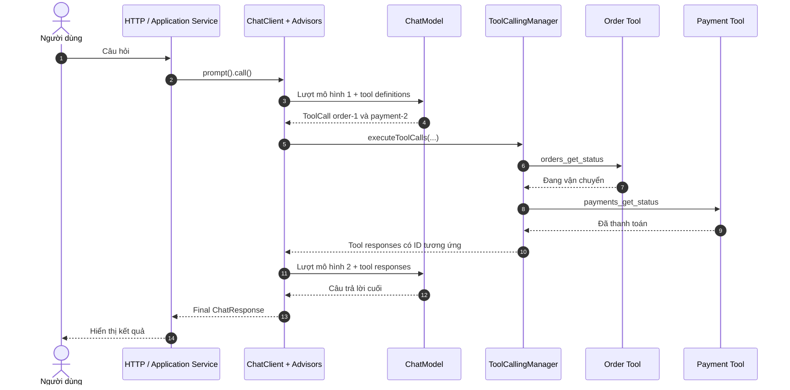

# Theo dõi một yêu cầu qua lượt gọi mô hình và các lần thực thi công cụ

Một yêu cầu tới assistant có thể tạo ra nhiều hoạt động trước khi người dùng thấy câu trả lời. Ứng dụng gửi câu hỏi cho mô hình, mô hình yêu cầu tra cứu đơn hàng và giao vận, `ToolCallingManager` thực thi hai `ToolCallback`, rồi mô hình nhận kết quả để tổng hợp câu trả lời. Nếu câu trả lời chậm hoặc sai, chỉ xem thời gian xử lý của HTTP endpoint sẽ không biết phần nào gây ra vấn đề.

Spring AI 2.x tích hợp với **Micrometer Observation** trong hệ sinh thái Spring để ghi nhận metrics, traces và kết nối log với trace. Trong **SPRING_AI_TOOL_CALLING**, mô hình chỉ tạo tool call; ứng dụng chịu trách nhiệm thực thi callback, kiểm tra quyền, xử lý lỗi và điều phối các lượt tiếp theo. Muốn quan sát đầy đủ, cần đo cả **yêu cầu tổng thể**, **mỗi lượt gọi mô hình**, **mỗi lần thực thi công cụ** và **các bước nghiệp vụ bên trong callback**.

Bài học dùng API của Spring AI **2.1.0** làm mốc. Ta sẽ theo dõi một yêu cầu từ khi vào `ChatClient` đến khi có kết quả cuối, phân biệt trace/span/metric/log, nối correlation ID xuyên các lớp, cấu hình Micrometer/OpenTelemetry, quan sát vòng lặp `ToolCallingAdvisor`, xử lý streaming, đo token và bảo vệ thông tin nhạy cảm trong telemetry.

Sau bài học, bạn có thể:

- Vẽ lại đường đi của một yêu cầu qua `ChatClient`, advisor, `ChatModel`, `ToolCallingManager` và callback.
- Phân biệt `traceId`, `spanId`, `requestId`, `conversationId` và `toolCallId`.
- Đọc các observation `spring.ai.chat.client`, `spring.ai.advisor`, `gen_ai.client.operation`, `spring.ai.tool`.
- Tạo span ở tầng workflow và truyền thông tin tương quan vào `ToolContext`.
- Quan sát từng iteration mà vẫn giữ vòng lặp tự động của `ToolCallingAdvisor`.
- Theo dõi latency, token usage, lỗi, retry, số tool call và kết quả nghiệp vụ.
- Xử lý correlation trong streaming, tác vụ bất đồng bộ và pause/resume.
- Kiểm thử telemetry mà không cần gọi model provider thật hoặc xuất dữ liệu nhạy cảm.

## 1. Một yêu cầu có thể chứa nhiều lượt mô hình

Người dùng hỏi: “Đơn hàng ORD-104 đang giao tới đâu và đã thanh toán chưa?”. Ứng dụng có hai công cụ `orders_get_status` và `payments_get_status`.



Về mặt logic, đây là **một request ứng dụng**, **hai model calls** và **hai tool executions**. Một lần gọi `ChatClient.call()` không đồng nghĩa chỉ có một request đến nhà cung cấp mô hình. Nếu callback lại gọi thêm service HTTP hoặc database, các lần truy cập đó cũng ảnh hưởng tới thời gian tổng.

`DefaultToolCallingManager` của Spring AI xử lý các tool call trong một batch theo thứ tự; việc mô hình trả hai call trong một response không tự làm callback chạy song song. Khi đọc timeline, cần xem các khoảng thời gian nối tiếp, lồng nhau và song song theo thực tế, không cộng mọi span duration một cách máy móc.

## 2. Trace, span, metric và log giải quyết bài toán gì?

| Thành phần | Trả lời câu hỏi | Ví dụ |
|---|---|---|
| **Trace** | Một yêu cầu đi qua những bước nào? | Request → model 1 → tool A → tool B → model 2 |
| **Span** | Một bước mất bao lâu và có liên quan tới bước nào? | `gen_ai.client.operation` hoặc `spring.ai.tool` |
| **Metric** | Hệ thống hoạt động ra sao trên nhiều request? | P95 latency, tổng token, số lỗi tool theo tên |
| **Log** | Sự kiện chi tiết nào đã xảy ra? | Tool A trả `NOT_FOUND`, proposal bị từ chối |
| **Business event** | Hành động nghiệp vụ nào được phép, thực hiện hoặc bị từ chối? | `REFUND_APPROVED`, `PERMISSION_DENIED` |

Trace phù hợp khi điều tra **một** yêu cầu cụ thể. Metrics phù hợp với xu hướng và cảnh báo **hàng nghìn** yêu cầu. Log chứa ngữ cảnh giải thích; business audit chứa sự kiện cần truy vết theo yêu cầu nghiệp vụ. Không xem trace hoặc DEBUG log là hệ thống audit lâu dài có tính toàn vẹn.

## 3. Phân biệt các định danh tương quan

Các ID có phạm vi khác nhau:

| ID | Phạm vi | Ai tạo? | Nên dùng ở đâu? |
|---|---|---|---|
| `traceId` | Một đường thực thi phân tán | Hệ thống tracing | Trace backend, log correlation |
| `spanId` | Một bước trong trace | Tracing instrumentation | Span và parent/child relationship |
| `requestId` | Một lần người dùng gửi yêu cầu | Ứng dụng hoặc API gateway | Log, request status, hỗ trợ người dùng |
| `conversationId` | Nhiều lượt trong cùng hội thoại | Ứng dụng/session memory | Tìm lịch sử, nối nhiều request theo thời gian |
| `workflowId` | Quy trình có thể pause/resume hoặc chạy nhiều bước | Ứng dụng nghiệp vụ | Checkpoint, audit, điều phối giữa các request |
| `toolCallId` | Một yêu cầu tool mà mô hình phát ra | Model/provider | Ghép `AssistantMessage.ToolCall` và tool response |

Một `conversationId` có thể chứa nhiều `requestId` và **nhiều trace**. Một tool call có thể thuộc một iteration cụ thể, nhưng `toolCallId` không phải `traceId`. Đừng dùng ID do mô hình tự tạo để thay thế danh tính caller hoặc bằng chứng quyền truy cập.

Với công cụ nhạy cảm, correlation ID nên là mã opaque do server sinh hoặc đã được gateway xác thực. Tránh ghi user ID, email, nội dung câu hỏi hoặc tenant ID thô làm tên metric hay nhãn có cardinality cao.

## 4. Cây span minh họa cho một yêu cầu

Khi hệ thống tracing và các thành phần được cấu hình đúng, giao diện trace có thể hiển thị một cấu trúc tương tự:

```text
HTTP POST /assistant/ask                     traceId=T
└── app.ai.request                          workflow=order_status
    └── spring.ai.chat.client               một lần gọi ChatClient
        └── spring.ai.advisor               ToolCallingAdvisor
            ├── gen_ai.client.operation     model lượt 1
            ├── spring.ai.tool              orders_get_status, id=order-1
            │   └── HTTP / DB               truy cập dịch vụ đơn hàng
            ├── spring.ai.tool              payments_get_status, id=payment-2
            │   └── HTTP / DB               truy cập dịch vụ thanh toán
            └── gen_ai.client.operation     model lượt 2
```

Đây là **sơ đồ khái niệm**, không phải cam kết về chính xác số lượng span hay thứ tự parent của mọi adapter. Các advisor tạo span lồng nhau, một tool có thể gọi service khác, và streaming/SDK có thể chuyển thread làm thay đổi cấu trúc trace. Hãy xác minh cấu trúc thực tế bằng backend tracing của ứng dụng.

Một request mất 3 giây không thể được giải thích bằng cách cộng tất cả span duration: span cha thường bao gồm thời gian của span con. Để xác định điểm chậm, hãy nhìn timeline/waterfall và thời gian xử lý riêng của từng hoạt động.

## 5. Các observation chuẩn Spring AI 2.1.0

Spring AI cung cấp những observation chính dưới đây:

| Observation | Thời điểm | Thông tin cần xem |
|---|---|---|
| `spring.ai.chat.client` | Mỗi lần gọi `ChatClient.call()` hoặc `stream()` | Thời gian tổng của client và advisor chain |
| `spring.ai.advisor` | Khi chạy từng advisor | Tên/order advisor, thời gian gồm các advisor bên trong |
| `gen_ai.client.operation` | Mỗi lần gọi `ChatModel.call()` hoặc `stream()` | Provider, model, usage, finish reason và latency |
| `spring.ai.tool` | Khi callback thực thi trong tool calling | Tên công cụ, tool call ID, duration và trace context |

Một số thuộc tính cụ thể từ convention mặc định:

| Span/metric | Key | Ý nghĩa |
|---|---|---|
| ChatClient | `spring.ai.chat.client.stream` | Có đang dùng streaming hay không |
| ChatClient | `spring.ai.chat.client.conversation.id` | ID hội thoại nếu dùng memory và có cung cấp |
| ChatClient | `spring.ai.chat.client.tool.names` | Tên công cụ được cung cấp cho client |
| Advisor | `spring.ai.advisor.name` | Tên advisor |
| ChatModel | `gen_ai.system` | Nhà cung cấp model |
| ChatModel | `gen_ai.request.model` | Model được yêu cầu |
| ChatModel | `gen_ai.response.finish_reasons` | Lý do model kết thúc mỗi generation |
| ChatModel | `gen_ai.usage.input_tokens`, `gen_ai.usage.output_tokens` | Token của model exchange |
| Tool | `spring.ai.tool.definition.name` | Tên callback |
| Tool | `spring.ai.tool.call.id` | ID tool call do model trả về |

Trong convention, các thuộc tính **low-cardinality** có thể xuất hiện ở metrics và traces; **high-cardinality** được dành cho traces. `spring.ai.tool.call.id`, `conversationId`, `requestId`, raw arguments hoặc tên tài nguyên cá biệt không nên trở thành tag của một time series có số tổ hợp không giới hạn.

## 6. Cấu hình Micrometer, Actuator và tracing

Spring AI dùng observability của Spring. Cần có Actuator, registry hoặc exporter, tracing bridge và một backend để thực sự nhìn thấy dữ liệu. Với Spring Boot **4.x**, Gradle có thể dùng các dependency tương ứng:

```groovy
dependencies {
    implementation 'org.springframework.boot:spring-boot-starter-actuator'
    implementation 'org.springframework.boot:spring-boot-starter-opentelemetry'
    runtimeOnly 'io.micrometer:micrometer-registry-prometheus'
}
```

Đây là ví dụ cho môi trường Spring Boot 4.x; nếu ứng dụng dùng phiên bản Boot khác, chọn bộ starter/bridge tương ứng với version đó. Cần cấu hình OTLP endpoint/backend như Tempo, Jaeger hoặc OpenTelemetry Collector. Việc có dependency không tự bảo đảm trace đã được xuất thành công.

Ví dụ `application.yml` ở môi trường demo:

```yaml
management:
  tracing:
    sampling:
      probability: 1.0  # 100% chỉ cho môi trường kiểm thử
  endpoints:
    web:
      exposure:
        include: health,info,metrics,prometheus

spring:
  ai:
    chat:
      client:
        observations:
          log-prompt: false
          log-completion: false
      observations:
        log-prompt: false
        log-completion: false
        include-error-logging: false
    tools:
      observations:
        include-content: false
```

Trong production, giảm sampling theo lưu lượng và nhu cầu điều tra. Chỉ mở Actuator endpoint cho mạng/identity phù hợp và cấu hình exporter theo chính sách hạ tầng. Spring Boot hỗ trợ `management.tracing.sampling.probability`; một trace có thể không xuất hiện trong backend khi sampling dưới 100%, nhưng metrics vẫn nên được dùng để đánh giá xu hướng tổng thể.

## 7. Các khóa telemetry không nên chứa nội dung nhạy cảm

Spring AI **không export prompt/completion và tool arguments/result theo mặc định** vì nội dung có thể chứa dữ liệu cá nhân hoặc bí mật. Những cấu hình dưới đây mặc định `false`:

| Property | Nếu bật sẽ làm gì? |
|---|---|
| `spring.ai.chat.client.observations.log-prompt` | Ghi prompt của ChatClient |
| `spring.ai.chat.client.observations.log-completion` | Ghi completion của ChatClient |
| `spring.ai.chat.observations.log-prompt` | Ghi prompt của ChatModel |
| `spring.ai.chat.observations.log-completion` | Ghi completion của ChatModel |
| `spring.ai.chat.observations.include-error-logging` | Bổ sung nội dung log lỗi của model |
| `spring.ai.tools.observations.include-content` | Đưa tool arguments và result vào observation |

Không bật các cờ này đại trà ở production để gỡ lỗi nhanh. Nếu cần chẩn đoán một trường hợp được phép, hãy dùng môi trường cách ly, dữ liệu giả hoặc redaction ở nguồn, sampling giới hạn và thời gian lưu ngắn. Không log nguyên `ToolContext`, header `Authorization`, cookie, nội dung RAG, thông tin thanh toán hoặc câu hỏi người dùng mặc định.

## 8. Tạo một span nghiệp vụ bao quanh `ChatClient`

Span ứng dụng giúp trả lời một yêu cầu thuộc workflow nào và toàn bộ thời gian xử lý (bao gồm logic ngoài Spring AI) ra sao. Dùng `ObservationRegistry` của Micrometer:

```java
import io.micrometer.observation.Observation;
import io.micrometer.observation.ObservationRegistry;
import org.springframework.ai.chat.client.ChatClient;
import org.springframework.stereotype.Service;

@Service
public class OrderAssistant {

    private final ChatClient chatClient;
    private final OrderReadTools orderReadTools;
    private final ObservationRegistry observationRegistry;

    public OrderAssistant(
            ChatClient.Builder builder,
            OrderReadTools orderReadTools,
            ObservationRegistry observationRegistry) {
        this.chatClient = builder.build();
        this.orderReadTools = orderReadTools;
        this.observationRegistry = observationRegistry;
    }

    public String answer(String question, CallerContext caller) {
        String requestKey = UUID.randomUUID().toString();

        return Observation.createNotStarted("app.ai.request", observationRegistry)
            .lowCardinalityKeyValue("workflow", "order_lookup")
            .observe(() -> chatClient.prompt()
                .user(question)
                .tools(orderReadTools)
                .toolContext(Map.of(
                    "requestKey", requestKey,
                    "caller", caller
                ))
                .call()
                .content());
    }
}
```

`app.ai.request` là tên observation tự định nghĩa; `workflow=order_lookup` là nhãn có số giá trị giới hạn. `requestKey` là ID riêng của ứng dụng, được đưa xuống callback bằng `ToolContext` để tương quan log/audit, **không** dùng làm metric label. Khi request đến qua HTTP đã được Spring Boot instrument, observation ứng dụng có thể nằm trong trace HTTP đang hoạt động.

Ví dụ trên dùng `.call()` blocking. Với `.stream()`, không đặt một `Flux` lazy vào `Observation.observe(() -> flux)` rồi coi span đã đo toàn bộ thời gian: phương thức có thể kết thúc trước lúc subscription chạy. Phải gắn lifecycle quan sát với **subscription, completion, error và cancel** của Flux.

## 9. Truyền correlation ID tới callback qua `ToolContext`

`ToolContext` là dữ liệu ứng dụng đưa tới callback nhưng không đưa cho mô hình như tool arguments. Nó phù hợp để truyền `requestKey`, principal đã xác thực và metadata phục vụ audit:

```java
@Component
public class OrderReadTools {

    private static final Logger log =
        LoggerFactory.getLogger(OrderReadTools.class);

    private final OrderService orderService;

    public OrderReadTools(OrderService orderService) {
        this.orderService = orderService;
    }

    @Tool(
        name = "orders_get_status",
        description = "Tra cứu trạng thái đơn hàng trong phạm vi người gọi có quyền xem"
    )
    public OrderStatusView getStatus(
            @ToolParam(description = "Mã đơn hàng") String orderId,
            ToolContext context) {

        String requestKey = (String) context.getContext().get("requestKey");
        CallerContext caller = (CallerContext) context.getContext().get("caller");

        // Service luôn xác thực lại quyền trên đơn hàng, không tin model arguments.
        OrderStatusView result = orderService.getVisibleStatus(orderId, caller);
        log.info("tool=orders_get_status requestKey={} outcome=SUCCESS", requestKey);
        return result;
    }
}
```

Không để mô hình tự truyền `traceId`, `tenantId`, `role` hoặc `requestKey` trong input schema để phục vụ phân quyền. Tracing ID có thể được phát từ Micrometer Tracing; `requestKey` của ứng dụng chỉ là ID bổ sung để tìm log và nối sang workflow store. Thao tác đọc trạng thái vẫn phải kiểm tra quyền, kể cả khi được model đề xuất hợp lệ.

## 10. Lấy trace ID phục vụ điều tra

Nếu Micrometer Tracing đã được cấu hình, có thể lấy trace hiện tại để ghi trong một sự kiện log có cấu trúc:

```java
import io.micrometer.tracing.Span;
import io.micrometer.tracing.Tracer;

public String currentTraceId(Tracer tracer) {
    Span span = tracer.currentSpan();
    return span == null ? "untraced" : span.context().traceId();
}
```

`currentSpan()` có thể là `null`, ví dụ khi không có trace hiện hành, propagation bị mất hoặc test không bật tracer. Không tự tạo giá trị `traceId` giả rồi gắn vào context như một trace hợp lệ. Spring Boot có thể đưa trace/span ID vào log correlation khi tracing được cấu hình; hãy kiểm tra format log thực tế trước khi viết middleware bổ sung.

Một ID dễ tìm trong log giúp liên kết các bước, nhưng **nó không tự tạo ra parent-child span**. Muốn có distributed trace thực, phải có observation/tracing context được propagate đúng giữa các thread và qua HTTP.

## 11. Theo dõi từng iteration trong vòng lặp tự động

`ToolCallingAdvisor` là recursive advisor. Nó tự gửi tool definitions tới model, nhận tool call, gọi `ToolCallingManager`, cập nhật conversation history rồi gọi model tiếp. Thứ tự mặc định là `Ordered.HIGHEST_PRECEDENCE + 300`.

Advisor nằm **trước** `ToolCallingAdvisor` chạy quanh toàn bộ vòng lặp; advisor nằm **sau** (có order lớn hơn) được gọi lại ở từng iteration. Đặt một advisor quan sát ở order `HIGHEST_PRECEDENCE + 400` để đo mỗi model round mà không cần tắt vòng lặp tự động.

`spring.ai.advisor` đã đo thời gian advisor. Chỉ thêm metric riêng khi cần biểu diễn outcome của từng vòng (`tool_calls`, `final`, `empty`, `error`) hoặc theo dõi chỉ tiêu nghiệp vụ đặc biệt.

## 12. Ví dụ `CallAdvisor` đo từng lượt

```java
import io.micrometer.core.instrument.MeterRegistry;
import io.micrometer.core.instrument.Timer;
import org.springframework.ai.chat.client.ChatClient;
import org.springframework.ai.chat.client.ChatClientRequest;
import org.springframework.ai.chat.client.ChatClientResponse;
import org.springframework.ai.chat.client.advisor.api.CallAdvisor;
import org.springframework.ai.chat.client.advisor.api.CallAdvisorChain;
import org.springframework.core.Ordered;

public final class RoundMetricsAdvisor implements CallAdvisor {

    private final MeterRegistry meters;

    public RoundMetricsAdvisor(MeterRegistry meters) {
        this.meters = meters;
    }

    @Override
    public String getName() {
        return "RoundMetricsAdvisor";
    }

    @Override
    public int getOrder() {
        return Ordered.HIGHEST_PRECEDENCE + 400;
    }

    @Override
    public ChatClientResponse adviseCall(
            ChatClientRequest request,
            CallAdvisorChain chain) {

        Timer.Sample sample = Timer.start(meters);
        String outcome = "error";

        try {
            ChatClientResponse response = chain.nextCall(request);
            outcome = response.chatResponse() == null
                ? "empty"
                : response.chatResponse().hasToolCalls() ? "tool_calls" : "final";
            return response;
        }
        finally {
            sample.stop(meters.timer("app.ai.round.duration", "outcome", outcome));
            meters.counter("app.ai.round.count", "outcome", outcome).increment();
        }
    }
}
```

Đăng ký:

```java
ChatClient client = ChatClient.builder(chatModel)
    .defaultAdvisors(new RoundMetricsAdvisor(meterRegistry))
    .build();
```

Với vị trí này, `RoundMetricsAdvisor` quan sát phần chain bên trong tại **mỗi model round**. Metric `app.ai.round.duration` bao gồm phần advisor/model downstream mà nó bao quanh, không phải một phép đo độc lập chính xác chỉ của HTTP model. Để xem thời gian model thuần theo instrumentation, dùng span `gen_ai.client.operation`.

Ví dụ chỉ triển khai `CallAdvisor` cho blocking mode. Nếu ứng dụng dùng `.stream()`, cần triển khai thêm `StreamAdvisor`; bộ đếm vòng phải ghi khi một iteration **hoàn tất**, thay vì tăng một lần cho mỗi streaming chunk.

## 13. Theo dõi tool call riêng với lượt mô hình

`spring.ai.tool` span đo việc thực thi công cụ. Trong trace, các key hữu ích gồm `spring.ai.tool.definition.name` và `spring.ai.tool.call.id`; có thể xem duration và exception nếu callback báo lỗi.

Không dùng `spring.ai.tool.call.id` làm low-cardinality metric label vì mỗi lượt thường tạo ID mới. Dùng tên công cụ và nhóm outcome như `success`, `business_rejected`, `timeout`, `permission_denied` ở một metric ứng dụng có giá trị giới hạn.

Ví dụ một callback trả `NOT_FOUND` là **một lần thực thi thành công về mặt kỹ thuật** nhưng kết quả nghiệp vụ là không tìm thấy. Nếu chỉ dựa vào exception hoặc HTTP status, dashboard có thể xem nó là `success`. Hãy đo cả hai khía cạnh:

| Kết quả | Technical status | Business outcome |
|---|---|---|
| Đơn hàng được tìm thấy | `success` | `found` |
| Đơn hàng không tồn tại | `success` | `not_found` |
| Người gọi không có quyền | `denied` hoặc exception | `permission_denied` |
| Service ngoài timeout | `error` | `temporarily_unavailable` |
| Người dùng không phê duyệt tool | Tool chưa chạy | `approval_denied` |

Khi `ToolExecutionExceptionProcessor` chuyển lỗi callback thành một chuỗi trả cho mô hình, request vẫn có thể kết thúc bằng câu trả lời bình thường. Do đó, chỉ đo HTTP response 200 hoặc exception của `ChatClient` sẽ bỏ sót một số lỗi tool. Cần phát sự kiện outcome ở service/adapter hoặc ở nơi xử lý kết quả, không suy luận hoàn toàn từ câu trả lời cuối.

## 14. Đo token qua nhiều model calls

Mỗi lần gọi model có thể tiêu thụ input/output tokens. Spring AI 2.1.0 dùng metric:

```text
gen_ai.client.token.usage
```

Metric này đo token theo **từng lần gọi `ChatModel`**. Trong trace, các key có thể gồm `gen_ai.usage.input_tokens`, `gen_ai.usage.output_tokens`, `gen_ai.usage.total_tokens`; thông tin cache input tokens có thể xuất hiện nếu provider cung cấp.

Với vòng lặp có hai model calls, tổng chi phí hội thoại không thể suy từ lượt cuối. `ToolCallingAdvisor` trong Spring AI 2.1.0 **cộng dồn token usage** của các lượt để `ChatResponse` cuối phản ánh tổng của vòng lặp, thay vì chỉ lượt cuối. Các recursive advisor tùy chỉnh cũng cần tích lũy usage; Spring AI cung cấp `UsageAccumulator` cho mục đích này.

Nếu tự điều phối bằng `ChatModel` và `ToolCallingManager`, ứng dụng phải tự tổng hợp usage qua các lần gọi. Khi provider không trả usage hoặc streaming kết thúc bất thường, đánh dấu dữ liệu thiếu hoặc ước lượng riêng có nguồn rõ ràng; không tự coi số token thiếu là 0.

**Chi phí tiền** còn phụ thuộc model, bảng giá theo thời gian, cached input, output và chính sách nhà cung cấp. Hãy lưu model identifier và thời điểm áp giá ở tầng billing/reporting. Không gửi raw prompt chỉ để tính chi phí nếu usage do provider đã có.

## 15. Đọc span theo timeline, tránh cộng trùng thời gian

Ví dụ timeline minh họa cho một request 3.8 giây:

| Mốc | Hoạt động | Khoảng thời gian |
|---|---|---:|
| 0–1.1 s | Model round 1 | 1.1 s |
| 1.1–1.5 s | `orders_get_status` | 0.4 s |
| 1.5–2.3 s | `payments_get_status` | 0.8 s |
| 2.3–3.6 s | Model round 2 | 1.3 s |
| 3.6–3.8 s | Chuẩn bị và trả HTTP response | 0.2 s |

Các con số trên là giả định để luyện đọc waterfall. `spring.ai.chat.client` có thể bao trùm nhiều bước trên, còn `spring.ai.advisor` lồng trong nó. Không cộng duration của chúng vào tổng một lần nữa.

Nếu thấy p95 latency tăng, hãy kiểm tra:

1. Số model rounds trong một request có tăng không?
2. Thời gian model round tăng, hay callback/backend chậm?
3. Có nhiều retry, timeout hoặc call limit hits không?
4. Tool response quá lớn khiến model input tokens của lượt tiếp theo tăng không?
5. Có thread pool/HTTP connection pool bị nghẽn không?

Trace chỉ cho biết tương quan và thời gian; để chứng minh nguyên nhân, đối chiếu metrics, log và chỉ số downstream.

## 16. Streaming: đếm completion, không đếm chunk như request

Với `ChatClient.stream()`, một request có thể phát hàng trăm chunk. Chúng là các phần của cùng một model exchange, không phải hàng trăm model calls.

Các mốc có ích cho streaming:

- `request_received`: ứng dụng bắt đầu xử lý.
- `model_round_started`: bắt đầu một round.
- `first_token`: nhận chunk text đầu tiên (time to first token, TTFT).
- `tool_call_complete`: mô hình đã phát tool call hoàn chỉnh.
- `tool_execution_started` và `tool_execution_finished`.
- `stream_completed`, `stream_error` hoặc `stream_cancelled`.

Một số provider phát tool-call arguments thành nhiều `ToolCallPart` partial. Chỉ ghi sự kiện `tool_call_complete` khi model adapter đã tổng hợp call đầy đủ; không parse fragment như JSON hoàn chỉnh hoặc tính mỗi fragment là một lần gọi tool.

Thời gian của một reactive stream phải gắn với subscription. Sử dụng toán tử như `doOnSubscribe`, `doOnNext`, `doOnError` và `doFinally` cho các sự kiện tương ứng, nhưng giữ state trong phạm vi một subscription để hai client không dùng chung bộ đếm. Nếu cần làm việc với response tổng hợp, Spring AI có `ChatClientMessageAggregator` để gom các chunk trước khi kiểm tra tool calls hoặc final usage.

Nếu người dùng đóng kết nối SSE, cancellation có thể làm stream dừng. Nó không chứng minh callback đang blocking đã bị hủy hoặc side effect đã rollback. Ghi trạng thái `cancelled` riêng và để service kiểm tra cancellation token nếu nghiệp vụ yêu cầu.

## 17. Truyền trace qua HTTP và tác vụ bất đồng bộ

Khi callback gọi downstream service bằng `RestClient` hoặc `WebClient`, nên dùng builder đã được Spring Boot auto-configure để trace context được propagate qua header phù hợp, thường là `traceparent` theo W3C Trace Context.

```java
@Bean
RestClient orderServiceClient(RestClient.Builder builder) {
    return builder.baseUrl("https://orders.internal.example").build();
}
```

Nếu tự xây `RestClient`/`WebClient` bỏ qua builder auto-configure, context tracing có thể không được tự động truyền. Với Kafka, executor, `CompletableFuture` hoặc Reactor, kiểm tra cơ chế context propagation của môi trường đang dùng, ví dụ Micrometer Context Propagation, Reactor context và executor/task decorator phù hợp.

Không copy toàn bộ MDC hoặc `ToolContext` sang thread khác mà không kiểm tra: có thể vô tình đưa danh tính hoặc token từ request này sang request khác. Một callback đi qua nhiều hệ thống nên truyền correlation và caller security context bằng cơ chế được hỗ trợ, còn hệ thống nhận vẫn phải xác thực quyền độc lập.

Lưu ý trong Spring AI 2.1.0: tài liệu observability ghi nhận một giới hạn cụ thể với OpenAI streaming — HTTP-layer span được tạo nhưng có thể không nằm dưới chat-model span do SDK chuyển sang `ForkJoinPool.commonPool()`. Nếu trace waterfall thiếu quan hệ parent ở đường này, cần kiểm tra giới hạn instrumentation/SDK trước khi kết luận request không đi qua HTTP.

## 18. Pause, confirmation và resume tạo nhiều trace

Một công cụ có `requiresConfirmation = true` có thể khiến `ToolCallingAdvisor` dừng để ứng dụng hỏi người dùng. Người dùng có thể phê duyệt sau nhiều phút, nhiều giờ hoặc vào một request khác.

Không giữ một span hay HTTP connection mở trong suốt thời gian chờ người dùng. Nên tạo các trace riêng:

```text
Trace A: request tạo đề xuất
  app.ai.request → model → tool confirmation required → PAUSED

   (thời gian chờ approval: đo bằng business timestamp)

Trace B: request người dùng phê duyệt
  approval endpoint → reauthorize → execute tool → resume model → COMPLETED
```

Lưu `workflowId`, `proposalId`, request IDs và trace IDs trong workflow store/audit với phân quyền phù hợp. Khi resume, có thể tạo span link tới trace trước nếu tracing stack hỗ trợ, nhưng không mặc định Spring AI tự liên kết hai trace qua khoảng chờ. Ghi thêm metric `approval_wait_duration` được tính từ thời điểm pause và approve, thay vì coi đó là model latency.

Ứng dụng xác thực approver và khôi phục paused response từ server. Correlation tốt giúp điều tra; nó không thay thế anti-replay, idempotency hoặc quyền thực thi.

## 19. Logs có cấu trúc cho một tool call

Một log tốt có thể giúp liên kết trace và kết quả nghiệp vụ mà không cần chứa arguments nguyên văn:

```json
{
  "event": "tool.execution.finished",
  "requestKey": "req-7e6d",
  "toolName": "orders_get_status",
  "outcome": "not_found",
  "durationMs": 143,
  "retryCount": 0,
  "errorCode": null
}
```

`requestKey` trong ví dụ đã được rút gọn chỉ để minh họa; thực tế dùng ID opaque do server sinh. Nếu log backend đã tự thêm `traceId` và `spanId`, không cần ghi hai ID đó thủ công trong mọi message. `toolCallId` có thể ghi ở trace hoặc audit có kiểm soát, nhưng không dùng làm metric tag.

Đề xuất sự kiện nghiệp vụ chuẩn hóa:

| Event | Khi phát | Trường an toàn nên giữ |
|---|---|---|
| `ai.request.started` | Nhận yêu cầu | requestKey, workflow type, timestamp |
| `ai.model.round.finished` | Một round hoàn tất | model, iteration index, finish reason, usage nếu có |
| `tool.execution.finished` | Callback hoàn tất | tool name, outcome code, duration |
| `tool.execution.rejected` | Authorization từ chối | tool name, reason code, policy version |
| `ai.request.paused` | Chờ xác nhận | workflowId tham chiếu ở kho kiểm toán, reason |
| `ai.request.finished` | Trả kết quả hoặc lỗi | duration, outcome, round count, total usage |

Đảm bảo log và metric không tiết lộ câu hỏi, thông tin hồ sơ, secret hoặc kết quả công cụ. Sự kiện audit có thể yêu cầu lưu nhiều trường hơn log vận hành, nhưng phải có phân quyền và retention riêng.

## 20. Dashboard nên bắt đầu từ những chỉ số nào?

Một dashboard cho tool calling có thể dùng các nhóm sau:

| Mục tiêu | Chỉ số đề xuất | Phân nhóm hợp lý |
|---|---|---|
| Trải nghiệm người dùng | P50/P95/P99 latency của request | Workflow type, environment |
| Hiệu quả vòng lặp | Số model rounds/request | Workflow type, outcome |
| Chi phí | Input/output/cache tokens | Provider, model |
| Hiệu quả chọn tool | Tool calls/request và tỉ lệ không cần tool | Workflow type, tool name |
| Chất lượng thực thi | Tool success/error/rejected rate | Tool name, outcome code |
| Độ ổn định | Timeout/retry/limit-exceeded | Tool category, error class |
| Người duyệt | Pause rate, approval wait duration, deny rate | Action category |
| Streaming | TTFT, completion/cancel/error rate | Model, workflow type |

Đừng tạo một metric riêng theo từng conversation, user, order, prompt hoặc tool-call ID. Hãy đưa ID duy nhất vào tracing/log có kiểm soát và dùng nhóm giá trị hữu hạn ở metric tags.

Khi đo các tỉ lệ, xác định rõ mẫu số. Ví dụ, `tool_error_rate` theo **số lần thực thi tool** khác với `request_failure_rate` theo **số request của người dùng**. Một request có ba callback và một callback lỗi có thể vẫn trả lời thành công một phần; hai chỉ số này không giống nhau.

## 21. Cảnh báo và cách điều tra sự cố

Một số tình huống gợi ý:

| Triệu chứng | Kiểm tra đầu tiên |
|---|---|
| Request p95 tăng | Waterfall trace: model, tool, downstream hay advisor nào chậm |
| Chi phí token tăng | Số round và input tokens mỗi round; tool result/history có dài hơn không |
| Tool error rate tăng | Tên tool, mã lỗi service, timeout và quyền truy cập |
| HTTP 200 nhưng assistant trả “không thể tra cứu” | Có tool error được exception processor chuyển thành result không |
| Stream ngắt sớm | Client disconnect, provider error, timeout, cancellation |
| Không thấy tool span | Tool có thật sự chạy không, instrumentation, sampling hoặc context propagation |
| Không thấy model HTTP span dưới chat span | SDK/streaming thread hop, propagation và backend trace links |
| Cùng hành động được thực thi hai lần | Tool call IDs, retry, idempotency và workflow ledger |

Nếu cần điều tra một request cụ thể, tìm `requestKey` hoặc trace ID trong log trước, mở trace rồi kiểm tra từng `gen_ai.client.operation` và `spring.ai.tool`. Đối chiếu tool result với audit của service; không chỉ dựa vào final answer của mô hình.

## 22. Kiểm thử telemetry với model và callback giả

Kiểm thử observability nên khẳng định các **sự kiện có ý nghĩa**, không chỉ kiểm tra code có gọi `log.info`.

| Kịch bản | Kết quả cần xác nhận |
|---|---|
| Model trả final answer ngay | Một model round, không có tool execution |
| Model trả hai tool calls rồi final answer | Hai model rounds và hai tool executions |
| Tool trả `NOT_FOUND` | Technical success nhưng business outcome là `not_found` |
| Callback ném RuntimeException và lỗi được đưa về model | Tool failure được ghi nhận dù outer request có thể 200 |
| Callback timeout | Có span/metric lỗi và mã timeout nhất quán |
| Provider không trả token usage | Tổng usage không bị ghi sai thành 0 chắc chắn |
| `.stream()` có 200 chunk | Không ghi 200 model rounds |
| Người dùng hủy stream | Có trạng thái `cancelled`, không báo hoàn thành giả |
| Confirmation pause/resume | Hai request/trace có workflow correlation đúng |
| Không có quyền truy cập đơn hàng | Không log nội dung nhạy cảm, có business outcome `denied` |
| Tracing bị sampling | Metrics vẫn có và test không giả định trace luôn được export |

Ví dụ unit test cho custom advisor với `SimpleMeterRegistry` và fake `CallAdvisorChain`:

```java
@Test
void recordsOneRoundForFinalResponse() {
    SimpleMeterRegistry meters = new SimpleMeterRegistry();
    RoundMetricsAdvisor advisor = new RoundMetricsAdvisor(meters);

    // Fixture của test: nextCall trả ChatClientResponse có final answer, không có tool call.
    CallAdvisorChain chain = fakeChainReturning(finalChatClientResponse());
    advisor.adviseCall(testRequest(), chain);

    assertThat(meters.get("app.ai.round.count")
        .tag("outcome", "final").counter().count()).isEqualTo(1.0);
}
```

`fakeChainReturning`, `finalChatClientResponse`, `testRequest` là test fixtures do ứng dụng xây dựng. Với integration test, dùng một fake `ChatModel` lần đầu trả tool call, lần sau trả final response; callback giả ghi nhận số lần thực thi. Kiểm tra đúng quan hệ giữa rounds, tool calls, token usage và các observation, đồng thời xác nhận không có raw arguments trong span khi `include-content=false`.

Có thể dùng `TestObservationRegistry` của Micrometer để thu observation in-memory, `SimpleMeterRegistry` để kiểm tra metrics, và một test tracer/exporter trong môi trường cách ly để kiểm tra parent/child relation. Không phải gọi model provider thật mới kiểm thử được chuỗi sự kiện.

## 23. Những lỗi quan sát thường gặp

| Lỗi | Vì sao gây sai lệch? | Cách xử lý |
|---|---|---|
| Đếm `.call()` bằng số model requests | Một tool loop có thể gọi model nhiều lần | Dùng `gen_ai.client.operation` và per-round counter |
| Cộng thời gian span cha và con | Thời gian bị đếm trùng | Đọc timeline, exclusive duration hoặc critical path |
| Ghi prompt và arguments nguyên văn | Lộ dữ liệu cá nhân/secret | Giữ các cờ content logging tắt, redact có chọn lọc |
| Dùng request ID làm metric tag | Cardinality tăng không giới hạn | Dùng workflow type/tool name/outcome; ID ở trace/log |
| Không thấy trace trong production | Sampling, exporter hoặc propagation | Xác minh config và metrics, không kết luận thiếu request |
| Đếm mỗi streaming chunk là một lượt | Thổi phồng số model calls | Đếm aggregated iteration hoặc terminal signal |
| Chỉ xem exception ở outer HTTP | Tool error có thể thành tool response | Ghi outcome ở callback/service |
| Chỉ ghi final token usage của manual loop | Bỏ sót các round trước | Cộng usage từng `ChatModel` call |
| Để cùng một span mở khi chờ approval | Traces kéo dài và giữ tài nguyên | Tách pause/resume, liên kết bằng workflow ID |
| Mất trace khi chuyển thread | Context không được propagate | Dùng builder/instrumentation và reactive/task context đúng cách |

## 24. Checklist triển khai

- Có Actuator, observation registry và backend metrics/tracing phù hợp.
- Xác minh các observation `spring.ai.chat.client`, `spring.ai.advisor`, `gen_ai.client.operation`, `spring.ai.tool` xuất hiện như mong đợi.
- Đặt workflow-level observation bao quanh yêu cầu thực sự, không bao quanh việc tạo Flux lazy.
- Ghi requestKey opaque, dùng traceId/spanId của tracing, không tự sinh traceId giả.
- Phân biệt request, conversation, workflow và tool-call IDs.
- Giữ `ToolContext` riêng cho correlation và principal được server xác thực.
- Giới hạn low-cardinality metric tags; để ID cá biệt ở trace/log có kiểm soát.
- Tắt prompt/completion/arguments/results logging theo mặc định.
- Đo cả technical result và business outcome của callback.
- Khi cần per-round events, đặt advisor quan sát sau `ToolCallingAdvisor` trong advisor chain.
- Không cộng span duration lồng nhau; không đếm streaming chunks thành model requests.
- Đo token theo model call và tính tổng qua các vòng; xử lý provider thiếu usage.
- Truyền trace context qua HTTP/async bằng instrumentation tương thích.
- Với pause/resume, liên kết nhiều request qua workflow store thay vì giữ span chờ.
- Kiểm thử một vòng, nhiều vòng, partial success, timeout, stream cancel và confirmation.

## 25. Ghi nhớ

- Một `ChatClient.call()` có thể bao gồm nhiều `ChatModel` calls và nhiều `ToolCallback` executions.
- `spring.ai.chat.client` nhìn ở mức client; `gen_ai.client.operation` nhìn mỗi model call; `spring.ai.tool` nhìn từng tool execution.
- `ToolCallingAdvisor` là recursive advisor; advisor nằm bên trong vòng lặp có thể quan sát từng round.
- Spring AI 2.1.0 tích lũy token usage qua các round của vòng tool gọi tự động.
- `traceId`, `requestId`, `conversationId` và `toolCallId` không đồng nghĩa; hãy dùng chúng theo đúng phạm vi.
- Tool error có thể được xử lý thành tool response mà outer HTTP request vẫn thành công; cần business outcome metrics.
- Streaming, async và pause/resume đòi hỏi quản lý observation lifecycle và context propagation rõ ràng.
- Nội dung prompt và tool arguments/results mặc định không được export; giữ chính sách này trừ trường hợp kiểm thử có kiểm soát.

Khi điều tra một yêu cầu tool calling, hãy bắt đầu từ trace của request, xem lần lượt các model rounds, callback executions và downstream calls rồi đối chiếu metrics cùng log nghiệp vụ. Một mô hình quan sát hiệu quả cho biết **điều gì được gọi, khi nào, kéo dài bao lâu, kết quả gì và tốn bao nhiêu tài nguyên**, trong khi vẫn giữ nội dung nhạy cảm ngoài hệ thống telemetry mặc định.

## Tài liệu tham khảo

- [Spring AI 2.1.0 — Observability](https://docs.spring.io/spring-ai/reference/observability/index.html)
- [Spring AI 2.1.0 — ToolCallingAdvisor](https://docs.spring.io/spring-ai/reference/api/tools/tool-calling-advisor.html)
- [Spring AI 2.1.0 — Recursive Advisors](https://docs.spring.io/spring-ai/reference/api/advisors-recursive.html)
- [Spring AI 2.1.0 — Tool Calling](https://docs.spring.io/spring-ai/reference/api/tools.html)
- [Spring AI 2.1.0 — Advisors API](https://docs.spring.io/spring-ai/reference/api/advisors.html)
- [Spring Boot — Tracing](https://docs.spring.io/spring-boot/reference/actuator/tracing.html)
- [Spring Boot — Observability](https://docs.spring.io/spring-boot/reference/actuator/observability.html)
